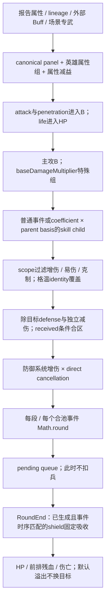

# 英雄技能效果机制审计：当前源码快照

[CODE_CONFIRMED] 审计日期：2026-10-13（Asia/Shanghai）。仓库：`无尽冬日战斗模型`。本次只读取源码、加载现有定义、执行临时只读探针和既有测试，输出本文件；没有修改源码、技能定义、公式、取整、优化器、测试文件或其他既有文档。

[CODE_CONFIRMED] 统计口径：英雄目录62个，其中57个有正式战斗技能定义、5个没有可执行PVP技能；注册定义204个 = 158远征 + 46专武；目录远征条目186个，其中combatRelevant=158。技能定义覆盖S1—S16，S12—S16共57个定义均标记TENTATIVE。556个“已配置等级×效果”行完整保留；没有插值缺失技能等级。

[CODE_CONFIRMED] 数量：英雄定义实际使用13种effect kind，加玲奈运行时生成的directDamageCancellation为14种；另列3种仅接口英雄类型及3种兵种交互类型。英雄来源bucket30个，加闪避运行时bucket为31个；再加3个兵种交互bucket，本报告实际使用的乘区/作用组总表为34个。bucket、effect kind、action mechanic是三种不同概念，不能混数。

| 标签 | 含义/本报告限制 |
| --- | --- |
| CODE_CONFIRMED | 当前源码或实际运行探针明确如此；不等于真实游戏已验证。 |
| BATTLE_CONFIRMED | 仅用于会话中明确给出的实际战报实验结论；注明数据来源，未重复运行游戏。 |
| TENTATIVE | 继承、推测或尚缺实际战报验证；即使代码可执行/测试通过仍保留该标签。 |
| CONFLICT | 与本次确认规则或正式引擎对照存在冲突；注明冲突对象，不能混同两者。 |

[CODE_CONFIRMED] `metadata.ruleStatus="supported"`、变量名`CONFIRMED_*`和测试名称中的“confirmed”只是源码自身声明；本报告不会据此把147个supported定义全部升级为BATTLE_CONFIRMED。正式引擎与Theory/Criterion也分开讨论。

## 一、效果类型总表（先按机制，不按英雄）

| 证据 | effect kind | 实际作用/阶段 | bucket | 聚合 | 对象 | source scope | target scope | damageType | 持续 | 叠加 | 覆盖/备注 | 读取位置 |
| --- | --- | --- | --- | --- | --- | --- | --- | --- | --- | --- | --- | --- |
| CODE_CONFIRMED | attributeModifier | 属性解析与 life 初始化 | buffAttack<br>buffDefense<br>buffLife<br>buffPenetration<br>heroAttackBonus<br>heroDefenseBonus<br>heroLifeBonus<br>heroMarksmanAttackStack<br>heroPenetrationBonus | 1+Σ；外部 Buff 另先合计 | selfArmy | army, lancer, marksman, shield | all | all | 按各 effect.lifecycle；缺省无到期或由特殊 handler 指定 | replace<br>stack<br>未配置 | 无统一跨组覆盖 | [src/pvp/effects/attributeModifiers.ts:50 / resolveTroopAttribute](src/pvp/effects/attributeModifiers.ts#L50) |
| CODE_CONFIRMED | attributeReduction | 属性 factor 除区 | enemyAttackReduction<br>enemyDefenseReduction<br>enemyPenetrationReduction<br>selfAttackReduction | /(1+Σ)，不同组相乘 | enemyArmy<br>selfArmy | army, lancer, marksman, shield | all, currentTarget, lancer, shield | all | 按各 effect.lifecycle；缺省无到期或由特殊 handler 指定 | replace<br>未配置 | 无统一跨组覆盖 | [src/pvp/effects/attributeModifiers.ts:140 / resolveTroopAttribute](src/pvp/effects/attributeModifiers.ts#L140) |
| CODE_CONFIRMED | damageIncrease | 攻击方事件增伤 | commonDamageIncrease<br>criticalNormalAttack<br>normalAttackDamageIncrease<br>skillDamageIncrease<br>troopVsTroopDamage | ×(1+Σ)，独立组相乘 | selfArmy | army, lancer, marksman, shield | all, lancer, shield | all, normalAttack, skillDamage | 按各 effect.lifecycle；缺省无到期或由特殊 handler 指定 | replace<br>未配置 | 无统一跨组覆盖 | [src/pvp/damage/createDamageEvent.ts:72 / createDamageEvent](src/pvp/damage/createDamageEvent.ts#L72) |
| CODE_CONFIRMED | damageReduction | 防守方事件减伤 | receivedDamageReduction<br>receivedNormalAttackReduction<br>receivedSkillDamageReduction<br>viperPhalanxOtherReduction<br>viperPhalanxShieldReduction | /(1+Σ)，received 条件项合区 | selfArmy | army | all, lancer, marksman, shield | all, normalAttack, skillDamage | 按各 effect.lifecycle；缺省无到期或由特殊 handler 指定 | replace<br>未配置 | 无统一跨组覆盖 | [src/pvp/damage/createDamageEvent.ts:88 / createDamageEvent](src/pvp/damage/createDamageEvent.ts#L88) |
| CODE_CONFIRMED | decayingDamageIncrease | beforeDamageEvent 临时增伤 | commonDamageIncrease | 按 count 指数衰减，进入普通增伤组 | selfArmy | army | all | all | 按各 effect.lifecycle；缺省无到期或由特殊 handler 指定 | 未配置 | 无统一跨组覆盖 | [src/pvp/heroSkills/resolveHeroSkills.ts:1679 / compileDecayingEventEffects](src/pvp/heroSkills/resolveHeroSkills.ts#L1679) |
| CODE_CONFIRMED | extraDamage | 主攻后事件编译 | 未配置 | 独立事件；parentBase 可同目标合池 | selfArmy | army, lancer, marksman, shield | all, currentTarget, lancer, marksman | skillDamage | 按各 effect.lifecycle；缺省无到期或由特殊 handler 指定 | 未配置 | 无统一跨组覆盖 | [src/pvp/heroSkills/resolveHeroSkills.ts:2064 / compileExtraDamageInputs](src/pvp/heroSkills/resolveHeroSkills.ts#L2064) |
| CODE_CONFIRMED | incomingDamageIncrease | 目标侧易伤 | vulnerability | ×(1+Σ)；格温 token 为有条件替换 | enemyArmy | army | currentTarget, shield | all | 按各 effect.lifecycle；缺省无到期或由特殊 handler 指定 | replace<br>未配置 | 格温 token / proc family / target mark，见专节 | [src/pvp/damage/createDamageEvent.ts:51 / createDamageEvent](src/pvp/damage/createDamageEvent.ts#L51) |
| CODE_CONFIRMED | markedTargetDamageIncrease | 放 mark 时编译 incomingDamageIncrease | dreamMarkDamage | 按 mark 的目标、scope 聚合 | enemyArmy | army, lancer | currentTarget | all | 按各 effect.lifecycle；缺省无到期或由特殊 handler 指定 | 未配置 | 无统一跨组覆盖 | [src/pvp/heroSkills/resolveHeroSkills.ts:1444 / compileAfterNormalActiveEffects](src/pvp/heroSkills/resolveHeroSkills.ts#L1444) |
| CODE_CONFIRMED | oneUseIncomingDamageIncrease | 目标一次 marker → 消费转换 | aerialSuppressionOverride | 一次消费；同 originRoot 不消费 | enemyArmy | army | currentTarget | all | 按各 effect.lifecycle；缺省无到期或由特殊 handler 指定 | replace | 格温 token / proc family / target mark，见专节 | [src/pvp/heroSkills/resolveHeroSkills.ts:2024 / consumeOneUseIncomingEffects](src/pvp/heroSkills/resolveHeroSkills.ts#L2024) |
| CODE_CONFIRMED | outgoingDamageReduction | 攻击方造成伤害降低 | enemyOutgoingDamageReduction<br>gordonMarksmanOutgoingReduction<br>gordonPeriodicOutgoingReduction<br>poisonOutgoingDamageReduction | 独立 /(1+Σ) | enemyArmy | army, marksman | all, currentTarget | all | 按各 effect.lifecycle；缺省无到期或由特殊 handler 指定 | replace<br>未配置 | 无统一跨组覆盖 | [src/pvp/effects/effectMatching.ts:50 / getApplicableEffects](src/pvp/effects/effectMatching.ts#L50) |
| CODE_CONFIRMED | skipNextRoundAction | beforeMainAttack skip | 未配置 | 按配置 refresh/replace，不产生伤害 | enemyArmy | lancer | currentTarget | all | 按各 effect.lifecycle；缺省无到期或由特殊 handler 指定 | replace | 无统一跨组覆盖 | [src/pvp/heroSkills/resolveHeroSkills.ts:207 / beforeMainAttack](src/pvp/heroSkills/resolveHeroSkills.ts#L207) |
| CODE_CONFIRMED | targetBoundMark | 目标 mark → 到期 extra | 未配置 | 按 hero runtime / skill / target identity replace | enemyArmy | lancer | currentTarget | all | 按各 effect.lifecycle；缺省无到期或由特殊 handler 指定 | 未配置 | 格温 token / proc family / target mark，见专节 | [src/pvp/heroSkills/resolveHeroSkills.ts:1632 / compileTargetBoundMarkDamageInputs](src/pvp/heroSkills/resolveHeroSkills.ts#L1632) |
| CODE_CONFIRMED | temporaryShield | 盾层生成 → RoundEnd 吸收 | 未配置 | 生成后 replace；不同 layer 依次固定抵消 | selfArmy | shield | all | all | 按各 effect.lifecycle；缺省无到期或由特殊 handler 指定 | replace | 无统一跨组覆盖 | [src/pvp/heroSkills/resolveHeroSkills.ts:1510 / compileTemporaryShieldLayers](src/pvp/heroSkills/resolveHeroSkills.ts#L1510) |
| CODE_CONFIRMED | directDamageCancellation（英雄运行时生成） | 玲奈闪避 | dodgeNormalAttack | ×(1-Σ)，成功值1使主攻0 | 防守方生成、事件临时 | 本次攻击者兵种 | 本次目标 | normalAttack | 只用于此判定事件 | 不存普通持续 Buff | 并非 received 除区 | [src/pvp/heroSkills/resolveHeroSkills.ts:1727 / createDodgeCancellationEffect](src/pvp/heroSkills/resolveHeroSkills.ts#L1727) |
| CODE_CONFIRMED | defenseModifier（仅接口） | 旧类型已退役 | 任意声明 group | 若进入 createDamageEvent 则抛错 | 接口支持 | 接口支持 | 接口支持 | 接口支持 | 无注册实例 | 无注册实例 | 不能作为当前英雄技能统计 | [src/pvp/damage/createDamageEvent.ts:105](src/pvp/damage/createDamageEvent.ts#L105) |
| CODE_CONFIRMED | defenseReduction（仅接口） | 防御系统增伤 | 任意声明 group | ×(1+Σ)，不是 received 减伤 | 接口支持 | 接口支持 | 接口支持 | 接口支持 | 无注册实例 | 无注册实例 | 当前英雄无此 kind | [src/pvp/damage/createDamageEvent.ts:85](src/pvp/damage/createDamageEvent.ts#L85) |
| CODE_CONFIRMED | targetingOverride（仅英雄接口；兵种有实例） | targetSelection | 不属于伤害 bucket | priority 改索敌 | selfArmy | 配置限定 | 优先序 | — | 按配置 | 按 identity/lifecycle | 已死目标由 selectTarget 排除 | [src/pvp/targeting/selectTarget.ts:1](src/pvp/targeting/selectTarget.ts#L1) |
| CODE_CONFIRMED | sameMainAttackSegment（兵种交互） | 连射内部第二段 | normalAttack 所有适用组 | 每段取整后合并到父事件 | 攻击方 | 射 | 继承本次目标 | normalAttack | 本次根攻击 | 不作为独立主攻 | 沿用主事件烈晶盾牌/炽红力场判定 | [src/pvp/troopSkills/resolveTroopSkills.ts:1053 / compileSameMainAttackSegments](src/pvp/troopSkills/resolveTroopSkills.ts#L1053) |
| CODE_CONFIRMED | baseDamageMultiplier（兵种交互） | 构造B前的特殊乘数 | flameImpactBaseAttack | 同组1+Σ、独立组相乘 | 攻击方 | 射 | scope限定 | scope限定 | 按配置 | 按 identity | 不是英雄 attack 属性 | [src/pvp/round/actionPhase.ts:268](src/pvp/round/actionPhase.ts#L268) |
| CODE_CONFIRMED | baseDefenseMultiplier（兵种交互） | 事件额外除区 | lightforgedBaseDefense | /(1+Σ)，与 received 独立 | 防守方 | scope限定 | 盾 | 按配置 | 按配置 | 按 identity | 不是防御属性/HP | [src/pvp/damage/createDamageEvent.ts:98](src/pvp/damage/createDamageEvent.ts#L98) |

[CODE_CONFIRMED] 额外action mechanic共5个源码枚举：`skipMainAttack`、`dodgeNormalAttack`、`attackCountTrigger`、`naturalRoundTrigger`、`targetBoundMark`。`stun`在当前代码实际是`skipNextRoundAction`，`critical/crit`是`damageIncrease/criticalNormalAttack`，`additionalAttack`并非英雄effect kind；Criterion中该channel名称用于近似兵种连射内部段。`normalAttackDamageIncrease`等名称是bucket，不是独立kind。

## 二、运行链、leader/member与数据身份

| 证据 | 环节 | 实际行为 | 源码 |
| --- | --- | --- | --- |
| CODE_CONFIRMED | 目录/技能定义 | EXPEDITION_HERO_DATA保存文字和静态数据；CONFIRMED_HERO_SKILL_DEFINITIONS保存真正可执行的levelValues/effects。 | [src/pvp/heroSkills/data/expeditionHeroes.ts:18](src/pvp/heroSkills/data/expeditionHeroes.ts#L18)；[src/pvp/heroSkills/definitions/simpleHeroes.ts:138](src/pvp/heroSkills/definitions/simpleHeroes.ts#L138) |
| CODE_CONFIRMED | runtime创建 | 缺省远征Lv5；只有已配置levelValues可选；leader1/2/3，member只1；leader专武按Lv2/4/6/8/10解锁tier1/2/3/4/5。 | [src/pvp/heroSkills/loadout.ts:75 / createHeroStateFromDefinitions](src/pvp/heroSkills/loadout.ts#L75) |
| CODE_CONFIRMED | BodySkillConfig | 只保留heroId/definitionId/runtimeId/skillId/slot1/skillLevel；最多4槽、可重复，不能携带二三技能或专武/静态属性。 | [src/pvp/validationUi/bodySkillConfig.ts:8](src/pvp/validationUi/bodySkillConfig.ts#L8)；[src/pvp/validationUi/adapter.ts:625](src/pvp/validationUi/adapter.ts#L625) |
| CODE_CONFIRMED | 身份 | 定义ID不等于runtime ID；body缺省A-body-0…/B-body-0…；技能键side+runtime+skill；effect identity=(sourceId,sourceSkillId,effectId)。 | [src/pvp/heroSkills/identity.ts:21](src/pvp/heroSkills/identity.ts#L21)；[src/pvp/heroSkills/resolveHeroSkills.ts:2469](src/pvp/heroSkills/resolveHeroSkills.ts#L2469) |
| CODE_CONFIRMED | round准备 | 先troopSkillSystem.prepareRound，再heroSkillSystem.prepareRound，再创建immutable round snapshot。 | [src/pvp/round/resolveRound.ts:159 / resolveRoundInternal](src/pvp/round/resolveRound.ts#L159) |
| CODE_CONFIRMED | 行动与事件 | 先skip→target→attempt→dodge→主攻→计数→extra drafts→按目标合池→DamageEvent；行动中不提前扣兵。 | [src/pvp/round/actionPhase.ts:141 / runActionPhase](src/pvp/round/actionPhase.ts#L141) |
| CODE_CONFIRMED | 状态提交 | queuedArmyEffects、hitTargetDebuffs、token消费、shield层及runtimeUpdates在finalizeActionState提交。 | [src/pvp/heroSkills/resolveHeroSkills.ts:1191](src/pvp/heroSkills/resolveHeroSkills.ts#L1191) |
| CODE_CONFIRMED | round结算 | 按事件顺序取整伤害→护盾→HP/伤亡；随后duration递减/expire；存活战斗进入下一round。 | [src/pvp/round/resolveRound.ts:63](src/pvp/round/resolveRound.ts#L63)；[src/pvp/casualty/resolvePendingDamage.ts:69](src/pvp/casualty/resolvePendingDamage.ts#L69) |

[CODE_CONFIRMED] 目录没有战斗技能的五位：尤金、史密斯、查理、克劳瑞斯、吉娜。它们有目录条目，但不能把生产/发展/容量类条目当作战斗effect。集结输入的member配置来自首个combatRelevant远征slot1；在普通single等场景，adapter不装载bodySkills。当前ServerStage决定可选范围，存在高代定义不代表当前服务器可选。

## 三、属性类效果与战报静态来源

[CODE_CONFIRMED] 属性输入先统一为decimal bonus，百分比点只用于报告转换。预测模式canonical panel：

```text
R_panel = (100 + R_raw + formationDelta + officeAdditive)
          × (1 + externalBuffBase + sceneWeaponBuff) / (1 + externalDebuff) - 100
f_X = (1 + R_panel_X/100) × Πhero_group(1 + Σvalue×stack)
      / ΠattributeReduction_group(1 + Σvalue×stack)
X ∈ {attack, defense, penetration, life}
```
[CODE_CONFIRMED] `addToAttribute`这个旧operation标签在普通英雄属性上仍按技能乘区执行，不能把它解读为加到战报百分比点。专武技能ID前缀或`buff*`属性group转为`addToExternalBuff`；同属性外部来源先加，最终只构造一次面板。不同hero group仍相乘。

| 证据 | 来源/组 | 同组与不同组 | 是否已含于战报面板 | 实际读取 |
| --- | --- | --- | --- | --- |
| CODE_CONFIRMED | heroAttackBonus/heroDefenseBonus/heroPenetrationBonus/heroLifeBonus | 同组1+Σ，组间乘算 | 当前模型区分这些远征技能与静态panel，仍额外读取 | [src/pvp/effects/attributeModifiers.ts:99](src/pvp/effects/attributeModifiers.ts#L99) |
| CODE_CONFIRMED | heroMarksmanAttackStack | 同group累计5%×stack；不是每层独立×1.05 | 动态技能组，不是装备面板静态值 | [src/pvp/effects/attributeModifiers.ts:109](src/pvp/effects/attributeModifiers.ts#L109) |
| CODE_CONFIRMED | buffAttack/buffDefense/buffPenetration/buffLife | 同属性external全部先加，canonical panel中一次乘算 | finalReport通常已包含；prediction由context重新构建 | [src/pvp/effects/attributeModifiers.ts:120](src/pvp/effects/attributeModifiers.ts#L120) |
| CODE_CONFIRMED | enemyAttackReduction/enemyDefenseReduction/enemyPenetrationReduction/selfAttackReduction | 各属性组除(1+Σ)，独立组再乘；不进入received | 动态技能减益额外计算 | [src/pvp/effects/attributeModifiers.ts:140](src/pvp/effects/attributeModifiers.ts#L140) |
| CODE_CONFIRMED | enemyLifeReduction / skillLifeReduction | 接口/常量有life减益能力，当前英雄定义没有使用该bucket | 不能猜出游戏机制或补数据 | [src/pvp/constants/attributeSkillGroups.ts:16](src/pvp/constants/attributeSkillGroups.ts#L16) |
| CODE_CONFIRMED | 英雄裸静态attack/defense与专武裸penetration/life | prediction：simulation static−report static形成formationDelta；只加差值 | finalReport：不再添加这部分静态值 | [src/pvp/heroSkills/heroStatCorrection.ts:34](src/pvp/heroSkills/heroStatCorrection.ts#L34) |
| CODE_CONFIRMED | baseAttackMultiplier/baseDefenseMultiplier名称 | 没有名为baseAttackMultiplier的英雄bucket；实际为baseDamageMultiplier(kind)/flameImpactBaseAttack(group)；baseDefenseMultiplier是kind、实际group为lightforgedBaseDefense | 属于兵种交互，不是英雄面板属性 | [src/pvp/round/actionPhase.ts:268](src/pvp/round/actionPhase.ts#L268)；[src/pvp/damage/createDamageEvent.ts:98](src/pvp/damage/createDamageEvent.ts#L98) |

[CODE_CONFIRMED] 默认finalReport路径在`toBattleSideSetup`把英雄weaponLevel置0、reportHeroes/correction关闭，且不再加入external report modifier；远征技能仍装载。prediction路径按已知report lineage只改静态差值，member不贡献静态panel。不能把“技能属性额外乘算”误认成“静态英雄重复加”。直接绕过scenario构造低层BattleSetup时，调用者仍需保证panel含义正确，低层resolver无法从数值猜出来源。

[CODE_CONFIRMED] life技能重建HP只允许round1：`maxHpPerUnit = baseHpPerUnit × f_life`；之后若prepare阶段再触发生命attributeModifier会抛错。防御属性在DamageEvent中作为分母，不放入HP；当前没有注册的战斗中动态life技能要求重基已损伤栈。专武裸静态值按源码现有level/10比例计算，这属于当前代码已有规则，不是本次补等级。

## 四、伤害乘区与received免伤合区

| 证据 | 机制 | 实际公式 | 作用范围 |
| --- | --- | --- | --- |
| CODE_CONFIRMED | damageIncrease / incomingDamageIncrease | 每个独立group先Σ再×(1+Σ)；两类同名group在同一次增伤聚合里合并 | 按effect scope；common通常覆盖全部，normal/skill组各自限定 |
| CODE_CONFIRMED / BATTLE_CONFIRMED（普通部分） | received大区 | normal: D/(1+Σgeneral+Σnormal)；skill/extra: D/(1+Σgeneral+Σskill) | extraDamage属于skillDamage；技能合区的游戏验证仍TENTATIVE |
| CODE_CONFIRMED | 其他damageReduction/outgoingReduction | 各自 /(1+Σ)，不并入received | enemyOutgoing、poison、gordon、viper等保持独立 |
| CODE_CONFIRMED | 直接取消 | ×(1-Σ)，要求结果在[0,1] | 玲奈dodgeNormalAttack值1使普通根攻击0 |
| CODE_CONFIRMED | 防御系统defenseReduction | 独立×(1+Σ) | 当前无英雄注册实例；不是普通易伤重命名 |
| CODE_CONFIRMED | 格温canonical token | 移除Eagle身份贡献后，剩余vulnerability + token15%同区Σ | Fred20+Gwen25：1.45→1.35→1.45 |

[CODE_CONFIRMED] 所有actual bucket名称、拥有者及源码见文末B表。`normalAttackDamageReduction`/`skillDamageReduction`并非当前英雄group名；实际是`receivedNormalAttackReduction`/`receivedSkillDamageReduction`。不要把enemy outgoing虚弱、属性减益、直接取消、基础防御独立除区并入received大区。

## 五、全部extraDamage与目标channel审计

[CODE_CONFIRMED] 共有30个定义含extraDamage，所有已配置等级合计55个extra effect行；另有芮妮targetBoundMark机制生成延期extra，下面另列。每笔已生成child固定为`damageType=skillDamage`、`damageSubtype=extraDamage`。它不增加主攻计数，不递归调用afterNormalAttack，不重新抽玲奈普通主攻闪避；是否生成须由技能触发路径决定。

| 证据 | 技能 | Lv | effect ID | coefficient | basis | source | target | probability | B行为 | dodge | stun/skip | 计数/乘区 | 定义 |
| --- | --- | --- | --- | --- | --- | --- | --- | --- | --- | --- | --- | --- | --- |
| CODE_CONFIRMED | hero-skill.baxiti.unstable-field | 5 | hero-effect.baxiti.unstable-field | 0.5 | parentBaseDamage | army | currentTarget | 0.5 | 换目标时重解skill上下文攻击/穿透，保留父baseDamageMultiplier；主目标沿用父B | 玲奈闪避成功时不会抽巴希提这一 proc，也不会生成其 extra | stun/skip 时没有主攻，整个判定路径均跳过 | 不计主攻；不递归；normal专用增伤/免伤不吃；common+skill+易伤+适用克制读取 | [src/pvp/heroSkills/definitions/simpleHeroes.ts:86](src/pvp/heroSkills/definitions/simpleHeroes.ts#L86) |
| CODE_CONFIRMED | hero-skill.moli.ice-field | 5 | hero-effect.moli.ice-field | 0.5 | parentBaseDamage | army | currentTarget | 0.5 | 换目标时重解skill上下文攻击/穿透，保留父baseDamageMultiplier；主目标沿用父B | 通用 beforeAttack extra 的 RNG 可已成功，但 hitCancelled 后仍不发出；不应等同显式 preDodge extra | stun/skip 时本次行动的判定、状态和 extra 均不运行 | 不计主攻；不递归；normal专用增伤/免伤不吃；common+skill+易伤+适用克制读取 | [src/pvp/heroSkills/definitions/s1Heroes.ts:36](src/pvp/heroSkills/definitions/s1Heroes.ts#L36) |
| CODE_CONFIRMED | hero-skill.feilande.strengthening-potion | 1 | hero-effect.feilande.strengthening-potion.extra | 0.2 | parentRawDamage | army | currentTarget | 0.25 | 保留父基底，不因all/固定目标重新计算B；各目标事件防御/乘区独立 | 通用 beforeAttack extra 的 RNG 可已成功，但 hitCancelled 后仍不发出；不应等同显式 preDodge extra | stun/skip 时本次行动的判定、状态和 extra 均不运行 | 不计主攻；不递归；normal专用增伤/免伤不吃；common+skill+易伤+适用克制读取 | [src/pvp/heroSkills/definitions/s2Heroes.ts:34](src/pvp/heroSkills/definitions/s2Heroes.ts#L34) |
| CODE_CONFIRMED | hero-skill.feilande.strengthening-potion | 2 | hero-effect.feilande.strengthening-potion.extra | 0.4 | parentRawDamage | army | currentTarget | 0.25 | 保留父基底，不因all/固定目标重新计算B；各目标事件防御/乘区独立 | 通用 beforeAttack extra 的 RNG 可已成功，但 hitCancelled 后仍不发出；不应等同显式 preDodge extra | stun/skip 时本次行动的判定、状态和 extra 均不运行 | 不计主攻；不递归；normal专用增伤/免伤不吃；common+skill+易伤+适用克制读取 | [src/pvp/heroSkills/definitions/s2Heroes.ts:34](src/pvp/heroSkills/definitions/s2Heroes.ts#L34) |
| CODE_CONFIRMED | hero-skill.feilande.strengthening-potion | 3 | hero-effect.feilande.strengthening-potion.extra | 0.6 | parentRawDamage | army | currentTarget | 0.25 | 保留父基底，不因all/固定目标重新计算B；各目标事件防御/乘区独立 | 通用 beforeAttack extra 的 RNG 可已成功，但 hitCancelled 后仍不发出；不应等同显式 preDodge extra | stun/skip 时本次行动的判定、状态和 extra 均不运行 | 不计主攻；不递归；normal专用增伤/免伤不吃；common+skill+易伤+适用克制读取 | [src/pvp/heroSkills/definitions/s2Heroes.ts:34](src/pvp/heroSkills/definitions/s2Heroes.ts#L34) |
| CODE_CONFIRMED | hero-skill.feilande.strengthening-potion | 4 | hero-effect.feilande.strengthening-potion.extra | 0.8 | parentRawDamage | army | currentTarget | 0.25 | 保留父基底，不因all/固定目标重新计算B；各目标事件防御/乘区独立 | 通用 beforeAttack extra 的 RNG 可已成功，但 hitCancelled 后仍不发出；不应等同显式 preDodge extra | stun/skip 时本次行动的判定、状态和 extra 均不运行 | 不计主攻；不递归；normal专用增伤/免伤不吃；common+skill+易伤+适用克制读取 | [src/pvp/heroSkills/definitions/s2Heroes.ts:34](src/pvp/heroSkills/definitions/s2Heroes.ts#L34) |
| CODE_CONFIRMED | hero-skill.feilande.strengthening-potion | 5 | hero-effect.feilande.strengthening-potion.extra | 1 | parentRawDamage | army | currentTarget | 0.25 | 保留父基底，不因all/固定目标重新计算B；各目标事件防御/乘区独立 | 通用 beforeAttack extra 的 RNG 可已成功，但 hitCancelled 后仍不发出；不应等同显式 preDodge extra | stun/skip 时本次行动的判定、状态和 extra 均不运行 | 不计主攻；不递归；normal专用增伤/免伤不吃；common+skill+易伤+适用克制读取 | [src/pvp/heroSkills/definitions/s2Heroes.ts:34](src/pvp/heroSkills/definitions/s2Heroes.ts#L34) |
| CODE_CONFIRMED | hero-skill.alongsuo.sharp-harpoon | 1 | hero-effect.alongsuo.sharp-harpoon | 0.1 | parentBaseDamage | army | currentTarget | 0.5 | 换目标时重解skill上下文攻击/穿透，保留父baseDamageMultiplier；主目标沿用父B | 通用 beforeAttack extra 的 RNG 可已成功，但 hitCancelled 后仍不发出；不应等同显式 preDodge extra | stun/skip 时本次行动的判定、状态和 extra 均不运行 | 不计主攻；不递归；normal专用增伤/免伤不吃；common+skill+易伤+适用克制读取 | [src/pvp/heroSkills/definitions/s2Heroes.ts:58](src/pvp/heroSkills/definitions/s2Heroes.ts#L58) |
| CODE_CONFIRMED | hero-skill.alongsuo.sharp-harpoon | 2 | hero-effect.alongsuo.sharp-harpoon | 0.2 | parentBaseDamage | army | currentTarget | 0.5 | 换目标时重解skill上下文攻击/穿透，保留父baseDamageMultiplier；主目标沿用父B | 通用 beforeAttack extra 的 RNG 可已成功，但 hitCancelled 后仍不发出；不应等同显式 preDodge extra | stun/skip 时本次行动的判定、状态和 extra 均不运行 | 不计主攻；不递归；normal专用增伤/免伤不吃；common+skill+易伤+适用克制读取 | [src/pvp/heroSkills/definitions/s2Heroes.ts:58](src/pvp/heroSkills/definitions/s2Heroes.ts#L58) |
| CODE_CONFIRMED | hero-skill.alongsuo.sharp-harpoon | 3 | hero-effect.alongsuo.sharp-harpoon | 0.3 | parentBaseDamage | army | currentTarget | 0.5 | 换目标时重解skill上下文攻击/穿透，保留父baseDamageMultiplier；主目标沿用父B | 通用 beforeAttack extra 的 RNG 可已成功，但 hitCancelled 后仍不发出；不应等同显式 preDodge extra | stun/skip 时本次行动的判定、状态和 extra 均不运行 | 不计主攻；不递归；normal专用增伤/免伤不吃；common+skill+易伤+适用克制读取 | [src/pvp/heroSkills/definitions/s2Heroes.ts:58](src/pvp/heroSkills/definitions/s2Heroes.ts#L58) |
| CODE_CONFIRMED | hero-skill.alongsuo.sharp-harpoon | 4 | hero-effect.alongsuo.sharp-harpoon | 0.4 | parentBaseDamage | army | currentTarget | 0.5 | 换目标时重解skill上下文攻击/穿透，保留父baseDamageMultiplier；主目标沿用父B | 通用 beforeAttack extra 的 RNG 可已成功，但 hitCancelled 后仍不发出；不应等同显式 preDodge extra | stun/skip 时本次行动的判定、状态和 extra 均不运行 | 不计主攻；不递归；normal专用增伤/免伤不吃；common+skill+易伤+适用克制读取 | [src/pvp/heroSkills/definitions/s2Heroes.ts:58](src/pvp/heroSkills/definitions/s2Heroes.ts#L58) |
| CODE_CONFIRMED | hero-skill.alongsuo.sharp-harpoon | 5 | hero-effect.alongsuo.sharp-harpoon | 0.5 | parentBaseDamage | army | currentTarget | 0.5 | 换目标时重解skill上下文攻击/穿透，保留父baseDamageMultiplier；主目标沿用父B | 通用 beforeAttack extra 的 RNG 可已成功，但 hitCancelled 后仍不发出；不应等同显式 preDodge extra | stun/skip 时本次行动的判定、状态和 extra 均不运行 | 不计主攻；不递归；normal专用增伤/免伤不吃；common+skill+易伤+适用克制读取 | [src/pvp/heroSkills/definitions/s2Heroes.ts:58](src/pvp/heroSkills/definitions/s2Heroes.ts#L58) |
| CODE_CONFIRMED | hero-skill.ahemosi.light-forged-blade | 5 | hero-effect.ahemosi.light-forged-blade.extra | 0.6 | parentRawDamage | shield | currentTarget | deterministic | 保留父基底，不因all/固定目标重新计算B；各目标事件防御/乘区独立 | 普通后置路径在 hitCancelled 时不执行；计数是否已增加须另看 counter 更新分支 | stun/skip 无 parent，不执行；naturalRoundTrigger 使用绝对回合且仍要求本兵种主攻 | 不计主攻；不递归；normal专用增伤/免伤不吃；common+skill+易伤+适用克制读取 | [src/pvp/heroSkills/definitions/s4Heroes.ts:60](src/pvp/heroSkills/definitions/s4Heroes.ts#L60) |
| CODE_CONFIRMED | hero-skill.lingnai.shadow-blade | 4 | hero-effect.lingnai.shadow-blade.extra | 1.8 | parentRawDamage | lancer | currentTarget | 0.25 | 保留父基底，不因all/固定目标重新计算B；各目标事件防御/乘区独立 | 即使主攻闪避仍保留 extra；fixed target 死亡则不发出该 channel | stun/skip 导致行动提前返回，此次没有判定和 extra | 不计主攻；不递归；normal专用增伤/免伤不吃；common+skill+易伤+适用克制读取 | [src/pvp/heroSkills/definitions/s4Heroes.ts:105](src/pvp/heroSkills/definitions/s4Heroes.ts#L105) |
| CODE_CONFIRMED | hero-skill.lingnai.shadow-blade | 5 | hero-effect.lingnai.shadow-blade.extra | 2 | parentRawDamage | lancer | currentTarget | 0.25 | 保留父基底，不因all/固定目标重新计算B；各目标事件防御/乘区独立 | 即使主攻闪避仍保留 extra；fixed target 死亡则不发出该 channel | stun/skip 导致行动提前返回，此次没有判定和 extra | 不计主攻；不递归；normal专用增伤/免伤不吃；common+skill+易伤+适用克制读取 | [src/pvp/heroSkills/definitions/s4Heroes.ts:105](src/pvp/heroSkills/definitions/s4Heroes.ts#L105) |
| CODE_CONFIRMED | hero-skill.heketuo.gale-strike | 5 | hero-effect.heketuo.gale-strike.extra | 1 | parentBaseDamage | army | currentTarget | 0.25 | 换目标时重解skill上下文攻击/穿透，保留父baseDamageMultiplier；主目标沿用父B | 普通后置路径在 hitCancelled 时不执行；计数是否已增加须另看 counter 更新分支 | stun/skip 无 parent，不执行；naturalRoundTrigger 使用绝对回合且仍要求本兵种主攻 | 不计主攻；不递归；normal专用增伤/免伤不吃；common+skill+易伤+适用克制读取 | [src/pvp/heroSkills/definitions/s5Heroes.ts:51](src/pvp/heroSkills/definitions/s5Heroes.ts#L51) |
| CODE_CONFIRMED | hero-skill.nuola.catch-off-guard | 5 | hero-effect.nuola.catch-off-guard.all-enemies | 1 | parentRawDamage | lancer | all | 0.2 | 保留父基底，不因all/固定目标重新计算B；各目标事件防御/乘区独立 | 普通后置路径在 hitCancelled 时不执行；计数是否已增加须另看 counter 更新分支 | stun/skip 无 parent，不执行；naturalRoundTrigger 使用绝对回合且仍要求本兵种主攻 | 不计主攻；不递归；normal专用增伤/免伤不吃；common+skill+易伤+适用克制读取 | [src/pvp/heroSkills/definitions/s5Heroes.ts:88](src/pvp/heroSkills/definitions/s5Heroes.ts#L88) |
| CODE_CONFIRMED | hero-skill.gewen.aerial-suppression | 5 | hero-effect.gewen.aerial-suppression.extra | 1 | parentBaseDamage | army | currentTarget | deterministic | 换目标时重解skill上下文攻击/穿透，保留父baseDamageMultiplier；主目标沿用父B | 普通后置路径在 hitCancelled 时不执行；计数是否已增加须另看 counter 更新分支 | stun/skip 无 parent，不执行；naturalRoundTrigger 使用绝对回合且仍要求本兵种主攻 | 不计主攻；不递归；normal专用增伤/免伤不吃；common+skill+易伤+适用克制读取 | [src/pvp/heroSkills/definitions/s5Heroes.ts:140](src/pvp/heroSkills/definitions/s5Heroes.ts#L140) |
| CODE_CONFIRMED | hero-skill.gewen.demolition-squad | 5 | hero-effect.gewen.demolition-squad.all-enemies | 0.5 | parentRawDamage | marksman | all | deterministic | 保留父基底，不因all/固定目标重新计算B；各目标事件防御/乘区独立 | 即使主攻闪避仍保留 extra；fixed target 死亡则不发出该 channel | stun/skip 导致行动提前返回，此次没有判定和 extra | 不计主攻；不递归；normal专用增伤/免伤不吃；common+skill+易伤+适用克制读取 | [src/pvp/heroSkills/definitions/s5Heroes.ts:162](src/pvp/heroSkills/definitions/s5Heroes.ts#L162) |
| CODE_CONFIRMED | hero-skill.weien.thunder-raid | 1 | hero-effect.weien.thunder-raid.extra | 0.2 | parentRawDamage | army | currentTarget | deterministic | 保留父基底，不因all/固定目标重新计算B；各目标事件防御/乘区独立 | 特殊分支在 hitCancelled 返回前执行，因此已排到行动的兵种即使主攻闪避仍产生 extra | period 按绝对回合；被 stun/skip 的兵种没有行动/parent，故不生成其 extra | 不计主攻；不递归；normal专用增伤/免伤不吃；common+skill+易伤+适用克制读取 | [src/pvp/heroSkills/definitions/s6Heroes.ts:101](src/pvp/heroSkills/definitions/s6Heroes.ts#L101) |
| CODE_CONFIRMED | hero-skill.weien.thunder-raid | 2 | hero-effect.weien.thunder-raid.extra | 0.4 | parentRawDamage | army | currentTarget | deterministic | 保留父基底，不因all/固定目标重新计算B；各目标事件防御/乘区独立 | 特殊分支在 hitCancelled 返回前执行，因此已排到行动的兵种即使主攻闪避仍产生 extra | period 按绝对回合；被 stun/skip 的兵种没有行动/parent，故不生成其 extra | 不计主攻；不递归；normal专用增伤/免伤不吃；common+skill+易伤+适用克制读取 | [src/pvp/heroSkills/definitions/s6Heroes.ts:101](src/pvp/heroSkills/definitions/s6Heroes.ts#L101) |
| CODE_CONFIRMED | hero-skill.weien.thunder-raid | 3 | hero-effect.weien.thunder-raid.extra | 0.6 | parentRawDamage | army | currentTarget | deterministic | 保留父基底，不因all/固定目标重新计算B；各目标事件防御/乘区独立 | 特殊分支在 hitCancelled 返回前执行，因此已排到行动的兵种即使主攻闪避仍产生 extra | period 按绝对回合；被 stun/skip 的兵种没有行动/parent，故不生成其 extra | 不计主攻；不递归；normal专用增伤/免伤不吃；common+skill+易伤+适用克制读取 | [src/pvp/heroSkills/definitions/s6Heroes.ts:101](src/pvp/heroSkills/definitions/s6Heroes.ts#L101) |
| CODE_CONFIRMED | hero-skill.weien.thunder-raid | 4 | hero-effect.weien.thunder-raid.extra | 0.8 | parentRawDamage | army | currentTarget | deterministic | 保留父基底，不因all/固定目标重新计算B；各目标事件防御/乘区独立 | 特殊分支在 hitCancelled 返回前执行，因此已排到行动的兵种即使主攻闪避仍产生 extra | period 按绝对回合；被 stun/skip 的兵种没有行动/parent，故不生成其 extra | 不计主攻；不递归；normal专用增伤/免伤不吃；common+skill+易伤+适用克制读取 | [src/pvp/heroSkills/definitions/s6Heroes.ts:101](src/pvp/heroSkills/definitions/s6Heroes.ts#L101) |
| CODE_CONFIRMED | hero-skill.weien.thunder-raid | 5 | hero-effect.weien.thunder-raid.extra | 1 | parentRawDamage | army | currentTarget | deterministic | 保留父基底，不因all/固定目标重新计算B；各目标事件防御/乘区独立 | 特殊分支在 hitCancelled 返回前执行，因此已排到行动的兵种即使主攻闪避仍产生 extra | period 按绝对回合；被 stun/skip 的兵种没有行动/parent，故不生成其 extra | 不计主攻；不递归；normal专用增伤/免伤不吃；common+skill+易伤+适用克制读取 | [src/pvp/heroSkills/definitions/s6Heroes.ts:101](src/pvp/heroSkills/definitions/s6Heroes.ts#L101) |
| CODE_CONFIRMED | hero-skill.weien.flanking-strike | 1 | hero-effect.weien.flanking-strike.lancer | 0.08 | parentBaseDamage | marksman | lancer | deterministic | 换目标时重解skill上下文攻击/穿透，保留父baseDamageMultiplier；主目标沿用父B | 即使主攻闪避仍保留 extra；fixed target 死亡则不发出该 channel | stun/skip 导致行动提前返回，此次没有判定和 extra | 不计主攻；不递归；normal专用增伤/免伤不吃；common+skill+易伤+适用克制读取 | [src/pvp/heroSkills/definitions/s6Heroes.ts:122](src/pvp/heroSkills/definitions/s6Heroes.ts#L122) |
| CODE_CONFIRMED | hero-skill.weien.flanking-strike | 1 | hero-effect.weien.flanking-strike.marksman | 0.04 | parentBaseDamage | marksman | marksman | deterministic | 换目标时重解skill上下文攻击/穿透，保留父baseDamageMultiplier；主目标沿用父B | 即使主攻闪避仍保留 extra；fixed target 死亡则不发出该 channel | stun/skip 导致行动提前返回，此次没有判定和 extra | 不计主攻；不递归；normal专用增伤/免伤不吃；common+skill+易伤+适用克制读取 | [src/pvp/heroSkills/definitions/s6Heroes.ts:122](src/pvp/heroSkills/definitions/s6Heroes.ts#L122) |
| CODE_CONFIRMED | hero-skill.weien.flanking-strike | 2 | hero-effect.weien.flanking-strike.lancer | 0.16 | parentBaseDamage | marksman | lancer | deterministic | 换目标时重解skill上下文攻击/穿透，保留父baseDamageMultiplier；主目标沿用父B | 即使主攻闪避仍保留 extra；fixed target 死亡则不发出该 channel | stun/skip 导致行动提前返回，此次没有判定和 extra | 不计主攻；不递归；normal专用增伤/免伤不吃；common+skill+易伤+适用克制读取 | [src/pvp/heroSkills/definitions/s6Heroes.ts:122](src/pvp/heroSkills/definitions/s6Heroes.ts#L122) |
| CODE_CONFIRMED | hero-skill.weien.flanking-strike | 2 | hero-effect.weien.flanking-strike.marksman | 0.08 | parentBaseDamage | marksman | marksman | deterministic | 换目标时重解skill上下文攻击/穿透，保留父baseDamageMultiplier；主目标沿用父B | 即使主攻闪避仍保留 extra；fixed target 死亡则不发出该 channel | stun/skip 导致行动提前返回，此次没有判定和 extra | 不计主攻；不递归；normal专用增伤/免伤不吃；common+skill+易伤+适用克制读取 | [src/pvp/heroSkills/definitions/s6Heroes.ts:122](src/pvp/heroSkills/definitions/s6Heroes.ts#L122) |
| CODE_CONFIRMED | hero-skill.weien.flanking-strike | 3 | hero-effect.weien.flanking-strike.lancer | 0.24 | parentBaseDamage | marksman | lancer | deterministic | 换目标时重解skill上下文攻击/穿透，保留父baseDamageMultiplier；主目标沿用父B | 即使主攻闪避仍保留 extra；fixed target 死亡则不发出该 channel | stun/skip 导致行动提前返回，此次没有判定和 extra | 不计主攻；不递归；normal专用增伤/免伤不吃；common+skill+易伤+适用克制读取 | [src/pvp/heroSkills/definitions/s6Heroes.ts:122](src/pvp/heroSkills/definitions/s6Heroes.ts#L122) |
| CODE_CONFIRMED | hero-skill.weien.flanking-strike | 3 | hero-effect.weien.flanking-strike.marksman | 0.12 | parentBaseDamage | marksman | marksman | deterministic | 换目标时重解skill上下文攻击/穿透，保留父baseDamageMultiplier；主目标沿用父B | 即使主攻闪避仍保留 extra；fixed target 死亡则不发出该 channel | stun/skip 导致行动提前返回，此次没有判定和 extra | 不计主攻；不递归；normal专用增伤/免伤不吃；common+skill+易伤+适用克制读取 | [src/pvp/heroSkills/definitions/s6Heroes.ts:122](src/pvp/heroSkills/definitions/s6Heroes.ts#L122) |
| CODE_CONFIRMED | hero-skill.weien.flanking-strike | 4 | hero-effect.weien.flanking-strike.lancer | 0.32 | parentBaseDamage | marksman | lancer | deterministic | 换目标时重解skill上下文攻击/穿透，保留父baseDamageMultiplier；主目标沿用父B | 即使主攻闪避仍保留 extra；fixed target 死亡则不发出该 channel | stun/skip 导致行动提前返回，此次没有判定和 extra | 不计主攻；不递归；normal专用增伤/免伤不吃；common+skill+易伤+适用克制读取 | [src/pvp/heroSkills/definitions/s6Heroes.ts:122](src/pvp/heroSkills/definitions/s6Heroes.ts#L122) |
| CODE_CONFIRMED | hero-skill.weien.flanking-strike | 4 | hero-effect.weien.flanking-strike.marksman | 0.16 | parentBaseDamage | marksman | marksman | deterministic | 换目标时重解skill上下文攻击/穿透，保留父baseDamageMultiplier；主目标沿用父B | 即使主攻闪避仍保留 extra；fixed target 死亡则不发出该 channel | stun/skip 导致行动提前返回，此次没有判定和 extra | 不计主攻；不递归；normal专用增伤/免伤不吃；common+skill+易伤+适用克制读取 | [src/pvp/heroSkills/definitions/s6Heroes.ts:122](src/pvp/heroSkills/definitions/s6Heroes.ts#L122) |
| CODE_CONFIRMED | hero-skill.weien.flanking-strike | 5 | hero-effect.weien.flanking-strike.lancer | 0.4 | parentBaseDamage | marksman | lancer | deterministic | 换目标时重解skill上下文攻击/穿透，保留父baseDamageMultiplier；主目标沿用父B | 即使主攻闪避仍保留 extra；fixed target 死亡则不发出该 channel | stun/skip 导致行动提前返回，此次没有判定和 extra | 不计主攻；不递归；normal专用增伤/免伤不吃；common+skill+易伤+适用克制读取 | [src/pvp/heroSkills/definitions/s6Heroes.ts:122](src/pvp/heroSkills/definitions/s6Heroes.ts#L122) |
| CODE_CONFIRMED | hero-skill.weien.flanking-strike | 5 | hero-effect.weien.flanking-strike.marksman | 0.2 | parentBaseDamage | marksman | marksman | deterministic | 换目标时重解skill上下文攻击/穿透，保留父baseDamageMultiplier；主目标沿用父B | 即使主攻闪避仍保留 extra；fixed target 死亡则不发出该 channel | stun/skip 导致行动提前返回，此次没有判定和 extra | 不计主攻；不递归；normal专用增伤/免伤不吃；common+skill+易伤+适用克制读取 | [src/pvp/heroSkills/definitions/s6Heroes.ts:122](src/pvp/heroSkills/definitions/s6Heroes.ts#L122) |
| CODE_CONFIRMED | hero-skill.gedun.poisoned-blade | 1 | hero-effect.gedun.poisoned-blade.extra | 0.2 | parentRawDamage | lancer | currentTarget | deterministic | 保留父基底，不因all/固定目标重新计算B；各目标事件防御/乘区独立 | 普通后置路径在 hitCancelled 时不执行；计数是否已增加须另看 counter 更新分支 | stun/skip 无 parent，不执行；naturalRoundTrigger 使用绝对回合且仍要求本兵种主攻 | 不计主攻；不递归；normal专用增伤/免伤不吃；common+skill+易伤+适用克制读取 | [src/pvp/heroSkills/definitions/s7Heroes.ts:55](src/pvp/heroSkills/definitions/s7Heroes.ts#L55) |
| CODE_CONFIRMED | hero-skill.gedun.poisoned-blade | 5 | hero-effect.gedun.poisoned-blade.extra | 1 | parentRawDamage | lancer | currentTarget | deterministic | 保留父基底，不因all/固定目标重新计算B；各目标事件防御/乘区独立 | 普通后置路径在 hitCancelled 时不执行；计数是否已增加须另看 counter 更新分支 | stun/skip 无 parent，不执行；naturalRoundTrigger 使用绝对回合且仍要求本兵种主攻 | 不计主攻；不递归；normal专用增伤/免伤不吃；common+skill+易伤+适用克制读取 | [src/pvp/heroSkills/definitions/s7Heroes.ts:55](src/pvp/heroSkills/definitions/s7Heroes.ts#L55) |
| CODE_CONFIRMED | hero-skill.suoniya.bounty-temptation | 5 | hero-effect.suoniya.bounty-temptation.extra | 0.75 | parentBaseDamage | lancer | currentTarget | deterministic | 换目标时重解skill上下文攻击/穿透，保留父baseDamageMultiplier；主目标沿用父B | 普通后置路径在 hitCancelled 时不执行；计数是否已增加须另看 counter 更新分支 | stun/skip 无 parent，不执行；naturalRoundTrigger 使用绝对回合且仍要求本兵种主攻 | 不计主攻；不递归；normal专用增伤/免伤不吃；common+skill+易伤+适用克制读取 | [src/pvp/heroSkills/definitions/s8Heroes.ts:79](src/pvp/heroSkills/definitions/s8Heroes.ts#L79) |
| CODE_CONFIRMED | hero-skill.suoniya.torrent-impact | 5 | hero-effect.suoniya.torrent-impact.extra | 2.5 | parentBaseDamage | lancer | currentTarget | deterministic | 换目标时重解skill上下文攻击/穿透，保留父baseDamageMultiplier；主目标沿用父B | 普通后置路径在 hitCancelled 时不执行；计数是否已增加须另看 counter 更新分支 | stun/skip 无 parent，不执行；naturalRoundTrigger 使用绝对回合且仍要求本兵种主攻 | 不计主攻；不递归；normal专用增伤/免伤不吃；common+skill+易伤+适用克制读取 | [src/pvp/heroSkills/definitions/s8Heroes.ts:98](src/pvp/heroSkills/definitions/s8Heroes.ts#L98) |
| CODE_CONFIRMED | hero-skill.s8.hengdelike.heir-of-forest | 5 | hero-effect.s8.hengdelike.heir-of-forest.all | 0.4 | parentBaseDamage | marksman | all | deterministic | 换目标时重解skill上下文攻击/穿透，保留父baseDamageMultiplier；主目标沿用父B | 普通后置路径在 hitCancelled 时不执行；计数是否已增加须另看 counter 更新分支 | stun/skip 无 parent，不执行；naturalRoundTrigger 使用绝对回合且仍要求本兵种主攻 | 不计主攻；不递归；normal专用增伤/免伤不吃；common+skill+易伤+适用克制读取 | [src/pvp/heroSkills/definitions/s8Heroes.ts:140](src/pvp/heroSkills/definitions/s8Heroes.ts#L140) |
| CODE_CONFIRMED | hero-skill.fuleide.tidal-offensive | 5 | hero-effect.fuleide.tidal-offensive.extra | 2 | parentBaseDamage | lancer | currentTarget | deterministic | 换目标时重解skill上下文攻击/穿透，保留父baseDamageMultiplier；主目标沿用父B | 闪避不回滚此次判定、计数或 attempt extra | stun/skip 在本阶段前返回；没有主攻尝试即无该次判定 | 不计主攻；不递归；normal专用增伤/免伤不吃；common+skill+易伤+适用克制读取 | [src/pvp/heroSkills/definitions/s9Heroes.ts:84](src/pvp/heroSkills/definitions/s9Heroes.ts#L84) |
| CODE_CONFIRMED | hero-skill.xiula.piercing-arrow | 5 | hero-effect.xiula.piercing-arrow.extra | 1 | parentBaseDamage | marksman | currentTarget | deterministic | 换目标时重解skill上下文攻击/穿透，保留父baseDamageMultiplier；主目标沿用父B | 闪避不回滚此次判定、计数或 attempt extra | stun/skip 在本阶段前返回；没有主攻尝试即无该次判定 | 不计主攻；不递归；normal专用增伤/免伤不吃；common+skill+易伤+适用克制读取 | [src/pvp/heroSkills/definitions/s9Heroes.ts:118](src/pvp/heroSkills/definitions/s9Heroes.ts#L118) |
| CODE_CONFIRMED | hero-skill.freya.crescent-scythe | 5 | hero-effect.freya.crescent-scythe.extra | 1 | parentBaseDamage | lancer | currentTarget | 0.5 | 换目标时重解skill上下文攻击/穿透，保留父baseDamageMultiplier；主目标沿用父B | 普通后置路径在 hitCancelled 时不执行；计数是否已增加须另看 counter 更新分支 | stun/skip 无 parent，不执行；naturalRoundTrigger 使用绝对回合且仍要求本兵种主攻 | 不计主攻；不递归；normal专用增伤/免伤不吃；common+skill+易伤+适用克制读取 | [src/pvp/heroSkills/definitions/s10Heroes.ts:58](src/pvp/heroSkills/definitions/s10Heroes.ts#L58) |
| CODE_CONFIRMED | hero-skill.blanchette.crimson-burst | 5 | hero-effect.blanchette.crimson-burst.extra | 0.75 | parentBaseDamage | marksman | currentTarget | deterministic | 换目标时重解skill上下文攻击/穿透，保留父baseDamageMultiplier；主目标沿用父B | 闪避不回滚此次判定、计数或 attempt extra | stun/skip 在本阶段前返回；没有主攻尝试即无该次判定 | 不计主攻；不递归；normal专用增伤/免伤不吃；common+skill+易伤+适用克制读取 | [src/pvp/heroSkills/definitions/s10Heroes.ts:91](src/pvp/heroSkills/definitions/s10Heroes.ts#L91) |
| CODE_CONFIRMED | hero-skill.blanchette.dawn-sniper | 5 | hero-effect.blanchette.dawn-sniper.lancer | 0.4 | parentBaseDamage | marksman | lancer | deterministic | 换目标时重解skill上下文攻击/穿透，保留父baseDamageMultiplier；主目标沿用父B | 即使主攻闪避仍保留 extra；fixed target 死亡则不发出该 channel | stun/skip 导致行动提前返回，此次没有判定和 extra | 不计主攻；不递归；normal专用增伤/免伤不吃；common+skill+易伤+适用克制读取 | [src/pvp/heroSkills/definitions/s10Heroes.ts:104](src/pvp/heroSkills/definitions/s10Heroes.ts#L104) |
| CODE_CONFIRMED | hero-skill.blanchette.dawn-sniper | 5 | hero-effect.blanchette.dawn-sniper.marksman | 0.2 | parentBaseDamage | marksman | marksman | deterministic | 换目标时重解skill上下文攻击/穿透，保留父baseDamageMultiplier；主目标沿用父B | 即使主攻闪避仍保留 extra；fixed target 死亡则不发出该 channel | stun/skip 导致行动提前返回，此次没有判定和 extra | 不计主攻；不递归；normal专用增伤/免伤不吃；common+skill+易伤+适用克制读取 | [src/pvp/heroSkills/definitions/s10Heroes.ts:104](src/pvp/heroSkills/definitions/s10Heroes.ts#L104) |
| CODE_CONFIRMED | hero-skill.rufus.armor-breaking-strike | 5 | hero-effect.rufus.armor-breaking-strike.extra | 0.6 | parentBaseDamage | marksman | currentTarget | deterministic | 换目标时重解skill上下文攻击/穿透，保留父baseDamageMultiplier；主目标沿用父B | 普通后置路径在 hitCancelled 时不执行；计数是否已增加须另看 counter 更新分支 | stun/skip 无 parent，不执行；naturalRoundTrigger 使用绝对回合且仍要求本兵种主攻 | 不计主攻；不递归；normal专用增伤/免伤不吃；common+skill+易伤+适用克制读取 | [src/pvp/heroSkills/definitions/s11Heroes.ts:108](src/pvp/heroSkills/definitions/s11Heroes.ts#L108) |
| CODE_CONFIRMED / TENTATIVE | hero-skill.ligeia.disintegrating-poison | 5 | hero-effect.ligeia.disintegrating-poison.extra | 1 | parentBaseDamage | marksman | currentTarget | deterministic | 换目标时重解skill上下文攻击/穿透，保留父baseDamageMultiplier；主目标沿用父B | 普通后置路径在 hitCancelled 时不执行；计数是否已增加须另看 counter 更新分支 | stun/skip 无 parent，不执行；naturalRoundTrigger 使用绝对回合且仍要求本兵种主攻 | 不计主攻；不递归；normal专用增伤/免伤不吃；common+skill+易伤+适用克制读取 | [src/pvp/heroSkills/definitions/s12Heroes.ts:86](src/pvp/heroSkills/definitions/s12Heroes.ts#L86) |
| CODE_CONFIRMED / TENTATIVE | hero-skill.ligeia.venom-fang-assault | 5 | hero-effect.ligeia.venom-fang-assault.extra | 1 | parentBaseDamage | marksman | currentTarget | deterministic | 换目标时重解skill上下文攻击/穿透，保留父baseDamageMultiplier；主目标沿用父B | 普通后置路径在 hitCancelled 时不执行；计数是否已增加须另看 counter 更新分支 | stun/skip 无 parent，不执行；naturalRoundTrigger 使用绝对回合且仍要求本兵种主攻 | 不计主攻；不递归；normal专用增伤/免伤不吃；common+skill+易伤+适用克制读取 | [src/pvp/heroSkills/definitions/s12Heroes.ts:102](src/pvp/heroSkills/definitions/s12Heroes.ts#L102) |
| CODE_CONFIRMED / TENTATIVE | hero-skill.vulcanus.rifting-blade | 5 | hero-effect.vulcanus.rifting-blade.1 | 1 | parentBaseDamage | army | currentTarget | deterministic | 换目标时重解skill上下文攻击/穿透，保留父baseDamageMultiplier；主目标沿用父B | 普通后置路径在 hitCancelled 时不执行；计数是否已增加须另看 counter 更新分支 | stun/skip 无 parent，不执行；naturalRoundTrigger 使用绝对回合且仍要求本兵种主攻 | 不计主攻；不递归；normal专用增伤/免伤不吃；common+skill+易伤+适用克制读取 | [src/pvp/heroSkills/definitions/s13Heroes.ts:88](src/pvp/heroSkills/definitions/s13Heroes.ts#L88) |
| CODE_CONFIRMED / TENTATIVE | hero-skill.dominic.rose-thrust | 5 | hero-effect.dominic.rose-thrust.1 | 0.6 | parentBaseDamage | lancer | currentTarget | deterministic | 换目标时重解skill上下文攻击/穿透，保留父baseDamageMultiplier；主目标沿用父B | 普通后置路径在 hitCancelled 时不执行；计数是否已增加须另看 counter 更新分支 | stun/skip 无 parent，不执行；naturalRoundTrigger 使用绝对回合且仍要求本兵种主攻 | 不计主攻；不递归；normal专用增伤/免伤不吃；common+skill+易伤+适用克制读取 | [src/pvp/heroSkills/definitions/s14Heroes.ts:58](src/pvp/heroSkills/definitions/s14Heroes.ts#L58) |
| CODE_CONFIRMED / TENTATIVE | hero-skill.cara.witch-assault | 5 | hero-effect.cara.witch-assault.1 | 0.4 | parentBaseDamage | marksman | lancer | deterministic | 换目标时重解skill上下文攻击/穿透，保留父baseDamageMultiplier；主目标沿用父B | 即使主攻闪避仍保留 extra；fixed target 死亡则不发出该 channel | stun/skip 导致行动提前返回，此次没有判定和 extra | 不计主攻；不递归；normal专用增伤/免伤不吃；common+skill+易伤+适用克制读取 | [src/pvp/heroSkills/definitions/s14Heroes.ts:90](src/pvp/heroSkills/definitions/s14Heroes.ts#L90) |
| CODE_CONFIRMED / TENTATIVE | hero-skill.cara.witch-assault | 5 | hero-effect.cara.witch-assault.2 | 0.2 | parentBaseDamage | marksman | marksman | deterministic | 换目标时重解skill上下文攻击/穿透，保留父baseDamageMultiplier；主目标沿用父B | 即使主攻闪避仍保留 extra；fixed target 死亡则不发出该 channel | stun/skip 导致行动提前返回，此次没有判定和 extra | 不计主攻；不递归；normal专用增伤/免伤不吃；common+skill+易伤+适用克制读取 | [src/pvp/heroSkills/definitions/s14Heroes.ts:90](src/pvp/heroSkills/definitions/s14Heroes.ts#L90) |
| CODE_CONFIRMED / TENTATIVE | hero-skill.viveca.shadow-vision | 5 | hero-effect.viveca.shadow-vision.1 | 1 | parentBaseDamage | marksman | all | 0.2 | 换目标时重解skill上下文攻击/穿透，保留父baseDamageMultiplier；主目标沿用父B | 普通后置路径在 hitCancelled 时不执行；计数是否已增加须另看 counter 更新分支 | stun/skip 无 parent，不执行；naturalRoundTrigger 使用绝对回合且仍要求本兵种主攻 | 不计主攻；不递归；normal专用增伤/免伤不吃；common+skill+易伤+适用克制读取 | [src/pvp/heroSkills/definitions/s15Heroes.ts:75](src/pvp/heroSkills/definitions/s15Heroes.ts#L75) |
| CODE_CONFIRMED / TENTATIVE | hero-skill.ursa.poison-blade | 5 | hero-effect.ursa.poison-blade.1 | 1 | parentBaseDamage | lancer | currentTarget | deterministic | 换目标时重解skill上下文攻击/穿透，保留父baseDamageMultiplier；主目标沿用父B | 普通后置路径在 hitCancelled 时不执行；计数是否已增加须另看 counter 更新分支 | stun/skip 无 parent，不执行；naturalRoundTrigger 使用绝对回合且仍要求本兵种主攻 | 不计主攻；不递归；normal专用增伤/免伤不吃；common+skill+易伤+适用克制读取 | [src/pvp/heroSkills/definitions/s16Heroes.ts:70](src/pvp/heroSkills/definitions/s16Heroes.ts#L70) |
| CODE_CONFIRMED / TENTATIVE | hero-skill.aishilin.forest-fury | 5 | hero-effect.aishilin.forest-fury.1 | 0.4 | parentBaseDamage | marksman | all | deterministic | 换目标时重解skill上下文攻击/穿透，保留父baseDamageMultiplier；主目标沿用父B | 普通后置路径在 hitCancelled 时不执行；计数是否已增加须另看 counter 更新分支 | stun/skip 无 parent，不执行；naturalRoundTrigger 使用绝对回合且仍要求本兵种主攻 | 不计主攻；不递归；normal专用增伤/免伤不吃；common+skill+易伤+适用克制读取 | [src/pvp/heroSkills/definitions/s16Heroes.ts:99](src/pvp/heroSkills/definitions/s16Heroes.ts#L99) |

[CODE_CONFIRMED] 芮妮 `hero-skill.ruini.dream-mark`不在上表55行内：targetBoundMark handler从配置读取`damageDelayRounds=1`、`damageCoefficient=2`；到期遍历仍活着的带自身mark目标，用当前矛主攻parent.baseDamage×2构造skillDamage。它没有按敌当前main target重定向标记，也没有给死标记目标fallback。`dreamMarkDamage`只随对应mark编译到目标。

| 证据 | target/basis | 正式引擎 | Theory / Criterion状态 |
| --- | --- | --- | --- |
| CODE_CONFIRMED | currentTarget | 直接继承父主攻实际目标；同回合兵数尚未扣除，不能把RoundEnd死亡当成即时改目标理由 | Criterion current继承主攻priority/ambush分支；不会绕过主攻的实际目标选择 |
| CODE_CONFIRMED | shield/lancer/marksman固定目标 | 指定兵种当前alive则发出；dead则[]；不fallback | Criterion numeric branch检查enemyMask后才add；aliveMask重建清空旧矩阵；既有A2回归10项通过 |
| CODE_CONFIRMED | all | 枚举当前alive敌盾/矛/射，每个目标分别createDamageEvent；死目标不发出 | Theory显式all dispatch已修复；Criterion all遍历aliveMask；既有A1回归9项通过 |
| CODE_CONFIRMED | all + parentRawDamage | parent.rawDamage在本模型就是事件effects前的input.baseDamage；各child保留同一父B，再分别算目标防御/减伤/易伤 | 诺拉探针formal300/200/150，Theory概率期望60/40/30；不复制最终伤害 |
| CODE_CONFIRMED | all + parentBaseDamage | 只有child目标不同于父目标时才重解攻击/穿透skill上下文并重算B；父baseDamageMultiplier照沿用 | Theory all已做对应重算；不是每目标无条件同样重算B |
| CODE_CONFIRMED | parentModifiedDamage/parentFinalDamage | 前者以父修正未取整伤害、后者以父已取整伤害作为新事件基底；又进入child自身乘区 | 当前注册英雄extra均为parentBase或parentRaw；此两basis只在接口存在，不能猜入现有技能 |

[CODE_CONFIRMED] `parentBaseDamage`且同parent、source、target、actionOrder的extra先合池，将各baseDamage相加，再做一次事件减伤/防御判定与Math.round；不同target不合池。parentRaw未进入此合池键。普通增伤common可吃；normalAttackDamageIncrease/criticalNormalAttack不吃；skillDamageIncrease可吃；received normal不吃、received skill可吃；易伤和两种实际克制group按该目标scope读取。

## 六、全部概率技能与米娅/茉莉明确冲突

| 证据 | 技能 | Lv | probability | trigger | 实际判定时点/粒度 | RNG | proc family | 源码 |
| --- | --- | --- | --- | --- | --- | --- | --- | --- |
| CODE_CONFIRMED | hero-skill.baxiti.unstable-field | 5 | 0.5 | beforeAttack | 无玲奈闪避时 beforeTargetSelection 判定；检测到玲奈时改为 afterDodge 才判定 | 独立next调用；共用config.randomSource流 | 无 | [src/pvp/heroSkills/definitions/simpleHeroes.ts:86](src/pvp/heroSkills/definitions/simpleHeroes.ts#L86) |
| CODE_CONFIRMED | hero-skill.nataliya.wild-roar | 5 | 0.4 | roundStart | prepareHeroSkillRound：每符合 period 的回合逐 runtime 判定一次；不是逐兵种抽概率 | 独立next调用；共用config.randomSource流 | 无 | [src/pvp/heroSkills/definitions/s1Heroes.ts:27](src/pvp/heroSkills/definitions/s1Heroes.ts#L27) |
| CODE_CONFIRMED | hero-skill.moli.snow-command | 5 | 0.4 | roundStart | prepareHeroSkillRound：每符合 period 的回合逐 runtime 判定一次；不是逐兵种抽概率 | 独立next调用；共用config.randomSource流 | 无 | [src/pvp/heroSkills/definitions/s1Heroes.ts:34](src/pvp/heroSkills/definitions/s1Heroes.ts#L34) |
| CODE_CONFIRMED | hero-skill.moli.ice-field | 5 | 0.5 | beforeAttack | beforeTargetSelection：每个存活且未跳过的主攻槽逐 runtime 判定；extra 延迟到主攻后发出 | 独立next调用；共用config.randomSource流 | 无 | [src/pvp/heroSkills/definitions/s1Heroes.ts:36](src/pvp/heroSkills/definitions/s1Heroes.ts#L36) |
| CODE_CONFIRMED | hero-skill.feilande.strengthening-potion | 1 | 0.25 | beforeAttack | beforeTargetSelection：每个存活且未跳过的主攻槽逐 runtime 判定；extra 延迟到主攻后发出 | 独立next调用；共用config.randomSource流 | 无 | [src/pvp/heroSkills/definitions/s2Heroes.ts:34](src/pvp/heroSkills/definitions/s2Heroes.ts#L34) |
| CODE_CONFIRMED | hero-skill.feilande.strengthening-potion | 2 | 0.25 | beforeAttack | beforeTargetSelection：每个存活且未跳过的主攻槽逐 runtime 判定；extra 延迟到主攻后发出 | 独立next调用；共用config.randomSource流 | 无 | [src/pvp/heroSkills/definitions/s2Heroes.ts:34](src/pvp/heroSkills/definitions/s2Heroes.ts#L34) |
| CODE_CONFIRMED | hero-skill.feilande.strengthening-potion | 3 | 0.25 | beforeAttack | beforeTargetSelection：每个存活且未跳过的主攻槽逐 runtime 判定；extra 延迟到主攻后发出 | 独立next调用；共用config.randomSource流 | 无 | [src/pvp/heroSkills/definitions/s2Heroes.ts:34](src/pvp/heroSkills/definitions/s2Heroes.ts#L34) |
| CODE_CONFIRMED | hero-skill.feilande.strengthening-potion | 4 | 0.25 | beforeAttack | beforeTargetSelection：每个存活且未跳过的主攻槽逐 runtime 判定；extra 延迟到主攻后发出 | 独立next调用；共用config.randomSource流 | 无 | [src/pvp/heroSkills/definitions/s2Heroes.ts:34](src/pvp/heroSkills/definitions/s2Heroes.ts#L34) |
| CODE_CONFIRMED | hero-skill.feilande.strengthening-potion | 5 | 0.25 | beforeAttack | beforeTargetSelection：每个存活且未跳过的主攻槽逐 runtime 判定；extra 延迟到主攻后发出 | 独立next调用；共用config.randomSource流 | 无 | [src/pvp/heroSkills/definitions/s2Heroes.ts:34](src/pvp/heroSkills/definitions/s2Heroes.ts#L34) |
| CODE_CONFIRMED | hero-skill.feilande.stimulant | 1 | 0.4 | roundStart | prepareHeroSkillRound：每符合 period 的回合逐 runtime 判定一次；不是逐兵种抽概率 | 独立next调用；共用config.randomSource流 | 无 | [src/pvp/heroSkills/definitions/s2Heroes.ts:40](src/pvp/heroSkills/definitions/s2Heroes.ts#L40) |
| CODE_CONFIRMED | hero-skill.feilande.stimulant | 2 | 0.4 | roundStart | prepareHeroSkillRound：每符合 period 的回合逐 runtime 判定一次；不是逐兵种抽概率 | 独立next调用；共用config.randomSource流 | 无 | [src/pvp/heroSkills/definitions/s2Heroes.ts:40](src/pvp/heroSkills/definitions/s2Heroes.ts#L40) |
| CODE_CONFIRMED | hero-skill.feilande.stimulant | 3 | 0.4 | roundStart | prepareHeroSkillRound：每符合 period 的回合逐 runtime 判定一次；不是逐兵种抽概率 | 独立next调用；共用config.randomSource流 | 无 | [src/pvp/heroSkills/definitions/s2Heroes.ts:40](src/pvp/heroSkills/definitions/s2Heroes.ts#L40) |
| CODE_CONFIRMED | hero-skill.feilande.stimulant | 4 | 0.4 | roundStart | prepareHeroSkillRound：每符合 period 的回合逐 runtime 判定一次；不是逐兵种抽概率 | 独立next调用；共用config.randomSource流 | 无 | [src/pvp/heroSkills/definitions/s2Heroes.ts:40](src/pvp/heroSkills/definitions/s2Heroes.ts#L40) |
| CODE_CONFIRMED | hero-skill.feilande.stimulant | 5 | 0.4 | roundStart | prepareHeroSkillRound：每符合 period 的回合逐 runtime 判定一次；不是逐兵种抽概率 | 独立next调用；共用config.randomSource流 | 无 | [src/pvp/heroSkills/definitions/s2Heroes.ts:40](src/pvp/heroSkills/definitions/s2Heroes.ts#L40) |
| CODE_CONFIRMED | hero-skill.alongsuo.stormy-waves | 1 | 0.4 | roundStart | prepareHeroSkillRound：每符合 period 的回合逐 runtime 判定一次；不是逐兵种抽概率 | 独立next调用；共用config.randomSource流 | 无 | [src/pvp/heroSkills/definitions/s2Heroes.ts:46](src/pvp/heroSkills/definitions/s2Heroes.ts#L46) |
| CODE_CONFIRMED | hero-skill.alongsuo.stormy-waves | 2 | 0.4 | roundStart | prepareHeroSkillRound：每符合 period 的回合逐 runtime 判定一次；不是逐兵种抽概率 | 独立next调用；共用config.randomSource流 | 无 | [src/pvp/heroSkills/definitions/s2Heroes.ts:46](src/pvp/heroSkills/definitions/s2Heroes.ts#L46) |
| CODE_CONFIRMED | hero-skill.alongsuo.stormy-waves | 3 | 0.4 | roundStart | prepareHeroSkillRound：每符合 period 的回合逐 runtime 判定一次；不是逐兵种抽概率 | 独立next调用；共用config.randomSource流 | 无 | [src/pvp/heroSkills/definitions/s2Heroes.ts:46](src/pvp/heroSkills/definitions/s2Heroes.ts#L46) |
| CODE_CONFIRMED | hero-skill.alongsuo.stormy-waves | 4 | 0.4 | roundStart | prepareHeroSkillRound：每符合 period 的回合逐 runtime 判定一次；不是逐兵种抽概率 | 独立next调用；共用config.randomSource流 | 无 | [src/pvp/heroSkills/definitions/s2Heroes.ts:46](src/pvp/heroSkills/definitions/s2Heroes.ts#L46) |
| CODE_CONFIRMED | hero-skill.alongsuo.stormy-waves | 5 | 0.4 | roundStart | prepareHeroSkillRound：每符合 period 的回合逐 runtime 判定一次；不是逐兵种抽概率 | 独立next调用；共用config.randomSource流 | 无 | [src/pvp/heroSkills/definitions/s2Heroes.ts:46](src/pvp/heroSkills/definitions/s2Heroes.ts#L46) |
| CODE_CONFIRMED | hero-skill.alongsuo.steel-will | 1 | 0.2 | beforeAttack | 普通根事件 beforeDamageEvent：逐实际主攻 runtime 判定，向实际目标编译 Debuff | 独立next调用；共用config.randomSource流 | 无 | [src/pvp/heroSkills/definitions/s2Heroes.ts:51](src/pvp/heroSkills/definitions/s2Heroes.ts#L51) |
| CODE_CONFIRMED | hero-skill.alongsuo.steel-will | 2 | 0.2 | beforeAttack | 普通根事件 beforeDamageEvent：逐实际主攻 runtime 判定，向实际目标编译 Debuff | 独立next调用；共用config.randomSource流 | 无 | [src/pvp/heroSkills/definitions/s2Heroes.ts:51](src/pvp/heroSkills/definitions/s2Heroes.ts#L51) |
| CODE_CONFIRMED | hero-skill.alongsuo.steel-will | 3 | 0.2 | beforeAttack | 普通根事件 beforeDamageEvent：逐实际主攻 runtime 判定，向实际目标编译 Debuff | 独立next调用；共用config.randomSource流 | 无 | [src/pvp/heroSkills/definitions/s2Heroes.ts:51](src/pvp/heroSkills/definitions/s2Heroes.ts#L51) |
| CODE_CONFIRMED | hero-skill.alongsuo.steel-will | 4 | 0.2 | beforeAttack | 普通根事件 beforeDamageEvent：逐实际主攻 runtime 判定，向实际目标编译 Debuff | 独立next调用；共用config.randomSource流 | 无 | [src/pvp/heroSkills/definitions/s2Heroes.ts:51](src/pvp/heroSkills/definitions/s2Heroes.ts#L51) |
| CODE_CONFIRMED | hero-skill.alongsuo.steel-will | 5 | 0.2 | beforeAttack | 普通根事件 beforeDamageEvent：逐实际主攻 runtime 判定，向实际目标编译 Debuff | 独立next调用；共用config.randomSource流 | 无 | [src/pvp/heroSkills/definitions/s2Heroes.ts:51](src/pvp/heroSkills/definitions/s2Heroes.ts#L51) |
| CODE_CONFIRMED | hero-skill.alongsuo.sharp-harpoon | 1 | 0.5 | beforeAttack | beforeTargetSelection：每个存活且未跳过的主攻槽逐 runtime 判定；extra 延迟到主攻后发出 | 独立next调用；共用config.randomSource流 | 无 | [src/pvp/heroSkills/definitions/s2Heroes.ts:58](src/pvp/heroSkills/definitions/s2Heroes.ts#L58) |
| CODE_CONFIRMED | hero-skill.alongsuo.sharp-harpoon | 2 | 0.5 | beforeAttack | beforeTargetSelection：每个存活且未跳过的主攻槽逐 runtime 判定；extra 延迟到主攻后发出 | 独立next调用；共用config.randomSource流 | 无 | [src/pvp/heroSkills/definitions/s2Heroes.ts:58](src/pvp/heroSkills/definitions/s2Heroes.ts#L58) |
| CODE_CONFIRMED | hero-skill.alongsuo.sharp-harpoon | 3 | 0.5 | beforeAttack | beforeTargetSelection：每个存活且未跳过的主攻槽逐 runtime 判定；extra 延迟到主攻后发出 | 独立next调用；共用config.randomSource流 | 无 | [src/pvp/heroSkills/definitions/s2Heroes.ts:58](src/pvp/heroSkills/definitions/s2Heroes.ts#L58) |
| CODE_CONFIRMED | hero-skill.alongsuo.sharp-harpoon | 4 | 0.5 | beforeAttack | beforeTargetSelection：每个存活且未跳过的主攻槽逐 runtime 判定；extra 延迟到主攻后发出 | 独立next调用；共用config.randomSource流 | 无 | [src/pvp/heroSkills/definitions/s2Heroes.ts:58](src/pvp/heroSkills/definitions/s2Heroes.ts#L58) |
| CODE_CONFIRMED | hero-skill.alongsuo.sharp-harpoon | 5 | 0.5 | beforeAttack | beforeTargetSelection：每个存活且未跳过的主攻槽逐 runtime 判定；extra 延迟到主攻后发出 | 独立next调用；共用config.randomSource流 | 无 | [src/pvp/heroSkills/definitions/s2Heroes.ts:58](src/pvp/heroSkills/definitions/s2Heroes.ts#L58) |
| CODE_CONFIRMED | hero-skill.miya.doom-entanglement | 5 | 0.5 | beforeAttack | 普通根事件 beforeDamageEvent：逐实际主攻 runtime 判定，向实际目标编译 Debuff | 独立next调用；共用config.randomSource流 | miya-doom-entanglement-family | [src/pvp/heroSkills/definitions/s3Heroes.ts:37](src/pvp/heroSkills/definitions/s3Heroes.ts#L37) |
| CONFLICT | hero-skill.miya.lucky-blessing | 5 | 0.5 | roundStart | prepareHeroSkillRound：每符合 period 的回合逐 runtime 判定一次；不是逐兵种抽概率 | 独立next调用；共用config.randomSource流 | 无 | [src/pvp/heroSkills/definitions/s3Heroes.ts:51](src/pvp/heroSkills/definitions/s3Heroes.ts#L51) |
| CODE_CONFIRMED | hero-skill.miya.secret-interpretation | 5 | 0.4 | roundStart | prepareHeroSkillRound：每符合 period 的回合逐 runtime 判定一次；不是逐兵种抽概率 | 独立next调用；共用config.randomSource流 | 无 | [src/pvp/heroSkills/definitions/s3Heroes.ts:64](src/pvp/heroSkills/definitions/s3Heroes.ts#L64) |
| CODE_CONFIRMED | hero-skill.gelaige.sword-of-justice | 5 | 0.2 | roundStart | prepareHeroSkillRound：每符合 period 的回合逐 runtime 判定一次；不是逐兵种抽概率 | 独立next调用；共用config.randomSource流 | 无 | [src/pvp/heroSkills/definitions/s3Heroes.ts:81](src/pvp/heroSkills/definitions/s3Heroes.ts#L81) |
| CODE_CONFIRMED | hero-skill.gelaige.law-deterrence | 5 | 0.2 | beforeAttack | 普通根事件 beforeDamageEvent：逐实际主攻 runtime 判定，向实际目标编译 Debuff | 独立next调用；共用config.randomSource流 | 无 | [src/pvp/heroSkills/definitions/s3Heroes.ts:94](src/pvp/heroSkills/definitions/s3Heroes.ts#L94) |
| CODE_CONFIRMED | hero-skill.lingnai.swift-shadow-dance | 2 | 0.08 | beforeAttack | beforeHit：防守方逐 runtime 判定，生成 directDamageCancellation/dodgeNormalAttack | 独立next调用；共用config.randomSource流 | 无 | [src/pvp/heroSkills/definitions/s4Heroes.ts:89](src/pvp/heroSkills/definitions/s4Heroes.ts#L89) |
| CODE_CONFIRMED | hero-skill.lingnai.swift-shadow-dance | 5 | 0.2 | beforeAttack | beforeHit：防守方逐 runtime 判定，生成 directDamageCancellation/dodgeNormalAttack | 独立next调用；共用config.randomSource流 | 无 | [src/pvp/heroSkills/definitions/s4Heroes.ts:89](src/pvp/heroSkills/definitions/s4Heroes.ts#L89) |
| CODE_CONFIRMED | hero-skill.lingnai.shadow-blade | 4 | 0.25 | afterNormalAttack | beforeDodge 专门分支：预判定；主攻后输出预先记录的 extra | 独立next调用；共用config.randomSource流 | 无 | [src/pvp/heroSkills/definitions/s4Heroes.ts:105](src/pvp/heroSkills/definitions/s4Heroes.ts#L105) |
| CODE_CONFIRMED | hero-skill.lingnai.shadow-blade | 5 | 0.25 | afterNormalAttack | beforeDodge 专门分支：预判定；主攻后输出预先记录的 extra | 独立next调用；共用config.randomSource流 | 无 | [src/pvp/heroSkills/definitions/s4Heroes.ts:105](src/pvp/heroSkills/definitions/s4Heroes.ts#L105) |
| CODE_CONFIRMED | hero-skill.linen.lion-song | 5 | 0.4 | roundStart | prepareHeroSkillRound：每符合 period 的回合逐 runtime 判定一次；不是逐兵种抽概率 | 独立next调用；共用config.randomSource流 | 无 | [src/pvp/heroSkills/definitions/s4Heroes.ts:123](src/pvp/heroSkills/definitions/s4Heroes.ts#L123) |
| CODE_CONFIRMED | hero-skill.heketuo.survival-instinct | 5 | 0.4 | roundStart | prepareHeroSkillRound：每符合 period 的回合逐 runtime 判定一次；不是逐兵种抽概率 | 独立next调用；共用config.randomSource流 | 无 | [src/pvp/heroSkills/definitions/s5Heroes.ts:26](src/pvp/heroSkills/definitions/s5Heroes.ts#L26) |
| CODE_CONFIRMED | hero-skill.heketuo.gale-strike | 5 | 0.25 | afterNormalAttack | afterNormalAttack：主攻命中后调用 decideAfterNormalTrigger，生成 extra / 状态 / 护盾 | 独立next调用；共用config.randomSource流 | 无 | [src/pvp/heroSkills/definitions/s5Heroes.ts:51](src/pvp/heroSkills/definitions/s5Heroes.ts#L51) |
| CODE_CONFIRMED | hero-skill.nuola.catch-off-guard | 5 | 0.2 | afterNormalAttack | afterNormalAttack：主攻命中后调用 decideAfterNormalTrigger，生成 extra / 状态 / 护盾 | 独立next调用；共用config.randomSource流 | 无 | [src/pvp/heroSkills/definitions/s5Heroes.ts:88](src/pvp/heroSkills/definitions/s5Heroes.ts#L88) |
| CODE_CONFIRMED | hero-skill.weien.lightning-speed | 1 | 0.05 | beforeAttack | afterDodge：仅主攻未闪避时抽概率，生成当前行动的普通攻击增伤 | 独立next调用；共用config.randomSource流 | 无 | [src/pvp/heroSkills/definitions/s6Heroes.ts:142](src/pvp/heroSkills/definitions/s6Heroes.ts#L142) |
| CODE_CONFIRMED | hero-skill.weien.lightning-speed | 2 | 0.1 | beforeAttack | afterDodge：仅主攻未闪避时抽概率，生成当前行动的普通攻击增伤 | 独立next调用；共用config.randomSource流 | 无 | [src/pvp/heroSkills/definitions/s6Heroes.ts:142](src/pvp/heroSkills/definitions/s6Heroes.ts#L142) |
| CODE_CONFIRMED | hero-skill.weien.lightning-speed | 3 | 0.15000000000000002 | beforeAttack | afterDodge：仅主攻未闪避时抽概率，生成当前行动的普通攻击增伤 | 独立next调用；共用config.randomSource流 | 无 | [src/pvp/heroSkills/definitions/s6Heroes.ts:142](src/pvp/heroSkills/definitions/s6Heroes.ts#L142) |
| CODE_CONFIRMED | hero-skill.weien.lightning-speed | 4 | 0.2 | beforeAttack | afterDodge：仅主攻未闪避时抽概率，生成当前行动的普通攻击增伤 | 独立next调用；共用config.randomSource流 | 无 | [src/pvp/heroSkills/definitions/s6Heroes.ts:142](src/pvp/heroSkills/definitions/s6Heroes.ts#L142) |
| CODE_CONFIRMED | hero-skill.weien.lightning-speed | 5 | 0.25 | beforeAttack | afterDodge：仅主攻未闪避时抽概率，生成当前行动的普通攻击增伤 | 独立next调用；共用config.randomSource流 | 无 | [src/pvp/heroSkills/definitions/s6Heroes.ts:142](src/pvp/heroSkills/definitions/s6Heroes.ts#L142) |
| CODE_CONFIRMED | hero-skill.magenusi.steel-phalanx | 5 | 0.4 | afterNormalAttack | beforeDodge：先计数/判定并编译属性或 Debuff；extra draft 在主攻后发出 | 独立next调用；共用config.randomSource流 | 无 | [src/pvp/heroSkills/definitions/s9Heroes.ts:28](src/pvp/heroSkills/definitions/s9Heroes.ts#L28) |
| CODE_CONFIRMED | hero-skill.gregory.steel-phalanx | 5 | 0.25 | beforeAttack | afterDodge：仅主攻未闪避时抽概率，生成当前行动的普通攻击增伤 | 独立next调用；共用config.randomSource流 | 无 | [src/pvp/heroSkills/definitions/s10Heroes.ts:30](src/pvp/heroSkills/definitions/s10Heroes.ts#L30) |
| CODE_CONFIRMED | hero-skill.freya.crescent-scythe | 5 | 0.5 | afterNormalAttack | afterNormalAttack：主攻命中后调用 decideAfterNormalTrigger，生成 extra / 状态 / 护盾 | 独立next调用；共用config.randomSource流 | 无 | [src/pvp/heroSkills/definitions/s10Heroes.ts:58](src/pvp/heroSkills/definitions/s10Heroes.ts#L58) |
| CODE_CONFIRMED | hero-skill.lloyd.endless-ingenuity | 5 | 0.4 | roundStart | prepareHeroSkillRound：每符合 period 的回合逐 runtime 判定一次；不是逐兵种抽概率 | 独立next调用；共用config.randomSource流 | 无 | [src/pvp/heroSkills/definitions/s11Heroes.ts:87](src/pvp/heroSkills/definitions/s11Heroes.ts#L87) |
| CODE_CONFIRMED | hero-skill.rufus.violent-blast | 5 | 0.2 | beforeAttack | beforeDodge：先计数/判定并编译属性或 Debuff；extra draft 在主攻后发出 | 独立next调用；共用config.randomSource流 | 无 | [src/pvp/heroSkills/definitions/s11Heroes.ts:120](src/pvp/heroSkills/definitions/s11Heroes.ts#L120) |
| CODE_CONFIRMED | hero-skill.gisela.temporary-fortification | 5 | 0.4 | afterNormalAttack | beforeDodge：先计数/判定并编译属性或 Debuff；extra draft 在主攻后发出 | 独立next调用；共用config.randomSource流 | 无 | [src/pvp/heroSkills/definitions/s13Heroes.ts:31](src/pvp/heroSkills/definitions/s13Heroes.ts#L31) |
| CODE_CONFIRMED | hero-skill.gisela.prototype-shield | 5 | 0.4 | roundStart | prepareHeroSkillRound：每符合 period 的回合逐 runtime 判定一次；不是逐兵种抽概率 | 独立next调用；共用config.randomSource流 | 无 | [src/pvp/heroSkills/definitions/s13Heroes.ts:37](src/pvp/heroSkills/definitions/s13Heroes.ts#L37) |
| CODE_CONFIRMED | hero-skill.flora.thorn-vine-dance | 5 | 0.5 | beforeAttack | beforeDodge：先计数/判定并编译属性或 Debuff；extra draft 在主攻后发出 | 独立next调用；共用config.randomSource流 | 无 | [src/pvp/heroSkills/definitions/s13Heroes.ts:50](src/pvp/heroSkills/definitions/s13Heroes.ts#L50) |
| CODE_CONFIRMED | hero-skill.viveca.shadow-vision | 5 | 0.2 | afterNormalAttack | afterNormalAttack：主攻命中后调用 decideAfterNormalTrigger，生成 extra / 状态 / 护盾 | 独立next调用；共用config.randomSource流 | 无 | [src/pvp/heroSkills/definitions/s15Heroes.ts:75](src/pvp/heroSkills/definitions/s15Heroes.ts#L75) |

🔴 **[CONFLICT / P0-01] 米娅二技能 `hero-skill.miya.lucky-blessing` 当前仍是 roundStart一次50%→commonDamageIncrease +50%、全军当回合生效。茉莉二技能 `hero-skill.moli.ice-field`是三个存活兵种在各自主攻时分别50%抽概率，成功且主攻未闪避后，对当前目标产生0.5×parentBaseDamage extra。两者当前不一致；米娅目录描述也与旧实现一致，尚未更新为本次确认的新规则。本轮只报告，未修改。**

| 证据 | 固定roll序列 [.2,.8,.2] | 米娅二技 | 茉莉二技 |
| --- | --- | --- | --- |
| CODE_CONFIRMED / CONFLICT | 一次三兵种R1 | 抽1次；shield/lancer/marksman普攻都×1.5；0笔extra | 抽3次；shield与marksman各1笔0.5B extra，lancer失败 |
| CODE_CONFIRMED | 主攻闪避 | roundStart Buff不会因此回滚 | 通用beforeAttack extra输出被hitCancelled gate取消，虽然proc可能已抽成功 |

[CODE_CONFIRMED] `decideTrigger`使用level.probability优先，roll∈[0,1)、roll<p；没有概率字段时不抽。triggerOverride按round/side/troop/skill到skill逐级回退。各runtime独立判定，但不是每runtime独立PRNG；共享流的抽取顺序受行动序、英雄排列及特殊Reina分支影响。不同来源成功后是否叠加，取决于effect identity及proc family，不能由“概率独立”推出效果叠加。

## 七、attackCount、自然回合与周期技能完整表

| 证据 | 技能 | action mechanic原值 | 计数归属/闪避/跳过/extra | 触发时点 | 源码 |
| --- | --- | --- | --- | --- | --- |
| CODE_CONFIRMED | hero-skill.ahemosi.viper-phalanx | {"kind":"skipMainAttack","sourceTroop":"shield","afterCompletedAttacks":4} | side × hero runtime × skill × troop 私有计数；army 表示各兵种都可参加，仍各自计数；afterMainAttack 先 +1；当前闪避也计数（不是成功命中专用计数）；stun/skip 不计数；extra/连射第二段不计数 | beforeMainAttack：到达 afterCompletedAttacks 门槛后跳过一次主攻，预约技能效果 | [src/pvp/heroSkills/definitions/s4Heroes.ts:18](src/pvp/heroSkills/definitions/s4Heroes.ts#L18) |
| CODE_CONFIRMED | hero-skill.lingnai.swift-shadow-dance | {"kind":"dodgeNormalAttack"} | 没有 mainAttackCounts 驱动；triggerCount 仅累计成功技能判定 | beforeHit：防守方逐 runtime 判定，生成 directDamageCancellation/dodgeNormalAttack | [src/pvp/heroSkills/definitions/s4Heroes.ts:89](src/pvp/heroSkills/definitions/s4Heroes.ts#L89) |
| CODE_CONFIRMED | hero-skill.linen.onaihua | {"kind":"attackCountTrigger","schedule":{"source":"marksman","interval":3,"mode":"onCompleted"}} | side × hero runtime × skill × troop 私有计数；army 表示各兵种都可参加，仍各自计数；afterMainAttack 先 +1；当前闪避也计数（不是成功命中专用计数）；stun/skip 不计数；extra/连射第二段不计数 | afterNormalAttack：主攻命中后调用 decideAfterNormalTrigger，生成 extra / 状态 / 护盾 | [src/pvp/heroSkills/definitions/s4Heroes.ts:145](src/pvp/heroSkills/definitions/s4Heroes.ts#L145) |
| CODE_CONFIRMED | hero-skill.heketuo.thunder-strike | {"kind":"decayingDamageIncrease / event lookup"} | side × hero runtime × skill × troop 私有计数；army 表示各兵种都可参加，仍各自计数；afterMainAttack 先 +1；闪避不计数；stun/skip 不计数；extra/连射第二段不计数 | prepareHeroSkillRound：首次被启用并符合上下文时附加一次；triggerCount>0 后不重挂；decayingDamageIncrease 不在此编译，而由每笔 damage event 动态生成 | [src/pvp/heroSkills/definitions/s5Heroes.ts:38](src/pvp/heroSkills/definitions/s5Heroes.ts#L38) |
| CODE_CONFIRMED | hero-skill.nuola.catch-off-guard | {"kind":"attackCountTrigger","schedule":{"source":"lancer","interval":1,"mode":"onCompleted"}} | side × hero runtime × skill × troop 私有计数；army 表示各兵种都可参加，仍各自计数；afterMainAttack 先 +1；闪避不计数；stun/skip 不计数；extra/连射第二段不计数 | afterNormalAttack：主攻命中后调用 decideAfterNormalTrigger，生成 extra / 状态 / 护盾 | [src/pvp/heroSkills/definitions/s5Heroes.ts:88](src/pvp/heroSkills/definitions/s5Heroes.ts#L88) |
| CODE_CONFIRMED | hero-skill.nuola.momentum-pursuit | {"kind":"attackCountTrigger","schedule":{"source":"lancer","interval":5,"mode":"onCompleted"}} | side × hero runtime × skill × troop 私有计数；army 表示各兵种都可参加，仍各自计数；afterMainAttack 先 +1；闪避不计数；stun/skip 不计数；extra/连射第二段不计数 | afterNormalAttack：主攻命中后调用 decideAfterNormalTrigger，生成 extra / 状态 / 护盾 | [src/pvp/heroSkills/definitions/s5Heroes.ts:102](src/pvp/heroSkills/definitions/s5Heroes.ts#L102) |
| CODE_CONFIRMED | hero-skill.gewen.aerial-suppression | {"kind":"attackCountTrigger","schedule":{"source":"army","interval":6,"mode":"onCompleted"}} | side × hero runtime × skill × troop 私有计数；army 表示各兵种都可参加，仍各自计数；afterMainAttack 先 +1；闪避不计数；stun/skip 不计数；extra/连射第二段不计数 | afterNormalAttack：主攻命中后调用 decideAfterNormalTrigger，生成 extra / 状态 / 护盾 | [src/pvp/heroSkills/definitions/s5Heroes.ts:140](src/pvp/heroSkills/definitions/s5Heroes.ts#L140) |
| CODE_CONFIRMED | hero-skill.gewen.demolition-squad | {"kind":"attackCountTrigger","schedule":{"source":"marksman","interval":5,"mode":"onCompleted"}} | side × hero runtime × skill × troop 私有计数；army 表示各兵种都可参加，仍各自计数；beforeDodge 先 +1，闪避仍计数；stun/skip 不计数；extra/连射第二段不计数 | beforeDodge 专门分支：预判定；主攻后输出预先记录的 extra | [src/pvp/heroSkills/definitions/s5Heroes.ts:162](src/pvp/heroSkills/definitions/s5Heroes.ts#L162) |
| CODE_CONFIRMED | hero-skill.ruini.dream-mark | {"kind":"targetBoundMark","schedule":{"source":"lancer","interval":2,"mode":"onCompleted"},"markId":"reneeDreamMark","damageDelayRounds":1,"damageCoefficient":2,"markDurationRounds":1} | side × hero runtime × skill × troop 私有计数；army 表示各兵种都可参加，仍各自计数；beforeDodge 先 +1，闪避仍计数；stun/skip 不计数；extra/连射第二段不计数 | beforeDodge 计数并向命中目标预约 nextRound mark；到期标记伤害在主攻后生成 | [src/pvp/heroSkills/definitions/s6Heroes.ts:65](src/pvp/heroSkills/definitions/s6Heroes.ts#L65) |
| CODE_CONFIRMED | hero-skill.weien.flanking-strike | {"kind":"attackCountTrigger","schedule":{"source":"marksman","interval":2,"mode":"onCompleted"}} | side × hero runtime × skill × troop 私有计数；army 表示各兵种都可参加，仍各自计数；beforeDodge 先 +1，闪避仍计数；stun/skip 不计数；extra/连射第二段不计数 | beforeDodge 专门分支：预判定；主攻后输出预先记录的 extra | [src/pvp/heroSkills/definitions/s6Heroes.ts:122](src/pvp/heroSkills/definitions/s6Heroes.ts#L122) |
| CODE_CONFIRMED | hero-skill.gedun.poisoned-blade | {"kind":"attackCountTrigger","schedule":{"source":"lancer","interval":2,"mode":"onCompleted"}} | side × hero runtime × skill × troop 私有计数；army 表示各兵种都可参加，仍各自计数；afterMainAttack 先 +1；闪避不计数；stun/skip 不计数；extra/连射第二段不计数 | afterNormalAttack：主攻命中后调用 decideAfterNormalTrigger，生成 extra / 状态 / 护盾 | [src/pvp/heroSkills/definitions/s7Heroes.ts:55](src/pvp/heroSkills/definitions/s7Heroes.ts#L55) |
| CODE_CONFIRMED | hero-skill.jiatuo.kings-gift | {"kind":"attackCountTrigger","schedule":{"source":"shield","interval":1,"mode":"onCompleted"}} | side × hero runtime × skill × troop 私有计数；army 表示各兵种都可参加，仍各自计数；afterMainAttack 先 +1；当前闪避也计数（不是成功命中专用计数）；stun/skip 不计数；extra/连射第二段不计数 | afterNormalAttack：主攻命中后调用 decideAfterNormalTrigger，生成 extra / 状态 / 护盾 | [src/pvp/heroSkills/definitions/s8Heroes.ts:30](src/pvp/heroSkills/definitions/s8Heroes.ts#L30) |
| CODE_CONFIRMED | hero-skill.suoniya.bounty-temptation | {"kind":"attackCountTrigger","schedule":{"source":"lancer","interval":2,"mode":"onCompleted"}} | side × hero runtime × skill × troop 私有计数；army 表示各兵种都可参加，仍各自计数；afterMainAttack 先 +1；当前闪避也计数（不是成功命中专用计数）；stun/skip 不计数；extra/连射第二段不计数 | afterNormalAttack：主攻命中后调用 decideAfterNormalTrigger，生成 extra / 状态 / 护盾 | [src/pvp/heroSkills/definitions/s8Heroes.ts:79](src/pvp/heroSkills/definitions/s8Heroes.ts#L79) |
| CODE_CONFIRMED | hero-skill.suoniya.torrent-impact | {"kind":"naturalRoundTrigger","source":"lancer"} | 没有 mainAttackCounts 驱动；triggerCount 仅累计成功技能判定 | afterNormalAttack：主攻命中后调用 decideAfterNormalTrigger，生成 extra / 状态 / 护盾 | [src/pvp/heroSkills/definitions/s8Heroes.ts:98](src/pvp/heroSkills/definitions/s8Heroes.ts#L98) |
| CODE_CONFIRMED | hero-skill.s8.hengdelike.heir-of-forest | {"kind":"naturalRoundTrigger","source":"marksman"} | 没有 mainAttackCounts 驱动；triggerCount 仅累计成功技能判定 | afterNormalAttack：主攻命中后调用 decideAfterNormalTrigger，生成 extra / 状态 / 护盾 | [src/pvp/heroSkills/definitions/s8Heroes.ts:140](src/pvp/heroSkills/definitions/s8Heroes.ts#L140) |
| CODE_CONFIRMED | hero-skill.magenusi.steel-phalanx | {"kind":"attackCountTrigger","schedule":{"source":"shield","interval":1,"mode":"onCompleted"}} | side × hero runtime × skill × troop 私有计数；army 表示各兵种都可参加，仍各自计数；beforeDodge 先 +1，闪避仍计数；stun/skip 不计数；extra/连射第二段不计数 | beforeDodge：先计数/判定并编译属性或 Debuff；extra draft 在主攻后发出 | [src/pvp/heroSkills/definitions/s9Heroes.ts:28](src/pvp/heroSkills/definitions/s9Heroes.ts#L28) |
| CODE_CONFIRMED | hero-skill.fuleide.tidal-offensive | {"kind":"attackCountTrigger","schedule":{"source":"lancer","interval":4,"mode":"onCompleted"}} | side × hero runtime × skill × troop 私有计数；army 表示各兵种都可参加，仍各自计数；beforeDodge 先 +1，闪避仍计数；stun/skip 不计数；extra/连射第二段不计数 | beforeDodge：先计数/判定并编译属性或 Debuff；extra draft 在主攻后发出 | [src/pvp/heroSkills/definitions/s9Heroes.ts:84](src/pvp/heroSkills/definitions/s9Heroes.ts#L84) |
| CODE_CONFIRMED | hero-skill.xiula.piercing-arrow | {"kind":"attackCountTrigger","schedule":{"source":"marksman","interval":2,"mode":"onCompleted"}} | side × hero runtime × skill × troop 私有计数；army 表示各兵种都可参加，仍各自计数；beforeDodge 先 +1，闪避仍计数；stun/skip 不计数；extra/连射第二段不计数 | beforeDodge：先计数/判定并编译属性或 Debuff；extra draft 在主攻后发出 | [src/pvp/heroSkills/definitions/s9Heroes.ts:118](src/pvp/heroSkills/definitions/s9Heroes.ts#L118) |
| CODE_CONFIRMED | hero-skill.blanchette.crimson-burst | {"kind":"naturalRoundTrigger","source":"marksman"} | 没有 mainAttackCounts 驱动；triggerCount 仅累计成功技能判定 | beforeDodge：先计数/判定并编译属性或 Debuff；extra draft 在主攻后发出 | [src/pvp/heroSkills/definitions/s10Heroes.ts:91](src/pvp/heroSkills/definitions/s10Heroes.ts#L91) |
| CODE_CONFIRMED | hero-skill.blanchette.dawn-sniper | {"kind":"attackCountTrigger","schedule":{"source":"marksman","interval":2,"mode":"onCompleted"}} | side × hero runtime × skill × troop 私有计数；army 表示各兵种都可参加，仍各自计数；beforeDodge 先 +1，闪避仍计数；stun/skip 不计数；extra/连射第二段不计数 | beforeDodge 专门分支：预判定；主攻后输出预先记录的 extra | [src/pvp/heroSkills/definitions/s10Heroes.ts:104](src/pvp/heroSkills/definitions/s10Heroes.ts#L104) |
| CODE_CONFIRMED | hero-skill.eleonora.soaring-flame | {"kind":"attackCountTrigger","schedule":{"source":"shield","interval":5,"mode":"onCompleted"}} | side × hero runtime × skill × troop 私有计数；army 表示各兵种都可参加，仍各自计数；beforeDodge 先 +1，闪避仍计数；stun/skip 不计数；extra/连射第二段不计数 | beforeDodge：先计数/判定并编译属性或 Debuff；extra draft 在主攻后发出 | [src/pvp/heroSkills/definitions/s11Heroes.ts:37](src/pvp/heroSkills/definitions/s11Heroes.ts#L37) |
| CODE_CONFIRMED / TENTATIVE | hero-skill.ligeia.disintegrating-poison | {"kind":"attackCountTrigger","schedule":{"source":"marksman","interval":2,"mode":"onCompleted"}} | side × hero runtime × skill × troop 私有计数；army 表示各兵种都可参加，仍各自计数；afterMainAttack 先 +1；当前闪避也计数（不是成功命中专用计数）；stun/skip 不计数；extra/连射第二段不计数 | afterNormalAttack：主攻命中后调用 decideAfterNormalTrigger，生成 extra / 状态 / 护盾 | [src/pvp/heroSkills/definitions/s12Heroes.ts:86](src/pvp/heroSkills/definitions/s12Heroes.ts#L86) |
| CODE_CONFIRMED / TENTATIVE | hero-skill.ligeia.venom-fang-assault | {"kind":"attackCountTrigger","schedule":{"source":"marksman","interval":2,"mode":"onCompleted"}} | side × hero runtime × skill × troop 私有计数；army 表示各兵种都可参加，仍各自计数；afterMainAttack 先 +1；当前闪避也计数（不是成功命中专用计数）；stun/skip 不计数；extra/连射第二段不计数 | afterNormalAttack：主攻命中后调用 decideAfterNormalTrigger，生成 extra / 状态 / 护盾 | [src/pvp/heroSkills/definitions/s12Heroes.ts:102](src/pvp/heroSkills/definitions/s12Heroes.ts#L102) |
| CODE_CONFIRMED / TENTATIVE | hero-skill.gisela.temporary-fortification | {"kind":"attackCountTrigger","schedule":{"source":"shield","interval":1,"mode":"onCompleted"}} | side × hero runtime × skill × troop 私有计数；army 表示各兵种都可参加，仍各自计数；beforeDodge 先 +1，闪避仍计数；stun/skip 不计数；extra/连射第二段不计数 | beforeDodge：先计数/判定并编译属性或 Debuff；extra draft 在主攻后发出 | [src/pvp/heroSkills/definitions/s13Heroes.ts:31](src/pvp/heroSkills/definitions/s13Heroes.ts#L31) |
| CODE_CONFIRMED / TENTATIVE | hero-skill.vulcanus.rifting-blade | {"kind":"attackCountTrigger","schedule":{"source":"army","interval":6,"mode":"onCompleted"}} | side × hero runtime × skill × troop 私有计数；army 表示各兵种都可参加，仍各自计数；afterMainAttack 先 +1；当前闪避也计数（不是成功命中专用计数）；stun/skip 不计数；extra/连射第二段不计数 | afterNormalAttack：主攻命中后调用 decideAfterNormalTrigger，生成 extra / 状态 / 护盾 | [src/pvp/heroSkills/definitions/s13Heroes.ts:88](src/pvp/heroSkills/definitions/s13Heroes.ts#L88) |
| CODE_CONFIRMED / TENTATIVE | hero-skill.elif.brocade-veil | {"kind":"attackCountTrigger","schedule":{"source":"shield","interval":1,"mode":"onCompleted"}} | side × hero runtime × skill × troop 私有计数；army 表示各兵种都可参加，仍各自计数；afterMainAttack 先 +1；当前闪避也计数（不是成功命中专用计数）；stun/skip 不计数；extra/连射第二段不计数 | afterNormalAttack：主攻命中后调用 decideAfterNormalTrigger，生成 extra / 状态 / 护盾 | [src/pvp/heroSkills/definitions/s14Heroes.ts:41](src/pvp/heroSkills/definitions/s14Heroes.ts#L41) |
| CODE_CONFIRMED / TENTATIVE | hero-skill.cara.witch-assault | {"kind":"attackCountTrigger","schedule":{"source":"marksman","interval":2,"mode":"onCompleted"}} | side × hero runtime × skill × troop 私有计数；army 表示各兵种都可参加，仍各自计数；beforeDodge 先 +1，闪避仍计数；stun/skip 不计数；extra/连射第二段不计数 | beforeDodge 专门分支：预判定；主攻后输出预先记录的 extra | [src/pvp/heroSkills/definitions/s14Heroes.ts:90](src/pvp/heroSkills/definitions/s14Heroes.ts#L90) |
| CODE_CONFIRMED / TENTATIVE | hero-skill.hank.sparks-fly | {"kind":"attackCountTrigger","schedule":{"source":"shield","interval":5,"mode":"onCompleted"}} | side × hero runtime × skill × troop 私有计数；army 表示各兵种都可参加，仍各自计数；beforeDodge 先 +1，闪避仍计数；stun/skip 不计数；extra/连射第二段不计数 | beforeDodge：先计数/判定并编译属性或 Debuff；extra draft 在主攻后发出 | [src/pvp/heroSkills/definitions/s15Heroes.ts:30](src/pvp/heroSkills/definitions/s15Heroes.ts#L30) |
| CODE_CONFIRMED / TENTATIVE | hero-skill.viveca.shadow-vision | {"kind":"attackCountTrigger","schedule":{"source":"marksman","interval":1,"mode":"onCompleted"}} | side × hero runtime × skill × troop 私有计数；army 表示各兵种都可参加，仍各自计数；afterMainAttack 先 +1；当前闪避也计数（不是成功命中专用计数）；stun/skip 不计数；extra/连射第二段不计数 | afterNormalAttack：主攻命中后调用 decideAfterNormalTrigger，生成 extra / 状态 / 护盾 | [src/pvp/heroSkills/definitions/s15Heroes.ts:75](src/pvp/heroSkills/definitions/s15Heroes.ts#L75) |
| CODE_CONFIRMED / TENTATIVE | hero-skill.ursa.poison-blade | {"kind":"attackCountTrigger","schedule":{"source":"lancer","interval":2,"mode":"onCompleted"}} | side × hero runtime × skill × troop 私有计数；army 表示各兵种都可参加，仍各自计数；afterMainAttack 先 +1；当前闪避也计数（不是成功命中专用计数）；stun/skip 不计数；extra/连射第二段不计数 | afterNormalAttack：主攻命中后调用 decideAfterNormalTrigger，生成 extra / 状态 / 护盾 | [src/pvp/heroSkills/definitions/s16Heroes.ts:70](src/pvp/heroSkills/definitions/s16Heroes.ts#L70) |
| CODE_CONFIRMED / TENTATIVE | hero-skill.aishilin.forest-fury | {"kind":"naturalRoundTrigger","source":"marksman"} | 没有 mainAttackCounts 驱动；triggerCount 仅累计成功技能判定 | afterNormalAttack：主攻命中后调用 decideAfterNormalTrigger，生成 extra / 状态 / 护盾 | [src/pvp/heroSkills/definitions/s16Heroes.ts:99](src/pvp/heroSkills/definitions/s16Heroes.ts#L99) |

| 证据 | 技能 | Lv | trigger周期字段 | effect周期/窗口原值 | 实际行为 | 源码 |
| --- | --- | --- | --- | --- | --- | --- |
| CODE_CONFIRMED | hero-skill.heluonimo.periodic-damage | 5 | {} | [{"effectId":"hero-effect.heluonimo.periodic-damage","periodRounds":4,"firstActiveRound":5,"activeWindowRounds":2}] | prepareHeroSkillRound：首次被启用并符合上下文时附加一次；triggerCount>0 后不重挂 | [src/pvp/heroSkills/definitions/s1Heroes.ts:20](src/pvp/heroSkills/definitions/s1Heroes.ts#L20) |
| CODE_CONFIRMED | hero-skill.weien.thunder-raid | 1 | {"periodRounds":4,"periodStartRound":4} | [] | roundStart 按 level.periodRounds 标记当轮触发；实际 extra 在各兵种主攻后生成 | [src/pvp/heroSkills/definitions/s6Heroes.ts:101](src/pvp/heroSkills/definitions/s6Heroes.ts#L101) |
| CODE_CONFIRMED | hero-skill.weien.thunder-raid | 2 | {"periodRounds":4,"periodStartRound":4} | [] | roundStart 按 level.periodRounds 标记当轮触发；实际 extra 在各兵种主攻后生成 | [src/pvp/heroSkills/definitions/s6Heroes.ts:101](src/pvp/heroSkills/definitions/s6Heroes.ts#L101) |
| CODE_CONFIRMED | hero-skill.weien.thunder-raid | 3 | {"periodRounds":4,"periodStartRound":4} | [] | roundStart 按 level.periodRounds 标记当轮触发；实际 extra 在各兵种主攻后生成 | [src/pvp/heroSkills/definitions/s6Heroes.ts:101](src/pvp/heroSkills/definitions/s6Heroes.ts#L101) |
| CODE_CONFIRMED | hero-skill.weien.thunder-raid | 4 | {"periodRounds":4,"periodStartRound":4} | [] | roundStart 按 level.periodRounds 标记当轮触发；实际 extra 在各兵种主攻后生成 | [src/pvp/heroSkills/definitions/s6Heroes.ts:101](src/pvp/heroSkills/definitions/s6Heroes.ts#L101) |
| CODE_CONFIRMED | hero-skill.weien.thunder-raid | 5 | {"periodRounds":4,"periodStartRound":4} | [] | roundStart 按 level.periodRounds 标记当轮触发；实际 extra 在各兵种主攻后生成 | [src/pvp/heroSkills/definitions/s6Heroes.ts:101](src/pvp/heroSkills/definitions/s6Heroes.ts#L101) |
| CODE_CONFIRMED | hero-skill.gedun.toxic-phobia | 1 | {"periodRounds":3,"periodStartRound":3} | [] | prepareHeroSkillRound：每符合 period 的回合逐 runtime 判定一次；不是逐兵种抽概率 | [src/pvp/heroSkills/definitions/s7Heroes.ts:95](src/pvp/heroSkills/definitions/s7Heroes.ts#L95) |
| CODE_CONFIRMED | hero-skill.gedun.toxic-phobia | 5 | {"periodRounds":3,"periodStartRound":3} | [] | prepareHeroSkillRound：每符合 period 的回合逐 runtime 判定一次；不是逐兵种抽概率 | [src/pvp/heroSkills/definitions/s7Heroes.ts:95](src/pvp/heroSkills/definitions/s7Heroes.ts#L95) |
| CODE_CONFIRMED | hero-skill.gedun.poison-cloud | 1 | {"periodRounds":4,"periodStartRound":4} | [] | prepareHeroSkillRound：每符合 period 的回合逐 runtime 判定一次；不是逐兵种抽概率 | [src/pvp/heroSkills/definitions/s7Heroes.ts:140](src/pvp/heroSkills/definitions/s7Heroes.ts#L140) |
| CODE_CONFIRMED | hero-skill.gedun.poison-cloud | 5 | {"periodRounds":4,"periodStartRound":4} | [] | prepareHeroSkillRound：每符合 period 的回合逐 runtime 判定一次；不是逐兵种抽概率 | [src/pvp/heroSkills/definitions/s7Heroes.ts:140](src/pvp/heroSkills/definitions/s7Heroes.ts#L140) |
| CODE_CONFIRMED | hero-skill.buladeli.battlefield-insight | 5 | {} | [{"effectId":"hero-effect.buladeli.battlefield-insight","periodRounds":4,"firstActiveRound":5,"activeWindowRounds":2}] | prepareHeroSkillRound：首次被启用并符合上下文时附加一次；triggerCount>0 后不重挂 | [src/pvp/heroSkills/definitions/s7Heroes.ts:215](src/pvp/heroSkills/definitions/s7Heroes.ts#L215) |
| CODE_CONFIRMED | hero-skill.suoniya.torrent-impact | 5 | {"periodRounds":5,"periodStartRound":5} | [] | afterNormalAttack：主攻命中后调用 decideAfterNormalTrigger，生成 extra / 状态 / 护盾 | [src/pvp/heroSkills/definitions/s8Heroes.ts:98](src/pvp/heroSkills/definitions/s8Heroes.ts#L98) |
| CODE_CONFIRMED | hero-skill.s8.hengdelike.barnacle-armor | 5 | {} | [{"effectId":"hero-effect.s8.hengdelike.barnacle-armor","periodRounds":4,"firstActiveRound":5,"activeWindowRounds":2,"refreshMode":"replace"}] | prepareHeroSkillRound：首次被启用并符合上下文时附加一次；triggerCount>0 后不重挂 | [src/pvp/heroSkills/definitions/s8Heroes.ts:126](src/pvp/heroSkills/definitions/s8Heroes.ts#L126) |
| CODE_CONFIRMED | hero-skill.s8.hengdelike.heir-of-forest | 5 | {"periodRounds":3,"periodStartRound":3} | [] | afterNormalAttack：主攻命中后调用 decideAfterNormalTrigger，生成 extra / 状态 / 护盾 | [src/pvp/heroSkills/definitions/s8Heroes.ts:140](src/pvp/heroSkills/definitions/s8Heroes.ts#L140) |
| CODE_CONFIRMED | hero-skill.blanchette.crimson-burst | 5 | {"periodRounds":3,"periodStartRound":3} | [] | beforeDodge：先计数/判定并编译属性或 Debuff；extra draft 在主攻后发出 | [src/pvp/heroSkills/definitions/s10Heroes.ts:91](src/pvp/heroSkills/definitions/s10Heroes.ts#L91) |
| CODE_CONFIRMED | hero-skill.lloyd.ice-fog-bomb | 5 | {} | [{"effectId":"hero-effect.lloyd.ice-fog-bomb.lancer-damage","periodRounds":3,"firstActiveRound":3,"activeWindowRounds":1},{"effectId":"hero-effect.lloyd.ice-fog-bomb.penetration","periodRounds":3,"firstActiveRound":3,"activeWindowRounds":1}] | prepareHeroSkillRound：首次被启用并符合上下文时附加一次；triggerCount>0 后不重挂 | [src/pvp/heroSkills/definitions/s11Heroes.ts:71](src/pvp/heroSkills/definitions/s11Heroes.ts#L71) |
| CODE_CONFIRMED / TENTATIVE | hero-skill.flora.aromatic-mist | 5 | {} | [{"effectId":"hero-effect.flora.aromatic-mist.shield-vulnerability","periodRounds":4,"firstActiveRound":5,"activeWindowRounds":2},{"effectId":"hero-effect.flora.aromatic-mist.marksman-outgoing","periodRounds":4,"firstActiveRound":5,"activeWindowRounds":2}] | prepareHeroSkillRound：首次被启用并符合上下文时附加一次；triggerCount>0 后不重挂 | [src/pvp/heroSkills/definitions/s13Heroes.ts:68](src/pvp/heroSkills/definitions/s13Heroes.ts#L68) |
| CODE_CONFIRMED / TENTATIVE | hero-skill.vulcanus.shattered-scythe | 5 | {} | [{"effectId":"hero-effect.vulcanus.shattered-scythe.shield-defense","periodRounds":3,"firstActiveRound":3,"activeWindowRounds":1},{"effectId":"hero-effect.vulcanus.shattered-scythe.lancer-defense","periodRounds":3,"firstActiveRound":3,"activeWindowRounds":1},{"effectId":"hero-effect.vulcanus.shattered-scythe.marksman-attack","periodRounds":3,"firstActiveRound":3,"activeWindowRounds":1}] | prepareHeroSkillRound：首次被启用并符合上下文时附加一次；triggerCount>0 后不重挂 | [src/pvp/heroSkills/definitions/s13Heroes.ts:96](src/pvp/heroSkills/definitions/s13Heroes.ts#L96) |
| CODE_CONFIRMED / TENTATIVE | hero-skill.hank.berserk-power | 5 | {} | [{"effectId":"hero-effect.hank.berserk-power.1","periodRounds":4,"firstActiveRound":5,"activeWindowRounds":2},{"effectId":"hero-effect.hank.berserk-power.2","periodRounds":4,"firstActiveRound":5,"activeWindowRounds":2}] | prepareHeroSkillRound：首次被启用并符合上下文时附加一次；triggerCount>0 后不重挂 | [src/pvp/heroSkills/definitions/s15Heroes.ts:36](src/pvp/heroSkills/definitions/s15Heroes.ts#L36) |
| CODE_CONFIRMED / TENTATIVE | hero-skill.ursa.ancestral-horn | 5 | {} | [{"effectId":"hero-effect.ursa.lancer-penetration","periodRounds":2,"firstActiveRound":2,"activeWindowRounds":1},{"effectId":"hero-effect.ursa.marksman-penetration","periodRounds":2,"firstActiveRound":2,"activeWindowRounds":1},{"effectId":"hero-effect.ursa.enemy-defense","periodRounds":2,"firstActiveRound":2,"activeWindowRounds":1}] | prepareHeroSkillRound：首次被启用并符合上下文时附加一次；triggerCount>0 后不重挂 | [src/pvp/heroSkills/definitions/s16Heroes.ts:55](src/pvp/heroSkills/definitions/s16Heroes.ts#L55) |
| CODE_CONFIRMED / TENTATIVE | hero-skill.aishilin.arrow-rain | 5 | {} | [{"effectId":"hero-effect.aishilin.marksman-damage","periodRounds":3,"firstActiveRound":3,"activeWindowRounds":1},{"effectId":"hero-effect.aishilin.enemy-outgoing","periodRounds":3,"firstActiveRound":3,"activeWindowRounds":1}] | prepareHeroSkillRound：首次被启用并符合上下文时附加一次；triggerCount>0 后不重挂 | [src/pvp/heroSkills/definitions/s16Heroes.ts:84](src/pvp/heroSkills/definitions/s16Heroes.ts#L84) |
| CODE_CONFIRMED / TENTATIVE | hero-skill.aishilin.forest-fury | 5 | {"periodRounds":3,"periodStartRound":3} | [] | afterNormalAttack：主攻命中后调用 decideAfterNormalTrigger，生成 extra / 状态 / 护盾 | [src/pvp/heroSkills/definitions/s16Heroes.ts:99](src/pvp/heroSkills/definitions/s16Heroes.ts#L99) |

[CODE_CONFIRMED] source=army的schedule没有将三兵种计数相加：访问的始终是`runtime.mainAttackCounts[sourceTroop]`。onCompleted在已+1后的N/2N触发；nextAttack接口语义用countBefore>0且countBefore%N=0，当前实际注册schedule没有nextAttack实例。skipMainAttack用“已完成累计数=(triggerCount+1)×N”令下一槽跳过，但S4通用counter实际也可包含被闪避主攻。

[CODE_CONFIRMED] effect.lifecycle周期窗口与技能level.periodRounds不同：前者被动附加一次后按绝对round检查窗口；后者在指定round重新判定/触发。例如赫罗尼莫精湛剑术实际window从R5/R6开始，随后R9/R10；不能仅依据“每4回合”文字改成R4/R5。`cooldown`/`remainingDuration`是runtime中写入的审计字段，正式decideTrigger当前没有cooldown阻挡/递减逻辑；当前定义没有配置非零cooldown，不能把它宣称为已接入机制。

## 八、统一执行时序与生命周期

| 顺序 | 证据 | 阶段 | 源码执行行为 |
| --- | --- | --- | --- |
| 1 | CODE_CONFIRMED | battleStart等价准备 | createBattleState建HP/身份；passive首次prepareRound附加，没有独立hero battleStart trigger枚举 |
| 2 | CODE_CONFIRMED | roundStart | 先兵种后英雄roundStart/passive；概率全军技能每runtime一次；life重建仅R1 |
| 3 | CODE_CONFIRMED | snapshot | 固定本回合兵数/N0等快照；后续行动不提前扣兵 |
| 4 | CODE_CONFIRMED | beforeMainAttack | source dead直接不行动；stun skipNextRoundAction优先；Ahmosis等skipMainAttack门槛 |
| 5 | CODE_CONFIRMED | beforeAttack/targetSelection | targeting providers包括通用beforeAttack；default盾→矛→射；矛奇袭射→盾→矛 |
| 6 | CODE_CONFIRMED | beforeNormalAttack / attempt | 主攻尝试型计数、特殊preDodge判定；无独立同名HeroSkillTrigger |
| 7 | CODE_CONFIRMED | dodge | 防守玲奈逐runtime判定；并非对所有extra重新抽 |
| 8 | CODE_CONFIRMED | afterDodge | 只未闪避主攻判定暴击；有玲奈时巴希提/烈晶长矛相应后置 |
| 9 | CODE_CONFIRMED | 主攻事件 | 解析attack/penetration/B，运行event providers；闪避根事件跳过providers，以direct cancellation为0 |
| 10 | CODE_CONFIRMED | attackCount更新 | afterMainAttack；attempt已在前方计过则不再计；S5/Gordon排除miss，其他observer须看具体分支 |
| 11 | CODE_CONFIRMED | afterNormalAttack / marker / shield | 先生成extra drafts、queued effects、marker、shield；特殊preDodge和Wayne延期输出位于miss返回前 |
| 12 | CODE_CONFIRMED | extraDamage事件 | 同目标B基底合池；beforeDamageEvent读取本笔适用effect/token，独立防御roll；同originRoot不消费新token |
| 13 | CODE_CONFIRMED | 状态提交 | 先troop finalize再hero finalize：状态、shield、token移除、runtime更新 |
| 14 | CODE_CONFIRMED | roundEnd | 按已排事件顺序护盾吸收/HP伤亡，默认溢出丢弃不转目标；本回合结束才变兵数 |
| 15 | CODE_CONFIRMED | nextRound / duration | duration统一递减，过期移除；未结束战斗round+1后nextRound状态到达activeFromRound |

[CODE_CONFIRMED] `immediate`：activeFromRound=应用round，但真正何时参与要看queued/transient读取位置。`nextRound`：activeFromRound=应用round+1，创建时remainingRounds=d+1，当前RoundEnd递减一次后余d。refresh/replace会重新建立activation/remainingRounds；stack通常保留旧时间，只在配置atMaxStacks=refreshDuration时刷新上限处持续时间。`nextAction`/`roundEnd`是lifecycle接口标签，但createActiveEffect仅对nextRound加1；当前注册英雄没有这两类实例，不能猜测为额外可用调度阶段。

## 九、重复英雄、重复技能与proc family

| 证据 | 类型 | 概率 | 效果identity/叠加 | 实际结论 |
| --- | --- | --- | --- | --- |
| CODE_CONFIRMED | leader重复 | — | 同侧相同leader definition禁止；formation还限制每兵种一个leader | 不允许靠重复车头制造多份效果 |
| CODE_CONFIRMED | member/body重复 | 逐slot runtime分别抽 | A-body-i/B-body-i保证状态不串；四槽手工可重复，member只有slot1 | 重复技能不被definitionID合成一个runtime |
| CODE_CONFIRMED | 米娅一技 | 独立p=.5；m来源至少一成功概率1-(1-.5)^m | 显式miya-doom-entanglement-family；side/family/target共用identity，50% nextRound replace一份 | m=1/2/3/4：.5/.75/.875/.9375，但效果仍+50% |
| CODE_CONFIRMED；游戏含义TENTATIVE | 琳恩概率穿透 | 逐runtime p=.4 | 没有family；成功来源各自+50%，同heroPenetrationBonus加算 | 两个都成功=+100%而非只保留50%；不可自动套米娅family规则 |
| CODE_CONFIRMED | 其他同group技能 | 逐自身trigger判定 | 同group≠同identity；不同runtime/skill普通来源加算；只有registry显式family才能共享 | reuseLevelFiveTemplate不会自动授权跨英雄family |
| CODE_CONFIRMED；游戏含义TENTATIVE | 多个格温Eagle来源遇格温token | 各自Eagle为确定命中后挂标 | 覆盖按skill/effect身份，未比较token来源runtime | 会暂时过滤所有适用Eagle来源；不是只过滤一个slot |

[CODE_CONFIRMED] 当前PROC_EFFECT_FAMILIES注册只有`miya-doom-entanglement-family`；value=.5、duration=1、nextRound、replace，validateProcEffectFamily严格校验supported、beforeAttack、hitTargetTroop、精确作用范围和值。不存在泛化的“所有同值易伤合并”逻辑，也没有琳恩family。

## 十、marker、token、mark与覆盖

| 证据 | 技能 | Lv | kind | 完整effect配置 | 生成时点 | 源码 |
| --- | --- | --- | --- | --- | --- | --- |
| CODE_CONFIRMED | hero-skill.gewen.aerial-suppression | 5 | oneUseIncomingDamageIncrease | {"id":"hero-effect.gewen.aerial-suppression.vulnerability","name":"格温·空中压制一次性易伤","kind":"oneUseIncomingDamageIncrease","recipient":"enemyArmy","group":"aerialSuppressionOverride","value":0.15,"scope":{"source":"army","target":"currentTarget","damageType":"all"},"lifecycle":{"activationTiming":"immediate","refreshMode":"replace"}} | afterNormalAttack：主攻命中后调用 decideAfterNormalTrigger，生成 extra / 状态 / 护盾 | [src/pvp/heroSkills/definitions/s5Heroes.ts:140](src/pvp/heroSkills/definitions/s5Heroes.ts#L140) |
| CODE_CONFIRMED | hero-skill.ruini.dream-mark | 5 | targetBoundMark | {"id":"hero-effect.ruini.dream-mark","name":"hero-effect.ruini.dream-mark","kind":"targetBoundMark","recipient":"enemyArmy","markId":"reneeDreamMark","scope":{"source":"lancer","target":"currentTarget","damageType":"all"}} | beforeDodge 计数并向命中目标预约 nextRound mark；到期标记伤害在主攻后生成 | [src/pvp/heroSkills/definitions/s6Heroes.ts:65](src/pvp/heroSkills/definitions/s6Heroes.ts#L65) |
| CODE_CONFIRMED | hero-skill.suoniya.torrent-impact | 5 | skipNextRoundAction | {"id":"hero-effect.suoniya.torrent-impact.stun","name":"hero-effect.suoniya.torrent-impact.stun","kind":"skipNextRoundAction","recipient":"enemyArmy","scope":{"source":"lancer","target":"currentTarget","damageType":"all"},"lifecycle":{"activationTiming":"nextRound","durationRounds":1,"refreshMode":"replace"}} | afterNormalAttack：主攻命中后调用 decideAfterNormalTrigger，生成 extra / 状态 / 护盾 | [src/pvp/heroSkills/definitions/s8Heroes.ts:98](src/pvp/heroSkills/definitions/s8Heroes.ts#L98) |
| CODE_CONFIRMED / TENTATIVE | hero-skill.vulcanus.rifting-blade | 5 | oneUseIncomingDamageIncrease | {"id":"hero-effect.vulcanus.rifting-blade.2","name":"乌尔卡努斯·架裂之刃·效果2","kind":"oneUseIncomingDamageIncrease","recipient":"enemyArmy","group":"aerialSuppressionOverride","value":0.15,"scope":{"source":"army","target":"currentTarget","damageType":"all"},"lifecycle":{"activationTiming":"immediate","refreshMode":"replace"}} | afterNormalAttack：主攻命中后调用 decideAfterNormalTrigger，生成 extra / 状态 / 护盾 | [src/pvp/heroSkills/definitions/s13Heroes.ts:88](src/pvp/heroSkills/definitions/s13Heroes.ts#L88) |

[CODE_CONFIRMED] 格温Aerial：每本兵种第6/12/18次成功主攻先生成1B draft，再创建目标上的15% one-use marker并记录originRoot；生成该marker的主攻及同root extra都不消费。下一个目标匹配且可活动的独立DamageEvent在beforeDamageEvent消费；普通/skill/extra均可，普通主攻若闪避跳过provider便不消费，原有token可被之后独立extra消费。消费记录在本回合consumed set阻止再次使用，finalizeActionState从目标debuffs删除；目标死亡时roundEnd也清理one-use。

[CODE_CONFIRMED / TENTATIVE（游戏规则仍暂定）] 当前格温选择性覆盖已完成：只过滤`sourceSkillId=hero-skill.gewen.eagle-vision`或canonical effect ID等价匹配的incomingDamageIncrease；不按vulnerability组整组删除。保留其他来源，再在计算用副本把格温15%加入vulnerability同组。Fred20+Gwen25正常1.45、消费1.35、后续1.45；只有Gwen1.25→1.15→1.25；Mia50+Gwen25消费1.65。来源group在审计中保持原名。

[CODE_CONFIRMED / TENTATIVE] 乌尔卡努斯架裂之刃是第二个one-use来源，当前不是canonical Gwen identity，所以仍走旧“清除其他incoming”分支；不能把格温修复结论无条件推广给它。多个Eagle runtime则会被格温过滤条件一起去掉：现有探针1.95→1.35→1.95。两件事均保留在P1清单，未自动修改。芮妮mark并非一次性token：按配置到期读取，roundEnd持续时间过期；眩晕skipNextRoundAction也是活动状态，不是乘区。

## 十一、闪避／眩晕／跳过攻击交互矩阵

| 证据 | 技能类型 | 闪避是否取消 | stun/skip是否取消 | 关键路径 |
| --- | --- | --- | --- | --- |
| CODE_CONFIRMED | main normal attack | 是，生成0伤害根事件；依然算是否计数须看分支 | 直接跳过行动，不生成根事件 | beforeMainAttack / beforeHit / createEventWithProviders |
| CODE_CONFIRMED | 通用beforeAttack extra（茉莉/菲兰德等） | 是取消输出，可能此前已抽proc | 取消该行动判定与输出 | beforeAttackExtraDamage在hitCancelled返回之后发出 |
| CODE_CONFIRMED | 显式preDodge extra（玲奈暗影之刃、韦恩侧翼、格温爆破、mainAttackAttempt） | 否，预先记下的draft仍输出 | 取消，没有主攻尝试 | preDodgeShadowBlade / preDodgeFlanking / attemptDecisions |
| CODE_CONFIRMED | 普通afterNormalAttack extra | 是，命中gate跳过 | 取消 | hitCancelled return后的普通后置路径 |
| CODE_CONFIRMED | Wayne roundStart周期extra | 否，命中返回前特殊输出 | 该兵种被skip则无parent，不输出；roundStart触发本身仍可发生 | thunder-raid特例 |
| CODE_CONFIRMED | periodic/roundStart Buff/Debuff | 已预先生效的状态不回滚 | 不因某兵种skip取消全军预置状态 | prepareHeroSkillRound |
| CODE_CONFIRMED | mainAttackAttempt计数/trigger | 不取消 | 无尝试，不加数 | beforeDodge |
| CODE_CONFIRMED | S5成功计数、Gordon毒刀计数 | 不加数 | 不加数 | afterMainAttack的特定排除 |
| CODE_CONFIRMED | 其他observer私有counter | 当前仍+1；例如Ligeia、skipMainAttack、Lynn堆攻击 | 不加数 | afterMainAttack通用更新 |
| CODE_CONFIRMED | Gwen token生成 | 该成功主攻没有发生则不生成 | 不生成 | 普通后置技能路径 |
| CODE_CONFIRMED | token消费 | 闪避根事件不消费；后续独立skill事件仍可能消费 | 无该兵种事件即无该次消费 | consumeOneUseIncomingEffects |
| CODE_CONFIRMED | additionalAttack/连射内部第二段 | 当前有玲奈时预先判定，根攻击闪避后第二段仍保留；并不继承根dodge cancellation | 无行动不发第二段 | troop preDodgeInputs；S4回归明确覆盖 |
| CODE_CONFIRMED | 临时护盾生成 | 普通后置生成需成功主攻；被闪避不生成 | 不生成；已经存在的盾不因为出手跳过消失 | compileTemporaryShieldLayers |

[CODE_CONFIRMED] 普通根事件的主段被闪避时，其primaryRoundedDamage为0；若连射内部第二段仍保留，合并后的finalDamage可以大于0而mainHitCancelled仍为true。后置英雄技能与计数读取的是原主攻的hitCancelled，并不会因为第二段输出而把该根主攻改判成成功。

[CODE_CONFIRMED] 连射不递归抽粉末/连射、不加英雄主攻counter；第二段仍是normalAttack，吃普攻增伤/免伤，逐段Math.round后合并父事件。防御provider对sameMainAttackSegment返回父缓存的防御effects，烈晶盾牌/炽红力场不重抽、只记一次；独立skill/extra会单独抽或按合池后的事件抽。真实战报若提示不同，应继续验证，不能在本次审计直接替换此规则。

## 十二、逐英雄完整定义与实际运行说明（S1—S16）

[CODE_CONFIRMED] 下列每个技能都保留完整导出的definition JSON，包含全部已配置levelValues、effect字段、metadata与模板来源。缺省字段用“未配置”说明，不补参数/不插值。目录原文另保留以便与实现比较。源码无generation字段的R/SR在初代章节展示，不向数据里增加虚构S代数。

### S1 / 初代目录

#### 巴希提（SR / marksman）

[CODE_CONFIRMED] heroId=`hero.sr.baxiti`；generation原字段=`未配置`；同英雄slot1/2/3与专武均在下方单独列出。

**[CODE_CONFIRMED] 目录原文、静态属性与专武数据（不是额外执行的战斗Buff）**

```json
{
  "id": "hero.sr.baxiti",
  "name": "巴希提",
  "rarity": "SR",
  "stats": {
    "troopType": "marksman",
    "attackBonus": 1.4011,
    "defenseBonus": 1.4011,
    "penetrationBonus": 0,
    "lifeBonus": 0
  },
  "expeditionSkills": [
    {
      "id": "expedition.baxiti.danger-sense",
      "name": "危险感知",
      "expeditionSkillSlot": 1,
      "levelValues": {
        "1": 0.04,
        "2": 0.08,
        "3": 0.12,
        "4": 0.16,
        "5": 0.2
      },
      "combatRelevant": true,
      "combatSkillDefinitionId": "hero-skill.baxiti.danger-sense",
      "description": "全军受到伤害降低20%。"
    },
    {
      "id": "expedition.baxiti.unstable-field",
      "name": "不稳定力场",
      "expeditionSkillSlot": 2,
      "levelValues": {
        "5": 0.5
      },
      "combatRelevant": true,
      "combatSkillDefinitionId": "hero-skill.baxiti.unstable-field",
      "description": "每个兵种主攻击时独立50%概率，触发后追加基于本次基础伤害B的50%额外技能伤害。"
    }
  ]
}
```

<a id="skill-hero-skill-baxiti-danger-sense"></a>
##### 技能1：Bahiti Danger Sense

| 字段 | 当前值/结论 |
| --- | --- |
| 证据 | CODE_CONFIRMED |
| 原始技能ID | hero-skill.baxiti.danger-sense |
| expedition slot | 1 |
| position rule | {"kind":"expeditionSkillSlot","expeditionSkillSlot":1,"allowedPositions":["leader","member"]} |
| 配置等级 | [1,2,3,4,5] |
| trigger / triggerTiming | {"trigger":"passive","triggerTiming":"未配置"} |
| probability / RNG | 无 probability 字段：符合条件即 deterministic（不会调用 next） |
| action mechanic | 未配置 |
| effect kind | ["damageReduction"] |
| bucket | ["receivedDamageReduction"] |
| 实际运行路径 | prepareHeroSkillRound：首次被启用并符合上下文时附加一次；triggerCount>0 后不重挂 |
| dodge interaction | 已生效的属性/乘区不会因为一笔普攻被闪避而删除 |
| stun / skip interaction | 附加被动不依赖某兵种本回合能否出手；life 重建只允许 round=1 |
| attackCount interaction | 没有 mainAttackCounts 驱动；triggerCount 仅累计成功技能判定 |
| battleContexts | 未限制 |
| 默认timing / duration | {"activationTiming":"immediate","durationRounds":"未配置"} |
| stacking | 按effect lifecycle + identity；跨runtime普通同bucket加算；显式proc family例外 |
| procEffectFamilyId | 无 |
| 可信度/游戏验证 | 源码metadata=supported；没有单凭该字段认定BATTLE_CONFIRMED |
| 目录对应文字 | [{"id":"expedition.baxiti.danger-sense","name":"危险感知","expeditionSkillSlot":1,"levelValues":{"1":0.04,"2":0.08,"3":0.12,"4":0.16,"5":0.2},"combatRelevant":true,"combatSkillDefinitionId":"hero-skill.baxiti.danger-sense","description":"全军受到伤害降低20%。"}] |
| 定义源码 | [src/pvp/heroSkills/definitions/simpleHeroes.ts:80](src/pvp/heroSkills/definitions/simpleHeroes.ts#L80) |
| 运行源码 | [src/pvp/heroSkills/resolveHeroSkills.ts:117 / prepareHeroSkillRound](src/pvp/heroSkills/resolveHeroSkills.ts#L117)；[src/pvp/heroSkills/resolveHeroSkills.ts:1856 / decideTrigger](src/pvp/heroSkills/resolveHeroSkills.ts#L1856) |

| 证据 | Lv | effect ID | kind | 数值 | bucket | recipient | scope原值 | lifecycle实际来源 | 当前实际效果 |
| --- | --- | --- | --- | --- | --- | --- | --- | --- | --- |
| CODE_CONFIRMED | 1 | hero-effect.baxiti.danger-sense | damageReduction | 0.04（4%） | receivedDamageReduction | selfArmy | {"source":"army","target":"all","damageType":"all"} | {"activationTiming":"immediate"} | 通用 received + 本伤害类型适用的 received 条件项先加，再除以 (1+Σ) |
| CODE_CONFIRMED | 2 | hero-effect.baxiti.danger-sense | damageReduction | 0.08（8%） | receivedDamageReduction | selfArmy | {"source":"army","target":"all","damageType":"all"} | {"activationTiming":"immediate"} | 通用 received + 本伤害类型适用的 received 条件项先加，再除以 (1+Σ) |
| CODE_CONFIRMED | 3 | hero-effect.baxiti.danger-sense | damageReduction | 0.12（12%） | receivedDamageReduction | selfArmy | {"source":"army","target":"all","damageType":"all"} | {"activationTiming":"immediate"} | 通用 received + 本伤害类型适用的 received 条件项先加，再除以 (1+Σ) |
| CODE_CONFIRMED | 4 | hero-effect.baxiti.danger-sense | damageReduction | 0.16（16%） | receivedDamageReduction | selfArmy | {"source":"army","target":"all","damageType":"all"} | {"activationTiming":"immediate"} | 通用 received + 本伤害类型适用的 received 条件项先加，再除以 (1+Σ) |
| CODE_CONFIRMED | 5 | hero-effect.baxiti.danger-sense | damageReduction | 0.2（20%） | receivedDamageReduction | selfArmy | {"source":"army","target":"all","damageType":"all"} | {"activationTiming":"immediate"} | 通用 received + 本伤害类型适用的 received 条件项先加，再除以 (1+Σ) |

[CODE_CONFIRMED] 特殊规则：没有超出该技能配置与上述共用handler的专门规则；以实际trigger/identity/lifecycle为准。

**[CODE_CONFIRMED] 完整已配置definition（加载当前源码所得；未补缺失等级）**

```json
{
  "id": "hero-skill.baxiti.danger-sense",
  "heroId": "hero.sr.baxiti",
  "name": "Bahiti Danger Sense",
  "positionRule": {
    "kind": "expeditionSkillSlot",
    "expeditionSkillSlot": 1,
    "allowedPositions": [
      "leader",
      "member"
    ]
  },
  "trigger": "passive",
  "activationTiming": "immediate",
  "levelValues": {
    "1": {
      "versionLabel": "Expedition Lv.1",
      "effects": [
        {
          "id": "hero-effect.baxiti.danger-sense",
          "name": "hero-effect.baxiti.danger-sense",
          "kind": "damageReduction",
          "recipient": "selfArmy",
          "group": "receivedDamageReduction",
          "value": 0.04,
          "scope": {
            "source": "army",
            "target": "all",
            "damageType": "all"
          }
        }
      ]
    },
    "2": {
      "versionLabel": "Expedition Lv.2",
      "effects": [
        {
          "id": "hero-effect.baxiti.danger-sense",
          "name": "hero-effect.baxiti.danger-sense",
          "kind": "damageReduction",
          "recipient": "selfArmy",
          "group": "receivedDamageReduction",
          "value": 0.08,
          "scope": {
            "source": "army",
            "target": "all",
            "damageType": "all"
          }
        }
      ]
    },
    "3": {
      "versionLabel": "Expedition Lv.3",
      "effects": [
        {
          "id": "hero-effect.baxiti.danger-sense",
          "name": "hero-effect.baxiti.danger-sense",
          "kind": "damageReduction",
          "recipient": "selfArmy",
          "group": "receivedDamageReduction",
          "value": 0.12,
          "scope": {
            "source": "army",
            "target": "all",
            "damageType": "all"
          }
        }
      ]
    },
    "4": {
      "versionLabel": "Expedition Lv.4",
      "effects": [
        {
          "id": "hero-effect.baxiti.danger-sense",
          "name": "hero-effect.baxiti.danger-sense",
          "kind": "damageReduction",
          "recipient": "selfArmy",
          "group": "receivedDamageReduction",
          "value": 0.16,
          "scope": {
            "source": "army",
            "target": "all",
            "damageType": "all"
          }
        }
      ]
    },
    "5": {
      "versionLabel": "Expedition Lv.5",
      "effects": [
        {
          "id": "hero-effect.baxiti.danger-sense",
          "name": "hero-effect.baxiti.danger-sense",
          "kind": "damageReduction",
          "recipient": "selfArmy",
          "group": "receivedDamageReduction",
          "value": 0.2,
          "scope": {
            "source": "army",
            "target": "all",
            "damageType": "all"
          }
        }
      ]
    }
  },
  "metadata": {
    "ruleStatus": "supported",
    "source": "confirmed expedition PVP rules, synchronized 2026-09-20",
    "tags": [
      "confirmed",
      "expeditionSlot1"
    ]
  }
}
```

<a id="skill-hero-skill-baxiti-unstable-field"></a>
##### 技能2：Bahiti Unstable Field

| 字段 | 当前值/结论 |
| --- | --- |
| 证据 | CODE_CONFIRMED |
| 原始技能ID | hero-skill.baxiti.unstable-field |
| expedition slot | 2 |
| position rule | {"kind":"expeditionSkillSlot","expeditionSkillSlot":2,"allowedPositions":["leader","member"]} |
| 配置等级 | [5] |
| trigger / triggerTiming | {"trigger":"beforeAttack","triggerTiming":"未配置"} |
| probability / RNG | 每符合条件的本兵种主攻/防守主攻逐 runtime 一次；不是各自拥有独立 PRNG；level.probability 优先于 skill.probability；{"5": 0.5} |
| action mechanic | 未配置 |
| effect kind | ["extraDamage"] |
| bucket | [] |
| 实际运行路径 | 无玲奈闪避时 beforeTargetSelection 判定；检测到玲奈时改为 afterDodge 才判定 |
| dodge interaction | 玲奈闪避成功时不会抽巴希提这一 proc，也不会生成其 extra |
| stun / skip interaction | stun/skip 时没有主攻，整个判定路径均跳过 |
| attackCount interaction | 没有 mainAttackCounts 驱动；triggerCount 仅累计成功技能判定 |
| battleContexts | 未限制 |
| 默认timing / duration | {"activationTiming":"immediate","durationRounds":"未配置"} |
| stacking | 按effect lifecycle + identity；跨runtime普通同bucket加算；显式proc family例外 |
| procEffectFamilyId | 无 |
| 可信度/游戏验证 | 源码metadata=supported；没有单凭该字段认定BATTLE_CONFIRMED |
| 目录对应文字 | [{"id":"expedition.baxiti.unstable-field","name":"不稳定力场","expeditionSkillSlot":2,"levelValues":{"5":0.5},"combatRelevant":true,"combatSkillDefinitionId":"hero-skill.baxiti.unstable-field","description":"每个兵种主攻击时独立50%概率，触发后追加基于本次基础伤害B的50%额外技能伤害。"}] |
| 定义源码 | [src/pvp/heroSkills/definitions/simpleHeroes.ts:86](src/pvp/heroSkills/definitions/simpleHeroes.ts#L86) |
| 运行源码 | [src/pvp/heroSkills/resolveHeroSkills.ts:117 / prepareHeroSkillRound](src/pvp/heroSkills/resolveHeroSkills.ts#L117)；[src/pvp/heroSkills/resolveHeroSkills.ts:1856 / decideTrigger](src/pvp/heroSkills/resolveHeroSkills.ts#L1856) |

| 证据 | Lv | effect ID | kind | 数值 | bucket | recipient | scope原值 | lifecycle实际来源 | 当前实际效果 |
| --- | --- | --- | --- | --- | --- | --- | --- | --- | --- |
| CODE_CONFIRMED | 5 | hero-effect.baxiti.unstable-field | extraDamage | coefficient=0.5 | — | selfArmy | {"source":"army","target":"currentTarget","damageType":"skillDamage"} | 无配置到期/按特殊handler | 独立 skillDamage/extraDamage draft：0.5 × parentBaseDamage；每个实际目标重新解析防御、易伤、免伤；parentBaseDamage 同 parent/目标可合池 |

[CODE_CONFIRMED] 特殊规则：没有超出该技能配置与上述共用handler的专门规则；以实际trigger/identity/lifecycle为准。

**[CODE_CONFIRMED] 完整已配置definition（加载当前源码所得；未补缺失等级）**

```json
{
  "id": "hero-skill.baxiti.unstable-field",
  "heroId": "hero.sr.baxiti",
  "name": "Bahiti Unstable Field",
  "positionRule": {
    "kind": "expeditionSkillSlot",
    "expeditionSkillSlot": 2,
    "allowedPositions": [
      "leader",
      "member"
    ]
  },
  "trigger": "beforeAttack",
  "probability": 0.5,
  "activationTiming": "immediate",
  "levelValues": {
    "5": {
      "versionLabel": "Expedition Lv.5",
      "effects": [
        {
          "id": "hero-effect.baxiti.unstable-field",
          "name": "hero-effect.baxiti.unstable-field",
          "kind": "extraDamage",
          "recipient": "selfArmy",
          "coefficient": 0.5,
          "basis": "parentBaseDamage",
          "scope": {
            "source": "army",
            "target": "currentTarget",
            "damageType": "skillDamage"
          }
        }
      ]
    }
  },
  "metadata": {
    "ruleStatus": "supported",
    "source": "confirmed expedition PVP rules, synchronized 2026-09-20",
    "tags": [
      "confirmed",
      "expeditionSlot2"
    ]
  }
}
```

[CODE_CONFIRMED] 此英雄当前没有正式专武技能definition；不能从专武裸静态数据自动推出额外专武技能效果。

#### 吉娜（SR / marksman）

[CODE_CONFIRMED] heroId=`hero.sr.jina`；generation原字段=`未配置`；同英雄slot1/2/3与专武均在下方单独列出。

**[CODE_CONFIRMED] 目录原文、静态属性与专武数据（不是额外执行的战斗Buff）**

```json
{
  "id": "hero.sr.jina",
  "name": "吉娜",
  "rarity": "SR",
  "stats": {
    "troopType": "marksman",
    "attackBonus": 1.1008,
    "defenseBonus": 1.1008,
    "penetrationBonus": 0,
    "lifeBonus": 0
  },
  "expeditionSkills": [
    {
      "id": "expedition.jina.strong-physique",
      "name": "强劲体魄",
      "expeditionSkillSlot": 1,
      "levelValues": {
        "1": 0.1,
        "2": 0.12,
        "3": 0.15,
        "4": 0.18,
        "5": 0.2
      },
      "combatRelevant": false,
      "description": "领主体力消耗减少20%。"
    },
    {
      "id": "expedition.jina.swift-action",
      "name": "迅捷行动",
      "expeditionSkillSlot": 2,
      "levelValues": {
        "1": 0.2,
        "2": 0.4,
        "3": 0.6,
        "4": 0.8,
        "5": 1
      },
      "combatRelevant": false,
      "description": "打怪出征速度+100%。"
    }
  ]
}
```

[CODE_CONFIRMED] 当前没有对应正式战斗definition/runtime；上述目录技能为非combat条目，本报告不为它生成伤害机制。

#### 凌霜（SR / lancer）

[CODE_CONFIRMED] heroId=`hero.sr.lingshuang`；generation原字段=`未配置`；同英雄slot1/2/3与专武均在下方单独列出。

**[CODE_CONFIRMED] 目录原文、静态属性与专武数据（不是额外执行的战斗Buff）**

```json
{
  "id": "hero.sr.lingshuang",
  "name": "凌霜",
  "rarity": "SR",
  "stats": {
    "troopType": "lancer",
    "attackBonus": 1.4011,
    "defenseBonus": 1.4011,
    "penetrationBonus": 0,
    "lifeBonus": 0
  },
  "expeditionSkills": [
    {
      "id": "expedition.lingshuang.commanding-presence",
      "name": "威风八面",
      "expeditionSkillSlot": 1,
      "levelValues": {
        "1": 0.04,
        "2": 0.08,
        "3": 0.12,
        "4": 0.16,
        "5": 0.2
      },
      "combatRelevant": true,
      "combatSkillDefinitionId": "hero-skill.lingshuang.attack-reduction",
      "description": "敌军攻击力降低20%。"
    },
    {
      "id": "expedition.lingshuang.troop-training",
      "name": "治兵振旅",
      "expeditionSkillSlot": 2,
      "levelValues": {
        "1": 0.04,
        "2": 0.08,
        "3": 0.12,
        "4": 0.16,
        "5": 0.2
      },
      "combatRelevant": false,
      "description": "训练速度+20%。"
    }
  ]
}
```

<a id="skill-hero-skill-lingshuang-attack-reduction"></a>
##### 技能1：Ling Shuang Commanding Presence

| 字段 | 当前值/结论 |
| --- | --- |
| 证据 | CODE_CONFIRMED |
| 原始技能ID | hero-skill.lingshuang.attack-reduction |
| expedition slot | 1 |
| position rule | {"kind":"expeditionSkillSlot","expeditionSkillSlot":1,"allowedPositions":["leader","member"]} |
| 配置等级 | [1,2,3,4,5] |
| trigger / triggerTiming | {"trigger":"passive","triggerTiming":"未配置"} |
| probability / RNG | 无 probability 字段：符合条件即 deterministic（不会调用 next） |
| action mechanic | 未配置 |
| effect kind | ["attributeReduction"] |
| bucket | ["enemyAttackReduction"] |
| 实际运行路径 | prepareHeroSkillRound：首次被启用并符合上下文时附加一次；triggerCount>0 后不重挂 |
| dodge interaction | 已生效的属性/乘区不会因为一笔普攻被闪避而删除 |
| stun / skip interaction | 附加被动不依赖某兵种本回合能否出手；life 重建只允许 round=1 |
| attackCount interaction | 没有 mainAttackCounts 驱动；triggerCount 仅累计成功技能判定 |
| battleContexts | 未限制 |
| 默认timing / duration | {"activationTiming":"immediate","durationRounds":"未配置"} |
| stacking | 按effect lifecycle + identity；跨runtime普通同bucket加算；显式proc family例外 |
| procEffectFamilyId | 无 |
| 可信度/游戏验证 | 源码metadata=supported；没有单凭该字段认定BATTLE_CONFIRMED |
| 目录对应文字 | [{"id":"expedition.lingshuang.commanding-presence","name":"威风八面","expeditionSkillSlot":1,"levelValues":{"1":0.04,"2":0.08,"3":0.12,"4":0.16,"5":0.2},"combatRelevant":true,"combatSkillDefinitionId":"hero-skill.lingshuang.attack-reduction","description":"敌军攻击力降低20%。"}] |
| 定义源码 | [src/pvp/heroSkills/definitions/simpleHeroes.ts:106](src/pvp/heroSkills/definitions/simpleHeroes.ts#L106) |
| 运行源码 | [src/pvp/heroSkills/resolveHeroSkills.ts:117 / prepareHeroSkillRound](src/pvp/heroSkills/resolveHeroSkills.ts#L117)；[src/pvp/heroSkills/resolveHeroSkills.ts:1856 / decideTrigger](src/pvp/heroSkills/resolveHeroSkills.ts#L1856) |

| 证据 | Lv | effect ID | kind | 数值 | bucket | recipient | scope原值 | lifecycle实际来源 | 当前实际效果 |
| --- | --- | --- | --- | --- | --- | --- | --- | --- | --- |
| CODE_CONFIRMED | 1 | hero-effect.lingshuang.attack-reduction | attributeReduction | 0.04（4%） | enemyAttackReduction | enemyArmy | {"source":"army","target":"all","damageType":"all"} | {"activationTiming":"immediate"} | 对 enemyArmy 的 attack factor 除以该组 (1+Σr)；不放入 DamageEvent 免伤 |
| CODE_CONFIRMED | 2 | hero-effect.lingshuang.attack-reduction | attributeReduction | 0.08（8%） | enemyAttackReduction | enemyArmy | {"source":"army","target":"all","damageType":"all"} | {"activationTiming":"immediate"} | 对 enemyArmy 的 attack factor 除以该组 (1+Σr)；不放入 DamageEvent 免伤 |
| CODE_CONFIRMED | 3 | hero-effect.lingshuang.attack-reduction | attributeReduction | 0.12（12%） | enemyAttackReduction | enemyArmy | {"source":"army","target":"all","damageType":"all"} | {"activationTiming":"immediate"} | 对 enemyArmy 的 attack factor 除以该组 (1+Σr)；不放入 DamageEvent 免伤 |
| CODE_CONFIRMED | 4 | hero-effect.lingshuang.attack-reduction | attributeReduction | 0.16（16%） | enemyAttackReduction | enemyArmy | {"source":"army","target":"all","damageType":"all"} | {"activationTiming":"immediate"} | 对 enemyArmy 的 attack factor 除以该组 (1+Σr)；不放入 DamageEvent 免伤 |
| CODE_CONFIRMED | 5 | hero-effect.lingshuang.attack-reduction | attributeReduction | 0.2（20%） | enemyAttackReduction | enemyArmy | {"source":"army","target":"all","damageType":"all"} | {"activationTiming":"immediate"} | 对 enemyArmy 的 attack factor 除以该组 (1+Σr)；不放入 DamageEvent 免伤 |

[CODE_CONFIRMED] 特殊规则：没有超出该技能配置与上述共用handler的专门规则；以实际trigger/identity/lifecycle为准。

**[CODE_CONFIRMED] 完整已配置definition（加载当前源码所得；未补缺失等级）**

```json
{
  "id": "hero-skill.lingshuang.attack-reduction",
  "heroId": "hero.sr.lingshuang",
  "name": "Ling Shuang Commanding Presence",
  "positionRule": {
    "kind": "expeditionSkillSlot",
    "expeditionSkillSlot": 1,
    "allowedPositions": [
      "leader",
      "member"
    ]
  },
  "trigger": "passive",
  "activationTiming": "immediate",
  "levelValues": {
    "1": {
      "versionLabel": "Expedition Lv.1",
      "effects": [
        {
          "id": "hero-effect.lingshuang.attack-reduction",
          "name": "hero-effect.lingshuang.attack-reduction",
          "kind": "attributeReduction",
          "recipient": "enemyArmy",
          "attribute": "attack",
          "group": "enemyAttackReduction",
          "value": 0.04,
          "scope": {
            "source": "army",
            "target": "all",
            "damageType": "all"
          }
        }
      ]
    },
    "2": {
      "versionLabel": "Expedition Lv.2",
      "effects": [
        {
          "id": "hero-effect.lingshuang.attack-reduction",
          "name": "hero-effect.lingshuang.attack-reduction",
          "kind": "attributeReduction",
          "recipient": "enemyArmy",
          "attribute": "attack",
          "group": "enemyAttackReduction",
          "value": 0.08,
          "scope": {
            "source": "army",
            "target": "all",
            "damageType": "all"
          }
        }
      ]
    },
    "3": {
      "versionLabel": "Expedition Lv.3",
      "effects": [
        {
          "id": "hero-effect.lingshuang.attack-reduction",
          "name": "hero-effect.lingshuang.attack-reduction",
          "kind": "attributeReduction",
          "recipient": "enemyArmy",
          "attribute": "attack",
          "group": "enemyAttackReduction",
          "value": 0.12,
          "scope": {
            "source": "army",
            "target": "all",
            "damageType": "all"
          }
        }
      ]
    },
    "4": {
      "versionLabel": "Expedition Lv.4",
      "effects": [
        {
          "id": "hero-effect.lingshuang.attack-reduction",
          "name": "hero-effect.lingshuang.attack-reduction",
          "kind": "attributeReduction",
          "recipient": "enemyArmy",
          "attribute": "attack",
          "group": "enemyAttackReduction",
          "value": 0.16,
          "scope": {
            "source": "army",
            "target": "all",
            "damageType": "all"
          }
        }
      ]
    },
    "5": {
      "versionLabel": "Expedition Lv.5",
      "effects": [
        {
          "id": "hero-effect.lingshuang.attack-reduction",
          "name": "hero-effect.lingshuang.attack-reduction",
          "kind": "attributeReduction",
          "recipient": "enemyArmy",
          "attribute": "attack",
          "group": "enemyAttackReduction",
          "value": 0.2,
          "scope": {
            "source": "army",
            "target": "all",
            "damageType": "all"
          }
        }
      ]
    }
  },
  "metadata": {
    "ruleStatus": "supported",
    "source": "confirmed expedition PVP rules, synchronized 2026-09-20",
    "tags": [
      "confirmed",
      "expeditionSlot1"
    ]
  }
}
```

[CODE_CONFIRMED] 此英雄当前没有正式专武技能definition；不能从专武裸静态数据自动推出额外专武技能效果。

#### 卢姆·波根（SR / lancer）

[CODE_CONFIRMED] heroId=`hero.sr.lumubogen`；generation原字段=`未配置`；同英雄slot1/2/3与专武均在下方单独列出。

**[CODE_CONFIRMED] 目录原文、静态属性与专武数据（不是额外执行的战斗Buff）**

```json
{
  "id": "hero.sr.lumubogen",
  "name": "卢姆·波根",
  "rarity": "SR",
  "stats": {
    "troopType": "lancer",
    "attackBonus": 1.4011,
    "defenseBonus": 1.4011,
    "penetrationBonus": 0,
    "lifeBonus": 0
  },
  "expeditionSkills": [
    {
      "id": "expedition.lumubogen.deception",
      "name": "惑敌战术",
      "expeditionSkillSlot": 1,
      "levelValues": {
        "1": 0.04,
        "2": 0.08,
        "3": 0.12,
        "4": 0.16,
        "5": 0.2
      },
      "combatRelevant": true,
      "combatSkillDefinitionId": "hero-skill.lumubogen.penetration-reduction",
      "description": "敌军穿透力降低20%。"
    },
    {
      "id": "expedition.lumubogen.emerald-warrior",
      "name": "翡翠勇士",
      "expeditionSkillSlot": 2,
      "levelValues": {
        "1": 0.2,
        "2": 0.4,
        "3": 0.6,
        "4": 0.8,
        "5": 1
      },
      "combatRelevant": false,
      "description": "打怪出征速度+100%。"
    }
  ]
}
```

<a id="skill-hero-skill-lumubogen-penetration-reduction"></a>
##### 技能1：Lum Pogen Deception

| 字段 | 当前值/结论 |
| --- | --- |
| 证据 | CODE_CONFIRMED |
| 原始技能ID | hero-skill.lumubogen.penetration-reduction |
| expedition slot | 1 |
| position rule | {"kind":"expeditionSkillSlot","expeditionSkillSlot":1,"allowedPositions":["leader","member"]} |
| 配置等级 | [1,2,3,4,5] |
| trigger / triggerTiming | {"trigger":"passive","triggerTiming":"未配置"} |
| probability / RNG | 无 probability 字段：符合条件即 deterministic（不会调用 next） |
| action mechanic | 未配置 |
| effect kind | ["attributeReduction"] |
| bucket | ["enemyPenetrationReduction"] |
| 实际运行路径 | prepareHeroSkillRound：首次被启用并符合上下文时附加一次；triggerCount>0 后不重挂 |
| dodge interaction | 已生效的属性/乘区不会因为一笔普攻被闪避而删除 |
| stun / skip interaction | 附加被动不依赖某兵种本回合能否出手；life 重建只允许 round=1 |
| attackCount interaction | 没有 mainAttackCounts 驱动；triggerCount 仅累计成功技能判定 |
| battleContexts | 未限制 |
| 默认timing / duration | {"activationTiming":"immediate","durationRounds":"未配置"} |
| stacking | 按effect lifecycle + identity；跨runtime普通同bucket加算；显式proc family例外 |
| procEffectFamilyId | 无 |
| 可信度/游戏验证 | 源码metadata=supported；没有单凭该字段认定BATTLE_CONFIRMED |
| 目录对应文字 | [{"id":"expedition.lumubogen.deception","name":"惑敌战术","expeditionSkillSlot":1,"levelValues":{"1":0.04,"2":0.08,"3":0.12,"4":0.16,"5":0.2},"combatRelevant":true,"combatSkillDefinitionId":"hero-skill.lumubogen.penetration-reduction","description":"敌军穿透力降低20%。"}] |
| 定义源码 | [src/pvp/heroSkills/definitions/simpleHeroes.ts:100](src/pvp/heroSkills/definitions/simpleHeroes.ts#L100) |
| 运行源码 | [src/pvp/heroSkills/resolveHeroSkills.ts:117 / prepareHeroSkillRound](src/pvp/heroSkills/resolveHeroSkills.ts#L117)；[src/pvp/heroSkills/resolveHeroSkills.ts:1856 / decideTrigger](src/pvp/heroSkills/resolveHeroSkills.ts#L1856) |

| 证据 | Lv | effect ID | kind | 数值 | bucket | recipient | scope原值 | lifecycle实际来源 | 当前实际效果 |
| --- | --- | --- | --- | --- | --- | --- | --- | --- | --- |
| CODE_CONFIRMED | 1 | hero-effect.lumubogen.penetration-reduction | attributeReduction | 0.04（4%） | enemyPenetrationReduction | enemyArmy | {"source":"army","target":"all","damageType":"all"} | {"activationTiming":"immediate"} | 对 enemyArmy 的 penetration factor 除以该组 (1+Σr)；不放入 DamageEvent 免伤 |
| CODE_CONFIRMED | 2 | hero-effect.lumubogen.penetration-reduction | attributeReduction | 0.08（8%） | enemyPenetrationReduction | enemyArmy | {"source":"army","target":"all","damageType":"all"} | {"activationTiming":"immediate"} | 对 enemyArmy 的 penetration factor 除以该组 (1+Σr)；不放入 DamageEvent 免伤 |
| CODE_CONFIRMED | 3 | hero-effect.lumubogen.penetration-reduction | attributeReduction | 0.12（12%） | enemyPenetrationReduction | enemyArmy | {"source":"army","target":"all","damageType":"all"} | {"activationTiming":"immediate"} | 对 enemyArmy 的 penetration factor 除以该组 (1+Σr)；不放入 DamageEvent 免伤 |
| CODE_CONFIRMED | 4 | hero-effect.lumubogen.penetration-reduction | attributeReduction | 0.16（16%） | enemyPenetrationReduction | enemyArmy | {"source":"army","target":"all","damageType":"all"} | {"activationTiming":"immediate"} | 对 enemyArmy 的 penetration factor 除以该组 (1+Σr)；不放入 DamageEvent 免伤 |
| CODE_CONFIRMED | 5 | hero-effect.lumubogen.penetration-reduction | attributeReduction | 0.2（20%） | enemyPenetrationReduction | enemyArmy | {"source":"army","target":"all","damageType":"all"} | {"activationTiming":"immediate"} | 对 enemyArmy 的 penetration factor 除以该组 (1+Σr)；不放入 DamageEvent 免伤 |

[CODE_CONFIRMED] 特殊规则：没有超出该技能配置与上述共用handler的专门规则；以实际trigger/identity/lifecycle为准。

**[CODE_CONFIRMED] 完整已配置definition（加载当前源码所得；未补缺失等级）**

```json
{
  "id": "hero-skill.lumubogen.penetration-reduction",
  "heroId": "hero.sr.lumubogen",
  "name": "Lum Pogen Deception",
  "positionRule": {
    "kind": "expeditionSkillSlot",
    "expeditionSkillSlot": 1,
    "allowedPositions": [
      "leader",
      "member"
    ]
  },
  "trigger": "passive",
  "activationTiming": "immediate",
  "levelValues": {
    "1": {
      "versionLabel": "Expedition Lv.1",
      "effects": [
        {
          "id": "hero-effect.lumubogen.penetration-reduction",
          "name": "hero-effect.lumubogen.penetration-reduction",
          "kind": "attributeReduction",
          "recipient": "enemyArmy",
          "attribute": "penetration",
          "group": "enemyPenetrationReduction",
          "value": 0.04,
          "scope": {
            "source": "army",
            "target": "all",
            "damageType": "all"
          }
        }
      ]
    },
    "2": {
      "versionLabel": "Expedition Lv.2",
      "effects": [
        {
          "id": "hero-effect.lumubogen.penetration-reduction",
          "name": "hero-effect.lumubogen.penetration-reduction",
          "kind": "attributeReduction",
          "recipient": "enemyArmy",
          "attribute": "penetration",
          "group": "enemyPenetrationReduction",
          "value": 0.08,
          "scope": {
            "source": "army",
            "target": "all",
            "damageType": "all"
          }
        }
      ]
    },
    "3": {
      "versionLabel": "Expedition Lv.3",
      "effects": [
        {
          "id": "hero-effect.lumubogen.penetration-reduction",
          "name": "hero-effect.lumubogen.penetration-reduction",
          "kind": "attributeReduction",
          "recipient": "enemyArmy",
          "attribute": "penetration",
          "group": "enemyPenetrationReduction",
          "value": 0.12,
          "scope": {
            "source": "army",
            "target": "all",
            "damageType": "all"
          }
        }
      ]
    },
    "4": {
      "versionLabel": "Expedition Lv.4",
      "effects": [
        {
          "id": "hero-effect.lumubogen.penetration-reduction",
          "name": "hero-effect.lumubogen.penetration-reduction",
          "kind": "attributeReduction",
          "recipient": "enemyArmy",
          "attribute": "penetration",
          "group": "enemyPenetrationReduction",
          "value": 0.16,
          "scope": {
            "source": "army",
            "target": "all",
            "damageType": "all"
          }
        }
      ]
    },
    "5": {
      "versionLabel": "Expedition Lv.5",
      "effects": [
        {
          "id": "hero-effect.lumubogen.penetration-reduction",
          "name": "hero-effect.lumubogen.penetration-reduction",
          "kind": "attributeReduction",
          "recipient": "enemyArmy",
          "attribute": "penetration",
          "group": "enemyPenetrationReduction",
          "value": 0.2,
          "scope": {
            "source": "army",
            "target": "all",
            "damageType": "all"
          }
        }
      ]
    }
  },
  "metadata": {
    "ruleStatus": "supported",
    "source": "confirmed expedition PVP rules, synchronized 2026-09-20",
    "tags": [
      "confirmed",
      "expeditionSlot1"
    ]
  }
}
```

[CODE_CONFIRMED] 此英雄当前没有正式专武技能definition；不能从专武裸静态数据自动推出额外专武技能效果。

#### 帕特里克（SR / lancer）

[CODE_CONFIRMED] heroId=`hero.sr.patelike`；generation原字段=`未配置`；同英雄slot1/2/3与专武均在下方单独列出。

**[CODE_CONFIRMED] 目录原文、静态属性与专武数据（不是额外执行的战斗Buff）**

```json
{
  "id": "hero.sr.patelike",
  "name": "帕特里克",
  "rarity": "SR",
  "stats": {
    "troopType": "lancer",
    "attackBonus": 1.4011,
    "defenseBonus": 1.4011,
    "penetrationBonus": 0,
    "lifeBonus": 0
  },
  "expeditionSkills": [
    {
      "id": "expedition.patelike.food-effect",
      "name": "美食功效",
      "expeditionSkillSlot": 1,
      "levelValues": {
        "1": 0.05,
        "2": 0.1,
        "3": 0.15,
        "4": 0.2,
        "5": 0.25
      },
      "combatRelevant": true,
      "combatSkillDefinitionId": "hero-skill.patelike.life",
      "description": "全军生命值提升25%。"
    },
    {
      "id": "expedition.patelike.energy-intake",
      "name": "能量摄入",
      "expeditionSkillSlot": 2,
      "levelValues": {
        "1": 0.05,
        "2": 0.1,
        "3": 0.15,
        "4": 0.2,
        "5": 0.25
      },
      "combatRelevant": true,
      "combatSkillDefinitionId": "hero-skill.patelike.attack",
      "description": "全军攻击力提升25%。"
    }
  ]
}
```

<a id="skill-hero-skill-patelike-life"></a>
##### 技能1：Patrick Food Effect

| 字段 | 当前值/结论 |
| --- | --- |
| 证据 | CODE_CONFIRMED |
| 原始技能ID | hero-skill.patelike.life |
| expedition slot | 1 |
| position rule | {"kind":"expeditionSkillSlot","expeditionSkillSlot":1,"allowedPositions":["leader","member"]} |
| 配置等级 | [1,2,3,4,5] |
| trigger / triggerTiming | {"trigger":"passive","triggerTiming":"未配置"} |
| probability / RNG | 无 probability 字段：符合条件即 deterministic（不会调用 next） |
| action mechanic | 未配置 |
| effect kind | ["attributeModifier"] |
| bucket | ["heroLifeBonus"] |
| 实际运行路径 | prepareHeroSkillRound：首次被启用并符合上下文时附加一次；triggerCount>0 后不重挂 |
| dodge interaction | 已生效的属性/乘区不会因为一笔普攻被闪避而删除 |
| stun / skip interaction | 附加被动不依赖某兵种本回合能否出手；life 重建只允许 round=1 |
| attackCount interaction | 没有 mainAttackCounts 驱动；triggerCount 仅累计成功技能判定 |
| battleContexts | 未限制 |
| 默认timing / duration | {"activationTiming":"immediate","durationRounds":"未配置"} |
| stacking | 按effect lifecycle + identity；跨runtime普通同bucket加算；显式proc family例外 |
| procEffectFamilyId | 无 |
| 可信度/游戏验证 | 源码metadata=supported；没有单凭该字段认定BATTLE_CONFIRMED |
| 目录对应文字 | [{"id":"expedition.patelike.food-effect","name":"美食功效","expeditionSkillSlot":1,"levelValues":{"1":0.05,"2":0.1,"3":0.15,"4":0.2,"5":0.25},"combatRelevant":true,"combatSkillDefinitionId":"hero-skill.patelike.life","description":"全军生命值提升25%。"}] |
| 定义源码 | [src/pvp/heroSkills/definitions/simpleHeroes.ts:68](src/pvp/heroSkills/definitions/simpleHeroes.ts#L68) |
| 运行源码 | [src/pvp/heroSkills/resolveHeroSkills.ts:117 / prepareHeroSkillRound](src/pvp/heroSkills/resolveHeroSkills.ts#L117)；[src/pvp/heroSkills/resolveHeroSkills.ts:1856 / decideTrigger](src/pvp/heroSkills/resolveHeroSkills.ts#L1856) |

| 证据 | Lv | effect ID | kind | 数值 | bucket | recipient | scope原值 | lifecycle实际来源 | 当前实际效果 |
| --- | --- | --- | --- | --- | --- | --- | --- | --- | --- |
| CODE_CONFIRMED | 1 | hero-effect.patelike.life | attributeModifier | 0.05（5%） | heroLifeBonus | selfArmy | {"source":"army","target":"all","damageType":"all"} | {"activationTiming":"immediate"} | life 的技能属性组 heroLifeBonus：同组 1+Σ，不同组相乘；addToAttribute 标签仍按该乘法语义执行 |
| CODE_CONFIRMED | 2 | hero-effect.patelike.life | attributeModifier | 0.1（10%） | heroLifeBonus | selfArmy | {"source":"army","target":"all","damageType":"all"} | {"activationTiming":"immediate"} | life 的技能属性组 heroLifeBonus：同组 1+Σ，不同组相乘；addToAttribute 标签仍按该乘法语义执行 |
| CODE_CONFIRMED | 3 | hero-effect.patelike.life | attributeModifier | 0.15（15%） | heroLifeBonus | selfArmy | {"source":"army","target":"all","damageType":"all"} | {"activationTiming":"immediate"} | life 的技能属性组 heroLifeBonus：同组 1+Σ，不同组相乘；addToAttribute 标签仍按该乘法语义执行 |
| CODE_CONFIRMED | 4 | hero-effect.patelike.life | attributeModifier | 0.2（20%） | heroLifeBonus | selfArmy | {"source":"army","target":"all","damageType":"all"} | {"activationTiming":"immediate"} | life 的技能属性组 heroLifeBonus：同组 1+Σ，不同组相乘；addToAttribute 标签仍按该乘法语义执行 |
| CODE_CONFIRMED | 5 | hero-effect.patelike.life | attributeModifier | 0.25（25%） | heroLifeBonus | selfArmy | {"source":"army","target":"all","damageType":"all"} | {"activationTiming":"immediate"} | life 的技能属性组 heroLifeBonus：同组 1+Σ，不同组相乘；addToAttribute 标签仍按该乘法语义执行 |

[CODE_CONFIRMED] 特殊规则：没有超出该技能配置与上述共用handler的专门规则；以实际trigger/identity/lifecycle为准。

**[CODE_CONFIRMED] 完整已配置definition（加载当前源码所得；未补缺失等级）**

```json
{
  "id": "hero-skill.patelike.life",
  "heroId": "hero.sr.patelike",
  "name": "Patrick Food Effect",
  "positionRule": {
    "kind": "expeditionSkillSlot",
    "expeditionSkillSlot": 1,
    "allowedPositions": [
      "leader",
      "member"
    ]
  },
  "trigger": "passive",
  "activationTiming": "immediate",
  "levelValues": {
    "1": {
      "versionLabel": "Expedition Lv.1",
      "effects": [
        {
          "id": "hero-effect.patelike.life",
          "name": "hero-effect.patelike.life",
          "kind": "attributeModifier",
          "recipient": "selfArmy",
          "attribute": "life",
          "operation": "addToAttribute",
          "group": "heroLifeBonus",
          "value": 0.05,
          "scope": {
            "source": "army",
            "target": "all",
            "damageType": "all"
          }
        }
      ]
    },
    "2": {
      "versionLabel": "Expedition Lv.2",
      "effects": [
        {
          "id": "hero-effect.patelike.life",
          "name": "hero-effect.patelike.life",
          "kind": "attributeModifier",
          "recipient": "selfArmy",
          "attribute": "life",
          "operation": "addToAttribute",
          "group": "heroLifeBonus",
          "value": 0.1,
          "scope": {
            "source": "army",
            "target": "all",
            "damageType": "all"
          }
        }
      ]
    },
    "3": {
      "versionLabel": "Expedition Lv.3",
      "effects": [
        {
          "id": "hero-effect.patelike.life",
          "name": "hero-effect.patelike.life",
          "kind": "attributeModifier",
          "recipient": "selfArmy",
          "attribute": "life",
          "operation": "addToAttribute",
          "group": "heroLifeBonus",
          "value": 0.15,
          "scope": {
            "source": "army",
            "target": "all",
            "damageType": "all"
          }
        }
      ]
    },
    "4": {
      "versionLabel": "Expedition Lv.4",
      "effects": [
        {
          "id": "hero-effect.patelike.life",
          "name": "hero-effect.patelike.life",
          "kind": "attributeModifier",
          "recipient": "selfArmy",
          "attribute": "life",
          "operation": "addToAttribute",
          "group": "heroLifeBonus",
          "value": 0.2,
          "scope": {
            "source": "army",
            "target": "all",
            "damageType": "all"
          }
        }
      ]
    },
    "5": {
      "versionLabel": "Expedition Lv.5",
      "effects": [
        {
          "id": "hero-effect.patelike.life",
          "name": "hero-effect.patelike.life",
          "kind": "attributeModifier",
          "recipient": "selfArmy",
          "attribute": "life",
          "operation": "addToAttribute",
          "group": "heroLifeBonus",
          "value": 0.25,
          "scope": {
            "source": "army",
            "target": "all",
            "damageType": "all"
          }
        }
      ]
    }
  },
  "metadata": {
    "ruleStatus": "supported",
    "source": "confirmed expedition PVP rules, synchronized 2026-09-20",
    "tags": [
      "confirmed",
      "expeditionSlot1"
    ]
  }
}
```

<a id="skill-hero-skill-patelike-attack"></a>
##### 技能2：Patrick Energy Intake

| 字段 | 当前值/结论 |
| --- | --- |
| 证据 | CODE_CONFIRMED |
| 原始技能ID | hero-skill.patelike.attack |
| expedition slot | 2 |
| position rule | {"kind":"expeditionSkillSlot","expeditionSkillSlot":2,"allowedPositions":["leader","member"]} |
| 配置等级 | [1,2,3,4,5] |
| trigger / triggerTiming | {"trigger":"passive","triggerTiming":"未配置"} |
| probability / RNG | 无 probability 字段：符合条件即 deterministic（不会调用 next） |
| action mechanic | 未配置 |
| effect kind | ["attributeModifier"] |
| bucket | ["heroAttackBonus"] |
| 实际运行路径 | prepareHeroSkillRound：首次被启用并符合上下文时附加一次；triggerCount>0 后不重挂 |
| dodge interaction | 已生效的属性/乘区不会因为一笔普攻被闪避而删除 |
| stun / skip interaction | 附加被动不依赖某兵种本回合能否出手；life 重建只允许 round=1 |
| attackCount interaction | 没有 mainAttackCounts 驱动；triggerCount 仅累计成功技能判定 |
| battleContexts | 未限制 |
| 默认timing / duration | {"activationTiming":"immediate","durationRounds":"未配置"} |
| stacking | 按effect lifecycle + identity；跨runtime普通同bucket加算；显式proc family例外 |
| procEffectFamilyId | 无 |
| 可信度/游戏验证 | 源码metadata=supported；没有单凭该字段认定BATTLE_CONFIRMED |
| 目录对应文字 | [{"id":"expedition.patelike.energy-intake","name":"能量摄入","expeditionSkillSlot":2,"levelValues":{"1":0.05,"2":0.1,"3":0.15,"4":0.2,"5":0.25},"combatRelevant":true,"combatSkillDefinitionId":"hero-skill.patelike.attack","description":"全军攻击力提升25%。"}] |
| 定义源码 | [src/pvp/heroSkills/definitions/simpleHeroes.ts:74](src/pvp/heroSkills/definitions/simpleHeroes.ts#L74) |
| 运行源码 | [src/pvp/heroSkills/resolveHeroSkills.ts:117 / prepareHeroSkillRound](src/pvp/heroSkills/resolveHeroSkills.ts#L117)；[src/pvp/heroSkills/resolveHeroSkills.ts:1856 / decideTrigger](src/pvp/heroSkills/resolveHeroSkills.ts#L1856) |

| 证据 | Lv | effect ID | kind | 数值 | bucket | recipient | scope原值 | lifecycle实际来源 | 当前实际效果 |
| --- | --- | --- | --- | --- | --- | --- | --- | --- | --- |
| CODE_CONFIRMED | 1 | hero-effect.patelike.attack | attributeModifier | 0.05（5%） | heroAttackBonus | selfArmy | {"source":"army","target":"all","damageType":"all"} | {"activationTiming":"immediate"} | attack 的技能属性组 heroAttackBonus：同组 1+Σ，不同组相乘；addToAttribute 标签仍按该乘法语义执行 |
| CODE_CONFIRMED | 2 | hero-effect.patelike.attack | attributeModifier | 0.1（10%） | heroAttackBonus | selfArmy | {"source":"army","target":"all","damageType":"all"} | {"activationTiming":"immediate"} | attack 的技能属性组 heroAttackBonus：同组 1+Σ，不同组相乘；addToAttribute 标签仍按该乘法语义执行 |
| CODE_CONFIRMED | 3 | hero-effect.patelike.attack | attributeModifier | 0.15（15%） | heroAttackBonus | selfArmy | {"source":"army","target":"all","damageType":"all"} | {"activationTiming":"immediate"} | attack 的技能属性组 heroAttackBonus：同组 1+Σ，不同组相乘；addToAttribute 标签仍按该乘法语义执行 |
| CODE_CONFIRMED | 4 | hero-effect.patelike.attack | attributeModifier | 0.2（20%） | heroAttackBonus | selfArmy | {"source":"army","target":"all","damageType":"all"} | {"activationTiming":"immediate"} | attack 的技能属性组 heroAttackBonus：同组 1+Σ，不同组相乘；addToAttribute 标签仍按该乘法语义执行 |
| CODE_CONFIRMED | 5 | hero-effect.patelike.attack | attributeModifier | 0.25（25%） | heroAttackBonus | selfArmy | {"source":"army","target":"all","damageType":"all"} | {"activationTiming":"immediate"} | attack 的技能属性组 heroAttackBonus：同组 1+Σ，不同组相乘；addToAttribute 标签仍按该乘法语义执行 |

[CODE_CONFIRMED] 特殊规则：没有超出该技能配置与上述共用handler的专门规则；以实际trigger/identity/lifecycle为准。

**[CODE_CONFIRMED] 完整已配置definition（加载当前源码所得；未补缺失等级）**

```json
{
  "id": "hero-skill.patelike.attack",
  "heroId": "hero.sr.patelike",
  "name": "Patrick Energy Intake",
  "positionRule": {
    "kind": "expeditionSkillSlot",
    "expeditionSkillSlot": 2,
    "allowedPositions": [
      "leader",
      "member"
    ]
  },
  "trigger": "passive",
  "activationTiming": "immediate",
  "levelValues": {
    "1": {
      "versionLabel": "Expedition Lv.1",
      "effects": [
        {
          "id": "hero-effect.patelike.attack",
          "name": "hero-effect.patelike.attack",
          "kind": "attributeModifier",
          "recipient": "selfArmy",
          "attribute": "attack",
          "operation": "addToAttribute",
          "group": "heroAttackBonus",
          "value": 0.05,
          "scope": {
            "source": "army",
            "target": "all",
            "damageType": "all"
          }
        }
      ]
    },
    "2": {
      "versionLabel": "Expedition Lv.2",
      "effects": [
        {
          "id": "hero-effect.patelike.attack",
          "name": "hero-effect.patelike.attack",
          "kind": "attributeModifier",
          "recipient": "selfArmy",
          "attribute": "attack",
          "operation": "addToAttribute",
          "group": "heroAttackBonus",
          "value": 0.1,
          "scope": {
            "source": "army",
            "target": "all",
            "damageType": "all"
          }
        }
      ]
    },
    "3": {
      "versionLabel": "Expedition Lv.3",
      "effects": [
        {
          "id": "hero-effect.patelike.attack",
          "name": "hero-effect.patelike.attack",
          "kind": "attributeModifier",
          "recipient": "selfArmy",
          "attribute": "attack",
          "operation": "addToAttribute",
          "group": "heroAttackBonus",
          "value": 0.15,
          "scope": {
            "source": "army",
            "target": "all",
            "damageType": "all"
          }
        }
      ]
    },
    "4": {
      "versionLabel": "Expedition Lv.4",
      "effects": [
        {
          "id": "hero-effect.patelike.attack",
          "name": "hero-effect.patelike.attack",
          "kind": "attributeModifier",
          "recipient": "selfArmy",
          "attribute": "attack",
          "operation": "addToAttribute",
          "group": "heroAttackBonus",
          "value": 0.2,
          "scope": {
            "source": "army",
            "target": "all",
            "damageType": "all"
          }
        }
      ]
    },
    "5": {
      "versionLabel": "Expedition Lv.5",
      "effects": [
        {
          "id": "hero-effect.patelike.attack",
          "name": "hero-effect.patelike.attack",
          "kind": "attributeModifier",
          "recipient": "selfArmy",
          "attribute": "attack",
          "operation": "addToAttribute",
          "group": "heroAttackBonus",
          "value": 0.25,
          "scope": {
            "source": "army",
            "target": "all",
            "damageType": "all"
          }
        }
      ]
    }
  },
  "metadata": {
    "ruleStatus": "supported",
    "source": "confirmed expedition PVP rules, synchronized 2026-09-20",
    "tags": [
      "confirmed",
      "expeditionSlot2"
    ]
  }
}
```

[CODE_CONFIRMED] 此英雄当前没有正式专武技能definition；不能从专武裸静态数据自动推出额外专武技能效果。

#### 谢尔盖（SR / shield）

[CODE_CONFIRMED] heroId=`hero.sr.xieergai`；generation原字段=`未配置`；同英雄slot1/2/3与专武均在下方单独列出。

**[CODE_CONFIRMED] 目录原文、静态属性与专武数据（不是额外执行的战斗Buff）**

```json
{
  "id": "hero.sr.xieergai",
  "name": "谢尔盖",
  "rarity": "SR",
  "stats": {
    "troopType": "shield",
    "attackBonus": 1.4011,
    "defenseBonus": 1.4011,
    "penetrationBonus": 0,
    "lifeBonus": 0
  },
  "expeditionSkills": [
    {
      "id": "expedition.xieergai.guardian-power",
      "name": "守护之力",
      "expeditionSkillSlot": 1,
      "levelValues": {
        "1": 0.04,
        "2": 0.08,
        "3": 0.12,
        "4": 0.16,
        "5": 0.2
      },
      "combatRelevant": true,
      "combatSkillDefinitionId": "hero-skill.xieergai.guardian-power",
      "description": "全军受到伤害降低20%。"
    },
    {
      "id": "expedition.xieergai.weakening-strike",
      "name": "虚弱打击",
      "expeditionSkillSlot": 2,
      "levelValues": {
        "1": 0.04,
        "2": 0.08,
        "3": 0.12,
        "4": 0.16,
        "5": 0.2
      },
      "combatRelevant": true,
      "combatSkillDefinitionId": "hero-skill.xieergai.weakening-strike",
      "description": "敌军攻击力降低20%。"
    }
  ]
}
```

<a id="skill-hero-skill-xieergai-guardian-power"></a>
##### 技能1：Sergei Guardian Power

| 字段 | 当前值/结论 |
| --- | --- |
| 证据 | CODE_CONFIRMED |
| 原始技能ID | hero-skill.xieergai.guardian-power |
| expedition slot | 1 |
| position rule | {"kind":"expeditionSkillSlot","expeditionSkillSlot":1,"allowedPositions":["leader","member"]} |
| 配置等级 | [1,2,3,4,5] |
| trigger / triggerTiming | {"trigger":"passive","triggerTiming":"未配置"} |
| probability / RNG | 无 probability 字段：符合条件即 deterministic（不会调用 next） |
| action mechanic | 未配置 |
| effect kind | ["damageReduction"] |
| bucket | ["receivedDamageReduction"] |
| 实际运行路径 | prepareHeroSkillRound：首次被启用并符合上下文时附加一次；triggerCount>0 后不重挂 |
| dodge interaction | 已生效的属性/乘区不会因为一笔普攻被闪避而删除 |
| stun / skip interaction | 附加被动不依赖某兵种本回合能否出手；life 重建只允许 round=1 |
| attackCount interaction | 没有 mainAttackCounts 驱动；triggerCount 仅累计成功技能判定 |
| battleContexts | 未限制 |
| 默认timing / duration | {"activationTiming":"immediate","durationRounds":"未配置"} |
| stacking | 按effect lifecycle + identity；跨runtime普通同bucket加算；显式proc family例外 |
| procEffectFamilyId | 无 |
| 可信度/游戏验证 | 源码metadata=supported；没有单凭该字段认定BATTLE_CONFIRMED |
| 目录对应文字 | [{"id":"expedition.xieergai.guardian-power","name":"守护之力","expeditionSkillSlot":1,"levelValues":{"1":0.04,"2":0.08,"3":0.12,"4":0.16,"5":0.2},"combatRelevant":true,"combatSkillDefinitionId":"hero-skill.xieergai.guardian-power","description":"全军受到伤害降低20%。"}] |
| 定义源码 | [src/pvp/heroSkills/definitions/simpleHeroes.ts:56](src/pvp/heroSkills/definitions/simpleHeroes.ts#L56) |
| 运行源码 | [src/pvp/heroSkills/resolveHeroSkills.ts:117 / prepareHeroSkillRound](src/pvp/heroSkills/resolveHeroSkills.ts#L117)；[src/pvp/heroSkills/resolveHeroSkills.ts:1856 / decideTrigger](src/pvp/heroSkills/resolveHeroSkills.ts#L1856) |

| 证据 | Lv | effect ID | kind | 数值 | bucket | recipient | scope原值 | lifecycle实际来源 | 当前实际效果 |
| --- | --- | --- | --- | --- | --- | --- | --- | --- | --- |
| CODE_CONFIRMED | 1 | hero-effect.xieergai.guardian-power | damageReduction | 0.04（4%） | receivedDamageReduction | selfArmy | {"source":"army","target":"all","damageType":"all"} | {"activationTiming":"immediate"} | 通用 received + 本伤害类型适用的 received 条件项先加，再除以 (1+Σ) |
| CODE_CONFIRMED | 2 | hero-effect.xieergai.guardian-power | damageReduction | 0.08（8%） | receivedDamageReduction | selfArmy | {"source":"army","target":"all","damageType":"all"} | {"activationTiming":"immediate"} | 通用 received + 本伤害类型适用的 received 条件项先加，再除以 (1+Σ) |
| CODE_CONFIRMED | 3 | hero-effect.xieergai.guardian-power | damageReduction | 0.12（12%） | receivedDamageReduction | selfArmy | {"source":"army","target":"all","damageType":"all"} | {"activationTiming":"immediate"} | 通用 received + 本伤害类型适用的 received 条件项先加，再除以 (1+Σ) |
| CODE_CONFIRMED | 4 | hero-effect.xieergai.guardian-power | damageReduction | 0.16（16%） | receivedDamageReduction | selfArmy | {"source":"army","target":"all","damageType":"all"} | {"activationTiming":"immediate"} | 通用 received + 本伤害类型适用的 received 条件项先加，再除以 (1+Σ) |
| CODE_CONFIRMED | 5 | hero-effect.xieergai.guardian-power | damageReduction | 0.2（20%） | receivedDamageReduction | selfArmy | {"source":"army","target":"all","damageType":"all"} | {"activationTiming":"immediate"} | 通用 received + 本伤害类型适用的 received 条件项先加，再除以 (1+Σ) |

[CODE_CONFIRMED] 特殊规则：没有超出该技能配置与上述共用handler的专门规则；以实际trigger/identity/lifecycle为准。

**[CODE_CONFIRMED] 完整已配置definition（加载当前源码所得；未补缺失等级）**

```json
{
  "id": "hero-skill.xieergai.guardian-power",
  "heroId": "hero.sr.xieergai",
  "name": "Sergei Guardian Power",
  "positionRule": {
    "kind": "expeditionSkillSlot",
    "expeditionSkillSlot": 1,
    "allowedPositions": [
      "leader",
      "member"
    ]
  },
  "trigger": "passive",
  "activationTiming": "immediate",
  "levelValues": {
    "1": {
      "versionLabel": "Expedition Lv.1",
      "effects": [
        {
          "id": "hero-effect.xieergai.guardian-power",
          "name": "hero-effect.xieergai.guardian-power",
          "kind": "damageReduction",
          "recipient": "selfArmy",
          "group": "receivedDamageReduction",
          "value": 0.04,
          "scope": {
            "source": "army",
            "target": "all",
            "damageType": "all"
          }
        }
      ]
    },
    "2": {
      "versionLabel": "Expedition Lv.2",
      "effects": [
        {
          "id": "hero-effect.xieergai.guardian-power",
          "name": "hero-effect.xieergai.guardian-power",
          "kind": "damageReduction",
          "recipient": "selfArmy",
          "group": "receivedDamageReduction",
          "value": 0.08,
          "scope": {
            "source": "army",
            "target": "all",
            "damageType": "all"
          }
        }
      ]
    },
    "3": {
      "versionLabel": "Expedition Lv.3",
      "effects": [
        {
          "id": "hero-effect.xieergai.guardian-power",
          "name": "hero-effect.xieergai.guardian-power",
          "kind": "damageReduction",
          "recipient": "selfArmy",
          "group": "receivedDamageReduction",
          "value": 0.12,
          "scope": {
            "source": "army",
            "target": "all",
            "damageType": "all"
          }
        }
      ]
    },
    "4": {
      "versionLabel": "Expedition Lv.4",
      "effects": [
        {
          "id": "hero-effect.xieergai.guardian-power",
          "name": "hero-effect.xieergai.guardian-power",
          "kind": "damageReduction",
          "recipient": "selfArmy",
          "group": "receivedDamageReduction",
          "value": 0.16,
          "scope": {
            "source": "army",
            "target": "all",
            "damageType": "all"
          }
        }
      ]
    },
    "5": {
      "versionLabel": "Expedition Lv.5",
      "effects": [
        {
          "id": "hero-effect.xieergai.guardian-power",
          "name": "hero-effect.xieergai.guardian-power",
          "kind": "damageReduction",
          "recipient": "selfArmy",
          "group": "receivedDamageReduction",
          "value": 0.2,
          "scope": {
            "source": "army",
            "target": "all",
            "damageType": "all"
          }
        }
      ]
    }
  },
  "metadata": {
    "ruleStatus": "supported",
    "source": "confirmed expedition PVP rules, synchronized 2026-09-20",
    "tags": [
      "confirmed",
      "expeditionSlot1"
    ]
  }
}
```

<a id="skill-hero-skill-xieergai-weakening-strike"></a>
##### 技能2：Sergei Weakening Strike

| 字段 | 当前值/结论 |
| --- | --- |
| 证据 | CODE_CONFIRMED |
| 原始技能ID | hero-skill.xieergai.weakening-strike |
| expedition slot | 2 |
| position rule | {"kind":"expeditionSkillSlot","expeditionSkillSlot":2,"allowedPositions":["leader","member"]} |
| 配置等级 | [1,2,3,4,5] |
| trigger / triggerTiming | {"trigger":"passive","triggerTiming":"未配置"} |
| probability / RNG | 无 probability 字段：符合条件即 deterministic（不会调用 next） |
| action mechanic | 未配置 |
| effect kind | ["attributeReduction"] |
| bucket | ["enemyAttackReduction"] |
| 实际运行路径 | prepareHeroSkillRound：首次被启用并符合上下文时附加一次；triggerCount>0 后不重挂 |
| dodge interaction | 已生效的属性/乘区不会因为一笔普攻被闪避而删除 |
| stun / skip interaction | 附加被动不依赖某兵种本回合能否出手；life 重建只允许 round=1 |
| attackCount interaction | 没有 mainAttackCounts 驱动；triggerCount 仅累计成功技能判定 |
| battleContexts | 未限制 |
| 默认timing / duration | {"activationTiming":"immediate","durationRounds":"未配置"} |
| stacking | 按effect lifecycle + identity；跨runtime普通同bucket加算；显式proc family例外 |
| procEffectFamilyId | 无 |
| 可信度/游戏验证 | 源码metadata=supported；没有单凭该字段认定BATTLE_CONFIRMED |
| 目录对应文字 | [{"id":"expedition.xieergai.weakening-strike","name":"虚弱打击","expeditionSkillSlot":2,"levelValues":{"1":0.04,"2":0.08,"3":0.12,"4":0.16,"5":0.2},"combatRelevant":true,"combatSkillDefinitionId":"hero-skill.xieergai.weakening-strike","description":"敌军攻击力降低20%。"}] |
| 定义源码 | [src/pvp/heroSkills/definitions/simpleHeroes.ts:62](src/pvp/heroSkills/definitions/simpleHeroes.ts#L62) |
| 运行源码 | [src/pvp/heroSkills/resolveHeroSkills.ts:117 / prepareHeroSkillRound](src/pvp/heroSkills/resolveHeroSkills.ts#L117)；[src/pvp/heroSkills/resolveHeroSkills.ts:1856 / decideTrigger](src/pvp/heroSkills/resolveHeroSkills.ts#L1856) |

| 证据 | Lv | effect ID | kind | 数值 | bucket | recipient | scope原值 | lifecycle实际来源 | 当前实际效果 |
| --- | --- | --- | --- | --- | --- | --- | --- | --- | --- |
| CODE_CONFIRMED | 1 | hero-effect.xieergai.weakening-strike | attributeReduction | 0.04（4%） | enemyAttackReduction | enemyArmy | {"source":"army","target":"all","damageType":"all"} | {"activationTiming":"immediate"} | 对 enemyArmy 的 attack factor 除以该组 (1+Σr)；不放入 DamageEvent 免伤 |
| CODE_CONFIRMED | 2 | hero-effect.xieergai.weakening-strike | attributeReduction | 0.08（8%） | enemyAttackReduction | enemyArmy | {"source":"army","target":"all","damageType":"all"} | {"activationTiming":"immediate"} | 对 enemyArmy 的 attack factor 除以该组 (1+Σr)；不放入 DamageEvent 免伤 |
| CODE_CONFIRMED | 3 | hero-effect.xieergai.weakening-strike | attributeReduction | 0.12（12%） | enemyAttackReduction | enemyArmy | {"source":"army","target":"all","damageType":"all"} | {"activationTiming":"immediate"} | 对 enemyArmy 的 attack factor 除以该组 (1+Σr)；不放入 DamageEvent 免伤 |
| CODE_CONFIRMED | 4 | hero-effect.xieergai.weakening-strike | attributeReduction | 0.16（16%） | enemyAttackReduction | enemyArmy | {"source":"army","target":"all","damageType":"all"} | {"activationTiming":"immediate"} | 对 enemyArmy 的 attack factor 除以该组 (1+Σr)；不放入 DamageEvent 免伤 |
| CODE_CONFIRMED | 5 | hero-effect.xieergai.weakening-strike | attributeReduction | 0.2（20%） | enemyAttackReduction | enemyArmy | {"source":"army","target":"all","damageType":"all"} | {"activationTiming":"immediate"} | 对 enemyArmy 的 attack factor 除以该组 (1+Σr)；不放入 DamageEvent 免伤 |

[CODE_CONFIRMED] 特殊规则：没有超出该技能配置与上述共用handler的专门规则；以实际trigger/identity/lifecycle为准。

**[CODE_CONFIRMED] 完整已配置definition（加载当前源码所得；未补缺失等级）**

```json
{
  "id": "hero-skill.xieergai.weakening-strike",
  "heroId": "hero.sr.xieergai",
  "name": "Sergei Weakening Strike",
  "positionRule": {
    "kind": "expeditionSkillSlot",
    "expeditionSkillSlot": 2,
    "allowedPositions": [
      "leader",
      "member"
    ]
  },
  "trigger": "passive",
  "activationTiming": "immediate",
  "levelValues": {
    "1": {
      "versionLabel": "Expedition Lv.1",
      "effects": [
        {
          "id": "hero-effect.xieergai.weakening-strike",
          "name": "hero-effect.xieergai.weakening-strike",
          "kind": "attributeReduction",
          "recipient": "enemyArmy",
          "attribute": "attack",
          "group": "enemyAttackReduction",
          "value": 0.04,
          "scope": {
            "source": "army",
            "target": "all",
            "damageType": "all"
          }
        }
      ]
    },
    "2": {
      "versionLabel": "Expedition Lv.2",
      "effects": [
        {
          "id": "hero-effect.xieergai.weakening-strike",
          "name": "hero-effect.xieergai.weakening-strike",
          "kind": "attributeReduction",
          "recipient": "enemyArmy",
          "attribute": "attack",
          "group": "enemyAttackReduction",
          "value": 0.08,
          "scope": {
            "source": "army",
            "target": "all",
            "damageType": "all"
          }
        }
      ]
    },
    "3": {
      "versionLabel": "Expedition Lv.3",
      "effects": [
        {
          "id": "hero-effect.xieergai.weakening-strike",
          "name": "hero-effect.xieergai.weakening-strike",
          "kind": "attributeReduction",
          "recipient": "enemyArmy",
          "attribute": "attack",
          "group": "enemyAttackReduction",
          "value": 0.12,
          "scope": {
            "source": "army",
            "target": "all",
            "damageType": "all"
          }
        }
      ]
    },
    "4": {
      "versionLabel": "Expedition Lv.4",
      "effects": [
        {
          "id": "hero-effect.xieergai.weakening-strike",
          "name": "hero-effect.xieergai.weakening-strike",
          "kind": "attributeReduction",
          "recipient": "enemyArmy",
          "attribute": "attack",
          "group": "enemyAttackReduction",
          "value": 0.16,
          "scope": {
            "source": "army",
            "target": "all",
            "damageType": "all"
          }
        }
      ]
    },
    "5": {
      "versionLabel": "Expedition Lv.5",
      "effects": [
        {
          "id": "hero-effect.xieergai.weakening-strike",
          "name": "hero-effect.xieergai.weakening-strike",
          "kind": "attributeReduction",
          "recipient": "enemyArmy",
          "attribute": "attack",
          "group": "enemyAttackReduction",
          "value": 0.2,
          "scope": {
            "source": "army",
            "target": "all",
            "damageType": "all"
          }
        }
      ]
    }
  },
  "metadata": {
    "ruleStatus": "supported",
    "source": "confirmed expedition PVP rules, synchronized 2026-09-20",
    "tags": [
      "confirmed",
      "expeditionSlot2"
    ]
  }
}
```

[CODE_CONFIRMED] 此英雄当前没有正式专武技能definition；不能从专武裸静态数据自动推出额外专武技能效果。

#### 杰塞尔（SR / marksman）

[CODE_CONFIRMED] heroId=`hero.body.jiesaier`；generation原字段=`未配置`；同英雄slot1/2/3与专武均在下方单独列出。

**[CODE_CONFIRMED] 目录原文、静态属性与专武数据（不是额外执行的战斗Buff）**

```json
{
  "id": "hero.body.jiesaier",
  "name": "杰塞尔",
  "rarity": "SR",
  "stats": {
    "troopType": "marksman",
    "attackBonus": 1.4011,
    "defenseBonus": 1.4011,
    "penetrationBonus": 0,
    "lifeBonus": 0
  },
  "expeditionSkills": [
    {
      "id": "expedition.jiesaier.tactical-deduction",
      "name": "战术推演",
      "expeditionSkillSlot": 1,
      "levelValues": {
        "1": 0.05,
        "2": 0.1,
        "3": 0.15,
        "4": 0.2,
        "5": 0.25
      },
      "combatRelevant": true,
      "combatSkillDefinitionId": "hero-skill.jiesaier.penetration",
      "description": "全军穿透力提升25%。"
    },
    {
      "id": "expedition.jiesaier.erudition",
      "name": "博学多闻",
      "expeditionSkillSlot": 2,
      "levelValues": {
        "1": 0.03,
        "2": 0.06,
        "3": 0.09,
        "4": 0.12,
        "5": 0.15
      },
      "combatRelevant": false,
      "description": "科技研究速度+15%。"
    }
  ]
}
```

<a id="skill-hero-skill-jiesaier-penetration"></a>
##### 技能1：Jasser Tactical Deduction

| 字段 | 当前值/结论 |
| --- | --- |
| 证据 | CODE_CONFIRMED |
| 原始技能ID | hero-skill.jiesaier.penetration |
| expedition slot | 1 |
| position rule | {"kind":"expeditionSkillSlot","expeditionSkillSlot":1,"allowedPositions":["leader","member"]} |
| 配置等级 | [1,2,3,4,5] |
| trigger / triggerTiming | {"trigger":"passive","triggerTiming":"未配置"} |
| probability / RNG | 无 probability 字段：符合条件即 deterministic（不会调用 next） |
| action mechanic | 未配置 |
| effect kind | ["attributeModifier"] |
| bucket | ["heroPenetrationBonus"] |
| 实际运行路径 | prepareHeroSkillRound：首次被启用并符合上下文时附加一次；triggerCount>0 后不重挂 |
| dodge interaction | 已生效的属性/乘区不会因为一笔普攻被闪避而删除 |
| stun / skip interaction | 附加被动不依赖某兵种本回合能否出手；life 重建只允许 round=1 |
| attackCount interaction | 没有 mainAttackCounts 驱动；triggerCount 仅累计成功技能判定 |
| battleContexts | 未限制 |
| 默认timing / duration | {"activationTiming":"immediate","durationRounds":"未配置"} |
| stacking | 按effect lifecycle + identity；跨runtime普通同bucket加算；显式proc family例外 |
| procEffectFamilyId | 无 |
| 可信度/游戏验证 | 源码metadata=supported；没有单凭该字段认定BATTLE_CONFIRMED |
| 目录对应文字 | [{"id":"expedition.jiesaier.tactical-deduction","name":"战术推演","expeditionSkillSlot":1,"levelValues":{"1":0.05,"2":0.1,"3":0.15,"4":0.2,"5":0.25},"combatRelevant":true,"combatSkillDefinitionId":"hero-skill.jiesaier.penetration","description":"全军穿透力提升25%。"}] |
| 定义源码 | [src/pvp/heroSkills/definitions/simpleHeroes.ts:43](src/pvp/heroSkills/definitions/simpleHeroes.ts#L43) |
| 运行源码 | [src/pvp/heroSkills/resolveHeroSkills.ts:117 / prepareHeroSkillRound](src/pvp/heroSkills/resolveHeroSkills.ts#L117)；[src/pvp/heroSkills/resolveHeroSkills.ts:1856 / decideTrigger](src/pvp/heroSkills/resolveHeroSkills.ts#L1856) |

| 证据 | Lv | effect ID | kind | 数值 | bucket | recipient | scope原值 | lifecycle实际来源 | 当前实际效果 |
| --- | --- | --- | --- | --- | --- | --- | --- | --- | --- |
| CODE_CONFIRMED | 1 | hero-effect.jiesaier.penetration | attributeModifier | 0.05（5%） | heroPenetrationBonus | selfArmy | {"source":"army","target":"all","damageType":"all"} | {"activationTiming":"immediate"} | penetration 的技能属性组 heroPenetrationBonus：同组 1+Σ，不同组相乘；addToAttribute 标签仍按该乘法语义执行 |
| CODE_CONFIRMED | 2 | hero-effect.jiesaier.penetration | attributeModifier | 0.1（10%） | heroPenetrationBonus | selfArmy | {"source":"army","target":"all","damageType":"all"} | {"activationTiming":"immediate"} | penetration 的技能属性组 heroPenetrationBonus：同组 1+Σ，不同组相乘；addToAttribute 标签仍按该乘法语义执行 |
| CODE_CONFIRMED | 3 | hero-effect.jiesaier.penetration | attributeModifier | 0.15（15%） | heroPenetrationBonus | selfArmy | {"source":"army","target":"all","damageType":"all"} | {"activationTiming":"immediate"} | penetration 的技能属性组 heroPenetrationBonus：同组 1+Σ，不同组相乘；addToAttribute 标签仍按该乘法语义执行 |
| CODE_CONFIRMED | 4 | hero-effect.jiesaier.penetration | attributeModifier | 0.2（20%） | heroPenetrationBonus | selfArmy | {"source":"army","target":"all","damageType":"all"} | {"activationTiming":"immediate"} | penetration 的技能属性组 heroPenetrationBonus：同组 1+Σ，不同组相乘；addToAttribute 标签仍按该乘法语义执行 |
| CODE_CONFIRMED | 5 | hero-effect.jiesaier.penetration | attributeModifier | 0.25（25%） | heroPenetrationBonus | selfArmy | {"source":"army","target":"all","damageType":"all"} | {"activationTiming":"immediate"} | penetration 的技能属性组 heroPenetrationBonus：同组 1+Σ，不同组相乘；addToAttribute 标签仍按该乘法语义执行 |

[CODE_CONFIRMED] 特殊规则：没有超出该技能配置与上述共用handler的专门规则；以实际trigger/identity/lifecycle为准。

**[CODE_CONFIRMED] 完整已配置definition（加载当前源码所得；未补缺失等级）**

```json
{
  "id": "hero-skill.jiesaier.penetration",
  "heroId": "hero.body.jiesaier",
  "name": "Jasser Tactical Deduction",
  "positionRule": {
    "kind": "expeditionSkillSlot",
    "expeditionSkillSlot": 1,
    "allowedPositions": [
      "leader",
      "member"
    ]
  },
  "trigger": "passive",
  "activationTiming": "immediate",
  "levelValues": {
    "1": {
      "versionLabel": "Expedition Lv.1",
      "effects": [
        {
          "id": "hero-effect.jiesaier.penetration",
          "name": "hero-effect.jiesaier.penetration",
          "kind": "attributeModifier",
          "recipient": "selfArmy",
          "attribute": "penetration",
          "operation": "addToAttribute",
          "group": "heroPenetrationBonus",
          "value": 0.05,
          "scope": {
            "source": "army",
            "target": "all",
            "damageType": "all"
          }
        }
      ]
    },
    "2": {
      "versionLabel": "Expedition Lv.2",
      "effects": [
        {
          "id": "hero-effect.jiesaier.penetration",
          "name": "hero-effect.jiesaier.penetration",
          "kind": "attributeModifier",
          "recipient": "selfArmy",
          "attribute": "penetration",
          "operation": "addToAttribute",
          "group": "heroPenetrationBonus",
          "value": 0.1,
          "scope": {
            "source": "army",
            "target": "all",
            "damageType": "all"
          }
        }
      ]
    },
    "3": {
      "versionLabel": "Expedition Lv.3",
      "effects": [
        {
          "id": "hero-effect.jiesaier.penetration",
          "name": "hero-effect.jiesaier.penetration",
          "kind": "attributeModifier",
          "recipient": "selfArmy",
          "attribute": "penetration",
          "operation": "addToAttribute",
          "group": "heroPenetrationBonus",
          "value": 0.15,
          "scope": {
            "source": "army",
            "target": "all",
            "damageType": "all"
          }
        }
      ]
    },
    "4": {
      "versionLabel": "Expedition Lv.4",
      "effects": [
        {
          "id": "hero-effect.jiesaier.penetration",
          "name": "hero-effect.jiesaier.penetration",
          "kind": "attributeModifier",
          "recipient": "selfArmy",
          "attribute": "penetration",
          "operation": "addToAttribute",
          "group": "heroPenetrationBonus",
          "value": 0.2,
          "scope": {
            "source": "army",
            "target": "all",
            "damageType": "all"
          }
        }
      ]
    },
    "5": {
      "versionLabel": "Expedition Lv.5",
      "effects": [
        {
          "id": "hero-effect.jiesaier.penetration",
          "name": "hero-effect.jiesaier.penetration",
          "kind": "attributeModifier",
          "recipient": "selfArmy",
          "attribute": "penetration",
          "operation": "addToAttribute",
          "group": "heroPenetrationBonus",
          "value": 0.25,
          "scope": {
            "source": "army",
            "target": "all",
            "damageType": "all"
          }
        }
      ]
    }
  },
  "metadata": {
    "ruleStatus": "supported",
    "source": "confirmed expedition PVP rules, synchronized 2026-09-20",
    "tags": [
      "confirmed",
      "expeditionSlot1"
    ]
  }
}
```

[CODE_CONFIRMED] 此英雄当前没有正式专武技能definition；不能从专武裸静态数据自动推出额外专武技能效果。

#### 杰西（SR / lancer）

[CODE_CONFIRMED] heroId=`hero.body.jiexi`；generation原字段=`未配置`；同英雄slot1/2/3与专武均在下方单独列出。

**[CODE_CONFIRMED] 目录原文、静态属性与专武数据（不是额外执行的战斗Buff）**

```json
{
  "id": "hero.body.jiexi",
  "name": "杰西",
  "rarity": "SR",
  "stats": {
    "troopType": "lancer",
    "attackBonus": 1.4011,
    "defenseBonus": 1.4011,
    "penetrationBonus": 0,
    "lifeBonus": 0
  },
  "expeditionSkills": [
    {
      "id": "expedition.jiexi.fully-armed",
      "name": "全副武装",
      "expeditionSkillSlot": 1,
      "levelValues": {
        "1": 0.05,
        "2": 0.1,
        "3": 0.15,
        "4": 0.2,
        "5": 0.25
      },
      "combatRelevant": true,
      "combatSkillDefinitionId": "hero-skill.jiexi.penetration",
      "description": "全军穿透力提升25%。"
    },
    {
      "id": "expedition.jiexi.mechanical-barrier",
      "name": "机械屏障",
      "expeditionSkillSlot": 2,
      "levelValues": {
        "1": 0.04,
        "2": 0.08,
        "3": 0.12,
        "4": 0.16,
        "5": 0.2
      },
      "combatRelevant": true,
      "combatSkillDefinitionId": "hero-skill.jiexi.mechanical-barrier",
      "description": "全军受到伤害降低20%。"
    }
  ]
}
```

<a id="skill-hero-skill-jiexi-penetration"></a>
##### 技能1：Jessie Fully Armed

| 字段 | 当前值/结论 |
| --- | --- |
| 证据 | CODE_CONFIRMED |
| 原始技能ID | hero-skill.jiexi.penetration |
| expedition slot | 1 |
| position rule | {"kind":"expeditionSkillSlot","expeditionSkillSlot":1,"allowedPositions":["leader","member"]} |
| 配置等级 | [1,2,3,4,5] |
| trigger / triggerTiming | {"trigger":"passive","triggerTiming":"未配置"} |
| probability / RNG | 无 probability 字段：符合条件即 deterministic（不会调用 next） |
| action mechanic | 未配置 |
| effect kind | ["attributeModifier"] |
| bucket | ["heroPenetrationBonus"] |
| 实际运行路径 | prepareHeroSkillRound：首次被启用并符合上下文时附加一次；triggerCount>0 后不重挂 |
| dodge interaction | 已生效的属性/乘区不会因为一笔普攻被闪避而删除 |
| stun / skip interaction | 附加被动不依赖某兵种本回合能否出手；life 重建只允许 round=1 |
| attackCount interaction | 没有 mainAttackCounts 驱动；triggerCount 仅累计成功技能判定 |
| battleContexts | 未限制 |
| 默认timing / duration | {"activationTiming":"immediate","durationRounds":"未配置"} |
| stacking | 按effect lifecycle + identity；跨runtime普通同bucket加算；显式proc family例外 |
| procEffectFamilyId | 无 |
| 可信度/游戏验证 | 源码metadata=supported；没有单凭该字段认定BATTLE_CONFIRMED |
| 目录对应文字 | [{"id":"expedition.jiexi.fully-armed","name":"全副武装","expeditionSkillSlot":1,"levelValues":{"1":0.05,"2":0.1,"3":0.15,"4":0.2,"5":0.25},"combatRelevant":true,"combatSkillDefinitionId":"hero-skill.jiexi.penetration","description":"全军穿透力提升25%。"}] |
| 定义源码 | [src/pvp/heroSkills/definitions/simpleHeroes.ts:31](src/pvp/heroSkills/definitions/simpleHeroes.ts#L31) |
| 运行源码 | [src/pvp/heroSkills/resolveHeroSkills.ts:117 / prepareHeroSkillRound](src/pvp/heroSkills/resolveHeroSkills.ts#L117)；[src/pvp/heroSkills/resolveHeroSkills.ts:1856 / decideTrigger](src/pvp/heroSkills/resolveHeroSkills.ts#L1856) |

| 证据 | Lv | effect ID | kind | 数值 | bucket | recipient | scope原值 | lifecycle实际来源 | 当前实际效果 |
| --- | --- | --- | --- | --- | --- | --- | --- | --- | --- |
| CODE_CONFIRMED | 1 | hero-effect.jiexi.penetration | attributeModifier | 0.05（5%） | heroPenetrationBonus | selfArmy | {"source":"army","target":"all","damageType":"all"} | {"activationTiming":"immediate"} | penetration 的技能属性组 heroPenetrationBonus：同组 1+Σ，不同组相乘；addToAttribute 标签仍按该乘法语义执行 |
| CODE_CONFIRMED | 2 | hero-effect.jiexi.penetration | attributeModifier | 0.1（10%） | heroPenetrationBonus | selfArmy | {"source":"army","target":"all","damageType":"all"} | {"activationTiming":"immediate"} | penetration 的技能属性组 heroPenetrationBonus：同组 1+Σ，不同组相乘；addToAttribute 标签仍按该乘法语义执行 |
| CODE_CONFIRMED | 3 | hero-effect.jiexi.penetration | attributeModifier | 0.15（15%） | heroPenetrationBonus | selfArmy | {"source":"army","target":"all","damageType":"all"} | {"activationTiming":"immediate"} | penetration 的技能属性组 heroPenetrationBonus：同组 1+Σ，不同组相乘；addToAttribute 标签仍按该乘法语义执行 |
| CODE_CONFIRMED | 4 | hero-effect.jiexi.penetration | attributeModifier | 0.2（20%） | heroPenetrationBonus | selfArmy | {"source":"army","target":"all","damageType":"all"} | {"activationTiming":"immediate"} | penetration 的技能属性组 heroPenetrationBonus：同组 1+Σ，不同组相乘；addToAttribute 标签仍按该乘法语义执行 |
| CODE_CONFIRMED | 5 | hero-effect.jiexi.penetration | attributeModifier | 0.25（25%） | heroPenetrationBonus | selfArmy | {"source":"army","target":"all","damageType":"all"} | {"activationTiming":"immediate"} | penetration 的技能属性组 heroPenetrationBonus：同组 1+Σ，不同组相乘；addToAttribute 标签仍按该乘法语义执行 |

[CODE_CONFIRMED] 特殊规则：没有超出该技能配置与上述共用handler的专门规则；以实际trigger/identity/lifecycle为准。

**[CODE_CONFIRMED] 完整已配置definition（加载当前源码所得；未补缺失等级）**

```json
{
  "id": "hero-skill.jiexi.penetration",
  "heroId": "hero.body.jiexi",
  "name": "Jessie Fully Armed",
  "positionRule": {
    "kind": "expeditionSkillSlot",
    "expeditionSkillSlot": 1,
    "allowedPositions": [
      "leader",
      "member"
    ]
  },
  "trigger": "passive",
  "activationTiming": "immediate",
  "levelValues": {
    "1": {
      "versionLabel": "Expedition Lv.1",
      "effects": [
        {
          "id": "hero-effect.jiexi.penetration",
          "name": "hero-effect.jiexi.penetration",
          "kind": "attributeModifier",
          "recipient": "selfArmy",
          "attribute": "penetration",
          "operation": "addToAttribute",
          "group": "heroPenetrationBonus",
          "value": 0.05,
          "scope": {
            "source": "army",
            "target": "all",
            "damageType": "all"
          }
        }
      ]
    },
    "2": {
      "versionLabel": "Expedition Lv.2",
      "effects": [
        {
          "id": "hero-effect.jiexi.penetration",
          "name": "hero-effect.jiexi.penetration",
          "kind": "attributeModifier",
          "recipient": "selfArmy",
          "attribute": "penetration",
          "operation": "addToAttribute",
          "group": "heroPenetrationBonus",
          "value": 0.1,
          "scope": {
            "source": "army",
            "target": "all",
            "damageType": "all"
          }
        }
      ]
    },
    "3": {
      "versionLabel": "Expedition Lv.3",
      "effects": [
        {
          "id": "hero-effect.jiexi.penetration",
          "name": "hero-effect.jiexi.penetration",
          "kind": "attributeModifier",
          "recipient": "selfArmy",
          "attribute": "penetration",
          "operation": "addToAttribute",
          "group": "heroPenetrationBonus",
          "value": 0.15,
          "scope": {
            "source": "army",
            "target": "all",
            "damageType": "all"
          }
        }
      ]
    },
    "4": {
      "versionLabel": "Expedition Lv.4",
      "effects": [
        {
          "id": "hero-effect.jiexi.penetration",
          "name": "hero-effect.jiexi.penetration",
          "kind": "attributeModifier",
          "recipient": "selfArmy",
          "attribute": "penetration",
          "operation": "addToAttribute",
          "group": "heroPenetrationBonus",
          "value": 0.2,
          "scope": {
            "source": "army",
            "target": "all",
            "damageType": "all"
          }
        }
      ]
    },
    "5": {
      "versionLabel": "Expedition Lv.5",
      "effects": [
        {
          "id": "hero-effect.jiexi.penetration",
          "name": "hero-effect.jiexi.penetration",
          "kind": "attributeModifier",
          "recipient": "selfArmy",
          "attribute": "penetration",
          "operation": "addToAttribute",
          "group": "heroPenetrationBonus",
          "value": 0.25,
          "scope": {
            "source": "army",
            "target": "all",
            "damageType": "all"
          }
        }
      ]
    }
  },
  "metadata": {
    "ruleStatus": "supported",
    "source": "confirmed expedition PVP rules, synchronized 2026-09-20",
    "tags": [
      "confirmed",
      "expeditionSlot1"
    ]
  }
}
```

<a id="skill-hero-skill-jiexi-mechanical-barrier"></a>
##### 技能2：Jessie Mechanical Barrier

| 字段 | 当前值/结论 |
| --- | --- |
| 证据 | CODE_CONFIRMED |
| 原始技能ID | hero-skill.jiexi.mechanical-barrier |
| expedition slot | 2 |
| position rule | {"kind":"expeditionSkillSlot","expeditionSkillSlot":2,"allowedPositions":["leader","member"]} |
| 配置等级 | [1,2,3,4,5] |
| trigger / triggerTiming | {"trigger":"passive","triggerTiming":"未配置"} |
| probability / RNG | 无 probability 字段：符合条件即 deterministic（不会调用 next） |
| action mechanic | 未配置 |
| effect kind | ["damageReduction"] |
| bucket | ["receivedDamageReduction"] |
| 实际运行路径 | prepareHeroSkillRound：首次被启用并符合上下文时附加一次；triggerCount>0 后不重挂 |
| dodge interaction | 已生效的属性/乘区不会因为一笔普攻被闪避而删除 |
| stun / skip interaction | 附加被动不依赖某兵种本回合能否出手；life 重建只允许 round=1 |
| attackCount interaction | 没有 mainAttackCounts 驱动；triggerCount 仅累计成功技能判定 |
| battleContexts | 未限制 |
| 默认timing / duration | {"activationTiming":"immediate","durationRounds":"未配置"} |
| stacking | 按effect lifecycle + identity；跨runtime普通同bucket加算；显式proc family例外 |
| procEffectFamilyId | 无 |
| 可信度/游戏验证 | 源码metadata=supported；没有单凭该字段认定BATTLE_CONFIRMED |
| 目录对应文字 | [{"id":"expedition.jiexi.mechanical-barrier","name":"机械屏障","expeditionSkillSlot":2,"levelValues":{"1":0.04,"2":0.08,"3":0.12,"4":0.16,"5":0.2},"combatRelevant":true,"combatSkillDefinitionId":"hero-skill.jiexi.mechanical-barrier","description":"全军受到伤害降低20%。"}] |
| 定义源码 | [src/pvp/heroSkills/definitions/simpleHeroes.ts:37](src/pvp/heroSkills/definitions/simpleHeroes.ts#L37) |
| 运行源码 | [src/pvp/heroSkills/resolveHeroSkills.ts:117 / prepareHeroSkillRound](src/pvp/heroSkills/resolveHeroSkills.ts#L117)；[src/pvp/heroSkills/resolveHeroSkills.ts:1856 / decideTrigger](src/pvp/heroSkills/resolveHeroSkills.ts#L1856) |

| 证据 | Lv | effect ID | kind | 数值 | bucket | recipient | scope原值 | lifecycle实际来源 | 当前实际效果 |
| --- | --- | --- | --- | --- | --- | --- | --- | --- | --- |
| CODE_CONFIRMED | 1 | hero-effect.jiexi.mechanical-barrier | damageReduction | 0.04（4%） | receivedDamageReduction | selfArmy | {"source":"army","target":"all","damageType":"all"} | {"activationTiming":"immediate"} | 通用 received + 本伤害类型适用的 received 条件项先加，再除以 (1+Σ) |
| CODE_CONFIRMED | 2 | hero-effect.jiexi.mechanical-barrier | damageReduction | 0.08（8%） | receivedDamageReduction | selfArmy | {"source":"army","target":"all","damageType":"all"} | {"activationTiming":"immediate"} | 通用 received + 本伤害类型适用的 received 条件项先加，再除以 (1+Σ) |
| CODE_CONFIRMED | 3 | hero-effect.jiexi.mechanical-barrier | damageReduction | 0.12（12%） | receivedDamageReduction | selfArmy | {"source":"army","target":"all","damageType":"all"} | {"activationTiming":"immediate"} | 通用 received + 本伤害类型适用的 received 条件项先加，再除以 (1+Σ) |
| CODE_CONFIRMED | 4 | hero-effect.jiexi.mechanical-barrier | damageReduction | 0.16（16%） | receivedDamageReduction | selfArmy | {"source":"army","target":"all","damageType":"all"} | {"activationTiming":"immediate"} | 通用 received + 本伤害类型适用的 received 条件项先加，再除以 (1+Σ) |
| CODE_CONFIRMED | 5 | hero-effect.jiexi.mechanical-barrier | damageReduction | 0.2（20%） | receivedDamageReduction | selfArmy | {"source":"army","target":"all","damageType":"all"} | {"activationTiming":"immediate"} | 通用 received + 本伤害类型适用的 received 条件项先加，再除以 (1+Σ) |

[CODE_CONFIRMED] 特殊规则：没有超出该技能配置与上述共用handler的专门规则；以实际trigger/identity/lifecycle为准。

**[CODE_CONFIRMED] 完整已配置definition（加载当前源码所得；未补缺失等级）**

```json
{
  "id": "hero-skill.jiexi.mechanical-barrier",
  "heroId": "hero.body.jiexi",
  "name": "Jessie Mechanical Barrier",
  "positionRule": {
    "kind": "expeditionSkillSlot",
    "expeditionSkillSlot": 2,
    "allowedPositions": [
      "leader",
      "member"
    ]
  },
  "trigger": "passive",
  "activationTiming": "immediate",
  "levelValues": {
    "1": {
      "versionLabel": "Expedition Lv.1",
      "effects": [
        {
          "id": "hero-effect.jiexi.mechanical-barrier",
          "name": "hero-effect.jiexi.mechanical-barrier",
          "kind": "damageReduction",
          "recipient": "selfArmy",
          "group": "receivedDamageReduction",
          "value": 0.04,
          "scope": {
            "source": "army",
            "target": "all",
            "damageType": "all"
          }
        }
      ]
    },
    "2": {
      "versionLabel": "Expedition Lv.2",
      "effects": [
        {
          "id": "hero-effect.jiexi.mechanical-barrier",
          "name": "hero-effect.jiexi.mechanical-barrier",
          "kind": "damageReduction",
          "recipient": "selfArmy",
          "group": "receivedDamageReduction",
          "value": 0.08,
          "scope": {
            "source": "army",
            "target": "all",
            "damageType": "all"
          }
        }
      ]
    },
    "3": {
      "versionLabel": "Expedition Lv.3",
      "effects": [
        {
          "id": "hero-effect.jiexi.mechanical-barrier",
          "name": "hero-effect.jiexi.mechanical-barrier",
          "kind": "damageReduction",
          "recipient": "selfArmy",
          "group": "receivedDamageReduction",
          "value": 0.12,
          "scope": {
            "source": "army",
            "target": "all",
            "damageType": "all"
          }
        }
      ]
    },
    "4": {
      "versionLabel": "Expedition Lv.4",
      "effects": [
        {
          "id": "hero-effect.jiexi.mechanical-barrier",
          "name": "hero-effect.jiexi.mechanical-barrier",
          "kind": "damageReduction",
          "recipient": "selfArmy",
          "group": "receivedDamageReduction",
          "value": 0.16,
          "scope": {
            "source": "army",
            "target": "all",
            "damageType": "all"
          }
        }
      ]
    },
    "5": {
      "versionLabel": "Expedition Lv.5",
      "effects": [
        {
          "id": "hero-effect.jiexi.mechanical-barrier",
          "name": "hero-effect.jiexi.mechanical-barrier",
          "kind": "damageReduction",
          "recipient": "selfArmy",
          "group": "receivedDamageReduction",
          "value": 0.2,
          "scope": {
            "source": "army",
            "target": "all",
            "damageType": "all"
          }
        }
      ]
    }
  },
  "metadata": {
    "ruleStatus": "supported",
    "source": "confirmed expedition PVP rules, synchronized 2026-09-20",
    "tags": [
      "confirmed",
      "expeditionSlot2"
    ]
  }
}
```

[CODE_CONFIRMED] 此英雄当前没有正式专武技能definition；不能从专武裸静态数据自动推出额外专武技能效果。

#### 书允（SR / marksman）

[CODE_CONFIRMED] heroId=`hero.body.shuyun`；generation原字段=`未配置`；同英雄slot1/2/3与专武均在下方单独列出。

**[CODE_CONFIRMED] 目录原文、静态属性与专武数据（不是额外执行的战斗Buff）**

```json
{
  "id": "hero.body.shuyun",
  "name": "书允",
  "rarity": "SR",
  "stats": {
    "troopType": "marksman",
    "attackBonus": 1.4011,
    "defenseBonus": 1.4011,
    "penetrationBonus": 0,
    "lifeBonus": 0
  },
  "expeditionSkills": [
    {
      "id": "expedition.shuyun.war-drum",
      "name": "征伐的战鼓",
      "expeditionSkillSlot": 1,
      "levelValues": {
        "1": 0.05,
        "2": 0.1,
        "3": 0.15,
        "4": 0.2,
        "5": 0.25
      },
      "combatRelevant": true,
      "combatSkillDefinitionId": "hero-skill.shuyun.attack",
      "description": "全军攻击力提升25%。"
    },
    {
      "id": "expedition.shuyun.healing-dance",
      "name": "疗愈之舞",
      "expeditionSkillSlot": 2,
      "levelValues": {
        "1": 0.1,
        "2": 0.2,
        "3": 0.3,
        "4": 0.4,
        "5": 0.5
      },
      "combatRelevant": false,
      "description": "军医所治疗速度+50%。"
    }
  ]
}
```

<a id="skill-hero-skill-shuyun-attack"></a>
##### 技能1：Seo-yoon War Drum

| 字段 | 当前值/结论 |
| --- | --- |
| 证据 | CODE_CONFIRMED |
| 原始技能ID | hero-skill.shuyun.attack |
| expedition slot | 1 |
| position rule | {"kind":"expeditionSkillSlot","expeditionSkillSlot":1,"allowedPositions":["leader","member"]} |
| 配置等级 | [1,2,3,4,5] |
| trigger / triggerTiming | {"trigger":"passive","triggerTiming":"未配置"} |
| probability / RNG | 无 probability 字段：符合条件即 deterministic（不会调用 next） |
| action mechanic | 未配置 |
| effect kind | ["attributeModifier"] |
| bucket | ["heroAttackBonus"] |
| 实际运行路径 | prepareHeroSkillRound：首次被启用并符合上下文时附加一次；triggerCount>0 后不重挂 |
| dodge interaction | 已生效的属性/乘区不会因为一笔普攻被闪避而删除 |
| stun / skip interaction | 附加被动不依赖某兵种本回合能否出手；life 重建只允许 round=1 |
| attackCount interaction | 没有 mainAttackCounts 驱动；triggerCount 仅累计成功技能判定 |
| battleContexts | 未限制 |
| 默认timing / duration | {"activationTiming":"immediate","durationRounds":"未配置"} |
| stacking | 按effect lifecycle + identity；跨runtime普通同bucket加算；显式proc family例外 |
| procEffectFamilyId | 无 |
| 可信度/游戏验证 | 源码metadata=supported；没有单凭该字段认定BATTLE_CONFIRMED |
| 目录对应文字 | [{"id":"expedition.shuyun.war-drum","name":"征伐的战鼓","expeditionSkillSlot":1,"levelValues":{"1":0.05,"2":0.1,"3":0.15,"4":0.2,"5":0.25},"combatRelevant":true,"combatSkillDefinitionId":"hero-skill.shuyun.attack","description":"全军攻击力提升25%。"}] |
| 定义源码 | [src/pvp/heroSkills/definitions/simpleHeroes.ts:49](src/pvp/heroSkills/definitions/simpleHeroes.ts#L49) |
| 运行源码 | [src/pvp/heroSkills/resolveHeroSkills.ts:117 / prepareHeroSkillRound](src/pvp/heroSkills/resolveHeroSkills.ts#L117)；[src/pvp/heroSkills/resolveHeroSkills.ts:1856 / decideTrigger](src/pvp/heroSkills/resolveHeroSkills.ts#L1856) |

| 证据 | Lv | effect ID | kind | 数值 | bucket | recipient | scope原值 | lifecycle实际来源 | 当前实际效果 |
| --- | --- | --- | --- | --- | --- | --- | --- | --- | --- |
| CODE_CONFIRMED | 1 | hero-effect.shuyun.attack | attributeModifier | 0.05（5%） | heroAttackBonus | selfArmy | {"source":"army","target":"all","damageType":"all"} | {"activationTiming":"immediate"} | attack 的技能属性组 heroAttackBonus：同组 1+Σ，不同组相乘；addToAttribute 标签仍按该乘法语义执行 |
| CODE_CONFIRMED | 2 | hero-effect.shuyun.attack | attributeModifier | 0.1（10%） | heroAttackBonus | selfArmy | {"source":"army","target":"all","damageType":"all"} | {"activationTiming":"immediate"} | attack 的技能属性组 heroAttackBonus：同组 1+Σ，不同组相乘；addToAttribute 标签仍按该乘法语义执行 |
| CODE_CONFIRMED | 3 | hero-effect.shuyun.attack | attributeModifier | 0.15（15%） | heroAttackBonus | selfArmy | {"source":"army","target":"all","damageType":"all"} | {"activationTiming":"immediate"} | attack 的技能属性组 heroAttackBonus：同组 1+Σ，不同组相乘；addToAttribute 标签仍按该乘法语义执行 |
| CODE_CONFIRMED | 4 | hero-effect.shuyun.attack | attributeModifier | 0.2（20%） | heroAttackBonus | selfArmy | {"source":"army","target":"all","damageType":"all"} | {"activationTiming":"immediate"} | attack 的技能属性组 heroAttackBonus：同组 1+Σ，不同组相乘；addToAttribute 标签仍按该乘法语义执行 |
| CODE_CONFIRMED | 5 | hero-effect.shuyun.attack | attributeModifier | 0.25（25%） | heroAttackBonus | selfArmy | {"source":"army","target":"all","damageType":"all"} | {"activationTiming":"immediate"} | attack 的技能属性组 heroAttackBonus：同组 1+Σ，不同组相乘；addToAttribute 标签仍按该乘法语义执行 |

[CODE_CONFIRMED] 特殊规则：没有超出该技能配置与上述共用handler的专门规则；以实际trigger/identity/lifecycle为准。

**[CODE_CONFIRMED] 完整已配置definition（加载当前源码所得；未补缺失等级）**

```json
{
  "id": "hero-skill.shuyun.attack",
  "heroId": "hero.body.shuyun",
  "name": "Seo-yoon War Drum",
  "positionRule": {
    "kind": "expeditionSkillSlot",
    "expeditionSkillSlot": 1,
    "allowedPositions": [
      "leader",
      "member"
    ]
  },
  "trigger": "passive",
  "activationTiming": "immediate",
  "levelValues": {
    "1": {
      "versionLabel": "Expedition Lv.1",
      "effects": [
        {
          "id": "hero-effect.shuyun.attack",
          "name": "hero-effect.shuyun.attack",
          "kind": "attributeModifier",
          "recipient": "selfArmy",
          "attribute": "attack",
          "operation": "addToAttribute",
          "group": "heroAttackBonus",
          "value": 0.05,
          "scope": {
            "source": "army",
            "target": "all",
            "damageType": "all"
          }
        }
      ]
    },
    "2": {
      "versionLabel": "Expedition Lv.2",
      "effects": [
        {
          "id": "hero-effect.shuyun.attack",
          "name": "hero-effect.shuyun.attack",
          "kind": "attributeModifier",
          "recipient": "selfArmy",
          "attribute": "attack",
          "operation": "addToAttribute",
          "group": "heroAttackBonus",
          "value": 0.1,
          "scope": {
            "source": "army",
            "target": "all",
            "damageType": "all"
          }
        }
      ]
    },
    "3": {
      "versionLabel": "Expedition Lv.3",
      "effects": [
        {
          "id": "hero-effect.shuyun.attack",
          "name": "hero-effect.shuyun.attack",
          "kind": "attributeModifier",
          "recipient": "selfArmy",
          "attribute": "attack",
          "operation": "addToAttribute",
          "group": "heroAttackBonus",
          "value": 0.15,
          "scope": {
            "source": "army",
            "target": "all",
            "damageType": "all"
          }
        }
      ]
    },
    "4": {
      "versionLabel": "Expedition Lv.4",
      "effects": [
        {
          "id": "hero-effect.shuyun.attack",
          "name": "hero-effect.shuyun.attack",
          "kind": "attributeModifier",
          "recipient": "selfArmy",
          "attribute": "attack",
          "operation": "addToAttribute",
          "group": "heroAttackBonus",
          "value": 0.2,
          "scope": {
            "source": "army",
            "target": "all",
            "damageType": "all"
          }
        }
      ]
    },
    "5": {
      "versionLabel": "Expedition Lv.5",
      "effects": [
        {
          "id": "hero-effect.shuyun.attack",
          "name": "hero-effect.shuyun.attack",
          "kind": "attributeModifier",
          "recipient": "selfArmy",
          "attribute": "attack",
          "operation": "addToAttribute",
          "group": "heroAttackBonus",
          "value": 0.25,
          "scope": {
            "source": "army",
            "target": "all",
            "damageType": "all"
          }
        }
      ]
    }
  },
  "metadata": {
    "ruleStatus": "supported",
    "source": "confirmed expedition PVP rules, synchronized 2026-09-20",
    "tags": [
      "confirmed",
      "expeditionSlot1"
    ]
  }
}
```

[CODE_CONFIRMED] 此英雄当前没有正式专武技能definition；不能从专武裸静态数据自动推出额外专武技能效果。

#### 查理（R / lancer）

[CODE_CONFIRMED] heroId=`hero.r.chali`；generation原字段=`未配置`；同英雄slot1/2/3与专武均在下方单独列出。

**[CODE_CONFIRMED] 目录原文、静态属性与专武数据（不是额外执行的战斗Buff）**

```json
{
  "id": "hero.r.chali",
  "name": "查理",
  "rarity": "R",
  "stats": {
    "troopType": "lancer",
    "attackBonus": 0.9007,
    "defenseBonus": 0.9007,
    "penetrationBonus": 0,
    "lifeBonus": 0
  },
  "expeditionSkills": [
    {
      "id": "expedition.chali.blasting",
      "name": "爆破专精",
      "expeditionSkillSlot": 1,
      "levelValues": {
        "1": 0.05,
        "2": 0.1,
        "3": 0.15,
        "4": 0.2,
        "5": 0.25
      },
      "combatRelevant": false,
      "description": "煤矿厂收益+25%。"
    },
    {
      "id": "expedition.chali.coal-mining",
      "name": "煤矿开采",
      "expeditionSkillSlot": 2,
      "levelValues": {
        "1": 0.05,
        "2": 0.1,
        "3": 0.15,
        "4": 0.2,
        "5": 0.25
      },
      "combatRelevant": false,
      "description": "煤矿采集速度+25%。"
    }
  ]
}
```

[CODE_CONFIRMED] 当前没有对应正式战斗definition/runtime；上述目录技能为非combat条目，本报告不为它生成伤害机制。

#### 克劳瑞斯（R / marksman）

[CODE_CONFIRMED] heroId=`hero.r.kelaoruisi`；generation原字段=`未配置`；同英雄slot1/2/3与专武均在下方单独列出。

**[CODE_CONFIRMED] 目录原文、静态属性与专武数据（不是额外执行的战斗Buff）**

```json
{
  "id": "hero.r.kelaoruisi",
  "name": "克劳瑞斯",
  "rarity": "R",
  "stats": {
    "troopType": "marksman",
    "attackBonus": 0.9007,
    "defenseBonus": 0.9007,
    "penetrationBonus": 0,
    "lifeBonus": 0
  },
  "expeditionSkills": [
    {
      "id": "expedition.kelaoruisi.ace-hunter",
      "name": "王牌猎人",
      "expeditionSkillSlot": 1,
      "levelValues": {
        "1": 0.05,
        "2": 0.1,
        "3": 0.15,
        "4": 0.2,
        "5": 0.25
      },
      "combatRelevant": false,
      "description": "狩猎收益+25%。"
    },
    {
      "id": "expedition.kelaoruisi.carnivore",
      "name": "肉食者",
      "expeditionSkillSlot": 2,
      "levelValues": {
        "1": 0.05,
        "2": 0.1,
        "3": 0.15,
        "4": 0.2,
        "5": 0.25
      },
      "combatRelevant": false,
      "description": "生肉采集速度+25%。"
    }
  ]
}
```

[CODE_CONFIRMED] 当前没有对应正式战斗definition/runtime；上述目录技能为非combat条目，本报告不为它生成伤害机制。

#### 史密斯（R / shield）

[CODE_CONFIRMED] heroId=`hero.r.shimisi`；generation原字段=`未配置`；同英雄slot1/2/3与专武均在下方单独列出。

**[CODE_CONFIRMED] 目录原文、静态属性与专武数据（不是额外执行的战斗Buff）**

```json
{
  "id": "hero.r.shimisi",
  "name": "史密斯",
  "rarity": "R",
  "stats": {
    "troopType": "shield",
    "attackBonus": 0.9007,
    "defenseBonus": 0.9007,
    "penetrationBonus": 0,
    "lifeBonus": 0
  },
  "expeditionSkills": [
    {
      "id": "expedition.shimisi.strike-while-hot",
      "name": "趁热打铁",
      "expeditionSkillSlot": 1,
      "levelValues": {
        "1": 0.05,
        "2": 0.1,
        "3": 0.15,
        "4": 0.2,
        "5": 0.25
      },
      "combatRelevant": false,
      "description": "铁矿厂收益+25%。"
    },
    {
      "id": "expedition.shimisi.blacksmith-spirit",
      "name": "铁匠精神",
      "expeditionSkillSlot": 2,
      "levelValues": {
        "1": 0.05,
        "2": 0.1,
        "3": 0.15,
        "4": 0.2,
        "5": 0.25
      },
      "combatRelevant": false,
      "description": "铁矿采集速度+25%。"
    }
  ]
}
```

[CODE_CONFIRMED] 当前没有对应正式战斗definition/runtime；上述目录技能为非combat条目，本报告不为它生成伤害机制。

#### 尤金（R / shield）

[CODE_CONFIRMED] heroId=`hero.r.youjin`；generation原字段=`未配置`；同英雄slot1/2/3与专武均在下方单独列出。

**[CODE_CONFIRMED] 目录原文、静态属性与专武数据（不是额外执行的战斗Buff）**

```json
{
  "id": "hero.r.youjin",
  "name": "尤金",
  "rarity": "R",
  "stats": {
    "troopType": "shield",
    "attackBonus": 0.9007,
    "defenseBonus": 0.9007,
    "penetrationBonus": 0,
    "lifeBonus": 0
  },
  "expeditionSkills": [
    {
      "id": "expedition.youjin.ancestral-craft",
      "name": "祖传技艺",
      "expeditionSkillSlot": 1,
      "levelValues": {
        "1": 0.05,
        "2": 0.1,
        "3": 0.15,
        "4": 0.2,
        "5": 0.25
      },
      "combatRelevant": false,
      "description": "伐木收益+25%。"
    },
    {
      "id": "expedition.youjin.logging-master",
      "name": "伐木大师",
      "expeditionSkillSlot": 2,
      "levelValues": {
        "1": 0.05,
        "2": 0.1,
        "3": 0.15,
        "4": 0.2,
        "5": 0.25
      },
      "combatRelevant": false,
      "description": "木材采集速度+25%。"
    }
  ]
}
```

[CODE_CONFIRMED] 当前没有对应正式战斗definition/runtime；上述目录技能为非combat条目，本报告不为它生成伤害机制。

#### 赫罗尼莫（SSR / shield）

[CODE_CONFIRMED] heroId=`hero.s1.heluonimo`；generation原字段=`1`；同英雄slot1/2/3与专武均在下方单独列出。

**[CODE_CONFIRMED] 目录原文、静态属性与专武数据（不是额外执行的战斗Buff）**

```json
{
  "id": "hero.s1.heluonimo",
  "name": "赫罗尼莫",
  "rarity": "SSR",
  "generation": 1,
  "stats": {
    "troopType": "shield",
    "attackBonus": 2.602,
    "defenseBonus": 2.602,
    "penetrationBonus": 0,
    "lifeBonus": 0
  },
  "exclusiveWeapon": {
    "maxPenetrationBonus": 0.625,
    "maxLifeBonus": 0.625,
    "skillDefinitionIds": [
      "hero-weapon-skill.heluonimo.rally-attack"
    ],
    "knownSkillValues": {
      "hero-weapon-skill.heluonimo.rally-attack": {
        "1": 0.05,
        "2": 0.075,
        "3": 0.1,
        "4": 0.125,
        "5": 0.15
      }
    }
  },
  "expeditionSkills": [
    {
      "id": "expedition.heluonimo.prebattle-declaration",
      "name": "战前宣言",
      "expeditionSkillSlot": 1,
      "levelValues": {
        "5": 0.25
      },
      "combatRelevant": true,
      "combatSkillDefinitionId": "hero-skill.heluonimo.penetration",
      "description": "全军穿透+25%。"
    },
    {
      "id": "expedition.heluonimo.swordsmanship-guidance",
      "name": "剑术指导",
      "expeditionSkillSlot": 2,
      "levelValues": {
        "5": 0.25
      },
      "combatRelevant": true,
      "combatSkillDefinitionId": "hero-skill.heluonimo.attack",
      "description": "全军攻击+25%。"
    },
    {
      "id": "expedition.heluonimo.masterful-swordsmanship",
      "name": "精湛剑术",
      "expeditionSkillSlot": 3,
      "levelValues": {
        "5": 0.3
      },
      "combatRelevant": true,
      "combatSkillDefinitionId": "hero-skill.heluonimo.periodic-damage",
      "description": "从第5回合起，每4回合生效2回合，全军造成伤害+30%。"
    }
  ]
}
```

<a id="skill-hero-skill-heluonimo-penetration"></a>
##### 技能1：赫罗尼莫·战前宣言

| 字段 | 当前值/结论 |
| --- | --- |
| 证据 | CODE_CONFIRMED |
| 原始技能ID | hero-skill.heluonimo.penetration |
| expedition slot | 1 |
| position rule | {"kind":"expeditionSkillSlot","expeditionSkillSlot":1,"allowedPositions":["leader","member"]} |
| 配置等级 | [5] |
| trigger / triggerTiming | {"trigger":"passive","triggerTiming":"未配置"} |
| probability / RNG | 无 probability 字段：符合条件即 deterministic（不会调用 next） |
| action mechanic | 未配置 |
| effect kind | ["attributeModifier"] |
| bucket | ["heroPenetrationBonus"] |
| 实际运行路径 | prepareHeroSkillRound：首次被启用并符合上下文时附加一次；triggerCount>0 后不重挂 |
| dodge interaction | 已生效的属性/乘区不会因为一笔普攻被闪避而删除 |
| stun / skip interaction | 附加被动不依赖某兵种本回合能否出手；life 重建只允许 round=1 |
| attackCount interaction | 没有 mainAttackCounts 驱动；triggerCount 仅累计成功技能判定 |
| battleContexts | 未限制 |
| 默认timing / duration | {"activationTiming":"immediate","durationRounds":"未配置"} |
| stacking | 按effect lifecycle + identity；跨runtime普通同bucket加算；显式proc family例外 |
| procEffectFamilyId | 无 |
| 可信度/游戏验证 | 源码metadata=supported；没有单凭该字段认定BATTLE_CONFIRMED |
| 目录对应文字 | [{"id":"expedition.heluonimo.prebattle-declaration","name":"战前宣言","expeditionSkillSlot":1,"levelValues":{"5":0.25},"combatRelevant":true,"combatSkillDefinitionId":"hero-skill.heluonimo.penetration","description":"全军穿透+25%。"}] |
| 定义源码 | [src/pvp/heroSkills/definitions/s1Heroes.ts:16](src/pvp/heroSkills/definitions/s1Heroes.ts#L16) |
| 运行源码 | [src/pvp/heroSkills/resolveHeroSkills.ts:117 / prepareHeroSkillRound](src/pvp/heroSkills/resolveHeroSkills.ts#L117)；[src/pvp/heroSkills/resolveHeroSkills.ts:1856 / decideTrigger](src/pvp/heroSkills/resolveHeroSkills.ts#L1856) |

| 证据 | Lv | effect ID | kind | 数值 | bucket | recipient | scope原值 | lifecycle实际来源 | 当前实际效果 |
| --- | --- | --- | --- | --- | --- | --- | --- | --- | --- |
| CODE_CONFIRMED | 5 | hero-effect.heluonimo.penetration | attributeModifier | 0.25（25%） | heroPenetrationBonus | selfArmy | {"source":"army","target":"all","damageType":"all"} | {"activationTiming":"immediate"} | penetration 的技能属性组 heroPenetrationBonus：同组 1+Σ，不同组相乘；addToAttribute 标签仍按该乘法语义执行 |

[CODE_CONFIRMED] 特殊规则：没有超出该技能配置与上述共用handler的专门规则；以实际trigger/identity/lifecycle为准。

**[CODE_CONFIRMED] 完整已配置definition（加载当前源码所得；未补缺失等级）**

```json
{
  "id": "hero-skill.heluonimo.penetration",
  "heroId": "hero.s1.heluonimo",
  "name": "赫罗尼莫·战前宣言",
  "positionRule": {
    "kind": "expeditionSkillSlot",
    "expeditionSkillSlot": 1,
    "allowedPositions": [
      "leader",
      "member"
    ]
  },
  "trigger": "passive",
  "activationTiming": "immediate",
  "levelValues": {
    "5": {
      "versionLabel": "Expedition Lv.5",
      "effects": [
        {
          "id": "hero-effect.heluonimo.penetration",
          "name": "hero-effect.heluonimo.penetration",
          "kind": "attributeModifier",
          "recipient": "selfArmy",
          "attribute": "penetration",
          "operation": "multiplyAttributeFactor",
          "group": "heroPenetrationBonus",
          "value": 0.25,
          "scope": {
            "source": "army",
            "target": "all",
            "damageType": "all"
          }
        }
      ]
    }
  },
  "metadata": {
    "ruleStatus": "supported",
    "source": "confirmed S1 expedition PVP rules, synchronized 2026-09-20",
    "tags": [
      "S1",
      "expeditionSlot1"
    ]
  }
}
```

<a id="skill-hero-skill-heluonimo-attack"></a>
##### 技能2：赫罗尼莫·剑术指导

| 字段 | 当前值/结论 |
| --- | --- |
| 证据 | CODE_CONFIRMED |
| 原始技能ID | hero-skill.heluonimo.attack |
| expedition slot | 2 |
| position rule | {"kind":"expeditionSkillSlot","expeditionSkillSlot":2,"allowedPositions":["leader","member"]} |
| 配置等级 | [5] |
| trigger / triggerTiming | {"trigger":"passive","triggerTiming":"未配置"} |
| probability / RNG | 无 probability 字段：符合条件即 deterministic（不会调用 next） |
| action mechanic | 未配置 |
| effect kind | ["attributeModifier"] |
| bucket | ["heroAttackBonus"] |
| 实际运行路径 | prepareHeroSkillRound：首次被启用并符合上下文时附加一次；triggerCount>0 后不重挂 |
| dodge interaction | 已生效的属性/乘区不会因为一笔普攻被闪避而删除 |
| stun / skip interaction | 附加被动不依赖某兵种本回合能否出手；life 重建只允许 round=1 |
| attackCount interaction | 没有 mainAttackCounts 驱动；triggerCount 仅累计成功技能判定 |
| battleContexts | 未限制 |
| 默认timing / duration | {"activationTiming":"immediate","durationRounds":"未配置"} |
| stacking | 按effect lifecycle + identity；跨runtime普通同bucket加算；显式proc family例外 |
| procEffectFamilyId | 无 |
| 可信度/游戏验证 | 源码metadata=supported；没有单凭该字段认定BATTLE_CONFIRMED |
| 目录对应文字 | [{"id":"expedition.heluonimo.swordsmanship-guidance","name":"剑术指导","expeditionSkillSlot":2,"levelValues":{"5":0.25},"combatRelevant":true,"combatSkillDefinitionId":"hero-skill.heluonimo.attack","description":"全军攻击+25%。"}] |
| 定义源码 | [src/pvp/heroSkills/definitions/s1Heroes.ts:18](src/pvp/heroSkills/definitions/s1Heroes.ts#L18) |
| 运行源码 | [src/pvp/heroSkills/resolveHeroSkills.ts:117 / prepareHeroSkillRound](src/pvp/heroSkills/resolveHeroSkills.ts#L117)；[src/pvp/heroSkills/resolveHeroSkills.ts:1856 / decideTrigger](src/pvp/heroSkills/resolveHeroSkills.ts#L1856) |

| 证据 | Lv | effect ID | kind | 数值 | bucket | recipient | scope原值 | lifecycle实际来源 | 当前实际效果 |
| --- | --- | --- | --- | --- | --- | --- | --- | --- | --- |
| CODE_CONFIRMED | 5 | hero-effect.heluonimo.attack | attributeModifier | 0.25（25%） | heroAttackBonus | selfArmy | {"source":"army","target":"all","damageType":"all"} | {"activationTiming":"immediate"} | attack 的技能属性组 heroAttackBonus：同组 1+Σ，不同组相乘；addToAttribute 标签仍按该乘法语义执行 |

[CODE_CONFIRMED] 特殊规则：没有超出该技能配置与上述共用handler的专门规则；以实际trigger/identity/lifecycle为准。

**[CODE_CONFIRMED] 完整已配置definition（加载当前源码所得；未补缺失等级）**

```json
{
  "id": "hero-skill.heluonimo.attack",
  "heroId": "hero.s1.heluonimo",
  "name": "赫罗尼莫·剑术指导",
  "positionRule": {
    "kind": "expeditionSkillSlot",
    "expeditionSkillSlot": 2,
    "allowedPositions": [
      "leader",
      "member"
    ]
  },
  "trigger": "passive",
  "activationTiming": "immediate",
  "levelValues": {
    "5": {
      "versionLabel": "Expedition Lv.5",
      "effects": [
        {
          "id": "hero-effect.heluonimo.attack",
          "name": "hero-effect.heluonimo.attack",
          "kind": "attributeModifier",
          "recipient": "selfArmy",
          "attribute": "attack",
          "operation": "multiplyAttributeFactor",
          "group": "heroAttackBonus",
          "value": 0.25,
          "scope": {
            "source": "army",
            "target": "all",
            "damageType": "all"
          }
        }
      ]
    }
  },
  "metadata": {
    "ruleStatus": "supported",
    "source": "confirmed S1 expedition PVP rules, synchronized 2026-09-20",
    "tags": [
      "S1",
      "expeditionSlot2"
    ]
  }
}
```

<a id="skill-hero-skill-heluonimo-periodic-damage"></a>
##### 技能3：赫罗尼莫·精湛剑术

| 字段 | 当前值/结论 |
| --- | --- |
| 证据 | CODE_CONFIRMED |
| 原始技能ID | hero-skill.heluonimo.periodic-damage |
| expedition slot | 3 |
| position rule | {"kind":"expeditionSkillSlot","expeditionSkillSlot":3,"allowedPositions":["leader","member"]} |
| 配置等级 | [5] |
| trigger / triggerTiming | {"trigger":"passive","triggerTiming":"未配置"} |
| probability / RNG | 无 probability 字段：符合条件即 deterministic（不会调用 next） |
| action mechanic | 未配置 |
| effect kind | ["damageIncrease"] |
| bucket | ["commonDamageIncrease"] |
| 实际运行路径 | prepareHeroSkillRound：首次被启用并符合上下文时附加一次；triggerCount>0 后不重挂 |
| dodge interaction | 已生效的属性/乘区不会因为一笔普攻被闪避而删除 |
| stun / skip interaction | 附加被动不依赖某兵种本回合能否出手；life 重建只允许 round=1 |
| attackCount interaction | 没有 mainAttackCounts 驱动；triggerCount 仅累计成功技能判定 |
| battleContexts | 未限制 |
| 默认timing / duration | {"activationTiming":"immediate","durationRounds":"未配置"} |
| stacking | 按effect lifecycle + identity；跨runtime普通同bucket加算；显式proc family例外 |
| procEffectFamilyId | 无 |
| 可信度/游戏验证 | 源码metadata=supported；没有单凭该字段认定BATTLE_CONFIRMED |
| 目录对应文字 | [{"id":"expedition.heluonimo.masterful-swordsmanship","name":"精湛剑术","expeditionSkillSlot":3,"levelValues":{"5":0.3},"combatRelevant":true,"combatSkillDefinitionId":"hero-skill.heluonimo.periodic-damage","description":"从第5回合起，每4回合生效2回合，全军造成伤害+30%。"}] |
| 定义源码 | [src/pvp/heroSkills/definitions/s1Heroes.ts:20](src/pvp/heroSkills/definitions/s1Heroes.ts#L20) |
| 运行源码 | [src/pvp/heroSkills/resolveHeroSkills.ts:117 / prepareHeroSkillRound](src/pvp/heroSkills/resolveHeroSkills.ts#L117)；[src/pvp/heroSkills/resolveHeroSkills.ts:1856 / decideTrigger](src/pvp/heroSkills/resolveHeroSkills.ts#L1856) |

| 证据 | Lv | effect ID | kind | 数值 | bucket | recipient | scope原值 | lifecycle实际来源 | 当前实际效果 |
| --- | --- | --- | --- | --- | --- | --- | --- | --- | --- |
| CODE_CONFIRMED | 5 | hero-effect.heluonimo.periodic-damage | damageIncrease | 0.3（30%） | commonDamageIncrease | selfArmy | {"source":"army","target":"all","damageType":"all"} | {"periodRounds":4,"firstActiveRound":5,"activeWindowRounds":2,"activationTiming":"immediate"} | commonDamageIncrease：同组 Σ 后 ×(1+Σ)，不同独立组相乘；按 source/target/damageType scope 过滤 |

[CODE_CONFIRMED] 特殊规则：没有超出该技能配置与上述共用handler的专门规则；以实际trigger/identity/lifecycle为准。

**[CODE_CONFIRMED] 完整已配置definition（加载当前源码所得；未补缺失等级）**

```json
{
  "id": "hero-skill.heluonimo.periodic-damage",
  "heroId": "hero.s1.heluonimo",
  "name": "赫罗尼莫·精湛剑术",
  "positionRule": {
    "kind": "expeditionSkillSlot",
    "expeditionSkillSlot": 3,
    "allowedPositions": [
      "leader",
      "member"
    ]
  },
  "trigger": "passive",
  "activationTiming": "immediate",
  "levelValues": {
    "5": {
      "versionLabel": "Expedition Lv.5",
      "effects": [
        {
          "id": "hero-effect.heluonimo.periodic-damage",
          "name": "hero-effect.heluonimo.periodic-damage",
          "kind": "damageIncrease",
          "recipient": "selfArmy",
          "group": "commonDamageIncrease",
          "value": 0.3,
          "scope": {
            "source": "army",
            "target": "all",
            "damageType": "all"
          },
          "lifecycle": {
            "periodRounds": 4,
            "firstActiveRound": 5,
            "activeWindowRounds": 2
          }
        }
      ]
    }
  },
  "metadata": {
    "ruleStatus": "supported",
    "source": "confirmed S1 expedition PVP rules, synchronized 2026-09-20",
    "tags": [
      "S1",
      "expeditionSlot3"
    ]
  }
}
```

<a id="skill-hero-weapon-skill-heluonimo-rally-attack"></a>
##### 专武技能：赫罗尼莫专武·集结进攻攻击

| 字段 | 当前值/结论 |
| --- | --- |
| 证据 | CODE_CONFIRMED |
| 原始技能ID | hero-weapon-skill.heluonimo.rally-attack |
| expedition slot | 2 |
| position rule | {"kind":"exclusiveWeapon","expeditionSkillSlot":2,"allowedPositions":["leader","member"]} |
| 配置等级 | [1,2,3,4,5] |
| trigger / triggerTiming | {"trigger":"passive","triggerTiming":"未配置"} |
| probability / RNG | 无 probability 字段：符合条件即 deterministic（不会调用 next） |
| action mechanic | 未配置 |
| effect kind | ["attributeModifier"] |
| bucket | ["buffAttack"] |
| 实际运行路径 | prepareHeroSkillRound：首次被启用并符合上下文时附加一次；triggerCount>0 后不重挂 |
| dodge interaction | 已生效的属性/乘区不会因为一笔普攻被闪避而删除 |
| stun / skip interaction | 附加被动不依赖某兵种本回合能否出手；life 重建只允许 round=1 |
| attackCount interaction | 没有 mainAttackCounts 驱动；triggerCount 仅累计成功技能判定 |
| battleContexts | ["rallyAttack"] |
| 默认timing / duration | {"activationTiming":"immediate","durationRounds":"未配置"} |
| stacking | 按effect lifecycle + identity；跨runtime普通同bucket加算；显式proc family例外 |
| procEffectFamilyId | 无 |
| 可信度/游戏验证 | 源码metadata=supported；没有单凭该字段认定BATTLE_CONFIRMED |
| 目录对应文字 | 专武数据见英雄exclusiveWeapon；无远征文字条目 |
| 定义源码 | [src/pvp/heroSkills/definitions/s1Heroes.ts:51](src/pvp/heroSkills/definitions/s1Heroes.ts#L51) |
| 运行源码 | [src/pvp/heroSkills/resolveHeroSkills.ts:117 / prepareHeroSkillRound](src/pvp/heroSkills/resolveHeroSkills.ts#L117)；[src/pvp/heroSkills/resolveHeroSkills.ts:1856 / decideTrigger](src/pvp/heroSkills/resolveHeroSkills.ts#L1856) |

| 证据 | Lv | effect ID | kind | 数值 | bucket | recipient | scope原值 | lifecycle实际来源 | 当前实际效果 |
| --- | --- | --- | --- | --- | --- | --- | --- | --- | --- |
| CODE_CONFIRMED | 1 | hero-weapon-effect.heluonimo.rally-attack | attributeModifier | 0.05（5%） | buffAttack | selfArmy | {"source":"army","target":"all","damageType":"all"} | {"activationTiming":"immediate"} | attack 的外部 Buff 同组先加，再构造面板；不是最终百分比点直加 |
| CODE_CONFIRMED | 2 | hero-weapon-effect.heluonimo.rally-attack | attributeModifier | 0.075（7.5%） | buffAttack | selfArmy | {"source":"army","target":"all","damageType":"all"} | {"activationTiming":"immediate"} | attack 的外部 Buff 同组先加，再构造面板；不是最终百分比点直加 |
| CODE_CONFIRMED | 3 | hero-weapon-effect.heluonimo.rally-attack | attributeModifier | 0.1（10%） | buffAttack | selfArmy | {"source":"army","target":"all","damageType":"all"} | {"activationTiming":"immediate"} | attack 的外部 Buff 同组先加，再构造面板；不是最终百分比点直加 |
| CODE_CONFIRMED | 4 | hero-weapon-effect.heluonimo.rally-attack | attributeModifier | 0.125（12.5%） | buffAttack | selfArmy | {"source":"army","target":"all","damageType":"all"} | {"activationTiming":"immediate"} | attack 的外部 Buff 同组先加，再构造面板；不是最终百分比点直加 |
| CODE_CONFIRMED | 5 | hero-weapon-effect.heluonimo.rally-attack | attributeModifier | 0.15（15%） | buffAttack | selfArmy | {"source":"army","target":"all","damageType":"all"} | {"activationTiming":"immediate"} | attack 的外部 Buff 同组先加，再构造面板；不是最终百分比点直加 |

[CODE_CONFIRMED] 特殊规则：没有超出该技能配置与上述共用handler的专门规则；以实际trigger/identity/lifecycle为准。

**[CODE_CONFIRMED] 完整已配置definition（加载当前源码所得；未补缺失等级）**

```json
{
  "id": "hero-weapon-skill.heluonimo.rally-attack",
  "heroId": "hero.s1.heluonimo",
  "name": "赫罗尼莫专武·集结进攻攻击",
  "positionRule": {
    "kind": "exclusiveWeapon",
    "expeditionSkillSlot": 2,
    "allowedPositions": [
      "leader",
      "member"
    ]
  },
  "trigger": "passive",
  "activationTiming": "immediate",
  "battleContexts": [
    "rallyAttack"
  ],
  "levelValues": {
    "1": {
      "versionLabel": "Exclusive Weapon Tier 1",
      "effects": [
        {
          "id": "hero-weapon-effect.heluonimo.rally-attack",
          "name": "hero-weapon-effect.heluonimo.rally-attack",
          "kind": "attributeModifier",
          "recipient": "selfArmy",
          "attribute": "attack",
          "operation": "multiplyAttributeFactor",
          "group": "buffAttack",
          "value": 0.05,
          "scope": {
            "source": "army",
            "target": "all",
            "damageType": "all"
          }
        }
      ]
    },
    "2": {
      "versionLabel": "Exclusive Weapon Tier 2",
      "effects": [
        {
          "id": "hero-weapon-effect.heluonimo.rally-attack",
          "name": "hero-weapon-effect.heluonimo.rally-attack",
          "kind": "attributeModifier",
          "recipient": "selfArmy",
          "attribute": "attack",
          "operation": "multiplyAttributeFactor",
          "group": "buffAttack",
          "value": 0.075,
          "scope": {
            "source": "army",
            "target": "all",
            "damageType": "all"
          }
        }
      ]
    },
    "3": {
      "versionLabel": "Exclusive Weapon Tier 3",
      "effects": [
        {
          "id": "hero-weapon-effect.heluonimo.rally-attack",
          "name": "hero-weapon-effect.heluonimo.rally-attack",
          "kind": "attributeModifier",
          "recipient": "selfArmy",
          "attribute": "attack",
          "operation": "multiplyAttributeFactor",
          "group": "buffAttack",
          "value": 0.1,
          "scope": {
            "source": "army",
            "target": "all",
            "damageType": "all"
          }
        }
      ]
    },
    "4": {
      "versionLabel": "Exclusive Weapon Tier 4",
      "effects": [
        {
          "id": "hero-weapon-effect.heluonimo.rally-attack",
          "name": "hero-weapon-effect.heluonimo.rally-attack",
          "kind": "attributeModifier",
          "recipient": "selfArmy",
          "attribute": "attack",
          "operation": "multiplyAttributeFactor",
          "group": "buffAttack",
          "value": 0.125,
          "scope": {
            "source": "army",
            "target": "all",
            "damageType": "all"
          }
        }
      ]
    },
    "5": {
      "versionLabel": "Exclusive Weapon Tier 5",
      "effects": [
        {
          "id": "hero-weapon-effect.heluonimo.rally-attack",
          "name": "hero-weapon-effect.heluonimo.rally-attack",
          "kind": "attributeModifier",
          "recipient": "selfArmy",
          "attribute": "attack",
          "operation": "multiplyAttributeFactor",
          "group": "buffAttack",
          "value": 0.15,
          "scope": {
            "source": "army",
            "target": "all",
            "damageType": "all"
          }
        }
      ]
    }
  },
  "metadata": {
    "ruleStatus": "supported",
    "source": "confirmed S1 expedition PVP rules, synchronized 2026-09-20",
    "tags": [
      "S1",
      "exclusiveWeapon",
      "weaponSkill2"
    ]
  }
}
```

#### 津曼（SSR / marksman）

[CODE_CONFIRMED] heroId=`hero.s1.jinman`；generation原字段=`1`；同英雄slot1/2/3与专武均在下方单独列出。

**[CODE_CONFIRMED] 目录原文、静态属性与专武数据（不是额外执行的战斗Buff）**

```json
{
  "id": "hero.s1.jinman",
  "name": "津曼",
  "rarity": "SSR",
  "generation": 1,
  "stats": {
    "troopType": "marksman",
    "attackBonus": 2.0016,
    "defenseBonus": 2.0016,
    "penetrationBonus": 0,
    "lifeBonus": 0
  },
  "exclusiveWeapon": {
    "maxPenetrationBonus": 0.55,
    "maxLifeBonus": 0.55,
    "skillDefinitionIds": [
      "hero-weapon-skill.jinman.defense-attack"
    ],
    "knownSkillValues": {
      "hero-weapon-skill.jinman.defense-attack": {
        "1": 0.05,
        "2": 0.075,
        "3": 0.1,
        "4": 0.125,
        "5": 0.15
      }
    }
  },
  "expeditionSkills": [
    {
      "id": "expedition.jinman.impregnable",
      "name": "固若金汤",
      "expeditionSkillSlot": 1,
      "levelValues": {
        "5": 0.1
      },
      "combatRelevant": true,
      "combatSkillDefinitionId": "hero-skill.jinman.defense-life",
      "description": "全军防御与生命+10%。"
    },
    {
      "id": "expedition.jinman.architectural-art",
      "name": "建筑艺术",
      "expeditionSkillSlot": 2,
      "levelValues": {
        "5": 0.1
      },
      "combatRelevant": false,
      "description": "非战斗远征技能。"
    },
    {
      "id": "expedition.jinman.positional-warfare",
      "name": "阵地战强者",
      "expeditionSkillSlot": 3,
      "levelValues": {
        "5": 0.25
      },
      "combatRelevant": true,
      "combatSkillDefinitionId": "hero-skill.jinman.penetration",
      "description": "全军穿透+25%。"
    }
  ]
}
```

<a id="skill-hero-skill-jinman-defense-life"></a>
##### 技能1：津曼·固若金汤

| 字段 | 当前值/结论 |
| --- | --- |
| 证据 | CODE_CONFIRMED |
| 原始技能ID | hero-skill.jinman.defense-life |
| expedition slot | 1 |
| position rule | {"kind":"expeditionSkillSlot","expeditionSkillSlot":1,"allowedPositions":["leader","member"]} |
| 配置等级 | [5] |
| trigger / triggerTiming | {"trigger":"passive","triggerTiming":"未配置"} |
| probability / RNG | 无 probability 字段：符合条件即 deterministic（不会调用 next） |
| action mechanic | 未配置 |
| effect kind | ["attributeModifier"] |
| bucket | ["heroDefenseBonus","heroLifeBonus"] |
| 实际运行路径 | prepareHeroSkillRound：首次被启用并符合上下文时附加一次；triggerCount>0 后不重挂 |
| dodge interaction | 已生效的属性/乘区不会因为一笔普攻被闪避而删除 |
| stun / skip interaction | 附加被动不依赖某兵种本回合能否出手；life 重建只允许 round=1 |
| attackCount interaction | 没有 mainAttackCounts 驱动；triggerCount 仅累计成功技能判定 |
| battleContexts | 未限制 |
| 默认timing / duration | {"activationTiming":"immediate","durationRounds":"未配置"} |
| stacking | 按effect lifecycle + identity；跨runtime普通同bucket加算；显式proc family例外 |
| procEffectFamilyId | 无 |
| 可信度/游戏验证 | 源码metadata=supported；没有单凭该字段认定BATTLE_CONFIRMED |
| 目录对应文字 | [{"id":"expedition.jinman.impregnable","name":"固若金汤","expeditionSkillSlot":1,"levelValues":{"5":0.1},"combatRelevant":true,"combatSkillDefinitionId":"hero-skill.jinman.defense-life","description":"全军防御与生命+10%。"}] |
| 定义源码 | [src/pvp/heroSkills/definitions/s1Heroes.ts:42](src/pvp/heroSkills/definitions/s1Heroes.ts#L42) |
| 运行源码 | [src/pvp/heroSkills/resolveHeroSkills.ts:117 / prepareHeroSkillRound](src/pvp/heroSkills/resolveHeroSkills.ts#L117)；[src/pvp/heroSkills/resolveHeroSkills.ts:1856 / decideTrigger](src/pvp/heroSkills/resolveHeroSkills.ts#L1856) |

| 证据 | Lv | effect ID | kind | 数值 | bucket | recipient | scope原值 | lifecycle实际来源 | 当前实际效果 |
| --- | --- | --- | --- | --- | --- | --- | --- | --- | --- |
| CODE_CONFIRMED | 5 | hero-effect.jinman.defense | attributeModifier | 0.1（10%） | heroDefenseBonus | selfArmy | {"source":"army","target":"all","damageType":"all"} | {"activationTiming":"immediate"} | defense 的技能属性组 heroDefenseBonus：同组 1+Σ，不同组相乘；addToAttribute 标签仍按该乘法语义执行 |
| CODE_CONFIRMED | 5 | hero-effect.jinman.life | attributeModifier | 0.1（10%） | heroLifeBonus | selfArmy | {"source":"army","target":"all","damageType":"all"} | {"activationTiming":"immediate"} | life 的技能属性组 heroLifeBonus：同组 1+Σ，不同组相乘；addToAttribute 标签仍按该乘法语义执行 |

[CODE_CONFIRMED] 特殊规则：没有超出该技能配置与上述共用handler的专门规则；以实际trigger/identity/lifecycle为准。

**[CODE_CONFIRMED] 完整已配置definition（加载当前源码所得；未补缺失等级）**

```json
{
  "id": "hero-skill.jinman.defense-life",
  "heroId": "hero.s1.jinman",
  "name": "津曼·固若金汤",
  "positionRule": {
    "kind": "expeditionSkillSlot",
    "expeditionSkillSlot": 1,
    "allowedPositions": [
      "leader",
      "member"
    ]
  },
  "trigger": "passive",
  "activationTiming": "immediate",
  "levelValues": {
    "5": {
      "versionLabel": "Expedition Lv.5",
      "effects": [
        {
          "id": "hero-effect.jinman.defense",
          "name": "hero-effect.jinman.defense",
          "kind": "attributeModifier",
          "recipient": "selfArmy",
          "attribute": "defense",
          "operation": "multiplyAttributeFactor",
          "group": "heroDefenseBonus",
          "value": 0.1,
          "scope": {
            "source": "army",
            "target": "all",
            "damageType": "all"
          }
        },
        {
          "id": "hero-effect.jinman.life",
          "name": "hero-effect.jinman.life",
          "kind": "attributeModifier",
          "recipient": "selfArmy",
          "attribute": "life",
          "operation": "multiplyAttributeFactor",
          "group": "heroLifeBonus",
          "value": 0.1,
          "scope": {
            "source": "army",
            "target": "all",
            "damageType": "all"
          }
        }
      ]
    }
  },
  "metadata": {
    "ruleStatus": "supported",
    "source": "confirmed S1 expedition PVP rules, synchronized 2026-09-20",
    "tags": [
      "S1",
      "expeditionSlot1"
    ]
  }
}
```

<a id="skill-hero-skill-jinman-penetration"></a>
##### 技能3：津曼·阵地战强者

| 字段 | 当前值/结论 |
| --- | --- |
| 证据 | CODE_CONFIRMED |
| 原始技能ID | hero-skill.jinman.penetration |
| expedition slot | 3 |
| position rule | {"kind":"expeditionSkillSlot","expeditionSkillSlot":3,"allowedPositions":["leader","member"]} |
| 配置等级 | [5] |
| trigger / triggerTiming | {"trigger":"passive","triggerTiming":"未配置"} |
| probability / RNG | 无 probability 字段：符合条件即 deterministic（不会调用 next） |
| action mechanic | 未配置 |
| effect kind | ["attributeModifier"] |
| bucket | ["heroPenetrationBonus"] |
| 实际运行路径 | prepareHeroSkillRound：首次被启用并符合上下文时附加一次；triggerCount>0 后不重挂 |
| dodge interaction | 已生效的属性/乘区不会因为一笔普攻被闪避而删除 |
| stun / skip interaction | 附加被动不依赖某兵种本回合能否出手；life 重建只允许 round=1 |
| attackCount interaction | 没有 mainAttackCounts 驱动；triggerCount 仅累计成功技能判定 |
| battleContexts | 未限制 |
| 默认timing / duration | {"activationTiming":"immediate","durationRounds":"未配置"} |
| stacking | 按effect lifecycle + identity；跨runtime普通同bucket加算；显式proc family例外 |
| procEffectFamilyId | 无 |
| 可信度/游戏验证 | 源码metadata=supported；没有单凭该字段认定BATTLE_CONFIRMED |
| 目录对应文字 | [{"id":"expedition.jinman.positional-warfare","name":"阵地战强者","expeditionSkillSlot":3,"levelValues":{"5":0.25},"combatRelevant":true,"combatSkillDefinitionId":"hero-skill.jinman.penetration","description":"全军穿透+25%。"}] |
| 定义源码 | [src/pvp/heroSkills/definitions/s1Heroes.ts:46](src/pvp/heroSkills/definitions/s1Heroes.ts#L46) |
| 运行源码 | [src/pvp/heroSkills/resolveHeroSkills.ts:117 / prepareHeroSkillRound](src/pvp/heroSkills/resolveHeroSkills.ts#L117)；[src/pvp/heroSkills/resolveHeroSkills.ts:1856 / decideTrigger](src/pvp/heroSkills/resolveHeroSkills.ts#L1856) |

| 证据 | Lv | effect ID | kind | 数值 | bucket | recipient | scope原值 | lifecycle实际来源 | 当前实际效果 |
| --- | --- | --- | --- | --- | --- | --- | --- | --- | --- |
| CODE_CONFIRMED | 5 | hero-effect.jinman.penetration | attributeModifier | 0.25（25%） | heroPenetrationBonus | selfArmy | {"source":"army","target":"all","damageType":"all"} | {"activationTiming":"immediate"} | penetration 的技能属性组 heroPenetrationBonus：同组 1+Σ，不同组相乘；addToAttribute 标签仍按该乘法语义执行 |

[CODE_CONFIRMED] 特殊规则：没有超出该技能配置与上述共用handler的专门规则；以实际trigger/identity/lifecycle为准。

**[CODE_CONFIRMED] 完整已配置definition（加载当前源码所得；未补缺失等级）**

```json
{
  "id": "hero-skill.jinman.penetration",
  "heroId": "hero.s1.jinman",
  "name": "津曼·阵地战强者",
  "positionRule": {
    "kind": "expeditionSkillSlot",
    "expeditionSkillSlot": 3,
    "allowedPositions": [
      "leader",
      "member"
    ]
  },
  "trigger": "passive",
  "activationTiming": "immediate",
  "levelValues": {
    "5": {
      "versionLabel": "Expedition Lv.5",
      "effects": [
        {
          "id": "hero-effect.jinman.penetration",
          "name": "hero-effect.jinman.penetration",
          "kind": "attributeModifier",
          "recipient": "selfArmy",
          "attribute": "penetration",
          "operation": "multiplyAttributeFactor",
          "group": "heroPenetrationBonus",
          "value": 0.25,
          "scope": {
            "source": "army",
            "target": "all",
            "damageType": "all"
          }
        }
      ]
    }
  },
  "metadata": {
    "ruleStatus": "supported",
    "source": "confirmed S1 expedition PVP rules, synchronized 2026-09-20",
    "tags": [
      "S1",
      "expeditionSlot3"
    ]
  }
}
```

<a id="skill-hero-weapon-skill-jinman-defense-attack"></a>
##### 专武技能：津曼专武·守城攻击

| 字段 | 当前值/结论 |
| --- | --- |
| 证据 | CODE_CONFIRMED |
| 原始技能ID | hero-weapon-skill.jinman.defense-attack |
| expedition slot | 2 |
| position rule | {"kind":"exclusiveWeapon","expeditionSkillSlot":2,"allowedPositions":["leader","member"]} |
| 配置等级 | [1,2,3,4,5] |
| trigger / triggerTiming | {"trigger":"passive","triggerTiming":"未配置"} |
| probability / RNG | 无 probability 字段：符合条件即 deterministic（不会调用 next） |
| action mechanic | 未配置 |
| effect kind | ["attributeModifier"] |
| bucket | ["buffAttack"] |
| 实际运行路径 | prepareHeroSkillRound：首次被启用并符合上下文时附加一次；triggerCount>0 后不重挂 |
| dodge interaction | 已生效的属性/乘区不会因为一笔普攻被闪避而删除 |
| stun / skip interaction | 附加被动不依赖某兵种本回合能否出手；life 重建只允许 round=1 |
| attackCount interaction | 没有 mainAttackCounts 驱动；triggerCount 仅累计成功技能判定 |
| battleContexts | ["rallyDefense","garrisonDefense"] |
| 默认timing / duration | {"activationTiming":"immediate","durationRounds":"未配置"} |
| stacking | 按effect lifecycle + identity；跨runtime普通同bucket加算；显式proc family例外 |
| procEffectFamilyId | 无 |
| 可信度/游戏验证 | 源码metadata=supported；没有单凭该字段认定BATTLE_CONFIRMED |
| 目录对应文字 | 专武数据见英雄exclusiveWeapon；无远征文字条目 |
| 定义源码 | [src/pvp/heroSkills/definitions/s1Heroes.ts:57](src/pvp/heroSkills/definitions/s1Heroes.ts#L57) |
| 运行源码 | [src/pvp/heroSkills/resolveHeroSkills.ts:117 / prepareHeroSkillRound](src/pvp/heroSkills/resolveHeroSkills.ts#L117)；[src/pvp/heroSkills/resolveHeroSkills.ts:1856 / decideTrigger](src/pvp/heroSkills/resolveHeroSkills.ts#L1856) |

| 证据 | Lv | effect ID | kind | 数值 | bucket | recipient | scope原值 | lifecycle实际来源 | 当前实际效果 |
| --- | --- | --- | --- | --- | --- | --- | --- | --- | --- |
| CODE_CONFIRMED | 1 | hero-weapon-effect.jinman.defense-attack | attributeModifier | 0.05（5%） | buffAttack | selfArmy | {"source":"army","target":"all","damageType":"all"} | {"activationTiming":"immediate"} | attack 的外部 Buff 同组先加，再构造面板；不是最终百分比点直加 |
| CODE_CONFIRMED | 2 | hero-weapon-effect.jinman.defense-attack | attributeModifier | 0.075（7.5%） | buffAttack | selfArmy | {"source":"army","target":"all","damageType":"all"} | {"activationTiming":"immediate"} | attack 的外部 Buff 同组先加，再构造面板；不是最终百分比点直加 |
| CODE_CONFIRMED | 3 | hero-weapon-effect.jinman.defense-attack | attributeModifier | 0.1（10%） | buffAttack | selfArmy | {"source":"army","target":"all","damageType":"all"} | {"activationTiming":"immediate"} | attack 的外部 Buff 同组先加，再构造面板；不是最终百分比点直加 |
| CODE_CONFIRMED | 4 | hero-weapon-effect.jinman.defense-attack | attributeModifier | 0.125（12.5%） | buffAttack | selfArmy | {"source":"army","target":"all","damageType":"all"} | {"activationTiming":"immediate"} | attack 的外部 Buff 同组先加，再构造面板；不是最终百分比点直加 |
| CODE_CONFIRMED | 5 | hero-weapon-effect.jinman.defense-attack | attributeModifier | 0.15（15%） | buffAttack | selfArmy | {"source":"army","target":"all","damageType":"all"} | {"activationTiming":"immediate"} | attack 的外部 Buff 同组先加，再构造面板；不是最终百分比点直加 |

[CODE_CONFIRMED] 特殊规则：没有超出该技能配置与上述共用handler的专门规则；以实际trigger/identity/lifecycle为准。

**[CODE_CONFIRMED] 完整已配置definition（加载当前源码所得；未补缺失等级）**

```json
{
  "id": "hero-weapon-skill.jinman.defense-attack",
  "heroId": "hero.s1.jinman",
  "name": "津曼专武·守城攻击",
  "positionRule": {
    "kind": "exclusiveWeapon",
    "expeditionSkillSlot": 2,
    "allowedPositions": [
      "leader",
      "member"
    ]
  },
  "trigger": "passive",
  "activationTiming": "immediate",
  "battleContexts": [
    "rallyDefense",
    "garrisonDefense"
  ],
  "levelValues": {
    "1": {
      "versionLabel": "Exclusive Weapon Tier 1",
      "effects": [
        {
          "id": "hero-weapon-effect.jinman.defense-attack",
          "name": "hero-weapon-effect.jinman.defense-attack",
          "kind": "attributeModifier",
          "recipient": "selfArmy",
          "attribute": "attack",
          "operation": "multiplyAttributeFactor",
          "group": "buffAttack",
          "value": 0.05,
          "scope": {
            "source": "army",
            "target": "all",
            "damageType": "all"
          }
        }
      ]
    },
    "2": {
      "versionLabel": "Exclusive Weapon Tier 2",
      "effects": [
        {
          "id": "hero-weapon-effect.jinman.defense-attack",
          "name": "hero-weapon-effect.jinman.defense-attack",
          "kind": "attributeModifier",
          "recipient": "selfArmy",
          "attribute": "attack",
          "operation": "multiplyAttributeFactor",
          "group": "buffAttack",
          "value": 0.075,
          "scope": {
            "source": "army",
            "target": "all",
            "damageType": "all"
          }
        }
      ]
    },
    "3": {
      "versionLabel": "Exclusive Weapon Tier 3",
      "effects": [
        {
          "id": "hero-weapon-effect.jinman.defense-attack",
          "name": "hero-weapon-effect.jinman.defense-attack",
          "kind": "attributeModifier",
          "recipient": "selfArmy",
          "attribute": "attack",
          "operation": "multiplyAttributeFactor",
          "group": "buffAttack",
          "value": 0.1,
          "scope": {
            "source": "army",
            "target": "all",
            "damageType": "all"
          }
        }
      ]
    },
    "4": {
      "versionLabel": "Exclusive Weapon Tier 4",
      "effects": [
        {
          "id": "hero-weapon-effect.jinman.defense-attack",
          "name": "hero-weapon-effect.jinman.defense-attack",
          "kind": "attributeModifier",
          "recipient": "selfArmy",
          "attribute": "attack",
          "operation": "multiplyAttributeFactor",
          "group": "buffAttack",
          "value": 0.125,
          "scope": {
            "source": "army",
            "target": "all",
            "damageType": "all"
          }
        }
      ]
    },
    "5": {
      "versionLabel": "Exclusive Weapon Tier 5",
      "effects": [
        {
          "id": "hero-weapon-effect.jinman.defense-attack",
          "name": "hero-weapon-effect.jinman.defense-attack",
          "kind": "attributeModifier",
          "recipient": "selfArmy",
          "attribute": "attack",
          "operation": "multiplyAttributeFactor",
          "group": "buffAttack",
          "value": 0.15,
          "scope": {
            "source": "army",
            "target": "all",
            "damageType": "all"
          }
        }
      ]
    }
  },
  "metadata": {
    "ruleStatus": "supported",
    "source": "confirmed S1 expedition PVP rules, synchronized 2026-09-20",
    "tags": [
      "S1",
      "exclusiveWeapon",
      "weaponSkill2"
    ]
  }
}
```

#### 茉莉（SSR / lancer）

[CODE_CONFIRMED] heroId=`hero.s1.moli`；generation原字段=`1`；同英雄slot1/2/3与专武均在下方单独列出。

**[CODE_CONFIRMED] 目录原文、静态属性与专武数据（不是额外执行的战斗Buff）**

```json
{
  "id": "hero.s1.moli",
  "name": "茉莉",
  "rarity": "SSR",
  "generation": 1,
  "stats": {
    "troopType": "lancer",
    "attackBonus": 2.0016,
    "defenseBonus": 2.0016,
    "penetrationBonus": 0,
    "lifeBonus": 0
  },
  "exclusiveWeapon": {
    "maxPenetrationBonus": 0.55,
    "maxLifeBonus": 0.55,
    "skillDefinitionIds": [
      "hero-weapon-skill.moli.defense-penetration"
    ],
    "knownSkillValues": {
      "hero-weapon-skill.moli.defense-penetration": {
        "1": 0.05,
        "2": 0.075,
        "3": 0.1,
        "4": 0.125,
        "5": 0.15
      }
    }
  },
  "expeditionSkills": [
    {
      "id": "expedition.moli.snow-command",
      "name": "雪之号令",
      "expeditionSkillSlot": 1,
      "levelValues": {
        "5": 0.5
      },
      "combatRelevant": true,
      "combatSkillDefinitionId": "hero-skill.moli.snow-command",
      "description": "每回合40%概率使全军本回合受到伤害降低50%。"
    },
    {
      "id": "expedition.moli.ice-field",
      "name": "冰雪领域",
      "expeditionSkillSlot": 2,
      "levelValues": {
        "5": 0.5
      },
      "combatRelevant": true,
      "combatSkillDefinitionId": "hero-skill.moli.ice-field",
      "description": "每个兵种主攻击前独立50%判定，触发后产生基于基础伤害B的50%额外技能伤害。"
    },
    {
      "id": "expedition.moli.maiden-fury",
      "name": "少女之怒",
      "expeditionSkillSlot": 3,
      "levelValues": {
        "5": 0.25
      },
      "combatRelevant": true,
      "combatSkillDefinitionId": "hero-skill.moli.penetration",
      "description": "全军穿透+25%。"
    }
  ]
}
```

<a id="skill-hero-skill-moli-snow-command"></a>
##### 技能1：茉莉·雪之号令

| 字段 | 当前值/结论 |
| --- | --- |
| 证据 | CODE_CONFIRMED |
| 原始技能ID | hero-skill.moli.snow-command |
| expedition slot | 1 |
| position rule | {"kind":"expeditionSkillSlot","expeditionSkillSlot":1,"allowedPositions":["leader","member"]} |
| 配置等级 | [5] |
| trigger / triggerTiming | {"trigger":"roundStart","triggerTiming":"未配置"} |
| probability / RNG | 每 runtime 每符合条件的回合一次；level.probability 优先于 skill.probability；{"5": 0.4} |
| action mechanic | 未配置 |
| effect kind | ["damageReduction"] |
| bucket | ["receivedDamageReduction"] |
| 实际运行路径 | prepareHeroSkillRound：每符合 period 的回合逐 runtime 判定一次；不是逐兵种抽概率 |
| dodge interaction | 当轮预先附加的 Buff/Debuff 不被某次主攻闪避回滚 |
| stun / skip interaction | roundStart 判定不依赖主攻是否被 stun/skip；实际输出仍需要有行动的兵种 |
| attackCount interaction | 没有 mainAttackCounts 驱动；triggerCount 仅累计成功技能判定 |
| battleContexts | 未限制 |
| 默认timing / duration | {"activationTiming":"immediate","durationRounds":"未配置"} |
| stacking | 按effect lifecycle + identity；跨runtime普通同bucket加算；显式proc family例外 |
| procEffectFamilyId | 无 |
| 可信度/游戏验证 | 源码metadata=supported；没有单凭该字段认定BATTLE_CONFIRMED |
| 目录对应文字 | [{"id":"expedition.moli.snow-command","name":"雪之号令","expeditionSkillSlot":1,"levelValues":{"5":0.5},"combatRelevant":true,"combatSkillDefinitionId":"hero-skill.moli.snow-command","description":"每回合40%概率使全军本回合受到伤害降低50%。"}] |
| 定义源码 | [src/pvp/heroSkills/definitions/s1Heroes.ts:34](src/pvp/heroSkills/definitions/s1Heroes.ts#L34) |
| 运行源码 | [src/pvp/heroSkills/resolveHeroSkills.ts:117 / prepareHeroSkillRound](src/pvp/heroSkills/resolveHeroSkills.ts#L117)；[src/pvp/heroSkills/resolveHeroSkills.ts:1856 / decideTrigger](src/pvp/heroSkills/resolveHeroSkills.ts#L1856) |

| 证据 | Lv | effect ID | kind | 数值 | bucket | recipient | scope原值 | lifecycle实际来源 | 当前实际效果 |
| --- | --- | --- | --- | --- | --- | --- | --- | --- | --- |
| CODE_CONFIRMED | 5 | hero-effect.moli.snow-command | damageReduction | 0.5（50%） | receivedDamageReduction | selfArmy | {"source":"army","target":"all","damageType":"all"} | {"durationRounds":1,"refreshMode":"replace","activationTiming":"immediate"} | 通用 received + 本伤害类型适用的 received 条件项先加，再除以 (1+Σ) |

[CODE_CONFIRMED] 特殊规则：没有超出该技能配置与上述共用handler的专门规则；以实际trigger/identity/lifecycle为准。

**[CODE_CONFIRMED] 完整已配置definition（加载当前源码所得；未补缺失等级）**

```json
{
  "id": "hero-skill.moli.snow-command",
  "heroId": "hero.s1.moli",
  "name": "茉莉·雪之号令",
  "positionRule": {
    "kind": "expeditionSkillSlot",
    "expeditionSkillSlot": 1,
    "allowedPositions": [
      "leader",
      "member"
    ]
  },
  "trigger": "roundStart",
  "probability": 0.4,
  "activationTiming": "immediate",
  "levelValues": {
    "5": {
      "versionLabel": "Expedition Lv.5",
      "effects": [
        {
          "id": "hero-effect.moli.snow-command",
          "name": "hero-effect.moli.snow-command",
          "kind": "damageReduction",
          "recipient": "selfArmy",
          "group": "receivedDamageReduction",
          "value": 0.5,
          "scope": {
            "source": "army",
            "target": "all",
            "damageType": "all"
          },
          "lifecycle": {
            "durationRounds": 1,
            "refreshMode": "replace"
          }
        }
      ]
    }
  },
  "metadata": {
    "ruleStatus": "supported",
    "source": "confirmed S1 expedition PVP rules, synchronized 2026-09-20",
    "tags": [
      "S1",
      "expeditionSlot1"
    ]
  }
}
```

<a id="skill-hero-skill-moli-ice-field"></a>
##### 技能2：茉莉·冰雪领域

| 字段 | 当前值/结论 |
| --- | --- |
| 证据 | CODE_CONFIRMED |
| 原始技能ID | hero-skill.moli.ice-field |
| expedition slot | 2 |
| position rule | {"kind":"expeditionSkillSlot","expeditionSkillSlot":2,"allowedPositions":["leader","member"]} |
| 配置等级 | [5] |
| trigger / triggerTiming | {"trigger":"beforeAttack","triggerTiming":"未配置"} |
| probability / RNG | 每符合条件的本兵种主攻/防守主攻逐 runtime 一次；不是各自拥有独立 PRNG；level.probability 优先于 skill.probability；{"5": 0.5} |
| action mechanic | 未配置 |
| effect kind | ["extraDamage"] |
| bucket | [] |
| 实际运行路径 | beforeTargetSelection：每个存活且未跳过的主攻槽逐 runtime 判定；extra 延迟到主攻后发出 |
| dodge interaction | 通用 beforeAttack extra 的 RNG 可已成功，但 hitCancelled 后仍不发出；不应等同显式 preDodge extra |
| stun / skip interaction | stun/skip 时本次行动的判定、状态和 extra 均不运行 |
| attackCount interaction | 没有 mainAttackCounts 驱动；triggerCount 仅累计成功技能判定 |
| battleContexts | 未限制 |
| 默认timing / duration | {"activationTiming":"immediate","durationRounds":"未配置"} |
| stacking | 按effect lifecycle + identity；跨runtime普通同bucket加算；显式proc family例外 |
| procEffectFamilyId | 无 |
| 可信度/游戏验证 | 源码metadata=supported；没有单凭该字段认定BATTLE_CONFIRMED |
| 目录对应文字 | [{"id":"expedition.moli.ice-field","name":"冰雪领域","expeditionSkillSlot":2,"levelValues":{"5":0.5},"combatRelevant":true,"combatSkillDefinitionId":"hero-skill.moli.ice-field","description":"每个兵种主攻击前独立50%判定，触发后产生基于基础伤害B的50%额外技能伤害。"}] |
| 定义源码 | [src/pvp/heroSkills/definitions/s1Heroes.ts:36](src/pvp/heroSkills/definitions/s1Heroes.ts#L36) |
| 运行源码 | [src/pvp/heroSkills/resolveHeroSkills.ts:117 / prepareHeroSkillRound](src/pvp/heroSkills/resolveHeroSkills.ts#L117)；[src/pvp/heroSkills/resolveHeroSkills.ts:1856 / decideTrigger](src/pvp/heroSkills/resolveHeroSkills.ts#L1856) |

| 证据 | Lv | effect ID | kind | 数值 | bucket | recipient | scope原值 | lifecycle实际来源 | 当前实际效果 |
| --- | --- | --- | --- | --- | --- | --- | --- | --- | --- |
| CODE_CONFIRMED | 5 | hero-effect.moli.ice-field | extraDamage | coefficient=0.5 | — | selfArmy | {"source":"army","target":"currentTarget","damageType":"skillDamage"} | 无配置到期/按特殊handler | 独立 skillDamage/extraDamage draft：0.5 × parentBaseDamage；每个实际目标重新解析防御、易伤、免伤；parentBaseDamage 同 parent/目标可合池 |

[CODE_CONFIRMED] 特殊规则：没有超出该技能配置与上述共用handler的专门规则；以实际trigger/identity/lifecycle为准。

**[CODE_CONFIRMED] 完整已配置definition（加载当前源码所得；未补缺失等级）**

```json
{
  "id": "hero-skill.moli.ice-field",
  "heroId": "hero.s1.moli",
  "name": "茉莉·冰雪领域",
  "positionRule": {
    "kind": "expeditionSkillSlot",
    "expeditionSkillSlot": 2,
    "allowedPositions": [
      "leader",
      "member"
    ]
  },
  "trigger": "beforeAttack",
  "probability": 0.5,
  "activationTiming": "immediate",
  "levelValues": {
    "5": {
      "versionLabel": "Expedition Lv.5",
      "effects": [
        {
          "id": "hero-effect.moli.ice-field",
          "name": "hero-effect.moli.ice-field",
          "kind": "extraDamage",
          "recipient": "selfArmy",
          "coefficient": 0.5,
          "basis": "parentBaseDamage",
          "scope": {
            "source": "army",
            "target": "currentTarget",
            "damageType": "skillDamage"
          }
        }
      ]
    }
  },
  "metadata": {
    "ruleStatus": "supported",
    "source": "confirmed S1 expedition PVP rules, synchronized 2026-09-20",
    "tags": [
      "S1",
      "expeditionSlot2"
    ]
  }
}
```

<a id="skill-hero-skill-moli-penetration"></a>
##### 技能3：茉莉·少女之怒

| 字段 | 当前值/结论 |
| --- | --- |
| 证据 | CODE_CONFIRMED |
| 原始技能ID | hero-skill.moli.penetration |
| expedition slot | 3 |
| position rule | {"kind":"expeditionSkillSlot","expeditionSkillSlot":3,"allowedPositions":["leader","member"]} |
| 配置等级 | [5] |
| trigger / triggerTiming | {"trigger":"passive","triggerTiming":"未配置"} |
| probability / RNG | 无 probability 字段：符合条件即 deterministic（不会调用 next） |
| action mechanic | 未配置 |
| effect kind | ["attributeModifier"] |
| bucket | ["heroPenetrationBonus"] |
| 实际运行路径 | prepareHeroSkillRound：首次被启用并符合上下文时附加一次；triggerCount>0 后不重挂 |
| dodge interaction | 已生效的属性/乘区不会因为一笔普攻被闪避而删除 |
| stun / skip interaction | 附加被动不依赖某兵种本回合能否出手；life 重建只允许 round=1 |
| attackCount interaction | 没有 mainAttackCounts 驱动；triggerCount 仅累计成功技能判定 |
| battleContexts | 未限制 |
| 默认timing / duration | {"activationTiming":"immediate","durationRounds":"未配置"} |
| stacking | 按effect lifecycle + identity；跨runtime普通同bucket加算；显式proc family例外 |
| procEffectFamilyId | 无 |
| 可信度/游戏验证 | 源码metadata=supported；没有单凭该字段认定BATTLE_CONFIRMED |
| 目录对应文字 | [{"id":"expedition.moli.maiden-fury","name":"少女之怒","expeditionSkillSlot":3,"levelValues":{"5":0.25},"combatRelevant":true,"combatSkillDefinitionId":"hero-skill.moli.penetration","description":"全军穿透+25%。"}] |
| 定义源码 | [src/pvp/heroSkills/definitions/s1Heroes.ts:39](src/pvp/heroSkills/definitions/s1Heroes.ts#L39) |
| 运行源码 | [src/pvp/heroSkills/resolveHeroSkills.ts:117 / prepareHeroSkillRound](src/pvp/heroSkills/resolveHeroSkills.ts#L117)；[src/pvp/heroSkills/resolveHeroSkills.ts:1856 / decideTrigger](src/pvp/heroSkills/resolveHeroSkills.ts#L1856) |

| 证据 | Lv | effect ID | kind | 数值 | bucket | recipient | scope原值 | lifecycle实际来源 | 当前实际效果 |
| --- | --- | --- | --- | --- | --- | --- | --- | --- | --- |
| CODE_CONFIRMED | 5 | hero-effect.moli.penetration | attributeModifier | 0.25（25%） | heroPenetrationBonus | selfArmy | {"source":"army","target":"all","damageType":"all"} | {"activationTiming":"immediate"} | penetration 的技能属性组 heroPenetrationBonus：同组 1+Σ，不同组相乘；addToAttribute 标签仍按该乘法语义执行 |

[CODE_CONFIRMED] 特殊规则：没有超出该技能配置与上述共用handler的专门规则；以实际trigger/identity/lifecycle为准。

**[CODE_CONFIRMED] 完整已配置definition（加载当前源码所得；未补缺失等级）**

```json
{
  "id": "hero-skill.moli.penetration",
  "heroId": "hero.s1.moli",
  "name": "茉莉·少女之怒",
  "positionRule": {
    "kind": "expeditionSkillSlot",
    "expeditionSkillSlot": 3,
    "allowedPositions": [
      "leader",
      "member"
    ]
  },
  "trigger": "passive",
  "activationTiming": "immediate",
  "levelValues": {
    "5": {
      "versionLabel": "Expedition Lv.5",
      "effects": [
        {
          "id": "hero-effect.moli.penetration",
          "name": "hero-effect.moli.penetration",
          "kind": "attributeModifier",
          "recipient": "selfArmy",
          "attribute": "penetration",
          "operation": "multiplyAttributeFactor",
          "group": "heroPenetrationBonus",
          "value": 0.25,
          "scope": {
            "source": "army",
            "target": "all",
            "damageType": "all"
          }
        }
      ]
    }
  },
  "metadata": {
    "ruleStatus": "supported",
    "source": "confirmed S1 expedition PVP rules, synchronized 2026-09-20",
    "tags": [
      "S1",
      "expeditionSlot3"
    ]
  }
}
```

<a id="skill-hero-weapon-skill-moli-defense-penetration"></a>
##### 专武技能：茉莉专武·守城穿透

| 字段 | 当前值/结论 |
| --- | --- |
| 证据 | CODE_CONFIRMED |
| 原始技能ID | hero-weapon-skill.moli.defense-penetration |
| expedition slot | 2 |
| position rule | {"kind":"exclusiveWeapon","expeditionSkillSlot":2,"allowedPositions":["leader","member"]} |
| 配置等级 | [1,2,3,4,5] |
| trigger / triggerTiming | {"trigger":"passive","triggerTiming":"未配置"} |
| probability / RNG | 无 probability 字段：符合条件即 deterministic（不会调用 next） |
| action mechanic | 未配置 |
| effect kind | ["attributeModifier"] |
| bucket | ["buffPenetration"] |
| 实际运行路径 | prepareHeroSkillRound：首次被启用并符合上下文时附加一次；triggerCount>0 后不重挂 |
| dodge interaction | 已生效的属性/乘区不会因为一笔普攻被闪避而删除 |
| stun / skip interaction | 附加被动不依赖某兵种本回合能否出手；life 重建只允许 round=1 |
| attackCount interaction | 没有 mainAttackCounts 驱动；triggerCount 仅累计成功技能判定 |
| battleContexts | ["rallyDefense","garrisonDefense"] |
| 默认timing / duration | {"activationTiming":"immediate","durationRounds":"未配置"} |
| stacking | 按effect lifecycle + identity；跨runtime普通同bucket加算；显式proc family例外 |
| procEffectFamilyId | 无 |
| 可信度/游戏验证 | 源码metadata=supported；没有单凭该字段认定BATTLE_CONFIRMED |
| 目录对应文字 | 专武数据见英雄exclusiveWeapon；无远征文字条目 |
| 定义源码 | [src/pvp/heroSkills/definitions/s1Heroes.ts:55](src/pvp/heroSkills/definitions/s1Heroes.ts#L55) |
| 运行源码 | [src/pvp/heroSkills/resolveHeroSkills.ts:117 / prepareHeroSkillRound](src/pvp/heroSkills/resolveHeroSkills.ts#L117)；[src/pvp/heroSkills/resolveHeroSkills.ts:1856 / decideTrigger](src/pvp/heroSkills/resolveHeroSkills.ts#L1856) |

| 证据 | Lv | effect ID | kind | 数值 | bucket | recipient | scope原值 | lifecycle实际来源 | 当前实际效果 |
| --- | --- | --- | --- | --- | --- | --- | --- | --- | --- |
| CODE_CONFIRMED | 1 | hero-weapon-effect.moli.defense-penetration | attributeModifier | 0.05（5%） | buffPenetration | selfArmy | {"source":"army","target":"all","damageType":"all"} | {"activationTiming":"immediate"} | penetration 的外部 Buff 同组先加，再构造面板；不是最终百分比点直加 |
| CODE_CONFIRMED | 2 | hero-weapon-effect.moli.defense-penetration | attributeModifier | 0.075（7.5%） | buffPenetration | selfArmy | {"source":"army","target":"all","damageType":"all"} | {"activationTiming":"immediate"} | penetration 的外部 Buff 同组先加，再构造面板；不是最终百分比点直加 |
| CODE_CONFIRMED | 3 | hero-weapon-effect.moli.defense-penetration | attributeModifier | 0.1（10%） | buffPenetration | selfArmy | {"source":"army","target":"all","damageType":"all"} | {"activationTiming":"immediate"} | penetration 的外部 Buff 同组先加，再构造面板；不是最终百分比点直加 |
| CODE_CONFIRMED | 4 | hero-weapon-effect.moli.defense-penetration | attributeModifier | 0.125（12.5%） | buffPenetration | selfArmy | {"source":"army","target":"all","damageType":"all"} | {"activationTiming":"immediate"} | penetration 的外部 Buff 同组先加，再构造面板；不是最终百分比点直加 |
| CODE_CONFIRMED | 5 | hero-weapon-effect.moli.defense-penetration | attributeModifier | 0.15（15%） | buffPenetration | selfArmy | {"source":"army","target":"all","damageType":"all"} | {"activationTiming":"immediate"} | penetration 的外部 Buff 同组先加，再构造面板；不是最终百分比点直加 |

[CODE_CONFIRMED] 特殊规则：没有超出该技能配置与上述共用handler的专门规则；以实际trigger/identity/lifecycle为准。

**[CODE_CONFIRMED] 完整已配置definition（加载当前源码所得；未补缺失等级）**

```json
{
  "id": "hero-weapon-skill.moli.defense-penetration",
  "heroId": "hero.s1.moli",
  "name": "茉莉专武·守城穿透",
  "positionRule": {
    "kind": "exclusiveWeapon",
    "expeditionSkillSlot": 2,
    "allowedPositions": [
      "leader",
      "member"
    ]
  },
  "trigger": "passive",
  "activationTiming": "immediate",
  "battleContexts": [
    "rallyDefense",
    "garrisonDefense"
  ],
  "levelValues": {
    "1": {
      "versionLabel": "Exclusive Weapon Tier 1",
      "effects": [
        {
          "id": "hero-weapon-effect.moli.defense-penetration",
          "name": "hero-weapon-effect.moli.defense-penetration",
          "kind": "attributeModifier",
          "recipient": "selfArmy",
          "attribute": "penetration",
          "operation": "multiplyAttributeFactor",
          "group": "buffPenetration",
          "value": 0.05,
          "scope": {
            "source": "army",
            "target": "all",
            "damageType": "all"
          }
        }
      ]
    },
    "2": {
      "versionLabel": "Exclusive Weapon Tier 2",
      "effects": [
        {
          "id": "hero-weapon-effect.moli.defense-penetration",
          "name": "hero-weapon-effect.moli.defense-penetration",
          "kind": "attributeModifier",
          "recipient": "selfArmy",
          "attribute": "penetration",
          "operation": "multiplyAttributeFactor",
          "group": "buffPenetration",
          "value": 0.075,
          "scope": {
            "source": "army",
            "target": "all",
            "damageType": "all"
          }
        }
      ]
    },
    "3": {
      "versionLabel": "Exclusive Weapon Tier 3",
      "effects": [
        {
          "id": "hero-weapon-effect.moli.defense-penetration",
          "name": "hero-weapon-effect.moli.defense-penetration",
          "kind": "attributeModifier",
          "recipient": "selfArmy",
          "attribute": "penetration",
          "operation": "multiplyAttributeFactor",
          "group": "buffPenetration",
          "value": 0.1,
          "scope": {
            "source": "army",
            "target": "all",
            "damageType": "all"
          }
        }
      ]
    },
    "4": {
      "versionLabel": "Exclusive Weapon Tier 4",
      "effects": [
        {
          "id": "hero-weapon-effect.moli.defense-penetration",
          "name": "hero-weapon-effect.moli.defense-penetration",
          "kind": "attributeModifier",
          "recipient": "selfArmy",
          "attribute": "penetration",
          "operation": "multiplyAttributeFactor",
          "group": "buffPenetration",
          "value": 0.125,
          "scope": {
            "source": "army",
            "target": "all",
            "damageType": "all"
          }
        }
      ]
    },
    "5": {
      "versionLabel": "Exclusive Weapon Tier 5",
      "effects": [
        {
          "id": "hero-weapon-effect.moli.defense-penetration",
          "name": "hero-weapon-effect.moli.defense-penetration",
          "kind": "attributeModifier",
          "recipient": "selfArmy",
          "attribute": "penetration",
          "operation": "multiplyAttributeFactor",
          "group": "buffPenetration",
          "value": 0.15,
          "scope": {
            "source": "army",
            "target": "all",
            "damageType": "all"
          }
        }
      ]
    }
  },
  "metadata": {
    "ruleStatus": "supported",
    "source": "confirmed S1 expedition PVP rules, synchronized 2026-09-20",
    "tags": [
      "S1",
      "exclusiveWeapon",
      "weaponSkill2"
    ]
  }
}
```

#### 娜塔莉亚（SSR / shield）

[CODE_CONFIRMED] heroId=`hero.s1.nataliya`；generation原字段=`1`；同英雄slot1/2/3与专武均在下方单独列出。

**[CODE_CONFIRMED] 目录原文、静态属性与专武数据（不是额外执行的战斗Buff）**

```json
{
  "id": "hero.s1.nataliya",
  "name": "娜塔莉亚",
  "rarity": "SSR",
  "generation": 1,
  "stats": {
    "troopType": "shield",
    "attackBonus": 2.0016,
    "defenseBonus": 2.0016,
    "penetrationBonus": 0,
    "lifeBonus": 0
  },
  "exclusiveWeapon": {
    "maxPenetrationBonus": 0.55,
    "maxLifeBonus": 0.55,
    "skillDefinitionIds": [
      "hero-weapon-skill.nataliya.rally-penetration"
    ],
    "knownSkillValues": {
      "hero-weapon-skill.nataliya.rally-penetration": {
        "1": 0.05,
        "2": 0.075,
        "3": 0.1,
        "4": 0.125,
        "5": 0.15
      }
    }
  },
  "expeditionSkills": [
    {
      "id": "expedition.nataliya.wild-roar",
      "name": "野性咆哮",
      "expeditionSkillSlot": 1,
      "levelValues": {
        "5": 0.5
      },
      "combatRelevant": true,
      "combatSkillDefinitionId": "hero-skill.nataliya.wild-roar",
      "description": "每回合40%概率使全军本回合受到伤害降低50%。"
    },
    {
      "id": "expedition.nataliya.pack-leader",
      "name": "兽群领袖",
      "expeditionSkillSlot": 2,
      "levelValues": {
        "5": 0.25
      },
      "combatRelevant": true,
      "combatSkillDefinitionId": "hero-skill.nataliya.attack",
      "description": "全军攻击+25%。"
    },
    {
      "id": "expedition.nataliya.wild-call",
      "name": "狂野呼唤",
      "expeditionSkillSlot": 3,
      "levelValues": {
        "5": 0.25
      },
      "combatRelevant": true,
      "combatSkillDefinitionId": "hero-skill.nataliya.penetration",
      "description": "全军穿透+25%。"
    }
  ]
}
```

<a id="skill-hero-skill-nataliya-wild-roar"></a>
##### 技能1：娜塔莉亚·野性咆哮

| 字段 | 当前值/结论 |
| --- | --- |
| 证据 | CODE_CONFIRMED |
| 原始技能ID | hero-skill.nataliya.wild-roar |
| expedition slot | 1 |
| position rule | {"kind":"expeditionSkillSlot","expeditionSkillSlot":1,"allowedPositions":["leader","member"]} |
| 配置等级 | [5] |
| trigger / triggerTiming | {"trigger":"roundStart","triggerTiming":"未配置"} |
| probability / RNG | 每 runtime 每符合条件的回合一次；level.probability 优先于 skill.probability；{"5": 0.4} |
| action mechanic | 未配置 |
| effect kind | ["damageReduction"] |
| bucket | ["receivedDamageReduction"] |
| 实际运行路径 | prepareHeroSkillRound：每符合 period 的回合逐 runtime 判定一次；不是逐兵种抽概率 |
| dodge interaction | 当轮预先附加的 Buff/Debuff 不被某次主攻闪避回滚 |
| stun / skip interaction | roundStart 判定不依赖主攻是否被 stun/skip；实际输出仍需要有行动的兵种 |
| attackCount interaction | 没有 mainAttackCounts 驱动；triggerCount 仅累计成功技能判定 |
| battleContexts | 未限制 |
| 默认timing / duration | {"activationTiming":"immediate","durationRounds":"未配置"} |
| stacking | 按effect lifecycle + identity；跨runtime普通同bucket加算；显式proc family例外 |
| procEffectFamilyId | 无 |
| 可信度/游戏验证 | 源码metadata=supported；没有单凭该字段认定BATTLE_CONFIRMED |
| 目录对应文字 | [{"id":"expedition.nataliya.wild-roar","name":"野性咆哮","expeditionSkillSlot":1,"levelValues":{"5":0.5},"combatRelevant":true,"combatSkillDefinitionId":"hero-skill.nataliya.wild-roar","description":"每回合40%概率使全军本回合受到伤害降低50%。"}] |
| 定义源码 | [src/pvp/heroSkills/definitions/s1Heroes.ts:27](src/pvp/heroSkills/definitions/s1Heroes.ts#L27) |
| 运行源码 | [src/pvp/heroSkills/resolveHeroSkills.ts:117 / prepareHeroSkillRound](src/pvp/heroSkills/resolveHeroSkills.ts#L117)；[src/pvp/heroSkills/resolveHeroSkills.ts:1856 / decideTrigger](src/pvp/heroSkills/resolveHeroSkills.ts#L1856) |

| 证据 | Lv | effect ID | kind | 数值 | bucket | recipient | scope原值 | lifecycle实际来源 | 当前实际效果 |
| --- | --- | --- | --- | --- | --- | --- | --- | --- | --- |
| CODE_CONFIRMED | 5 | hero-effect.nataliya.wild-roar | damageReduction | 0.5（50%） | receivedDamageReduction | selfArmy | {"source":"army","target":"all","damageType":"all"} | {"durationRounds":1,"refreshMode":"replace","activationTiming":"immediate"} | 通用 received + 本伤害类型适用的 received 条件项先加，再除以 (1+Σ) |

[CODE_CONFIRMED] 特殊规则：没有超出该技能配置与上述共用handler的专门规则；以实际trigger/identity/lifecycle为准。

**[CODE_CONFIRMED] 完整已配置definition（加载当前源码所得；未补缺失等级）**

```json
{
  "id": "hero-skill.nataliya.wild-roar",
  "heroId": "hero.s1.nataliya",
  "name": "娜塔莉亚·野性咆哮",
  "positionRule": {
    "kind": "expeditionSkillSlot",
    "expeditionSkillSlot": 1,
    "allowedPositions": [
      "leader",
      "member"
    ]
  },
  "trigger": "roundStart",
  "probability": 0.4,
  "activationTiming": "immediate",
  "levelValues": {
    "5": {
      "versionLabel": "Expedition Lv.5",
      "effects": [
        {
          "id": "hero-effect.nataliya.wild-roar",
          "name": "hero-effect.nataliya.wild-roar",
          "kind": "damageReduction",
          "recipient": "selfArmy",
          "group": "receivedDamageReduction",
          "value": 0.5,
          "scope": {
            "source": "army",
            "target": "all",
            "damageType": "all"
          },
          "lifecycle": {
            "durationRounds": 1,
            "refreshMode": "replace"
          }
        }
      ]
    }
  },
  "metadata": {
    "ruleStatus": "supported",
    "source": "confirmed S1 expedition PVP rules, synchronized 2026-09-20",
    "tags": [
      "S1",
      "expeditionSlot1"
    ]
  }
}
```

<a id="skill-hero-skill-nataliya-attack"></a>
##### 技能2：娜塔莉亚·兽群领袖

| 字段 | 当前值/结论 |
| --- | --- |
| 证据 | CODE_CONFIRMED |
| 原始技能ID | hero-skill.nataliya.attack |
| expedition slot | 2 |
| position rule | {"kind":"expeditionSkillSlot","expeditionSkillSlot":2,"allowedPositions":["leader","member"]} |
| 配置等级 | [5] |
| trigger / triggerTiming | {"trigger":"passive","triggerTiming":"未配置"} |
| probability / RNG | 无 probability 字段：符合条件即 deterministic（不会调用 next） |
| action mechanic | 未配置 |
| effect kind | ["attributeModifier"] |
| bucket | ["heroAttackBonus"] |
| 实际运行路径 | prepareHeroSkillRound：首次被启用并符合上下文时附加一次；triggerCount>0 后不重挂 |
| dodge interaction | 已生效的属性/乘区不会因为一笔普攻被闪避而删除 |
| stun / skip interaction | 附加被动不依赖某兵种本回合能否出手；life 重建只允许 round=1 |
| attackCount interaction | 没有 mainAttackCounts 驱动；triggerCount 仅累计成功技能判定 |
| battleContexts | 未限制 |
| 默认timing / duration | {"activationTiming":"immediate","durationRounds":"未配置"} |
| stacking | 按effect lifecycle + identity；跨runtime普通同bucket加算；显式proc family例外 |
| procEffectFamilyId | 无 |
| 可信度/游戏验证 | 源码metadata=supported；没有单凭该字段认定BATTLE_CONFIRMED |
| 目录对应文字 | [{"id":"expedition.nataliya.pack-leader","name":"兽群领袖","expeditionSkillSlot":2,"levelValues":{"5":0.25},"combatRelevant":true,"combatSkillDefinitionId":"hero-skill.nataliya.attack","description":"全军攻击+25%。"}] |
| 定义源码 | [src/pvp/heroSkills/definitions/s1Heroes.ts:29](src/pvp/heroSkills/definitions/s1Heroes.ts#L29) |
| 运行源码 | [src/pvp/heroSkills/resolveHeroSkills.ts:117 / prepareHeroSkillRound](src/pvp/heroSkills/resolveHeroSkills.ts#L117)；[src/pvp/heroSkills/resolveHeroSkills.ts:1856 / decideTrigger](src/pvp/heroSkills/resolveHeroSkills.ts#L1856) |

| 证据 | Lv | effect ID | kind | 数值 | bucket | recipient | scope原值 | lifecycle实际来源 | 当前实际效果 |
| --- | --- | --- | --- | --- | --- | --- | --- | --- | --- |
| CODE_CONFIRMED | 5 | hero-effect.nataliya.attack | attributeModifier | 0.25（25%） | heroAttackBonus | selfArmy | {"source":"army","target":"all","damageType":"all"} | {"activationTiming":"immediate"} | attack 的技能属性组 heroAttackBonus：同组 1+Σ，不同组相乘；addToAttribute 标签仍按该乘法语义执行 |

[CODE_CONFIRMED] 特殊规则：没有超出该技能配置与上述共用handler的专门规则；以实际trigger/identity/lifecycle为准。

**[CODE_CONFIRMED] 完整已配置definition（加载当前源码所得；未补缺失等级）**

```json
{
  "id": "hero-skill.nataliya.attack",
  "heroId": "hero.s1.nataliya",
  "name": "娜塔莉亚·兽群领袖",
  "positionRule": {
    "kind": "expeditionSkillSlot",
    "expeditionSkillSlot": 2,
    "allowedPositions": [
      "leader",
      "member"
    ]
  },
  "trigger": "passive",
  "activationTiming": "immediate",
  "levelValues": {
    "5": {
      "versionLabel": "Expedition Lv.5",
      "effects": [
        {
          "id": "hero-effect.nataliya.attack",
          "name": "hero-effect.nataliya.attack",
          "kind": "attributeModifier",
          "recipient": "selfArmy",
          "attribute": "attack",
          "operation": "multiplyAttributeFactor",
          "group": "heroAttackBonus",
          "value": 0.25,
          "scope": {
            "source": "army",
            "target": "all",
            "damageType": "all"
          }
        }
      ]
    }
  },
  "metadata": {
    "ruleStatus": "supported",
    "source": "confirmed S1 expedition PVP rules, synchronized 2026-09-20",
    "tags": [
      "S1",
      "expeditionSlot2"
    ]
  }
}
```

<a id="skill-hero-skill-nataliya-penetration"></a>
##### 技能3：娜塔莉亚·狂野呼唤

| 字段 | 当前值/结论 |
| --- | --- |
| 证据 | CODE_CONFIRMED |
| 原始技能ID | hero-skill.nataliya.penetration |
| expedition slot | 3 |
| position rule | {"kind":"expeditionSkillSlot","expeditionSkillSlot":3,"allowedPositions":["leader","member"]} |
| 配置等级 | [5] |
| trigger / triggerTiming | {"trigger":"passive","triggerTiming":"未配置"} |
| probability / RNG | 无 probability 字段：符合条件即 deterministic（不会调用 next） |
| action mechanic | 未配置 |
| effect kind | ["attributeModifier"] |
| bucket | ["heroPenetrationBonus"] |
| 实际运行路径 | prepareHeroSkillRound：首次被启用并符合上下文时附加一次；triggerCount>0 后不重挂 |
| dodge interaction | 已生效的属性/乘区不会因为一笔普攻被闪避而删除 |
| stun / skip interaction | 附加被动不依赖某兵种本回合能否出手；life 重建只允许 round=1 |
| attackCount interaction | 没有 mainAttackCounts 驱动；triggerCount 仅累计成功技能判定 |
| battleContexts | 未限制 |
| 默认timing / duration | {"activationTiming":"immediate","durationRounds":"未配置"} |
| stacking | 按effect lifecycle + identity；跨runtime普通同bucket加算；显式proc family例外 |
| procEffectFamilyId | 无 |
| 可信度/游戏验证 | 源码metadata=supported；没有单凭该字段认定BATTLE_CONFIRMED |
| 目录对应文字 | [{"id":"expedition.nataliya.wild-call","name":"狂野呼唤","expeditionSkillSlot":3,"levelValues":{"5":0.25},"combatRelevant":true,"combatSkillDefinitionId":"hero-skill.nataliya.penetration","description":"全军穿透+25%。"}] |
| 定义源码 | [src/pvp/heroSkills/definitions/s1Heroes.ts:31](src/pvp/heroSkills/definitions/s1Heroes.ts#L31) |
| 运行源码 | [src/pvp/heroSkills/resolveHeroSkills.ts:117 / prepareHeroSkillRound](src/pvp/heroSkills/resolveHeroSkills.ts#L117)；[src/pvp/heroSkills/resolveHeroSkills.ts:1856 / decideTrigger](src/pvp/heroSkills/resolveHeroSkills.ts#L1856) |

| 证据 | Lv | effect ID | kind | 数值 | bucket | recipient | scope原值 | lifecycle实际来源 | 当前实际效果 |
| --- | --- | --- | --- | --- | --- | --- | --- | --- | --- |
| CODE_CONFIRMED | 5 | hero-effect.nataliya.penetration | attributeModifier | 0.25（25%） | heroPenetrationBonus | selfArmy | {"source":"army","target":"all","damageType":"all"} | {"activationTiming":"immediate"} | penetration 的技能属性组 heroPenetrationBonus：同组 1+Σ，不同组相乘；addToAttribute 标签仍按该乘法语义执行 |

[CODE_CONFIRMED] 特殊规则：没有超出该技能配置与上述共用handler的专门规则；以实际trigger/identity/lifecycle为准。

**[CODE_CONFIRMED] 完整已配置definition（加载当前源码所得；未补缺失等级）**

```json
{
  "id": "hero-skill.nataliya.penetration",
  "heroId": "hero.s1.nataliya",
  "name": "娜塔莉亚·狂野呼唤",
  "positionRule": {
    "kind": "expeditionSkillSlot",
    "expeditionSkillSlot": 3,
    "allowedPositions": [
      "leader",
      "member"
    ]
  },
  "trigger": "passive",
  "activationTiming": "immediate",
  "levelValues": {
    "5": {
      "versionLabel": "Expedition Lv.5",
      "effects": [
        {
          "id": "hero-effect.nataliya.penetration",
          "name": "hero-effect.nataliya.penetration",
          "kind": "attributeModifier",
          "recipient": "selfArmy",
          "attribute": "penetration",
          "operation": "multiplyAttributeFactor",
          "group": "heroPenetrationBonus",
          "value": 0.25,
          "scope": {
            "source": "army",
            "target": "all",
            "damageType": "all"
          }
        }
      ]
    }
  },
  "metadata": {
    "ruleStatus": "supported",
    "source": "confirmed S1 expedition PVP rules, synchronized 2026-09-20",
    "tags": [
      "S1",
      "expeditionSlot3"
    ]
  }
}
```

<a id="skill-hero-weapon-skill-nataliya-rally-penetration"></a>
##### 专武技能：娜塔莉亚专武·集结进攻穿透

| 字段 | 当前值/结论 |
| --- | --- |
| 证据 | CODE_CONFIRMED |
| 原始技能ID | hero-weapon-skill.nataliya.rally-penetration |
| expedition slot | 2 |
| position rule | {"kind":"exclusiveWeapon","expeditionSkillSlot":2,"allowedPositions":["leader","member"]} |
| 配置等级 | [1,2,3,4,5] |
| trigger / triggerTiming | {"trigger":"passive","triggerTiming":"未配置"} |
| probability / RNG | 无 probability 字段：符合条件即 deterministic（不会调用 next） |
| action mechanic | 未配置 |
| effect kind | ["attributeModifier"] |
| bucket | ["buffPenetration"] |
| 实际运行路径 | prepareHeroSkillRound：首次被启用并符合上下文时附加一次；triggerCount>0 后不重挂 |
| dodge interaction | 已生效的属性/乘区不会因为一笔普攻被闪避而删除 |
| stun / skip interaction | 附加被动不依赖某兵种本回合能否出手；life 重建只允许 round=1 |
| attackCount interaction | 没有 mainAttackCounts 驱动；triggerCount 仅累计成功技能判定 |
| battleContexts | ["rallyAttack"] |
| 默认timing / duration | {"activationTiming":"immediate","durationRounds":"未配置"} |
| stacking | 按effect lifecycle + identity；跨runtime普通同bucket加算；显式proc family例外 |
| procEffectFamilyId | 无 |
| 可信度/游戏验证 | 源码metadata=supported；没有单凭该字段认定BATTLE_CONFIRMED |
| 目录对应文字 | 专武数据见英雄exclusiveWeapon；无远征文字条目 |
| 定义源码 | [src/pvp/heroSkills/definitions/s1Heroes.ts:53](src/pvp/heroSkills/definitions/s1Heroes.ts#L53) |
| 运行源码 | [src/pvp/heroSkills/resolveHeroSkills.ts:117 / prepareHeroSkillRound](src/pvp/heroSkills/resolveHeroSkills.ts#L117)；[src/pvp/heroSkills/resolveHeroSkills.ts:1856 / decideTrigger](src/pvp/heroSkills/resolveHeroSkills.ts#L1856) |

| 证据 | Lv | effect ID | kind | 数值 | bucket | recipient | scope原值 | lifecycle实际来源 | 当前实际效果 |
| --- | --- | --- | --- | --- | --- | --- | --- | --- | --- |
| CODE_CONFIRMED | 1 | hero-weapon-effect.nataliya.rally-penetration | attributeModifier | 0.05（5%） | buffPenetration | selfArmy | {"source":"army","target":"all","damageType":"all"} | {"activationTiming":"immediate"} | penetration 的外部 Buff 同组先加，再构造面板；不是最终百分比点直加 |
| CODE_CONFIRMED | 2 | hero-weapon-effect.nataliya.rally-penetration | attributeModifier | 0.075（7.5%） | buffPenetration | selfArmy | {"source":"army","target":"all","damageType":"all"} | {"activationTiming":"immediate"} | penetration 的外部 Buff 同组先加，再构造面板；不是最终百分比点直加 |
| CODE_CONFIRMED | 3 | hero-weapon-effect.nataliya.rally-penetration | attributeModifier | 0.1（10%） | buffPenetration | selfArmy | {"source":"army","target":"all","damageType":"all"} | {"activationTiming":"immediate"} | penetration 的外部 Buff 同组先加，再构造面板；不是最终百分比点直加 |
| CODE_CONFIRMED | 4 | hero-weapon-effect.nataliya.rally-penetration | attributeModifier | 0.125（12.5%） | buffPenetration | selfArmy | {"source":"army","target":"all","damageType":"all"} | {"activationTiming":"immediate"} | penetration 的外部 Buff 同组先加，再构造面板；不是最终百分比点直加 |
| CODE_CONFIRMED | 5 | hero-weapon-effect.nataliya.rally-penetration | attributeModifier | 0.15（15%） | buffPenetration | selfArmy | {"source":"army","target":"all","damageType":"all"} | {"activationTiming":"immediate"} | penetration 的外部 Buff 同组先加，再构造面板；不是最终百分比点直加 |

[CODE_CONFIRMED] 特殊规则：没有超出该技能配置与上述共用handler的专门规则；以实际trigger/identity/lifecycle为准。

**[CODE_CONFIRMED] 完整已配置definition（加载当前源码所得；未补缺失等级）**

```json
{
  "id": "hero-weapon-skill.nataliya.rally-penetration",
  "heroId": "hero.s1.nataliya",
  "name": "娜塔莉亚专武·集结进攻穿透",
  "positionRule": {
    "kind": "exclusiveWeapon",
    "expeditionSkillSlot": 2,
    "allowedPositions": [
      "leader",
      "member"
    ]
  },
  "trigger": "passive",
  "activationTiming": "immediate",
  "battleContexts": [
    "rallyAttack"
  ],
  "levelValues": {
    "1": {
      "versionLabel": "Exclusive Weapon Tier 1",
      "effects": [
        {
          "id": "hero-weapon-effect.nataliya.rally-penetration",
          "name": "hero-weapon-effect.nataliya.rally-penetration",
          "kind": "attributeModifier",
          "recipient": "selfArmy",
          "attribute": "penetration",
          "operation": "multiplyAttributeFactor",
          "group": "buffPenetration",
          "value": 0.05,
          "scope": {
            "source": "army",
            "target": "all",
            "damageType": "all"
          }
        }
      ]
    },
    "2": {
      "versionLabel": "Exclusive Weapon Tier 2",
      "effects": [
        {
          "id": "hero-weapon-effect.nataliya.rally-penetration",
          "name": "hero-weapon-effect.nataliya.rally-penetration",
          "kind": "attributeModifier",
          "recipient": "selfArmy",
          "attribute": "penetration",
          "operation": "multiplyAttributeFactor",
          "group": "buffPenetration",
          "value": 0.075,
          "scope": {
            "source": "army",
            "target": "all",
            "damageType": "all"
          }
        }
      ]
    },
    "3": {
      "versionLabel": "Exclusive Weapon Tier 3",
      "effects": [
        {
          "id": "hero-weapon-effect.nataliya.rally-penetration",
          "name": "hero-weapon-effect.nataliya.rally-penetration",
          "kind": "attributeModifier",
          "recipient": "selfArmy",
          "attribute": "penetration",
          "operation": "multiplyAttributeFactor",
          "group": "buffPenetration",
          "value": 0.1,
          "scope": {
            "source": "army",
            "target": "all",
            "damageType": "all"
          }
        }
      ]
    },
    "4": {
      "versionLabel": "Exclusive Weapon Tier 4",
      "effects": [
        {
          "id": "hero-weapon-effect.nataliya.rally-penetration",
          "name": "hero-weapon-effect.nataliya.rally-penetration",
          "kind": "attributeModifier",
          "recipient": "selfArmy",
          "attribute": "penetration",
          "operation": "multiplyAttributeFactor",
          "group": "buffPenetration",
          "value": 0.125,
          "scope": {
            "source": "army",
            "target": "all",
            "damageType": "all"
          }
        }
      ]
    },
    "5": {
      "versionLabel": "Exclusive Weapon Tier 5",
      "effects": [
        {
          "id": "hero-weapon-effect.nataliya.rally-penetration",
          "name": "hero-weapon-effect.nataliya.rally-penetration",
          "kind": "attributeModifier",
          "recipient": "selfArmy",
          "attribute": "penetration",
          "operation": "multiplyAttributeFactor",
          "group": "buffPenetration",
          "value": 0.15,
          "scope": {
            "source": "army",
            "target": "all",
            "damageType": "all"
          }
        }
      ]
    }
  },
  "metadata": {
    "ruleStatus": "supported",
    "source": "confirmed S1 expedition PVP rules, synchronized 2026-09-20",
    "tags": [
      "S1",
      "exclusiveWeapon",
      "weaponSkill2"
    ]
  }
}
```

### S2

#### 弗林特（SSR / shield）

[CODE_CONFIRMED] heroId=`hero.head.fulinte`；generation原字段=`2`；同英雄slot1/2/3与专武均在下方单独列出。

**[CODE_CONFIRMED] 目录原文、静态属性与专武数据（不是额外执行的战斗Buff）**

```json
{
  "id": "hero.head.fulinte",
  "name": "弗林特",
  "rarity": "SSR",
  "generation": 2,
  "stats": {
    "troopType": "shield",
    "attackBonus": 2.4019,
    "defenseBonus": 2.4019,
    "penetrationBonus": 0,
    "lifeBonus": 0
  },
  "exclusiveWeapon": {
    "maxPenetrationBonus": 0.6,
    "maxLifeBonus": 0.6,
    "skillDefinitionIds": [
      "hero-weapon-skill.fulinte.defense-attack"
    ],
    "knownSkillValues": {
      "hero-weapon-skill.fulinte.defense-attack": {
        "1": 0.05,
        "2": 0.075,
        "3": 0.1,
        "4": 0.125,
        "5": 0.15
      }
    }
  },
  "expeditionSkills": [
    {
      "id": "expedition.fulinte.wildfire",
      "name": "野火燎原",
      "expeditionSkillSlot": 1,
      "levelValues": {
        "1": 0.2,
        "2": 0.4,
        "3": 0.6,
        "4": 0.8,
        "5": 1
      },
      "combatRelevant": true,
      "combatSkillDefinitionId": "hero-skill.fulinte.wildfire",
      "description": "盾兵造成伤害提升100%。"
    },
    {
      "id": "expedition.fulinte.burning-will",
      "name": "燃烧意志",
      "expeditionSkillSlot": 2,
      "levelValues": {
        "1": 0.05,
        "2": 0.1,
        "3": 0.15,
        "4": 0.2,
        "5": 0.25
      },
      "combatRelevant": true,
      "combatSkillDefinitionId": "hero-skill.fulinte.burning-will",
      "description": "全军攻击提升25%。"
    },
    {
      "id": "expedition.fulinte.endless-fire",
      "name": "无尽烈火",
      "expeditionSkillSlot": 3,
      "levelValues": {
        "1": 0.05,
        "2": 0.1,
        "3": 0.15,
        "4": 0.2,
        "5": 0.25
      },
      "combatRelevant": true,
      "combatSkillDefinitionId": "hero-skill.fulinte.endless-fire",
      "description": "全军穿透提升25%。"
    }
  ]
}
```

<a id="skill-hero-skill-fulinte-wildfire"></a>
##### 技能1：弗林特·野火燎原

| 字段 | 当前值/结论 |
| --- | --- |
| 证据 | CODE_CONFIRMED |
| 原始技能ID | hero-skill.fulinte.wildfire |
| expedition slot | 1 |
| position rule | {"kind":"expeditionSkillSlot","expeditionSkillSlot":1,"allowedPositions":["leader","member"]} |
| 配置等级 | [1,2,3,4,5] |
| trigger / triggerTiming | {"trigger":"passive","triggerTiming":"未配置"} |
| probability / RNG | 无 probability 字段：符合条件即 deterministic（不会调用 next） |
| action mechanic | 未配置 |
| effect kind | ["damageIncrease"] |
| bucket | ["commonDamageIncrease"] |
| 实际运行路径 | prepareHeroSkillRound：首次被启用并符合上下文时附加一次；triggerCount>0 后不重挂 |
| dodge interaction | 已生效的属性/乘区不会因为一笔普攻被闪避而删除 |
| stun / skip interaction | 附加被动不依赖某兵种本回合能否出手；life 重建只允许 round=1 |
| attackCount interaction | 没有 mainAttackCounts 驱动；triggerCount 仅累计成功技能判定 |
| battleContexts | 未限制 |
| 默认timing / duration | {"activationTiming":"未配置","durationRounds":"未配置"} |
| stacking | 按effect lifecycle + identity；跨runtime普通同bucket加算；显式proc family例外 |
| procEffectFamilyId | 无 |
| 可信度/游戏验证 | 源码metadata=supported；没有单凭该字段认定BATTLE_CONFIRMED |
| 目录对应文字 | [{"id":"expedition.fulinte.wildfire","name":"野火燎原","expeditionSkillSlot":1,"levelValues":{"1":0.2,"2":0.4,"3":0.6,"4":0.8,"5":1},"combatRelevant":true,"combatSkillDefinitionId":"hero-skill.fulinte.wildfire","description":"盾兵造成伤害提升100%。"}] |
| 定义源码 | [src/pvp/heroSkills/definitions/s2Heroes.ts:14](src/pvp/heroSkills/definitions/s2Heroes.ts#L14) |
| 运行源码 | [src/pvp/heroSkills/resolveHeroSkills.ts:117 / prepareHeroSkillRound](src/pvp/heroSkills/resolveHeroSkills.ts#L117)；[src/pvp/heroSkills/resolveHeroSkills.ts:1856 / decideTrigger](src/pvp/heroSkills/resolveHeroSkills.ts#L1856) |

| 证据 | Lv | effect ID | kind | 数值 | bucket | recipient | scope原值 | lifecycle实际来源 | 当前实际效果 |
| --- | --- | --- | --- | --- | --- | --- | --- | --- | --- |
| CODE_CONFIRMED | 1 | hero-effect.fulinte.wildfire.shield-damage | damageIncrease | 0.2（20%） | commonDamageIncrease | selfArmy | {"source":"shield","target":"all","damageType":"all"} | 无配置到期/按特殊handler | commonDamageIncrease：同组 Σ 后 ×(1+Σ)，不同独立组相乘；按 source/target/damageType scope 过滤 |
| CODE_CONFIRMED | 2 | hero-effect.fulinte.wildfire.shield-damage | damageIncrease | 0.4（40%） | commonDamageIncrease | selfArmy | {"source":"shield","target":"all","damageType":"all"} | 无配置到期/按特殊handler | commonDamageIncrease：同组 Σ 后 ×(1+Σ)，不同独立组相乘；按 source/target/damageType scope 过滤 |
| CODE_CONFIRMED | 3 | hero-effect.fulinte.wildfire.shield-damage | damageIncrease | 0.6（60%） | commonDamageIncrease | selfArmy | {"source":"shield","target":"all","damageType":"all"} | 无配置到期/按特殊handler | commonDamageIncrease：同组 Σ 后 ×(1+Σ)，不同独立组相乘；按 source/target/damageType scope 过滤 |
| CODE_CONFIRMED | 4 | hero-effect.fulinte.wildfire.shield-damage | damageIncrease | 0.8（80%） | commonDamageIncrease | selfArmy | {"source":"shield","target":"all","damageType":"all"} | 无配置到期/按特殊handler | commonDamageIncrease：同组 Σ 后 ×(1+Σ)，不同独立组相乘；按 source/target/damageType scope 过滤 |
| CODE_CONFIRMED | 5 | hero-effect.fulinte.wildfire.shield-damage | damageIncrease | 1（100%） | commonDamageIncrease | selfArmy | {"source":"shield","target":"all","damageType":"all"} | 无配置到期/按特殊handler | commonDamageIncrease：同组 Σ 后 ×(1+Σ)，不同独立组相乘；按 source/target/damageType scope 过滤 |

[CODE_CONFIRMED] 特殊规则：没有超出该技能配置与上述共用handler的专门规则；以实际trigger/identity/lifecycle为准。

**[CODE_CONFIRMED] 完整已配置definition（加载当前源码所得；未补缺失等级）**

```json
{
  "id": "hero-skill.fulinte.wildfire",
  "heroId": "hero.head.fulinte",
  "name": "弗林特·野火燎原",
  "positionRule": {
    "kind": "expeditionSkillSlot",
    "expeditionSkillSlot": 1,
    "allowedPositions": [
      "leader",
      "member"
    ]
  },
  "trigger": "passive",
  "levelValues": {
    "1": {
      "versionLabel": "Expedition Lv.1",
      "effects": [
        {
          "id": "hero-effect.fulinte.wildfire.shield-damage",
          "name": "hero-effect.fulinte.wildfire.shield-damage",
          "kind": "damageIncrease",
          "recipient": "selfArmy",
          "group": "commonDamageIncrease",
          "value": 0.2,
          "scope": {
            "source": "shield",
            "target": "all",
            "damageType": "all"
          }
        }
      ]
    },
    "2": {
      "versionLabel": "Expedition Lv.2",
      "effects": [
        {
          "id": "hero-effect.fulinte.wildfire.shield-damage",
          "name": "hero-effect.fulinte.wildfire.shield-damage",
          "kind": "damageIncrease",
          "recipient": "selfArmy",
          "group": "commonDamageIncrease",
          "value": 0.4,
          "scope": {
            "source": "shield",
            "target": "all",
            "damageType": "all"
          }
        }
      ]
    },
    "3": {
      "versionLabel": "Expedition Lv.3",
      "effects": [
        {
          "id": "hero-effect.fulinte.wildfire.shield-damage",
          "name": "hero-effect.fulinte.wildfire.shield-damage",
          "kind": "damageIncrease",
          "recipient": "selfArmy",
          "group": "commonDamageIncrease",
          "value": 0.6,
          "scope": {
            "source": "shield",
            "target": "all",
            "damageType": "all"
          }
        }
      ]
    },
    "4": {
      "versionLabel": "Expedition Lv.4",
      "effects": [
        {
          "id": "hero-effect.fulinte.wildfire.shield-damage",
          "name": "hero-effect.fulinte.wildfire.shield-damage",
          "kind": "damageIncrease",
          "recipient": "selfArmy",
          "group": "commonDamageIncrease",
          "value": 0.8,
          "scope": {
            "source": "shield",
            "target": "all",
            "damageType": "all"
          }
        }
      ]
    },
    "5": {
      "versionLabel": "Expedition Lv.5",
      "effects": [
        {
          "id": "hero-effect.fulinte.wildfire.shield-damage",
          "name": "hero-effect.fulinte.wildfire.shield-damage",
          "kind": "damageIncrease",
          "recipient": "selfArmy",
          "group": "commonDamageIncrease",
          "value": 1,
          "scope": {
            "source": "shield",
            "target": "all",
            "damageType": "all"
          }
        }
      ]
    }
  },
  "metadata": {
    "ruleStatus": "supported",
    "source": "confirmed S2 expedition PVP rules, synchronized 2026-09-20",
    "tags": [
      "S2",
      "expeditionSlot1"
    ]
  }
}
```

<a id="skill-hero-skill-fulinte-burning-will"></a>
##### 技能2：弗林特·燃烧意志

| 字段 | 当前值/结论 |
| --- | --- |
| 证据 | CODE_CONFIRMED |
| 原始技能ID | hero-skill.fulinte.burning-will |
| expedition slot | 2 |
| position rule | {"kind":"expeditionSkillSlot","expeditionSkillSlot":2,"allowedPositions":["leader","member"]} |
| 配置等级 | [1,2,3,4,5] |
| trigger / triggerTiming | {"trigger":"passive","triggerTiming":"未配置"} |
| probability / RNG | 无 probability 字段：符合条件即 deterministic（不会调用 next） |
| action mechanic | 未配置 |
| effect kind | ["attributeModifier"] |
| bucket | ["heroAttackBonus"] |
| 实际运行路径 | prepareHeroSkillRound：首次被启用并符合上下文时附加一次；triggerCount>0 后不重挂 |
| dodge interaction | 已生效的属性/乘区不会因为一笔普攻被闪避而删除 |
| stun / skip interaction | 附加被动不依赖某兵种本回合能否出手；life 重建只允许 round=1 |
| attackCount interaction | 没有 mainAttackCounts 驱动；triggerCount 仅累计成功技能判定 |
| battleContexts | 未限制 |
| 默认timing / duration | {"activationTiming":"未配置","durationRounds":"未配置"} |
| stacking | 按effect lifecycle + identity；跨runtime普通同bucket加算；显式proc family例外 |
| procEffectFamilyId | 无 |
| 可信度/游戏验证 | 源码metadata=supported；没有单凭该字段认定BATTLE_CONFIRMED |
| 目录对应文字 | [{"id":"expedition.fulinte.burning-will","name":"燃烧意志","expeditionSkillSlot":2,"levelValues":{"1":0.05,"2":0.1,"3":0.15,"4":0.2,"5":0.25},"combatRelevant":true,"combatSkillDefinitionId":"hero-skill.fulinte.burning-will","description":"全军攻击提升25%。"}] |
| 定义源码 | [src/pvp/heroSkills/definitions/s2Heroes.ts:18](src/pvp/heroSkills/definitions/s2Heroes.ts#L18) |
| 运行源码 | [src/pvp/heroSkills/resolveHeroSkills.ts:117 / prepareHeroSkillRound](src/pvp/heroSkills/resolveHeroSkills.ts#L117)；[src/pvp/heroSkills/resolveHeroSkills.ts:1856 / decideTrigger](src/pvp/heroSkills/resolveHeroSkills.ts#L1856) |

| 证据 | Lv | effect ID | kind | 数值 | bucket | recipient | scope原值 | lifecycle实际来源 | 当前实际效果 |
| --- | --- | --- | --- | --- | --- | --- | --- | --- | --- |
| CODE_CONFIRMED | 1 | hero-effect.fulinte.burning-will.attack | attributeModifier | 0.05（5%） | heroAttackBonus | selfArmy | {"source":"army","target":"all","damageType":"all"} | 无配置到期/按特殊handler | attack 的技能属性组 heroAttackBonus：同组 1+Σ，不同组相乘；addToAttribute 标签仍按该乘法语义执行 |
| CODE_CONFIRMED | 2 | hero-effect.fulinte.burning-will.attack | attributeModifier | 0.1（10%） | heroAttackBonus | selfArmy | {"source":"army","target":"all","damageType":"all"} | 无配置到期/按特殊handler | attack 的技能属性组 heroAttackBonus：同组 1+Σ，不同组相乘；addToAttribute 标签仍按该乘法语义执行 |
| CODE_CONFIRMED | 3 | hero-effect.fulinte.burning-will.attack | attributeModifier | 0.15（15%） | heroAttackBonus | selfArmy | {"source":"army","target":"all","damageType":"all"} | 无配置到期/按特殊handler | attack 的技能属性组 heroAttackBonus：同组 1+Σ，不同组相乘；addToAttribute 标签仍按该乘法语义执行 |
| CODE_CONFIRMED | 4 | hero-effect.fulinte.burning-will.attack | attributeModifier | 0.2（20%） | heroAttackBonus | selfArmy | {"source":"army","target":"all","damageType":"all"} | 无配置到期/按特殊handler | attack 的技能属性组 heroAttackBonus：同组 1+Σ，不同组相乘；addToAttribute 标签仍按该乘法语义执行 |
| CODE_CONFIRMED | 5 | hero-effect.fulinte.burning-will.attack | attributeModifier | 0.25（25%） | heroAttackBonus | selfArmy | {"source":"army","target":"all","damageType":"all"} | 无配置到期/按特殊handler | attack 的技能属性组 heroAttackBonus：同组 1+Σ，不同组相乘；addToAttribute 标签仍按该乘法语义执行 |

[CODE_CONFIRMED] 特殊规则：没有超出该技能配置与上述共用handler的专门规则；以实际trigger/identity/lifecycle为准。

**[CODE_CONFIRMED] 完整已配置definition（加载当前源码所得；未补缺失等级）**

```json
{
  "id": "hero-skill.fulinte.burning-will",
  "heroId": "hero.head.fulinte",
  "name": "弗林特·燃烧意志",
  "positionRule": {
    "kind": "expeditionSkillSlot",
    "expeditionSkillSlot": 2,
    "allowedPositions": [
      "leader",
      "member"
    ]
  },
  "trigger": "passive",
  "levelValues": {
    "1": {
      "versionLabel": "Expedition Lv.1",
      "effects": [
        {
          "id": "hero-effect.fulinte.burning-will.attack",
          "name": "hero-effect.fulinte.burning-will.attack",
          "kind": "attributeModifier",
          "recipient": "selfArmy",
          "attribute": "attack",
          "operation": "multiplyAttributeFactor",
          "group": "heroAttackBonus",
          "value": 0.05,
          "scope": {
            "source": "army",
            "target": "all",
            "damageType": "all"
          }
        }
      ]
    },
    "2": {
      "versionLabel": "Expedition Lv.2",
      "effects": [
        {
          "id": "hero-effect.fulinte.burning-will.attack",
          "name": "hero-effect.fulinte.burning-will.attack",
          "kind": "attributeModifier",
          "recipient": "selfArmy",
          "attribute": "attack",
          "operation": "multiplyAttributeFactor",
          "group": "heroAttackBonus",
          "value": 0.1,
          "scope": {
            "source": "army",
            "target": "all",
            "damageType": "all"
          }
        }
      ]
    },
    "3": {
      "versionLabel": "Expedition Lv.3",
      "effects": [
        {
          "id": "hero-effect.fulinte.burning-will.attack",
          "name": "hero-effect.fulinte.burning-will.attack",
          "kind": "attributeModifier",
          "recipient": "selfArmy",
          "attribute": "attack",
          "operation": "multiplyAttributeFactor",
          "group": "heroAttackBonus",
          "value": 0.15,
          "scope": {
            "source": "army",
            "target": "all",
            "damageType": "all"
          }
        }
      ]
    },
    "4": {
      "versionLabel": "Expedition Lv.4",
      "effects": [
        {
          "id": "hero-effect.fulinte.burning-will.attack",
          "name": "hero-effect.fulinte.burning-will.attack",
          "kind": "attributeModifier",
          "recipient": "selfArmy",
          "attribute": "attack",
          "operation": "multiplyAttributeFactor",
          "group": "heroAttackBonus",
          "value": 0.2,
          "scope": {
            "source": "army",
            "target": "all",
            "damageType": "all"
          }
        }
      ]
    },
    "5": {
      "versionLabel": "Expedition Lv.5",
      "effects": [
        {
          "id": "hero-effect.fulinte.burning-will.attack",
          "name": "hero-effect.fulinte.burning-will.attack",
          "kind": "attributeModifier",
          "recipient": "selfArmy",
          "attribute": "attack",
          "operation": "multiplyAttributeFactor",
          "group": "heroAttackBonus",
          "value": 0.25,
          "scope": {
            "source": "army",
            "target": "all",
            "damageType": "all"
          }
        }
      ]
    }
  },
  "metadata": {
    "ruleStatus": "supported",
    "source": "confirmed S2 expedition PVP rules, synchronized 2026-09-20",
    "tags": [
      "S2",
      "expeditionSlot2"
    ]
  }
}
```

<a id="skill-hero-skill-fulinte-endless-fire"></a>
##### 技能3：弗林特·无尽烈火

| 字段 | 当前值/结论 |
| --- | --- |
| 证据 | CODE_CONFIRMED |
| 原始技能ID | hero-skill.fulinte.endless-fire |
| expedition slot | 3 |
| position rule | {"kind":"expeditionSkillSlot","expeditionSkillSlot":3,"allowedPositions":["leader","member"]} |
| 配置等级 | [1,2,3,4,5] |
| trigger / triggerTiming | {"trigger":"passive","triggerTiming":"未配置"} |
| probability / RNG | 无 probability 字段：符合条件即 deterministic（不会调用 next） |
| action mechanic | 未配置 |
| effect kind | ["attributeModifier"] |
| bucket | ["heroPenetrationBonus"] |
| 实际运行路径 | prepareHeroSkillRound：首次被启用并符合上下文时附加一次；triggerCount>0 后不重挂 |
| dodge interaction | 已生效的属性/乘区不会因为一笔普攻被闪避而删除 |
| stun / skip interaction | 附加被动不依赖某兵种本回合能否出手；life 重建只允许 round=1 |
| attackCount interaction | 没有 mainAttackCounts 驱动；triggerCount 仅累计成功技能判定 |
| battleContexts | 未限制 |
| 默认timing / duration | {"activationTiming":"未配置","durationRounds":"未配置"} |
| stacking | 按effect lifecycle + identity；跨runtime普通同bucket加算；显式proc family例外 |
| procEffectFamilyId | 无 |
| 可信度/游戏验证 | 源码metadata=supported；没有单凭该字段认定BATTLE_CONFIRMED |
| 目录对应文字 | [{"id":"expedition.fulinte.endless-fire","name":"无尽烈火","expeditionSkillSlot":3,"levelValues":{"1":0.05,"2":0.1,"3":0.15,"4":0.2,"5":0.25},"combatRelevant":true,"combatSkillDefinitionId":"hero-skill.fulinte.endless-fire","description":"全军穿透提升25%。"}] |
| 定义源码 | [src/pvp/heroSkills/definitions/s2Heroes.ts:22](src/pvp/heroSkills/definitions/s2Heroes.ts#L22) |
| 运行源码 | [src/pvp/heroSkills/resolveHeroSkills.ts:117 / prepareHeroSkillRound](src/pvp/heroSkills/resolveHeroSkills.ts#L117)；[src/pvp/heroSkills/resolveHeroSkills.ts:1856 / decideTrigger](src/pvp/heroSkills/resolveHeroSkills.ts#L1856) |

| 证据 | Lv | effect ID | kind | 数值 | bucket | recipient | scope原值 | lifecycle实际来源 | 当前实际效果 |
| --- | --- | --- | --- | --- | --- | --- | --- | --- | --- |
| CODE_CONFIRMED | 1 | hero-effect.fulinte.endless-fire.penetration | attributeModifier | 0.05（5%） | heroPenetrationBonus | selfArmy | {"source":"army","target":"all","damageType":"all"} | 无配置到期/按特殊handler | penetration 的技能属性组 heroPenetrationBonus：同组 1+Σ，不同组相乘；addToAttribute 标签仍按该乘法语义执行 |
| CODE_CONFIRMED | 2 | hero-effect.fulinte.endless-fire.penetration | attributeModifier | 0.1（10%） | heroPenetrationBonus | selfArmy | {"source":"army","target":"all","damageType":"all"} | 无配置到期/按特殊handler | penetration 的技能属性组 heroPenetrationBonus：同组 1+Σ，不同组相乘；addToAttribute 标签仍按该乘法语义执行 |
| CODE_CONFIRMED | 3 | hero-effect.fulinte.endless-fire.penetration | attributeModifier | 0.15（15%） | heroPenetrationBonus | selfArmy | {"source":"army","target":"all","damageType":"all"} | 无配置到期/按特殊handler | penetration 的技能属性组 heroPenetrationBonus：同组 1+Σ，不同组相乘；addToAttribute 标签仍按该乘法语义执行 |
| CODE_CONFIRMED | 4 | hero-effect.fulinte.endless-fire.penetration | attributeModifier | 0.2（20%） | heroPenetrationBonus | selfArmy | {"source":"army","target":"all","damageType":"all"} | 无配置到期/按特殊handler | penetration 的技能属性组 heroPenetrationBonus：同组 1+Σ，不同组相乘；addToAttribute 标签仍按该乘法语义执行 |
| CODE_CONFIRMED | 5 | hero-effect.fulinte.endless-fire.penetration | attributeModifier | 0.25（25%） | heroPenetrationBonus | selfArmy | {"source":"army","target":"all","damageType":"all"} | 无配置到期/按特殊handler | penetration 的技能属性组 heroPenetrationBonus：同组 1+Σ，不同组相乘；addToAttribute 标签仍按该乘法语义执行 |

[CODE_CONFIRMED] 特殊规则：没有超出该技能配置与上述共用handler的专门规则；以实际trigger/identity/lifecycle为准。

**[CODE_CONFIRMED] 完整已配置definition（加载当前源码所得；未补缺失等级）**

```json
{
  "id": "hero-skill.fulinte.endless-fire",
  "heroId": "hero.head.fulinte",
  "name": "弗林特·无尽烈火",
  "positionRule": {
    "kind": "expeditionSkillSlot",
    "expeditionSkillSlot": 3,
    "allowedPositions": [
      "leader",
      "member"
    ]
  },
  "trigger": "passive",
  "levelValues": {
    "1": {
      "versionLabel": "Expedition Lv.1",
      "effects": [
        {
          "id": "hero-effect.fulinte.endless-fire.penetration",
          "name": "hero-effect.fulinte.endless-fire.penetration",
          "kind": "attributeModifier",
          "recipient": "selfArmy",
          "attribute": "penetration",
          "operation": "multiplyAttributeFactor",
          "group": "heroPenetrationBonus",
          "value": 0.05,
          "scope": {
            "source": "army",
            "target": "all",
            "damageType": "all"
          }
        }
      ]
    },
    "2": {
      "versionLabel": "Expedition Lv.2",
      "effects": [
        {
          "id": "hero-effect.fulinte.endless-fire.penetration",
          "name": "hero-effect.fulinte.endless-fire.penetration",
          "kind": "attributeModifier",
          "recipient": "selfArmy",
          "attribute": "penetration",
          "operation": "multiplyAttributeFactor",
          "group": "heroPenetrationBonus",
          "value": 0.1,
          "scope": {
            "source": "army",
            "target": "all",
            "damageType": "all"
          }
        }
      ]
    },
    "3": {
      "versionLabel": "Expedition Lv.3",
      "effects": [
        {
          "id": "hero-effect.fulinte.endless-fire.penetration",
          "name": "hero-effect.fulinte.endless-fire.penetration",
          "kind": "attributeModifier",
          "recipient": "selfArmy",
          "attribute": "penetration",
          "operation": "multiplyAttributeFactor",
          "group": "heroPenetrationBonus",
          "value": 0.15,
          "scope": {
            "source": "army",
            "target": "all",
            "damageType": "all"
          }
        }
      ]
    },
    "4": {
      "versionLabel": "Expedition Lv.4",
      "effects": [
        {
          "id": "hero-effect.fulinte.endless-fire.penetration",
          "name": "hero-effect.fulinte.endless-fire.penetration",
          "kind": "attributeModifier",
          "recipient": "selfArmy",
          "attribute": "penetration",
          "operation": "multiplyAttributeFactor",
          "group": "heroPenetrationBonus",
          "value": 0.2,
          "scope": {
            "source": "army",
            "target": "all",
            "damageType": "all"
          }
        }
      ]
    },
    "5": {
      "versionLabel": "Expedition Lv.5",
      "effects": [
        {
          "id": "hero-effect.fulinte.endless-fire.penetration",
          "name": "hero-effect.fulinte.endless-fire.penetration",
          "kind": "attributeModifier",
          "recipient": "selfArmy",
          "attribute": "penetration",
          "operation": "multiplyAttributeFactor",
          "group": "heroPenetrationBonus",
          "value": 0.25,
          "scope": {
            "source": "army",
            "target": "all",
            "damageType": "all"
          }
        }
      ]
    }
  },
  "metadata": {
    "ruleStatus": "supported",
    "source": "confirmed S2 expedition PVP rules, synchronized 2026-09-20",
    "tags": [
      "S2",
      "expeditionSlot3"
    ]
  }
}
```

<a id="skill-hero-weapon-skill-fulinte-defense-attack"></a>
##### 专武技能：弗林特专武·龙之吐息

| 字段 | 当前值/结论 |
| --- | --- |
| 证据 | CODE_CONFIRMED |
| 原始技能ID | hero-weapon-skill.fulinte.defense-attack |
| expedition slot | 2 |
| position rule | {"kind":"exclusiveWeapon","expeditionSkillSlot":2,"allowedPositions":["leader","member"]} |
| 配置等级 | [1,2,3,4,5] |
| trigger / triggerTiming | {"trigger":"passive","triggerTiming":"未配置"} |
| probability / RNG | 无 probability 字段：符合条件即 deterministic（不会调用 next） |
| action mechanic | 未配置 |
| effect kind | ["attributeModifier"] |
| bucket | ["buffAttack"] |
| 实际运行路径 | prepareHeroSkillRound：首次被启用并符合上下文时附加一次；triggerCount>0 后不重挂 |
| dodge interaction | 已生效的属性/乘区不会因为一笔普攻被闪避而删除 |
| stun / skip interaction | 附加被动不依赖某兵种本回合能否出手；life 重建只允许 round=1 |
| attackCount interaction | 没有 mainAttackCounts 驱动；triggerCount 仅累计成功技能判定 |
| battleContexts | ["rallyDefense","garrisonDefense"] |
| 默认timing / duration | {"activationTiming":"immediate","durationRounds":"未配置"} |
| stacking | 按effect lifecycle + identity；跨runtime普通同bucket加算；显式proc family例外 |
| procEffectFamilyId | 无 |
| 可信度/游戏验证 | 源码metadata=supported；没有单凭该字段认定BATTLE_CONFIRMED |
| 目录对应文字 | 专武数据见英雄exclusiveWeapon；无远征文字条目 |
| 定义源码 | [src/pvp/heroSkills/definitions/s2Heroes.ts:64](src/pvp/heroSkills/definitions/s2Heroes.ts#L64) |
| 运行源码 | [src/pvp/heroSkills/resolveHeroSkills.ts:117 / prepareHeroSkillRound](src/pvp/heroSkills/resolveHeroSkills.ts#L117)；[src/pvp/heroSkills/resolveHeroSkills.ts:1856 / decideTrigger](src/pvp/heroSkills/resolveHeroSkills.ts#L1856) |

| 证据 | Lv | effect ID | kind | 数值 | bucket | recipient | scope原值 | lifecycle实际来源 | 当前实际效果 |
| --- | --- | --- | --- | --- | --- | --- | --- | --- | --- |
| CODE_CONFIRMED | 1 | hero-weapon-effect.fulinte.defense-attack | attributeModifier | 0.05（5%） | buffAttack | selfArmy | {"source":"army","target":"all","damageType":"all"} | {"activationTiming":"immediate"} | attack 的外部 Buff 同组先加，再构造面板；不是最终百分比点直加 |
| CODE_CONFIRMED | 2 | hero-weapon-effect.fulinte.defense-attack | attributeModifier | 0.075（7.5%） | buffAttack | selfArmy | {"source":"army","target":"all","damageType":"all"} | {"activationTiming":"immediate"} | attack 的外部 Buff 同组先加，再构造面板；不是最终百分比点直加 |
| CODE_CONFIRMED | 3 | hero-weapon-effect.fulinte.defense-attack | attributeModifier | 0.1（10%） | buffAttack | selfArmy | {"source":"army","target":"all","damageType":"all"} | {"activationTiming":"immediate"} | attack 的外部 Buff 同组先加，再构造面板；不是最终百分比点直加 |
| CODE_CONFIRMED | 4 | hero-weapon-effect.fulinte.defense-attack | attributeModifier | 0.125（12.5%） | buffAttack | selfArmy | {"source":"army","target":"all","damageType":"all"} | {"activationTiming":"immediate"} | attack 的外部 Buff 同组先加，再构造面板；不是最终百分比点直加 |
| CODE_CONFIRMED | 5 | hero-weapon-effect.fulinte.defense-attack | attributeModifier | 0.15（15%） | buffAttack | selfArmy | {"source":"army","target":"all","damageType":"all"} | {"activationTiming":"immediate"} | attack 的外部 Buff 同组先加，再构造面板；不是最终百分比点直加 |

[CODE_CONFIRMED] 特殊规则：没有超出该技能配置与上述共用handler的专门规则；以实际trigger/identity/lifecycle为准。

**[CODE_CONFIRMED] 完整已配置definition（加载当前源码所得；未补缺失等级）**

```json
{
  "id": "hero-weapon-skill.fulinte.defense-attack",
  "heroId": "hero.head.fulinte",
  "name": "弗林特专武·龙之吐息",
  "positionRule": {
    "kind": "exclusiveWeapon",
    "expeditionSkillSlot": 2,
    "allowedPositions": [
      "leader",
      "member"
    ]
  },
  "trigger": "passive",
  "activationTiming": "immediate",
  "battleContexts": [
    "rallyDefense",
    "garrisonDefense"
  ],
  "levelValues": {
    "1": {
      "versionLabel": "Exclusive Weapon Tier 1",
      "effects": [
        {
          "id": "hero-weapon-effect.fulinte.defense-attack",
          "name": "hero-weapon-effect.fulinte.defense-attack",
          "kind": "attributeModifier",
          "recipient": "selfArmy",
          "attribute": "attack",
          "operation": "multiplyAttributeFactor",
          "group": "buffAttack",
          "value": 0.05,
          "scope": {
            "source": "army",
            "target": "all",
            "damageType": "all"
          }
        }
      ]
    },
    "2": {
      "versionLabel": "Exclusive Weapon Tier 2",
      "effects": [
        {
          "id": "hero-weapon-effect.fulinte.defense-attack",
          "name": "hero-weapon-effect.fulinte.defense-attack",
          "kind": "attributeModifier",
          "recipient": "selfArmy",
          "attribute": "attack",
          "operation": "multiplyAttributeFactor",
          "group": "buffAttack",
          "value": 0.075,
          "scope": {
            "source": "army",
            "target": "all",
            "damageType": "all"
          }
        }
      ]
    },
    "3": {
      "versionLabel": "Exclusive Weapon Tier 3",
      "effects": [
        {
          "id": "hero-weapon-effect.fulinte.defense-attack",
          "name": "hero-weapon-effect.fulinte.defense-attack",
          "kind": "attributeModifier",
          "recipient": "selfArmy",
          "attribute": "attack",
          "operation": "multiplyAttributeFactor",
          "group": "buffAttack",
          "value": 0.1,
          "scope": {
            "source": "army",
            "target": "all",
            "damageType": "all"
          }
        }
      ]
    },
    "4": {
      "versionLabel": "Exclusive Weapon Tier 4",
      "effects": [
        {
          "id": "hero-weapon-effect.fulinte.defense-attack",
          "name": "hero-weapon-effect.fulinte.defense-attack",
          "kind": "attributeModifier",
          "recipient": "selfArmy",
          "attribute": "attack",
          "operation": "multiplyAttributeFactor",
          "group": "buffAttack",
          "value": 0.125,
          "scope": {
            "source": "army",
            "target": "all",
            "damageType": "all"
          }
        }
      ]
    },
    "5": {
      "versionLabel": "Exclusive Weapon Tier 5",
      "effects": [
        {
          "id": "hero-weapon-effect.fulinte.defense-attack",
          "name": "hero-weapon-effect.fulinte.defense-attack",
          "kind": "attributeModifier",
          "recipient": "selfArmy",
          "attribute": "attack",
          "operation": "multiplyAttributeFactor",
          "group": "buffAttack",
          "value": 0.15,
          "scope": {
            "source": "army",
            "target": "all",
            "damageType": "all"
          }
        }
      ]
    }
  },
  "metadata": {
    "ruleStatus": "supported",
    "source": "confirmed S2 expedition PVP rules, synchronized 2026-09-20",
    "tags": [
      "S2",
      "exclusiveWeapon",
      "weaponSkill2"
    ]
  }
}
```

#### 阿隆索（SSR / marksman）

[CODE_CONFIRMED] heroId=`hero.s2.alongsuo`；generation原字段=`2`；同英雄slot1/2/3与专武均在下方单独列出。

**[CODE_CONFIRMED] 目录原文、静态属性与专武数据（不是额外执行的战斗Buff）**

```json
{
  "id": "hero.s2.alongsuo",
  "name": "阿隆索",
  "rarity": "SSR",
  "generation": 2,
  "stats": {
    "troopType": "marksman",
    "attackBonus": 2.4019,
    "defenseBonus": 2.4019,
    "penetrationBonus": 0,
    "lifeBonus": 0
  },
  "exclusiveWeapon": {
    "maxPenetrationBonus": 0.6,
    "maxLifeBonus": 0.6,
    "skillDefinitionIds": [
      "hero-weapon-skill.alongsuo.rally-penetration"
    ],
    "knownSkillValues": {
      "hero-weapon-skill.alongsuo.rally-penetration": {
        "1": 0.05,
        "2": 0.075,
        "3": 0.1,
        "4": 0.125,
        "5": 0.15
      }
    }
  },
  "expeditionSkills": [
    {
      "id": "expedition.alongsuo.stormy-waves",
      "name": "惊涛骇浪",
      "expeditionSkillSlot": 1,
      "levelValues": {
        "1": 0.1,
        "2": 0.2,
        "3": 0.3,
        "4": 0.4,
        "5": 0.5
      },
      "combatRelevant": true,
      "combatSkillDefinitionId": "hero-skill.alongsuo.stormy-waves",
      "description": "每回合40%概率使全军当回合穿透提升50%。"
    },
    {
      "id": "expedition.alongsuo.steel-will",
      "name": "钢铁意志",
      "expeditionSkillSlot": 2,
      "levelValues": {
        "1": 0.1,
        "2": 0.2,
        "3": 0.3,
        "4": 0.4,
        "5": 0.5
      },
      "combatRelevant": true,
      "combatSkillDefinitionId": "hero-skill.alongsuo.steel-will",
      "description": "各存活兵种主攻击独立20%判定；命中目标栈从下一回合起穿透降低，持续2回合，重复触发覆盖并重新计时。"
    },
    {
      "id": "expedition.alongsuo.sharp-harpoon",
      "name": "锋锐鱼叉",
      "expeditionSkillSlot": 3,
      "levelValues": {
        "1": 0.1,
        "2": 0.2,
        "3": 0.3,
        "4": 0.4,
        "5": 0.5
      },
      "combatRelevant": true,
      "combatSkillDefinitionId": "hero-skill.alongsuo.sharp-harpoon",
      "description": "各兵种主攻击时独立50%判定，成功后按等级产生基于基础伤害B的额外技能伤害。"
    }
  ]
}
```

<a id="skill-hero-skill-alongsuo-stormy-waves"></a>
##### 技能1：阿隆索·惊涛骇浪

| 字段 | 当前值/结论 |
| --- | --- |
| 证据 | CODE_CONFIRMED |
| 原始技能ID | hero-skill.alongsuo.stormy-waves |
| expedition slot | 1 |
| position rule | {"kind":"expeditionSkillSlot","expeditionSkillSlot":1,"allowedPositions":["leader","member"]} |
| 配置等级 | [1,2,3,4,5] |
| trigger / triggerTiming | {"trigger":"roundStart","triggerTiming":"未配置"} |
| probability / RNG | 每 runtime 每符合条件的回合一次；level.probability 优先于 skill.probability；{"1": 0.4, "2": 0.4, "3": 0.4, "4": 0.4, "5": 0.4} |
| action mechanic | 未配置 |
| effect kind | ["attributeModifier"] |
| bucket | ["heroPenetrationBonus"] |
| 实际运行路径 | prepareHeroSkillRound：每符合 period 的回合逐 runtime 判定一次；不是逐兵种抽概率 |
| dodge interaction | 当轮预先附加的 Buff/Debuff 不被某次主攻闪避回滚 |
| stun / skip interaction | roundStart 判定不依赖主攻是否被 stun/skip；实际输出仍需要有行动的兵种 |
| attackCount interaction | 没有 mainAttackCounts 驱动；triggerCount 仅累计成功技能判定 |
| battleContexts | 未限制 |
| 默认timing / duration | {"activationTiming":"未配置","durationRounds":"未配置"} |
| stacking | 按effect lifecycle + identity；跨runtime普通同bucket加算；显式proc family例外 |
| procEffectFamilyId | 无 |
| 可信度/游戏验证 | 源码metadata=supported；没有单凭该字段认定BATTLE_CONFIRMED |
| 目录对应文字 | [{"id":"expedition.alongsuo.stormy-waves","name":"惊涛骇浪","expeditionSkillSlot":1,"levelValues":{"1":0.1,"2":0.2,"3":0.3,"4":0.4,"5":0.5},"combatRelevant":true,"combatSkillDefinitionId":"hero-skill.alongsuo.stormy-waves","description":"每回合40%概率使全军当回合穿透提升50%。"}] |
| 定义源码 | [src/pvp/heroSkills/definitions/s2Heroes.ts:46](src/pvp/heroSkills/definitions/s2Heroes.ts#L46) |
| 运行源码 | [src/pvp/heroSkills/resolveHeroSkills.ts:117 / prepareHeroSkillRound](src/pvp/heroSkills/resolveHeroSkills.ts#L117)；[src/pvp/heroSkills/resolveHeroSkills.ts:1856 / decideTrigger](src/pvp/heroSkills/resolveHeroSkills.ts#L1856) |

| 证据 | Lv | effect ID | kind | 数值 | bucket | recipient | scope原值 | lifecycle实际来源 | 当前实际效果 |
| --- | --- | --- | --- | --- | --- | --- | --- | --- | --- |
| CODE_CONFIRMED | 1 | hero-effect.alongsuo.stormy-waves | attributeModifier | 0.1（10%） | heroPenetrationBonus | selfArmy | {"source":"army","target":"all","damageType":"all"} | {"durationRounds":1,"refreshMode":"replace"} | penetration 的技能属性组 heroPenetrationBonus：同组 1+Σ，不同组相乘；addToAttribute 标签仍按该乘法语义执行 |
| CODE_CONFIRMED | 2 | hero-effect.alongsuo.stormy-waves | attributeModifier | 0.2（20%） | heroPenetrationBonus | selfArmy | {"source":"army","target":"all","damageType":"all"} | {"durationRounds":1,"refreshMode":"replace"} | penetration 的技能属性组 heroPenetrationBonus：同组 1+Σ，不同组相乘；addToAttribute 标签仍按该乘法语义执行 |
| CODE_CONFIRMED | 3 | hero-effect.alongsuo.stormy-waves | attributeModifier | 0.3（30%） | heroPenetrationBonus | selfArmy | {"source":"army","target":"all","damageType":"all"} | {"durationRounds":1,"refreshMode":"replace"} | penetration 的技能属性组 heroPenetrationBonus：同组 1+Σ，不同组相乘；addToAttribute 标签仍按该乘法语义执行 |
| CODE_CONFIRMED | 4 | hero-effect.alongsuo.stormy-waves | attributeModifier | 0.4（40%） | heroPenetrationBonus | selfArmy | {"source":"army","target":"all","damageType":"all"} | {"durationRounds":1,"refreshMode":"replace"} | penetration 的技能属性组 heroPenetrationBonus：同组 1+Σ，不同组相乘；addToAttribute 标签仍按该乘法语义执行 |
| CODE_CONFIRMED | 5 | hero-effect.alongsuo.stormy-waves | attributeModifier | 0.5（50%） | heroPenetrationBonus | selfArmy | {"source":"army","target":"all","damageType":"all"} | {"durationRounds":1,"refreshMode":"replace"} | penetration 的技能属性组 heroPenetrationBonus：同组 1+Σ，不同组相乘；addToAttribute 标签仍按该乘法语义执行 |

[CODE_CONFIRMED] 特殊规则：没有超出该技能配置与上述共用handler的专门规则；以实际trigger/identity/lifecycle为准。

**[CODE_CONFIRMED] 完整已配置definition（加载当前源码所得；未补缺失等级）**

```json
{
  "id": "hero-skill.alongsuo.stormy-waves",
  "heroId": "hero.s2.alongsuo",
  "name": "阿隆索·惊涛骇浪",
  "positionRule": {
    "kind": "expeditionSkillSlot",
    "expeditionSkillSlot": 1,
    "allowedPositions": [
      "leader",
      "member"
    ]
  },
  "trigger": "roundStart",
  "probability": 0.4,
  "levelValues": {
    "1": {
      "versionLabel": "Expedition Lv.1",
      "effects": [
        {
          "id": "hero-effect.alongsuo.stormy-waves",
          "name": "hero-effect.alongsuo.stormy-waves",
          "kind": "attributeModifier",
          "recipient": "selfArmy",
          "attribute": "penetration",
          "operation": "multiplyAttributeFactor",
          "group": "heroPenetrationBonus",
          "value": 0.1,
          "scope": {
            "source": "army",
            "target": "all",
            "damageType": "all"
          },
          "lifecycle": {
            "durationRounds": 1,
            "refreshMode": "replace"
          }
        }
      ]
    },
    "2": {
      "versionLabel": "Expedition Lv.2",
      "effects": [
        {
          "id": "hero-effect.alongsuo.stormy-waves",
          "name": "hero-effect.alongsuo.stormy-waves",
          "kind": "attributeModifier",
          "recipient": "selfArmy",
          "attribute": "penetration",
          "operation": "multiplyAttributeFactor",
          "group": "heroPenetrationBonus",
          "value": 0.2,
          "scope": {
            "source": "army",
            "target": "all",
            "damageType": "all"
          },
          "lifecycle": {
            "durationRounds": 1,
            "refreshMode": "replace"
          }
        }
      ]
    },
    "3": {
      "versionLabel": "Expedition Lv.3",
      "effects": [
        {
          "id": "hero-effect.alongsuo.stormy-waves",
          "name": "hero-effect.alongsuo.stormy-waves",
          "kind": "attributeModifier",
          "recipient": "selfArmy",
          "attribute": "penetration",
          "operation": "multiplyAttributeFactor",
          "group": "heroPenetrationBonus",
          "value": 0.3,
          "scope": {
            "source": "army",
            "target": "all",
            "damageType": "all"
          },
          "lifecycle": {
            "durationRounds": 1,
            "refreshMode": "replace"
          }
        }
      ]
    },
    "4": {
      "versionLabel": "Expedition Lv.4",
      "effects": [
        {
          "id": "hero-effect.alongsuo.stormy-waves",
          "name": "hero-effect.alongsuo.stormy-waves",
          "kind": "attributeModifier",
          "recipient": "selfArmy",
          "attribute": "penetration",
          "operation": "multiplyAttributeFactor",
          "group": "heroPenetrationBonus",
          "value": 0.4,
          "scope": {
            "source": "army",
            "target": "all",
            "damageType": "all"
          },
          "lifecycle": {
            "durationRounds": 1,
            "refreshMode": "replace"
          }
        }
      ]
    },
    "5": {
      "versionLabel": "Expedition Lv.5",
      "effects": [
        {
          "id": "hero-effect.alongsuo.stormy-waves",
          "name": "hero-effect.alongsuo.stormy-waves",
          "kind": "attributeModifier",
          "recipient": "selfArmy",
          "attribute": "penetration",
          "operation": "multiplyAttributeFactor",
          "group": "heroPenetrationBonus",
          "value": 0.5,
          "scope": {
            "source": "army",
            "target": "all",
            "damageType": "all"
          },
          "lifecycle": {
            "durationRounds": 1,
            "refreshMode": "replace"
          }
        }
      ]
    }
  },
  "metadata": {
    "ruleStatus": "supported",
    "source": "confirmed S2 expedition PVP rules, synchronized 2026-09-20",
    "tags": [
      "S2",
      "expeditionSlot1"
    ]
  }
}
```

<a id="skill-hero-skill-alongsuo-steel-will"></a>
##### 技能2：阿隆索·钢铁意志

| 字段 | 当前值/结论 |
| --- | --- |
| 证据 | CODE_CONFIRMED |
| 原始技能ID | hero-skill.alongsuo.steel-will |
| expedition slot | 2 |
| position rule | {"kind":"expeditionSkillSlot","expeditionSkillSlot":2,"allowedPositions":["leader","member"]} |
| 配置等级 | [1,2,3,4,5] |
| trigger / triggerTiming | {"trigger":"beforeAttack","triggerTiming":"未配置"} |
| probability / RNG | 每符合条件的本兵种主攻/防守主攻逐 runtime 一次；不是各自拥有独立 PRNG；level.probability 优先于 skill.probability；{"1": 0.2, "2": 0.2, "3": 0.2, "4": 0.2, "5": 0.2} |
| action mechanic | 未配置 |
| effect kind | ["attributeReduction"] |
| bucket | ["enemyPenetrationReduction"] |
| 实际运行路径 | 普通根事件 beforeDamageEvent：逐实际主攻 runtime 判定，向实际目标编译 Debuff |
| dodge interaction | 主攻闪避使根事件跳过 event providers，故本次不判定/不挂状态；nextRound 已挂状态不会因此删除 |
| stun / skip interaction | stun/skip 无事件，不挂新状态 |
| attackCount interaction | 没有 mainAttackCounts 驱动；triggerCount 仅累计成功技能判定 |
| battleContexts | 未限制 |
| 默认timing / duration | {"activationTiming":"nextRound","durationRounds":"未配置"} |
| stacking | 按effect lifecycle + identity；跨runtime普通同bucket加算；显式proc family例外 |
| procEffectFamilyId | 无 |
| 可信度/游戏验证 | 源码metadata=supported；没有单凭该字段认定BATTLE_CONFIRMED |
| 目录对应文字 | [{"id":"expedition.alongsuo.steel-will","name":"钢铁意志","expeditionSkillSlot":2,"levelValues":{"1":0.1,"2":0.2,"3":0.3,"4":0.4,"5":0.5},"combatRelevant":true,"combatSkillDefinitionId":"hero-skill.alongsuo.steel-will","description":"各存活兵种主攻击独立20%判定；命中目标栈从下一回合起穿透降低，持续2回合，重复触发覆盖并重新计时。"}] |
| 定义源码 | [src/pvp/heroSkills/definitions/s2Heroes.ts:51](src/pvp/heroSkills/definitions/s2Heroes.ts#L51) |
| 运行源码 | [src/pvp/heroSkills/resolveHeroSkills.ts:117 / prepareHeroSkillRound](src/pvp/heroSkills/resolveHeroSkills.ts#L117)；[src/pvp/heroSkills/resolveHeroSkills.ts:1856 / decideTrigger](src/pvp/heroSkills/resolveHeroSkills.ts#L1856) |

| 证据 | Lv | effect ID | kind | 数值 | bucket | recipient | scope原值 | lifecycle实际来源 | 当前实际效果 |
| --- | --- | --- | --- | --- | --- | --- | --- | --- | --- |
| CODE_CONFIRMED | 1 | hero-effect.alongsuo.steel-will.penetration-reduction | attributeReduction | 0.1（10%） | enemyPenetrationReduction | enemyArmy | {"source":"army","target":"currentTarget","damageType":"all"} | {"activationTiming":"nextRound","durationRounds":2,"refreshMode":"replace"} | 对 enemyArmy 的 penetration factor 除以该组 (1+Σr)；不放入 DamageEvent 免伤 |
| CODE_CONFIRMED | 2 | hero-effect.alongsuo.steel-will.penetration-reduction | attributeReduction | 0.2（20%） | enemyPenetrationReduction | enemyArmy | {"source":"army","target":"currentTarget","damageType":"all"} | {"activationTiming":"nextRound","durationRounds":2,"refreshMode":"replace"} | 对 enemyArmy 的 penetration factor 除以该组 (1+Σr)；不放入 DamageEvent 免伤 |
| CODE_CONFIRMED | 3 | hero-effect.alongsuo.steel-will.penetration-reduction | attributeReduction | 0.3（30%） | enemyPenetrationReduction | enemyArmy | {"source":"army","target":"currentTarget","damageType":"all"} | {"activationTiming":"nextRound","durationRounds":2,"refreshMode":"replace"} | 对 enemyArmy 的 penetration factor 除以该组 (1+Σr)；不放入 DamageEvent 免伤 |
| CODE_CONFIRMED | 4 | hero-effect.alongsuo.steel-will.penetration-reduction | attributeReduction | 0.4（40%） | enemyPenetrationReduction | enemyArmy | {"source":"army","target":"currentTarget","damageType":"all"} | {"activationTiming":"nextRound","durationRounds":2,"refreshMode":"replace"} | 对 enemyArmy 的 penetration factor 除以该组 (1+Σr)；不放入 DamageEvent 免伤 |
| CODE_CONFIRMED | 5 | hero-effect.alongsuo.steel-will.penetration-reduction | attributeReduction | 0.5（50%） | enemyPenetrationReduction | enemyArmy | {"source":"army","target":"currentTarget","damageType":"all"} | {"activationTiming":"nextRound","durationRounds":2,"refreshMode":"replace"} | 对 enemyArmy 的 penetration factor 除以该组 (1+Σr)；不放入 DamageEvent 免伤 |

[CODE_CONFIRMED] 特殊规则：没有超出该技能配置与上述共用handler的专门规则；以实际trigger/identity/lifecycle为准。

**[CODE_CONFIRMED] 完整已配置definition（加载当前源码所得；未补缺失等级）**

```json
{
  "id": "hero-skill.alongsuo.steel-will",
  "heroId": "hero.s2.alongsuo",
  "name": "阿隆索·钢铁意志",
  "positionRule": {
    "kind": "expeditionSkillSlot",
    "expeditionSkillSlot": 2,
    "allowedPositions": [
      "leader",
      "member"
    ]
  },
  "trigger": "beforeAttack",
  "probability": 0.2,
  "activationTiming": "nextRound",
  "levelValues": {
    "1": {
      "versionLabel": "Expedition Lv.1",
      "effects": [
        {
          "id": "hero-effect.alongsuo.steel-will.penetration-reduction",
          "name": "hero-effect.alongsuo.steel-will.penetration-reduction",
          "kind": "attributeReduction",
          "recipient": "enemyArmy",
          "attribute": "penetration",
          "group": "enemyPenetrationReduction",
          "value": 0.1,
          "scope": {
            "source": "army",
            "target": "currentTarget",
            "damageType": "all"
          },
          "lifecycle": {
            "activationTiming": "nextRound",
            "durationRounds": 2,
            "refreshMode": "replace"
          }
        }
      ]
    },
    "2": {
      "versionLabel": "Expedition Lv.2",
      "effects": [
        {
          "id": "hero-effect.alongsuo.steel-will.penetration-reduction",
          "name": "hero-effect.alongsuo.steel-will.penetration-reduction",
          "kind": "attributeReduction",
          "recipient": "enemyArmy",
          "attribute": "penetration",
          "group": "enemyPenetrationReduction",
          "value": 0.2,
          "scope": {
            "source": "army",
            "target": "currentTarget",
            "damageType": "all"
          },
          "lifecycle": {
            "activationTiming": "nextRound",
            "durationRounds": 2,
            "refreshMode": "replace"
          }
        }
      ]
    },
    "3": {
      "versionLabel": "Expedition Lv.3",
      "effects": [
        {
          "id": "hero-effect.alongsuo.steel-will.penetration-reduction",
          "name": "hero-effect.alongsuo.steel-will.penetration-reduction",
          "kind": "attributeReduction",
          "recipient": "enemyArmy",
          "attribute": "penetration",
          "group": "enemyPenetrationReduction",
          "value": 0.3,
          "scope": {
            "source": "army",
            "target": "currentTarget",
            "damageType": "all"
          },
          "lifecycle": {
            "activationTiming": "nextRound",
            "durationRounds": 2,
            "refreshMode": "replace"
          }
        }
      ]
    },
    "4": {
      "versionLabel": "Expedition Lv.4",
      "effects": [
        {
          "id": "hero-effect.alongsuo.steel-will.penetration-reduction",
          "name": "hero-effect.alongsuo.steel-will.penetration-reduction",
          "kind": "attributeReduction",
          "recipient": "enemyArmy",
          "attribute": "penetration",
          "group": "enemyPenetrationReduction",
          "value": 0.4,
          "scope": {
            "source": "army",
            "target": "currentTarget",
            "damageType": "all"
          },
          "lifecycle": {
            "activationTiming": "nextRound",
            "durationRounds": 2,
            "refreshMode": "replace"
          }
        }
      ]
    },
    "5": {
      "versionLabel": "Expedition Lv.5",
      "effects": [
        {
          "id": "hero-effect.alongsuo.steel-will.penetration-reduction",
          "name": "hero-effect.alongsuo.steel-will.penetration-reduction",
          "kind": "attributeReduction",
          "recipient": "enemyArmy",
          "attribute": "penetration",
          "group": "enemyPenetrationReduction",
          "value": 0.5,
          "scope": {
            "source": "army",
            "target": "currentTarget",
            "damageType": "all"
          },
          "lifecycle": {
            "activationTiming": "nextRound",
            "durationRounds": 2,
            "refreshMode": "replace"
          }
        }
      ]
    }
  },
  "metadata": {
    "ruleStatus": "supported",
    "source": "confirmed S2 expedition PVP rules, synchronized 2026-09-20",
    "tags": [
      "S2",
      "expeditionSlot2",
      "hitTargetTroop"
    ]
  }
}
```

<a id="skill-hero-skill-alongsuo-sharp-harpoon"></a>
##### 技能3：阿隆索·锋锐鱼叉

| 字段 | 当前值/结论 |
| --- | --- |
| 证据 | CODE_CONFIRMED |
| 原始技能ID | hero-skill.alongsuo.sharp-harpoon |
| expedition slot | 3 |
| position rule | {"kind":"expeditionSkillSlot","expeditionSkillSlot":3,"allowedPositions":["leader","member"]} |
| 配置等级 | [1,2,3,4,5] |
| trigger / triggerTiming | {"trigger":"beforeAttack","triggerTiming":"未配置"} |
| probability / RNG | 每符合条件的本兵种主攻/防守主攻逐 runtime 一次；不是各自拥有独立 PRNG；level.probability 优先于 skill.probability；{"1": 0.5, "2": 0.5, "3": 0.5, "4": 0.5, "5": 0.5} |
| action mechanic | 未配置 |
| effect kind | ["extraDamage"] |
| bucket | [] |
| 实际运行路径 | beforeTargetSelection：每个存活且未跳过的主攻槽逐 runtime 判定；extra 延迟到主攻后发出 |
| dodge interaction | 通用 beforeAttack extra 的 RNG 可已成功，但 hitCancelled 后仍不发出；不应等同显式 preDodge extra |
| stun / skip interaction | stun/skip 时本次行动的判定、状态和 extra 均不运行 |
| attackCount interaction | 没有 mainAttackCounts 驱动；triggerCount 仅累计成功技能判定 |
| battleContexts | 未限制 |
| 默认timing / duration | {"activationTiming":"未配置","durationRounds":"未配置"} |
| stacking | 按effect lifecycle + identity；跨runtime普通同bucket加算；显式proc family例外 |
| procEffectFamilyId | 无 |
| 可信度/游戏验证 | 源码metadata=supported；没有单凭该字段认定BATTLE_CONFIRMED |
| 目录对应文字 | [{"id":"expedition.alongsuo.sharp-harpoon","name":"锋锐鱼叉","expeditionSkillSlot":3,"levelValues":{"1":0.1,"2":0.2,"3":0.3,"4":0.4,"5":0.5},"combatRelevant":true,"combatSkillDefinitionId":"hero-skill.alongsuo.sharp-harpoon","description":"各兵种主攻击时独立50%判定，成功后按等级产生基于基础伤害B的额外技能伤害。"}] |
| 定义源码 | [src/pvp/heroSkills/definitions/s2Heroes.ts:58](src/pvp/heroSkills/definitions/s2Heroes.ts#L58) |
| 运行源码 | [src/pvp/heroSkills/resolveHeroSkills.ts:117 / prepareHeroSkillRound](src/pvp/heroSkills/resolveHeroSkills.ts#L117)；[src/pvp/heroSkills/resolveHeroSkills.ts:1856 / decideTrigger](src/pvp/heroSkills/resolveHeroSkills.ts#L1856) |

| 证据 | Lv | effect ID | kind | 数值 | bucket | recipient | scope原值 | lifecycle实际来源 | 当前实际效果 |
| --- | --- | --- | --- | --- | --- | --- | --- | --- | --- |
| CODE_CONFIRMED | 1 | hero-effect.alongsuo.sharp-harpoon | extraDamage | coefficient=0.1 | — | selfArmy | {"source":"army","target":"currentTarget","damageType":"skillDamage"} | 无配置到期/按特殊handler | 独立 skillDamage/extraDamage draft：0.1 × parentBaseDamage；每个实际目标重新解析防御、易伤、免伤；parentBaseDamage 同 parent/目标可合池 |
| CODE_CONFIRMED | 2 | hero-effect.alongsuo.sharp-harpoon | extraDamage | coefficient=0.2 | — | selfArmy | {"source":"army","target":"currentTarget","damageType":"skillDamage"} | 无配置到期/按特殊handler | 独立 skillDamage/extraDamage draft：0.2 × parentBaseDamage；每个实际目标重新解析防御、易伤、免伤；parentBaseDamage 同 parent/目标可合池 |
| CODE_CONFIRMED | 3 | hero-effect.alongsuo.sharp-harpoon | extraDamage | coefficient=0.3 | — | selfArmy | {"source":"army","target":"currentTarget","damageType":"skillDamage"} | 无配置到期/按特殊handler | 独立 skillDamage/extraDamage draft：0.3 × parentBaseDamage；每个实际目标重新解析防御、易伤、免伤；parentBaseDamage 同 parent/目标可合池 |
| CODE_CONFIRMED | 4 | hero-effect.alongsuo.sharp-harpoon | extraDamage | coefficient=0.4 | — | selfArmy | {"source":"army","target":"currentTarget","damageType":"skillDamage"} | 无配置到期/按特殊handler | 独立 skillDamage/extraDamage draft：0.4 × parentBaseDamage；每个实际目标重新解析防御、易伤、免伤；parentBaseDamage 同 parent/目标可合池 |
| CODE_CONFIRMED | 5 | hero-effect.alongsuo.sharp-harpoon | extraDamage | coefficient=0.5 | — | selfArmy | {"source":"army","target":"currentTarget","damageType":"skillDamage"} | 无配置到期/按特殊handler | 独立 skillDamage/extraDamage draft：0.5 × parentBaseDamage；每个实际目标重新解析防御、易伤、免伤；parentBaseDamage 同 parent/目标可合池 |

[CODE_CONFIRMED] 特殊规则：没有超出该技能配置与上述共用handler的专门规则；以实际trigger/identity/lifecycle为准。

**[CODE_CONFIRMED] 完整已配置definition（加载当前源码所得；未补缺失等级）**

```json
{
  "id": "hero-skill.alongsuo.sharp-harpoon",
  "heroId": "hero.s2.alongsuo",
  "name": "阿隆索·锋锐鱼叉",
  "positionRule": {
    "kind": "expeditionSkillSlot",
    "expeditionSkillSlot": 3,
    "allowedPositions": [
      "leader",
      "member"
    ]
  },
  "trigger": "beforeAttack",
  "probability": 0.5,
  "levelValues": {
    "1": {
      "versionLabel": "Expedition Lv.1",
      "effects": [
        {
          "id": "hero-effect.alongsuo.sharp-harpoon",
          "name": "hero-effect.alongsuo.sharp-harpoon",
          "kind": "extraDamage",
          "recipient": "selfArmy",
          "coefficient": 0.1,
          "basis": "parentBaseDamage",
          "scope": {
            "source": "army",
            "target": "currentTarget",
            "damageType": "skillDamage"
          }
        }
      ]
    },
    "2": {
      "versionLabel": "Expedition Lv.2",
      "effects": [
        {
          "id": "hero-effect.alongsuo.sharp-harpoon",
          "name": "hero-effect.alongsuo.sharp-harpoon",
          "kind": "extraDamage",
          "recipient": "selfArmy",
          "coefficient": 0.2,
          "basis": "parentBaseDamage",
          "scope": {
            "source": "army",
            "target": "currentTarget",
            "damageType": "skillDamage"
          }
        }
      ]
    },
    "3": {
      "versionLabel": "Expedition Lv.3",
      "effects": [
        {
          "id": "hero-effect.alongsuo.sharp-harpoon",
          "name": "hero-effect.alongsuo.sharp-harpoon",
          "kind": "extraDamage",
          "recipient": "selfArmy",
          "coefficient": 0.3,
          "basis": "parentBaseDamage",
          "scope": {
            "source": "army",
            "target": "currentTarget",
            "damageType": "skillDamage"
          }
        }
      ]
    },
    "4": {
      "versionLabel": "Expedition Lv.4",
      "effects": [
        {
          "id": "hero-effect.alongsuo.sharp-harpoon",
          "name": "hero-effect.alongsuo.sharp-harpoon",
          "kind": "extraDamage",
          "recipient": "selfArmy",
          "coefficient": 0.4,
          "basis": "parentBaseDamage",
          "scope": {
            "source": "army",
            "target": "currentTarget",
            "damageType": "skillDamage"
          }
        }
      ]
    },
    "5": {
      "versionLabel": "Expedition Lv.5",
      "effects": [
        {
          "id": "hero-effect.alongsuo.sharp-harpoon",
          "name": "hero-effect.alongsuo.sharp-harpoon",
          "kind": "extraDamage",
          "recipient": "selfArmy",
          "coefficient": 0.5,
          "basis": "parentBaseDamage",
          "scope": {
            "source": "army",
            "target": "currentTarget",
            "damageType": "skillDamage"
          }
        }
      ]
    }
  },
  "metadata": {
    "ruleStatus": "supported",
    "source": "confirmed S2 expedition PVP rules, synchronized 2026-09-20",
    "tags": [
      "S2",
      "expeditionSlot3"
    ]
  }
}
```

<a id="skill-hero-weapon-skill-alongsuo-rally-penetration"></a>
##### 专武技能：阿隆索专武·鱼叉强化

| 字段 | 当前值/结论 |
| --- | --- |
| 证据 | CODE_CONFIRMED |
| 原始技能ID | hero-weapon-skill.alongsuo.rally-penetration |
| expedition slot | 2 |
| position rule | {"kind":"exclusiveWeapon","expeditionSkillSlot":2,"allowedPositions":["leader","member"]} |
| 配置等级 | [1,2,3,4,5] |
| trigger / triggerTiming | {"trigger":"passive","triggerTiming":"未配置"} |
| probability / RNG | 无 probability 字段：符合条件即 deterministic（不会调用 next） |
| action mechanic | 未配置 |
| effect kind | ["attributeModifier"] |
| bucket | ["buffPenetration"] |
| 实际运行路径 | prepareHeroSkillRound：首次被启用并符合上下文时附加一次；triggerCount>0 后不重挂 |
| dodge interaction | 已生效的属性/乘区不会因为一笔普攻被闪避而删除 |
| stun / skip interaction | 附加被动不依赖某兵种本回合能否出手；life 重建只允许 round=1 |
| attackCount interaction | 没有 mainAttackCounts 驱动；triggerCount 仅累计成功技能判定 |
| battleContexts | ["rallyAttack"] |
| 默认timing / duration | {"activationTiming":"immediate","durationRounds":"未配置"} |
| stacking | 按effect lifecycle + identity；跨runtime普通同bucket加算；显式proc family例外 |
| procEffectFamilyId | 无 |
| 可信度/游戏验证 | 源码metadata=supported；没有单凭该字段认定BATTLE_CONFIRMED |
| 目录对应文字 | 专武数据见英雄exclusiveWeapon；无远征文字条目 |
| 定义源码 | [src/pvp/heroSkills/definitions/s2Heroes.ts:66](src/pvp/heroSkills/definitions/s2Heroes.ts#L66) |
| 运行源码 | [src/pvp/heroSkills/resolveHeroSkills.ts:117 / prepareHeroSkillRound](src/pvp/heroSkills/resolveHeroSkills.ts#L117)；[src/pvp/heroSkills/resolveHeroSkills.ts:1856 / decideTrigger](src/pvp/heroSkills/resolveHeroSkills.ts#L1856) |

| 证据 | Lv | effect ID | kind | 数值 | bucket | recipient | scope原值 | lifecycle实际来源 | 当前实际效果 |
| --- | --- | --- | --- | --- | --- | --- | --- | --- | --- |
| CODE_CONFIRMED | 1 | hero-weapon-effect.alongsuo.rally-penetration | attributeModifier | 0.05（5%） | buffPenetration | selfArmy | {"source":"army","target":"all","damageType":"all"} | {"activationTiming":"immediate"} | penetration 的外部 Buff 同组先加，再构造面板；不是最终百分比点直加 |
| CODE_CONFIRMED | 2 | hero-weapon-effect.alongsuo.rally-penetration | attributeModifier | 0.075（7.5%） | buffPenetration | selfArmy | {"source":"army","target":"all","damageType":"all"} | {"activationTiming":"immediate"} | penetration 的外部 Buff 同组先加，再构造面板；不是最终百分比点直加 |
| CODE_CONFIRMED | 3 | hero-weapon-effect.alongsuo.rally-penetration | attributeModifier | 0.1（10%） | buffPenetration | selfArmy | {"source":"army","target":"all","damageType":"all"} | {"activationTiming":"immediate"} | penetration 的外部 Buff 同组先加，再构造面板；不是最终百分比点直加 |
| CODE_CONFIRMED | 4 | hero-weapon-effect.alongsuo.rally-penetration | attributeModifier | 0.125（12.5%） | buffPenetration | selfArmy | {"source":"army","target":"all","damageType":"all"} | {"activationTiming":"immediate"} | penetration 的外部 Buff 同组先加，再构造面板；不是最终百分比点直加 |
| CODE_CONFIRMED | 5 | hero-weapon-effect.alongsuo.rally-penetration | attributeModifier | 0.15（15%） | buffPenetration | selfArmy | {"source":"army","target":"all","damageType":"all"} | {"activationTiming":"immediate"} | penetration 的外部 Buff 同组先加，再构造面板；不是最终百分比点直加 |

[CODE_CONFIRMED] 特殊规则：没有超出该技能配置与上述共用handler的专门规则；以实际trigger/identity/lifecycle为准。

**[CODE_CONFIRMED] 完整已配置definition（加载当前源码所得；未补缺失等级）**

```json
{
  "id": "hero-weapon-skill.alongsuo.rally-penetration",
  "heroId": "hero.s2.alongsuo",
  "name": "阿隆索专武·鱼叉强化",
  "positionRule": {
    "kind": "exclusiveWeapon",
    "expeditionSkillSlot": 2,
    "allowedPositions": [
      "leader",
      "member"
    ]
  },
  "trigger": "passive",
  "activationTiming": "immediate",
  "battleContexts": [
    "rallyAttack"
  ],
  "levelValues": {
    "1": {
      "versionLabel": "Exclusive Weapon Tier 1",
      "effects": [
        {
          "id": "hero-weapon-effect.alongsuo.rally-penetration",
          "name": "hero-weapon-effect.alongsuo.rally-penetration",
          "kind": "attributeModifier",
          "recipient": "selfArmy",
          "attribute": "penetration",
          "operation": "multiplyAttributeFactor",
          "group": "buffPenetration",
          "value": 0.05,
          "scope": {
            "source": "army",
            "target": "all",
            "damageType": "all"
          }
        }
      ]
    },
    "2": {
      "versionLabel": "Exclusive Weapon Tier 2",
      "effects": [
        {
          "id": "hero-weapon-effect.alongsuo.rally-penetration",
          "name": "hero-weapon-effect.alongsuo.rally-penetration",
          "kind": "attributeModifier",
          "recipient": "selfArmy",
          "attribute": "penetration",
          "operation": "multiplyAttributeFactor",
          "group": "buffPenetration",
          "value": 0.075,
          "scope": {
            "source": "army",
            "target": "all",
            "damageType": "all"
          }
        }
      ]
    },
    "3": {
      "versionLabel": "Exclusive Weapon Tier 3",
      "effects": [
        {
          "id": "hero-weapon-effect.alongsuo.rally-penetration",
          "name": "hero-weapon-effect.alongsuo.rally-penetration",
          "kind": "attributeModifier",
          "recipient": "selfArmy",
          "attribute": "penetration",
          "operation": "multiplyAttributeFactor",
          "group": "buffPenetration",
          "value": 0.1,
          "scope": {
            "source": "army",
            "target": "all",
            "damageType": "all"
          }
        }
      ]
    },
    "4": {
      "versionLabel": "Exclusive Weapon Tier 4",
      "effects": [
        {
          "id": "hero-weapon-effect.alongsuo.rally-penetration",
          "name": "hero-weapon-effect.alongsuo.rally-penetration",
          "kind": "attributeModifier",
          "recipient": "selfArmy",
          "attribute": "penetration",
          "operation": "multiplyAttributeFactor",
          "group": "buffPenetration",
          "value": 0.125,
          "scope": {
            "source": "army",
            "target": "all",
            "damageType": "all"
          }
        }
      ]
    },
    "5": {
      "versionLabel": "Exclusive Weapon Tier 5",
      "effects": [
        {
          "id": "hero-weapon-effect.alongsuo.rally-penetration",
          "name": "hero-weapon-effect.alongsuo.rally-penetration",
          "kind": "attributeModifier",
          "recipient": "selfArmy",
          "attribute": "penetration",
          "operation": "multiplyAttributeFactor",
          "group": "buffPenetration",
          "value": 0.15,
          "scope": {
            "source": "army",
            "target": "all",
            "damageType": "all"
          }
        }
      ]
    }
  },
  "metadata": {
    "ruleStatus": "supported",
    "source": "confirmed S2 expedition PVP rules, synchronized 2026-09-20",
    "tags": [
      "S2",
      "exclusiveWeapon",
      "weaponSkill2"
    ]
  }
}
```

#### 菲兰德（SSR / lancer）

[CODE_CONFIRMED] heroId=`hero.s2.feilande`；generation原字段=`2`；同英雄slot1/2/3与专武均在下方单独列出。

**[CODE_CONFIRMED] 目录原文、静态属性与专武数据（不是额外执行的战斗Buff）**

```json
{
  "id": "hero.s2.feilande",
  "name": "菲兰德",
  "rarity": "SSR",
  "generation": 2,
  "stats": {
    "troopType": "lancer",
    "attackBonus": 2.4019,
    "defenseBonus": 2.4019,
    "penetrationBonus": 0,
    "lifeBonus": 0
  },
  "exclusiveWeapon": {
    "maxPenetrationBonus": 0.6,
    "maxLifeBonus": 0.6,
    "skillDefinitionIds": [
      "hero-weapon-skill.feilande.defense-life"
    ],
    "knownSkillValues": {
      "hero-weapon-skill.feilande.defense-life": {
        "1": 0.05,
        "2": 0.075,
        "3": 0.1,
        "4": 0.125,
        "5": 0.15
      }
    }
  },
  "expeditionSkills": [
    {
      "id": "expedition.feilande.fitness-secret",
      "name": "健身秘诀",
      "expeditionSkillSlot": 1,
      "levelValues": {
        "1": 0.03,
        "2": 0.06,
        "3": 0.09,
        "4": 0.12,
        "5": 0.15
      },
      "combatRelevant": true,
      "combatSkillDefinitionId": "hero-skill.feilande.fitness-secret",
      "description": "全军攻击提升15%、防御提升10%。"
    },
    {
      "id": "expedition.feilande.strengthening-potion",
      "name": "强化药剂",
      "expeditionSkillSlot": 2,
      "levelValues": {
        "1": 0.2,
        "2": 0.4,
        "3": 0.6,
        "4": 0.8,
        "5": 1
      },
      "combatRelevant": true,
      "combatSkillDefinitionId": "hero-skill.feilande.strengthening-potion",
      "description": "盾、矛、射每次主攻击各独立判定25%；成功后暂按该次主攻击 parentRawDamage 基准产生额外技能伤害（载体待战报验证），连射内部第二段不重判。"
    },
    {
      "id": "expedition.feilande.stimulant",
      "name": "提神针剂",
      "expeditionSkillSlot": 3,
      "levelValues": {
        "1": 0.1,
        "2": 0.2,
        "3": 0.3,
        "4": 0.4,
        "5": 0.5
      },
      "combatRelevant": true,
      "combatSkillDefinitionId": "hero-skill.feilande.stimulant",
      "description": "每回合40%概率使全军受到伤害降低50%。"
    }
  ]
}
```

<a id="skill-hero-skill-feilande-fitness-secret"></a>
##### 技能1：菲兰德·健身秘诀

| 字段 | 当前值/结论 |
| --- | --- |
| 证据 | CODE_CONFIRMED |
| 原始技能ID | hero-skill.feilande.fitness-secret |
| expedition slot | 1 |
| position rule | {"kind":"expeditionSkillSlot","expeditionSkillSlot":1,"allowedPositions":["leader","member"]} |
| 配置等级 | [1,2,3,4,5] |
| trigger / triggerTiming | {"trigger":"passive","triggerTiming":"未配置"} |
| probability / RNG | 无 probability 字段：符合条件即 deterministic（不会调用 next） |
| action mechanic | 未配置 |
| effect kind | ["attributeModifier"] |
| bucket | ["heroAttackBonus","heroDefenseBonus"] |
| 实际运行路径 | prepareHeroSkillRound：首次被启用并符合上下文时附加一次；triggerCount>0 后不重挂 |
| dodge interaction | 已生效的属性/乘区不会因为一笔普攻被闪避而删除 |
| stun / skip interaction | 附加被动不依赖某兵种本回合能否出手；life 重建只允许 round=1 |
| attackCount interaction | 没有 mainAttackCounts 驱动；triggerCount 仅累计成功技能判定 |
| battleContexts | 未限制 |
| 默认timing / duration | {"activationTiming":"未配置","durationRounds":"未配置"} |
| stacking | 按effect lifecycle + identity；跨runtime普通同bucket加算；显式proc family例外 |
| procEffectFamilyId | 无 |
| 可信度/游戏验证 | 源码metadata=supported；没有单凭该字段认定BATTLE_CONFIRMED |
| 目录对应文字 | [{"id":"expedition.feilande.fitness-secret","name":"健身秘诀","expeditionSkillSlot":1,"levelValues":{"1":0.03,"2":0.06,"3":0.09,"4":0.12,"5":0.15},"combatRelevant":true,"combatSkillDefinitionId":"hero-skill.feilande.fitness-secret","description":"全军攻击提升15%、防御提升10%。"}] |
| 定义源码 | [src/pvp/heroSkills/definitions/s2Heroes.ts:27](src/pvp/heroSkills/definitions/s2Heroes.ts#L27) |
| 运行源码 | [src/pvp/heroSkills/resolveHeroSkills.ts:117 / prepareHeroSkillRound](src/pvp/heroSkills/resolveHeroSkills.ts#L117)；[src/pvp/heroSkills/resolveHeroSkills.ts:1856 / decideTrigger](src/pvp/heroSkills/resolveHeroSkills.ts#L1856) |

| 证据 | Lv | effect ID | kind | 数值 | bucket | recipient | scope原值 | lifecycle实际来源 | 当前实际效果 |
| --- | --- | --- | --- | --- | --- | --- | --- | --- | --- |
| CODE_CONFIRMED | 1 | hero-effect.feilande.fitness-secret.attack | attributeModifier | 0.03（3%） | heroAttackBonus | selfArmy | {"source":"army","target":"all","damageType":"all"} | 无配置到期/按特殊handler | attack 的技能属性组 heroAttackBonus：同组 1+Σ，不同组相乘；addToAttribute 标签仍按该乘法语义执行 |
| CODE_CONFIRMED | 1 | hero-effect.feilande.fitness-secret.defense | attributeModifier | 0.02（2%） | heroDefenseBonus | selfArmy | {"source":"army","target":"all","damageType":"all"} | 无配置到期/按特殊handler | defense 的技能属性组 heroDefenseBonus：同组 1+Σ，不同组相乘；addToAttribute 标签仍按该乘法语义执行 |
| CODE_CONFIRMED | 2 | hero-effect.feilande.fitness-secret.attack | attributeModifier | 0.06（6%） | heroAttackBonus | selfArmy | {"source":"army","target":"all","damageType":"all"} | 无配置到期/按特殊handler | attack 的技能属性组 heroAttackBonus：同组 1+Σ，不同组相乘；addToAttribute 标签仍按该乘法语义执行 |
| CODE_CONFIRMED | 2 | hero-effect.feilande.fitness-secret.defense | attributeModifier | 0.04（4%） | heroDefenseBonus | selfArmy | {"source":"army","target":"all","damageType":"all"} | 无配置到期/按特殊handler | defense 的技能属性组 heroDefenseBonus：同组 1+Σ，不同组相乘；addToAttribute 标签仍按该乘法语义执行 |
| CODE_CONFIRMED | 3 | hero-effect.feilande.fitness-secret.attack | attributeModifier | 0.09（9%） | heroAttackBonus | selfArmy | {"source":"army","target":"all","damageType":"all"} | 无配置到期/按特殊handler | attack 的技能属性组 heroAttackBonus：同组 1+Σ，不同组相乘；addToAttribute 标签仍按该乘法语义执行 |
| CODE_CONFIRMED | 3 | hero-effect.feilande.fitness-secret.defense | attributeModifier | 0.06（6%） | heroDefenseBonus | selfArmy | {"source":"army","target":"all","damageType":"all"} | 无配置到期/按特殊handler | defense 的技能属性组 heroDefenseBonus：同组 1+Σ，不同组相乘；addToAttribute 标签仍按该乘法语义执行 |
| CODE_CONFIRMED | 4 | hero-effect.feilande.fitness-secret.attack | attributeModifier | 0.12（12%） | heroAttackBonus | selfArmy | {"source":"army","target":"all","damageType":"all"} | 无配置到期/按特殊handler | attack 的技能属性组 heroAttackBonus：同组 1+Σ，不同组相乘；addToAttribute 标签仍按该乘法语义执行 |
| CODE_CONFIRMED | 4 | hero-effect.feilande.fitness-secret.defense | attributeModifier | 0.08（8%） | heroDefenseBonus | selfArmy | {"source":"army","target":"all","damageType":"all"} | 无配置到期/按特殊handler | defense 的技能属性组 heroDefenseBonus：同组 1+Σ，不同组相乘；addToAttribute 标签仍按该乘法语义执行 |
| CODE_CONFIRMED | 5 | hero-effect.feilande.fitness-secret.attack | attributeModifier | 0.15（15%） | heroAttackBonus | selfArmy | {"source":"army","target":"all","damageType":"all"} | 无配置到期/按特殊handler | attack 的技能属性组 heroAttackBonus：同组 1+Σ，不同组相乘；addToAttribute 标签仍按该乘法语义执行 |
| CODE_CONFIRMED | 5 | hero-effect.feilande.fitness-secret.defense | attributeModifier | 0.1（10%） | heroDefenseBonus | selfArmy | {"source":"army","target":"all","damageType":"all"} | 无配置到期/按特殊handler | defense 的技能属性组 heroDefenseBonus：同组 1+Σ，不同组相乘；addToAttribute 标签仍按该乘法语义执行 |

[CODE_CONFIRMED] 特殊规则：没有超出该技能配置与上述共用handler的专门规则；以实际trigger/identity/lifecycle为准。

**[CODE_CONFIRMED] 完整已配置definition（加载当前源码所得；未补缺失等级）**

```json
{
  "id": "hero-skill.feilande.fitness-secret",
  "heroId": "hero.s2.feilande",
  "name": "菲兰德·健身秘诀",
  "positionRule": {
    "kind": "expeditionSkillSlot",
    "expeditionSkillSlot": 1,
    "allowedPositions": [
      "leader",
      "member"
    ]
  },
  "trigger": "passive",
  "levelValues": {
    "1": {
      "versionLabel": "Expedition Lv.1",
      "effects": [
        {
          "id": "hero-effect.feilande.fitness-secret.attack",
          "name": "hero-effect.feilande.fitness-secret.attack",
          "kind": "attributeModifier",
          "recipient": "selfArmy",
          "attribute": "attack",
          "operation": "multiplyAttributeFactor",
          "group": "heroAttackBonus",
          "value": 0.03,
          "scope": {
            "source": "army",
            "target": "all",
            "damageType": "all"
          }
        },
        {
          "id": "hero-effect.feilande.fitness-secret.defense",
          "name": "hero-effect.feilande.fitness-secret.defense",
          "kind": "attributeModifier",
          "recipient": "selfArmy",
          "attribute": "defense",
          "operation": "multiplyAttributeFactor",
          "group": "heroDefenseBonus",
          "value": 0.02,
          "scope": {
            "source": "army",
            "target": "all",
            "damageType": "all"
          }
        }
      ]
    },
    "2": {
      "versionLabel": "Expedition Lv.2",
      "effects": [
        {
          "id": "hero-effect.feilande.fitness-secret.attack",
          "name": "hero-effect.feilande.fitness-secret.attack",
          "kind": "attributeModifier",
          "recipient": "selfArmy",
          "attribute": "attack",
          "operation": "multiplyAttributeFactor",
          "group": "heroAttackBonus",
          "value": 0.06,
          "scope": {
            "source": "army",
            "target": "all",
            "damageType": "all"
          }
        },
        {
          "id": "hero-effect.feilande.fitness-secret.defense",
          "name": "hero-effect.feilande.fitness-secret.defense",
          "kind": "attributeModifier",
          "recipient": "selfArmy",
          "attribute": "defense",
          "operation": "multiplyAttributeFactor",
          "group": "heroDefenseBonus",
          "value": 0.04,
          "scope": {
            "source": "army",
            "target": "all",
            "damageType": "all"
          }
        }
      ]
    },
    "3": {
      "versionLabel": "Expedition Lv.3",
      "effects": [
        {
          "id": "hero-effect.feilande.fitness-secret.attack",
          "name": "hero-effect.feilande.fitness-secret.attack",
          "kind": "attributeModifier",
          "recipient": "selfArmy",
          "attribute": "attack",
          "operation": "multiplyAttributeFactor",
          "group": "heroAttackBonus",
          "value": 0.09,
          "scope": {
            "source": "army",
            "target": "all",
            "damageType": "all"
          }
        },
        {
          "id": "hero-effect.feilande.fitness-secret.defense",
          "name": "hero-effect.feilande.fitness-secret.defense",
          "kind": "attributeModifier",
          "recipient": "selfArmy",
          "attribute": "defense",
          "operation": "multiplyAttributeFactor",
          "group": "heroDefenseBonus",
          "value": 0.06,
          "scope": {
            "source": "army",
            "target": "all",
            "damageType": "all"
          }
        }
      ]
    },
    "4": {
      "versionLabel": "Expedition Lv.4",
      "effects": [
        {
          "id": "hero-effect.feilande.fitness-secret.attack",
          "name": "hero-effect.feilande.fitness-secret.attack",
          "kind": "attributeModifier",
          "recipient": "selfArmy",
          "attribute": "attack",
          "operation": "multiplyAttributeFactor",
          "group": "heroAttackBonus",
          "value": 0.12,
          "scope": {
            "source": "army",
            "target": "all",
            "damageType": "all"
          }
        },
        {
          "id": "hero-effect.feilande.fitness-secret.defense",
          "name": "hero-effect.feilande.fitness-secret.defense",
          "kind": "attributeModifier",
          "recipient": "selfArmy",
          "attribute": "defense",
          "operation": "multiplyAttributeFactor",
          "group": "heroDefenseBonus",
          "value": 0.08,
          "scope": {
            "source": "army",
            "target": "all",
            "damageType": "all"
          }
        }
      ]
    },
    "5": {
      "versionLabel": "Expedition Lv.5",
      "effects": [
        {
          "id": "hero-effect.feilande.fitness-secret.attack",
          "name": "hero-effect.feilande.fitness-secret.attack",
          "kind": "attributeModifier",
          "recipient": "selfArmy",
          "attribute": "attack",
          "operation": "multiplyAttributeFactor",
          "group": "heroAttackBonus",
          "value": 0.15,
          "scope": {
            "source": "army",
            "target": "all",
            "damageType": "all"
          }
        },
        {
          "id": "hero-effect.feilande.fitness-secret.defense",
          "name": "hero-effect.feilande.fitness-secret.defense",
          "kind": "attributeModifier",
          "recipient": "selfArmy",
          "attribute": "defense",
          "operation": "multiplyAttributeFactor",
          "group": "heroDefenseBonus",
          "value": 0.1,
          "scope": {
            "source": "army",
            "target": "all",
            "damageType": "all"
          }
        }
      ]
    }
  },
  "metadata": {
    "ruleStatus": "supported",
    "source": "confirmed S2 expedition PVP rules, synchronized 2026-09-20",
    "tags": [
      "S2",
      "expeditionSlot1"
    ]
  }
}
```

<a id="skill-hero-skill-feilande-strengthening-potion"></a>
##### 技能2：菲兰德·强化药剂

| 字段 | 当前值/结论 |
| --- | --- |
| 证据 | CODE_CONFIRMED |
| 原始技能ID | hero-skill.feilande.strengthening-potion |
| expedition slot | 2 |
| position rule | {"kind":"expeditionSkillSlot","expeditionSkillSlot":2,"allowedPositions":["leader","member"]} |
| 配置等级 | [1,2,3,4,5] |
| trigger / triggerTiming | {"trigger":"beforeAttack","triggerTiming":"未配置"} |
| probability / RNG | 每符合条件的本兵种主攻/防守主攻逐 runtime 一次；不是各自拥有独立 PRNG；level.probability 优先于 skill.probability；{"1": 0.25, "2": 0.25, "3": 0.25, "4": 0.25, "5": 0.25} |
| action mechanic | 未配置 |
| effect kind | ["extraDamage"] |
| bucket | [] |
| 实际运行路径 | beforeTargetSelection：每个存活且未跳过的主攻槽逐 runtime 判定；extra 延迟到主攻后发出 |
| dodge interaction | 通用 beforeAttack extra 的 RNG 可已成功，但 hitCancelled 后仍不发出；不应等同显式 preDodge extra |
| stun / skip interaction | stun/skip 时本次行动的判定、状态和 extra 均不运行 |
| attackCount interaction | 没有 mainAttackCounts 驱动；triggerCount 仅累计成功技能判定 |
| battleContexts | 未限制 |
| 默认timing / duration | {"activationTiming":"未配置","durationRounds":"未配置"} |
| stacking | 按effect lifecycle + identity；跨runtime普通同bucket加算；显式proc family例外 |
| procEffectFamilyId | 无 |
| 可信度/游戏验证 | 源码metadata=supported；没有单凭该字段认定BATTLE_CONFIRMED |
| 目录对应文字 | [{"id":"expedition.feilande.strengthening-potion","name":"强化药剂","expeditionSkillSlot":2,"levelValues":{"1":0.2,"2":0.4,"3":0.6,"4":0.8,"5":1},"combatRelevant":true,"combatSkillDefinitionId":"hero-skill.feilande.strengthening-potion","description":"盾、矛、射每次主攻击各独立判定25%；成功后暂按该次主攻击 parentRawDamage 基准产生额外技能伤害（载体待战报验证），连射内部第二段不重判。"}] |
| 定义源码 | [src/pvp/heroSkills/definitions/s2Heroes.ts:34](src/pvp/heroSkills/definitions/s2Heroes.ts#L34) |
| 运行源码 | [src/pvp/heroSkills/resolveHeroSkills.ts:117 / prepareHeroSkillRound](src/pvp/heroSkills/resolveHeroSkills.ts#L117)；[src/pvp/heroSkills/resolveHeroSkills.ts:1856 / decideTrigger](src/pvp/heroSkills/resolveHeroSkills.ts#L1856) |

| 证据 | Lv | effect ID | kind | 数值 | bucket | recipient | scope原值 | lifecycle实际来源 | 当前实际效果 |
| --- | --- | --- | --- | --- | --- | --- | --- | --- | --- |
| CODE_CONFIRMED | 1 | hero-effect.feilande.strengthening-potion.extra | extraDamage | coefficient=0.2 | — | selfArmy | {"source":"army","target":"currentTarget","damageType":"skillDamage"} | 无配置到期/按特殊handler | 独立 skillDamage/extraDamage draft：0.2 × parentRawDamage；每个实际目标重新解析防御、易伤、免伤；parentBaseDamage 同 parent/目标可合池 |
| CODE_CONFIRMED | 2 | hero-effect.feilande.strengthening-potion.extra | extraDamage | coefficient=0.4 | — | selfArmy | {"source":"army","target":"currentTarget","damageType":"skillDamage"} | 无配置到期/按特殊handler | 独立 skillDamage/extraDamage draft：0.4 × parentRawDamage；每个实际目标重新解析防御、易伤、免伤；parentBaseDamage 同 parent/目标可合池 |
| CODE_CONFIRMED | 3 | hero-effect.feilande.strengthening-potion.extra | extraDamage | coefficient=0.6 | — | selfArmy | {"source":"army","target":"currentTarget","damageType":"skillDamage"} | 无配置到期/按特殊handler | 独立 skillDamage/extraDamage draft：0.6 × parentRawDamage；每个实际目标重新解析防御、易伤、免伤；parentBaseDamage 同 parent/目标可合池 |
| CODE_CONFIRMED | 4 | hero-effect.feilande.strengthening-potion.extra | extraDamage | coefficient=0.8 | — | selfArmy | {"source":"army","target":"currentTarget","damageType":"skillDamage"} | 无配置到期/按特殊handler | 独立 skillDamage/extraDamage draft：0.8 × parentRawDamage；每个实际目标重新解析防御、易伤、免伤；parentBaseDamage 同 parent/目标可合池 |
| CODE_CONFIRMED | 5 | hero-effect.feilande.strengthening-potion.extra | extraDamage | coefficient=1 | — | selfArmy | {"source":"army","target":"currentTarget","damageType":"skillDamage"} | 无配置到期/按特殊handler | 独立 skillDamage/extraDamage draft：1 × parentRawDamage；每个实际目标重新解析防御、易伤、免伤；parentBaseDamage 同 parent/目标可合池 |

[CODE_CONFIRMED] 特殊规则：没有超出该技能配置与上述共用handler的专门规则；以实际trigger/identity/lifecycle为准。

**[CODE_CONFIRMED] 完整已配置definition（加载当前源码所得；未补缺失等级）**

```json
{
  "id": "hero-skill.feilande.strengthening-potion",
  "heroId": "hero.s2.feilande",
  "name": "菲兰德·强化药剂",
  "positionRule": {
    "kind": "expeditionSkillSlot",
    "expeditionSkillSlot": 2,
    "allowedPositions": [
      "leader",
      "member"
    ]
  },
  "trigger": "beforeAttack",
  "probability": 0.25,
  "levelValues": {
    "1": {
      "versionLabel": "Expedition Lv.1",
      "effects": [
        {
          "id": "hero-effect.feilande.strengthening-potion.extra",
          "name": "hero-effect.feilande.strengthening-potion.extra",
          "kind": "extraDamage",
          "recipient": "selfArmy",
          "coefficient": 0.2,
          "basis": "parentRawDamage",
          "scope": {
            "source": "army",
            "target": "currentTarget",
            "damageType": "skillDamage"
          }
        }
      ]
    },
    "2": {
      "versionLabel": "Expedition Lv.2",
      "effects": [
        {
          "id": "hero-effect.feilande.strengthening-potion.extra",
          "name": "hero-effect.feilande.strengthening-potion.extra",
          "kind": "extraDamage",
          "recipient": "selfArmy",
          "coefficient": 0.4,
          "basis": "parentRawDamage",
          "scope": {
            "source": "army",
            "target": "currentTarget",
            "damageType": "skillDamage"
          }
        }
      ]
    },
    "3": {
      "versionLabel": "Expedition Lv.3",
      "effects": [
        {
          "id": "hero-effect.feilande.strengthening-potion.extra",
          "name": "hero-effect.feilande.strengthening-potion.extra",
          "kind": "extraDamage",
          "recipient": "selfArmy",
          "coefficient": 0.6,
          "basis": "parentRawDamage",
          "scope": {
            "source": "army",
            "target": "currentTarget",
            "damageType": "skillDamage"
          }
        }
      ]
    },
    "4": {
      "versionLabel": "Expedition Lv.4",
      "effects": [
        {
          "id": "hero-effect.feilande.strengthening-potion.extra",
          "name": "hero-effect.feilande.strengthening-potion.extra",
          "kind": "extraDamage",
          "recipient": "selfArmy",
          "coefficient": 0.8,
          "basis": "parentRawDamage",
          "scope": {
            "source": "army",
            "target": "currentTarget",
            "damageType": "skillDamage"
          }
        }
      ]
    },
    "5": {
      "versionLabel": "Expedition Lv.5",
      "effects": [
        {
          "id": "hero-effect.feilande.strengthening-potion.extra",
          "name": "hero-effect.feilande.strengthening-potion.extra",
          "kind": "extraDamage",
          "recipient": "selfArmy",
          "coefficient": 1,
          "basis": "parentRawDamage",
          "scope": {
            "source": "army",
            "target": "currentTarget",
            "damageType": "skillDamage"
          }
        }
      ]
    }
  },
  "metadata": {
    "ruleStatus": "supported",
    "source": "confirmed S2 expedition PVP rules, synchronized 2026-09-20",
    "tags": [
      "S2",
      "expeditionSlot2",
      "perTroopMainAttackProc",
      "noRapidFireReproc"
    ]
  }
}
```

<a id="skill-hero-skill-feilande-stimulant"></a>
##### 技能3：菲兰德·提神针剂

| 字段 | 当前值/结论 |
| --- | --- |
| 证据 | CODE_CONFIRMED |
| 原始技能ID | hero-skill.feilande.stimulant |
| expedition slot | 3 |
| position rule | {"kind":"expeditionSkillSlot","expeditionSkillSlot":3,"allowedPositions":["leader","member"]} |
| 配置等级 | [1,2,3,4,5] |
| trigger / triggerTiming | {"trigger":"roundStart","triggerTiming":"未配置"} |
| probability / RNG | 每 runtime 每符合条件的回合一次；level.probability 优先于 skill.probability；{"1": 0.4, "2": 0.4, "3": 0.4, "4": 0.4, "5": 0.4} |
| action mechanic | 未配置 |
| effect kind | ["damageReduction"] |
| bucket | ["receivedDamageReduction"] |
| 实际运行路径 | prepareHeroSkillRound：每符合 period 的回合逐 runtime 判定一次；不是逐兵种抽概率 |
| dodge interaction | 当轮预先附加的 Buff/Debuff 不被某次主攻闪避回滚 |
| stun / skip interaction | roundStart 判定不依赖主攻是否被 stun/skip；实际输出仍需要有行动的兵种 |
| attackCount interaction | 没有 mainAttackCounts 驱动；triggerCount 仅累计成功技能判定 |
| battleContexts | 未限制 |
| 默认timing / duration | {"activationTiming":"未配置","durationRounds":"未配置"} |
| stacking | 按effect lifecycle + identity；跨runtime普通同bucket加算；显式proc family例外 |
| procEffectFamilyId | 无 |
| 可信度/游戏验证 | 源码metadata=supported；没有单凭该字段认定BATTLE_CONFIRMED |
| 目录对应文字 | [{"id":"expedition.feilande.stimulant","name":"提神针剂","expeditionSkillSlot":3,"levelValues":{"1":0.1,"2":0.2,"3":0.3,"4":0.4,"5":0.5},"combatRelevant":true,"combatSkillDefinitionId":"hero-skill.feilande.stimulant","description":"每回合40%概率使全军受到伤害降低50%。"}] |
| 定义源码 | [src/pvp/heroSkills/definitions/s2Heroes.ts:40](src/pvp/heroSkills/definitions/s2Heroes.ts#L40) |
| 运行源码 | [src/pvp/heroSkills/resolveHeroSkills.ts:117 / prepareHeroSkillRound](src/pvp/heroSkills/resolveHeroSkills.ts#L117)；[src/pvp/heroSkills/resolveHeroSkills.ts:1856 / decideTrigger](src/pvp/heroSkills/resolveHeroSkills.ts#L1856) |

| 证据 | Lv | effect ID | kind | 数值 | bucket | recipient | scope原值 | lifecycle实际来源 | 当前实际效果 |
| --- | --- | --- | --- | --- | --- | --- | --- | --- | --- |
| CODE_CONFIRMED | 1 | hero-effect.feilande.stimulant | damageReduction | 0.1（10%） | receivedDamageReduction | selfArmy | {"source":"army","target":"all","damageType":"all"} | {"durationRounds":1,"refreshMode":"replace"} | 通用 received + 本伤害类型适用的 received 条件项先加，再除以 (1+Σ) |
| CODE_CONFIRMED | 2 | hero-effect.feilande.stimulant | damageReduction | 0.2（20%） | receivedDamageReduction | selfArmy | {"source":"army","target":"all","damageType":"all"} | {"durationRounds":1,"refreshMode":"replace"} | 通用 received + 本伤害类型适用的 received 条件项先加，再除以 (1+Σ) |
| CODE_CONFIRMED | 3 | hero-effect.feilande.stimulant | damageReduction | 0.3（30%） | receivedDamageReduction | selfArmy | {"source":"army","target":"all","damageType":"all"} | {"durationRounds":1,"refreshMode":"replace"} | 通用 received + 本伤害类型适用的 received 条件项先加，再除以 (1+Σ) |
| CODE_CONFIRMED | 4 | hero-effect.feilande.stimulant | damageReduction | 0.4（40%） | receivedDamageReduction | selfArmy | {"source":"army","target":"all","damageType":"all"} | {"durationRounds":1,"refreshMode":"replace"} | 通用 received + 本伤害类型适用的 received 条件项先加，再除以 (1+Σ) |
| CODE_CONFIRMED | 5 | hero-effect.feilande.stimulant | damageReduction | 0.5（50%） | receivedDamageReduction | selfArmy | {"source":"army","target":"all","damageType":"all"} | {"durationRounds":1,"refreshMode":"replace"} | 通用 received + 本伤害类型适用的 received 条件项先加，再除以 (1+Σ) |

[CODE_CONFIRMED] 特殊规则：没有超出该技能配置与上述共用handler的专门规则；以实际trigger/identity/lifecycle为准。

**[CODE_CONFIRMED] 完整已配置definition（加载当前源码所得；未补缺失等级）**

```json
{
  "id": "hero-skill.feilande.stimulant",
  "heroId": "hero.s2.feilande",
  "name": "菲兰德·提神针剂",
  "positionRule": {
    "kind": "expeditionSkillSlot",
    "expeditionSkillSlot": 3,
    "allowedPositions": [
      "leader",
      "member"
    ]
  },
  "trigger": "roundStart",
  "probability": 0.4,
  "levelValues": {
    "1": {
      "versionLabel": "Expedition Lv.1",
      "effects": [
        {
          "id": "hero-effect.feilande.stimulant",
          "name": "hero-effect.feilande.stimulant",
          "kind": "damageReduction",
          "recipient": "selfArmy",
          "group": "receivedDamageReduction",
          "value": 0.1,
          "scope": {
            "source": "army",
            "target": "all",
            "damageType": "all"
          },
          "lifecycle": {
            "durationRounds": 1,
            "refreshMode": "replace"
          }
        }
      ]
    },
    "2": {
      "versionLabel": "Expedition Lv.2",
      "effects": [
        {
          "id": "hero-effect.feilande.stimulant",
          "name": "hero-effect.feilande.stimulant",
          "kind": "damageReduction",
          "recipient": "selfArmy",
          "group": "receivedDamageReduction",
          "value": 0.2,
          "scope": {
            "source": "army",
            "target": "all",
            "damageType": "all"
          },
          "lifecycle": {
            "durationRounds": 1,
            "refreshMode": "replace"
          }
        }
      ]
    },
    "3": {
      "versionLabel": "Expedition Lv.3",
      "effects": [
        {
          "id": "hero-effect.feilande.stimulant",
          "name": "hero-effect.feilande.stimulant",
          "kind": "damageReduction",
          "recipient": "selfArmy",
          "group": "receivedDamageReduction",
          "value": 0.3,
          "scope": {
            "source": "army",
            "target": "all",
            "damageType": "all"
          },
          "lifecycle": {
            "durationRounds": 1,
            "refreshMode": "replace"
          }
        }
      ]
    },
    "4": {
      "versionLabel": "Expedition Lv.4",
      "effects": [
        {
          "id": "hero-effect.feilande.stimulant",
          "name": "hero-effect.feilande.stimulant",
          "kind": "damageReduction",
          "recipient": "selfArmy",
          "group": "receivedDamageReduction",
          "value": 0.4,
          "scope": {
            "source": "army",
            "target": "all",
            "damageType": "all"
          },
          "lifecycle": {
            "durationRounds": 1,
            "refreshMode": "replace"
          }
        }
      ]
    },
    "5": {
      "versionLabel": "Expedition Lv.5",
      "effects": [
        {
          "id": "hero-effect.feilande.stimulant",
          "name": "hero-effect.feilande.stimulant",
          "kind": "damageReduction",
          "recipient": "selfArmy",
          "group": "receivedDamageReduction",
          "value": 0.5,
          "scope": {
            "source": "army",
            "target": "all",
            "damageType": "all"
          },
          "lifecycle": {
            "durationRounds": 1,
            "refreshMode": "replace"
          }
        }
      ]
    }
  },
  "metadata": {
    "ruleStatus": "supported",
    "source": "confirmed S2 expedition PVP rules, synchronized 2026-09-20",
    "tags": [
      "S2",
      "expeditionSlot3"
    ]
  }
}
```

<a id="skill-hero-weapon-skill-feilande-defense-life"></a>
##### 专武技能：菲兰德专武·急救训练

| 字段 | 当前值/结论 |
| --- | --- |
| 证据 | CODE_CONFIRMED |
| 原始技能ID | hero-weapon-skill.feilande.defense-life |
| expedition slot | 2 |
| position rule | {"kind":"exclusiveWeapon","expeditionSkillSlot":2,"allowedPositions":["leader","member"]} |
| 配置等级 | [1,2,3,4,5] |
| trigger / triggerTiming | {"trigger":"passive","triggerTiming":"未配置"} |
| probability / RNG | 无 probability 字段：符合条件即 deterministic（不会调用 next） |
| action mechanic | 未配置 |
| effect kind | ["attributeModifier"] |
| bucket | ["buffLife"] |
| 实际运行路径 | prepareHeroSkillRound：首次被启用并符合上下文时附加一次；triggerCount>0 后不重挂 |
| dodge interaction | 已生效的属性/乘区不会因为一笔普攻被闪避而删除 |
| stun / skip interaction | 附加被动不依赖某兵种本回合能否出手；life 重建只允许 round=1 |
| attackCount interaction | 没有 mainAttackCounts 驱动；triggerCount 仅累计成功技能判定 |
| battleContexts | ["rallyDefense","garrisonDefense"] |
| 默认timing / duration | {"activationTiming":"immediate","durationRounds":"未配置"} |
| stacking | 按effect lifecycle + identity；跨runtime普通同bucket加算；显式proc family例外 |
| procEffectFamilyId | 无 |
| 可信度/游戏验证 | 源码metadata=supported；没有单凭该字段认定BATTLE_CONFIRMED |
| 目录对应文字 | 专武数据见英雄exclusiveWeapon；无远征文字条目 |
| 定义源码 | [src/pvp/heroSkills/definitions/s2Heroes.ts:65](src/pvp/heroSkills/definitions/s2Heroes.ts#L65) |
| 运行源码 | [src/pvp/heroSkills/resolveHeroSkills.ts:117 / prepareHeroSkillRound](src/pvp/heroSkills/resolveHeroSkills.ts#L117)；[src/pvp/heroSkills/resolveHeroSkills.ts:1856 / decideTrigger](src/pvp/heroSkills/resolveHeroSkills.ts#L1856) |

| 证据 | Lv | effect ID | kind | 数值 | bucket | recipient | scope原值 | lifecycle实际来源 | 当前实际效果 |
| --- | --- | --- | --- | --- | --- | --- | --- | --- | --- |
| CODE_CONFIRMED | 1 | hero-weapon-effect.feilande.defense-life | attributeModifier | 0.05（5%） | buffLife | selfArmy | {"source":"army","target":"all","damageType":"all"} | {"activationTiming":"immediate"} | life 的外部 Buff 同组先加，再构造面板；不是最终百分比点直加 |
| CODE_CONFIRMED | 2 | hero-weapon-effect.feilande.defense-life | attributeModifier | 0.075（7.5%） | buffLife | selfArmy | {"source":"army","target":"all","damageType":"all"} | {"activationTiming":"immediate"} | life 的外部 Buff 同组先加，再构造面板；不是最终百分比点直加 |
| CODE_CONFIRMED | 3 | hero-weapon-effect.feilande.defense-life | attributeModifier | 0.1（10%） | buffLife | selfArmy | {"source":"army","target":"all","damageType":"all"} | {"activationTiming":"immediate"} | life 的外部 Buff 同组先加，再构造面板；不是最终百分比点直加 |
| CODE_CONFIRMED | 4 | hero-weapon-effect.feilande.defense-life | attributeModifier | 0.125（12.5%） | buffLife | selfArmy | {"source":"army","target":"all","damageType":"all"} | {"activationTiming":"immediate"} | life 的外部 Buff 同组先加，再构造面板；不是最终百分比点直加 |
| CODE_CONFIRMED | 5 | hero-weapon-effect.feilande.defense-life | attributeModifier | 0.15（15%） | buffLife | selfArmy | {"source":"army","target":"all","damageType":"all"} | {"activationTiming":"immediate"} | life 的外部 Buff 同组先加，再构造面板；不是最终百分比点直加 |

[CODE_CONFIRMED] 特殊规则：没有超出该技能配置与上述共用handler的专门规则；以实际trigger/identity/lifecycle为准。

**[CODE_CONFIRMED] 完整已配置definition（加载当前源码所得；未补缺失等级）**

```json
{
  "id": "hero-weapon-skill.feilande.defense-life",
  "heroId": "hero.s2.feilande",
  "name": "菲兰德专武·急救训练",
  "positionRule": {
    "kind": "exclusiveWeapon",
    "expeditionSkillSlot": 2,
    "allowedPositions": [
      "leader",
      "member"
    ]
  },
  "trigger": "passive",
  "activationTiming": "immediate",
  "battleContexts": [
    "rallyDefense",
    "garrisonDefense"
  ],
  "levelValues": {
    "1": {
      "versionLabel": "Exclusive Weapon Tier 1",
      "effects": [
        {
          "id": "hero-weapon-effect.feilande.defense-life",
          "name": "hero-weapon-effect.feilande.defense-life",
          "kind": "attributeModifier",
          "recipient": "selfArmy",
          "attribute": "life",
          "operation": "multiplyAttributeFactor",
          "group": "buffLife",
          "value": 0.05,
          "scope": {
            "source": "army",
            "target": "all",
            "damageType": "all"
          }
        }
      ]
    },
    "2": {
      "versionLabel": "Exclusive Weapon Tier 2",
      "effects": [
        {
          "id": "hero-weapon-effect.feilande.defense-life",
          "name": "hero-weapon-effect.feilande.defense-life",
          "kind": "attributeModifier",
          "recipient": "selfArmy",
          "attribute": "life",
          "operation": "multiplyAttributeFactor",
          "group": "buffLife",
          "value": 0.075,
          "scope": {
            "source": "army",
            "target": "all",
            "damageType": "all"
          }
        }
      ]
    },
    "3": {
      "versionLabel": "Exclusive Weapon Tier 3",
      "effects": [
        {
          "id": "hero-weapon-effect.feilande.defense-life",
          "name": "hero-weapon-effect.feilande.defense-life",
          "kind": "attributeModifier",
          "recipient": "selfArmy",
          "attribute": "life",
          "operation": "multiplyAttributeFactor",
          "group": "buffLife",
          "value": 0.1,
          "scope": {
            "source": "army",
            "target": "all",
            "damageType": "all"
          }
        }
      ]
    },
    "4": {
      "versionLabel": "Exclusive Weapon Tier 4",
      "effects": [
        {
          "id": "hero-weapon-effect.feilande.defense-life",
          "name": "hero-weapon-effect.feilande.defense-life",
          "kind": "attributeModifier",
          "recipient": "selfArmy",
          "attribute": "life",
          "operation": "multiplyAttributeFactor",
          "group": "buffLife",
          "value": 0.125,
          "scope": {
            "source": "army",
            "target": "all",
            "damageType": "all"
          }
        }
      ]
    },
    "5": {
      "versionLabel": "Exclusive Weapon Tier 5",
      "effects": [
        {
          "id": "hero-weapon-effect.feilande.defense-life",
          "name": "hero-weapon-effect.feilande.defense-life",
          "kind": "attributeModifier",
          "recipient": "selfArmy",
          "attribute": "life",
          "operation": "multiplyAttributeFactor",
          "group": "buffLife",
          "value": 0.15,
          "scope": {
            "source": "army",
            "target": "all",
            "damageType": "all"
          }
        }
      ]
    }
  },
  "metadata": {
    "ruleStatus": "supported",
    "source": "confirmed S2 expedition PVP rules, synchronized 2026-09-20",
    "tags": [
      "S2",
      "exclusiveWeapon",
      "weaponSkill2"
    ]
  }
}
```

### S3

#### 格雷格（SSR / marksman）

[CODE_CONFIRMED] heroId=`hero.s3.gelaige`；generation原字段=`3`；同英雄slot1/2/3与专武均在下方单独列出。

**[CODE_CONFIRMED] 目录原文、静态属性与专武数据（不是额外执行的战斗Buff）**

```json
{
  "id": "hero.s3.gelaige",
  "name": "格雷格",
  "rarity": "SSR",
  "generation": 3,
  "stats": {
    "troopType": "marksman",
    "attackBonus": 2.9023,
    "defenseBonus": 2.9023,
    "penetrationBonus": 0,
    "lifeBonus": 0
  },
  "exclusiveWeapon": {
    "maxPenetrationBonus": 0.7,
    "maxLifeBonus": 0.7,
    "skillDefinitionIds": [
      "hero-weapon-skill.gelaige.rally-life"
    ],
    "knownSkillValues": {
      "hero-weapon-skill.gelaige.rally-life": {
        "1": 0.05,
        "2": 0.075,
        "3": 0.1,
        "4": 0.125,
        "5": 0.15
      }
    }
  },
  "expeditionSkills": [
    {
      "id": "expedition.gelaige.sword-of-justice",
      "name": "正义之剑",
      "expeditionSkillSlot": 1,
      "levelValues": {
        "5": 0.4
      },
      "combatRelevant": true,
      "combatSkillDefinitionId": "hero-skill.gelaige.sword-of-justice",
      "description": "每回合一次20%判定；触发当回合全军伤害提升40%，持续3回合，重复触发覆盖并重新计时。"
    },
    {
      "id": "expedition.gelaige.law-deterrence",
      "name": "律令威慑",
      "expeditionSkillSlot": 2,
      "levelValues": {
        "5": 0.5
      },
      "combatRelevant": true,
      "combatSkillDefinitionId": "hero-skill.gelaige.law-deterrence",
      "description": "各兵种攻击时独立20%判定；命中目标栈造成伤害降低50%，立即生效2回合，重复触发覆盖。"
    },
    {
      "id": "expedition.gelaige.order-protection",
      "name": "秩序庇护",
      "expeditionSkillSlot": 3,
      "levelValues": {
        "5": 0.25
      },
      "combatRelevant": true,
      "combatSkillDefinitionId": "hero-skill.gelaige.order-protection",
      "description": "全军生命提升25%，开场生效。"
    }
  ]
}
```

<a id="skill-hero-skill-gelaige-sword-of-justice"></a>
##### 技能1：格雷格·正义之剑

| 字段 | 当前值/结论 |
| --- | --- |
| 证据 | CODE_CONFIRMED |
| 原始技能ID | hero-skill.gelaige.sword-of-justice |
| expedition slot | 1 |
| position rule | {"kind":"expeditionSkillSlot","expeditionSkillSlot":1,"allowedPositions":["leader","member"]} |
| 配置等级 | [5] |
| trigger / triggerTiming | {"trigger":"roundStart","triggerTiming":"未配置"} |
| probability / RNG | 每 runtime 每符合条件的回合一次；level.probability 优先于 skill.probability；{"5": 0.2} |
| action mechanic | 未配置 |
| effect kind | ["damageIncrease"] |
| bucket | ["commonDamageIncrease"] |
| 实际运行路径 | prepareHeroSkillRound：每符合 period 的回合逐 runtime 判定一次；不是逐兵种抽概率 |
| dodge interaction | 当轮预先附加的 Buff/Debuff 不被某次主攻闪避回滚 |
| stun / skip interaction | roundStart 判定不依赖主攻是否被 stun/skip；实际输出仍需要有行动的兵种 |
| attackCount interaction | 没有 mainAttackCounts 驱动；triggerCount 仅累计成功技能判定 |
| battleContexts | 未限制 |
| 默认timing / duration | {"activationTiming":"immediate","durationRounds":3} |
| stacking | 按effect lifecycle + identity；跨runtime普通同bucket加算；显式proc family例外 |
| procEffectFamilyId | 无 |
| 可信度/游戏验证 | 源码metadata=supported；没有单凭该字段认定BATTLE_CONFIRMED |
| 目录对应文字 | [{"id":"expedition.gelaige.sword-of-justice","name":"正义之剑","expeditionSkillSlot":1,"levelValues":{"5":0.4},"combatRelevant":true,"combatSkillDefinitionId":"hero-skill.gelaige.sword-of-justice","description":"每回合一次20%判定；触发当回合全军伤害提升40%，持续3回合，重复触发覆盖并重新计时。"}] |
| 定义源码 | [src/pvp/heroSkills/definitions/s3Heroes.ts:81](src/pvp/heroSkills/definitions/s3Heroes.ts#L81) |
| 运行源码 | [src/pvp/heroSkills/resolveHeroSkills.ts:117 / prepareHeroSkillRound](src/pvp/heroSkills/resolveHeroSkills.ts#L117)；[src/pvp/heroSkills/resolveHeroSkills.ts:1856 / decideTrigger](src/pvp/heroSkills/resolveHeroSkills.ts#L1856) |

| 证据 | Lv | effect ID | kind | 数值 | bucket | recipient | scope原值 | lifecycle实际来源 | 当前实际效果 |
| --- | --- | --- | --- | --- | --- | --- | --- | --- | --- |
| CODE_CONFIRMED | 5 | hero-effect.gelaige.sword-of-justice | damageIncrease | 0.4（40%） | commonDamageIncrease | selfArmy | {"source":"army","target":"all","damageType":"all"} | {"activationTiming":"immediate","durationRounds":3,"refreshMode":"replace"} | commonDamageIncrease：同组 Σ 后 ×(1+Σ)，不同独立组相乘；按 source/target/damageType scope 过滤 |

[CODE_CONFIRMED] 特殊规则：没有超出该技能配置与上述共用handler的专门规则；以实际trigger/identity/lifecycle为准。

**[CODE_CONFIRMED] 完整已配置definition（加载当前源码所得；未补缺失等级）**

```json
{
  "id": "hero-skill.gelaige.sword-of-justice",
  "heroId": "hero.s3.gelaige",
  "name": "格雷格·正义之剑",
  "positionRule": {
    "kind": "expeditionSkillSlot",
    "expeditionSkillSlot": 1,
    "allowedPositions": [
      "leader",
      "member"
    ]
  },
  "trigger": "roundStart",
  "probability": 0.2,
  "durationRounds": 3,
  "activationTiming": "immediate",
  "levelValues": {
    "5": {
      "versionLabel": "Expedition Lv.5",
      "effects": [
        {
          "id": "hero-effect.gelaige.sword-of-justice",
          "name": "hero-effect.gelaige.sword-of-justice",
          "kind": "damageIncrease",
          "recipient": "selfArmy",
          "group": "commonDamageIncrease",
          "value": 0.4,
          "scope": {
            "source": "army",
            "target": "all",
            "damageType": "all"
          },
          "lifecycle": {
            "activationTiming": "immediate",
            "durationRounds": 3,
            "refreshMode": "replace"
          }
        }
      ]
    }
  },
  "metadata": {
    "ruleStatus": "supported",
    "source": "confirmed S3 expedition PVP rules, synchronized 2026-09-20",
    "tags": [
      "S3",
      "expeditionSlot1",
      "oncePerRound",
      "bearModelSemantic",
      "replaceOnRetrigger"
    ]
  }
}
```

<a id="skill-hero-skill-gelaige-law-deterrence"></a>
##### 技能2：格雷格·律令威慑

| 字段 | 当前值/结论 |
| --- | --- |
| 证据 | CODE_CONFIRMED |
| 原始技能ID | hero-skill.gelaige.law-deterrence |
| expedition slot | 2 |
| position rule | {"kind":"expeditionSkillSlot","expeditionSkillSlot":2,"allowedPositions":["leader","member"]} |
| 配置等级 | [5] |
| trigger / triggerTiming | {"trigger":"beforeAttack","triggerTiming":"未配置"} |
| probability / RNG | 每符合条件的本兵种主攻/防守主攻逐 runtime 一次；不是各自拥有独立 PRNG；level.probability 优先于 skill.probability；{"5": 0.2} |
| action mechanic | 未配置 |
| effect kind | ["outgoingDamageReduction"] |
| bucket | ["enemyOutgoingDamageReduction"] |
| 实际运行路径 | 普通根事件 beforeDamageEvent：逐实际主攻 runtime 判定，向实际目标编译 Debuff |
| dodge interaction | 主攻闪避使根事件跳过 event providers，故本次不判定/不挂状态；nextRound 已挂状态不会因此删除 |
| stun / skip interaction | stun/skip 无事件，不挂新状态 |
| attackCount interaction | 没有 mainAttackCounts 驱动；triggerCount 仅累计成功技能判定 |
| battleContexts | 未限制 |
| 默认timing / duration | {"activationTiming":"immediate","durationRounds":2} |
| stacking | 按effect lifecycle + identity；跨runtime普通同bucket加算；显式proc family例外 |
| procEffectFamilyId | 无 |
| 可信度/游戏验证 | 源码metadata=supported；没有单凭该字段认定BATTLE_CONFIRMED |
| 目录对应文字 | [{"id":"expedition.gelaige.law-deterrence","name":"律令威慑","expeditionSkillSlot":2,"levelValues":{"5":0.5},"combatRelevant":true,"combatSkillDefinitionId":"hero-skill.gelaige.law-deterrence","description":"各兵种攻击时独立20%判定；命中目标栈造成伤害降低50%，立即生效2回合，重复触发覆盖。"}] |
| 定义源码 | [src/pvp/heroSkills/definitions/s3Heroes.ts:94](src/pvp/heroSkills/definitions/s3Heroes.ts#L94) |
| 运行源码 | [src/pvp/heroSkills/resolveHeroSkills.ts:117 / prepareHeroSkillRound](src/pvp/heroSkills/resolveHeroSkills.ts#L117)；[src/pvp/heroSkills/resolveHeroSkills.ts:1856 / decideTrigger](src/pvp/heroSkills/resolveHeroSkills.ts#L1856) |

| 证据 | Lv | effect ID | kind | 数值 | bucket | recipient | scope原值 | lifecycle实际来源 | 当前实际效果 |
| --- | --- | --- | --- | --- | --- | --- | --- | --- | --- |
| CODE_CONFIRMED | 5 | hero-effect.gelaige.law-deterrence | outgoingDamageReduction | 0.5（50%） | enemyOutgoingDamageReduction | enemyArmy | {"source":"army","target":"all","damageType":"all"} | {"activationTiming":"immediate","durationRounds":2,"refreshMode":"replace"} | 在受此状态影响的攻击方读取 enemyOutgoingDamageReduction，damage/(1+Σr)，与 received 合区独立 |

[CODE_CONFIRMED] 特殊规则：没有超出该技能配置与上述共用handler的专门规则；以实际trigger/identity/lifecycle为准。

**[CODE_CONFIRMED] 完整已配置definition（加载当前源码所得；未补缺失等级）**

```json
{
  "id": "hero-skill.gelaige.law-deterrence",
  "heroId": "hero.s3.gelaige",
  "name": "格雷格·律令威慑",
  "positionRule": {
    "kind": "expeditionSkillSlot",
    "expeditionSkillSlot": 2,
    "allowedPositions": [
      "leader",
      "member"
    ]
  },
  "trigger": "beforeAttack",
  "probability": 0.2,
  "durationRounds": 2,
  "activationTiming": "immediate",
  "levelValues": {
    "5": {
      "versionLabel": "Expedition Lv.5",
      "effects": [
        {
          "id": "hero-effect.gelaige.law-deterrence",
          "name": "hero-effect.gelaige.law-deterrence",
          "kind": "outgoingDamageReduction",
          "recipient": "enemyArmy",
          "group": "enemyOutgoingDamageReduction",
          "value": 0.5,
          "scope": {
            "source": "army",
            "target": "all",
            "damageType": "all"
          },
          "lifecycle": {
            "activationTiming": "immediate",
            "durationRounds": 2,
            "refreshMode": "replace"
          }
        }
      ]
    }
  },
  "metadata": {
    "ruleStatus": "supported",
    "source": "confirmed S3 expedition PVP rules, synchronized 2026-09-20",
    "tags": [
      "S3",
      "expeditionSlot2",
      "hitTargetTroop",
      "perTroopAttack",
      "replaceOnRetrigger"
    ]
  }
}
```

<a id="skill-hero-skill-gelaige-order-protection"></a>
##### 技能3：格雷格·秩序庇护

| 字段 | 当前值/结论 |
| --- | --- |
| 证据 | CODE_CONFIRMED |
| 原始技能ID | hero-skill.gelaige.order-protection |
| expedition slot | 3 |
| position rule | {"kind":"expeditionSkillSlot","expeditionSkillSlot":3,"allowedPositions":["leader","member"]} |
| 配置等级 | [5] |
| trigger / triggerTiming | {"trigger":"passive","triggerTiming":"未配置"} |
| probability / RNG | 无 probability 字段：符合条件即 deterministic（不会调用 next） |
| action mechanic | 未配置 |
| effect kind | ["attributeModifier"] |
| bucket | ["heroLifeBonus"] |
| 实际运行路径 | prepareHeroSkillRound：首次被启用并符合上下文时附加一次；triggerCount>0 后不重挂 |
| dodge interaction | 已生效的属性/乘区不会因为一笔普攻被闪避而删除 |
| stun / skip interaction | 附加被动不依赖某兵种本回合能否出手；life 重建只允许 round=1 |
| attackCount interaction | 没有 mainAttackCounts 驱动；triggerCount 仅累计成功技能判定 |
| battleContexts | 未限制 |
| 默认timing / duration | {"activationTiming":"immediate","durationRounds":"未配置"} |
| stacking | 按effect lifecycle + identity；跨runtime普通同bucket加算；显式proc family例外 |
| procEffectFamilyId | 无 |
| 可信度/游戏验证 | 源码metadata=supported；没有单凭该字段认定BATTLE_CONFIRMED |
| 目录对应文字 | [{"id":"expedition.gelaige.order-protection","name":"秩序庇护","expeditionSkillSlot":3,"levelValues":{"5":0.25},"combatRelevant":true,"combatSkillDefinitionId":"hero-skill.gelaige.order-protection","description":"全军生命提升25%，开场生效。"}] |
| 定义源码 | [src/pvp/heroSkills/definitions/s3Heroes.ts:111](src/pvp/heroSkills/definitions/s3Heroes.ts#L111) |
| 运行源码 | [src/pvp/heroSkills/resolveHeroSkills.ts:117 / prepareHeroSkillRound](src/pvp/heroSkills/resolveHeroSkills.ts#L117)；[src/pvp/heroSkills/resolveHeroSkills.ts:1856 / decideTrigger](src/pvp/heroSkills/resolveHeroSkills.ts#L1856) |

| 证据 | Lv | effect ID | kind | 数值 | bucket | recipient | scope原值 | lifecycle实际来源 | 当前实际效果 |
| --- | --- | --- | --- | --- | --- | --- | --- | --- | --- |
| CODE_CONFIRMED | 5 | hero-effect.gelaige.order-protection | attributeModifier | 0.25（25%） | heroLifeBonus | selfArmy | {"source":"army","target":"all","damageType":"all"} | {"activationTiming":"immediate"} | life 的技能属性组 heroLifeBonus：同组 1+Σ，不同组相乘；addToAttribute 标签仍按该乘法语义执行 |

[CODE_CONFIRMED] 特殊规则：没有超出该技能配置与上述共用handler的专门规则；以实际trigger/identity/lifecycle为准。

**[CODE_CONFIRMED] 完整已配置definition（加载当前源码所得；未补缺失等级）**

```json
{
  "id": "hero-skill.gelaige.order-protection",
  "heroId": "hero.s3.gelaige",
  "name": "格雷格·秩序庇护",
  "positionRule": {
    "kind": "expeditionSkillSlot",
    "expeditionSkillSlot": 3,
    "allowedPositions": [
      "leader",
      "member"
    ]
  },
  "trigger": "passive",
  "activationTiming": "immediate",
  "levelValues": {
    "5": {
      "versionLabel": "Expedition Lv.5",
      "effects": [
        {
          "id": "hero-effect.gelaige.order-protection",
          "name": "hero-effect.gelaige.order-protection",
          "kind": "attributeModifier",
          "recipient": "selfArmy",
          "attribute": "life",
          "operation": "addToAttribute",
          "group": "heroLifeBonus",
          "value": 0.25,
          "scope": {
            "source": "army",
            "target": "all",
            "damageType": "all"
          }
        }
      ]
    }
  },
  "metadata": {
    "ruleStatus": "supported",
    "source": "confirmed S3 expedition PVP rules, synchronized 2026-09-20",
    "tags": [
      "S3",
      "expeditionSlot3"
    ]
  }
}
```

<a id="skill-hero-weapon-skill-gelaige-rally-life"></a>
##### 专武技能：格雷格专武·正义的号角

| 字段 | 当前值/结论 |
| --- | --- |
| 证据 | CODE_CONFIRMED |
| 原始技能ID | hero-weapon-skill.gelaige.rally-life |
| expedition slot | 2 |
| position rule | {"kind":"exclusiveWeapon","expeditionSkillSlot":2,"allowedPositions":["leader","member"]} |
| 配置等级 | [1,2,3,4,5] |
| trigger / triggerTiming | {"trigger":"passive","triggerTiming":"未配置"} |
| probability / RNG | 无 probability 字段：符合条件即 deterministic（不会调用 next） |
| action mechanic | 未配置 |
| effect kind | ["attributeModifier"] |
| bucket | ["buffLife"] |
| 实际运行路径 | prepareHeroSkillRound：首次被启用并符合上下文时附加一次；triggerCount>0 后不重挂 |
| dodge interaction | 已生效的属性/乘区不会因为一笔普攻被闪避而删除 |
| stun / skip interaction | 附加被动不依赖某兵种本回合能否出手；life 重建只允许 round=1 |
| attackCount interaction | 没有 mainAttackCounts 驱动；triggerCount 仅累计成功技能判定 |
| battleContexts | ["rallyAttack"] |
| 默认timing / duration | {"activationTiming":"immediate","durationRounds":"未配置"} |
| stacking | 按effect lifecycle + identity；跨runtime普通同bucket加算；显式proc family例外 |
| procEffectFamilyId | 无 |
| 可信度/游戏验证 | 源码metadata=supported；没有单凭该字段认定BATTLE_CONFIRMED |
| 目录对应文字 | 专武数据见英雄exclusiveWeapon；无远征文字条目 |
| 定义源码 | [src/pvp/heroSkills/definitions/s3Heroes.ts:136](src/pvp/heroSkills/definitions/s3Heroes.ts#L136) |
| 运行源码 | [src/pvp/heroSkills/resolveHeroSkills.ts:117 / prepareHeroSkillRound](src/pvp/heroSkills/resolveHeroSkills.ts#L117)；[src/pvp/heroSkills/resolveHeroSkills.ts:1856 / decideTrigger](src/pvp/heroSkills/resolveHeroSkills.ts#L1856) |

| 证据 | Lv | effect ID | kind | 数值 | bucket | recipient | scope原值 | lifecycle实际来源 | 当前实际效果 |
| --- | --- | --- | --- | --- | --- | --- | --- | --- | --- |
| CODE_CONFIRMED | 1 | hero-weapon-effect.gelaige.rally-life | attributeModifier | 0.05（5%） | buffLife | selfArmy | {"source":"army","target":"all","damageType":"all"} | {"activationTiming":"immediate"} | life 的外部 Buff 同组先加，再构造面板；不是最终百分比点直加 |
| CODE_CONFIRMED | 2 | hero-weapon-effect.gelaige.rally-life | attributeModifier | 0.075（7.5%） | buffLife | selfArmy | {"source":"army","target":"all","damageType":"all"} | {"activationTiming":"immediate"} | life 的外部 Buff 同组先加，再构造面板；不是最终百分比点直加 |
| CODE_CONFIRMED | 3 | hero-weapon-effect.gelaige.rally-life | attributeModifier | 0.1（10%） | buffLife | selfArmy | {"source":"army","target":"all","damageType":"all"} | {"activationTiming":"immediate"} | life 的外部 Buff 同组先加，再构造面板；不是最终百分比点直加 |
| CODE_CONFIRMED | 4 | hero-weapon-effect.gelaige.rally-life | attributeModifier | 0.125（12.5%） | buffLife | selfArmy | {"source":"army","target":"all","damageType":"all"} | {"activationTiming":"immediate"} | life 的外部 Buff 同组先加，再构造面板；不是最终百分比点直加 |
| CODE_CONFIRMED | 5 | hero-weapon-effect.gelaige.rally-life | attributeModifier | 0.15（15%） | buffLife | selfArmy | {"source":"army","target":"all","damageType":"all"} | {"activationTiming":"immediate"} | life 的外部 Buff 同组先加，再构造面板；不是最终百分比点直加 |

[CODE_CONFIRMED] 特殊规则：没有超出该技能配置与上述共用handler的专门规则；以实际trigger/identity/lifecycle为准。

**[CODE_CONFIRMED] 完整已配置definition（加载当前源码所得；未补缺失等级）**

```json
{
  "id": "hero-weapon-skill.gelaige.rally-life",
  "heroId": "hero.s3.gelaige",
  "name": "格雷格专武·正义的号角",
  "positionRule": {
    "kind": "exclusiveWeapon",
    "expeditionSkillSlot": 2,
    "allowedPositions": [
      "leader",
      "member"
    ]
  },
  "trigger": "passive",
  "activationTiming": "immediate",
  "battleContexts": [
    "rallyAttack"
  ],
  "levelValues": {
    "1": {
      "versionLabel": "Exclusive Weapon Tier 1",
      "effects": [
        {
          "id": "hero-weapon-effect.gelaige.rally-life",
          "name": "hero-weapon-effect.gelaige.rally-life",
          "kind": "attributeModifier",
          "recipient": "selfArmy",
          "attribute": "life",
          "operation": "multiplyAttributeFactor",
          "group": "buffLife",
          "value": 0.05,
          "scope": {
            "source": "army",
            "target": "all",
            "damageType": "all"
          }
        }
      ]
    },
    "2": {
      "versionLabel": "Exclusive Weapon Tier 2",
      "effects": [
        {
          "id": "hero-weapon-effect.gelaige.rally-life",
          "name": "hero-weapon-effect.gelaige.rally-life",
          "kind": "attributeModifier",
          "recipient": "selfArmy",
          "attribute": "life",
          "operation": "multiplyAttributeFactor",
          "group": "buffLife",
          "value": 0.075,
          "scope": {
            "source": "army",
            "target": "all",
            "damageType": "all"
          }
        }
      ]
    },
    "3": {
      "versionLabel": "Exclusive Weapon Tier 3",
      "effects": [
        {
          "id": "hero-weapon-effect.gelaige.rally-life",
          "name": "hero-weapon-effect.gelaige.rally-life",
          "kind": "attributeModifier",
          "recipient": "selfArmy",
          "attribute": "life",
          "operation": "multiplyAttributeFactor",
          "group": "buffLife",
          "value": 0.1,
          "scope": {
            "source": "army",
            "target": "all",
            "damageType": "all"
          }
        }
      ]
    },
    "4": {
      "versionLabel": "Exclusive Weapon Tier 4",
      "effects": [
        {
          "id": "hero-weapon-effect.gelaige.rally-life",
          "name": "hero-weapon-effect.gelaige.rally-life",
          "kind": "attributeModifier",
          "recipient": "selfArmy",
          "attribute": "life",
          "operation": "multiplyAttributeFactor",
          "group": "buffLife",
          "value": 0.125,
          "scope": {
            "source": "army",
            "target": "all",
            "damageType": "all"
          }
        }
      ]
    },
    "5": {
      "versionLabel": "Exclusive Weapon Tier 5",
      "effects": [
        {
          "id": "hero-weapon-effect.gelaige.rally-life",
          "name": "hero-weapon-effect.gelaige.rally-life",
          "kind": "attributeModifier",
          "recipient": "selfArmy",
          "attribute": "life",
          "operation": "multiplyAttributeFactor",
          "group": "buffLife",
          "value": 0.15,
          "scope": {
            "source": "army",
            "target": "all",
            "damageType": "all"
          }
        }
      ]
    }
  },
  "metadata": {
    "ruleStatus": "supported",
    "source": "confirmed S3 expedition PVP rules, synchronized 2026-09-20",
    "tags": [
      "S3",
      "exclusiveWeapon",
      "weaponSkill2"
    ]
  }
}
```

#### 罗根（SSR / shield）

[CODE_CONFIRMED] heroId=`hero.s3.luogen`；generation原字段=`3`；同英雄slot1/2/3与专武均在下方单独列出。

**[CODE_CONFIRMED] 目录原文、静态属性与专武数据（不是额外执行的战斗Buff）**

```json
{
  "id": "hero.s3.luogen",
  "name": "罗根",
  "rarity": "SSR",
  "generation": 3,
  "stats": {
    "troopType": "shield",
    "attackBonus": 2.9023,
    "defenseBonus": 2.9023,
    "penetrationBonus": 0,
    "lifeBonus": 0
  },
  "exclusiveWeapon": {
    "maxPenetrationBonus": 0.7,
    "maxLifeBonus": 0.7,
    "skillDefinitionIds": [
      "hero-weapon-skill.luogen.defense-defense"
    ],
    "knownSkillValues": {
      "hero-weapon-skill.luogen.defense-defense": {
        "1": 0.05,
        "2": 0.075,
        "3": 0.1,
        "4": 0.125,
        "5": 0.15
      }
    }
  },
  "expeditionSkills": [
    {
      "id": "expedition.luogen.angry-lion-assault",
      "name": "怒狮强袭",
      "expeditionSkillSlot": 1,
      "levelValues": {
        "5": 0.2
      },
      "combatRelevant": true,
      "combatSkillDefinitionId": "hero-skill.luogen.angry-lion-assault",
      "description": "敌军全体攻击力降低20%。"
    },
    {
      "id": "expedition.luogen.lion-intimidation",
      "name": "猛狮恫吓",
      "expeditionSkillSlot": 2,
      "levelValues": {
        "5": 0.2
      },
      "combatRelevant": true,
      "combatSkillDefinitionId": "hero-skill.luogen.lion-intimidation",
      "description": "我军全体受到伤害降低20%。"
    },
    {
      "id": "expedition.luogen.burning-body",
      "name": "烈火焚身",
      "expeditionSkillSlot": 3,
      "levelValues": {
        "5": 0.25
      },
      "combatRelevant": true,
      "combatSkillDefinitionId": "hero-skill.luogen.burning-body",
      "description": "全军生命提升25%，开场生效。"
    }
  ]
}
```

<a id="skill-hero-skill-luogen-angry-lion-assault"></a>
##### 技能1：罗根·怒狮强袭

| 字段 | 当前值/结论 |
| --- | --- |
| 证据 | CODE_CONFIRMED |
| 原始技能ID | hero-skill.luogen.angry-lion-assault |
| expedition slot | 1 |
| position rule | {"kind":"expeditionSkillSlot","expeditionSkillSlot":1,"allowedPositions":["leader","member"]} |
| 配置等级 | [5] |
| trigger / triggerTiming | {"trigger":"passive","triggerTiming":"未配置"} |
| probability / RNG | 无 probability 字段：符合条件即 deterministic（不会调用 next） |
| action mechanic | 未配置 |
| effect kind | ["attributeReduction"] |
| bucket | ["enemyAttackReduction"] |
| 实际运行路径 | prepareHeroSkillRound：首次被启用并符合上下文时附加一次；triggerCount>0 后不重挂 |
| dodge interaction | 已生效的属性/乘区不会因为一笔普攻被闪避而删除 |
| stun / skip interaction | 附加被动不依赖某兵种本回合能否出手；life 重建只允许 round=1 |
| attackCount interaction | 没有 mainAttackCounts 驱动；triggerCount 仅累计成功技能判定 |
| battleContexts | 未限制 |
| 默认timing / duration | {"activationTiming":"immediate","durationRounds":"未配置"} |
| stacking | 按effect lifecycle + identity；跨runtime普通同bucket加算；显式proc family例外 |
| procEffectFamilyId | 无 |
| 可信度/游戏验证 | 源码metadata=supported；没有单凭该字段认定BATTLE_CONFIRMED |
| 目录对应文字 | [{"id":"expedition.luogen.angry-lion-assault","name":"怒狮强袭","expeditionSkillSlot":1,"levelValues":{"5":0.2},"combatRelevant":true,"combatSkillDefinitionId":"hero-skill.luogen.angry-lion-assault","description":"敌军全体攻击力降低20%。"}] |
| 定义源码 | [src/pvp/heroSkills/definitions/s3Heroes.ts:13](src/pvp/heroSkills/definitions/s3Heroes.ts#L13) |
| 运行源码 | [src/pvp/heroSkills/resolveHeroSkills.ts:117 / prepareHeroSkillRound](src/pvp/heroSkills/resolveHeroSkills.ts#L117)；[src/pvp/heroSkills/resolveHeroSkills.ts:1856 / decideTrigger](src/pvp/heroSkills/resolveHeroSkills.ts#L1856) |

| 证据 | Lv | effect ID | kind | 数值 | bucket | recipient | scope原值 | lifecycle实际来源 | 当前实际效果 |
| --- | --- | --- | --- | --- | --- | --- | --- | --- | --- |
| CODE_CONFIRMED | 5 | hero-effect.luogen.angry-lion-assault | attributeReduction | 0.2（20%） | enemyAttackReduction | enemyArmy | {"source":"army","target":"all","damageType":"all"} | {"activationTiming":"immediate"} | 对 enemyArmy 的 attack factor 除以该组 (1+Σr)；不放入 DamageEvent 免伤 |

[CODE_CONFIRMED] 特殊规则：没有超出该技能配置与上述共用handler的专门规则；以实际trigger/identity/lifecycle为准。

**[CODE_CONFIRMED] 完整已配置definition（加载当前源码所得；未补缺失等级）**

```json
{
  "id": "hero-skill.luogen.angry-lion-assault",
  "heroId": "hero.s3.luogen",
  "name": "罗根·怒狮强袭",
  "positionRule": {
    "kind": "expeditionSkillSlot",
    "expeditionSkillSlot": 1,
    "allowedPositions": [
      "leader",
      "member"
    ]
  },
  "trigger": "passive",
  "activationTiming": "immediate",
  "levelValues": {
    "5": {
      "versionLabel": "Expedition Lv.5",
      "effects": [
        {
          "id": "hero-effect.luogen.angry-lion-assault",
          "name": "hero-effect.luogen.angry-lion-assault",
          "kind": "attributeReduction",
          "recipient": "enemyArmy",
          "attribute": "attack",
          "group": "enemyAttackReduction",
          "value": 0.2,
          "scope": {
            "source": "army",
            "target": "all",
            "damageType": "all"
          }
        }
      ]
    }
  },
  "metadata": {
    "ruleStatus": "supported",
    "source": "confirmed S3 expedition PVP rules, synchronized 2026-09-20",
    "tags": [
      "S3",
      "expeditionSlot1"
    ]
  }
}
```

<a id="skill-hero-skill-luogen-lion-intimidation"></a>
##### 技能2：罗根·猛狮恫吓

| 字段 | 当前值/结论 |
| --- | --- |
| 证据 | CODE_CONFIRMED |
| 原始技能ID | hero-skill.luogen.lion-intimidation |
| expedition slot | 2 |
| position rule | {"kind":"expeditionSkillSlot","expeditionSkillSlot":2,"allowedPositions":["leader","member"]} |
| 配置等级 | [5] |
| trigger / triggerTiming | {"trigger":"passive","triggerTiming":"未配置"} |
| probability / RNG | 无 probability 字段：符合条件即 deterministic（不会调用 next） |
| action mechanic | 未配置 |
| effect kind | ["damageReduction"] |
| bucket | ["receivedDamageReduction"] |
| 实际运行路径 | prepareHeroSkillRound：首次被启用并符合上下文时附加一次；triggerCount>0 后不重挂 |
| dodge interaction | 已生效的属性/乘区不会因为一笔普攻被闪避而删除 |
| stun / skip interaction | 附加被动不依赖某兵种本回合能否出手；life 重建只允许 round=1 |
| attackCount interaction | 没有 mainAttackCounts 驱动；triggerCount 仅累计成功技能判定 |
| battleContexts | 未限制 |
| 默认timing / duration | {"activationTiming":"immediate","durationRounds":"未配置"} |
| stacking | 按effect lifecycle + identity；跨runtime普通同bucket加算；显式proc family例外 |
| procEffectFamilyId | 无 |
| 可信度/游戏验证 | 源码metadata=supported；没有单凭该字段认定BATTLE_CONFIRMED |
| 目录对应文字 | [{"id":"expedition.luogen.lion-intimidation","name":"猛狮恫吓","expeditionSkillSlot":2,"levelValues":{"5":0.2},"combatRelevant":true,"combatSkillDefinitionId":"hero-skill.luogen.lion-intimidation","description":"我军全体受到伤害降低20%。"}] |
| 定义源码 | [src/pvp/heroSkills/definitions/s3Heroes.ts:21](src/pvp/heroSkills/definitions/s3Heroes.ts#L21) |
| 运行源码 | [src/pvp/heroSkills/resolveHeroSkills.ts:117 / prepareHeroSkillRound](src/pvp/heroSkills/resolveHeroSkills.ts#L117)；[src/pvp/heroSkills/resolveHeroSkills.ts:1856 / decideTrigger](src/pvp/heroSkills/resolveHeroSkills.ts#L1856) |

| 证据 | Lv | effect ID | kind | 数值 | bucket | recipient | scope原值 | lifecycle实际来源 | 当前实际效果 |
| --- | --- | --- | --- | --- | --- | --- | --- | --- | --- |
| CODE_CONFIRMED | 5 | hero-effect.luogen.lion-intimidation | damageReduction | 0.2（20%） | receivedDamageReduction | selfArmy | {"source":"army","target":"all","damageType":"all"} | {"activationTiming":"immediate"} | 通用 received + 本伤害类型适用的 received 条件项先加，再除以 (1+Σ) |

[CODE_CONFIRMED] 特殊规则：没有超出该技能配置与上述共用handler的专门规则；以实际trigger/identity/lifecycle为准。

**[CODE_CONFIRMED] 完整已配置definition（加载当前源码所得；未补缺失等级）**

```json
{
  "id": "hero-skill.luogen.lion-intimidation",
  "heroId": "hero.s3.luogen",
  "name": "罗根·猛狮恫吓",
  "positionRule": {
    "kind": "expeditionSkillSlot",
    "expeditionSkillSlot": 2,
    "allowedPositions": [
      "leader",
      "member"
    ]
  },
  "trigger": "passive",
  "activationTiming": "immediate",
  "levelValues": {
    "5": {
      "versionLabel": "Expedition Lv.5",
      "effects": [
        {
          "id": "hero-effect.luogen.lion-intimidation",
          "name": "hero-effect.luogen.lion-intimidation",
          "kind": "damageReduction",
          "recipient": "selfArmy",
          "group": "receivedDamageReduction",
          "value": 0.2,
          "scope": {
            "source": "army",
            "target": "all",
            "damageType": "all"
          }
        }
      ]
    }
  },
  "metadata": {
    "ruleStatus": "supported",
    "source": "confirmed S3 expedition PVP rules, synchronized 2026-09-20",
    "tags": [
      "S3",
      "expeditionSlot2"
    ]
  }
}
```

<a id="skill-hero-skill-luogen-burning-body"></a>
##### 技能3：罗根·烈火焚身

| 字段 | 当前值/结论 |
| --- | --- |
| 证据 | CODE_CONFIRMED |
| 原始技能ID | hero-skill.luogen.burning-body |
| expedition slot | 3 |
| position rule | {"kind":"expeditionSkillSlot","expeditionSkillSlot":3,"allowedPositions":["leader","member"]} |
| 配置等级 | [5] |
| trigger / triggerTiming | {"trigger":"passive","triggerTiming":"未配置"} |
| probability / RNG | 无 probability 字段：符合条件即 deterministic（不会调用 next） |
| action mechanic | 未配置 |
| effect kind | ["attributeModifier"] |
| bucket | ["heroLifeBonus"] |
| 实际运行路径 | prepareHeroSkillRound：首次被启用并符合上下文时附加一次；triggerCount>0 后不重挂 |
| dodge interaction | 已生效的属性/乘区不会因为一笔普攻被闪避而删除 |
| stun / skip interaction | 附加被动不依赖某兵种本回合能否出手；life 重建只允许 round=1 |
| attackCount interaction | 没有 mainAttackCounts 驱动；triggerCount 仅累计成功技能判定 |
| battleContexts | 未限制 |
| 默认timing / duration | {"activationTiming":"immediate","durationRounds":"未配置"} |
| stacking | 按effect lifecycle + identity；跨runtime普通同bucket加算；显式proc family例外 |
| procEffectFamilyId | 无 |
| 可信度/游戏验证 | 源码metadata=supported；没有单凭该字段认定BATTLE_CONFIRMED |
| 目录对应文字 | [{"id":"expedition.luogen.burning-body","name":"烈火焚身","expeditionSkillSlot":3,"levelValues":{"5":0.25},"combatRelevant":true,"combatSkillDefinitionId":"hero-skill.luogen.burning-body","description":"全军生命提升25%，开场生效。"}] |
| 定义源码 | [src/pvp/heroSkills/definitions/s3Heroes.ts:29](src/pvp/heroSkills/definitions/s3Heroes.ts#L29) |
| 运行源码 | [src/pvp/heroSkills/resolveHeroSkills.ts:117 / prepareHeroSkillRound](src/pvp/heroSkills/resolveHeroSkills.ts#L117)；[src/pvp/heroSkills/resolveHeroSkills.ts:1856 / decideTrigger](src/pvp/heroSkills/resolveHeroSkills.ts#L1856) |

| 证据 | Lv | effect ID | kind | 数值 | bucket | recipient | scope原值 | lifecycle实际来源 | 当前实际效果 |
| --- | --- | --- | --- | --- | --- | --- | --- | --- | --- |
| CODE_CONFIRMED | 5 | hero-effect.luogen.burning-body | attributeModifier | 0.25（25%） | heroLifeBonus | selfArmy | {"source":"army","target":"all","damageType":"all"} | {"activationTiming":"immediate"} | life 的技能属性组 heroLifeBonus：同组 1+Σ，不同组相乘；addToAttribute 标签仍按该乘法语义执行 |

[CODE_CONFIRMED] 特殊规则：没有超出该技能配置与上述共用handler的专门规则；以实际trigger/identity/lifecycle为准。

**[CODE_CONFIRMED] 完整已配置definition（加载当前源码所得；未补缺失等级）**

```json
{
  "id": "hero-skill.luogen.burning-body",
  "heroId": "hero.s3.luogen",
  "name": "罗根·烈火焚身",
  "positionRule": {
    "kind": "expeditionSkillSlot",
    "expeditionSkillSlot": 3,
    "allowedPositions": [
      "leader",
      "member"
    ]
  },
  "trigger": "passive",
  "activationTiming": "immediate",
  "levelValues": {
    "5": {
      "versionLabel": "Expedition Lv.5",
      "effects": [
        {
          "id": "hero-effect.luogen.burning-body",
          "name": "hero-effect.luogen.burning-body",
          "kind": "attributeModifier",
          "recipient": "selfArmy",
          "attribute": "life",
          "operation": "addToAttribute",
          "group": "heroLifeBonus",
          "value": 0.25,
          "scope": {
            "source": "army",
            "target": "all",
            "damageType": "all"
          }
        }
      ]
    }
  },
  "metadata": {
    "ruleStatus": "supported",
    "source": "confirmed S3 expedition PVP rules, synchronized 2026-09-20",
    "tags": [
      "S3",
      "expeditionSlot3"
    ]
  }
}
```

<a id="skill-hero-weapon-skill-luogen-defense-defense"></a>
##### 专武技能：罗根专武·铁壁守护

| 字段 | 当前值/结论 |
| --- | --- |
| 证据 | CODE_CONFIRMED |
| 原始技能ID | hero-weapon-skill.luogen.defense-defense |
| expedition slot | 2 |
| position rule | {"kind":"exclusiveWeapon","expeditionSkillSlot":2,"allowedPositions":["leader","member"]} |
| 配置等级 | [1,2,3,4,5] |
| trigger / triggerTiming | {"trigger":"passive","triggerTiming":"未配置"} |
| probability / RNG | 无 probability 字段：符合条件即 deterministic（不会调用 next） |
| action mechanic | 未配置 |
| effect kind | ["attributeModifier"] |
| bucket | ["buffDefense"] |
| 实际运行路径 | prepareHeroSkillRound：首次被启用并符合上下文时附加一次；triggerCount>0 后不重挂 |
| dodge interaction | 已生效的属性/乘区不会因为一笔普攻被闪避而删除 |
| stun / skip interaction | 附加被动不依赖某兵种本回合能否出手；life 重建只允许 round=1 |
| attackCount interaction | 没有 mainAttackCounts 驱动；triggerCount 仅累计成功技能判定 |
| battleContexts | ["rallyDefense","garrisonDefense"] |
| 默认timing / duration | {"activationTiming":"immediate","durationRounds":"未配置"} |
| stacking | 按effect lifecycle + identity；跨runtime普通同bucket加算；显式proc family例外 |
| procEffectFamilyId | 无 |
| 可信度/游戏验证 | 源码metadata=supported；没有单凭该字段认定BATTLE_CONFIRMED |
| 目录对应文字 | 专武数据见英雄exclusiveWeapon；无远征文字条目 |
| 定义源码 | [src/pvp/heroSkills/definitions/s3Heroes.ts:120](src/pvp/heroSkills/definitions/s3Heroes.ts#L120) |
| 运行源码 | [src/pvp/heroSkills/resolveHeroSkills.ts:117 / prepareHeroSkillRound](src/pvp/heroSkills/resolveHeroSkills.ts#L117)；[src/pvp/heroSkills/resolveHeroSkills.ts:1856 / decideTrigger](src/pvp/heroSkills/resolveHeroSkills.ts#L1856) |

| 证据 | Lv | effect ID | kind | 数值 | bucket | recipient | scope原值 | lifecycle实际来源 | 当前实际效果 |
| --- | --- | --- | --- | --- | --- | --- | --- | --- | --- |
| CODE_CONFIRMED | 1 | hero-weapon-effect.luogen.defense-defense | attributeModifier | 0.05（5%） | buffDefense | selfArmy | {"source":"army","target":"all","damageType":"all"} | {"activationTiming":"immediate"} | defense 的外部 Buff 同组先加，再构造面板；不是最终百分比点直加 |
| CODE_CONFIRMED | 2 | hero-weapon-effect.luogen.defense-defense | attributeModifier | 0.075（7.5%） | buffDefense | selfArmy | {"source":"army","target":"all","damageType":"all"} | {"activationTiming":"immediate"} | defense 的外部 Buff 同组先加，再构造面板；不是最终百分比点直加 |
| CODE_CONFIRMED | 3 | hero-weapon-effect.luogen.defense-defense | attributeModifier | 0.1（10%） | buffDefense | selfArmy | {"source":"army","target":"all","damageType":"all"} | {"activationTiming":"immediate"} | defense 的外部 Buff 同组先加，再构造面板；不是最终百分比点直加 |
| CODE_CONFIRMED | 4 | hero-weapon-effect.luogen.defense-defense | attributeModifier | 0.125（12.5%） | buffDefense | selfArmy | {"source":"army","target":"all","damageType":"all"} | {"activationTiming":"immediate"} | defense 的外部 Buff 同组先加，再构造面板；不是最终百分比点直加 |
| CODE_CONFIRMED | 5 | hero-weapon-effect.luogen.defense-defense | attributeModifier | 0.15（15%） | buffDefense | selfArmy | {"source":"army","target":"all","damageType":"all"} | {"activationTiming":"immediate"} | defense 的外部 Buff 同组先加，再构造面板；不是最终百分比点直加 |

[CODE_CONFIRMED] 特殊规则：没有超出该技能配置与上述共用handler的专门规则；以实际trigger/identity/lifecycle为准。

**[CODE_CONFIRMED] 完整已配置definition（加载当前源码所得；未补缺失等级）**

```json
{
  "id": "hero-weapon-skill.luogen.defense-defense",
  "heroId": "hero.s3.luogen",
  "name": "罗根专武·铁壁守护",
  "positionRule": {
    "kind": "exclusiveWeapon",
    "expeditionSkillSlot": 2,
    "allowedPositions": [
      "leader",
      "member"
    ]
  },
  "trigger": "passive",
  "activationTiming": "immediate",
  "battleContexts": [
    "rallyDefense",
    "garrisonDefense"
  ],
  "levelValues": {
    "1": {
      "versionLabel": "Exclusive Weapon Tier 1",
      "effects": [
        {
          "id": "hero-weapon-effect.luogen.defense-defense",
          "name": "hero-weapon-effect.luogen.defense-defense",
          "kind": "attributeModifier",
          "recipient": "selfArmy",
          "attribute": "defense",
          "operation": "multiplyAttributeFactor",
          "group": "buffDefense",
          "value": 0.05,
          "scope": {
            "source": "army",
            "target": "all",
            "damageType": "all"
          }
        }
      ]
    },
    "2": {
      "versionLabel": "Exclusive Weapon Tier 2",
      "effects": [
        {
          "id": "hero-weapon-effect.luogen.defense-defense",
          "name": "hero-weapon-effect.luogen.defense-defense",
          "kind": "attributeModifier",
          "recipient": "selfArmy",
          "attribute": "defense",
          "operation": "multiplyAttributeFactor",
          "group": "buffDefense",
          "value": 0.075,
          "scope": {
            "source": "army",
            "target": "all",
            "damageType": "all"
          }
        }
      ]
    },
    "3": {
      "versionLabel": "Exclusive Weapon Tier 3",
      "effects": [
        {
          "id": "hero-weapon-effect.luogen.defense-defense",
          "name": "hero-weapon-effect.luogen.defense-defense",
          "kind": "attributeModifier",
          "recipient": "selfArmy",
          "attribute": "defense",
          "operation": "multiplyAttributeFactor",
          "group": "buffDefense",
          "value": 0.1,
          "scope": {
            "source": "army",
            "target": "all",
            "damageType": "all"
          }
        }
      ]
    },
    "4": {
      "versionLabel": "Exclusive Weapon Tier 4",
      "effects": [
        {
          "id": "hero-weapon-effect.luogen.defense-defense",
          "name": "hero-weapon-effect.luogen.defense-defense",
          "kind": "attributeModifier",
          "recipient": "selfArmy",
          "attribute": "defense",
          "operation": "multiplyAttributeFactor",
          "group": "buffDefense",
          "value": 0.125,
          "scope": {
            "source": "army",
            "target": "all",
            "damageType": "all"
          }
        }
      ]
    },
    "5": {
      "versionLabel": "Exclusive Weapon Tier 5",
      "effects": [
        {
          "id": "hero-weapon-effect.luogen.defense-defense",
          "name": "hero-weapon-effect.luogen.defense-defense",
          "kind": "attributeModifier",
          "recipient": "selfArmy",
          "attribute": "defense",
          "operation": "multiplyAttributeFactor",
          "group": "buffDefense",
          "value": 0.15,
          "scope": {
            "source": "army",
            "target": "all",
            "damageType": "all"
          }
        }
      ]
    }
  },
  "metadata": {
    "ruleStatus": "supported",
    "source": "confirmed S3 expedition PVP rules, synchronized 2026-09-20",
    "tags": [
      "S3",
      "exclusiveWeapon",
      "weaponSkill2"
    ]
  }
}
```

#### 米娅（SSR / lancer）

[CODE_CONFIRMED] heroId=`hero.s3.miya`；generation原字段=`3`；同英雄slot1/2/3与专武均在下方单独列出。

**[CODE_CONFIRMED] 目录原文、静态属性与专武数据（不是额外执行的战斗Buff）**

```json
{
  "id": "hero.s3.miya",
  "name": "米娅",
  "rarity": "SSR",
  "generation": 3,
  "stats": {
    "troopType": "lancer",
    "attackBonus": 2.9023,
    "defenseBonus": 2.9023,
    "penetrationBonus": 0,
    "lifeBonus": 0
  },
  "exclusiveWeapon": {
    "maxPenetrationBonus": 0.7,
    "maxLifeBonus": 0.7,
    "skillDefinitionIds": [
      "hero-weapon-skill.miya.rally-attack"
    ],
    "knownSkillValues": {
      "hero-weapon-skill.miya.rally-attack": {
        "1": 0.05,
        "2": 0.075,
        "3": 0.1,
        "4": 0.125,
        "5": 0.15
      }
    }
  },
  "expeditionSkills": [
    {
      "id": "expedition.miya.doom-entanglement",
      "name": "厄运缠身",
      "expeditionSkillSlot": 1,
      "levelValues": {
        "5": 0.5
      },
      "combatRelevant": true,
      "combatSkillDefinitionId": "hero-skill.miya.doom-entanglement",
      "description": "三兵种每回合各一次普通攻击，每次50%独立触发；仅命中目标栈在下一回合易伤50%，持续1回合。"
    },
    {
      "id": "expedition.miya.lucky-blessing",
      "name": "幸运加护",
      "expeditionSkillSlot": 2,
      "levelValues": {
        "5": 0.5
      },
      "combatRelevant": true,
      "combatSkillDefinitionId": "hero-skill.miya.lucky-blessing",
      "description": "每回合一次50%判定，触发时全军当回合造成伤害提升50%。"
    },
    {
      "id": "expedition.miya.secret-interpretation",
      "name": "秘义解读",
      "expeditionSkillSlot": 3,
      "levelValues": {
        "5": 0.5
      },
      "combatRelevant": true,
      "combatSkillDefinitionId": "hero-skill.miya.secret-interpretation",
      "description": "每回合一次40%判定，触发时全军当回合受到伤害降低50%。"
    }
  ]
}
```

<a id="skill-hero-skill-miya-doom-entanglement"></a>
##### 技能1：米娅·厄运缠身

| 字段 | 当前值/结论 |
| --- | --- |
| 证据 | CODE_CONFIRMED |
| 原始技能ID | hero-skill.miya.doom-entanglement |
| expedition slot | 1 |
| position rule | {"kind":"expeditionSkillSlot","expeditionSkillSlot":1,"allowedPositions":["leader","member"]} |
| 配置等级 | [5] |
| trigger / triggerTiming | {"trigger":"beforeAttack","triggerTiming":"未配置"} |
| probability / RNG | 每符合条件的本兵种主攻/防守主攻逐 runtime 一次；不是各自拥有独立 PRNG；level.probability 优先于 skill.probability；{"5": 0.5} |
| action mechanic | 未配置 |
| effect kind | ["incomingDamageIncrease"] |
| bucket | ["vulnerability"] |
| 实际运行路径 | 普通根事件 beforeDamageEvent：逐实际主攻 runtime 判定，向实际目标编译 Debuff |
| dodge interaction | 主攻闪避使根事件跳过 event providers，故本次不判定/不挂状态；nextRound 已挂状态不会因此删除 |
| stun / skip interaction | stun/skip 无事件，不挂新状态 |
| attackCount interaction | 没有 mainAttackCounts 驱动；triggerCount 仅累计成功技能判定 |
| battleContexts | 未限制 |
| 默认timing / duration | {"activationTiming":"nextRound","durationRounds":1} |
| stacking | 按effect lifecycle + identity；跨runtime普通同bucket加算；显式proc family例外 |
| procEffectFamilyId | miya-doom-entanglement-family |
| 可信度/游戏验证 | 源码metadata=supported；没有单凭该字段认定BATTLE_CONFIRMED |
| 目录对应文字 | [{"id":"expedition.miya.doom-entanglement","name":"厄运缠身","expeditionSkillSlot":1,"levelValues":{"5":0.5},"combatRelevant":true,"combatSkillDefinitionId":"hero-skill.miya.doom-entanglement","description":"三兵种每回合各一次普通攻击，每次50%独立触发；仅命中目标栈在下一回合易伤50%，持续1回合。"}] |
| 定义源码 | [src/pvp/heroSkills/definitions/s3Heroes.ts:37](src/pvp/heroSkills/definitions/s3Heroes.ts#L37) |
| 运行源码 | [src/pvp/heroSkills/resolveHeroSkills.ts:117 / prepareHeroSkillRound](src/pvp/heroSkills/resolveHeroSkills.ts#L117)；[src/pvp/heroSkills/resolveHeroSkills.ts:1856 / decideTrigger](src/pvp/heroSkills/resolveHeroSkills.ts#L1856) |

| 证据 | Lv | effect ID | kind | 数值 | bucket | recipient | scope原值 | lifecycle实际来源 | 当前实际效果 |
| --- | --- | --- | --- | --- | --- | --- | --- | --- | --- |
| CODE_CONFIRMED | 5 | hero-effect.miya.doom-entanglement | incomingDamageIncrease | 0.5（50%） | vulnerability | enemyArmy | {"source":"army","target":"currentTarget","damageType":"all"} | {"activationTiming":"nextRound","durationRounds":1,"refreshMode":"replace"} | vulnerability：同组 Σ 后 ×(1+Σ)，不同独立组相乘；按 source/target/damageType scope 过滤 |

[CODE_CONFIRMED] 特殊规则：每runtime独立roll，共用family/target effect identity；nextRound只保留一份50%

**[CODE_CONFIRMED] 完整已配置definition（加载当前源码所得；未补缺失等级）**

```json
{
  "id": "hero-skill.miya.doom-entanglement",
  "procEffectFamilyId": "miya-doom-entanglement-family",
  "heroId": "hero.s3.miya",
  "name": "米娅·厄运缠身",
  "positionRule": {
    "kind": "expeditionSkillSlot",
    "expeditionSkillSlot": 1,
    "allowedPositions": [
      "leader",
      "member"
    ]
  },
  "trigger": "beforeAttack",
  "probability": 0.5,
  "durationRounds": 1,
  "activationTiming": "nextRound",
  "levelValues": {
    "5": {
      "versionLabel": "Expedition Lv.5",
      "effects": [
        {
          "id": "hero-effect.miya.doom-entanglement",
          "name": "hero-effect.miya.doom-entanglement",
          "kind": "incomingDamageIncrease",
          "recipient": "enemyArmy",
          "group": "vulnerability",
          "value": 0.5,
          "scope": {
            "source": "army",
            "target": "currentTarget",
            "damageType": "all"
          },
          "lifecycle": {
            "activationTiming": "nextRound",
            "durationRounds": 1,
            "refreshMode": "replace"
          }
        }
      ]
    }
  },
  "metadata": {
    "ruleStatus": "supported",
    "source": "confirmed S3 expedition PVP rules, synchronized 2026-09-20",
    "tags": [
      "S3",
      "expeditionSlot1",
      "hitTargetTroop",
      "perTroopAttack",
      "bearModelSemantic"
    ]
  }
}
```

<a id="skill-hero-skill-miya-lucky-blessing"></a>
##### 技能2：米娅·幸运加护

| 字段 | 当前值/结论 |
| --- | --- |
| 证据 | CONFLICT / P0-01 |
| 原始技能ID | hero-skill.miya.lucky-blessing |
| expedition slot | 2 |
| position rule | {"kind":"expeditionSkillSlot","expeditionSkillSlot":2,"allowedPositions":["leader","member"]} |
| 配置等级 | [5] |
| trigger / triggerTiming | {"trigger":"roundStart","triggerTiming":"未配置"} |
| probability / RNG | 每 runtime 每符合条件的回合一次；level.probability 优先于 skill.probability；{"5": 0.5} |
| action mechanic | 未配置 |
| effect kind | ["damageIncrease"] |
| bucket | ["commonDamageIncrease"] |
| 实际运行路径 | prepareHeroSkillRound：每符合 period 的回合逐 runtime 判定一次；不是逐兵种抽概率 |
| dodge interaction | 当轮预先附加的 Buff/Debuff 不被某次主攻闪避回滚 |
| stun / skip interaction | roundStart 判定不依赖主攻是否被 stun/skip；实际输出仍需要有行动的兵种 |
| attackCount interaction | 没有 mainAttackCounts 驱动；triggerCount 仅累计成功技能判定 |
| battleContexts | 未限制 |
| 默认timing / duration | {"activationTiming":"immediate","durationRounds":1} |
| stacking | 按effect lifecycle + identity；跨runtime普通同bucket加算；显式proc family例外 |
| procEffectFamilyId | 无 |
| 可信度/游戏验证 | 源码metadata=supported；没有单凭该字段认定BATTLE_CONFIRMED |
| 目录对应文字 | [{"id":"expedition.miya.lucky-blessing","name":"幸运加护","expeditionSkillSlot":2,"levelValues":{"5":0.5},"combatRelevant":true,"combatSkillDefinitionId":"hero-skill.miya.lucky-blessing","description":"每回合一次50%判定，触发时全军当回合造成伤害提升50%。"}] |
| 定义源码 | [src/pvp/heroSkills/definitions/s3Heroes.ts:51](src/pvp/heroSkills/definitions/s3Heroes.ts#L51) |
| 运行源码 | [src/pvp/heroSkills/resolveHeroSkills.ts:117 / prepareHeroSkillRound](src/pvp/heroSkills/resolveHeroSkills.ts#L117)；[src/pvp/heroSkills/resolveHeroSkills.ts:1856 / decideTrigger](src/pvp/heroSkills/resolveHeroSkills.ts#L1856) |

| 证据 | Lv | effect ID | kind | 数值 | bucket | recipient | scope原值 | lifecycle实际来源 | 当前实际效果 |
| --- | --- | --- | --- | --- | --- | --- | --- | --- | --- |
| CONFLICT / P0-01 | 5 | hero-effect.miya.lucky-blessing | damageIncrease | 0.5（50%） | commonDamageIncrease | selfArmy | {"source":"army","target":"all","damageType":"all"} | {"activationTiming":"immediate","durationRounds":1,"refreshMode":"replace"} | commonDamageIncrease：同组 Σ 后 ×(1+Σ)，不同独立组相乘；按 source/target/damageType scope 过滤 |

[CONFLICT / P0-01] 特殊规则：没有超出该技能配置与上述共用handler的专门规则；以实际trigger/identity/lifecycle为准。

**[CODE_CONFIRMED] 完整已配置definition（加载当前源码所得；未补缺失等级）**

```json
{
  "id": "hero-skill.miya.lucky-blessing",
  "heroId": "hero.s3.miya",
  "name": "米娅·幸运加护",
  "positionRule": {
    "kind": "expeditionSkillSlot",
    "expeditionSkillSlot": 2,
    "allowedPositions": [
      "leader",
      "member"
    ]
  },
  "trigger": "roundStart",
  "probability": 0.5,
  "durationRounds": 1,
  "activationTiming": "immediate",
  "levelValues": {
    "5": {
      "versionLabel": "Expedition Lv.5",
      "effects": [
        {
          "id": "hero-effect.miya.lucky-blessing",
          "name": "hero-effect.miya.lucky-blessing",
          "kind": "damageIncrease",
          "recipient": "selfArmy",
          "group": "commonDamageIncrease",
          "value": 0.5,
          "scope": {
            "source": "army",
            "target": "all",
            "damageType": "all"
          },
          "lifecycle": {
            "activationTiming": "immediate",
            "durationRounds": 1,
            "refreshMode": "replace"
          }
        }
      ]
    }
  },
  "metadata": {
    "ruleStatus": "supported",
    "source": "confirmed S3 expedition PVP rules, synchronized 2026-09-20",
    "tags": [
      "S3",
      "expeditionSlot2",
      "oncePerRound",
      "bearModelSemantic"
    ]
  }
}
```

<a id="skill-hero-skill-miya-secret-interpretation"></a>
##### 技能3：米娅·秘义解读

| 字段 | 当前值/结论 |
| --- | --- |
| 证据 | CODE_CONFIRMED |
| 原始技能ID | hero-skill.miya.secret-interpretation |
| expedition slot | 3 |
| position rule | {"kind":"expeditionSkillSlot","expeditionSkillSlot":3,"allowedPositions":["leader","member"]} |
| 配置等级 | [5] |
| trigger / triggerTiming | {"trigger":"roundStart","triggerTiming":"未配置"} |
| probability / RNG | 每 runtime 每符合条件的回合一次；level.probability 优先于 skill.probability；{"5": 0.4} |
| action mechanic | 未配置 |
| effect kind | ["damageReduction"] |
| bucket | ["receivedDamageReduction"] |
| 实际运行路径 | prepareHeroSkillRound：每符合 period 的回合逐 runtime 判定一次；不是逐兵种抽概率 |
| dodge interaction | 当轮预先附加的 Buff/Debuff 不被某次主攻闪避回滚 |
| stun / skip interaction | roundStart 判定不依赖主攻是否被 stun/skip；实际输出仍需要有行动的兵种 |
| attackCount interaction | 没有 mainAttackCounts 驱动；triggerCount 仅累计成功技能判定 |
| battleContexts | 未限制 |
| 默认timing / duration | {"activationTiming":"immediate","durationRounds":1} |
| stacking | 按effect lifecycle + identity；跨runtime普通同bucket加算；显式proc family例外 |
| procEffectFamilyId | 无 |
| 可信度/游戏验证 | 源码metadata=supported；没有单凭该字段认定BATTLE_CONFIRMED |
| 目录对应文字 | [{"id":"expedition.miya.secret-interpretation","name":"秘义解读","expeditionSkillSlot":3,"levelValues":{"5":0.5},"combatRelevant":true,"combatSkillDefinitionId":"hero-skill.miya.secret-interpretation","description":"每回合一次40%判定，触发时全军当回合受到伤害降低50%。"}] |
| 定义源码 | [src/pvp/heroSkills/definitions/s3Heroes.ts:64](src/pvp/heroSkills/definitions/s3Heroes.ts#L64) |
| 运行源码 | [src/pvp/heroSkills/resolveHeroSkills.ts:117 / prepareHeroSkillRound](src/pvp/heroSkills/resolveHeroSkills.ts#L117)；[src/pvp/heroSkills/resolveHeroSkills.ts:1856 / decideTrigger](src/pvp/heroSkills/resolveHeroSkills.ts#L1856) |

| 证据 | Lv | effect ID | kind | 数值 | bucket | recipient | scope原值 | lifecycle实际来源 | 当前实际效果 |
| --- | --- | --- | --- | --- | --- | --- | --- | --- | --- |
| CODE_CONFIRMED | 5 | hero-effect.miya.secret-interpretation | damageReduction | 0.5（50%） | receivedDamageReduction | selfArmy | {"source":"army","target":"all","damageType":"all"} | {"activationTiming":"immediate","durationRounds":1,"refreshMode":"replace"} | 通用 received + 本伤害类型适用的 received 条件项先加，再除以 (1+Σ) |

[CODE_CONFIRMED] 特殊规则：没有超出该技能配置与上述共用handler的专门规则；以实际trigger/identity/lifecycle为准。

**[CODE_CONFIRMED] 完整已配置definition（加载当前源码所得；未补缺失等级）**

```json
{
  "id": "hero-skill.miya.secret-interpretation",
  "heroId": "hero.s3.miya",
  "name": "米娅·秘义解读",
  "positionRule": {
    "kind": "expeditionSkillSlot",
    "expeditionSkillSlot": 3,
    "allowedPositions": [
      "leader",
      "member"
    ]
  },
  "trigger": "roundStart",
  "probability": 0.4,
  "durationRounds": 1,
  "activationTiming": "immediate",
  "levelValues": {
    "5": {
      "versionLabel": "Expedition Lv.5",
      "effects": [
        {
          "id": "hero-effect.miya.secret-interpretation",
          "name": "hero-effect.miya.secret-interpretation",
          "kind": "damageReduction",
          "recipient": "selfArmy",
          "group": "receivedDamageReduction",
          "value": 0.5,
          "scope": {
            "source": "army",
            "target": "all",
            "damageType": "all"
          },
          "lifecycle": {
            "activationTiming": "immediate",
            "durationRounds": 1,
            "refreshMode": "replace"
          }
        }
      ]
    }
  },
  "metadata": {
    "ruleStatus": "supported",
    "source": "confirmed S3 expedition PVP rules, synchronized 2026-09-20",
    "tags": [
      "S3",
      "expeditionSlot3",
      "oncePerRound"
    ]
  }
}
```

<a id="skill-hero-weapon-skill-miya-rally-attack"></a>
##### 专武技能：米娅专武·宿命的集结

| 字段 | 当前值/结论 |
| --- | --- |
| 证据 | CODE_CONFIRMED |
| 原始技能ID | hero-weapon-skill.miya.rally-attack |
| expedition slot | 2 |
| position rule | {"kind":"exclusiveWeapon","expeditionSkillSlot":2,"allowedPositions":["leader","member"]} |
| 配置等级 | [1,2,3,4,5] |
| trigger / triggerTiming | {"trigger":"passive","triggerTiming":"未配置"} |
| probability / RNG | 无 probability 字段：符合条件即 deterministic（不会调用 next） |
| action mechanic | 未配置 |
| effect kind | ["attributeModifier"] |
| bucket | ["buffAttack"] |
| 实际运行路径 | prepareHeroSkillRound：首次被启用并符合上下文时附加一次；triggerCount>0 后不重挂 |
| dodge interaction | 已生效的属性/乘区不会因为一笔普攻被闪避而删除 |
| stun / skip interaction | 附加被动不依赖某兵种本回合能否出手；life 重建只允许 round=1 |
| attackCount interaction | 没有 mainAttackCounts 驱动；triggerCount 仅累计成功技能判定 |
| battleContexts | ["rallyAttack"] |
| 默认timing / duration | {"activationTiming":"immediate","durationRounds":"未配置"} |
| stacking | 按effect lifecycle + identity；跨runtime普通同bucket加算；显式proc family例外 |
| procEffectFamilyId | 无 |
| 可信度/游戏验证 | 源码metadata=supported；没有单凭该字段认定BATTLE_CONFIRMED |
| 目录对应文字 | 专武数据见英雄exclusiveWeapon；无远征文字条目 |
| 定义源码 | [src/pvp/heroSkills/definitions/s3Heroes.ts:128](src/pvp/heroSkills/definitions/s3Heroes.ts#L128) |
| 运行源码 | [src/pvp/heroSkills/resolveHeroSkills.ts:117 / prepareHeroSkillRound](src/pvp/heroSkills/resolveHeroSkills.ts#L117)；[src/pvp/heroSkills/resolveHeroSkills.ts:1856 / decideTrigger](src/pvp/heroSkills/resolveHeroSkills.ts#L1856) |

| 证据 | Lv | effect ID | kind | 数值 | bucket | recipient | scope原值 | lifecycle实际来源 | 当前实际效果 |
| --- | --- | --- | --- | --- | --- | --- | --- | --- | --- |
| CODE_CONFIRMED | 1 | hero-weapon-effect.miya.rally-attack | attributeModifier | 0.05（5%） | buffAttack | selfArmy | {"source":"army","target":"all","damageType":"all"} | {"activationTiming":"immediate"} | attack 的外部 Buff 同组先加，再构造面板；不是最终百分比点直加 |
| CODE_CONFIRMED | 2 | hero-weapon-effect.miya.rally-attack | attributeModifier | 0.075（7.5%） | buffAttack | selfArmy | {"source":"army","target":"all","damageType":"all"} | {"activationTiming":"immediate"} | attack 的外部 Buff 同组先加，再构造面板；不是最终百分比点直加 |
| CODE_CONFIRMED | 3 | hero-weapon-effect.miya.rally-attack | attributeModifier | 0.1（10%） | buffAttack | selfArmy | {"source":"army","target":"all","damageType":"all"} | {"activationTiming":"immediate"} | attack 的外部 Buff 同组先加，再构造面板；不是最终百分比点直加 |
| CODE_CONFIRMED | 4 | hero-weapon-effect.miya.rally-attack | attributeModifier | 0.125（12.5%） | buffAttack | selfArmy | {"source":"army","target":"all","damageType":"all"} | {"activationTiming":"immediate"} | attack 的外部 Buff 同组先加，再构造面板；不是最终百分比点直加 |
| CODE_CONFIRMED | 5 | hero-weapon-effect.miya.rally-attack | attributeModifier | 0.15（15%） | buffAttack | selfArmy | {"source":"army","target":"all","damageType":"all"} | {"activationTiming":"immediate"} | attack 的外部 Buff 同组先加，再构造面板；不是最终百分比点直加 |

[CODE_CONFIRMED] 特殊规则：没有超出该技能配置与上述共用handler的专门规则；以实际trigger/identity/lifecycle为准。

**[CODE_CONFIRMED] 完整已配置definition（加载当前源码所得；未补缺失等级）**

```json
{
  "id": "hero-weapon-skill.miya.rally-attack",
  "heroId": "hero.s3.miya",
  "name": "米娅专武·宿命的集结",
  "positionRule": {
    "kind": "exclusiveWeapon",
    "expeditionSkillSlot": 2,
    "allowedPositions": [
      "leader",
      "member"
    ]
  },
  "trigger": "passive",
  "activationTiming": "immediate",
  "battleContexts": [
    "rallyAttack"
  ],
  "levelValues": {
    "1": {
      "versionLabel": "Exclusive Weapon Tier 1",
      "effects": [
        {
          "id": "hero-weapon-effect.miya.rally-attack",
          "name": "hero-weapon-effect.miya.rally-attack",
          "kind": "attributeModifier",
          "recipient": "selfArmy",
          "attribute": "attack",
          "operation": "multiplyAttributeFactor",
          "group": "buffAttack",
          "value": 0.05,
          "scope": {
            "source": "army",
            "target": "all",
            "damageType": "all"
          }
        }
      ]
    },
    "2": {
      "versionLabel": "Exclusive Weapon Tier 2",
      "effects": [
        {
          "id": "hero-weapon-effect.miya.rally-attack",
          "name": "hero-weapon-effect.miya.rally-attack",
          "kind": "attributeModifier",
          "recipient": "selfArmy",
          "attribute": "attack",
          "operation": "multiplyAttributeFactor",
          "group": "buffAttack",
          "value": 0.075,
          "scope": {
            "source": "army",
            "target": "all",
            "damageType": "all"
          }
        }
      ]
    },
    "3": {
      "versionLabel": "Exclusive Weapon Tier 3",
      "effects": [
        {
          "id": "hero-weapon-effect.miya.rally-attack",
          "name": "hero-weapon-effect.miya.rally-attack",
          "kind": "attributeModifier",
          "recipient": "selfArmy",
          "attribute": "attack",
          "operation": "multiplyAttributeFactor",
          "group": "buffAttack",
          "value": 0.1,
          "scope": {
            "source": "army",
            "target": "all",
            "damageType": "all"
          }
        }
      ]
    },
    "4": {
      "versionLabel": "Exclusive Weapon Tier 4",
      "effects": [
        {
          "id": "hero-weapon-effect.miya.rally-attack",
          "name": "hero-weapon-effect.miya.rally-attack",
          "kind": "attributeModifier",
          "recipient": "selfArmy",
          "attribute": "attack",
          "operation": "multiplyAttributeFactor",
          "group": "buffAttack",
          "value": 0.125,
          "scope": {
            "source": "army",
            "target": "all",
            "damageType": "all"
          }
        }
      ]
    },
    "5": {
      "versionLabel": "Exclusive Weapon Tier 5",
      "effects": [
        {
          "id": "hero-weapon-effect.miya.rally-attack",
          "name": "hero-weapon-effect.miya.rally-attack",
          "kind": "attributeModifier",
          "recipient": "selfArmy",
          "attribute": "attack",
          "operation": "multiplyAttributeFactor",
          "group": "buffAttack",
          "value": 0.15,
          "scope": {
            "source": "army",
            "target": "all",
            "damageType": "all"
          }
        }
      ]
    }
  },
  "metadata": {
    "ruleStatus": "supported",
    "source": "confirmed S3 expedition PVP rules, synchronized 2026-09-20",
    "tags": [
      "S3",
      "exclusiveWeapon",
      "weaponSkill2"
    ]
  }
}
```

### S4

#### 阿赫莫斯（SSR / shield）

[CODE_CONFIRMED] heroId=`hero.s4.ahemosi`；generation原字段=`4`；同英雄slot1/2/3与专武均在下方单独列出。

**[CODE_CONFIRMED] 目录原文、静态属性与专武数据（不是额外执行的战斗Buff）**

```json
{
  "id": "hero.s4.ahemosi",
  "name": "阿赫莫斯",
  "rarity": "SSR",
  "generation": 4,
  "stats": {
    "troopType": "shield",
    "attackBonus": 3.7029,
    "defenseBonus": 3.7029,
    "penetrationBonus": 0,
    "lifeBonus": 0
  },
  "exclusiveWeapon": {
    "maxPenetrationBonus": 0.925,
    "maxLifeBonus": 0.925,
    "skillDefinitionIds": [
      "hero-weapon-skill.ahemosi.defense-life"
    ],
    "knownSkillValues": {
      "hero-weapon-skill.ahemosi.defense-life": {
        "1": 0.05,
        "2": 0.075,
        "3": 0.1,
        "4": 0.125,
        "5": 0.15
      }
    }
  },
  "expeditionSkills": [
    {
      "id": "expedition.ahemosi.viper-phalanx",
      "name": "腹蛇方阵",
      "expeditionSkillSlot": 1,
      "levelValues": {
        "5": 0.7
      },
      "combatRelevant": true,
      "combatSkillDefinitionId": "hero-skill.ahemosi.viper-phalanx",
      "description": "盾兵每完成4次主攻击后跳过下一次；跳过回合及下一回合盾兵减伤70%、矛兵/射手减伤30%。"
    },
    {
      "id": "expedition.ahemosi.fire-blessing",
      "name": "火之祝祷",
      "expeditionSkillSlot": 2,
      "levelValues": {
        "5": 1
      },
      "combatRelevant": true,
      "combatSkillDefinitionId": "hero-skill.ahemosi.fire-blessing",
      "description": "盾兵造成伤害提升100%。"
    },
    {
      "id": "expedition.ahemosi.light-forged-blade",
      "name": "光铸之刃",
      "expeditionSkillSlot": 3,
      "levelValues": {
        "5": 0.6
      },
      "combatRelevant": true,
      "combatSkillDefinitionId": "hero-skill.ahemosi.light-forged-blade",
      "description": "盾兵主攻击附加60% extraDamage，并使命中目标下一回合易伤25%。"
    }
  ]
}
```

<a id="skill-hero-skill-ahemosi-viper-phalanx"></a>
##### 技能1：阿赫莫斯·腹蛇方阵

| 字段 | 当前值/结论 |
| --- | --- |
| 证据 | CODE_CONFIRMED |
| 原始技能ID | hero-skill.ahemosi.viper-phalanx |
| expedition slot | 1 |
| position rule | {"kind":"expeditionSkillSlot","expeditionSkillSlot":1,"allowedPositions":["leader","member"]} |
| 配置等级 | [5] |
| trigger / triggerTiming | {"trigger":"beforeAttack","triggerTiming":"未配置"} |
| probability / RNG | 无 probability 字段：符合条件即 deterministic（不会调用 next） |
| action mechanic | {"kind":"skipMainAttack","sourceTroop":"shield","afterCompletedAttacks":4} |
| effect kind | ["damageReduction"] |
| bucket | ["viperPhalanxOtherReduction","viperPhalanxShieldReduction"] |
| 实际运行路径 | beforeMainAttack：到达 afterCompletedAttacks 门槛后跳过一次主攻，预约技能效果 |
| dodge interaction | 主攻槽被跳过后不进入 RNG/目标/派生伤害阶段；历史计数是否含闪避见下方计数说明 |
| stun / skip interaction | 先检查 skipNextRoundAction；若已被其跳过，不再执行本次 skipMainAttack 判定 |
| attackCount interaction | side × hero runtime × skill × troop 私有计数；army 表示各兵种都可参加，仍各自计数；afterMainAttack 先 +1；当前闪避也计数（不是成功命中专用计数）；stun/skip 不计数；extra/连射第二段不计数 |
| battleContexts | 未限制 |
| 默认timing / duration | {"activationTiming":"immediate","durationRounds":"未配置"} |
| stacking | 按effect lifecycle + identity；跨runtime普通同bucket加算；显式proc family例外 |
| procEffectFamilyId | 无 |
| 可信度/游戏验证 | 源码metadata=supported；没有单凭该字段认定BATTLE_CONFIRMED |
| 目录对应文字 | [{"id":"expedition.ahemosi.viper-phalanx","name":"腹蛇方阵","expeditionSkillSlot":1,"levelValues":{"5":0.7},"combatRelevant":true,"combatSkillDefinitionId":"hero-skill.ahemosi.viper-phalanx","description":"盾兵每完成4次主攻击后跳过下一次；跳过回合及下一回合盾兵减伤70%、矛兵/射手减伤30%。"}] |
| 定义源码 | [src/pvp/heroSkills/definitions/s4Heroes.ts:18](src/pvp/heroSkills/definitions/s4Heroes.ts#L18) |
| 运行源码 | [src/pvp/heroSkills/resolveHeroSkills.ts:117 / prepareHeroSkillRound](src/pvp/heroSkills/resolveHeroSkills.ts#L117)；[src/pvp/heroSkills/resolveHeroSkills.ts:1856 / decideTrigger](src/pvp/heroSkills/resolveHeroSkills.ts#L1856) |

| 证据 | Lv | effect ID | kind | 数值 | bucket | recipient | scope原值 | lifecycle实际来源 | 当前实际效果 |
| --- | --- | --- | --- | --- | --- | --- | --- | --- | --- |
| CODE_CONFIRMED | 5 | hero-effect.ahemosi.viper-phalanx.shield-reduction | damageReduction | 0.7（70%） | viperPhalanxShieldReduction | selfArmy | {"source":"army","target":"shield","damageType":"all"} | {"activationTiming":"immediate","durationRounds":2,"refreshMode":"replace"} | 独立组 viperPhalanxShieldReduction：damage/(1+Σr)，不并入 received 合区 |
| CODE_CONFIRMED | 5 | hero-effect.ahemosi.viper-phalanx.lancer-reduction | damageReduction | 0.3（30%） | viperPhalanxOtherReduction | selfArmy | {"source":"army","target":"lancer","damageType":"all"} | {"activationTiming":"immediate","durationRounds":2,"refreshMode":"replace"} | 独立组 viperPhalanxOtherReduction：damage/(1+Σr)，不并入 received 合区 |
| CODE_CONFIRMED | 5 | hero-effect.ahemosi.viper-phalanx.marksman-reduction | damageReduction | 0.3（30%） | viperPhalanxOtherReduction | selfArmy | {"source":"army","target":"marksman","damageType":"all"} | {"activationTiming":"immediate","durationRounds":2,"refreshMode":"replace"} | 独立组 viperPhalanxOtherReduction：damage/(1+Σr)，不并入 received 合区 |

[CODE_CONFIRMED] 特殊规则：没有超出该技能配置与上述共用handler的专门规则；以实际trigger/identity/lifecycle为准。

**[CODE_CONFIRMED] 完整已配置definition（加载当前源码所得；未补缺失等级）**

```json
{
  "id": "hero-skill.ahemosi.viper-phalanx",
  "heroId": "hero.s4.ahemosi",
  "name": "阿赫莫斯·腹蛇方阵",
  "positionRule": {
    "kind": "expeditionSkillSlot",
    "expeditionSkillSlot": 1,
    "allowedPositions": [
      "leader",
      "member"
    ]
  },
  "trigger": "beforeAttack",
  "activationTiming": "immediate",
  "actionMechanic": {
    "kind": "skipMainAttack",
    "sourceTroop": "shield",
    "afterCompletedAttacks": 4
  },
  "levelValues": {
    "5": {
      "versionLabel": "Expedition Lv.5",
      "effects": [
        {
          "id": "hero-effect.ahemosi.viper-phalanx.shield-reduction",
          "name": "hero-effect.ahemosi.viper-phalanx.shield-reduction",
          "kind": "damageReduction",
          "recipient": "selfArmy",
          "group": "viperPhalanxShieldReduction",
          "value": 0.7,
          "scope": {
            "source": "army",
            "target": "shield",
            "damageType": "all"
          },
          "lifecycle": {
            "activationTiming": "immediate",
            "durationRounds": 2,
            "refreshMode": "replace"
          }
        },
        {
          "id": "hero-effect.ahemosi.viper-phalanx.lancer-reduction",
          "name": "hero-effect.ahemosi.viper-phalanx.lancer-reduction",
          "kind": "damageReduction",
          "recipient": "selfArmy",
          "group": "viperPhalanxOtherReduction",
          "value": 0.3,
          "scope": {
            "source": "army",
            "target": "lancer",
            "damageType": "all"
          },
          "lifecycle": {
            "activationTiming": "immediate",
            "durationRounds": 2,
            "refreshMode": "replace"
          }
        },
        {
          "id": "hero-effect.ahemosi.viper-phalanx.marksman-reduction",
          "name": "hero-effect.ahemosi.viper-phalanx.marksman-reduction",
          "kind": "damageReduction",
          "recipient": "selfArmy",
          "group": "viperPhalanxOtherReduction",
          "value": 0.3,
          "scope": {
            "source": "army",
            "target": "marksman",
            "damageType": "all"
          },
          "lifecycle": {
            "activationTiming": "immediate",
            "durationRounds": 2,
            "refreshMode": "replace"
          }
        }
      ]
    }
  },
  "metadata": {
    "ruleStatus": "supported",
    "generation": 4,
    "source": "confirmed S4 expedition PVP rules; bear semantics mirrored read-only, 2026-09-20",
    "tags": [
      "S4",
      "expeditionSlot1",
      "usesAttackCount",
      "skipMainAttack"
    ]
  }
}
```

<a id="skill-hero-skill-ahemosi-fire-blessing"></a>
##### 技能2：阿赫莫斯·火之祝祷

| 字段 | 当前值/结论 |
| --- | --- |
| 证据 | CODE_CONFIRMED |
| 原始技能ID | hero-skill.ahemosi.fire-blessing |
| expedition slot | 2 |
| position rule | {"kind":"expeditionSkillSlot","expeditionSkillSlot":2,"allowedPositions":["leader","member"]} |
| 配置等级 | [5] |
| trigger / triggerTiming | {"trigger":"passive","triggerTiming":"未配置"} |
| probability / RNG | 无 probability 字段：符合条件即 deterministic（不会调用 next） |
| action mechanic | 未配置 |
| effect kind | ["damageIncrease"] |
| bucket | ["commonDamageIncrease"] |
| 实际运行路径 | prepareHeroSkillRound：首次被启用并符合上下文时附加一次；triggerCount>0 后不重挂 |
| dodge interaction | 已生效的属性/乘区不会因为一笔普攻被闪避而删除 |
| stun / skip interaction | 附加被动不依赖某兵种本回合能否出手；life 重建只允许 round=1 |
| attackCount interaction | 没有 mainAttackCounts 驱动；triggerCount 仅累计成功技能判定 |
| battleContexts | 未限制 |
| 默认timing / duration | {"activationTiming":"immediate","durationRounds":"未配置"} |
| stacking | 按effect lifecycle + identity；跨runtime普通同bucket加算；显式proc family例外 |
| procEffectFamilyId | 无 |
| 可信度/游戏验证 | 源码metadata=supported；没有单凭该字段认定BATTLE_CONFIRMED |
| 目录对应文字 | [{"id":"expedition.ahemosi.fire-blessing","name":"火之祝祷","expeditionSkillSlot":2,"levelValues":{"5":1},"combatRelevant":true,"combatSkillDefinitionId":"hero-skill.ahemosi.fire-blessing","description":"盾兵造成伤害提升100%。"}] |
| 定义源码 | [src/pvp/heroSkills/definitions/s4Heroes.ts:48](src/pvp/heroSkills/definitions/s4Heroes.ts#L48) |
| 运行源码 | [src/pvp/heroSkills/resolveHeroSkills.ts:117 / prepareHeroSkillRound](src/pvp/heroSkills/resolveHeroSkills.ts#L117)；[src/pvp/heroSkills/resolveHeroSkills.ts:1856 / decideTrigger](src/pvp/heroSkills/resolveHeroSkills.ts#L1856) |

| 证据 | Lv | effect ID | kind | 数值 | bucket | recipient | scope原值 | lifecycle实际来源 | 当前实际效果 |
| --- | --- | --- | --- | --- | --- | --- | --- | --- | --- |
| CODE_CONFIRMED | 5 | hero-effect.ahemosi.fire-blessing | damageIncrease | 1（100%） | commonDamageIncrease | selfArmy | {"source":"shield","target":"all","damageType":"all"} | {"activationTiming":"immediate"} | commonDamageIncrease：同组 Σ 后 ×(1+Σ)，不同独立组相乘；按 source/target/damageType scope 过滤 |

[CODE_CONFIRMED] 特殊规则：没有超出该技能配置与上述共用handler的专门规则；以实际trigger/identity/lifecycle为准。

**[CODE_CONFIRMED] 完整已配置definition（加载当前源码所得；未补缺失等级）**

```json
{
  "id": "hero-skill.ahemosi.fire-blessing",
  "heroId": "hero.s4.ahemosi",
  "name": "阿赫莫斯·火之祝祷",
  "positionRule": {
    "kind": "expeditionSkillSlot",
    "expeditionSkillSlot": 2,
    "allowedPositions": [
      "leader",
      "member"
    ]
  },
  "trigger": "passive",
  "activationTiming": "immediate",
  "levelValues": {
    "5": {
      "versionLabel": "Expedition Lv.5",
      "effects": [
        {
          "id": "hero-effect.ahemosi.fire-blessing",
          "name": "hero-effect.ahemosi.fire-blessing",
          "kind": "damageIncrease",
          "recipient": "selfArmy",
          "group": "commonDamageIncrease",
          "value": 1,
          "scope": {
            "source": "shield",
            "target": "all",
            "damageType": "all"
          }
        }
      ]
    }
  },
  "metadata": {
    "ruleStatus": "supported",
    "generation": 4,
    "source": "confirmed S4 expedition PVP rules; bear semantics mirrored read-only, 2026-09-20",
    "tags": [
      "S4",
      "expeditionSlot2",
      "bearModelSemantic"
    ]
  }
}
```

<a id="skill-hero-skill-ahemosi-light-forged-blade"></a>
##### 技能3：阿赫莫斯·光铸之刃

| 字段 | 当前值/结论 |
| --- | --- |
| 证据 | CODE_CONFIRMED |
| 原始技能ID | hero-skill.ahemosi.light-forged-blade |
| expedition slot | 3 |
| position rule | {"kind":"expeditionSkillSlot","expeditionSkillSlot":3,"allowedPositions":["leader","member"]} |
| 配置等级 | [5] |
| trigger / triggerTiming | {"trigger":"afterNormalAttack","triggerTiming":"未配置"} |
| probability / RNG | 无 probability 字段：符合条件即 deterministic（不会调用 next） |
| action mechanic | 未配置 |
| effect kind | ["extraDamage","incomingDamageIncrease"] |
| bucket | ["vulnerability"] |
| 实际运行路径 | afterNormalAttack：主攻命中后调用 decideAfterNormalTrigger，生成 extra / 状态 / 护盾 |
| dodge interaction | 普通后置路径在 hitCancelled 时不执行；计数是否已增加须另看 counter 更新分支 |
| stun / skip interaction | stun/skip 无 parent，不执行；naturalRoundTrigger 使用绝对回合且仍要求本兵种主攻 |
| attackCount interaction | 没有 mainAttackCounts 驱动；triggerCount 仅累计成功技能判定 |
| battleContexts | 未限制 |
| 默认timing / duration | {"activationTiming":"immediate","durationRounds":"未配置"} |
| stacking | 按effect lifecycle + identity；跨runtime普通同bucket加算；显式proc family例外 |
| procEffectFamilyId | 无 |
| 可信度/游戏验证 | 源码metadata=supported；没有单凭该字段认定BATTLE_CONFIRMED |
| 目录对应文字 | [{"id":"expedition.ahemosi.light-forged-blade","name":"光铸之刃","expeditionSkillSlot":3,"levelValues":{"5":0.6},"combatRelevant":true,"combatSkillDefinitionId":"hero-skill.ahemosi.light-forged-blade","description":"盾兵主攻击附加60% extraDamage，并使命中目标下一回合易伤25%。"}] |
| 定义源码 | [src/pvp/heroSkills/definitions/s4Heroes.ts:60](src/pvp/heroSkills/definitions/s4Heroes.ts#L60) |
| 运行源码 | [src/pvp/heroSkills/resolveHeroSkills.ts:117 / prepareHeroSkillRound](src/pvp/heroSkills/resolveHeroSkills.ts#L117)；[src/pvp/heroSkills/resolveHeroSkills.ts:1856 / decideTrigger](src/pvp/heroSkills/resolveHeroSkills.ts#L1856) |

| 证据 | Lv | effect ID | kind | 数值 | bucket | recipient | scope原值 | lifecycle实际来源 | 当前实际效果 |
| --- | --- | --- | --- | --- | --- | --- | --- | --- | --- |
| CODE_CONFIRMED | 5 | hero-effect.ahemosi.light-forged-blade.extra | extraDamage | coefficient=0.6 | — | selfArmy | {"source":"shield","target":"currentTarget","damageType":"skillDamage"} | 无配置到期/按特殊handler | 独立 skillDamage/extraDamage draft：0.6 × parentRawDamage；每个实际目标重新解析防御、易伤、免伤；parentBaseDamage 同 parent/目标可合池 |
| CODE_CONFIRMED | 5 | hero-effect.ahemosi.light-forged-blade.vulnerability | incomingDamageIncrease | 0.25（25%） | vulnerability | enemyArmy | {"source":"army","target":"currentTarget","damageType":"all"} | {"activationTiming":"nextRound","durationRounds":1,"refreshMode":"replace"} | vulnerability：同组 Σ 后 ×(1+Σ)，不同独立组相乘；按 source/target/damageType scope 过滤 |

[CODE_CONFIRMED] 特殊规则：没有超出该技能配置与上述共用handler的专门规则；以实际trigger/identity/lifecycle为准。

**[CODE_CONFIRMED] 完整已配置definition（加载当前源码所得；未补缺失等级）**

```json
{
  "id": "hero-skill.ahemosi.light-forged-blade",
  "heroId": "hero.s4.ahemosi",
  "name": "阿赫莫斯·光铸之刃",
  "positionRule": {
    "kind": "expeditionSkillSlot",
    "expeditionSkillSlot": 3,
    "allowedPositions": [
      "leader",
      "member"
    ]
  },
  "trigger": "afterNormalAttack",
  "activationTiming": "immediate",
  "levelValues": {
    "5": {
      "versionLabel": "Expedition Lv.5",
      "effects": [
        {
          "id": "hero-effect.ahemosi.light-forged-blade.extra",
          "name": "hero-effect.ahemosi.light-forged-blade.extra",
          "kind": "extraDamage",
          "recipient": "selfArmy",
          "coefficient": 0.6,
          "basis": "parentRawDamage",
          "scope": {
            "source": "shield",
            "target": "currentTarget",
            "damageType": "skillDamage"
          }
        },
        {
          "id": "hero-effect.ahemosi.light-forged-blade.vulnerability",
          "name": "hero-effect.ahemosi.light-forged-blade.vulnerability",
          "kind": "incomingDamageIncrease",
          "recipient": "enemyArmy",
          "group": "vulnerability",
          "value": 0.25,
          "scope": {
            "source": "army",
            "target": "currentTarget",
            "damageType": "all"
          },
          "lifecycle": {
            "activationTiming": "nextRound",
            "durationRounds": 1,
            "refreshMode": "replace"
          }
        }
      ]
    }
  },
  "metadata": {
    "ruleStatus": "supported",
    "generation": 4,
    "source": "confirmed S4 expedition PVP rules; bear semantics mirrored read-only, 2026-09-20",
    "tags": [
      "S4",
      "expeditionSlot3",
      "hitTargetTroop",
      "bearModelSemantic"
    ]
  }
}
```

<a id="skill-hero-weapon-skill-ahemosi-defense-life"></a>
##### 专武技能：阿赫莫斯专武·守城生命

| 字段 | 当前值/结论 |
| --- | --- |
| 证据 | CODE_CONFIRMED |
| 原始技能ID | hero-weapon-skill.ahemosi.defense-life |
| expedition slot | 2 |
| position rule | {"kind":"exclusiveWeapon","expeditionSkillSlot":2,"allowedPositions":["leader","member"]} |
| 配置等级 | [1,2,3,4,5] |
| trigger / triggerTiming | {"trigger":"passive","triggerTiming":"未配置"} |
| probability / RNG | 无 probability 字段：符合条件即 deterministic（不会调用 next） |
| action mechanic | 未配置 |
| effect kind | ["attributeModifier"] |
| bucket | ["buffLife"] |
| 实际运行路径 | prepareHeroSkillRound：首次被启用并符合上下文时附加一次；triggerCount>0 后不重挂 |
| dodge interaction | 已生效的属性/乘区不会因为一笔普攻被闪避而删除 |
| stun / skip interaction | 附加被动不依赖某兵种本回合能否出手；life 重建只允许 round=1 |
| attackCount interaction | 没有 mainAttackCounts 驱动；triggerCount 仅累计成功技能判定 |
| battleContexts | ["rallyDefense","garrisonDefense"] |
| 默认timing / duration | {"activationTiming":"immediate","durationRounds":"未配置"} |
| stacking | 按effect lifecycle + identity；跨runtime普通同bucket加算；显式proc family例外 |
| procEffectFamilyId | 无 |
| 可信度/游戏验证 | 源码metadata=supported；没有单凭该字段认定BATTLE_CONFIRMED |
| 目录对应文字 | 专武数据见英雄exclusiveWeapon；无远征文字条目 |
| 定义源码 | [src/pvp/heroSkills/definitions/s4Heroes.ts:163](src/pvp/heroSkills/definitions/s4Heroes.ts#L163) |
| 运行源码 | [src/pvp/heroSkills/resolveHeroSkills.ts:117 / prepareHeroSkillRound](src/pvp/heroSkills/resolveHeroSkills.ts#L117)；[src/pvp/heroSkills/resolveHeroSkills.ts:1856 / decideTrigger](src/pvp/heroSkills/resolveHeroSkills.ts#L1856) |

| 证据 | Lv | effect ID | kind | 数值 | bucket | recipient | scope原值 | lifecycle实际来源 | 当前实际效果 |
| --- | --- | --- | --- | --- | --- | --- | --- | --- | --- |
| CODE_CONFIRMED | 1 | hero-weapon-effect.ahemosi.defense-life | attributeModifier | 0.05（5%） | buffLife | selfArmy | {"source":"army","target":"all","damageType":"all"} | {"activationTiming":"immediate"} | life 的外部 Buff 同组先加，再构造面板；不是最终百分比点直加 |
| CODE_CONFIRMED | 2 | hero-weapon-effect.ahemosi.defense-life | attributeModifier | 0.075（7.5%） | buffLife | selfArmy | {"source":"army","target":"all","damageType":"all"} | {"activationTiming":"immediate"} | life 的外部 Buff 同组先加，再构造面板；不是最终百分比点直加 |
| CODE_CONFIRMED | 3 | hero-weapon-effect.ahemosi.defense-life | attributeModifier | 0.1（10%） | buffLife | selfArmy | {"source":"army","target":"all","damageType":"all"} | {"activationTiming":"immediate"} | life 的外部 Buff 同组先加，再构造面板；不是最终百分比点直加 |
| CODE_CONFIRMED | 4 | hero-weapon-effect.ahemosi.defense-life | attributeModifier | 0.125（12.5%） | buffLife | selfArmy | {"source":"army","target":"all","damageType":"all"} | {"activationTiming":"immediate"} | life 的外部 Buff 同组先加，再构造面板；不是最终百分比点直加 |
| CODE_CONFIRMED | 5 | hero-weapon-effect.ahemosi.defense-life | attributeModifier | 0.15（15%） | buffLife | selfArmy | {"source":"army","target":"all","damageType":"all"} | {"activationTiming":"immediate"} | life 的外部 Buff 同组先加，再构造面板；不是最终百分比点直加 |

[CODE_CONFIRMED] 特殊规则：没有超出该技能配置与上述共用handler的专门规则；以实际trigger/identity/lifecycle为准。

**[CODE_CONFIRMED] 完整已配置definition（加载当前源码所得；未补缺失等级）**

```json
{
  "id": "hero-weapon-skill.ahemosi.defense-life",
  "heroId": "hero.s4.ahemosi",
  "name": "阿赫莫斯专武·守城生命",
  "positionRule": {
    "kind": "exclusiveWeapon",
    "expeditionSkillSlot": 2,
    "allowedPositions": [
      "leader",
      "member"
    ]
  },
  "trigger": "passive",
  "activationTiming": "immediate",
  "battleContexts": [
    "rallyDefense",
    "garrisonDefense"
  ],
  "levelValues": {
    "1": {
      "versionLabel": "Exclusive Weapon Tier 1",
      "effects": [
        {
          "id": "hero-weapon-effect.ahemosi.defense-life",
          "name": "hero-weapon-effect.ahemosi.defense-life",
          "kind": "attributeModifier",
          "recipient": "selfArmy",
          "attribute": "life",
          "operation": "multiplyAttributeFactor",
          "group": "buffLife",
          "value": 0.05,
          "scope": {
            "source": "army",
            "target": "all",
            "damageType": "all"
          }
        }
      ]
    },
    "2": {
      "versionLabel": "Exclusive Weapon Tier 2",
      "effects": [
        {
          "id": "hero-weapon-effect.ahemosi.defense-life",
          "name": "hero-weapon-effect.ahemosi.defense-life",
          "kind": "attributeModifier",
          "recipient": "selfArmy",
          "attribute": "life",
          "operation": "multiplyAttributeFactor",
          "group": "buffLife",
          "value": 0.075,
          "scope": {
            "source": "army",
            "target": "all",
            "damageType": "all"
          }
        }
      ]
    },
    "3": {
      "versionLabel": "Exclusive Weapon Tier 3",
      "effects": [
        {
          "id": "hero-weapon-effect.ahemosi.defense-life",
          "name": "hero-weapon-effect.ahemosi.defense-life",
          "kind": "attributeModifier",
          "recipient": "selfArmy",
          "attribute": "life",
          "operation": "multiplyAttributeFactor",
          "group": "buffLife",
          "value": 0.1,
          "scope": {
            "source": "army",
            "target": "all",
            "damageType": "all"
          }
        }
      ]
    },
    "4": {
      "versionLabel": "Exclusive Weapon Tier 4",
      "effects": [
        {
          "id": "hero-weapon-effect.ahemosi.defense-life",
          "name": "hero-weapon-effect.ahemosi.defense-life",
          "kind": "attributeModifier",
          "recipient": "selfArmy",
          "attribute": "life",
          "operation": "multiplyAttributeFactor",
          "group": "buffLife",
          "value": 0.125,
          "scope": {
            "source": "army",
            "target": "all",
            "damageType": "all"
          }
        }
      ]
    },
    "5": {
      "versionLabel": "Exclusive Weapon Tier 5",
      "effects": [
        {
          "id": "hero-weapon-effect.ahemosi.defense-life",
          "name": "hero-weapon-effect.ahemosi.defense-life",
          "kind": "attributeModifier",
          "recipient": "selfArmy",
          "attribute": "life",
          "operation": "multiplyAttributeFactor",
          "group": "buffLife",
          "value": 0.15,
          "scope": {
            "source": "army",
            "target": "all",
            "damageType": "all"
          }
        }
      ]
    }
  },
  "metadata": {
    "ruleStatus": "supported",
    "generation": 4,
    "source": "confirmed S4 expedition PVP rules; bear semantics mirrored read-only, 2026-09-20",
    "tags": [
      "S4",
      "exclusiveWeapon",
      "weaponSkill2"
    ]
  }
}
```

#### 琳恩（SSR / marksman）

[CODE_CONFIRMED] heroId=`hero.s4.linen`；generation原字段=`4`；同英雄slot1/2/3与专武均在下方单独列出。

**[CODE_CONFIRMED] 目录原文、静态属性与专武数据（不是额外执行的战斗Buff）**

```json
{
  "id": "hero.s4.linen",
  "name": "琳恩",
  "rarity": "SSR",
  "generation": 4,
  "stats": {
    "troopType": "marksman",
    "attackBonus": 3.7029,
    "defenseBonus": 3.7029,
    "penetrationBonus": 0,
    "lifeBonus": 0
  },
  "exclusiveWeapon": {
    "maxPenetrationBonus": 0.925,
    "maxLifeBonus": 0.925,
    "skillDefinitionIds": [
      "hero-weapon-skill.linen.defense-penetration"
    ],
    "knownSkillValues": {
      "hero-weapon-skill.linen.defense-penetration": {
        "1": 0.05,
        "2": 0.075,
        "3": 0.1,
        "4": 0.125,
        "5": 0.15
      }
    }
  },
  "expeditionSkills": [
    {
      "id": "expedition.linen.lion-song",
      "name": "雄狮之歌",
      "expeditionSkillSlot": 1,
      "levelValues": {
        "5": 0.5
      },
      "combatRelevant": true,
      "combatSkillDefinitionId": "hero-skill.linen.lion-song",
      "description": "每回合40%概率使全军当回合穿透提升50%。"
    },
    {
      "id": "expedition.linen.sorrowful-sound",
      "name": "悲戚之音",
      "expeditionSkillSlot": 2,
      "levelValues": {
        "5": 0.2
      },
      "combatRelevant": true,
      "combatSkillDefinitionId": "hero-skill.linen.sorrowful-sound",
      "description": "敌军全体穿透降低20%。"
    },
    {
      "id": "expedition.linen.onaihua",
      "name": "欧纳伊华",
      "expeditionSkillSlot": 3,
      "levelValues": {
        "5": 0.05
      },
      "combatRelevant": true,
      "combatSkillDefinitionId": "hero-skill.linen.onaihua",
      "description": "射手每完成3次主攻击，自身攻击叠加5%；无层数上限，持续至战斗结束。"
    }
  ]
}
```

<a id="skill-hero-skill-linen-lion-song"></a>
##### 技能1：琳恩·雄狮之歌

| 字段 | 当前值/结论 |
| --- | --- |
| 证据 | CODE_CONFIRMED |
| 原始技能ID | hero-skill.linen.lion-song |
| expedition slot | 1 |
| position rule | {"kind":"expeditionSkillSlot","expeditionSkillSlot":1,"allowedPositions":["leader","member"]} |
| 配置等级 | [5] |
| trigger / triggerTiming | {"trigger":"roundStart","triggerTiming":"未配置"} |
| probability / RNG | 每 runtime 每符合条件的回合一次；level.probability 优先于 skill.probability；{"5": 0.4} |
| action mechanic | 未配置 |
| effect kind | ["attributeModifier"] |
| bucket | ["heroPenetrationBonus"] |
| 实际运行路径 | prepareHeroSkillRound：每符合 period 的回合逐 runtime 判定一次；不是逐兵种抽概率 |
| dodge interaction | 当轮预先附加的 Buff/Debuff 不被某次主攻闪避回滚 |
| stun / skip interaction | roundStart 判定不依赖主攻是否被 stun/skip；实际输出仍需要有行动的兵种 |
| attackCount interaction | 没有 mainAttackCounts 驱动；triggerCount 仅累计成功技能判定 |
| battleContexts | 未限制 |
| 默认timing / duration | {"activationTiming":"immediate","durationRounds":"未配置"} |
| stacking | 按effect lifecycle + identity；跨runtime普通同bucket加算；显式proc family例外 |
| procEffectFamilyId | 无 |
| 可信度/游戏验证 | 源码metadata=supported；没有单凭该字段认定BATTLE_CONFIRMED |
| 目录对应文字 | [{"id":"expedition.linen.lion-song","name":"雄狮之歌","expeditionSkillSlot":1,"levelValues":{"5":0.5},"combatRelevant":true,"combatSkillDefinitionId":"hero-skill.linen.lion-song","description":"每回合40%概率使全军当回合穿透提升50%。"}] |
| 定义源码 | [src/pvp/heroSkills/definitions/s4Heroes.ts:123](src/pvp/heroSkills/definitions/s4Heroes.ts#L123) |
| 运行源码 | [src/pvp/heroSkills/resolveHeroSkills.ts:117 / prepareHeroSkillRound](src/pvp/heroSkills/resolveHeroSkills.ts#L117)；[src/pvp/heroSkills/resolveHeroSkills.ts:1856 / decideTrigger](src/pvp/heroSkills/resolveHeroSkills.ts#L1856) |

| 证据 | Lv | effect ID | kind | 数值 | bucket | recipient | scope原值 | lifecycle实际来源 | 当前实际效果 |
| --- | --- | --- | --- | --- | --- | --- | --- | --- | --- |
| CODE_CONFIRMED | 5 | hero-effect.linen.lion-song | attributeModifier | 0.5（50%） | heroPenetrationBonus | selfArmy | {"source":"army","target":"all","damageType":"all"} | {"activationTiming":"immediate","durationRounds":1,"refreshMode":"replace"} | penetration 的技能属性组 heroPenetrationBonus：同组 1+Σ，不同组相乘；addToAttribute 标签仍按该乘法语义执行 |

[CODE_CONFIRMED] 特殊规则：没有超出该技能配置与上述共用handler的专门规则；以实际trigger/identity/lifecycle为准。

**[CODE_CONFIRMED] 完整已配置definition（加载当前源码所得；未补缺失等级）**

```json
{
  "id": "hero-skill.linen.lion-song",
  "heroId": "hero.s4.linen",
  "name": "琳恩·雄狮之歌",
  "positionRule": {
    "kind": "expeditionSkillSlot",
    "expeditionSkillSlot": 1,
    "allowedPositions": [
      "leader",
      "member"
    ]
  },
  "trigger": "roundStart",
  "probability": 0.4,
  "activationTiming": "immediate",
  "levelValues": {
    "5": {
      "versionLabel": "Expedition Lv.5",
      "effects": [
        {
          "id": "hero-effect.linen.lion-song",
          "name": "hero-effect.linen.lion-song",
          "kind": "attributeModifier",
          "recipient": "selfArmy",
          "attribute": "penetration",
          "operation": "multiplyAttributeFactor",
          "group": "heroPenetrationBonus",
          "value": 0.5,
          "scope": {
            "source": "army",
            "target": "all",
            "damageType": "all"
          },
          "lifecycle": {
            "activationTiming": "immediate",
            "durationRounds": 1,
            "refreshMode": "replace"
          }
        }
      ]
    }
  },
  "metadata": {
    "ruleStatus": "supported",
    "generation": 4,
    "source": "confirmed S4 expedition PVP rules; bear semantics mirrored read-only, 2026-09-20",
    "tags": [
      "S4",
      "expeditionSlot1",
      "oncePerRound",
      "bearModelSemantic"
    ]
  }
}
```

<a id="skill-hero-skill-linen-sorrowful-sound"></a>
##### 技能2：琳恩·悲戚之音

| 字段 | 当前值/结论 |
| --- | --- |
| 证据 | CODE_CONFIRMED |
| 原始技能ID | hero-skill.linen.sorrowful-sound |
| expedition slot | 2 |
| position rule | {"kind":"expeditionSkillSlot","expeditionSkillSlot":2,"allowedPositions":["leader","member"]} |
| 配置等级 | [5] |
| trigger / triggerTiming | {"trigger":"passive","triggerTiming":"未配置"} |
| probability / RNG | 无 probability 字段：符合条件即 deterministic（不会调用 next） |
| action mechanic | 未配置 |
| effect kind | ["attributeReduction"] |
| bucket | ["enemyPenetrationReduction"] |
| 实际运行路径 | prepareHeroSkillRound：首次被启用并符合上下文时附加一次；triggerCount>0 后不重挂 |
| dodge interaction | 已生效的属性/乘区不会因为一笔普攻被闪避而删除 |
| stun / skip interaction | 附加被动不依赖某兵种本回合能否出手；life 重建只允许 round=1 |
| attackCount interaction | 没有 mainAttackCounts 驱动；triggerCount 仅累计成功技能判定 |
| battleContexts | 未限制 |
| 默认timing / duration | {"activationTiming":"immediate","durationRounds":"未配置"} |
| stacking | 按effect lifecycle + identity；跨runtime普通同bucket加算；显式proc family例外 |
| procEffectFamilyId | 无 |
| 可信度/游戏验证 | 源码metadata=supported；没有单凭该字段认定BATTLE_CONFIRMED |
| 目录对应文字 | [{"id":"expedition.linen.sorrowful-sound","name":"悲戚之音","expeditionSkillSlot":2,"levelValues":{"5":0.2},"combatRelevant":true,"combatSkillDefinitionId":"hero-skill.linen.sorrowful-sound","description":"敌军全体穿透降低20%。"}] |
| 定义源码 | [src/pvp/heroSkills/definitions/s4Heroes.ts:135](src/pvp/heroSkills/definitions/s4Heroes.ts#L135) |
| 运行源码 | [src/pvp/heroSkills/resolveHeroSkills.ts:117 / prepareHeroSkillRound](src/pvp/heroSkills/resolveHeroSkills.ts#L117)；[src/pvp/heroSkills/resolveHeroSkills.ts:1856 / decideTrigger](src/pvp/heroSkills/resolveHeroSkills.ts#L1856) |

| 证据 | Lv | effect ID | kind | 数值 | bucket | recipient | scope原值 | lifecycle实际来源 | 当前实际效果 |
| --- | --- | --- | --- | --- | --- | --- | --- | --- | --- |
| CODE_CONFIRMED | 5 | hero-effect.linen.sorrowful-sound | attributeReduction | 0.2（20%） | enemyPenetrationReduction | enemyArmy | {"source":"army","target":"all","damageType":"all"} | {"activationTiming":"immediate"} | 对 enemyArmy 的 penetration factor 除以该组 (1+Σr)；不放入 DamageEvent 免伤 |

[CODE_CONFIRMED] 特殊规则：没有超出该技能配置与上述共用handler的专门规则；以实际trigger/identity/lifecycle为准。

**[CODE_CONFIRMED] 完整已配置definition（加载当前源码所得；未补缺失等级）**

```json
{
  "id": "hero-skill.linen.sorrowful-sound",
  "heroId": "hero.s4.linen",
  "name": "琳恩·悲戚之音",
  "positionRule": {
    "kind": "expeditionSkillSlot",
    "expeditionSkillSlot": 2,
    "allowedPositions": [
      "leader",
      "member"
    ]
  },
  "trigger": "passive",
  "activationTiming": "immediate",
  "levelValues": {
    "5": {
      "versionLabel": "Expedition Lv.5",
      "effects": [
        {
          "id": "hero-effect.linen.sorrowful-sound",
          "name": "hero-effect.linen.sorrowful-sound",
          "kind": "attributeReduction",
          "recipient": "enemyArmy",
          "attribute": "penetration",
          "group": "enemyPenetrationReduction",
          "value": 0.2,
          "scope": {
            "source": "army",
            "target": "all",
            "damageType": "all"
          }
        }
      ]
    }
  },
  "metadata": {
    "ruleStatus": "supported",
    "generation": 4,
    "source": "confirmed S4 expedition PVP rules; bear semantics mirrored read-only, 2026-09-20",
    "tags": [
      "S4",
      "expeditionSlot2"
    ]
  }
}
```

<a id="skill-hero-skill-linen-onaihua"></a>
##### 技能3：琳恩·欧纳伊华

| 字段 | 当前值/结论 |
| --- | --- |
| 证据 | CODE_CONFIRMED |
| 原始技能ID | hero-skill.linen.onaihua |
| expedition slot | 3 |
| position rule | {"kind":"expeditionSkillSlot","expeditionSkillSlot":3,"allowedPositions":["leader","member"]} |
| 配置等级 | [5] |
| trigger / triggerTiming | {"trigger":"afterNormalAttack","triggerTiming":"未配置"} |
| probability / RNG | 无 probability 字段：符合条件即 deterministic（不会调用 next） |
| action mechanic | {"kind":"attackCountTrigger","schedule":{"source":"marksman","interval":3,"mode":"onCompleted"}} |
| effect kind | ["attributeModifier"] |
| bucket | ["heroMarksmanAttackStack"] |
| 实际运行路径 | afterNormalAttack：主攻命中后调用 decideAfterNormalTrigger，生成 extra / 状态 / 护盾 |
| dodge interaction | 普通后置路径在 hitCancelled 时不执行；计数是否已增加须另看 counter 更新分支 |
| stun / skip interaction | stun/skip 无 parent，不执行；naturalRoundTrigger 使用绝对回合且仍要求本兵种主攻 |
| attackCount interaction | side × hero runtime × skill × troop 私有计数；army 表示各兵种都可参加，仍各自计数；afterMainAttack 先 +1；当前闪避也计数（不是成功命中专用计数）；stun/skip 不计数；extra/连射第二段不计数 |
| battleContexts | 未限制 |
| 默认timing / duration | {"activationTiming":"immediate","durationRounds":"未配置"} |
| stacking | 按effect lifecycle + identity；跨runtime普通同bucket加算；显式proc family例外 |
| procEffectFamilyId | 无 |
| 可信度/游戏验证 | 源码metadata=supported；没有单凭该字段认定BATTLE_CONFIRMED |
| 目录对应文字 | [{"id":"expedition.linen.onaihua","name":"欧纳伊华","expeditionSkillSlot":3,"levelValues":{"5":0.05},"combatRelevant":true,"combatSkillDefinitionId":"hero-skill.linen.onaihua","description":"射手每完成3次主攻击，自身攻击叠加5%；无层数上限，持续至战斗结束。"}] |
| 定义源码 | [src/pvp/heroSkills/definitions/s4Heroes.ts:145](src/pvp/heroSkills/definitions/s4Heroes.ts#L145) |
| 运行源码 | [src/pvp/heroSkills/resolveHeroSkills.ts:117 / prepareHeroSkillRound](src/pvp/heroSkills/resolveHeroSkills.ts#L117)；[src/pvp/heroSkills/resolveHeroSkills.ts:1856 / decideTrigger](src/pvp/heroSkills/resolveHeroSkills.ts#L1856) |

| 证据 | Lv | effect ID | kind | 数值 | bucket | recipient | scope原值 | lifecycle实际来源 | 当前实际效果 |
| --- | --- | --- | --- | --- | --- | --- | --- | --- | --- |
| CODE_CONFIRMED | 5 | hero-effect.linen.onaihua.marksman-attack | attributeModifier | 0.05（5%） | heroMarksmanAttackStack | selfArmy | {"source":"marksman","target":"all","damageType":"all"} | {"activationTiming":"nextRound","refreshMode":"stack"} | attack 的技能属性组 heroMarksmanAttackStack：同组 1+Σ，不同组相乘；addToAttribute 标签仍按该乘法语义执行 |

[CODE_CONFIRMED] 特殊规则：没有超出该技能配置与上述共用handler的专门规则；以实际trigger/identity/lifecycle为准。

**[CODE_CONFIRMED] 完整已配置definition（加载当前源码所得；未补缺失等级）**

```json
{
  "id": "hero-skill.linen.onaihua",
  "heroId": "hero.s4.linen",
  "name": "琳恩·欧纳伊华",
  "positionRule": {
    "kind": "expeditionSkillSlot",
    "expeditionSkillSlot": 3,
    "allowedPositions": [
      "leader",
      "member"
    ]
  },
  "trigger": "afterNormalAttack",
  "activationTiming": "immediate",
  "actionMechanic": {
    "kind": "attackCountTrigger",
    "schedule": {
      "source": "marksman",
      "interval": 3,
      "mode": "onCompleted"
    }
  },
  "levelValues": {
    "5": {
      "versionLabel": "Expedition Lv.5",
      "effects": [
        {
          "id": "hero-effect.linen.onaihua.marksman-attack",
          "name": "hero-effect.linen.onaihua.marksman-attack",
          "kind": "attributeModifier",
          "recipient": "selfArmy",
          "attribute": "attack",
          "operation": "multiplyAttributeFactor",
          "group": "heroMarksmanAttackStack",
          "value": 0.05,
          "scope": {
            "source": "marksman",
            "target": "all",
            "damageType": "all"
          },
          "lifecycle": {
            "activationTiming": "nextRound",
            "refreshMode": "stack"
          }
        }
      ]
    }
  },
  "metadata": {
    "ruleStatus": "supported",
    "generation": 4,
    "source": "confirmed S4 expedition PVP rules; bear semantics mirrored read-only, 2026-09-20",
    "tags": [
      "S4",
      "expeditionSlot3",
      "usesAttackCount",
      "bearModelSemantic"
    ]
  }
}
```

<a id="skill-hero-weapon-skill-linen-defense-penetration"></a>
##### 专武技能：琳恩专武·守城穿透

| 字段 | 当前值/结论 |
| --- | --- |
| 证据 | CODE_CONFIRMED |
| 原始技能ID | hero-weapon-skill.linen.defense-penetration |
| expedition slot | 2 |
| position rule | {"kind":"exclusiveWeapon","expeditionSkillSlot":2,"allowedPositions":["leader","member"]} |
| 配置等级 | [1,2,3,4,5] |
| trigger / triggerTiming | {"trigger":"passive","triggerTiming":"未配置"} |
| probability / RNG | 无 probability 字段：符合条件即 deterministic（不会调用 next） |
| action mechanic | 未配置 |
| effect kind | ["attributeModifier"] |
| bucket | ["buffPenetration"] |
| 实际运行路径 | prepareHeroSkillRound：首次被启用并符合上下文时附加一次；triggerCount>0 后不重挂 |
| dodge interaction | 已生效的属性/乘区不会因为一笔普攻被闪避而删除 |
| stun / skip interaction | 附加被动不依赖某兵种本回合能否出手；life 重建只允许 round=1 |
| attackCount interaction | 没有 mainAttackCounts 驱动；triggerCount 仅累计成功技能判定 |
| battleContexts | ["rallyDefense","garrisonDefense"] |
| 默认timing / duration | {"activationTiming":"immediate","durationRounds":"未配置"} |
| stacking | 按effect lifecycle + identity；跨runtime普通同bucket加算；显式proc family例外 |
| procEffectFamilyId | 无 |
| 可信度/游戏验证 | 源码metadata=supported；没有单凭该字段认定BATTLE_CONFIRMED |
| 目录对应文字 | 专武数据见英雄exclusiveWeapon；无远征文字条目 |
| 定义源码 | [src/pvp/heroSkills/definitions/s4Heroes.ts:171](src/pvp/heroSkills/definitions/s4Heroes.ts#L171) |
| 运行源码 | [src/pvp/heroSkills/resolveHeroSkills.ts:117 / prepareHeroSkillRound](src/pvp/heroSkills/resolveHeroSkills.ts#L117)；[src/pvp/heroSkills/resolveHeroSkills.ts:1856 / decideTrigger](src/pvp/heroSkills/resolveHeroSkills.ts#L1856) |

| 证据 | Lv | effect ID | kind | 数值 | bucket | recipient | scope原值 | lifecycle实际来源 | 当前实际效果 |
| --- | --- | --- | --- | --- | --- | --- | --- | --- | --- |
| CODE_CONFIRMED | 1 | hero-weapon-effect.linen.defense-penetration | attributeModifier | 0.05（5%） | buffPenetration | selfArmy | {"source":"army","target":"all","damageType":"all"} | {"activationTiming":"immediate"} | penetration 的外部 Buff 同组先加，再构造面板；不是最终百分比点直加 |
| CODE_CONFIRMED | 2 | hero-weapon-effect.linen.defense-penetration | attributeModifier | 0.075（7.5%） | buffPenetration | selfArmy | {"source":"army","target":"all","damageType":"all"} | {"activationTiming":"immediate"} | penetration 的外部 Buff 同组先加，再构造面板；不是最终百分比点直加 |
| CODE_CONFIRMED | 3 | hero-weapon-effect.linen.defense-penetration | attributeModifier | 0.1（10%） | buffPenetration | selfArmy | {"source":"army","target":"all","damageType":"all"} | {"activationTiming":"immediate"} | penetration 的外部 Buff 同组先加，再构造面板；不是最终百分比点直加 |
| CODE_CONFIRMED | 4 | hero-weapon-effect.linen.defense-penetration | attributeModifier | 0.125（12.5%） | buffPenetration | selfArmy | {"source":"army","target":"all","damageType":"all"} | {"activationTiming":"immediate"} | penetration 的外部 Buff 同组先加，再构造面板；不是最终百分比点直加 |
| CODE_CONFIRMED | 5 | hero-weapon-effect.linen.defense-penetration | attributeModifier | 0.15（15%） | buffPenetration | selfArmy | {"source":"army","target":"all","damageType":"all"} | {"activationTiming":"immediate"} | penetration 的外部 Buff 同组先加，再构造面板；不是最终百分比点直加 |

[CODE_CONFIRMED] 特殊规则：没有超出该技能配置与上述共用handler的专门规则；以实际trigger/identity/lifecycle为准。

**[CODE_CONFIRMED] 完整已配置definition（加载当前源码所得；未补缺失等级）**

```json
{
  "id": "hero-weapon-skill.linen.defense-penetration",
  "heroId": "hero.s4.linen",
  "name": "琳恩专武·守城穿透",
  "positionRule": {
    "kind": "exclusiveWeapon",
    "expeditionSkillSlot": 2,
    "allowedPositions": [
      "leader",
      "member"
    ]
  },
  "trigger": "passive",
  "activationTiming": "immediate",
  "battleContexts": [
    "rallyDefense",
    "garrisonDefense"
  ],
  "levelValues": {
    "1": {
      "versionLabel": "Exclusive Weapon Tier 1",
      "effects": [
        {
          "id": "hero-weapon-effect.linen.defense-penetration",
          "name": "hero-weapon-effect.linen.defense-penetration",
          "kind": "attributeModifier",
          "recipient": "selfArmy",
          "attribute": "penetration",
          "operation": "multiplyAttributeFactor",
          "group": "buffPenetration",
          "value": 0.05,
          "scope": {
            "source": "army",
            "target": "all",
            "damageType": "all"
          }
        }
      ]
    },
    "2": {
      "versionLabel": "Exclusive Weapon Tier 2",
      "effects": [
        {
          "id": "hero-weapon-effect.linen.defense-penetration",
          "name": "hero-weapon-effect.linen.defense-penetration",
          "kind": "attributeModifier",
          "recipient": "selfArmy",
          "attribute": "penetration",
          "operation": "multiplyAttributeFactor",
          "group": "buffPenetration",
          "value": 0.075,
          "scope": {
            "source": "army",
            "target": "all",
            "damageType": "all"
          }
        }
      ]
    },
    "3": {
      "versionLabel": "Exclusive Weapon Tier 3",
      "effects": [
        {
          "id": "hero-weapon-effect.linen.defense-penetration",
          "name": "hero-weapon-effect.linen.defense-penetration",
          "kind": "attributeModifier",
          "recipient": "selfArmy",
          "attribute": "penetration",
          "operation": "multiplyAttributeFactor",
          "group": "buffPenetration",
          "value": 0.1,
          "scope": {
            "source": "army",
            "target": "all",
            "damageType": "all"
          }
        }
      ]
    },
    "4": {
      "versionLabel": "Exclusive Weapon Tier 4",
      "effects": [
        {
          "id": "hero-weapon-effect.linen.defense-penetration",
          "name": "hero-weapon-effect.linen.defense-penetration",
          "kind": "attributeModifier",
          "recipient": "selfArmy",
          "attribute": "penetration",
          "operation": "multiplyAttributeFactor",
          "group": "buffPenetration",
          "value": 0.125,
          "scope": {
            "source": "army",
            "target": "all",
            "damageType": "all"
          }
        }
      ]
    },
    "5": {
      "versionLabel": "Exclusive Weapon Tier 5",
      "effects": [
        {
          "id": "hero-weapon-effect.linen.defense-penetration",
          "name": "hero-weapon-effect.linen.defense-penetration",
          "kind": "attributeModifier",
          "recipient": "selfArmy",
          "attribute": "penetration",
          "operation": "multiplyAttributeFactor",
          "group": "buffPenetration",
          "value": 0.15,
          "scope": {
            "source": "army",
            "target": "all",
            "damageType": "all"
          }
        }
      ]
    }
  },
  "metadata": {
    "ruleStatus": "supported",
    "generation": 4,
    "source": "confirmed S4 expedition PVP rules; bear semantics mirrored read-only, 2026-09-20",
    "tags": [
      "S4",
      "exclusiveWeapon",
      "weaponSkill2"
    ]
  }
}
```

#### 玲奈（SSR / lancer）

[CODE_CONFIRMED] heroId=`hero.s4.lingnai`；generation原字段=`4`；同英雄slot1/2/3与专武均在下方单独列出。

**[CODE_CONFIRMED] 目录原文、静态属性与专武数据（不是额外执行的战斗Buff）**

```json
{
  "id": "hero.s4.lingnai",
  "name": "玲奈",
  "rarity": "SSR",
  "generation": 4,
  "stats": {
    "troopType": "lancer",
    "attackBonus": 3.7029,
    "defenseBonus": 3.7029,
    "penetrationBonus": 0,
    "lifeBonus": 0
  },
  "exclusiveWeapon": {
    "maxPenetrationBonus": 0.925,
    "maxLifeBonus": 0.925,
    "skillDefinitionIds": [
      "hero-weapon-skill.lingnai.rally-penetration"
    ],
    "knownSkillValues": {
      "hero-weapon-skill.lingnai.rally-penetration": {
        "1": 0.05,
        "2": 0.075,
        "3": 0.1,
        "4": 0.125,
        "5": 0.15
      }
    }
  },
  "expeditionSkills": [
    {
      "id": "expedition.lingnai.assassin-instinct",
      "name": "刺客本能",
      "expeditionSkillSlot": 1,
      "levelValues": {
        "5": 0.3
      },
      "combatRelevant": true,
      "combatSkillDefinitionId": "hero-skill.lingnai.assassin-instinct",
      "description": "全军普通攻击伤害提升30%。"
    },
    {
      "id": "expedition.lingnai.swift-shadow-dance",
      "name": "迅影舞步",
      "expeditionSkillSlot": 2,
      "levelValues": {
        "2": 0.08,
        "5": 0.2
      },
      "combatRelevant": true,
      "combatSkillDefinitionId": "hero-skill.lingnai.swift-shadow-dance",
      "description": "敌方每次主攻击独立判定闪避；Lv2 8%、Lv5 20%。仅取消普通攻击命中，不取消此前已触发的额外伤害。"
    },
    {
      "id": "expedition.lingnai.shadow-blade",
      "name": "影刃",
      "expeditionSkillSlot": 3,
      "levelValues": {
        "4": 1.8,
        "5": 2
      },
      "combatRelevant": true,
      "combatSkillDefinitionId": "hero-skill.lingnai.shadow-blade",
      "description": "矛兵每次主攻击尝试独立25%判定；Lv4 附加180%、Lv5 附加200% extraDamage，闪避前判定。"
    }
  ]
}
```

<a id="skill-hero-skill-lingnai-assassin-instinct"></a>
##### 技能1：玲奈·刺客本能

| 字段 | 当前值/结论 |
| --- | --- |
| 证据 | CODE_CONFIRMED |
| 原始技能ID | hero-skill.lingnai.assassin-instinct |
| expedition slot | 1 |
| position rule | {"kind":"expeditionSkillSlot","expeditionSkillSlot":1,"allowedPositions":["leader","member"]} |
| 配置等级 | [5] |
| trigger / triggerTiming | {"trigger":"passive","triggerTiming":"未配置"} |
| probability / RNG | 无 probability 字段：符合条件即 deterministic（不会调用 next） |
| action mechanic | 未配置 |
| effect kind | ["damageIncrease"] |
| bucket | ["normalAttackDamageIncrease"] |
| 实际运行路径 | prepareHeroSkillRound：首次被启用并符合上下文时附加一次；triggerCount>0 后不重挂 |
| dodge interaction | 已生效的属性/乘区不会因为一笔普攻被闪避而删除 |
| stun / skip interaction | 附加被动不依赖某兵种本回合能否出手；life 重建只允许 round=1 |
| attackCount interaction | 没有 mainAttackCounts 驱动；triggerCount 仅累计成功技能判定 |
| battleContexts | 未限制 |
| 默认timing / duration | {"activationTiming":"immediate","durationRounds":"未配置"} |
| stacking | 按effect lifecycle + identity；跨runtime普通同bucket加算；显式proc family例外 |
| procEffectFamilyId | 无 |
| 可信度/游戏验证 | 源码metadata=supported；没有单凭该字段认定BATTLE_CONFIRMED |
| 目录对应文字 | [{"id":"expedition.lingnai.assassin-instinct","name":"刺客本能","expeditionSkillSlot":1,"levelValues":{"5":0.3},"combatRelevant":true,"combatSkillDefinitionId":"hero-skill.lingnai.assassin-instinct","description":"全军普通攻击伤害提升30%。"}] |
| 定义源码 | [src/pvp/heroSkills/definitions/s4Heroes.ts:77](src/pvp/heroSkills/definitions/s4Heroes.ts#L77) |
| 运行源码 | [src/pvp/heroSkills/resolveHeroSkills.ts:117 / prepareHeroSkillRound](src/pvp/heroSkills/resolveHeroSkills.ts#L117)；[src/pvp/heroSkills/resolveHeroSkills.ts:1856 / decideTrigger](src/pvp/heroSkills/resolveHeroSkills.ts#L1856) |

| 证据 | Lv | effect ID | kind | 数值 | bucket | recipient | scope原值 | lifecycle实际来源 | 当前实际效果 |
| --- | --- | --- | --- | --- | --- | --- | --- | --- | --- |
| CODE_CONFIRMED | 5 | hero-effect.lingnai.assassin-instinct | damageIncrease | 0.3（30%） | normalAttackDamageIncrease | selfArmy | {"source":"army","target":"all","damageType":"normalAttack"} | {"activationTiming":"immediate"} | normalAttackDamageIncrease：同组 Σ 后 ×(1+Σ)，不同独立组相乘；按 source/target/damageType scope 过滤 |

[CODE_CONFIRMED] 特殊规则：没有超出该技能配置与上述共用handler的专门规则；以实际trigger/identity/lifecycle为准。

**[CODE_CONFIRMED] 完整已配置definition（加载当前源码所得；未补缺失等级）**

```json
{
  "id": "hero-skill.lingnai.assassin-instinct",
  "heroId": "hero.s4.lingnai",
  "name": "玲奈·刺客本能",
  "positionRule": {
    "kind": "expeditionSkillSlot",
    "expeditionSkillSlot": 1,
    "allowedPositions": [
      "leader",
      "member"
    ]
  },
  "trigger": "passive",
  "activationTiming": "immediate",
  "levelValues": {
    "5": {
      "versionLabel": "Expedition Lv.5",
      "effects": [
        {
          "id": "hero-effect.lingnai.assassin-instinct",
          "name": "hero-effect.lingnai.assassin-instinct",
          "kind": "damageIncrease",
          "recipient": "selfArmy",
          "group": "normalAttackDamageIncrease",
          "value": 0.3,
          "scope": {
            "source": "army",
            "target": "all",
            "damageType": "normalAttack"
          }
        }
      ]
    }
  },
  "metadata": {
    "ruleStatus": "supported",
    "generation": 4,
    "source": "confirmed S4 expedition PVP rules; bear semantics mirrored read-only, 2026-09-20",
    "tags": [
      "S4",
      "expeditionSlot1",
      "bearModelSemantic"
    ]
  }
}
```

<a id="skill-hero-skill-lingnai-swift-shadow-dance"></a>
##### 技能2：玲奈·迅影舞步

| 字段 | 当前值/结论 |
| --- | --- |
| 证据 | CODE_CONFIRMED |
| 原始技能ID | hero-skill.lingnai.swift-shadow-dance |
| expedition slot | 2 |
| position rule | {"kind":"expeditionSkillSlot","expeditionSkillSlot":2,"allowedPositions":["leader","member"]} |
| 配置等级 | [2,5] |
| trigger / triggerTiming | {"trigger":"beforeAttack","triggerTiming":"未配置"} |
| probability / RNG | 每符合条件的本兵种主攻/防守主攻逐 runtime 一次；不是各自拥有独立 PRNG；level.probability 优先于 skill.probability；{"2": 0.08, "5": 0.2} |
| action mechanic | {"kind":"dodgeNormalAttack"} |
| effect kind | [] |
| bucket | [] |
| 实际运行路径 | beforeHit：防守方逐 runtime 判定，生成 directDamageCancellation/dodgeNormalAttack |
| dodge interaction | 针对对方普通主攻；已生成的 skillDamage 不再单独抽此闪避 |
| stun / skip interaction | 没有额外的“防守方眩晕禁止闪避”判断；攻击方 stun/skip 会在进入闪避前跳过行动 |
| attackCount interaction | 没有 mainAttackCounts 驱动；triggerCount 仅累计成功技能判定 |
| battleContexts | 未限制 |
| 默认timing / duration | {"activationTiming":"immediate","durationRounds":"未配置"} |
| stacking | 按effect lifecycle + identity；跨runtime普通同bucket加算；显式proc family例外 |
| procEffectFamilyId | 无 |
| 可信度/游戏验证 | 源码metadata=supported；没有单凭该字段认定BATTLE_CONFIRMED |
| 目录对应文字 | [{"id":"expedition.lingnai.swift-shadow-dance","name":"迅影舞步","expeditionSkillSlot":2,"levelValues":{"2":0.08,"5":0.2},"combatRelevant":true,"combatSkillDefinitionId":"hero-skill.lingnai.swift-shadow-dance","description":"敌方每次主攻击独立判定闪避；Lv2 8%、Lv5 20%。仅取消普通攻击命中，不取消此前已触发的额外伤害。"}] |
| 定义源码 | [src/pvp/heroSkills/definitions/s4Heroes.ts:89](src/pvp/heroSkills/definitions/s4Heroes.ts#L89) |
| 运行源码 | [src/pvp/heroSkills/resolveHeroSkills.ts:117 / prepareHeroSkillRound](src/pvp/heroSkills/resolveHeroSkills.ts#L117)；[src/pvp/heroSkills/resolveHeroSkills.ts:1856 / decideTrigger](src/pvp/heroSkills/resolveHeroSkills.ts#L1856) |

[CODE_CONFIRMED] effects=[]；这是action mechanic驱动的闪避定义，不能当作没有战斗作用。

[CODE_CONFIRMED] 特殊规则：没有超出该技能配置与上述共用handler的专门规则；以实际trigger/identity/lifecycle为准。

**[CODE_CONFIRMED] 完整已配置definition（加载当前源码所得；未补缺失等级）**

```json
{
  "id": "hero-skill.lingnai.swift-shadow-dance",
  "heroId": "hero.s4.lingnai",
  "name": "玲奈·迅影舞步",
  "positionRule": {
    "kind": "expeditionSkillSlot",
    "expeditionSkillSlot": 2,
    "allowedPositions": [
      "leader",
      "member"
    ]
  },
  "trigger": "beforeAttack",
  "probability": 0.2,
  "activationTiming": "immediate",
  "actionMechanic": {
    "kind": "dodgeNormalAttack"
  },
  "levelValues": {
    "2": {
      "versionLabel": "Expedition Lv.2",
      "probability": 0.08,
      "effects": []
    },
    "5": {
      "versionLabel": "Expedition Lv.5",
      "effects": []
    }
  },
  "metadata": {
    "ruleStatus": "supported",
    "generation": 4,
    "source": "confirmed S4 expedition PVP rules; bear semantics mirrored read-only, 2026-09-20",
    "tags": [
      "S4",
      "expeditionSlot2",
      "dodgeNormalAttack",
      "sharedRapidFireRoll"
    ]
  }
}
```

<a id="skill-hero-skill-lingnai-shadow-blade"></a>
##### 技能3：玲奈·影刃

| 字段 | 当前值/结论 |
| --- | --- |
| 证据 | CODE_CONFIRMED |
| 原始技能ID | hero-skill.lingnai.shadow-blade |
| expedition slot | 3 |
| position rule | {"kind":"expeditionSkillSlot","expeditionSkillSlot":3,"allowedPositions":["leader","member"]} |
| 配置等级 | [4,5] |
| trigger / triggerTiming | {"trigger":"afterNormalAttack","triggerTiming":"未配置"} |
| probability / RNG | 每符合条件的本兵种主攻/防守主攻逐 runtime 一次；不是各自拥有独立 PRNG；level.probability 优先于 skill.probability；{"4": 0.25, "5": 0.25} |
| action mechanic | 未配置 |
| effect kind | ["extraDamage"] |
| bucket | [] |
| 实际运行路径 | beforeDodge 专门分支：预判定；主攻后输出预先记录的 extra |
| dodge interaction | 即使主攻闪避仍保留 extra；fixed target 死亡则不发出该 channel |
| stun / skip interaction | stun/skip 导致行动提前返回，此次没有判定和 extra |
| attackCount interaction | 没有 mainAttackCounts 驱动；triggerCount 仅累计成功技能判定 |
| battleContexts | 未限制 |
| 默认timing / duration | {"activationTiming":"immediate","durationRounds":"未配置"} |
| stacking | 按effect lifecycle + identity；跨runtime普通同bucket加算；显式proc family例外 |
| procEffectFamilyId | 无 |
| 可信度/游戏验证 | 源码metadata=supported；没有单凭该字段认定BATTLE_CONFIRMED |
| 目录对应文字 | [{"id":"expedition.lingnai.shadow-blade","name":"影刃","expeditionSkillSlot":3,"levelValues":{"4":1.8,"5":2},"combatRelevant":true,"combatSkillDefinitionId":"hero-skill.lingnai.shadow-blade","description":"矛兵每次主攻击尝试独立25%判定；Lv4 附加180%、Lv5 附加200% extraDamage，闪避前判定。"}] |
| 定义源码 | [src/pvp/heroSkills/definitions/s4Heroes.ts:105](src/pvp/heroSkills/definitions/s4Heroes.ts#L105) |
| 运行源码 | [src/pvp/heroSkills/resolveHeroSkills.ts:117 / prepareHeroSkillRound](src/pvp/heroSkills/resolveHeroSkills.ts#L117)；[src/pvp/heroSkills/resolveHeroSkills.ts:1856 / decideTrigger](src/pvp/heroSkills/resolveHeroSkills.ts#L1856) |

| 证据 | Lv | effect ID | kind | 数值 | bucket | recipient | scope原值 | lifecycle实际来源 | 当前实际效果 |
| --- | --- | --- | --- | --- | --- | --- | --- | --- | --- |
| CODE_CONFIRMED | 4 | hero-effect.lingnai.shadow-blade.extra | extraDamage | coefficient=1.8 | — | selfArmy | {"source":"lancer","target":"currentTarget","damageType":"skillDamage"} | 无配置到期/按特殊handler | 独立 skillDamage/extraDamage draft：1.8 × parentRawDamage；每个实际目标重新解析防御、易伤、免伤；parentBaseDamage 同 parent/目标可合池 |
| CODE_CONFIRMED | 5 | hero-effect.lingnai.shadow-blade.extra | extraDamage | coefficient=2 | — | selfArmy | {"source":"lancer","target":"currentTarget","damageType":"skillDamage"} | 无配置到期/按特殊handler | 独立 skillDamage/extraDamage draft：2 × parentRawDamage；每个实际目标重新解析防御、易伤、免伤；parentBaseDamage 同 parent/目标可合池 |

[CODE_CONFIRMED] 特殊规则：没有超出该技能配置与上述共用handler的专门规则；以实际trigger/identity/lifecycle为准。

**[CODE_CONFIRMED] 完整已配置definition（加载当前源码所得；未补缺失等级）**

```json
{
  "id": "hero-skill.lingnai.shadow-blade",
  "heroId": "hero.s4.lingnai",
  "name": "玲奈·影刃",
  "positionRule": {
    "kind": "expeditionSkillSlot",
    "expeditionSkillSlot": 3,
    "allowedPositions": [
      "leader",
      "member"
    ]
  },
  "trigger": "afterNormalAttack",
  "probability": 0.25,
  "activationTiming": "immediate",
  "levelValues": {
    "4": {
      "versionLabel": "Expedition Lv.4",
      "effects": [
        {
          "id": "hero-effect.lingnai.shadow-blade.extra",
          "name": "hero-effect.lingnai.shadow-blade.extra",
          "kind": "extraDamage",
          "recipient": "selfArmy",
          "coefficient": 1.8,
          "basis": "parentRawDamage",
          "scope": {
            "source": "lancer",
            "target": "currentTarget",
            "damageType": "skillDamage"
          }
        }
      ]
    },
    "5": {
      "versionLabel": "Expedition Lv.5",
      "effects": [
        {
          "id": "hero-effect.lingnai.shadow-blade.extra",
          "name": "hero-effect.lingnai.shadow-blade.extra",
          "kind": "extraDamage",
          "recipient": "selfArmy",
          "coefficient": 2,
          "basis": "parentRawDamage",
          "scope": {
            "source": "lancer",
            "target": "currentTarget",
            "damageType": "skillDamage"
          }
        }
      ]
    }
  },
  "metadata": {
    "ruleStatus": "supported",
    "generation": 4,
    "source": "confirmed S4 expedition PVP rules; bear semantics mirrored read-only, 2026-09-20",
    "tags": [
      "S4",
      "expeditionSlot3",
      "mainAttackAttempt",
      "preDodge",
      "extraDamageNotAdditionalAttack"
    ]
  }
}
```

<a id="skill-hero-weapon-skill-lingnai-rally-penetration"></a>
##### 专武技能：玲奈专武·集结穿透

| 字段 | 当前值/结论 |
| --- | --- |
| 证据 | CODE_CONFIRMED |
| 原始技能ID | hero-weapon-skill.lingnai.rally-penetration |
| expedition slot | 2 |
| position rule | {"kind":"exclusiveWeapon","expeditionSkillSlot":2,"allowedPositions":["leader","member"]} |
| 配置等级 | [1,2,3,4,5] |
| trigger / triggerTiming | {"trigger":"passive","triggerTiming":"未配置"} |
| probability / RNG | 无 probability 字段：符合条件即 deterministic（不会调用 next） |
| action mechanic | 未配置 |
| effect kind | ["attributeModifier"] |
| bucket | ["buffPenetration"] |
| 实际运行路径 | prepareHeroSkillRound：首次被启用并符合上下文时附加一次；triggerCount>0 后不重挂 |
| dodge interaction | 已生效的属性/乘区不会因为一笔普攻被闪避而删除 |
| stun / skip interaction | 附加被动不依赖某兵种本回合能否出手；life 重建只允许 round=1 |
| attackCount interaction | 没有 mainAttackCounts 驱动；triggerCount 仅累计成功技能判定 |
| battleContexts | ["rallyAttack"] |
| 默认timing / duration | {"activationTiming":"immediate","durationRounds":"未配置"} |
| stacking | 按effect lifecycle + identity；跨runtime普通同bucket加算；显式proc family例外 |
| procEffectFamilyId | 无 |
| 可信度/游戏验证 | 源码metadata=supported；没有单凭该字段认定BATTLE_CONFIRMED |
| 目录对应文字 | 专武数据见英雄exclusiveWeapon；无远征文字条目 |
| 定义源码 | [src/pvp/heroSkills/definitions/s4Heroes.ts:167](src/pvp/heroSkills/definitions/s4Heroes.ts#L167) |
| 运行源码 | [src/pvp/heroSkills/resolveHeroSkills.ts:117 / prepareHeroSkillRound](src/pvp/heroSkills/resolveHeroSkills.ts#L117)；[src/pvp/heroSkills/resolveHeroSkills.ts:1856 / decideTrigger](src/pvp/heroSkills/resolveHeroSkills.ts#L1856) |

| 证据 | Lv | effect ID | kind | 数值 | bucket | recipient | scope原值 | lifecycle实际来源 | 当前实际效果 |
| --- | --- | --- | --- | --- | --- | --- | --- | --- | --- |
| CODE_CONFIRMED | 1 | hero-weapon-effect.lingnai.rally-penetration | attributeModifier | 0.05（5%） | buffPenetration | selfArmy | {"source":"army","target":"all","damageType":"all"} | {"activationTiming":"immediate"} | penetration 的外部 Buff 同组先加，再构造面板；不是最终百分比点直加 |
| CODE_CONFIRMED | 2 | hero-weapon-effect.lingnai.rally-penetration | attributeModifier | 0.075（7.5%） | buffPenetration | selfArmy | {"source":"army","target":"all","damageType":"all"} | {"activationTiming":"immediate"} | penetration 的外部 Buff 同组先加，再构造面板；不是最终百分比点直加 |
| CODE_CONFIRMED | 3 | hero-weapon-effect.lingnai.rally-penetration | attributeModifier | 0.1（10%） | buffPenetration | selfArmy | {"source":"army","target":"all","damageType":"all"} | {"activationTiming":"immediate"} | penetration 的外部 Buff 同组先加，再构造面板；不是最终百分比点直加 |
| CODE_CONFIRMED | 4 | hero-weapon-effect.lingnai.rally-penetration | attributeModifier | 0.125（12.5%） | buffPenetration | selfArmy | {"source":"army","target":"all","damageType":"all"} | {"activationTiming":"immediate"} | penetration 的外部 Buff 同组先加，再构造面板；不是最终百分比点直加 |
| CODE_CONFIRMED | 5 | hero-weapon-effect.lingnai.rally-penetration | attributeModifier | 0.15（15%） | buffPenetration | selfArmy | {"source":"army","target":"all","damageType":"all"} | {"activationTiming":"immediate"} | penetration 的外部 Buff 同组先加，再构造面板；不是最终百分比点直加 |

[CODE_CONFIRMED] 特殊规则：没有超出该技能配置与上述共用handler的专门规则；以实际trigger/identity/lifecycle为准。

**[CODE_CONFIRMED] 完整已配置definition（加载当前源码所得；未补缺失等级）**

```json
{
  "id": "hero-weapon-skill.lingnai.rally-penetration",
  "heroId": "hero.s4.lingnai",
  "name": "玲奈专武·集结穿透",
  "positionRule": {
    "kind": "exclusiveWeapon",
    "expeditionSkillSlot": 2,
    "allowedPositions": [
      "leader",
      "member"
    ]
  },
  "trigger": "passive",
  "activationTiming": "immediate",
  "battleContexts": [
    "rallyAttack"
  ],
  "levelValues": {
    "1": {
      "versionLabel": "Exclusive Weapon Tier 1",
      "effects": [
        {
          "id": "hero-weapon-effect.lingnai.rally-penetration",
          "name": "hero-weapon-effect.lingnai.rally-penetration",
          "kind": "attributeModifier",
          "recipient": "selfArmy",
          "attribute": "penetration",
          "operation": "multiplyAttributeFactor",
          "group": "buffPenetration",
          "value": 0.05,
          "scope": {
            "source": "army",
            "target": "all",
            "damageType": "all"
          }
        }
      ]
    },
    "2": {
      "versionLabel": "Exclusive Weapon Tier 2",
      "effects": [
        {
          "id": "hero-weapon-effect.lingnai.rally-penetration",
          "name": "hero-weapon-effect.lingnai.rally-penetration",
          "kind": "attributeModifier",
          "recipient": "selfArmy",
          "attribute": "penetration",
          "operation": "multiplyAttributeFactor",
          "group": "buffPenetration",
          "value": 0.075,
          "scope": {
            "source": "army",
            "target": "all",
            "damageType": "all"
          }
        }
      ]
    },
    "3": {
      "versionLabel": "Exclusive Weapon Tier 3",
      "effects": [
        {
          "id": "hero-weapon-effect.lingnai.rally-penetration",
          "name": "hero-weapon-effect.lingnai.rally-penetration",
          "kind": "attributeModifier",
          "recipient": "selfArmy",
          "attribute": "penetration",
          "operation": "multiplyAttributeFactor",
          "group": "buffPenetration",
          "value": 0.1,
          "scope": {
            "source": "army",
            "target": "all",
            "damageType": "all"
          }
        }
      ]
    },
    "4": {
      "versionLabel": "Exclusive Weapon Tier 4",
      "effects": [
        {
          "id": "hero-weapon-effect.lingnai.rally-penetration",
          "name": "hero-weapon-effect.lingnai.rally-penetration",
          "kind": "attributeModifier",
          "recipient": "selfArmy",
          "attribute": "penetration",
          "operation": "multiplyAttributeFactor",
          "group": "buffPenetration",
          "value": 0.125,
          "scope": {
            "source": "army",
            "target": "all",
            "damageType": "all"
          }
        }
      ]
    },
    "5": {
      "versionLabel": "Exclusive Weapon Tier 5",
      "effects": [
        {
          "id": "hero-weapon-effect.lingnai.rally-penetration",
          "name": "hero-weapon-effect.lingnai.rally-penetration",
          "kind": "attributeModifier",
          "recipient": "selfArmy",
          "attribute": "penetration",
          "operation": "multiplyAttributeFactor",
          "group": "buffPenetration",
          "value": 0.15,
          "scope": {
            "source": "army",
            "target": "all",
            "damageType": "all"
          }
        }
      ]
    }
  },
  "metadata": {
    "ruleStatus": "supported",
    "generation": 4,
    "source": "confirmed S4 expedition PVP rules; bear semantics mirrored read-only, 2026-09-20",
    "tags": [
      "S4",
      "exclusiveWeapon",
      "weaponSkill2"
    ]
  }
}
```

### S5

#### 格温（SSR / marksman）

[CODE_CONFIRMED] heroId=`hero.s5.gewen`；generation原字段=`5`；同英雄slot1/2/3与专武均在下方单独列出。

**[CODE_CONFIRMED] 目录原文、静态属性与专武数据（不是额外执行的战斗Buff）**

```json
{
  "id": "hero.s5.gewen",
  "name": "格温",
  "rarity": "SSR",
  "generation": 5,
  "stats": {
    "troopType": "marksman",
    "attackBonus": 4.4435,
    "defenseBonus": 4.4435,
    "penetrationBonus": 0,
    "lifeBonus": 0
  },
  "exclusiveWeapon": {
    "maxPenetrationBonus": 1.11,
    "maxLifeBonus": 1.11,
    "skillDefinitionIds": [
      "hero-weapon-skill.gewen.rally-penetration"
    ],
    "knownSkillValues": {
      "hero-weapon-skill.gewen.rally-penetration": {
        "1": 0.05,
        "2": 0.075,
        "3": 0.1,
        "4": 0.125,
        "5": 0.15
      }
    }
  },
  "expeditionSkills": [
    {
      "id": "expedition.gewen.eagle-vision",
      "name": "鹰之视野",
      "expeditionSkillSlot": 1,
      "levelValues": {
        "5": 0.25
      },
      "combatRelevant": true,
      "combatSkillDefinitionId": "hero-skill.gewen.eagle-vision",
      "description": "全军主攻击命中目标后，使该目标从下一回合起永久易伤25%，同目标不叠层。"
    },
    {
      "id": "expedition.gewen.aerial-suppression",
      "name": "空中压制",
      "expeditionSkillSlot": 2,
      "levelValues": {
        "5": 1
      },
      "combatRelevant": true,
      "combatSkillDefinitionId": "hero-skill.gewen.aerial-suppression",
      "description": "各兵种第6、12、18次成功主攻击附加100% extraDamage，并给目标一次性15%易伤覆盖令牌。"
    },
    {
      "id": "expedition.gewen.demolition-squad",
      "name": "爆破小队",
      "expeditionSkillSlot": 3,
      "levelValues": {
        "5": 0.5
      },
      "combatRelevant": true,
      "combatSkillDefinitionId": "hero-skill.gewen.demolition-squad",
      "description": "射手第5、10、15次主攻击尝试时，对每个存活敌军兵种分别造成50% extraDamage；主攻闪避不取消。"
    }
  ]
}
```

<a id="skill-hero-skill-gewen-eagle-vision"></a>
##### 技能1：格温·鹰之视野

| 字段 | 当前值/结论 |
| --- | --- |
| 证据 | CODE_CONFIRMED |
| 原始技能ID | hero-skill.gewen.eagle-vision |
| expedition slot | 1 |
| position rule | {"kind":"expeditionSkillSlot","expeditionSkillSlot":1,"allowedPositions":["leader","member"]} |
| 配置等级 | [5] |
| trigger / triggerTiming | {"trigger":"beforeAttack","triggerTiming":"未配置"} |
| probability / RNG | 无 probability 字段：符合条件即 deterministic（不会调用 next） |
| action mechanic | 未配置 |
| effect kind | ["incomingDamageIncrease"] |
| bucket | ["vulnerability"] |
| 实际运行路径 | 普通根事件 beforeDamageEvent：逐实际主攻 runtime 判定，向实际目标编译 Debuff |
| dodge interaction | 主攻闪避使根事件跳过 event providers，故本次不判定/不挂状态；nextRound 已挂状态不会因此删除 |
| stun / skip interaction | stun/skip 无事件，不挂新状态 |
| attackCount interaction | 没有 mainAttackCounts 驱动；triggerCount 仅累计成功技能判定 |
| battleContexts | 未限制 |
| 默认timing / duration | {"activationTiming":"immediate","durationRounds":"未配置"} |
| stacking | 按effect lifecycle + identity；跨runtime普通同bucket加算；显式proc family例外 |
| procEffectFamilyId | 无 |
| 可信度/游戏验证 | 源码metadata=supported；没有单凭该字段认定BATTLE_CONFIRMED |
| 目录对应文字 | [{"id":"expedition.gewen.eagle-vision","name":"鹰之视野","expeditionSkillSlot":1,"levelValues":{"5":0.25},"combatRelevant":true,"combatSkillDefinitionId":"hero-skill.gewen.eagle-vision","description":"全军主攻击命中目标后，使该目标从下一回合起永久易伤25%，同目标不叠层。"}] |
| 定义源码 | [src/pvp/heroSkills/definitions/s5Heroes.ts:127](src/pvp/heroSkills/definitions/s5Heroes.ts#L127) |
| 运行源码 | [src/pvp/heroSkills/resolveHeroSkills.ts:117 / prepareHeroSkillRound](src/pvp/heroSkills/resolveHeroSkills.ts#L117)；[src/pvp/heroSkills/resolveHeroSkills.ts:1856 / decideTrigger](src/pvp/heroSkills/resolveHeroSkills.ts#L1856) |

| 证据 | Lv | effect ID | kind | 数值 | bucket | recipient | scope原值 | lifecycle实际来源 | 当前实际效果 |
| --- | --- | --- | --- | --- | --- | --- | --- | --- | --- |
| CODE_CONFIRMED | 5 | hero-effect.gewen.eagle-vision.vulnerability | incomingDamageIncrease | 0.25（25%） | vulnerability | enemyArmy | {"source":"army","target":"currentTarget","damageType":"all"} | {"activationTiming":"nextRound","refreshMode":"replace","maxStacks":1} | vulnerability：同组 Σ 后 ×(1+Σ)，不同独立组相乘；按 source/target/damageType scope 过滤 |

[CODE_CONFIRMED] 特殊规则：没有超出该技能配置与上述共用handler的专门规则；以实际trigger/identity/lifecycle为准。

**[CODE_CONFIRMED] 完整已配置definition（加载当前源码所得；未补缺失等级）**

```json
{
  "id": "hero-skill.gewen.eagle-vision",
  "heroId": "hero.s5.gewen",
  "name": "格温·鹰之视野",
  "positionRule": {
    "kind": "expeditionSkillSlot",
    "expeditionSkillSlot": 1,
    "allowedPositions": [
      "leader",
      "member"
    ]
  },
  "trigger": "beforeAttack",
  "activationTiming": "immediate",
  "levelValues": {
    "5": {
      "versionLabel": "Expedition Lv.5",
      "effects": [
        {
          "id": "hero-effect.gewen.eagle-vision.vulnerability",
          "name": "hero-effect.gewen.eagle-vision.vulnerability",
          "kind": "incomingDamageIncrease",
          "recipient": "enemyArmy",
          "group": "vulnerability",
          "value": 0.25,
          "scope": {
            "source": "army",
            "target": "currentTarget",
            "damageType": "all"
          },
          "lifecycle": {
            "activationTiming": "nextRound",
            "refreshMode": "replace",
            "maxStacks": 1
          }
        }
      ]
    }
  },
  "metadata": {
    "ruleStatus": "supported",
    "generation": 5,
    "source": "S5 expedition PVP battle-report confirmation, 2026-09-25; 095fe8e6/已粘贴的文本.txt",
    "tags": [
      "S5",
      "expeditionSlot1",
      "hitTargetTroop",
      "bearModelSemantic"
    ]
  }
}
```

<a id="skill-hero-skill-gewen-aerial-suppression"></a>
##### 技能2：格温·空中压制

| 字段 | 当前值/结论 |
| --- | --- |
| 证据 | CODE_CONFIRMED |
| 原始技能ID | hero-skill.gewen.aerial-suppression |
| expedition slot | 2 |
| position rule | {"kind":"expeditionSkillSlot","expeditionSkillSlot":2,"allowedPositions":["leader","member"]} |
| 配置等级 | [5] |
| trigger / triggerTiming | {"trigger":"afterNormalAttack","triggerTiming":"未配置"} |
| probability / RNG | 无 probability 字段：符合条件即 deterministic（不会调用 next） |
| action mechanic | {"kind":"attackCountTrigger","schedule":{"source":"army","interval":6,"mode":"onCompleted"}} |
| effect kind | ["extraDamage","oneUseIncomingDamageIncrease"] |
| bucket | ["aerialSuppressionOverride"] |
| 实际运行路径 | afterNormalAttack：主攻命中后调用 decideAfterNormalTrigger，生成 extra / 状态 / 护盾 |
| dodge interaction | 普通后置路径在 hitCancelled 时不执行；计数是否已增加须另看 counter 更新分支 |
| stun / skip interaction | stun/skip 无 parent，不执行；naturalRoundTrigger 使用绝对回合且仍要求本兵种主攻 |
| attackCount interaction | side × hero runtime × skill × troop 私有计数；army 表示各兵种都可参加，仍各自计数；afterMainAttack 先 +1；闪避不计数；stun/skip 不计数；extra/连射第二段不计数 |
| battleContexts | 未限制 |
| 默认timing / duration | {"activationTiming":"immediate","durationRounds":"未配置"} |
| stacking | 按effect lifecycle + identity；跨runtime普通同bucket加算；显式proc family例外 |
| procEffectFamilyId | 无 |
| 可信度/游戏验证 | 源码metadata=supported；没有单凭该字段认定BATTLE_CONFIRMED |
| 目录对应文字 | [{"id":"expedition.gewen.aerial-suppression","name":"空中压制","expeditionSkillSlot":2,"levelValues":{"5":1},"combatRelevant":true,"combatSkillDefinitionId":"hero-skill.gewen.aerial-suppression","description":"各兵种第6、12、18次成功主攻击附加100% extraDamage，并给目标一次性15%易伤覆盖令牌。"}] |
| 定义源码 | [src/pvp/heroSkills/definitions/s5Heroes.ts:140](src/pvp/heroSkills/definitions/s5Heroes.ts#L140) |
| 运行源码 | [src/pvp/heroSkills/resolveHeroSkills.ts:117 / prepareHeroSkillRound](src/pvp/heroSkills/resolveHeroSkills.ts#L117)；[src/pvp/heroSkills/resolveHeroSkills.ts:1856 / decideTrigger](src/pvp/heroSkills/resolveHeroSkills.ts#L1856) |

| 证据 | Lv | effect ID | kind | 数值 | bucket | recipient | scope原值 | lifecycle实际来源 | 当前实际效果 |
| --- | --- | --- | --- | --- | --- | --- | --- | --- | --- |
| CODE_CONFIRMED | 5 | hero-effect.gewen.aerial-suppression.extra | extraDamage | coefficient=1 | — | selfArmy | {"source":"army","target":"currentTarget","damageType":"skillDamage"} | 无配置到期/按特殊handler | 独立 skillDamage/extraDamage draft：1 × parentBaseDamage；每个实际目标重新解析防御、易伤、免伤；parentBaseDamage 同 parent/目标可合池 |
| CODE_CONFIRMED | 5 | hero-effect.gewen.aerial-suppression.vulnerability | oneUseIncomingDamageIncrease | 0.15（15%） | aerialSuppressionOverride | enemyArmy | {"source":"army","target":"currentTarget","damageType":"all"} | {"activationTiming":"immediate","refreshMode":"replace"} | 先存目标 marker，不立即增伤；一次消费转 incomingDamageIncrease；格温 canonical token 按技能 identity 覆盖鹰之视野，其余复用来源仍走旧分支 |

[CODE_CONFIRMED] 特殊规则：one-use/originRoot；canonical source选择性覆盖Eagle；所有matching Eagle runtime都被本笔过滤

**[CODE_CONFIRMED] 完整已配置definition（加载当前源码所得；未补缺失等级）**

```json
{
  "id": "hero-skill.gewen.aerial-suppression",
  "heroId": "hero.s5.gewen",
  "name": "格温·空中压制",
  "positionRule": {
    "kind": "expeditionSkillSlot",
    "expeditionSkillSlot": 2,
    "allowedPositions": [
      "leader",
      "member"
    ]
  },
  "trigger": "afterNormalAttack",
  "activationTiming": "immediate",
  "actionMechanic": {
    "kind": "attackCountTrigger",
    "schedule": {
      "source": "army",
      "interval": 6,
      "mode": "onCompleted"
    }
  },
  "levelValues": {
    "5": {
      "versionLabel": "Expedition Lv.5",
      "effects": [
        {
          "id": "hero-effect.gewen.aerial-suppression.extra",
          "name": "hero-effect.gewen.aerial-suppression.extra",
          "kind": "extraDamage",
          "recipient": "selfArmy",
          "coefficient": 1,
          "basis": "parentBaseDamage",
          "scope": {
            "source": "army",
            "target": "currentTarget",
            "damageType": "skillDamage"
          }
        },
        {
          "id": "hero-effect.gewen.aerial-suppression.vulnerability",
          "name": "格温·空中压制一次性易伤",
          "kind": "oneUseIncomingDamageIncrease",
          "recipient": "enemyArmy",
          "group": "aerialSuppressionOverride",
          "value": 0.15,
          "scope": {
            "source": "army",
            "target": "currentTarget",
            "damageType": "all"
          },
          "lifecycle": {
            "activationTiming": "immediate",
            "refreshMode": "replace"
          }
        }
      ]
    }
  },
  "metadata": {
    "ruleStatus": "supported",
    "generation": 5,
    "source": "S5 expedition PVP battle-report confirmation, 2026-09-25; 095fe8e6/已粘贴的文本.txt",
    "tags": [
      "S5",
      "expeditionSlot2",
      "usesAttackCount",
      "hitTargetTroop",
      "bearModelSemantic",
      "gwenAerialTemplate"
    ]
  }
}
```

<a id="skill-hero-skill-gewen-demolition-squad"></a>
##### 技能3：格温·爆破小队

| 字段 | 当前值/结论 |
| --- | --- |
| 证据 | CODE_CONFIRMED |
| 原始技能ID | hero-skill.gewen.demolition-squad |
| expedition slot | 3 |
| position rule | {"kind":"expeditionSkillSlot","expeditionSkillSlot":3,"allowedPositions":["leader","member"]} |
| 配置等级 | [5] |
| trigger / triggerTiming | {"trigger":"afterNormalAttack","triggerTiming":"未配置"} |
| probability / RNG | 无 probability 字段：符合条件即 deterministic（不会调用 next） |
| action mechanic | {"kind":"attackCountTrigger","schedule":{"source":"marksman","interval":5,"mode":"onCompleted"}} |
| effect kind | ["extraDamage"] |
| bucket | [] |
| 实际运行路径 | beforeDodge 专门分支：预判定；主攻后输出预先记录的 extra |
| dodge interaction | 即使主攻闪避仍保留 extra；fixed target 死亡则不发出该 channel |
| stun / skip interaction | stun/skip 导致行动提前返回，此次没有判定和 extra |
| attackCount interaction | side × hero runtime × skill × troop 私有计数；army 表示各兵种都可参加，仍各自计数；beforeDodge 先 +1，闪避仍计数；stun/skip 不计数；extra/连射第二段不计数 |
| battleContexts | 未限制 |
| 默认timing / duration | {"activationTiming":"immediate","durationRounds":"未配置"} |
| stacking | 按effect lifecycle + identity；跨runtime普通同bucket加算；显式proc family例外 |
| procEffectFamilyId | 无 |
| 可信度/游戏验证 | 源码metadata=supported；没有单凭该字段认定BATTLE_CONFIRMED |
| 目录对应文字 | [{"id":"expedition.gewen.demolition-squad","name":"爆破小队","expeditionSkillSlot":3,"levelValues":{"5":0.5},"combatRelevant":true,"combatSkillDefinitionId":"hero-skill.gewen.demolition-squad","description":"射手第5、10、15次主攻击尝试时，对每个存活敌军兵种分别造成50% extraDamage；主攻闪避不取消。"}] |
| 定义源码 | [src/pvp/heroSkills/definitions/s5Heroes.ts:162](src/pvp/heroSkills/definitions/s5Heroes.ts#L162) |
| 运行源码 | [src/pvp/heroSkills/resolveHeroSkills.ts:117 / prepareHeroSkillRound](src/pvp/heroSkills/resolveHeroSkills.ts#L117)；[src/pvp/heroSkills/resolveHeroSkills.ts:1856 / decideTrigger](src/pvp/heroSkills/resolveHeroSkills.ts#L1856) |

| 证据 | Lv | effect ID | kind | 数值 | bucket | recipient | scope原值 | lifecycle实际来源 | 当前实际效果 |
| --- | --- | --- | --- | --- | --- | --- | --- | --- | --- |
| CODE_CONFIRMED | 5 | hero-effect.gewen.demolition-squad.all-enemies | extraDamage | coefficient=0.5 | — | selfArmy | {"source":"marksman","target":"all","damageType":"skillDamage"} | 无配置到期/按特殊handler | 独立 skillDamage/extraDamage draft：0.5 × parentRawDamage；每个实际目标重新解析防御、易伤、免伤；parentBaseDamage 同 parent/目标可合池 |

[CODE_CONFIRMED] 特殊规则：没有超出该技能配置与上述共用handler的专门规则；以实际trigger/identity/lifecycle为准。

**[CODE_CONFIRMED] 完整已配置definition（加载当前源码所得；未补缺失等级）**

```json
{
  "id": "hero-skill.gewen.demolition-squad",
  "heroId": "hero.s5.gewen",
  "name": "格温·爆破小队",
  "positionRule": {
    "kind": "expeditionSkillSlot",
    "expeditionSkillSlot": 3,
    "allowedPositions": [
      "leader",
      "member"
    ]
  },
  "trigger": "afterNormalAttack",
  "activationTiming": "immediate",
  "actionMechanic": {
    "kind": "attackCountTrigger",
    "schedule": {
      "source": "marksman",
      "interval": 5,
      "mode": "onCompleted"
    }
  },
  "levelValues": {
    "5": {
      "versionLabel": "Expedition Lv.5",
      "effects": [
        {
          "id": "hero-effect.gewen.demolition-squad.all-enemies",
          "name": "hero-effect.gewen.demolition-squad.all-enemies",
          "kind": "extraDamage",
          "recipient": "selfArmy",
          "coefficient": 0.5,
          "basis": "parentRawDamage",
          "scope": {
            "source": "marksman",
            "target": "all",
            "damageType": "skillDamage"
          }
        }
      ]
    }
  },
  "metadata": {
    "ruleStatus": "supported",
    "generation": 5,
    "source": "S5 expedition PVP battle-report confirmation, 2026-09-25; 095fe8e6/已粘贴的文本.txt",
    "tags": [
      "S5",
      "expeditionSlot3",
      "usesAttackCount",
      "preDodge",
      "mainAttackAttempt",
      "multiTargetExtraDamage"
    ]
  }
}
```

<a id="skill-hero-weapon-skill-gewen-rally-penetration"></a>
##### 专武技能：格温专武·集结穿透

| 字段 | 当前值/结论 |
| --- | --- |
| 证据 | CODE_CONFIRMED |
| 原始技能ID | hero-weapon-skill.gewen.rally-penetration |
| expedition slot | 2 |
| position rule | {"kind":"exclusiveWeapon","expeditionSkillSlot":2,"allowedPositions":["leader","member"]} |
| 配置等级 | [1,2,3,4,5] |
| trigger / triggerTiming | {"trigger":"passive","triggerTiming":"未配置"} |
| probability / RNG | 无 probability 字段：符合条件即 deterministic（不会调用 next） |
| action mechanic | 未配置 |
| effect kind | ["attributeModifier"] |
| bucket | ["buffPenetration"] |
| 实际运行路径 | prepareHeroSkillRound：首次被启用并符合上下文时附加一次；triggerCount>0 后不重挂 |
| dodge interaction | 已生效的属性/乘区不会因为一笔普攻被闪避而删除 |
| stun / skip interaction | 附加被动不依赖某兵种本回合能否出手；life 重建只允许 round=1 |
| attackCount interaction | 没有 mainAttackCounts 驱动；triggerCount 仅累计成功技能判定 |
| battleContexts | ["rallyAttack"] |
| 默认timing / duration | {"activationTiming":"immediate","durationRounds":"未配置"} |
| stacking | 按effect lifecycle + identity；跨runtime普通同bucket加算；显式proc family例外 |
| procEffectFamilyId | 无 |
| 可信度/游戏验证 | 源码metadata=supported；没有单凭该字段认定BATTLE_CONFIRMED |
| 目录对应文字 | 专武数据见英雄exclusiveWeapon；无远征文字条目 |
| 定义源码 | [src/pvp/heroSkills/definitions/s5Heroes.ts:184](src/pvp/heroSkills/definitions/s5Heroes.ts#L184) |
| 运行源码 | [src/pvp/heroSkills/resolveHeroSkills.ts:117 / prepareHeroSkillRound](src/pvp/heroSkills/resolveHeroSkills.ts#L117)；[src/pvp/heroSkills/resolveHeroSkills.ts:1856 / decideTrigger](src/pvp/heroSkills/resolveHeroSkills.ts#L1856) |

| 证据 | Lv | effect ID | kind | 数值 | bucket | recipient | scope原值 | lifecycle实际来源 | 当前实际效果 |
| --- | --- | --- | --- | --- | --- | --- | --- | --- | --- |
| CODE_CONFIRMED | 1 | hero-weapon-effect.gewen.rally-penetration | attributeModifier | 0.05（5%） | buffPenetration | selfArmy | {"source":"army","target":"all","damageType":"all"} | {"activationTiming":"immediate"} | penetration 的外部 Buff 同组先加，再构造面板；不是最终百分比点直加 |
| CODE_CONFIRMED | 2 | hero-weapon-effect.gewen.rally-penetration | attributeModifier | 0.075（7.5%） | buffPenetration | selfArmy | {"source":"army","target":"all","damageType":"all"} | {"activationTiming":"immediate"} | penetration 的外部 Buff 同组先加，再构造面板；不是最终百分比点直加 |
| CODE_CONFIRMED | 3 | hero-weapon-effect.gewen.rally-penetration | attributeModifier | 0.1（10%） | buffPenetration | selfArmy | {"source":"army","target":"all","damageType":"all"} | {"activationTiming":"immediate"} | penetration 的外部 Buff 同组先加，再构造面板；不是最终百分比点直加 |
| CODE_CONFIRMED | 4 | hero-weapon-effect.gewen.rally-penetration | attributeModifier | 0.125（12.5%） | buffPenetration | selfArmy | {"source":"army","target":"all","damageType":"all"} | {"activationTiming":"immediate"} | penetration 的外部 Buff 同组先加，再构造面板；不是最终百分比点直加 |
| CODE_CONFIRMED | 5 | hero-weapon-effect.gewen.rally-penetration | attributeModifier | 0.15（15%） | buffPenetration | selfArmy | {"source":"army","target":"all","damageType":"all"} | {"activationTiming":"immediate"} | penetration 的外部 Buff 同组先加，再构造面板；不是最终百分比点直加 |

[CODE_CONFIRMED] 特殊规则：没有超出该技能配置与上述共用handler的专门规则；以实际trigger/identity/lifecycle为准。

**[CODE_CONFIRMED] 完整已配置definition（加载当前源码所得；未补缺失等级）**

```json
{
  "id": "hero-weapon-skill.gewen.rally-penetration",
  "heroId": "hero.s5.gewen",
  "name": "格温专武·集结穿透",
  "positionRule": {
    "kind": "exclusiveWeapon",
    "expeditionSkillSlot": 2,
    "allowedPositions": [
      "leader",
      "member"
    ]
  },
  "trigger": "passive",
  "activationTiming": "immediate",
  "battleContexts": [
    "rallyAttack"
  ],
  "levelValues": {
    "1": {
      "versionLabel": "Exclusive Weapon Tier 1",
      "effects": [
        {
          "id": "hero-weapon-effect.gewen.rally-penetration",
          "name": "hero-weapon-effect.gewen.rally-penetration",
          "kind": "attributeModifier",
          "recipient": "selfArmy",
          "attribute": "penetration",
          "operation": "multiplyAttributeFactor",
          "group": "buffPenetration",
          "value": 0.05,
          "scope": {
            "source": "army",
            "target": "all",
            "damageType": "all"
          }
        }
      ]
    },
    "2": {
      "versionLabel": "Exclusive Weapon Tier 2",
      "effects": [
        {
          "id": "hero-weapon-effect.gewen.rally-penetration",
          "name": "hero-weapon-effect.gewen.rally-penetration",
          "kind": "attributeModifier",
          "recipient": "selfArmy",
          "attribute": "penetration",
          "operation": "multiplyAttributeFactor",
          "group": "buffPenetration",
          "value": 0.075,
          "scope": {
            "source": "army",
            "target": "all",
            "damageType": "all"
          }
        }
      ]
    },
    "3": {
      "versionLabel": "Exclusive Weapon Tier 3",
      "effects": [
        {
          "id": "hero-weapon-effect.gewen.rally-penetration",
          "name": "hero-weapon-effect.gewen.rally-penetration",
          "kind": "attributeModifier",
          "recipient": "selfArmy",
          "attribute": "penetration",
          "operation": "multiplyAttributeFactor",
          "group": "buffPenetration",
          "value": 0.1,
          "scope": {
            "source": "army",
            "target": "all",
            "damageType": "all"
          }
        }
      ]
    },
    "4": {
      "versionLabel": "Exclusive Weapon Tier 4",
      "effects": [
        {
          "id": "hero-weapon-effect.gewen.rally-penetration",
          "name": "hero-weapon-effect.gewen.rally-penetration",
          "kind": "attributeModifier",
          "recipient": "selfArmy",
          "attribute": "penetration",
          "operation": "multiplyAttributeFactor",
          "group": "buffPenetration",
          "value": 0.125,
          "scope": {
            "source": "army",
            "target": "all",
            "damageType": "all"
          }
        }
      ]
    },
    "5": {
      "versionLabel": "Exclusive Weapon Tier 5",
      "effects": [
        {
          "id": "hero-weapon-effect.gewen.rally-penetration",
          "name": "hero-weapon-effect.gewen.rally-penetration",
          "kind": "attributeModifier",
          "recipient": "selfArmy",
          "attribute": "penetration",
          "operation": "multiplyAttributeFactor",
          "group": "buffPenetration",
          "value": 0.15,
          "scope": {
            "source": "army",
            "target": "all",
            "damageType": "all"
          }
        }
      ]
    }
  },
  "metadata": {
    "ruleStatus": "supported",
    "generation": 5,
    "source": "S5 expedition PVP battle-report confirmation, 2026-09-25; 095fe8e6/已粘贴的文本.txt",
    "tags": [
      "S5",
      "exclusiveWeapon",
      "weaponSkill2"
    ]
  }
}
```

#### 赫克托（SSR / shield）

[CODE_CONFIRMED] heroId=`hero.s5.heketuo`；generation原字段=`5`；同英雄slot1/2/3与专武均在下方单独列出。

**[CODE_CONFIRMED] 目录原文、静态属性与专武数据（不是额外执行的战斗Buff）**

```json
{
  "id": "hero.s5.heketuo",
  "name": "赫克托",
  "rarity": "SSR",
  "generation": 5,
  "stats": {
    "troopType": "shield",
    "attackBonus": 4.4435,
    "defenseBonus": 4.4435,
    "penetrationBonus": 0,
    "lifeBonus": 0
  },
  "exclusiveWeapon": {
    "maxPenetrationBonus": 1.11,
    "maxLifeBonus": 1.11,
    "skillDefinitionIds": [
      "hero-weapon-skill.heketuo.defense-attack"
    ],
    "knownSkillValues": {
      "hero-weapon-skill.heketuo.defense-attack": {
        "1": 0.05,
        "2": 0.075,
        "3": 0.1,
        "4": 0.125,
        "5": 0.15
      }
    }
  },
  "expeditionSkills": [
    {
      "id": "expedition.heketuo.survival-instinct",
      "name": "生存本能",
      "expeditionSkillSlot": 1,
      "levelValues": {
        "5": 0.5
      },
      "combatRelevant": true,
      "combatSkillDefinitionId": "hero-skill.heketuo.survival-instinct",
      "description": "每回合40%概率使全军当回合受到伤害降低50%。"
    },
    {
      "id": "expedition.heketuo.thunder-strike",
      "name": "雷霆出击",
      "expeditionSkillSlot": 2,
      "levelValues": {
        "5": 2
      },
      "combatRelevant": true,
      "combatSkillDefinitionId": "hero-skill.heketuo.thunder-strike",
      "description": "盾兵初始普通增伤乘区+200%、射手+100%，同一兵种每次主攻击后按85%衰减，覆盖10次；此处普通增伤按 scope 作用于普攻与技能伤害。"
    },
    {
      "id": "expedition.heketuo.gale-strike",
      "name": "疾风猛击",
      "expeditionSkillSlot": 3,
      "levelValues": {
        "5": 1
      },
      "combatRelevant": true,
      "combatSkillDefinitionId": "hero-skill.heketuo.gale-strike",
      "description": "每个兵种成功主攻击后独立25%判定，触发1倍基础伤害的额外技能事件。"
    }
  ]
}
```

<a id="skill-hero-skill-heketuo-survival-instinct"></a>
##### 技能1：赫克托·生存本能

| 字段 | 当前值/结论 |
| --- | --- |
| 证据 | CODE_CONFIRMED |
| 原始技能ID | hero-skill.heketuo.survival-instinct |
| expedition slot | 1 |
| position rule | {"kind":"expeditionSkillSlot","expeditionSkillSlot":1,"allowedPositions":["leader","member"]} |
| 配置等级 | [5] |
| trigger / triggerTiming | {"trigger":"roundStart","triggerTiming":"未配置"} |
| probability / RNG | 每 runtime 每符合条件的回合一次；level.probability 优先于 skill.probability；{"5": 0.4} |
| action mechanic | 未配置 |
| effect kind | ["damageReduction"] |
| bucket | ["receivedDamageReduction"] |
| 实际运行路径 | prepareHeroSkillRound：每符合 period 的回合逐 runtime 判定一次；不是逐兵种抽概率 |
| dodge interaction | 当轮预先附加的 Buff/Debuff 不被某次主攻闪避回滚 |
| stun / skip interaction | roundStart 判定不依赖主攻是否被 stun/skip；实际输出仍需要有行动的兵种 |
| attackCount interaction | 没有 mainAttackCounts 驱动；triggerCount 仅累计成功技能判定 |
| battleContexts | 未限制 |
| 默认timing / duration | {"activationTiming":"immediate","durationRounds":"未配置"} |
| stacking | 按effect lifecycle + identity；跨runtime普通同bucket加算；显式proc family例外 |
| procEffectFamilyId | 无 |
| 可信度/游戏验证 | 源码metadata=supported；没有单凭该字段认定BATTLE_CONFIRMED |
| 目录对应文字 | [{"id":"expedition.heketuo.survival-instinct","name":"生存本能","expeditionSkillSlot":1,"levelValues":{"5":0.5},"combatRelevant":true,"combatSkillDefinitionId":"hero-skill.heketuo.survival-instinct","description":"每回合40%概率使全军当回合受到伤害降低50%。"}] |
| 定义源码 | [src/pvp/heroSkills/definitions/s5Heroes.ts:26](src/pvp/heroSkills/definitions/s5Heroes.ts#L26) |
| 运行源码 | [src/pvp/heroSkills/resolveHeroSkills.ts:117 / prepareHeroSkillRound](src/pvp/heroSkills/resolveHeroSkills.ts#L117)；[src/pvp/heroSkills/resolveHeroSkills.ts:1856 / decideTrigger](src/pvp/heroSkills/resolveHeroSkills.ts#L1856) |

| 证据 | Lv | effect ID | kind | 数值 | bucket | recipient | scope原值 | lifecycle实际来源 | 当前实际效果 |
| --- | --- | --- | --- | --- | --- | --- | --- | --- | --- |
| CODE_CONFIRMED | 5 | hero-effect.heketuo.survival-instinct | damageReduction | 0.5（50%） | receivedDamageReduction | selfArmy | {"source":"army","target":"all","damageType":"all"} | {"activationTiming":"immediate","durationRounds":1,"refreshMode":"replace"} | 通用 received + 本伤害类型适用的 received 条件项先加，再除以 (1+Σ) |

[CODE_CONFIRMED] 特殊规则：没有超出该技能配置与上述共用handler的专门规则；以实际trigger/identity/lifecycle为准。

**[CODE_CONFIRMED] 完整已配置definition（加载当前源码所得；未补缺失等级）**

```json
{
  "id": "hero-skill.heketuo.survival-instinct",
  "heroId": "hero.s5.heketuo",
  "name": "赫克托·生存本能",
  "positionRule": {
    "kind": "expeditionSkillSlot",
    "expeditionSkillSlot": 1,
    "allowedPositions": [
      "leader",
      "member"
    ]
  },
  "trigger": "roundStart",
  "probability": 0.4,
  "activationTiming": "immediate",
  "levelValues": {
    "5": {
      "versionLabel": "Expedition Lv.5",
      "effects": [
        {
          "id": "hero-effect.heketuo.survival-instinct",
          "name": "hero-effect.heketuo.survival-instinct",
          "kind": "damageReduction",
          "recipient": "selfArmy",
          "group": "receivedDamageReduction",
          "value": 0.5,
          "scope": {
            "source": "army",
            "target": "all",
            "damageType": "all"
          },
          "lifecycle": {
            "activationTiming": "immediate",
            "durationRounds": 1,
            "refreshMode": "replace"
          }
        }
      ]
    }
  },
  "metadata": {
    "ruleStatus": "supported",
    "generation": 5,
    "source": "S5 expedition PVP battle-report confirmation, 2026-09-25; 095fe8e6/已粘贴的文本.txt",
    "tags": [
      "S5",
      "expeditionSlot1",
      "oncePerRound",
      "jasmineReductionTemplate",
      "bearModelSemantic"
    ]
  }
}
```

<a id="skill-hero-skill-heketuo-thunder-strike"></a>
##### 技能2：赫克托·雷霆出击

| 字段 | 当前值/结论 |
| --- | --- |
| 证据 | CODE_CONFIRMED |
| 原始技能ID | hero-skill.heketuo.thunder-strike |
| expedition slot | 2 |
| position rule | {"kind":"expeditionSkillSlot","expeditionSkillSlot":2,"allowedPositions":["leader","member"]} |
| 配置等级 | [5] |
| trigger / triggerTiming | {"trigger":"passive","triggerTiming":"未配置"} |
| probability / RNG | 无 probability 字段：符合条件即 deterministic（不会调用 next） |
| action mechanic | 未配置 |
| effect kind | ["decayingDamageIncrease"] |
| bucket | ["commonDamageIncrease"] |
| 实际运行路径 | prepareHeroSkillRound：首次被启用并符合上下文时附加一次；triggerCount>0 后不重挂；decayingDamageIncrease 不在此编译，而由每笔 damage event 动态生成 |
| dodge interaction | 已生效的属性/乘区不会因为一笔普攻被闪避而删除 |
| stun / skip interaction | 附加被动不依赖某兵种本回合能否出手；life 重建只允许 round=1 |
| attackCount interaction | side × hero runtime × skill × troop 私有计数；army 表示各兵种都可参加，仍各自计数；afterMainAttack 先 +1；闪避不计数；stun/skip 不计数；extra/连射第二段不计数 |
| battleContexts | 未限制 |
| 默认timing / duration | {"activationTiming":"immediate","durationRounds":"未配置"} |
| stacking | 按effect lifecycle + identity；跨runtime普通同bucket加算；显式proc family例外 |
| procEffectFamilyId | 无 |
| 可信度/游戏验证 | 源码metadata=supported；没有单凭该字段认定BATTLE_CONFIRMED |
| 目录对应文字 | [{"id":"expedition.heketuo.thunder-strike","name":"雷霆出击","expeditionSkillSlot":2,"levelValues":{"5":2},"combatRelevant":true,"combatSkillDefinitionId":"hero-skill.heketuo.thunder-strike","description":"盾兵初始普通增伤乘区+200%、射手+100%，同一兵种每次主攻击后按85%衰减，覆盖10次；此处普通增伤按 scope 作用于普攻与技能伤害。"}] |
| 定义源码 | [src/pvp/heroSkills/definitions/s5Heroes.ts:38](src/pvp/heroSkills/definitions/s5Heroes.ts#L38) |
| 运行源码 | [src/pvp/heroSkills/resolveHeroSkills.ts:117 / prepareHeroSkillRound](src/pvp/heroSkills/resolveHeroSkills.ts#L117)；[src/pvp/heroSkills/resolveHeroSkills.ts:1856 / decideTrigger](src/pvp/heroSkills/resolveHeroSkills.ts#L1856) |

| 证据 | Lv | effect ID | kind | 数值 | bucket | recipient | scope原值 | lifecycle实际来源 | 当前实际效果 |
| --- | --- | --- | --- | --- | --- | --- | --- | --- | --- |
| CODE_CONFIRMED | 5 | hero-effect.heketuo.thunder-strike | decayingDamageIncrease | {"initialValues":{"shield":2,"marksman":1},"decayFactor":0.85,"maxMainAttacks":10} | commonDamageIncrease | selfArmy | {"source":"army","target":"all","damageType":"all"} | 无配置到期/按特殊handler | commonDamageIncrease：每事件 initialValue × decayFactor^count；只读取技能私有本兵种主攻计数，child 会回看父主攻的计数索引 |

[CODE_CONFIRMED] 特殊规则：没有超出该技能配置与上述共用handler的专门规则；以实际trigger/identity/lifecycle为准。

**[CODE_CONFIRMED] 完整已配置definition（加载当前源码所得；未补缺失等级）**

```json
{
  "id": "hero-skill.heketuo.thunder-strike",
  "heroId": "hero.s5.heketuo",
  "name": "赫克托·雷霆出击",
  "positionRule": {
    "kind": "expeditionSkillSlot",
    "expeditionSkillSlot": 2,
    "allowedPositions": [
      "leader",
      "member"
    ]
  },
  "trigger": "passive",
  "activationTiming": "immediate",
  "levelValues": {
    "5": {
      "versionLabel": "Expedition Lv.5",
      "effects": [
        {
          "id": "hero-effect.heketuo.thunder-strike",
          "name": "hero-effect.heketuo.thunder-strike",
          "kind": "decayingDamageIncrease",
          "recipient": "selfArmy",
          "group": "commonDamageIncrease",
          "initialValues": {
            "shield": 2,
            "marksman": 1
          },
          "decayFactor": 0.85,
          "maxMainAttacks": 10,
          "scope": {
            "source": "army",
            "target": "all",
            "damageType": "all"
          }
        }
      ]
    }
  },
  "metadata": {
    "ruleStatus": "supported",
    "generation": 5,
    "source": "S5 expedition PVP battle-report confirmation, 2026-09-25; 095fe8e6/已粘贴的文本.txt",
    "tags": [
      "S5",
      "expeditionSlot2",
      "usesAttackCount",
      "bearModelSemantic",
      "normalAttackDamageNotExtra"
    ]
  }
}
```

<a id="skill-hero-skill-heketuo-gale-strike"></a>
##### 技能3：赫克托·疾风猛击

| 字段 | 当前值/结论 |
| --- | --- |
| 证据 | CODE_CONFIRMED |
| 原始技能ID | hero-skill.heketuo.gale-strike |
| expedition slot | 3 |
| position rule | {"kind":"expeditionSkillSlot","expeditionSkillSlot":3,"allowedPositions":["leader","member"]} |
| 配置等级 | [5] |
| trigger / triggerTiming | {"trigger":"afterNormalAttack","triggerTiming":"未配置"} |
| probability / RNG | 每符合条件的本兵种主攻/防守主攻逐 runtime 一次；不是各自拥有独立 PRNG；level.probability 优先于 skill.probability；{"5": 0.25} |
| action mechanic | 未配置 |
| effect kind | ["extraDamage"] |
| bucket | [] |
| 实际运行路径 | afterNormalAttack：主攻命中后调用 decideAfterNormalTrigger，生成 extra / 状态 / 护盾 |
| dodge interaction | 普通后置路径在 hitCancelled 时不执行；计数是否已增加须另看 counter 更新分支 |
| stun / skip interaction | stun/skip 无 parent，不执行；naturalRoundTrigger 使用绝对回合且仍要求本兵种主攻 |
| attackCount interaction | 没有 mainAttackCounts 驱动；triggerCount 仅累计成功技能判定 |
| battleContexts | 未限制 |
| 默认timing / duration | {"activationTiming":"immediate","durationRounds":"未配置"} |
| stacking | 按effect lifecycle + identity；跨runtime普通同bucket加算；显式proc family例外 |
| procEffectFamilyId | 无 |
| 可信度/游戏验证 | 源码metadata=supported；没有单凭该字段认定BATTLE_CONFIRMED |
| 目录对应文字 | [{"id":"expedition.heketuo.gale-strike","name":"疾风猛击","expeditionSkillSlot":3,"levelValues":{"5":1},"combatRelevant":true,"combatSkillDefinitionId":"hero-skill.heketuo.gale-strike","description":"每个兵种成功主攻击后独立25%判定，触发1倍基础伤害的额外技能事件。"}] |
| 定义源码 | [src/pvp/heroSkills/definitions/s5Heroes.ts:51](src/pvp/heroSkills/definitions/s5Heroes.ts#L51) |
| 运行源码 | [src/pvp/heroSkills/resolveHeroSkills.ts:117 / prepareHeroSkillRound](src/pvp/heroSkills/resolveHeroSkills.ts#L117)；[src/pvp/heroSkills/resolveHeroSkills.ts:1856 / decideTrigger](src/pvp/heroSkills/resolveHeroSkills.ts#L1856) |

| 证据 | Lv | effect ID | kind | 数值 | bucket | recipient | scope原值 | lifecycle实际来源 | 当前实际效果 |
| --- | --- | --- | --- | --- | --- | --- | --- | --- | --- |
| CODE_CONFIRMED | 5 | hero-effect.heketuo.gale-strike.extra | extraDamage | coefficient=1 | — | selfArmy | {"source":"army","target":"currentTarget","damageType":"skillDamage"} | 无配置到期/按特殊handler | 独立 skillDamage/extraDamage draft：1 × parentBaseDamage；每个实际目标重新解析防御、易伤、免伤；parentBaseDamage 同 parent/目标可合池 |

[CODE_CONFIRMED] 特殊规则：没有超出该技能配置与上述共用handler的专门规则；以实际trigger/identity/lifecycle为准。

**[CODE_CONFIRMED] 完整已配置definition（加载当前源码所得；未补缺失等级）**

```json
{
  "id": "hero-skill.heketuo.gale-strike",
  "heroId": "hero.s5.heketuo",
  "name": "赫克托·疾风猛击",
  "positionRule": {
    "kind": "expeditionSkillSlot",
    "expeditionSkillSlot": 3,
    "allowedPositions": [
      "leader",
      "member"
    ]
  },
  "trigger": "afterNormalAttack",
  "probability": 0.25,
  "activationTiming": "immediate",
  "levelValues": {
    "5": {
      "versionLabel": "Expedition Lv.5",
      "effects": [
        {
          "id": "hero-effect.heketuo.gale-strike.extra",
          "name": "赫克托·疾风猛击额外伤害",
          "kind": "extraDamage",
          "recipient": "selfArmy",
          "coefficient": 1,
          "basis": "parentBaseDamage",
          "scope": {
            "source": "army",
            "target": "currentTarget",
            "damageType": "skillDamage"
          }
        }
      ]
    }
  },
  "metadata": {
    "ruleStatus": "supported",
    "generation": 5,
    "source": "S5 expedition PVP battle-report confirmation, 2026-09-25; 095fe8e6/已粘贴的文本.txt",
    "tags": [
      "S5",
      "expeditionSlot3",
      "postDodge",
      "perSuccessfulMainAttack",
      "extraDamageNotAdditionalAttack"
    ]
  }
}
```

<a id="skill-hero-weapon-skill-heketuo-defense-attack"></a>
##### 专武技能：赫克托专武·守城攻击

| 字段 | 当前值/结论 |
| --- | --- |
| 证据 | CODE_CONFIRMED |
| 原始技能ID | hero-weapon-skill.heketuo.defense-attack |
| expedition slot | 2 |
| position rule | {"kind":"exclusiveWeapon","expeditionSkillSlot":2,"allowedPositions":["leader","member"]} |
| 配置等级 | [1,2,3,4,5] |
| trigger / triggerTiming | {"trigger":"passive","triggerTiming":"未配置"} |
| probability / RNG | 无 probability 字段：符合条件即 deterministic（不会调用 next） |
| action mechanic | 未配置 |
| effect kind | ["attributeModifier"] |
| bucket | ["buffAttack"] |
| 实际运行路径 | prepareHeroSkillRound：首次被启用并符合上下文时附加一次；triggerCount>0 后不重挂 |
| dodge interaction | 已生效的属性/乘区不会因为一笔普攻被闪避而删除 |
| stun / skip interaction | 附加被动不依赖某兵种本回合能否出手；life 重建只允许 round=1 |
| attackCount interaction | 没有 mainAttackCounts 驱动；triggerCount 仅累计成功技能判定 |
| battleContexts | ["rallyDefense","garrisonDefense"] |
| 默认timing / duration | {"activationTiming":"immediate","durationRounds":"未配置"} |
| stacking | 按effect lifecycle + identity；跨runtime普通同bucket加算；显式proc family例外 |
| procEffectFamilyId | 无 |
| 可信度/游戏验证 | 源码metadata=supported；没有单凭该字段认定BATTLE_CONFIRMED |
| 目录对应文字 | 专武数据见英雄exclusiveWeapon；无远征文字条目 |
| 定义源码 | [src/pvp/heroSkills/definitions/s5Heroes.ts:176](src/pvp/heroSkills/definitions/s5Heroes.ts#L176) |
| 运行源码 | [src/pvp/heroSkills/resolveHeroSkills.ts:117 / prepareHeroSkillRound](src/pvp/heroSkills/resolveHeroSkills.ts#L117)；[src/pvp/heroSkills/resolveHeroSkills.ts:1856 / decideTrigger](src/pvp/heroSkills/resolveHeroSkills.ts#L1856) |

| 证据 | Lv | effect ID | kind | 数值 | bucket | recipient | scope原值 | lifecycle实际来源 | 当前实际效果 |
| --- | --- | --- | --- | --- | --- | --- | --- | --- | --- |
| CODE_CONFIRMED | 1 | hero-weapon-effect.heketuo.defense-attack | attributeModifier | 0.05（5%） | buffAttack | selfArmy | {"source":"army","target":"all","damageType":"all"} | {"activationTiming":"immediate"} | attack 的外部 Buff 同组先加，再构造面板；不是最终百分比点直加 |
| CODE_CONFIRMED | 2 | hero-weapon-effect.heketuo.defense-attack | attributeModifier | 0.075（7.5%） | buffAttack | selfArmy | {"source":"army","target":"all","damageType":"all"} | {"activationTiming":"immediate"} | attack 的外部 Buff 同组先加，再构造面板；不是最终百分比点直加 |
| CODE_CONFIRMED | 3 | hero-weapon-effect.heketuo.defense-attack | attributeModifier | 0.1（10%） | buffAttack | selfArmy | {"source":"army","target":"all","damageType":"all"} | {"activationTiming":"immediate"} | attack 的外部 Buff 同组先加，再构造面板；不是最终百分比点直加 |
| CODE_CONFIRMED | 4 | hero-weapon-effect.heketuo.defense-attack | attributeModifier | 0.125（12.5%） | buffAttack | selfArmy | {"source":"army","target":"all","damageType":"all"} | {"activationTiming":"immediate"} | attack 的外部 Buff 同组先加，再构造面板；不是最终百分比点直加 |
| CODE_CONFIRMED | 5 | hero-weapon-effect.heketuo.defense-attack | attributeModifier | 0.15（15%） | buffAttack | selfArmy | {"source":"army","target":"all","damageType":"all"} | {"activationTiming":"immediate"} | attack 的外部 Buff 同组先加，再构造面板；不是最终百分比点直加 |

[CODE_CONFIRMED] 特殊规则：没有超出该技能配置与上述共用handler的专门规则；以实际trigger/identity/lifecycle为准。

**[CODE_CONFIRMED] 完整已配置definition（加载当前源码所得；未补缺失等级）**

```json
{
  "id": "hero-weapon-skill.heketuo.defense-attack",
  "heroId": "hero.s5.heketuo",
  "name": "赫克托专武·守城攻击",
  "positionRule": {
    "kind": "exclusiveWeapon",
    "expeditionSkillSlot": 2,
    "allowedPositions": [
      "leader",
      "member"
    ]
  },
  "trigger": "passive",
  "activationTiming": "immediate",
  "battleContexts": [
    "rallyDefense",
    "garrisonDefense"
  ],
  "levelValues": {
    "1": {
      "versionLabel": "Exclusive Weapon Tier 1",
      "effects": [
        {
          "id": "hero-weapon-effect.heketuo.defense-attack",
          "name": "hero-weapon-effect.heketuo.defense-attack",
          "kind": "attributeModifier",
          "recipient": "selfArmy",
          "attribute": "attack",
          "operation": "multiplyAttributeFactor",
          "group": "buffAttack",
          "value": 0.05,
          "scope": {
            "source": "army",
            "target": "all",
            "damageType": "all"
          }
        }
      ]
    },
    "2": {
      "versionLabel": "Exclusive Weapon Tier 2",
      "effects": [
        {
          "id": "hero-weapon-effect.heketuo.defense-attack",
          "name": "hero-weapon-effect.heketuo.defense-attack",
          "kind": "attributeModifier",
          "recipient": "selfArmy",
          "attribute": "attack",
          "operation": "multiplyAttributeFactor",
          "group": "buffAttack",
          "value": 0.075,
          "scope": {
            "source": "army",
            "target": "all",
            "damageType": "all"
          }
        }
      ]
    },
    "3": {
      "versionLabel": "Exclusive Weapon Tier 3",
      "effects": [
        {
          "id": "hero-weapon-effect.heketuo.defense-attack",
          "name": "hero-weapon-effect.heketuo.defense-attack",
          "kind": "attributeModifier",
          "recipient": "selfArmy",
          "attribute": "attack",
          "operation": "multiplyAttributeFactor",
          "group": "buffAttack",
          "value": 0.1,
          "scope": {
            "source": "army",
            "target": "all",
            "damageType": "all"
          }
        }
      ]
    },
    "4": {
      "versionLabel": "Exclusive Weapon Tier 4",
      "effects": [
        {
          "id": "hero-weapon-effect.heketuo.defense-attack",
          "name": "hero-weapon-effect.heketuo.defense-attack",
          "kind": "attributeModifier",
          "recipient": "selfArmy",
          "attribute": "attack",
          "operation": "multiplyAttributeFactor",
          "group": "buffAttack",
          "value": 0.125,
          "scope": {
            "source": "army",
            "target": "all",
            "damageType": "all"
          }
        }
      ]
    },
    "5": {
      "versionLabel": "Exclusive Weapon Tier 5",
      "effects": [
        {
          "id": "hero-weapon-effect.heketuo.defense-attack",
          "name": "hero-weapon-effect.heketuo.defense-attack",
          "kind": "attributeModifier",
          "recipient": "selfArmy",
          "attribute": "attack",
          "operation": "multiplyAttributeFactor",
          "group": "buffAttack",
          "value": 0.15,
          "scope": {
            "source": "army",
            "target": "all",
            "damageType": "all"
          }
        }
      ]
    }
  },
  "metadata": {
    "ruleStatus": "supported",
    "generation": 5,
    "source": "S5 expedition PVP battle-report confirmation, 2026-09-25; 095fe8e6/已粘贴的文本.txt",
    "tags": [
      "S5",
      "exclusiveWeapon",
      "weaponSkill2"
    ]
  }
}
```

#### 诺拉（SSR / lancer）

[CODE_CONFIRMED] heroId=`hero.s5.nuola`；generation原字段=`5`；同英雄slot1/2/3与专武均在下方单独列出。

**[CODE_CONFIRMED] 目录原文、静态属性与专武数据（不是额外执行的战斗Buff）**

```json
{
  "id": "hero.s5.nuola",
  "name": "诺拉",
  "rarity": "SSR",
  "generation": 5,
  "stats": {
    "troopType": "lancer",
    "attackBonus": 4.4435,
    "defenseBonus": 4.4435,
    "penetrationBonus": 0,
    "lifeBonus": 0
  },
  "exclusiveWeapon": {
    "maxPenetrationBonus": 1.11,
    "maxLifeBonus": 1.11,
    "skillDefinitionIds": [
      "hero-weapon-skill.nuola.defense-defense"
    ],
    "knownSkillValues": {
      "hero-weapon-skill.nuola.defense-defense": {
        "1": 0.05,
        "2": 0.075,
        "3": 0.1,
        "4": 0.125,
        "5": 0.15
      }
    }
  },
  "expeditionSkills": [
    {
      "id": "expedition.nuola.multi-troop-combat",
      "name": "多兵种作战",
      "expeditionSkillSlot": 1,
      "levelValues": {
        "5": 0.15
      },
      "combatRelevant": true,
      "combatSkillDefinitionId": "hero-skill.nuola.multi-troop-combat",
      "description": "盾/射造成伤害+15%，盾/射受到伤害降低15%。"
    },
    {
      "id": "expedition.nuola.catch-off-guard",
      "name": "攻其不备",
      "expeditionSkillSlot": 2,
      "levelValues": {
        "5": 1
      },
      "combatRelevant": true,
      "combatSkillDefinitionId": "hero-skill.nuola.catch-off-guard",
      "description": "矛兵成功主攻击后20%判定；每个存活敌军兵种分别受到100% extraDamage。"
    },
    {
      "id": "expedition.nuola.momentum-pursuit",
      "name": "乘势追击",
      "expeditionSkillSlot": 3,
      "levelValues": {
        "5": 0.25
      },
      "combatRelevant": true,
      "combatSkillDefinitionId": "hero-skill.nuola.momentum-pursuit",
      "description": "矛兵每完成5次成功主攻击后，全军从下一回合起增伤25%、减伤25%，持续2回合。"
    }
  ]
}
```

<a id="skill-hero-skill-nuola-multi-troop-combat"></a>
##### 技能1：诺拉·多兵种作战

| 字段 | 当前值/结论 |
| --- | --- |
| 证据 | CODE_CONFIRMED |
| 原始技能ID | hero-skill.nuola.multi-troop-combat |
| expedition slot | 1 |
| position rule | {"kind":"expeditionSkillSlot","expeditionSkillSlot":1,"allowedPositions":["leader","member"]} |
| 配置等级 | [5] |
| trigger / triggerTiming | {"trigger":"passive","triggerTiming":"未配置"} |
| probability / RNG | 无 probability 字段：符合条件即 deterministic（不会调用 next） |
| action mechanic | 未配置 |
| effect kind | ["damageIncrease","damageReduction"] |
| bucket | ["commonDamageIncrease","receivedDamageReduction"] |
| 实际运行路径 | prepareHeroSkillRound：首次被启用并符合上下文时附加一次；triggerCount>0 后不重挂 |
| dodge interaction | 已生效的属性/乘区不会因为一笔普攻被闪避而删除 |
| stun / skip interaction | 附加被动不依赖某兵种本回合能否出手；life 重建只允许 round=1 |
| attackCount interaction | 没有 mainAttackCounts 驱动；triggerCount 仅累计成功技能判定 |
| battleContexts | 未限制 |
| 默认timing / duration | {"activationTiming":"immediate","durationRounds":"未配置"} |
| stacking | 按effect lifecycle + identity；跨runtime普通同bucket加算；显式proc family例外 |
| procEffectFamilyId | 无 |
| 可信度/游戏验证 | 源码metadata=supported；没有单凭该字段认定BATTLE_CONFIRMED |
| 目录对应文字 | [{"id":"expedition.nuola.multi-troop-combat","name":"多兵种作战","expeditionSkillSlot":1,"levelValues":{"5":0.15},"combatRelevant":true,"combatSkillDefinitionId":"hero-skill.nuola.multi-troop-combat","description":"盾/射造成伤害+15%，盾/射受到伤害降低15%。"}] |
| 定义源码 | [src/pvp/heroSkills/definitions/s5Heroes.ts:59](src/pvp/heroSkills/definitions/s5Heroes.ts#L59) |
| 运行源码 | [src/pvp/heroSkills/resolveHeroSkills.ts:117 / prepareHeroSkillRound](src/pvp/heroSkills/resolveHeroSkills.ts#L117)；[src/pvp/heroSkills/resolveHeroSkills.ts:1856 / decideTrigger](src/pvp/heroSkills/resolveHeroSkills.ts#L1856) |

| 证据 | Lv | effect ID | kind | 数值 | bucket | recipient | scope原值 | lifecycle实际来源 | 当前实际效果 |
| --- | --- | --- | --- | --- | --- | --- | --- | --- | --- |
| CODE_CONFIRMED | 5 | hero-effect.nuola.multi-troop-combat.shield-damage | damageIncrease | 0.15（15%） | commonDamageIncrease | selfArmy | {"source":"shield","target":"all","damageType":"all"} | {"activationTiming":"immediate"} | commonDamageIncrease：同组 Σ 后 ×(1+Σ)，不同独立组相乘；按 source/target/damageType scope 过滤 |
| CODE_CONFIRMED | 5 | hero-effect.nuola.multi-troop-combat.marksman-damage | damageIncrease | 0.15（15%） | commonDamageIncrease | selfArmy | {"source":"marksman","target":"all","damageType":"all"} | {"activationTiming":"immediate"} | commonDamageIncrease：同组 Σ 后 ×(1+Σ)，不同独立组相乘；按 source/target/damageType scope 过滤 |
| CODE_CONFIRMED | 5 | hero-effect.nuola.multi-troop-combat.shield-reduction | damageReduction | 0.15（15%） | receivedDamageReduction | selfArmy | {"source":"army","target":"shield","damageType":"all"} | {"activationTiming":"immediate"} | 通用 received + 本伤害类型适用的 received 条件项先加，再除以 (1+Σ) |
| CODE_CONFIRMED | 5 | hero-effect.nuola.multi-troop-combat.marksman-reduction | damageReduction | 0.15（15%） | receivedDamageReduction | selfArmy | {"source":"army","target":"marksman","damageType":"all"} | {"activationTiming":"immediate"} | 通用 received + 本伤害类型适用的 received 条件项先加，再除以 (1+Σ) |

[CODE_CONFIRMED] 特殊规则：没有超出该技能配置与上述共用handler的专门规则；以实际trigger/identity/lifecycle为准。

**[CODE_CONFIRMED] 完整已配置definition（加载当前源码所得；未补缺失等级）**

```json
{
  "id": "hero-skill.nuola.multi-troop-combat",
  "heroId": "hero.s5.nuola",
  "name": "诺拉·多兵种作战",
  "positionRule": {
    "kind": "expeditionSkillSlot",
    "expeditionSkillSlot": 1,
    "allowedPositions": [
      "leader",
      "member"
    ]
  },
  "trigger": "passive",
  "activationTiming": "immediate",
  "levelValues": {
    "5": {
      "versionLabel": "Expedition Lv.5",
      "effects": [
        {
          "id": "hero-effect.nuola.multi-troop-combat.shield-damage",
          "name": "hero-effect.nuola.multi-troop-combat.shield-damage",
          "kind": "damageIncrease",
          "recipient": "selfArmy",
          "group": "commonDamageIncrease",
          "value": 0.15,
          "scope": {
            "source": "shield",
            "target": "all",
            "damageType": "all"
          }
        },
        {
          "id": "hero-effect.nuola.multi-troop-combat.marksman-damage",
          "name": "hero-effect.nuola.multi-troop-combat.marksman-damage",
          "kind": "damageIncrease",
          "recipient": "selfArmy",
          "group": "commonDamageIncrease",
          "value": 0.15,
          "scope": {
            "source": "marksman",
            "target": "all",
            "damageType": "all"
          }
        },
        {
          "id": "hero-effect.nuola.multi-troop-combat.shield-reduction",
          "name": "hero-effect.nuola.multi-troop-combat.shield-reduction",
          "kind": "damageReduction",
          "recipient": "selfArmy",
          "group": "receivedDamageReduction",
          "value": 0.15,
          "scope": {
            "source": "army",
            "target": "shield",
            "damageType": "all"
          }
        },
        {
          "id": "hero-effect.nuola.multi-troop-combat.marksman-reduction",
          "name": "hero-effect.nuola.multi-troop-combat.marksman-reduction",
          "kind": "damageReduction",
          "recipient": "selfArmy",
          "group": "receivedDamageReduction",
          "value": 0.15,
          "scope": {
            "source": "army",
            "target": "marksman",
            "damageType": "all"
          }
        }
      ]
    }
  },
  "metadata": {
    "ruleStatus": "supported",
    "generation": 5,
    "source": "S5 expedition PVP battle-report confirmation, 2026-09-25; 095fe8e6/已粘贴的文本.txt",
    "tags": [
      "S5",
      "expeditionSlot1",
      "bearModelSemantic",
      "pvpStaticReduction"
    ]
  }
}
```

<a id="skill-hero-skill-nuola-catch-off-guard"></a>
##### 技能2：诺拉·攻其不备

| 字段 | 当前值/结论 |
| --- | --- |
| 证据 | CODE_CONFIRMED |
| 原始技能ID | hero-skill.nuola.catch-off-guard |
| expedition slot | 2 |
| position rule | {"kind":"expeditionSkillSlot","expeditionSkillSlot":2,"allowedPositions":["leader","member"]} |
| 配置等级 | [5] |
| trigger / triggerTiming | {"trigger":"afterNormalAttack","triggerTiming":"未配置"} |
| probability / RNG | 每符合条件的本兵种主攻/防守主攻逐 runtime 一次；不是各自拥有独立 PRNG；level.probability 优先于 skill.probability；{"5": 0.2} |
| action mechanic | {"kind":"attackCountTrigger","schedule":{"source":"lancer","interval":1,"mode":"onCompleted"}} |
| effect kind | ["extraDamage"] |
| bucket | [] |
| 实际运行路径 | afterNormalAttack：主攻命中后调用 decideAfterNormalTrigger，生成 extra / 状态 / 护盾 |
| dodge interaction | 普通后置路径在 hitCancelled 时不执行；计数是否已增加须另看 counter 更新分支 |
| stun / skip interaction | stun/skip 无 parent，不执行；naturalRoundTrigger 使用绝对回合且仍要求本兵种主攻 |
| attackCount interaction | side × hero runtime × skill × troop 私有计数；army 表示各兵种都可参加，仍各自计数；afterMainAttack 先 +1；闪避不计数；stun/skip 不计数；extra/连射第二段不计数 |
| battleContexts | 未限制 |
| 默认timing / duration | {"activationTiming":"immediate","durationRounds":"未配置"} |
| stacking | 按effect lifecycle + identity；跨runtime普通同bucket加算；显式proc family例外 |
| procEffectFamilyId | 无 |
| 可信度/游戏验证 | 源码metadata=supported；没有单凭该字段认定BATTLE_CONFIRMED |
| 目录对应文字 | [{"id":"expedition.nuola.catch-off-guard","name":"攻其不备","expeditionSkillSlot":2,"levelValues":{"5":1},"combatRelevant":true,"combatSkillDefinitionId":"hero-skill.nuola.catch-off-guard","description":"矛兵成功主攻击后20%判定；每个存活敌军兵种分别受到100% extraDamage。"}] |
| 定义源码 | [src/pvp/heroSkills/definitions/s5Heroes.ts:88](src/pvp/heroSkills/definitions/s5Heroes.ts#L88) |
| 运行源码 | [src/pvp/heroSkills/resolveHeroSkills.ts:117 / prepareHeroSkillRound](src/pvp/heroSkills/resolveHeroSkills.ts#L117)；[src/pvp/heroSkills/resolveHeroSkills.ts:1856 / decideTrigger](src/pvp/heroSkills/resolveHeroSkills.ts#L1856) |

| 证据 | Lv | effect ID | kind | 数值 | bucket | recipient | scope原值 | lifecycle实际来源 | 当前实际效果 |
| --- | --- | --- | --- | --- | --- | --- | --- | --- | --- |
| CODE_CONFIRMED | 5 | hero-effect.nuola.catch-off-guard.all-enemies | extraDamage | coefficient=1 | — | selfArmy | {"source":"lancer","target":"all","damageType":"skillDamage"} | 无配置到期/按特殊handler | 独立 skillDamage/extraDamage draft：1 × parentRawDamage；每个实际目标重新解析防御、易伤、免伤；parentBaseDamage 同 parent/目标可合池 |

[CODE_CONFIRMED] 特殊规则：没有超出该技能配置与上述共用handler的专门规则；以实际trigger/identity/lifecycle为准。

**[CODE_CONFIRMED] 完整已配置definition（加载当前源码所得；未补缺失等级）**

```json
{
  "id": "hero-skill.nuola.catch-off-guard",
  "heroId": "hero.s5.nuola",
  "name": "诺拉·攻其不备",
  "positionRule": {
    "kind": "expeditionSkillSlot",
    "expeditionSkillSlot": 2,
    "allowedPositions": [
      "leader",
      "member"
    ]
  },
  "trigger": "afterNormalAttack",
  "probability": 0.2,
  "activationTiming": "immediate",
  "actionMechanic": {
    "kind": "attackCountTrigger",
    "schedule": {
      "source": "lancer",
      "interval": 1,
      "mode": "onCompleted"
    }
  },
  "levelValues": {
    "5": {
      "versionLabel": "Expedition Lv.5",
      "effects": [
        {
          "id": "hero-effect.nuola.catch-off-guard.all-enemies",
          "name": "hero-effect.nuola.catch-off-guard.all-enemies",
          "kind": "extraDamage",
          "recipient": "selfArmy",
          "coefficient": 1,
          "basis": "parentRawDamage",
          "scope": {
            "source": "lancer",
            "target": "all",
            "damageType": "skillDamage"
          }
        }
      ]
    }
  },
  "metadata": {
    "ruleStatus": "supported",
    "generation": 5,
    "source": "S5 expedition PVP battle-report confirmation, 2026-09-25; 095fe8e6/已粘贴的文本.txt",
    "tags": [
      "S5",
      "expeditionSlot2",
      "usesAttackCount",
      "multiTargetExtraDamage"
    ]
  }
}
```

<a id="skill-hero-skill-nuola-momentum-pursuit"></a>
##### 技能3：诺拉·乘势追击

| 字段 | 当前值/结论 |
| --- | --- |
| 证据 | CODE_CONFIRMED |
| 原始技能ID | hero-skill.nuola.momentum-pursuit |
| expedition slot | 3 |
| position rule | {"kind":"expeditionSkillSlot","expeditionSkillSlot":3,"allowedPositions":["leader","member"]} |
| 配置等级 | [5] |
| trigger / triggerTiming | {"trigger":"afterNormalAttack","triggerTiming":"未配置"} |
| probability / RNG | 无 probability 字段：符合条件即 deterministic（不会调用 next） |
| action mechanic | {"kind":"attackCountTrigger","schedule":{"source":"lancer","interval":5,"mode":"onCompleted"}} |
| effect kind | ["damageIncrease","damageReduction"] |
| bucket | ["commonDamageIncrease","receivedDamageReduction"] |
| 实际运行路径 | afterNormalAttack：主攻命中后调用 decideAfterNormalTrigger，生成 extra / 状态 / 护盾 |
| dodge interaction | 普通后置路径在 hitCancelled 时不执行；计数是否已增加须另看 counter 更新分支 |
| stun / skip interaction | stun/skip 无 parent，不执行；naturalRoundTrigger 使用绝对回合且仍要求本兵种主攻 |
| attackCount interaction | side × hero runtime × skill × troop 私有计数；army 表示各兵种都可参加，仍各自计数；afterMainAttack 先 +1；闪避不计数；stun/skip 不计数；extra/连射第二段不计数 |
| battleContexts | 未限制 |
| 默认timing / duration | {"activationTiming":"immediate","durationRounds":"未配置"} |
| stacking | 按effect lifecycle + identity；跨runtime普通同bucket加算；显式proc family例外 |
| procEffectFamilyId | 无 |
| 可信度/游戏验证 | 源码metadata=supported；没有单凭该字段认定BATTLE_CONFIRMED |
| 目录对应文字 | [{"id":"expedition.nuola.momentum-pursuit","name":"乘势追击","expeditionSkillSlot":3,"levelValues":{"5":0.25},"combatRelevant":true,"combatSkillDefinitionId":"hero-skill.nuola.momentum-pursuit","description":"矛兵每完成5次成功主攻击后，全军从下一回合起增伤25%、减伤25%，持续2回合。"}] |
| 定义源码 | [src/pvp/heroSkills/definitions/s5Heroes.ts:102](src/pvp/heroSkills/definitions/s5Heroes.ts#L102) |
| 运行源码 | [src/pvp/heroSkills/resolveHeroSkills.ts:117 / prepareHeroSkillRound](src/pvp/heroSkills/resolveHeroSkills.ts#L117)；[src/pvp/heroSkills/resolveHeroSkills.ts:1856 / decideTrigger](src/pvp/heroSkills/resolveHeroSkills.ts#L1856) |

| 证据 | Lv | effect ID | kind | 数值 | bucket | recipient | scope原值 | lifecycle实际来源 | 当前实际效果 |
| --- | --- | --- | --- | --- | --- | --- | --- | --- | --- |
| CODE_CONFIRMED | 5 | hero-effect.nuola.momentum-pursuit.damage | damageIncrease | 0.25（25%） | commonDamageIncrease | selfArmy | {"source":"army","target":"all","damageType":"all"} | {"activationTiming":"nextRound","durationRounds":2,"refreshMode":"replace"} | commonDamageIncrease：同组 Σ 后 ×(1+Σ)，不同独立组相乘；按 source/target/damageType scope 过滤 |
| CODE_CONFIRMED | 5 | hero-effect.nuola.momentum-pursuit.reduction | damageReduction | 0.25（25%） | receivedDamageReduction | selfArmy | {"source":"army","target":"all","damageType":"all"} | {"activationTiming":"nextRound","durationRounds":2,"refreshMode":"replace"} | 通用 received + 本伤害类型适用的 received 条件项先加，再除以 (1+Σ) |

[CODE_CONFIRMED] 特殊规则：没有超出该技能配置与上述共用handler的专门规则；以实际trigger/identity/lifecycle为准。

**[CODE_CONFIRMED] 完整已配置definition（加载当前源码所得；未补缺失等级）**

```json
{
  "id": "hero-skill.nuola.momentum-pursuit",
  "heroId": "hero.s5.nuola",
  "name": "诺拉·乘势追击",
  "positionRule": {
    "kind": "expeditionSkillSlot",
    "expeditionSkillSlot": 3,
    "allowedPositions": [
      "leader",
      "member"
    ]
  },
  "trigger": "afterNormalAttack",
  "activationTiming": "immediate",
  "actionMechanic": {
    "kind": "attackCountTrigger",
    "schedule": {
      "source": "lancer",
      "interval": 5,
      "mode": "onCompleted"
    }
  },
  "levelValues": {
    "5": {
      "versionLabel": "Expedition Lv.5",
      "effects": [
        {
          "id": "hero-effect.nuola.momentum-pursuit.damage",
          "name": "hero-effect.nuola.momentum-pursuit.damage",
          "kind": "damageIncrease",
          "recipient": "selfArmy",
          "group": "commonDamageIncrease",
          "value": 0.25,
          "scope": {
            "source": "army",
            "target": "all",
            "damageType": "all"
          },
          "lifecycle": {
            "activationTiming": "nextRound",
            "durationRounds": 2,
            "refreshMode": "replace"
          }
        },
        {
          "id": "hero-effect.nuola.momentum-pursuit.reduction",
          "name": "hero-effect.nuola.momentum-pursuit.reduction",
          "kind": "damageReduction",
          "recipient": "selfArmy",
          "group": "receivedDamageReduction",
          "value": 0.25,
          "scope": {
            "source": "army",
            "target": "all",
            "damageType": "all"
          },
          "lifecycle": {
            "activationTiming": "nextRound",
            "durationRounds": 2,
            "refreshMode": "replace"
          }
        }
      ]
    }
  },
  "metadata": {
    "ruleStatus": "supported",
    "generation": 5,
    "source": "S5 expedition PVP battle-report confirmation, 2026-09-25; 095fe8e6/已粘贴的文本.txt",
    "tags": [
      "S5",
      "expeditionSlot3",
      "usesAttackCount",
      "replaceOnRetrigger"
    ]
  }
}
```

<a id="skill-hero-weapon-skill-nuola-defense-defense"></a>
##### 专武技能：诺拉专武·守城防御

| 字段 | 当前值/结论 |
| --- | --- |
| 证据 | CODE_CONFIRMED |
| 原始技能ID | hero-weapon-skill.nuola.defense-defense |
| expedition slot | 2 |
| position rule | {"kind":"exclusiveWeapon","expeditionSkillSlot":2,"allowedPositions":["leader","member"]} |
| 配置等级 | [1,2,3,4,5] |
| trigger / triggerTiming | {"trigger":"passive","triggerTiming":"未配置"} |
| probability / RNG | 无 probability 字段：符合条件即 deterministic（不会调用 next） |
| action mechanic | 未配置 |
| effect kind | ["attributeModifier"] |
| bucket | ["buffDefense"] |
| 实际运行路径 | prepareHeroSkillRound：首次被启用并符合上下文时附加一次；triggerCount>0 后不重挂 |
| dodge interaction | 已生效的属性/乘区不会因为一笔普攻被闪避而删除 |
| stun / skip interaction | 附加被动不依赖某兵种本回合能否出手；life 重建只允许 round=1 |
| attackCount interaction | 没有 mainAttackCounts 驱动；triggerCount 仅累计成功技能判定 |
| battleContexts | ["rallyDefense","garrisonDefense"] |
| 默认timing / duration | {"activationTiming":"immediate","durationRounds":"未配置"} |
| stacking | 按effect lifecycle + identity；跨runtime普通同bucket加算；显式proc family例外 |
| procEffectFamilyId | 无 |
| 可信度/游戏验证 | 源码metadata=supported；没有单凭该字段认定BATTLE_CONFIRMED |
| 目录对应文字 | 专武数据见英雄exclusiveWeapon；无远征文字条目 |
| 定义源码 | [src/pvp/heroSkills/definitions/s5Heroes.ts:180](src/pvp/heroSkills/definitions/s5Heroes.ts#L180) |
| 运行源码 | [src/pvp/heroSkills/resolveHeroSkills.ts:117 / prepareHeroSkillRound](src/pvp/heroSkills/resolveHeroSkills.ts#L117)；[src/pvp/heroSkills/resolveHeroSkills.ts:1856 / decideTrigger](src/pvp/heroSkills/resolveHeroSkills.ts#L1856) |

| 证据 | Lv | effect ID | kind | 数值 | bucket | recipient | scope原值 | lifecycle实际来源 | 当前实际效果 |
| --- | --- | --- | --- | --- | --- | --- | --- | --- | --- |
| CODE_CONFIRMED | 1 | hero-weapon-effect.nuola.defense-defense | attributeModifier | 0.05（5%） | buffDefense | selfArmy | {"source":"army","target":"all","damageType":"all"} | {"activationTiming":"immediate"} | defense 的外部 Buff 同组先加，再构造面板；不是最终百分比点直加 |
| CODE_CONFIRMED | 2 | hero-weapon-effect.nuola.defense-defense | attributeModifier | 0.075（7.5%） | buffDefense | selfArmy | {"source":"army","target":"all","damageType":"all"} | {"activationTiming":"immediate"} | defense 的外部 Buff 同组先加，再构造面板；不是最终百分比点直加 |
| CODE_CONFIRMED | 3 | hero-weapon-effect.nuola.defense-defense | attributeModifier | 0.1（10%） | buffDefense | selfArmy | {"source":"army","target":"all","damageType":"all"} | {"activationTiming":"immediate"} | defense 的外部 Buff 同组先加，再构造面板；不是最终百分比点直加 |
| CODE_CONFIRMED | 4 | hero-weapon-effect.nuola.defense-defense | attributeModifier | 0.125（12.5%） | buffDefense | selfArmy | {"source":"army","target":"all","damageType":"all"} | {"activationTiming":"immediate"} | defense 的外部 Buff 同组先加，再构造面板；不是最终百分比点直加 |
| CODE_CONFIRMED | 5 | hero-weapon-effect.nuola.defense-defense | attributeModifier | 0.15（15%） | buffDefense | selfArmy | {"source":"army","target":"all","damageType":"all"} | {"activationTiming":"immediate"} | defense 的外部 Buff 同组先加，再构造面板；不是最终百分比点直加 |

[CODE_CONFIRMED] 特殊规则：没有超出该技能配置与上述共用handler的专门规则；以实际trigger/identity/lifecycle为准。

**[CODE_CONFIRMED] 完整已配置definition（加载当前源码所得；未补缺失等级）**

```json
{
  "id": "hero-weapon-skill.nuola.defense-defense",
  "heroId": "hero.s5.nuola",
  "name": "诺拉专武·守城防御",
  "positionRule": {
    "kind": "exclusiveWeapon",
    "expeditionSkillSlot": 2,
    "allowedPositions": [
      "leader",
      "member"
    ]
  },
  "trigger": "passive",
  "activationTiming": "immediate",
  "battleContexts": [
    "rallyDefense",
    "garrisonDefense"
  ],
  "levelValues": {
    "1": {
      "versionLabel": "Exclusive Weapon Tier 1",
      "effects": [
        {
          "id": "hero-weapon-effect.nuola.defense-defense",
          "name": "hero-weapon-effect.nuola.defense-defense",
          "kind": "attributeModifier",
          "recipient": "selfArmy",
          "attribute": "defense",
          "operation": "multiplyAttributeFactor",
          "group": "buffDefense",
          "value": 0.05,
          "scope": {
            "source": "army",
            "target": "all",
            "damageType": "all"
          }
        }
      ]
    },
    "2": {
      "versionLabel": "Exclusive Weapon Tier 2",
      "effects": [
        {
          "id": "hero-weapon-effect.nuola.defense-defense",
          "name": "hero-weapon-effect.nuola.defense-defense",
          "kind": "attributeModifier",
          "recipient": "selfArmy",
          "attribute": "defense",
          "operation": "multiplyAttributeFactor",
          "group": "buffDefense",
          "value": 0.075,
          "scope": {
            "source": "army",
            "target": "all",
            "damageType": "all"
          }
        }
      ]
    },
    "3": {
      "versionLabel": "Exclusive Weapon Tier 3",
      "effects": [
        {
          "id": "hero-weapon-effect.nuola.defense-defense",
          "name": "hero-weapon-effect.nuola.defense-defense",
          "kind": "attributeModifier",
          "recipient": "selfArmy",
          "attribute": "defense",
          "operation": "multiplyAttributeFactor",
          "group": "buffDefense",
          "value": 0.1,
          "scope": {
            "source": "army",
            "target": "all",
            "damageType": "all"
          }
        }
      ]
    },
    "4": {
      "versionLabel": "Exclusive Weapon Tier 4",
      "effects": [
        {
          "id": "hero-weapon-effect.nuola.defense-defense",
          "name": "hero-weapon-effect.nuola.defense-defense",
          "kind": "attributeModifier",
          "recipient": "selfArmy",
          "attribute": "defense",
          "operation": "multiplyAttributeFactor",
          "group": "buffDefense",
          "value": 0.125,
          "scope": {
            "source": "army",
            "target": "all",
            "damageType": "all"
          }
        }
      ]
    },
    "5": {
      "versionLabel": "Exclusive Weapon Tier 5",
      "effects": [
        {
          "id": "hero-weapon-effect.nuola.defense-defense",
          "name": "hero-weapon-effect.nuola.defense-defense",
          "kind": "attributeModifier",
          "recipient": "selfArmy",
          "attribute": "defense",
          "operation": "multiplyAttributeFactor",
          "group": "buffDefense",
          "value": 0.15,
          "scope": {
            "source": "army",
            "target": "all",
            "damageType": "all"
          }
        }
      ]
    }
  },
  "metadata": {
    "ruleStatus": "supported",
    "generation": 5,
    "source": "S5 expedition PVP battle-report confirmation, 2026-09-25; 095fe8e6/已粘贴的文本.txt",
    "tags": [
      "S5",
      "exclusiveWeapon",
      "weaponSkill2"
    ]
  }
}
```

### S6

#### 芮妮（SSR / lancer）

[CODE_CONFIRMED] heroId=`hero.s6.ruini`；generation原字段=`6`；同英雄slot1/2/3与专武均在下方单独列出。

**[CODE_CONFIRMED] 目录原文、静态属性与专武数据（不是额外执行的战斗Buff）**

```json
{
  "id": "hero.s6.ruini",
  "name": "芮妮",
  "rarity": "SSR",
  "generation": 6,
  "stats": {
    "troopType": "lancer",
    "attackBonus": 5.4043,
    "defenseBonus": 5.4043,
    "penetrationBonus": 0,
    "lifeBonus": 0
  },
  "exclusiveWeapon": {
    "maxPenetrationBonus": 1.335,
    "maxLifeBonus": 1.335,
    "skillDefinitionIds": [
      "hero-weapon-skill.ruini.rally-penetration"
    ],
    "knownSkillValues": {
      "hero-weapon-skill.ruini.rally-penetration": {
        "1": 0.05,
        "2": 0.075,
        "3": 0.1,
        "4": 0.125,
        "5": 0.15
      }
    }
  },
  "expeditionSkills": [
    {
      "id": "expedition.ruini.dream-mark",
      "name": "惊梦留痕",
      "expeditionSkillSlot": 1,
      "levelValues": {
        "5": 2
      },
      "combatRelevant": true,
      "combatSkillDefinitionId": "hero-skill.ruini.dream-mark",
      "description": "矛兵每2次主攻击尝试在闪避前标记选定目标；下回合对该目标造成200%独立技能额外伤害。"
    },
    {
      "id": "expedition.ruini.dream-catcher",
      "name": "捕梦手",
      "expeditionSkillSlot": 2,
      "levelValues": {
        "5": 1.5
      },
      "combatRelevant": true,
      "combatSkillDefinitionId": "hero-skill.ruini.dream-catcher",
      "description": "矛兵对DreamMark目标伤害提升150%。"
    },
    {
      "id": "expedition.ruini.dream-fragment",
      "name": "梦境切片",
      "expeditionSkillSlot": 3,
      "levelValues": {
        "5": 0.75
      },
      "combatRelevant": true,
      "combatSkillDefinitionId": "hero-skill.ruini.dream-fragment",
      "description": "全军对DreamMark目标伤害提升75%。"
    }
  ]
}
```

<a id="skill-hero-skill-ruini-dream-mark"></a>
##### 技能1：芮妮·惊梦留痕

| 字段 | 当前值/结论 |
| --- | --- |
| 证据 | CODE_CONFIRMED |
| 原始技能ID | hero-skill.ruini.dream-mark |
| expedition slot | 1 |
| position rule | {"kind":"expeditionSkillSlot","expeditionSkillSlot":1,"allowedPositions":["leader","member"]} |
| 配置等级 | [5] |
| trigger / triggerTiming | {"trigger":"beforeAttack","triggerTiming":"未配置"} |
| probability / RNG | 无 probability 字段：符合条件即 deterministic（不会调用 next） |
| action mechanic | {"kind":"targetBoundMark","schedule":{"source":"lancer","interval":2,"mode":"onCompleted"},"markId":"reneeDreamMark","damageDelayRounds":1,"damageCoefficient":2,"markDurationRounds":1} |
| effect kind | ["targetBoundMark"] |
| bucket | [] |
| 实际运行路径 | beforeDodge 计数并向命中目标预约 nextRound mark；到期标记伤害在主攻后生成 |
| dodge interaction | 放标记和延期伤害均有专门的 pre-dodge 路径，不因普通主攻闪避而统一取消 |
| stun / skip interaction | stun/skip 的本兵种无 parent，不能执行该次放标/到期输出；到期已死目标不产生伤害 |
| attackCount interaction | side × hero runtime × skill × troop 私有计数；army 表示各兵种都可参加，仍各自计数；beforeDodge 先 +1，闪避仍计数；stun/skip 不计数；extra/连射第二段不计数 |
| battleContexts | 未限制 |
| 默认timing / duration | {"activationTiming":"immediate","durationRounds":"未配置"} |
| stacking | 按effect lifecycle + identity；跨runtime普通同bucket加算；显式proc family例外 |
| procEffectFamilyId | 无 |
| 可信度/游戏验证 | 源码metadata=supported；没有单凭该字段认定BATTLE_CONFIRMED |
| 目录对应文字 | [{"id":"expedition.ruini.dream-mark","name":"惊梦留痕","expeditionSkillSlot":1,"levelValues":{"5":2},"combatRelevant":true,"combatSkillDefinitionId":"hero-skill.ruini.dream-mark","description":"矛兵每2次主攻击尝试在闪避前标记选定目标；下回合对该目标造成200%独立技能额外伤害。"}] |
| 定义源码 | [src/pvp/heroSkills/definitions/s6Heroes.ts:65](src/pvp/heroSkills/definitions/s6Heroes.ts#L65) |
| 运行源码 | [src/pvp/heroSkills/resolveHeroSkills.ts:117 / prepareHeroSkillRound](src/pvp/heroSkills/resolveHeroSkills.ts#L117)；[src/pvp/heroSkills/resolveHeroSkills.ts:1856 / decideTrigger](src/pvp/heroSkills/resolveHeroSkills.ts#L1856) |

| 证据 | Lv | effect ID | kind | 数值 | bucket | recipient | scope原值 | lifecycle实际来源 | 当前实际效果 |
| --- | --- | --- | --- | --- | --- | --- | --- | --- | --- |
| CODE_CONFIRMED | 5 | hero-effect.ruini.dream-mark | targetBoundMark | {"markId":"reneeDreamMark"} | — | enemyArmy | {"source":"lancer","target":"currentTarget","damageType":"all"} | 无配置到期/按特殊handler | 目标绑定 mark；本身不进入乘区；下回合按 mechanic 的 damageDelayRounds / damageCoefficient 生成延期 extra |

[CODE_CONFIRMED] 特殊规则：没有超出该技能配置与上述共用handler的专门规则；以实际trigger/identity/lifecycle为准。

**[CODE_CONFIRMED] 完整已配置definition（加载当前源码所得；未补缺失等级）**

```json
{
  "id": "hero-skill.ruini.dream-mark",
  "heroId": "hero.s6.ruini",
  "name": "芮妮·惊梦留痕",
  "positionRule": {
    "kind": "expeditionSkillSlot",
    "expeditionSkillSlot": 1,
    "allowedPositions": [
      "leader",
      "member"
    ]
  },
  "trigger": "beforeAttack",
  "activationTiming": "immediate",
  "actionMechanic": {
    "kind": "targetBoundMark",
    "schedule": {
      "source": "lancer",
      "interval": 2,
      "mode": "onCompleted"
    },
    "markId": "reneeDreamMark",
    "damageDelayRounds": 1,
    "damageCoefficient": 2,
    "markDurationRounds": 1
  },
  "levelValues": {
    "5": {
      "versionLabel": "Expedition Lv.5",
      "effects": [
        {
          "id": "hero-effect.ruini.dream-mark",
          "name": "hero-effect.ruini.dream-mark",
          "kind": "targetBoundMark",
          "recipient": "enemyArmy",
          "markId": "reneeDreamMark",
          "scope": {
            "source": "lancer",
            "target": "currentTarget",
            "damageType": "all"
          }
        }
      ]
    }
  },
  "metadata": {
    "ruleStatus": "supported",
    "generation": 6,
    "source": "confirmed S6 expedition PVP rules and battle reports, 2026-09-25",
    "tags": [
      "S6",
      "expeditionSlot1",
      "usesAttackCount",
      "hitTargetTroop",
      "targetBoundMark",
      "bearModelSemantic"
    ]
  }
}
```

<a id="skill-hero-skill-ruini-dream-catcher"></a>
##### 技能2：芮妮·捕梦手

| 字段 | 当前值/结论 |
| --- | --- |
| 证据 | CODE_CONFIRMED |
| 原始技能ID | hero-skill.ruini.dream-catcher |
| expedition slot | 2 |
| position rule | {"kind":"expeditionSkillSlot","expeditionSkillSlot":2,"allowedPositions":["leader","member"]} |
| 配置等级 | [5] |
| trigger / triggerTiming | {"trigger":"passive","triggerTiming":"未配置"} |
| probability / RNG | 无 probability 字段：符合条件即 deterministic（不会调用 next） |
| action mechanic | 未配置 |
| effect kind | ["markedTargetDamageIncrease"] |
| bucket | ["dreamMarkDamage"] |
| 实际运行路径 | prepareHeroSkillRound：首次被启用并符合上下文时附加一次；triggerCount>0 后不重挂 |
| dodge interaction | 已生效的属性/乘区不会因为一笔普攻被闪避而删除 |
| stun / skip interaction | 附加被动不依赖某兵种本回合能否出手；life 重建只允许 round=1 |
| attackCount interaction | 没有 mainAttackCounts 驱动；triggerCount 仅累计成功技能判定 |
| battleContexts | 未限制 |
| 默认timing / duration | {"activationTiming":"immediate","durationRounds":"未配置"} |
| stacking | 按effect lifecycle + identity；跨runtime普通同bucket加算；显式proc family例外 |
| procEffectFamilyId | 无 |
| 可信度/游戏验证 | 源码metadata=supported；没有单凭该字段认定BATTLE_CONFIRMED |
| 目录对应文字 | [{"id":"expedition.ruini.dream-catcher","name":"捕梦手","expeditionSkillSlot":2,"levelValues":{"5":1.5},"combatRelevant":true,"combatSkillDefinitionId":"hero-skill.ruini.dream-catcher","description":"矛兵对DreamMark目标伤害提升150%。"}] |
| 定义源码 | [src/pvp/heroSkills/definitions/s6Heroes.ts:81](src/pvp/heroSkills/definitions/s6Heroes.ts#L81) |
| 运行源码 | [src/pvp/heroSkills/resolveHeroSkills.ts:117 / prepareHeroSkillRound](src/pvp/heroSkills/resolveHeroSkills.ts#L117)；[src/pvp/heroSkills/resolveHeroSkills.ts:1856 / decideTrigger](src/pvp/heroSkills/resolveHeroSkills.ts#L1856) |

| 证据 | Lv | effect ID | kind | 数值 | bucket | recipient | scope原值 | lifecycle实际来源 | 当前实际效果 |
| --- | --- | --- | --- | --- | --- | --- | --- | --- | --- |
| CODE_CONFIRMED | 5 | hero-effect.ruini.dream-catcher | markedTargetDamageIncrease | 1.5（150%） | dreamMarkDamage | enemyArmy | {"source":"lancer","target":"currentTarget","damageType":"all"} | 无配置到期/按特殊handler | 只在相关 mark 被放置时编译到实际标记目标，变为 incomingDamageIncrease/dreamMarkDamage；该被动自己不独立全军挂状态 |

[CODE_CONFIRMED] 特殊规则：没有超出该技能配置与上述共用handler的专门规则；以实际trigger/identity/lifecycle为准。

**[CODE_CONFIRMED] 完整已配置definition（加载当前源码所得；未补缺失等级）**

```json
{
  "id": "hero-skill.ruini.dream-catcher",
  "heroId": "hero.s6.ruini",
  "name": "芮妮·捕梦手",
  "positionRule": {
    "kind": "expeditionSkillSlot",
    "expeditionSkillSlot": 2,
    "allowedPositions": [
      "leader",
      "member"
    ]
  },
  "trigger": "passive",
  "activationTiming": "immediate",
  "levelValues": {
    "5": {
      "versionLabel": "Expedition Lv.5",
      "effects": [
        {
          "id": "hero-effect.ruini.dream-catcher",
          "name": "hero-effect.ruini.dream-catcher",
          "kind": "markedTargetDamageIncrease",
          "recipient": "enemyArmy",
          "markId": "reneeDreamMark",
          "group": "dreamMarkDamage",
          "value": 1.5,
          "scope": {
            "source": "lancer",
            "target": "currentTarget",
            "damageType": "all"
          }
        }
      ]
    }
  },
  "metadata": {
    "ruleStatus": "supported",
    "generation": 6,
    "source": "confirmed S6 expedition PVP rules and battle reports, 2026-09-25",
    "tags": [
      "S6",
      "expeditionSlot2",
      "targetBoundMark",
      "bearModelSemantic"
    ]
  }
}
```

<a id="skill-hero-skill-ruini-dream-fragment"></a>
##### 技能3：芮妮·梦境切片

| 字段 | 当前值/结论 |
| --- | --- |
| 证据 | CODE_CONFIRMED |
| 原始技能ID | hero-skill.ruini.dream-fragment |
| expedition slot | 3 |
| position rule | {"kind":"expeditionSkillSlot","expeditionSkillSlot":3,"allowedPositions":["leader","member"]} |
| 配置等级 | [5] |
| trigger / triggerTiming | {"trigger":"passive","triggerTiming":"未配置"} |
| probability / RNG | 无 probability 字段：符合条件即 deterministic（不会调用 next） |
| action mechanic | 未配置 |
| effect kind | ["markedTargetDamageIncrease"] |
| bucket | ["dreamMarkDamage"] |
| 实际运行路径 | prepareHeroSkillRound：首次被启用并符合上下文时附加一次；triggerCount>0 后不重挂 |
| dodge interaction | 已生效的属性/乘区不会因为一笔普攻被闪避而删除 |
| stun / skip interaction | 附加被动不依赖某兵种本回合能否出手；life 重建只允许 round=1 |
| attackCount interaction | 没有 mainAttackCounts 驱动；triggerCount 仅累计成功技能判定 |
| battleContexts | 未限制 |
| 默认timing / duration | {"activationTiming":"immediate","durationRounds":"未配置"} |
| stacking | 按effect lifecycle + identity；跨runtime普通同bucket加算；显式proc family例外 |
| procEffectFamilyId | 无 |
| 可信度/游戏验证 | 源码metadata=supported；没有单凭该字段认定BATTLE_CONFIRMED |
| 目录对应文字 | [{"id":"expedition.ruini.dream-fragment","name":"梦境切片","expeditionSkillSlot":3,"levelValues":{"5":0.75},"combatRelevant":true,"combatSkillDefinitionId":"hero-skill.ruini.dream-fragment","description":"全军对DreamMark目标伤害提升75%。"}] |
| 定义源码 | [src/pvp/heroSkills/definitions/s6Heroes.ts:91](src/pvp/heroSkills/definitions/s6Heroes.ts#L91) |
| 运行源码 | [src/pvp/heroSkills/resolveHeroSkills.ts:117 / prepareHeroSkillRound](src/pvp/heroSkills/resolveHeroSkills.ts#L117)；[src/pvp/heroSkills/resolveHeroSkills.ts:1856 / decideTrigger](src/pvp/heroSkills/resolveHeroSkills.ts#L1856) |

| 证据 | Lv | effect ID | kind | 数值 | bucket | recipient | scope原值 | lifecycle实际来源 | 当前实际效果 |
| --- | --- | --- | --- | --- | --- | --- | --- | --- | --- |
| CODE_CONFIRMED | 5 | hero-effect.ruini.dream-fragment | markedTargetDamageIncrease | 0.75（75%） | dreamMarkDamage | enemyArmy | {"source":"army","target":"currentTarget","damageType":"all"} | 无配置到期/按特殊handler | 只在相关 mark 被放置时编译到实际标记目标，变为 incomingDamageIncrease/dreamMarkDamage；该被动自己不独立全军挂状态 |

[CODE_CONFIRMED] 特殊规则：没有超出该技能配置与上述共用handler的专门规则；以实际trigger/identity/lifecycle为准。

**[CODE_CONFIRMED] 完整已配置definition（加载当前源码所得；未补缺失等级）**

```json
{
  "id": "hero-skill.ruini.dream-fragment",
  "heroId": "hero.s6.ruini",
  "name": "芮妮·梦境切片",
  "positionRule": {
    "kind": "expeditionSkillSlot",
    "expeditionSkillSlot": 3,
    "allowedPositions": [
      "leader",
      "member"
    ]
  },
  "trigger": "passive",
  "activationTiming": "immediate",
  "levelValues": {
    "5": {
      "versionLabel": "Expedition Lv.5",
      "effects": [
        {
          "id": "hero-effect.ruini.dream-fragment",
          "name": "hero-effect.ruini.dream-fragment",
          "kind": "markedTargetDamageIncrease",
          "recipient": "enemyArmy",
          "markId": "reneeDreamMark",
          "group": "dreamMarkDamage",
          "value": 0.75,
          "scope": {
            "source": "army",
            "target": "currentTarget",
            "damageType": "all"
          }
        }
      ]
    }
  },
  "metadata": {
    "ruleStatus": "supported",
    "generation": 6,
    "source": "confirmed S6 expedition PVP rules and battle reports, 2026-09-25",
    "tags": [
      "S6",
      "expeditionSlot3",
      "targetBoundMark",
      "bearModelSemantic"
    ]
  }
}
```

<a id="skill-hero-weapon-skill-ruini-rally-penetration"></a>
##### 专武技能：芮妮专武·集结穿透

| 字段 | 当前值/结论 |
| --- | --- |
| 证据 | CODE_CONFIRMED |
| 原始技能ID | hero-weapon-skill.ruini.rally-penetration |
| expedition slot | 2 |
| position rule | {"kind":"exclusiveWeapon","expeditionSkillSlot":2,"allowedPositions":["leader","member"]} |
| 配置等级 | [1,2,3,4,5] |
| trigger / triggerTiming | {"trigger":"passive","triggerTiming":"未配置"} |
| probability / RNG | 无 probability 字段：符合条件即 deterministic（不会调用 next） |
| action mechanic | 未配置 |
| effect kind | ["attributeModifier"] |
| bucket | ["buffPenetration"] |
| 实际运行路径 | prepareHeroSkillRound：首次被启用并符合上下文时附加一次；triggerCount>0 后不重挂 |
| dodge interaction | 已生效的属性/乘区不会因为一笔普攻被闪避而删除 |
| stun / skip interaction | 附加被动不依赖某兵种本回合能否出手；life 重建只允许 round=1 |
| attackCount interaction | 没有 mainAttackCounts 驱动；triggerCount 仅累计成功技能判定 |
| battleContexts | ["rallyAttack"] |
| 默认timing / duration | {"activationTiming":"immediate","durationRounds":"未配置"} |
| stacking | 按effect lifecycle + identity；跨runtime普通同bucket加算；显式proc family例外 |
| procEffectFamilyId | 无 |
| 可信度/游戏验证 | 源码metadata=supported；没有单凭该字段认定BATTLE_CONFIRMED |
| 目录对应文字 | 专武数据见英雄exclusiveWeapon；无远征文字条目 |
| 定义源码 | [src/pvp/heroSkills/definitions/s6Heroes.ts:162](src/pvp/heroSkills/definitions/s6Heroes.ts#L162) |
| 运行源码 | [src/pvp/heroSkills/resolveHeroSkills.ts:117 / prepareHeroSkillRound](src/pvp/heroSkills/resolveHeroSkills.ts#L117)；[src/pvp/heroSkills/resolveHeroSkills.ts:1856 / decideTrigger](src/pvp/heroSkills/resolveHeroSkills.ts#L1856) |

| 证据 | Lv | effect ID | kind | 数值 | bucket | recipient | scope原值 | lifecycle实际来源 | 当前实际效果 |
| --- | --- | --- | --- | --- | --- | --- | --- | --- | --- |
| CODE_CONFIRMED | 1 | hero-weapon-effect.ruini.rally-penetration | attributeModifier | 0.05（5%） | buffPenetration | selfArmy | {"source":"army","target":"all","damageType":"all"} | {"activationTiming":"immediate"} | penetration 的外部 Buff 同组先加，再构造面板；不是最终百分比点直加 |
| CODE_CONFIRMED | 2 | hero-weapon-effect.ruini.rally-penetration | attributeModifier | 0.075（7.5%） | buffPenetration | selfArmy | {"source":"army","target":"all","damageType":"all"} | {"activationTiming":"immediate"} | penetration 的外部 Buff 同组先加，再构造面板；不是最终百分比点直加 |
| CODE_CONFIRMED | 3 | hero-weapon-effect.ruini.rally-penetration | attributeModifier | 0.1（10%） | buffPenetration | selfArmy | {"source":"army","target":"all","damageType":"all"} | {"activationTiming":"immediate"} | penetration 的外部 Buff 同组先加，再构造面板；不是最终百分比点直加 |
| CODE_CONFIRMED | 4 | hero-weapon-effect.ruini.rally-penetration | attributeModifier | 0.125（12.5%） | buffPenetration | selfArmy | {"source":"army","target":"all","damageType":"all"} | {"activationTiming":"immediate"} | penetration 的外部 Buff 同组先加，再构造面板；不是最终百分比点直加 |
| CODE_CONFIRMED | 5 | hero-weapon-effect.ruini.rally-penetration | attributeModifier | 0.15（15%） | buffPenetration | selfArmy | {"source":"army","target":"all","damageType":"all"} | {"activationTiming":"immediate"} | penetration 的外部 Buff 同组先加，再构造面板；不是最终百分比点直加 |

[CODE_CONFIRMED] 特殊规则：没有超出该技能配置与上述共用handler的专门规则；以实际trigger/identity/lifecycle为准。

**[CODE_CONFIRMED] 完整已配置definition（加载当前源码所得；未补缺失等级）**

```json
{
  "id": "hero-weapon-skill.ruini.rally-penetration",
  "heroId": "hero.s6.ruini",
  "name": "芮妮专武·集结穿透",
  "positionRule": {
    "kind": "exclusiveWeapon",
    "expeditionSkillSlot": 2,
    "allowedPositions": [
      "leader",
      "member"
    ]
  },
  "trigger": "passive",
  "activationTiming": "immediate",
  "battleContexts": [
    "rallyAttack"
  ],
  "levelValues": {
    "1": {
      "versionLabel": "Exclusive Weapon Tier 1",
      "effects": [
        {
          "id": "hero-weapon-effect.ruini.rally-penetration",
          "name": "hero-weapon-effect.ruini.rally-penetration",
          "kind": "attributeModifier",
          "recipient": "selfArmy",
          "attribute": "penetration",
          "operation": "multiplyAttributeFactor",
          "group": "buffPenetration",
          "value": 0.05,
          "scope": {
            "source": "army",
            "target": "all",
            "damageType": "all"
          }
        }
      ]
    },
    "2": {
      "versionLabel": "Exclusive Weapon Tier 2",
      "effects": [
        {
          "id": "hero-weapon-effect.ruini.rally-penetration",
          "name": "hero-weapon-effect.ruini.rally-penetration",
          "kind": "attributeModifier",
          "recipient": "selfArmy",
          "attribute": "penetration",
          "operation": "multiplyAttributeFactor",
          "group": "buffPenetration",
          "value": 0.075,
          "scope": {
            "source": "army",
            "target": "all",
            "damageType": "all"
          }
        }
      ]
    },
    "3": {
      "versionLabel": "Exclusive Weapon Tier 3",
      "effects": [
        {
          "id": "hero-weapon-effect.ruini.rally-penetration",
          "name": "hero-weapon-effect.ruini.rally-penetration",
          "kind": "attributeModifier",
          "recipient": "selfArmy",
          "attribute": "penetration",
          "operation": "multiplyAttributeFactor",
          "group": "buffPenetration",
          "value": 0.1,
          "scope": {
            "source": "army",
            "target": "all",
            "damageType": "all"
          }
        }
      ]
    },
    "4": {
      "versionLabel": "Exclusive Weapon Tier 4",
      "effects": [
        {
          "id": "hero-weapon-effect.ruini.rally-penetration",
          "name": "hero-weapon-effect.ruini.rally-penetration",
          "kind": "attributeModifier",
          "recipient": "selfArmy",
          "attribute": "penetration",
          "operation": "multiplyAttributeFactor",
          "group": "buffPenetration",
          "value": 0.125,
          "scope": {
            "source": "army",
            "target": "all",
            "damageType": "all"
          }
        }
      ]
    },
    "5": {
      "versionLabel": "Exclusive Weapon Tier 5",
      "effects": [
        {
          "id": "hero-weapon-effect.ruini.rally-penetration",
          "name": "hero-weapon-effect.ruini.rally-penetration",
          "kind": "attributeModifier",
          "recipient": "selfArmy",
          "attribute": "penetration",
          "operation": "multiplyAttributeFactor",
          "group": "buffPenetration",
          "value": 0.15,
          "scope": {
            "source": "army",
            "target": "all",
            "damageType": "all"
          }
        }
      ]
    }
  },
  "metadata": {
    "ruleStatus": "supported",
    "generation": 6,
    "source": "confirmed S6 expedition PVP rules and battle reports, 2026-09-25",
    "tags": [
      "S6",
      "exclusiveWeapon",
      "weaponSkill2"
    ]
  }
}
```

#### 韦恩（SSR / marksman）

[CODE_CONFIRMED] heroId=`hero.s6.weien`；generation原字段=`6`；同英雄slot1/2/3与专武均在下方单独列出。

**[CODE_CONFIRMED] 目录原文、静态属性与专武数据（不是额外执行的战斗Buff）**

```json
{
  "id": "hero.s6.weien",
  "name": "韦恩",
  "rarity": "SSR",
  "generation": 6,
  "stats": {
    "troopType": "marksman",
    "attackBonus": 5.4043,
    "defenseBonus": 5.4043,
    "penetrationBonus": 0,
    "lifeBonus": 0
  },
  "exclusiveWeapon": {
    "maxPenetrationBonus": 1.335,
    "maxLifeBonus": 1.335,
    "skillDefinitionIds": [
      "hero-weapon-skill.weien.defense-penetration"
    ],
    "knownSkillValues": {
      "hero-weapon-skill.weien.defense-penetration": {
        "1": 0.05,
        "2": 0.075,
        "3": 0.1,
        "4": 0.125,
        "5": 0.15
      }
    }
  },
  "expeditionSkills": [
    {
      "id": "expedition.weien.thunder-raid",
      "name": "惊雷奇袭",
      "expeditionSkillSlot": 1,
      "levelValues": {
        "1": 0.2,
        "2": 0.4,
        "3": 0.6,
        "4": 0.8,
        "5": 1
      },
      "combatRelevant": true,
      "combatSkillDefinitionId": "hero-skill.weien.thunder-raid",
      "description": "每4自然回合，我军各存活兵种分别发动一次独立技能额外打击；Lv5为100%。"
    },
    {
      "id": "expedition.weien.flanking-strike",
      "name": "迂回打击",
      "expeditionSkillSlot": 2,
      "levelValues": {
        "1": 0.08,
        "2": 0.16,
        "3": 0.24,
        "4": 0.32,
        "5": 0.4
      },
      "combatRelevant": true,
      "combatSkillDefinitionId": "hero-skill.weien.flanking-strike",
      "description": "射手每2次主攻击尝试，在闪避前对存活矛兵/射手产生独立技能伤害；Lv5为40%/20%。"
    },
    {
      "id": "expedition.weien.lightning-speed",
      "name": "电光石火",
      "expeditionSkillSlot": 3,
      "levelValues": {
        "1": 0.05,
        "2": 0.1,
        "3": 0.15,
        "4": 0.2,
        "5": 0.25
      },
      "combatRelevant": true,
      "combatSkillDefinitionId": "hero-skill.weien.lightning-speed",
      "description": "全军各兵种主普攻通过闪避后分别判定暴击；触发时该次普通攻击伤害×2，不生成独立技能事件；Lv5概率25%。"
    }
  ]
}
```

<a id="skill-hero-skill-weien-thunder-raid"></a>
##### 技能1：韦恩·惊雷奇袭

| 字段 | 当前值/结论 |
| --- | --- |
| 证据 | CODE_CONFIRMED |
| 原始技能ID | hero-skill.weien.thunder-raid |
| expedition slot | 1 |
| position rule | {"kind":"expeditionSkillSlot","expeditionSkillSlot":1,"allowedPositions":["leader","member"]} |
| 配置等级 | [1,2,3,4,5] |
| trigger / triggerTiming | {"trigger":"roundStart","triggerTiming":"未配置"} |
| probability / RNG | 无 probability 字段：符合条件即 deterministic（不会调用 next） |
| action mechanic | 未配置 |
| effect kind | ["extraDamage"] |
| bucket | [] |
| 实际运行路径 | roundStart 按 level.periodRounds 标记当轮触发；实际 extra 在各兵种主攻后生成 |
| dodge interaction | 特殊分支在 hitCancelled 返回前执行，因此已排到行动的兵种即使主攻闪避仍产生 extra |
| stun / skip interaction | period 按绝对回合；被 stun/skip 的兵种没有行动/parent，故不生成其 extra |
| attackCount interaction | 没有 mainAttackCounts 驱动；triggerCount 仅累计成功技能判定 |
| battleContexts | 未限制 |
| 默认timing / duration | {"activationTiming":"immediate","durationRounds":"未配置"} |
| stacking | 按effect lifecycle + identity；跨runtime普通同bucket加算；显式proc family例外 |
| procEffectFamilyId | 无 |
| 可信度/游戏验证 | 源码metadata=supported；没有单凭该字段认定BATTLE_CONFIRMED |
| 目录对应文字 | [{"id":"expedition.weien.thunder-raid","name":"惊雷奇袭","expeditionSkillSlot":1,"levelValues":{"1":0.2,"2":0.4,"3":0.6,"4":0.8,"5":1},"combatRelevant":true,"combatSkillDefinitionId":"hero-skill.weien.thunder-raid","description":"每4自然回合，我军各存活兵种分别发动一次独立技能额外打击；Lv5为100%。"}] |
| 定义源码 | [src/pvp/heroSkills/definitions/s6Heroes.ts:101](src/pvp/heroSkills/definitions/s6Heroes.ts#L101) |
| 运行源码 | [src/pvp/heroSkills/resolveHeroSkills.ts:117 / prepareHeroSkillRound](src/pvp/heroSkills/resolveHeroSkills.ts#L117)；[src/pvp/heroSkills/resolveHeroSkills.ts:1856 / decideTrigger](src/pvp/heroSkills/resolveHeroSkills.ts#L1856) |

| 证据 | Lv | effect ID | kind | 数值 | bucket | recipient | scope原值 | lifecycle实际来源 | 当前实际效果 |
| --- | --- | --- | --- | --- | --- | --- | --- | --- | --- |
| CODE_CONFIRMED | 1 | hero-effect.weien.thunder-raid.extra | extraDamage | coefficient=0.2 | — | selfArmy | {"source":"army","target":"currentTarget","damageType":"skillDamage"} | 无配置到期/按特殊handler | 独立 skillDamage/extraDamage draft：0.2 × parentRawDamage；每个实际目标重新解析防御、易伤、免伤；parentBaseDamage 同 parent/目标可合池 |
| CODE_CONFIRMED | 2 | hero-effect.weien.thunder-raid.extra | extraDamage | coefficient=0.4 | — | selfArmy | {"source":"army","target":"currentTarget","damageType":"skillDamage"} | 无配置到期/按特殊handler | 独立 skillDamage/extraDamage draft：0.4 × parentRawDamage；每个实际目标重新解析防御、易伤、免伤；parentBaseDamage 同 parent/目标可合池 |
| CODE_CONFIRMED | 3 | hero-effect.weien.thunder-raid.extra | extraDamage | coefficient=0.6 | — | selfArmy | {"source":"army","target":"currentTarget","damageType":"skillDamage"} | 无配置到期/按特殊handler | 独立 skillDamage/extraDamage draft：0.6 × parentRawDamage；每个实际目标重新解析防御、易伤、免伤；parentBaseDamage 同 parent/目标可合池 |
| CODE_CONFIRMED | 4 | hero-effect.weien.thunder-raid.extra | extraDamage | coefficient=0.8 | — | selfArmy | {"source":"army","target":"currentTarget","damageType":"skillDamage"} | 无配置到期/按特殊handler | 独立 skillDamage/extraDamage draft：0.8 × parentRawDamage；每个实际目标重新解析防御、易伤、免伤；parentBaseDamage 同 parent/目标可合池 |
| CODE_CONFIRMED | 5 | hero-effect.weien.thunder-raid.extra | extraDamage | coefficient=1 | — | selfArmy | {"source":"army","target":"currentTarget","damageType":"skillDamage"} | 无配置到期/按特殊handler | 独立 skillDamage/extraDamage draft：1 × parentRawDamage；每个实际目标重新解析防御、易伤、免伤；parentBaseDamage 同 parent/目标可合池 |

[CODE_CONFIRMED] 特殊规则：没有超出该技能配置与上述共用handler的专门规则；以实际trigger/identity/lifecycle为准。

**[CODE_CONFIRMED] 完整已配置definition（加载当前源码所得；未补缺失等级）**

```json
{
  "id": "hero-skill.weien.thunder-raid",
  "heroId": "hero.s6.weien",
  "name": "韦恩·惊雷奇袭",
  "positionRule": {
    "kind": "expeditionSkillSlot",
    "expeditionSkillSlot": 1,
    "allowedPositions": [
      "leader",
      "member"
    ]
  },
  "trigger": "roundStart",
  "activationTiming": "immediate",
  "levelValues": {
    "1": {
      "versionLabel": "Expedition Lv.1",
      "periodRounds": 4,
      "periodStartRound": 4,
      "effects": [
        {
          "id": "hero-effect.weien.thunder-raid.extra",
          "name": "hero-effect.weien.thunder-raid.extra",
          "kind": "extraDamage",
          "recipient": "selfArmy",
          "coefficient": 0.2,
          "basis": "parentRawDamage",
          "scope": {
            "source": "army",
            "target": "currentTarget",
            "damageType": "skillDamage"
          }
        }
      ]
    },
    "2": {
      "versionLabel": "Expedition Lv.2",
      "periodRounds": 4,
      "periodStartRound": 4,
      "effects": [
        {
          "id": "hero-effect.weien.thunder-raid.extra",
          "name": "hero-effect.weien.thunder-raid.extra",
          "kind": "extraDamage",
          "recipient": "selfArmy",
          "coefficient": 0.4,
          "basis": "parentRawDamage",
          "scope": {
            "source": "army",
            "target": "currentTarget",
            "damageType": "skillDamage"
          }
        }
      ]
    },
    "3": {
      "versionLabel": "Expedition Lv.3",
      "periodRounds": 4,
      "periodStartRound": 4,
      "effects": [
        {
          "id": "hero-effect.weien.thunder-raid.extra",
          "name": "hero-effect.weien.thunder-raid.extra",
          "kind": "extraDamage",
          "recipient": "selfArmy",
          "coefficient": 0.6,
          "basis": "parentRawDamage",
          "scope": {
            "source": "army",
            "target": "currentTarget",
            "damageType": "skillDamage"
          }
        }
      ]
    },
    "4": {
      "versionLabel": "Expedition Lv.4",
      "periodRounds": 4,
      "periodStartRound": 4,
      "effects": [
        {
          "id": "hero-effect.weien.thunder-raid.extra",
          "name": "hero-effect.weien.thunder-raid.extra",
          "kind": "extraDamage",
          "recipient": "selfArmy",
          "coefficient": 0.8,
          "basis": "parentRawDamage",
          "scope": {
            "source": "army",
            "target": "currentTarget",
            "damageType": "skillDamage"
          }
        }
      ]
    },
    "5": {
      "versionLabel": "Expedition Lv.5",
      "periodRounds": 4,
      "periodStartRound": 4,
      "effects": [
        {
          "id": "hero-effect.weien.thunder-raid.extra",
          "name": "hero-effect.weien.thunder-raid.extra",
          "kind": "extraDamage",
          "recipient": "selfArmy",
          "coefficient": 1,
          "basis": "parentRawDamage",
          "scope": {
            "source": "army",
            "target": "currentTarget",
            "damageType": "skillDamage"
          }
        }
      ]
    }
  },
  "metadata": {
    "ruleStatus": "supported",
    "generation": 6,
    "source": "confirmed S6 expedition PVP rules and battle reports, 2026-09-25",
    "tags": [
      "S6",
      "expeditionSlot1",
      "roundBasedExtraDamage",
      "extraDamageNotAdditionalAttack"
    ]
  }
}
```

<a id="skill-hero-skill-weien-flanking-strike"></a>
##### 技能2：韦恩·迂回打击

| 字段 | 当前值/结论 |
| --- | --- |
| 证据 | CODE_CONFIRMED |
| 原始技能ID | hero-skill.weien.flanking-strike |
| expedition slot | 2 |
| position rule | {"kind":"expeditionSkillSlot","expeditionSkillSlot":2,"allowedPositions":["leader","member"]} |
| 配置等级 | [1,2,3,4,5] |
| trigger / triggerTiming | {"trigger":"beforeAttack","triggerTiming":"未配置"} |
| probability / RNG | 无 probability 字段：符合条件即 deterministic（不会调用 next） |
| action mechanic | {"kind":"attackCountTrigger","schedule":{"source":"marksman","interval":2,"mode":"onCompleted"}} |
| effect kind | ["extraDamage"] |
| bucket | [] |
| 实际运行路径 | beforeDodge 专门分支：预判定；主攻后输出预先记录的 extra |
| dodge interaction | 即使主攻闪避仍保留 extra；fixed target 死亡则不发出该 channel |
| stun / skip interaction | stun/skip 导致行动提前返回，此次没有判定和 extra |
| attackCount interaction | side × hero runtime × skill × troop 私有计数；army 表示各兵种都可参加，仍各自计数；beforeDodge 先 +1，闪避仍计数；stun/skip 不计数；extra/连射第二段不计数 |
| battleContexts | 未限制 |
| 默认timing / duration | {"activationTiming":"immediate","durationRounds":"未配置"} |
| stacking | 按effect lifecycle + identity；跨runtime普通同bucket加算；显式proc family例外 |
| procEffectFamilyId | 无 |
| 可信度/游戏验证 | 源码metadata=supported；没有单凭该字段认定BATTLE_CONFIRMED |
| 目录对应文字 | [{"id":"expedition.weien.flanking-strike","name":"迂回打击","expeditionSkillSlot":2,"levelValues":{"1":0.08,"2":0.16,"3":0.24,"4":0.32,"5":0.4},"combatRelevant":true,"combatSkillDefinitionId":"hero-skill.weien.flanking-strike","description":"射手每2次主攻击尝试，在闪避前对存活矛兵/射手产生独立技能伤害；Lv5为40%/20%。"}] |
| 定义源码 | [src/pvp/heroSkills/definitions/s6Heroes.ts:122](src/pvp/heroSkills/definitions/s6Heroes.ts#L122) |
| 运行源码 | [src/pvp/heroSkills/resolveHeroSkills.ts:117 / prepareHeroSkillRound](src/pvp/heroSkills/resolveHeroSkills.ts#L117)；[src/pvp/heroSkills/resolveHeroSkills.ts:1856 / decideTrigger](src/pvp/heroSkills/resolveHeroSkills.ts#L1856) |

| 证据 | Lv | effect ID | kind | 数值 | bucket | recipient | scope原值 | lifecycle实际来源 | 当前实际效果 |
| --- | --- | --- | --- | --- | --- | --- | --- | --- | --- |
| CODE_CONFIRMED | 1 | hero-effect.weien.flanking-strike.lancer | extraDamage | coefficient=0.08 | — | selfArmy | {"source":"marksman","target":"lancer","damageType":"skillDamage"} | 无配置到期/按特殊handler | 独立 skillDamage/extraDamage draft：0.08 × parentBaseDamage；每个实际目标重新解析防御、易伤、免伤；parentBaseDamage 同 parent/目标可合池 |
| CODE_CONFIRMED | 1 | hero-effect.weien.flanking-strike.marksman | extraDamage | coefficient=0.04 | — | selfArmy | {"source":"marksman","target":"marksman","damageType":"skillDamage"} | 无配置到期/按特殊handler | 独立 skillDamage/extraDamage draft：0.04 × parentBaseDamage；每个实际目标重新解析防御、易伤、免伤；parentBaseDamage 同 parent/目标可合池 |
| CODE_CONFIRMED | 2 | hero-effect.weien.flanking-strike.lancer | extraDamage | coefficient=0.16 | — | selfArmy | {"source":"marksman","target":"lancer","damageType":"skillDamage"} | 无配置到期/按特殊handler | 独立 skillDamage/extraDamage draft：0.16 × parentBaseDamage；每个实际目标重新解析防御、易伤、免伤；parentBaseDamage 同 parent/目标可合池 |
| CODE_CONFIRMED | 2 | hero-effect.weien.flanking-strike.marksman | extraDamage | coefficient=0.08 | — | selfArmy | {"source":"marksman","target":"marksman","damageType":"skillDamage"} | 无配置到期/按特殊handler | 独立 skillDamage/extraDamage draft：0.08 × parentBaseDamage；每个实际目标重新解析防御、易伤、免伤；parentBaseDamage 同 parent/目标可合池 |
| CODE_CONFIRMED | 3 | hero-effect.weien.flanking-strike.lancer | extraDamage | coefficient=0.24 | — | selfArmy | {"source":"marksman","target":"lancer","damageType":"skillDamage"} | 无配置到期/按特殊handler | 独立 skillDamage/extraDamage draft：0.24 × parentBaseDamage；每个实际目标重新解析防御、易伤、免伤；parentBaseDamage 同 parent/目标可合池 |
| CODE_CONFIRMED | 3 | hero-effect.weien.flanking-strike.marksman | extraDamage | coefficient=0.12 | — | selfArmy | {"source":"marksman","target":"marksman","damageType":"skillDamage"} | 无配置到期/按特殊handler | 独立 skillDamage/extraDamage draft：0.12 × parentBaseDamage；每个实际目标重新解析防御、易伤、免伤；parentBaseDamage 同 parent/目标可合池 |
| CODE_CONFIRMED | 4 | hero-effect.weien.flanking-strike.lancer | extraDamage | coefficient=0.32 | — | selfArmy | {"source":"marksman","target":"lancer","damageType":"skillDamage"} | 无配置到期/按特殊handler | 独立 skillDamage/extraDamage draft：0.32 × parentBaseDamage；每个实际目标重新解析防御、易伤、免伤；parentBaseDamage 同 parent/目标可合池 |
| CODE_CONFIRMED | 4 | hero-effect.weien.flanking-strike.marksman | extraDamage | coefficient=0.16 | — | selfArmy | {"source":"marksman","target":"marksman","damageType":"skillDamage"} | 无配置到期/按特殊handler | 独立 skillDamage/extraDamage draft：0.16 × parentBaseDamage；每个实际目标重新解析防御、易伤、免伤；parentBaseDamage 同 parent/目标可合池 |
| CODE_CONFIRMED | 5 | hero-effect.weien.flanking-strike.lancer | extraDamage | coefficient=0.4 | — | selfArmy | {"source":"marksman","target":"lancer","damageType":"skillDamage"} | 无配置到期/按特殊handler | 独立 skillDamage/extraDamage draft：0.4 × parentBaseDamage；每个实际目标重新解析防御、易伤、免伤；parentBaseDamage 同 parent/目标可合池 |
| CODE_CONFIRMED | 5 | hero-effect.weien.flanking-strike.marksman | extraDamage | coefficient=0.2 | — | selfArmy | {"source":"marksman","target":"marksman","damageType":"skillDamage"} | 无配置到期/按特殊handler | 独立 skillDamage/extraDamage draft：0.2 × parentBaseDamage；每个实际目标重新解析防御、易伤、免伤；parentBaseDamage 同 parent/目标可合池 |

[CODE_CONFIRMED] 特殊规则：没有超出该技能配置与上述共用handler的专门规则；以实际trigger/identity/lifecycle为准。

**[CODE_CONFIRMED] 完整已配置definition（加载当前源码所得；未补缺失等级）**

```json
{
  "id": "hero-skill.weien.flanking-strike",
  "heroId": "hero.s6.weien",
  "name": "韦恩·迂回打击",
  "positionRule": {
    "kind": "expeditionSkillSlot",
    "expeditionSkillSlot": 2,
    "allowedPositions": [
      "leader",
      "member"
    ]
  },
  "trigger": "beforeAttack",
  "activationTiming": "immediate",
  "actionMechanic": {
    "kind": "attackCountTrigger",
    "schedule": {
      "source": "marksman",
      "interval": 2,
      "mode": "onCompleted"
    }
  },
  "levelValues": {
    "1": {
      "versionLabel": "Expedition Lv.1",
      "effects": [
        {
          "id": "hero-effect.weien.flanking-strike.lancer",
          "name": "hero-effect.weien.flanking-strike.lancer",
          "kind": "extraDamage",
          "recipient": "selfArmy",
          "coefficient": 0.08,
          "basis": "parentBaseDamage",
          "scope": {
            "source": "marksman",
            "target": "lancer",
            "damageType": "skillDamage"
          }
        },
        {
          "id": "hero-effect.weien.flanking-strike.marksman",
          "name": "hero-effect.weien.flanking-strike.marksman",
          "kind": "extraDamage",
          "recipient": "selfArmy",
          "coefficient": 0.04,
          "basis": "parentBaseDamage",
          "scope": {
            "source": "marksman",
            "target": "marksman",
            "damageType": "skillDamage"
          }
        }
      ]
    },
    "2": {
      "versionLabel": "Expedition Lv.2",
      "effects": [
        {
          "id": "hero-effect.weien.flanking-strike.lancer",
          "name": "hero-effect.weien.flanking-strike.lancer",
          "kind": "extraDamage",
          "recipient": "selfArmy",
          "coefficient": 0.16,
          "basis": "parentBaseDamage",
          "scope": {
            "source": "marksman",
            "target": "lancer",
            "damageType": "skillDamage"
          }
        },
        {
          "id": "hero-effect.weien.flanking-strike.marksman",
          "name": "hero-effect.weien.flanking-strike.marksman",
          "kind": "extraDamage",
          "recipient": "selfArmy",
          "coefficient": 0.08,
          "basis": "parentBaseDamage",
          "scope": {
            "source": "marksman",
            "target": "marksman",
            "damageType": "skillDamage"
          }
        }
      ]
    },
    "3": {
      "versionLabel": "Expedition Lv.3",
      "effects": [
        {
          "id": "hero-effect.weien.flanking-strike.lancer",
          "name": "hero-effect.weien.flanking-strike.lancer",
          "kind": "extraDamage",
          "recipient": "selfArmy",
          "coefficient": 0.24,
          "basis": "parentBaseDamage",
          "scope": {
            "source": "marksman",
            "target": "lancer",
            "damageType": "skillDamage"
          }
        },
        {
          "id": "hero-effect.weien.flanking-strike.marksman",
          "name": "hero-effect.weien.flanking-strike.marksman",
          "kind": "extraDamage",
          "recipient": "selfArmy",
          "coefficient": 0.12,
          "basis": "parentBaseDamage",
          "scope": {
            "source": "marksman",
            "target": "marksman",
            "damageType": "skillDamage"
          }
        }
      ]
    },
    "4": {
      "versionLabel": "Expedition Lv.4",
      "effects": [
        {
          "id": "hero-effect.weien.flanking-strike.lancer",
          "name": "hero-effect.weien.flanking-strike.lancer",
          "kind": "extraDamage",
          "recipient": "selfArmy",
          "coefficient": 0.32,
          "basis": "parentBaseDamage",
          "scope": {
            "source": "marksman",
            "target": "lancer",
            "damageType": "skillDamage"
          }
        },
        {
          "id": "hero-effect.weien.flanking-strike.marksman",
          "name": "hero-effect.weien.flanking-strike.marksman",
          "kind": "extraDamage",
          "recipient": "selfArmy",
          "coefficient": 0.16,
          "basis": "parentBaseDamage",
          "scope": {
            "source": "marksman",
            "target": "marksman",
            "damageType": "skillDamage"
          }
        }
      ]
    },
    "5": {
      "versionLabel": "Expedition Lv.5",
      "effects": [
        {
          "id": "hero-effect.weien.flanking-strike.lancer",
          "name": "hero-effect.weien.flanking-strike.lancer",
          "kind": "extraDamage",
          "recipient": "selfArmy",
          "coefficient": 0.4,
          "basis": "parentBaseDamage",
          "scope": {
            "source": "marksman",
            "target": "lancer",
            "damageType": "skillDamage"
          }
        },
        {
          "id": "hero-effect.weien.flanking-strike.marksman",
          "name": "hero-effect.weien.flanking-strike.marksman",
          "kind": "extraDamage",
          "recipient": "selfArmy",
          "coefficient": 0.2,
          "basis": "parentBaseDamage",
          "scope": {
            "source": "marksman",
            "target": "marksman",
            "damageType": "skillDamage"
          }
        }
      ]
    }
  },
  "metadata": {
    "ruleStatus": "supported",
    "generation": 6,
    "source": "2026-09-27 user-confirmed S10 reuse of Wayne critical and flanking templates; original S6 battle reports require recheck",
    "tags": [
      "S6",
      "expeditionSlot2",
      "usesAttackCount",
      "multiTargetExtraDamage",
      "noRetarget"
    ]
  }
}
```

<a id="skill-hero-skill-weien-lightning-speed"></a>
##### 技能3：韦恩·电光石火

| 字段 | 当前值/结论 |
| --- | --- |
| 证据 | CODE_CONFIRMED |
| 原始技能ID | hero-skill.weien.lightning-speed |
| expedition slot | 3 |
| position rule | {"kind":"expeditionSkillSlot","expeditionSkillSlot":3,"allowedPositions":["leader","member"]} |
| 配置等级 | [1,2,3,4,5] |
| trigger / triggerTiming | {"trigger":"beforeAttack","triggerTiming":"未配置"} |
| probability / RNG | 每符合条件的本兵种主攻/防守主攻逐 runtime 一次；不是各自拥有独立 PRNG；level.probability 优先于 skill.probability；{"1": 0.05, "2": 0.1, "3": 0.15000000000000002, "4": 0.2, "5": 0.25} |
| action mechanic | 未配置 |
| effect kind | ["damageIncrease"] |
| bucket | ["criticalNormalAttack"] |
| 实际运行路径 | afterDodge：仅主攻未闪避时抽概率，生成当前行动的普通攻击增伤 |
| dodge interaction | 主攻闪避时不抽暴击；产生的效果以 damageType 限制，不形成独立攻击 |
| stun / skip interaction | stun/skip 没有行动，暴击不判定 |
| attackCount interaction | 没有 mainAttackCounts 驱动；triggerCount 仅累计成功技能判定 |
| battleContexts | 未限制 |
| 默认timing / duration | {"activationTiming":"immediate","durationRounds":"未配置"} |
| stacking | 按effect lifecycle + identity；跨runtime普通同bucket加算；显式proc family例外 |
| procEffectFamilyId | 无 |
| 可信度/游戏验证 | 源码metadata=supported；没有单凭该字段认定BATTLE_CONFIRMED |
| 目录对应文字 | [{"id":"expedition.weien.lightning-speed","name":"电光石火","expeditionSkillSlot":3,"levelValues":{"1":0.05,"2":0.1,"3":0.15,"4":0.2,"5":0.25},"combatRelevant":true,"combatSkillDefinitionId":"hero-skill.weien.lightning-speed","description":"全军各兵种主普攻通过闪避后分别判定暴击；触发时该次普通攻击伤害×2，不生成独立技能事件；Lv5概率25%。"}] |
| 定义源码 | [src/pvp/heroSkills/definitions/s6Heroes.ts:142](src/pvp/heroSkills/definitions/s6Heroes.ts#L142) |
| 运行源码 | [src/pvp/heroSkills/resolveHeroSkills.ts:117 / prepareHeroSkillRound](src/pvp/heroSkills/resolveHeroSkills.ts#L117)；[src/pvp/heroSkills/resolveHeroSkills.ts:1856 / decideTrigger](src/pvp/heroSkills/resolveHeroSkills.ts#L1856) |

| 证据 | Lv | effect ID | kind | 数值 | bucket | recipient | scope原值 | lifecycle实际来源 | 当前实际效果 |
| --- | --- | --- | --- | --- | --- | --- | --- | --- | --- |
| CODE_CONFIRMED | 1 | hero-effect.weien.lightning-speed.critical | damageIncrease | 1（100%） | criticalNormalAttack | selfArmy | {"source":"army","target":"all","damageType":"normalAttack"} | {"activationTiming":"immediate"} | criticalNormalAttack：同组 Σ 后 ×(1+Σ)，不同独立组相乘；按 source/target/damageType scope 过滤 |
| CODE_CONFIRMED | 2 | hero-effect.weien.lightning-speed.critical | damageIncrease | 1（100%） | criticalNormalAttack | selfArmy | {"source":"army","target":"all","damageType":"normalAttack"} | {"activationTiming":"immediate"} | criticalNormalAttack：同组 Σ 后 ×(1+Σ)，不同独立组相乘；按 source/target/damageType scope 过滤 |
| CODE_CONFIRMED | 3 | hero-effect.weien.lightning-speed.critical | damageIncrease | 1（100%） | criticalNormalAttack | selfArmy | {"source":"army","target":"all","damageType":"normalAttack"} | {"activationTiming":"immediate"} | criticalNormalAttack：同组 Σ 后 ×(1+Σ)，不同独立组相乘；按 source/target/damageType scope 过滤 |
| CODE_CONFIRMED | 4 | hero-effect.weien.lightning-speed.critical | damageIncrease | 1（100%） | criticalNormalAttack | selfArmy | {"source":"army","target":"all","damageType":"normalAttack"} | {"activationTiming":"immediate"} | criticalNormalAttack：同组 Σ 后 ×(1+Σ)，不同独立组相乘；按 source/target/damageType scope 过滤 |
| CODE_CONFIRMED | 5 | hero-effect.weien.lightning-speed.critical | damageIncrease | 1（100%） | criticalNormalAttack | selfArmy | {"source":"army","target":"all","damageType":"normalAttack"} | {"activationTiming":"immediate"} | criticalNormalAttack：同组 Σ 后 ×(1+Σ)，不同独立组相乘；按 source/target/damageType scope 过滤 |

[CODE_CONFIRMED] 特殊规则：没有超出该技能配置与上述共用handler的专门规则；以实际trigger/identity/lifecycle为准。

**[CODE_CONFIRMED] 完整已配置definition（加载当前源码所得；未补缺失等级）**

```json
{
  "id": "hero-skill.weien.lightning-speed",
  "heroId": "hero.s6.weien",
  "name": "韦恩·电光石火",
  "positionRule": {
    "kind": "expeditionSkillSlot",
    "expeditionSkillSlot": 3,
    "allowedPositions": [
      "leader",
      "member"
    ]
  },
  "trigger": "beforeAttack",
  "probability": 0.25,
  "activationTiming": "immediate",
  "levelValues": {
    "1": {
      "versionLabel": "Expedition Lv.1",
      "probability": 0.05,
      "effects": [
        {
          "id": "hero-effect.weien.lightning-speed.critical",
          "name": "hero-effect.weien.lightning-speed.critical",
          "kind": "damageIncrease",
          "recipient": "selfArmy",
          "group": "criticalNormalAttack",
          "value": 1,
          "scope": {
            "source": "army",
            "target": "all",
            "damageType": "normalAttack"
          }
        }
      ]
    },
    "2": {
      "versionLabel": "Expedition Lv.2",
      "probability": 0.1,
      "effects": [
        {
          "id": "hero-effect.weien.lightning-speed.critical",
          "name": "hero-effect.weien.lightning-speed.critical",
          "kind": "damageIncrease",
          "recipient": "selfArmy",
          "group": "criticalNormalAttack",
          "value": 1,
          "scope": {
            "source": "army",
            "target": "all",
            "damageType": "normalAttack"
          }
        }
      ]
    },
    "3": {
      "versionLabel": "Expedition Lv.3",
      "probability": 0.15000000000000002,
      "effects": [
        {
          "id": "hero-effect.weien.lightning-speed.critical",
          "name": "hero-effect.weien.lightning-speed.critical",
          "kind": "damageIncrease",
          "recipient": "selfArmy",
          "group": "criticalNormalAttack",
          "value": 1,
          "scope": {
            "source": "army",
            "target": "all",
            "damageType": "normalAttack"
          }
        }
      ]
    },
    "4": {
      "versionLabel": "Expedition Lv.4",
      "probability": 0.2,
      "effects": [
        {
          "id": "hero-effect.weien.lightning-speed.critical",
          "name": "hero-effect.weien.lightning-speed.critical",
          "kind": "damageIncrease",
          "recipient": "selfArmy",
          "group": "criticalNormalAttack",
          "value": 1,
          "scope": {
            "source": "army",
            "target": "all",
            "damageType": "normalAttack"
          }
        }
      ]
    },
    "5": {
      "versionLabel": "Expedition Lv.5",
      "probability": 0.25,
      "effects": [
        {
          "id": "hero-effect.weien.lightning-speed.critical",
          "name": "hero-effect.weien.lightning-speed.critical",
          "kind": "damageIncrease",
          "recipient": "selfArmy",
          "group": "criticalNormalAttack",
          "value": 1,
          "scope": {
            "source": "army",
            "target": "all",
            "damageType": "normalAttack"
          }
        }
      ]
    }
  },
  "metadata": {
    "ruleStatus": "supported",
    "generation": 6,
    "source": "2026-09-27 user-confirmed S10 reuse of Wayne critical and flanking templates; original S6 battle reports require recheck",
    "tags": [
      "S6",
      "expeditionSlot3",
      "criticalNormalAttack",
      "perTroopAttack"
    ]
  }
}
```

<a id="skill-hero-weapon-skill-weien-defense-penetration"></a>
##### 专武技能：韦恩专武·守城穿透

| 字段 | 当前值/结论 |
| --- | --- |
| 证据 | CODE_CONFIRMED |
| 原始技能ID | hero-weapon-skill.weien.defense-penetration |
| expedition slot | 2 |
| position rule | {"kind":"exclusiveWeapon","expeditionSkillSlot":2,"allowedPositions":["leader","member"]} |
| 配置等级 | [1,2,3,4,5] |
| trigger / triggerTiming | {"trigger":"passive","triggerTiming":"未配置"} |
| probability / RNG | 无 probability 字段：符合条件即 deterministic（不会调用 next） |
| action mechanic | 未配置 |
| effect kind | ["attributeModifier"] |
| bucket | ["buffPenetration"] |
| 实际运行路径 | prepareHeroSkillRound：首次被启用并符合上下文时附加一次；triggerCount>0 后不重挂 |
| dodge interaction | 已生效的属性/乘区不会因为一笔普攻被闪避而删除 |
| stun / skip interaction | 附加被动不依赖某兵种本回合能否出手；life 重建只允许 round=1 |
| attackCount interaction | 没有 mainAttackCounts 驱动；triggerCount 仅累计成功技能判定 |
| battleContexts | ["rallyDefense","garrisonDefense"] |
| 默认timing / duration | {"activationTiming":"immediate","durationRounds":"未配置"} |
| stacking | 按effect lifecycle + identity；跨runtime普通同bucket加算；显式proc family例外 |
| procEffectFamilyId | 无 |
| 可信度/游戏验证 | 源码metadata=supported；没有单凭该字段认定BATTLE_CONFIRMED |
| 目录对应文字 | 专武数据见英雄exclusiveWeapon；无远征文字条目 |
| 定义源码 | [src/pvp/heroSkills/definitions/s6Heroes.ts:166](src/pvp/heroSkills/definitions/s6Heroes.ts#L166) |
| 运行源码 | [src/pvp/heroSkills/resolveHeroSkills.ts:117 / prepareHeroSkillRound](src/pvp/heroSkills/resolveHeroSkills.ts#L117)；[src/pvp/heroSkills/resolveHeroSkills.ts:1856 / decideTrigger](src/pvp/heroSkills/resolveHeroSkills.ts#L1856) |

| 证据 | Lv | effect ID | kind | 数值 | bucket | recipient | scope原值 | lifecycle实际来源 | 当前实际效果 |
| --- | --- | --- | --- | --- | --- | --- | --- | --- | --- |
| CODE_CONFIRMED | 1 | hero-weapon-effect.weien.defense-penetration | attributeModifier | 0.05（5%） | buffPenetration | selfArmy | {"source":"army","target":"all","damageType":"all"} | {"activationTiming":"immediate"} | penetration 的外部 Buff 同组先加，再构造面板；不是最终百分比点直加 |
| CODE_CONFIRMED | 2 | hero-weapon-effect.weien.defense-penetration | attributeModifier | 0.075（7.5%） | buffPenetration | selfArmy | {"source":"army","target":"all","damageType":"all"} | {"activationTiming":"immediate"} | penetration 的外部 Buff 同组先加，再构造面板；不是最终百分比点直加 |
| CODE_CONFIRMED | 3 | hero-weapon-effect.weien.defense-penetration | attributeModifier | 0.1（10%） | buffPenetration | selfArmy | {"source":"army","target":"all","damageType":"all"} | {"activationTiming":"immediate"} | penetration 的外部 Buff 同组先加，再构造面板；不是最终百分比点直加 |
| CODE_CONFIRMED | 4 | hero-weapon-effect.weien.defense-penetration | attributeModifier | 0.125（12.5%） | buffPenetration | selfArmy | {"source":"army","target":"all","damageType":"all"} | {"activationTiming":"immediate"} | penetration 的外部 Buff 同组先加，再构造面板；不是最终百分比点直加 |
| CODE_CONFIRMED | 5 | hero-weapon-effect.weien.defense-penetration | attributeModifier | 0.15（15%） | buffPenetration | selfArmy | {"source":"army","target":"all","damageType":"all"} | {"activationTiming":"immediate"} | penetration 的外部 Buff 同组先加，再构造面板；不是最终百分比点直加 |

[CODE_CONFIRMED] 特殊规则：没有超出该技能配置与上述共用handler的专门规则；以实际trigger/identity/lifecycle为准。

**[CODE_CONFIRMED] 完整已配置definition（加载当前源码所得；未补缺失等级）**

```json
{
  "id": "hero-weapon-skill.weien.defense-penetration",
  "heroId": "hero.s6.weien",
  "name": "韦恩专武·守城穿透",
  "positionRule": {
    "kind": "exclusiveWeapon",
    "expeditionSkillSlot": 2,
    "allowedPositions": [
      "leader",
      "member"
    ]
  },
  "trigger": "passive",
  "activationTiming": "immediate",
  "battleContexts": [
    "rallyDefense",
    "garrisonDefense"
  ],
  "levelValues": {
    "1": {
      "versionLabel": "Exclusive Weapon Tier 1",
      "effects": [
        {
          "id": "hero-weapon-effect.weien.defense-penetration",
          "name": "hero-weapon-effect.weien.defense-penetration",
          "kind": "attributeModifier",
          "recipient": "selfArmy",
          "attribute": "penetration",
          "operation": "multiplyAttributeFactor",
          "group": "buffPenetration",
          "value": 0.05,
          "scope": {
            "source": "army",
            "target": "all",
            "damageType": "all"
          }
        }
      ]
    },
    "2": {
      "versionLabel": "Exclusive Weapon Tier 2",
      "effects": [
        {
          "id": "hero-weapon-effect.weien.defense-penetration",
          "name": "hero-weapon-effect.weien.defense-penetration",
          "kind": "attributeModifier",
          "recipient": "selfArmy",
          "attribute": "penetration",
          "operation": "multiplyAttributeFactor",
          "group": "buffPenetration",
          "value": 0.075,
          "scope": {
            "source": "army",
            "target": "all",
            "damageType": "all"
          }
        }
      ]
    },
    "3": {
      "versionLabel": "Exclusive Weapon Tier 3",
      "effects": [
        {
          "id": "hero-weapon-effect.weien.defense-penetration",
          "name": "hero-weapon-effect.weien.defense-penetration",
          "kind": "attributeModifier",
          "recipient": "selfArmy",
          "attribute": "penetration",
          "operation": "multiplyAttributeFactor",
          "group": "buffPenetration",
          "value": 0.1,
          "scope": {
            "source": "army",
            "target": "all",
            "damageType": "all"
          }
        }
      ]
    },
    "4": {
      "versionLabel": "Exclusive Weapon Tier 4",
      "effects": [
        {
          "id": "hero-weapon-effect.weien.defense-penetration",
          "name": "hero-weapon-effect.weien.defense-penetration",
          "kind": "attributeModifier",
          "recipient": "selfArmy",
          "attribute": "penetration",
          "operation": "multiplyAttributeFactor",
          "group": "buffPenetration",
          "value": 0.125,
          "scope": {
            "source": "army",
            "target": "all",
            "damageType": "all"
          }
        }
      ]
    },
    "5": {
      "versionLabel": "Exclusive Weapon Tier 5",
      "effects": [
        {
          "id": "hero-weapon-effect.weien.defense-penetration",
          "name": "hero-weapon-effect.weien.defense-penetration",
          "kind": "attributeModifier",
          "recipient": "selfArmy",
          "attribute": "penetration",
          "operation": "multiplyAttributeFactor",
          "group": "buffPenetration",
          "value": 0.15,
          "scope": {
            "source": "army",
            "target": "all",
            "damageType": "all"
          }
        }
      ]
    }
  },
  "metadata": {
    "ruleStatus": "supported",
    "generation": 6,
    "source": "confirmed S6 expedition PVP rules and battle reports, 2026-09-25",
    "tags": [
      "S6",
      "exclusiveWeapon",
      "weaponSkill2"
    ]
  }
}
```

#### 无名（SSR / shield）

[CODE_CONFIRMED] heroId=`hero.s6.wuming`；generation原字段=`6`；同英雄slot1/2/3与专武均在下方单独列出。

**[CODE_CONFIRMED] 目录原文、静态属性与专武数据（不是额外执行的战斗Buff）**

```json
{
  "id": "hero.s6.wuming",
  "name": "无名",
  "rarity": "SSR",
  "generation": 6,
  "stats": {
    "troopType": "shield",
    "attackBonus": 5.4043,
    "defenseBonus": 5.4043,
    "penetrationBonus": 0,
    "lifeBonus": 0
  },
  "exclusiveWeapon": {
    "maxPenetrationBonus": 1.335,
    "maxLifeBonus": 1.335,
    "skillDefinitionIds": [
      "hero-weapon-skill.wuming.defense-defense"
    ],
    "knownSkillValues": {
      "hero-weapon-skill.wuming.defense-defense": {
        "1": 0.05,
        "2": 0.075,
        "3": 0.1,
        "4": 0.125,
        "5": 0.15
      }
    }
  },
  "expeditionSkills": [
    {
      "id": "expedition.wuming.wind-shelter",
      "name": "避风扑雨",
      "expeditionSkillSlot": 1,
      "levelValues": {
        "5": 0.3
      },
      "combatRelevant": true,
      "combatSkillDefinitionId": "hero-skill.wuming.wind-shelter",
      "description": "盾兵受到普通攻击降低25%，受到技能伤害降低30%。"
    },
    {
      "id": "expedition.wuming.half-moon",
      "name": "半月冲雪",
      "expeditionSkillSlot": 2,
      "levelValues": {
        "5": 0.2
      },
      "combatRelevant": true,
      "combatSkillDefinitionId": "hero-skill.wuming.half-moon",
      "description": "全军造成伤害提升20%。"
    },
    {
      "id": "expedition.wuming.four-images",
      "name": "四象分明",
      "expeditionSkillSlot": 3,
      "levelValues": {
        "5": 0.25
      },
      "combatRelevant": true,
      "combatSkillDefinitionId": "hero-skill.wuming.four-images",
      "description": "全军技能伤害提升25%，包括extraDamage。"
    }
  ]
}
```

<a id="skill-hero-skill-wuming-wind-shelter"></a>
##### 技能1：无名·避风扑雨

| 字段 | 当前值/结论 |
| --- | --- |
| 证据 | CODE_CONFIRMED |
| 原始技能ID | hero-skill.wuming.wind-shelter |
| expedition slot | 1 |
| position rule | {"kind":"expeditionSkillSlot","expeditionSkillSlot":1,"allowedPositions":["leader","member"]} |
| 配置等级 | [5] |
| trigger / triggerTiming | {"trigger":"passive","triggerTiming":"未配置"} |
| probability / RNG | 无 probability 字段：符合条件即 deterministic（不会调用 next） |
| action mechanic | 未配置 |
| effect kind | ["damageReduction"] |
| bucket | ["receivedNormalAttackReduction","receivedSkillDamageReduction"] |
| 实际运行路径 | prepareHeroSkillRound：首次被启用并符合上下文时附加一次；triggerCount>0 后不重挂 |
| dodge interaction | 已生效的属性/乘区不会因为一笔普攻被闪避而删除 |
| stun / skip interaction | 附加被动不依赖某兵种本回合能否出手；life 重建只允许 round=1 |
| attackCount interaction | 没有 mainAttackCounts 驱动；triggerCount 仅累计成功技能判定 |
| battleContexts | 未限制 |
| 默认timing / duration | {"activationTiming":"immediate","durationRounds":"未配置"} |
| stacking | 按effect lifecycle + identity；跨runtime普通同bucket加算；显式proc family例外 |
| procEffectFamilyId | 无 |
| 可信度/游戏验证 | 源码metadata=supported；没有单凭该字段认定BATTLE_CONFIRMED |
| 目录对应文字 | [{"id":"expedition.wuming.wind-shelter","name":"避风扑雨","expeditionSkillSlot":1,"levelValues":{"5":0.3},"combatRelevant":true,"combatSkillDefinitionId":"hero-skill.wuming.wind-shelter","description":"盾兵受到普通攻击降低25%，受到技能伤害降低30%。"}] |
| 定义源码 | [src/pvp/heroSkills/definitions/s6Heroes.ts:22](src/pvp/heroSkills/definitions/s6Heroes.ts#L22) |
| 运行源码 | [src/pvp/heroSkills/resolveHeroSkills.ts:117 / prepareHeroSkillRound](src/pvp/heroSkills/resolveHeroSkills.ts#L117)；[src/pvp/heroSkills/resolveHeroSkills.ts:1856 / decideTrigger](src/pvp/heroSkills/resolveHeroSkills.ts#L1856) |

| 证据 | Lv | effect ID | kind | 数值 | bucket | recipient | scope原值 | lifecycle实际来源 | 当前实际效果 |
| --- | --- | --- | --- | --- | --- | --- | --- | --- | --- |
| CODE_CONFIRMED | 5 | hero-effect.wuming.wind-shelter.normal | damageReduction | 0.25（25%） | receivedNormalAttackReduction | selfArmy | {"source":"army","target":"shield","damageType":"normalAttack"} | {"activationTiming":"immediate"} | 通用 received + 本伤害类型适用的 received 条件项先加，再除以 (1+Σ) |
| CODE_CONFIRMED | 5 | hero-effect.wuming.wind-shelter.skill | damageReduction | 0.3（30%） | receivedSkillDamageReduction | selfArmy | {"source":"army","target":"shield","damageType":"skillDamage"} | {"activationTiming":"immediate"} | 通用 received + 本伤害类型适用的 received 条件项先加，再除以 (1+Σ) |

[CODE_CONFIRMED] 特殊规则：没有超出该技能配置与上述共用handler的专门规则；以实际trigger/identity/lifecycle为准。

**[CODE_CONFIRMED] 完整已配置definition（加载当前源码所得；未补缺失等级）**

```json
{
  "id": "hero-skill.wuming.wind-shelter",
  "heroId": "hero.s6.wuming",
  "name": "无名·避风扑雨",
  "positionRule": {
    "kind": "expeditionSkillSlot",
    "expeditionSkillSlot": 1,
    "allowedPositions": [
      "leader",
      "member"
    ]
  },
  "trigger": "passive",
  "activationTiming": "immediate",
  "levelValues": {
    "5": {
      "versionLabel": "Expedition Lv.5",
      "effects": [
        {
          "id": "hero-effect.wuming.wind-shelter.normal",
          "name": "hero-effect.wuming.wind-shelter.normal",
          "kind": "damageReduction",
          "recipient": "selfArmy",
          "group": "receivedNormalAttackReduction",
          "value": 0.25,
          "scope": {
            "source": "army",
            "target": "shield",
            "damageType": "normalAttack"
          }
        },
        {
          "id": "hero-effect.wuming.wind-shelter.skill",
          "name": "hero-effect.wuming.wind-shelter.skill",
          "kind": "damageReduction",
          "recipient": "selfArmy",
          "group": "receivedSkillDamageReduction",
          "value": 0.3,
          "scope": {
            "source": "army",
            "target": "shield",
            "damageType": "skillDamage"
          }
        }
      ]
    }
  },
  "metadata": {
    "ruleStatus": "supported",
    "generation": 6,
    "source": "confirmed S6 expedition PVP rules and battle reports, 2026-09-25",
    "tags": [
      "S6",
      "expeditionSlot1"
    ]
  }
}
```

<a id="skill-hero-skill-wuming-half-moon"></a>
##### 技能2：无名·半月冲雪

| 字段 | 当前值/结论 |
| --- | --- |
| 证据 | CODE_CONFIRMED |
| 原始技能ID | hero-skill.wuming.half-moon |
| expedition slot | 2 |
| position rule | {"kind":"expeditionSkillSlot","expeditionSkillSlot":2,"allowedPositions":["leader","member"]} |
| 配置等级 | [5] |
| trigger / triggerTiming | {"trigger":"passive","triggerTiming":"未配置"} |
| probability / RNG | 无 probability 字段：符合条件即 deterministic（不会调用 next） |
| action mechanic | 未配置 |
| effect kind | ["damageIncrease"] |
| bucket | ["commonDamageIncrease"] |
| 实际运行路径 | prepareHeroSkillRound：首次被启用并符合上下文时附加一次；triggerCount>0 后不重挂 |
| dodge interaction | 已生效的属性/乘区不会因为一笔普攻被闪避而删除 |
| stun / skip interaction | 附加被动不依赖某兵种本回合能否出手；life 重建只允许 round=1 |
| attackCount interaction | 没有 mainAttackCounts 驱动；triggerCount 仅累计成功技能判定 |
| battleContexts | 未限制 |
| 默认timing / duration | {"activationTiming":"immediate","durationRounds":"未配置"} |
| stacking | 按effect lifecycle + identity；跨runtime普通同bucket加算；显式proc family例外 |
| procEffectFamilyId | 无 |
| 可信度/游戏验证 | 源码metadata=supported；没有单凭该字段认定BATTLE_CONFIRMED |
| 目录对应文字 | [{"id":"expedition.wuming.half-moon","name":"半月冲雪","expeditionSkillSlot":2,"levelValues":{"5":0.2},"combatRelevant":true,"combatSkillDefinitionId":"hero-skill.wuming.half-moon","description":"全军造成伤害提升20%。"}] |
| 定义源码 | [src/pvp/heroSkills/definitions/s6Heroes.ts:42](src/pvp/heroSkills/definitions/s6Heroes.ts#L42) |
| 运行源码 | [src/pvp/heroSkills/resolveHeroSkills.ts:117 / prepareHeroSkillRound](src/pvp/heroSkills/resolveHeroSkills.ts#L117)；[src/pvp/heroSkills/resolveHeroSkills.ts:1856 / decideTrigger](src/pvp/heroSkills/resolveHeroSkills.ts#L1856) |

| 证据 | Lv | effect ID | kind | 数值 | bucket | recipient | scope原值 | lifecycle实际来源 | 当前实际效果 |
| --- | --- | --- | --- | --- | --- | --- | --- | --- | --- |
| CODE_CONFIRMED | 5 | hero-effect.wuming.half-moon | damageIncrease | 0.2（20%） | commonDamageIncrease | selfArmy | {"source":"army","target":"all","damageType":"all"} | {"activationTiming":"immediate"} | commonDamageIncrease：同组 Σ 后 ×(1+Σ)，不同独立组相乘；按 source/target/damageType scope 过滤 |

[CODE_CONFIRMED] 特殊规则：没有超出该技能配置与上述共用handler的专门规则；以实际trigger/identity/lifecycle为准。

**[CODE_CONFIRMED] 完整已配置definition（加载当前源码所得；未补缺失等级）**

```json
{
  "id": "hero-skill.wuming.half-moon",
  "heroId": "hero.s6.wuming",
  "name": "无名·半月冲雪",
  "positionRule": {
    "kind": "expeditionSkillSlot",
    "expeditionSkillSlot": 2,
    "allowedPositions": [
      "leader",
      "member"
    ]
  },
  "trigger": "passive",
  "activationTiming": "immediate",
  "levelValues": {
    "5": {
      "versionLabel": "Expedition Lv.5",
      "effects": [
        {
          "id": "hero-effect.wuming.half-moon",
          "name": "hero-effect.wuming.half-moon",
          "kind": "damageIncrease",
          "recipient": "selfArmy",
          "group": "commonDamageIncrease",
          "value": 0.2,
          "scope": {
            "source": "army",
            "target": "all",
            "damageType": "all"
          }
        }
      ]
    }
  },
  "metadata": {
    "ruleStatus": "supported",
    "generation": 6,
    "source": "confirmed S6 expedition PVP rules and battle reports, 2026-09-25",
    "tags": [
      "S6",
      "expeditionSlot2",
      "bearModelSemantic"
    ]
  }
}
```

<a id="skill-hero-skill-wuming-four-images"></a>
##### 技能3：无名·四象分明

| 字段 | 当前值/结论 |
| --- | --- |
| 证据 | CODE_CONFIRMED |
| 原始技能ID | hero-skill.wuming.four-images |
| expedition slot | 3 |
| position rule | {"kind":"expeditionSkillSlot","expeditionSkillSlot":3,"allowedPositions":["leader","member"]} |
| 配置等级 | [5] |
| trigger / triggerTiming | {"trigger":"passive","triggerTiming":"未配置"} |
| probability / RNG | 无 probability 字段：符合条件即 deterministic（不会调用 next） |
| action mechanic | 未配置 |
| effect kind | ["damageIncrease"] |
| bucket | ["skillDamageIncrease"] |
| 实际运行路径 | prepareHeroSkillRound：首次被启用并符合上下文时附加一次；triggerCount>0 后不重挂 |
| dodge interaction | 已生效的属性/乘区不会因为一笔普攻被闪避而删除 |
| stun / skip interaction | 附加被动不依赖某兵种本回合能否出手；life 重建只允许 round=1 |
| attackCount interaction | 没有 mainAttackCounts 驱动；triggerCount 仅累计成功技能判定 |
| battleContexts | 未限制 |
| 默认timing / duration | {"activationTiming":"immediate","durationRounds":"未配置"} |
| stacking | 按effect lifecycle + identity；跨runtime普通同bucket加算；显式proc family例外 |
| procEffectFamilyId | 无 |
| 可信度/游戏验证 | 源码metadata=supported；没有单凭该字段认定BATTLE_CONFIRMED |
| 目录对应文字 | [{"id":"expedition.wuming.four-images","name":"四象分明","expeditionSkillSlot":3,"levelValues":{"5":0.25},"combatRelevant":true,"combatSkillDefinitionId":"hero-skill.wuming.four-images","description":"全军技能伤害提升25%，包括extraDamage。"}] |
| 定义源码 | [src/pvp/heroSkills/definitions/s6Heroes.ts:53](src/pvp/heroSkills/definitions/s6Heroes.ts#L53) |
| 运行源码 | [src/pvp/heroSkills/resolveHeroSkills.ts:117 / prepareHeroSkillRound](src/pvp/heroSkills/resolveHeroSkills.ts#L117)；[src/pvp/heroSkills/resolveHeroSkills.ts:1856 / decideTrigger](src/pvp/heroSkills/resolveHeroSkills.ts#L1856) |

| 证据 | Lv | effect ID | kind | 数值 | bucket | recipient | scope原值 | lifecycle实际来源 | 当前实际效果 |
| --- | --- | --- | --- | --- | --- | --- | --- | --- | --- |
| CODE_CONFIRMED | 5 | hero-effect.wuming.four-images | damageIncrease | 0.25（25%） | skillDamageIncrease | selfArmy | {"source":"army","target":"all","damageType":"skillDamage"} | {"activationTiming":"immediate"} | skillDamageIncrease：同组 Σ 后 ×(1+Σ)，不同独立组相乘；按 source/target/damageType scope 过滤 |

[CODE_CONFIRMED] 特殊规则：没有超出该技能配置与上述共用handler的专门规则；以实际trigger/identity/lifecycle为准。

**[CODE_CONFIRMED] 完整已配置definition（加载当前源码所得；未补缺失等级）**

```json
{
  "id": "hero-skill.wuming.four-images",
  "heroId": "hero.s6.wuming",
  "name": "无名·四象分明",
  "positionRule": {
    "kind": "expeditionSkillSlot",
    "expeditionSkillSlot": 3,
    "allowedPositions": [
      "leader",
      "member"
    ]
  },
  "trigger": "passive",
  "activationTiming": "immediate",
  "levelValues": {
    "5": {
      "versionLabel": "Expedition Lv.5",
      "effects": [
        {
          "id": "hero-effect.wuming.four-images",
          "name": "hero-effect.wuming.four-images",
          "kind": "damageIncrease",
          "recipient": "selfArmy",
          "group": "skillDamageIncrease",
          "value": 0.25,
          "scope": {
            "source": "army",
            "target": "all",
            "damageType": "skillDamage"
          }
        }
      ]
    }
  },
  "metadata": {
    "ruleStatus": "supported",
    "generation": 6,
    "source": "confirmed S6 expedition PVP rules and battle reports, 2026-09-25",
    "tags": [
      "S6",
      "expeditionSlot3",
      "bearModelSemantic",
      "includesExtraDamage"
    ]
  }
}
```

<a id="skill-hero-weapon-skill-wuming-defense-defense"></a>
##### 专武技能：无名专武·守城防御

| 字段 | 当前值/结论 |
| --- | --- |
| 证据 | CODE_CONFIRMED |
| 原始技能ID | hero-weapon-skill.wuming.defense-defense |
| expedition slot | 2 |
| position rule | {"kind":"exclusiveWeapon","expeditionSkillSlot":2,"allowedPositions":["leader","member"]} |
| 配置等级 | [1,2,3,4,5] |
| trigger / triggerTiming | {"trigger":"passive","triggerTiming":"未配置"} |
| probability / RNG | 无 probability 字段：符合条件即 deterministic（不会调用 next） |
| action mechanic | 未配置 |
| effect kind | ["attributeModifier"] |
| bucket | ["buffDefense"] |
| 实际运行路径 | prepareHeroSkillRound：首次被启用并符合上下文时附加一次；triggerCount>0 后不重挂 |
| dodge interaction | 已生效的属性/乘区不会因为一笔普攻被闪避而删除 |
| stun / skip interaction | 附加被动不依赖某兵种本回合能否出手；life 重建只允许 round=1 |
| attackCount interaction | 没有 mainAttackCounts 驱动；triggerCount 仅累计成功技能判定 |
| battleContexts | ["rallyDefense","garrisonDefense"] |
| 默认timing / duration | {"activationTiming":"immediate","durationRounds":"未配置"} |
| stacking | 按effect lifecycle + identity；跨runtime普通同bucket加算；显式proc family例外 |
| procEffectFamilyId | 无 |
| 可信度/游戏验证 | 源码metadata=supported；没有单凭该字段认定BATTLE_CONFIRMED |
| 目录对应文字 | 专武数据见英雄exclusiveWeapon；无远征文字条目 |
| 定义源码 | [src/pvp/heroSkills/definitions/s6Heroes.ts:158](src/pvp/heroSkills/definitions/s6Heroes.ts#L158) |
| 运行源码 | [src/pvp/heroSkills/resolveHeroSkills.ts:117 / prepareHeroSkillRound](src/pvp/heroSkills/resolveHeroSkills.ts#L117)；[src/pvp/heroSkills/resolveHeroSkills.ts:1856 / decideTrigger](src/pvp/heroSkills/resolveHeroSkills.ts#L1856) |

| 证据 | Lv | effect ID | kind | 数值 | bucket | recipient | scope原值 | lifecycle实际来源 | 当前实际效果 |
| --- | --- | --- | --- | --- | --- | --- | --- | --- | --- |
| CODE_CONFIRMED | 1 | hero-weapon-effect.wuming.defense-defense | attributeModifier | 0.05（5%） | buffDefense | selfArmy | {"source":"army","target":"all","damageType":"all"} | {"activationTiming":"immediate"} | defense 的外部 Buff 同组先加，再构造面板；不是最终百分比点直加 |
| CODE_CONFIRMED | 2 | hero-weapon-effect.wuming.defense-defense | attributeModifier | 0.075（7.5%） | buffDefense | selfArmy | {"source":"army","target":"all","damageType":"all"} | {"activationTiming":"immediate"} | defense 的外部 Buff 同组先加，再构造面板；不是最终百分比点直加 |
| CODE_CONFIRMED | 3 | hero-weapon-effect.wuming.defense-defense | attributeModifier | 0.1（10%） | buffDefense | selfArmy | {"source":"army","target":"all","damageType":"all"} | {"activationTiming":"immediate"} | defense 的外部 Buff 同组先加，再构造面板；不是最终百分比点直加 |
| CODE_CONFIRMED | 4 | hero-weapon-effect.wuming.defense-defense | attributeModifier | 0.125（12.5%） | buffDefense | selfArmy | {"source":"army","target":"all","damageType":"all"} | {"activationTiming":"immediate"} | defense 的外部 Buff 同组先加，再构造面板；不是最终百分比点直加 |
| CODE_CONFIRMED | 5 | hero-weapon-effect.wuming.defense-defense | attributeModifier | 0.15（15%） | buffDefense | selfArmy | {"source":"army","target":"all","damageType":"all"} | {"activationTiming":"immediate"} | defense 的外部 Buff 同组先加，再构造面板；不是最终百分比点直加 |

[CODE_CONFIRMED] 特殊规则：没有超出该技能配置与上述共用handler的专门规则；以实际trigger/identity/lifecycle为准。

**[CODE_CONFIRMED] 完整已配置definition（加载当前源码所得；未补缺失等级）**

```json
{
  "id": "hero-weapon-skill.wuming.defense-defense",
  "heroId": "hero.s6.wuming",
  "name": "无名专武·守城防御",
  "positionRule": {
    "kind": "exclusiveWeapon",
    "expeditionSkillSlot": 2,
    "allowedPositions": [
      "leader",
      "member"
    ]
  },
  "trigger": "passive",
  "activationTiming": "immediate",
  "battleContexts": [
    "rallyDefense",
    "garrisonDefense"
  ],
  "levelValues": {
    "1": {
      "versionLabel": "Exclusive Weapon Tier 1",
      "effects": [
        {
          "id": "hero-weapon-effect.wuming.defense-defense",
          "name": "hero-weapon-effect.wuming.defense-defense",
          "kind": "attributeModifier",
          "recipient": "selfArmy",
          "attribute": "defense",
          "operation": "multiplyAttributeFactor",
          "group": "buffDefense",
          "value": 0.05,
          "scope": {
            "source": "army",
            "target": "all",
            "damageType": "all"
          }
        }
      ]
    },
    "2": {
      "versionLabel": "Exclusive Weapon Tier 2",
      "effects": [
        {
          "id": "hero-weapon-effect.wuming.defense-defense",
          "name": "hero-weapon-effect.wuming.defense-defense",
          "kind": "attributeModifier",
          "recipient": "selfArmy",
          "attribute": "defense",
          "operation": "multiplyAttributeFactor",
          "group": "buffDefense",
          "value": 0.075,
          "scope": {
            "source": "army",
            "target": "all",
            "damageType": "all"
          }
        }
      ]
    },
    "3": {
      "versionLabel": "Exclusive Weapon Tier 3",
      "effects": [
        {
          "id": "hero-weapon-effect.wuming.defense-defense",
          "name": "hero-weapon-effect.wuming.defense-defense",
          "kind": "attributeModifier",
          "recipient": "selfArmy",
          "attribute": "defense",
          "operation": "multiplyAttributeFactor",
          "group": "buffDefense",
          "value": 0.1,
          "scope": {
            "source": "army",
            "target": "all",
            "damageType": "all"
          }
        }
      ]
    },
    "4": {
      "versionLabel": "Exclusive Weapon Tier 4",
      "effects": [
        {
          "id": "hero-weapon-effect.wuming.defense-defense",
          "name": "hero-weapon-effect.wuming.defense-defense",
          "kind": "attributeModifier",
          "recipient": "selfArmy",
          "attribute": "defense",
          "operation": "multiplyAttributeFactor",
          "group": "buffDefense",
          "value": 0.125,
          "scope": {
            "source": "army",
            "target": "all",
            "damageType": "all"
          }
        }
      ]
    },
    "5": {
      "versionLabel": "Exclusive Weapon Tier 5",
      "effects": [
        {
          "id": "hero-weapon-effect.wuming.defense-defense",
          "name": "hero-weapon-effect.wuming.defense-defense",
          "kind": "attributeModifier",
          "recipient": "selfArmy",
          "attribute": "defense",
          "operation": "multiplyAttributeFactor",
          "group": "buffDefense",
          "value": 0.15,
          "scope": {
            "source": "army",
            "target": "all",
            "damageType": "all"
          }
        }
      ]
    }
  },
  "metadata": {
    "ruleStatus": "supported",
    "generation": 6,
    "source": "confirmed S6 expedition PVP rules and battle reports, 2026-09-25",
    "tags": [
      "S6",
      "exclusiveWeapon",
      "weaponSkill2"
    ]
  }
}
```

### S7

#### 艾迪丝（SSR / shield）

[CODE_CONFIRMED] heroId=`hero.s7.aidisi`；generation原字段=`7`；同英雄slot1/2/3与专武均在下方单独列出。

**[CODE_CONFIRMED] 目录原文、静态属性与专武数据（不是额外执行的战斗Buff）**

```json
{
  "id": "hero.s7.aidisi",
  "name": "艾迪丝",
  "rarity": "SSR",
  "generation": 7,
  "stats": {
    "troopType": "shield",
    "attackBonus": 6.5052,
    "defenseBonus": 6.5052,
    "penetrationBonus": 0,
    "lifeBonus": 0
  },
  "exclusiveWeapon": {
    "maxPenetrationBonus": 1.605,
    "maxLifeBonus": 1.605,
    "skillDefinitionIds": [
      "hero-weapon-skill.aidisi.defense-life"
    ],
    "knownSkillValues": {
      "hero-weapon-skill.aidisi.defense-life": {
        "1": 0.05,
        "2": 0.075,
        "3": 0.1,
        "4": 0.125,
        "5": 0.15
      }
    }
  },
  "expeditionSkills": [
    {
      "id": "expedition.aidisi.offense-and-defense",
      "name": "攻守兼备",
      "expeditionSkillSlot": 1,
      "levelValues": {
        "5": 0.2
      },
      "combatRelevant": true,
      "combatSkillDefinitionId": "hero-skill.aidisi.offense-and-defense",
      "description": "射手承伤降低20%，矛兵伤害提升20%。"
    },
    {
      "id": "expedition.aidisi.iron-body",
      "name": "铜头铁臂",
      "expeditionSkillSlot": 2,
      "levelValues": {
        "5": 0.2
      },
      "combatRelevant": true,
      "combatSkillDefinitionId": "hero-skill.aidisi.iron-body",
      "description": "盾兵受到伤害降低20%。"
    },
    {
      "id": "expedition.aidisi.steel-armor",
      "name": "钢甲护体",
      "expeditionSkillSlot": 3,
      "levelValues": {
        "5": 0.25
      },
      "combatRelevant": true,
      "combatSkillDefinitionId": "hero-skill.aidisi.steel-armor",
      "description": "全军生命提升25%。"
    }
  ]
}
```

<a id="skill-hero-skill-aidisi-offense-and-defense"></a>
##### 技能1：艾迪丝·攻守兼备

| 字段 | 当前值/结论 |
| --- | --- |
| 证据 | CODE_CONFIRMED |
| 原始技能ID | hero-skill.aidisi.offense-and-defense |
| expedition slot | 1 |
| position rule | {"kind":"expeditionSkillSlot","expeditionSkillSlot":1,"allowedPositions":["leader","member"]} |
| 配置等级 | [5] |
| trigger / triggerTiming | {"trigger":"passive","triggerTiming":"未配置"} |
| probability / RNG | 无 probability 字段：符合条件即 deterministic（不会调用 next） |
| action mechanic | 未配置 |
| effect kind | ["damageIncrease","damageReduction"] |
| bucket | ["commonDamageIncrease","receivedDamageReduction"] |
| 实际运行路径 | prepareHeroSkillRound：首次被启用并符合上下文时附加一次；triggerCount>0 后不重挂 |
| dodge interaction | 已生效的属性/乘区不会因为一笔普攻被闪避而删除 |
| stun / skip interaction | 附加被动不依赖某兵种本回合能否出手；life 重建只允许 round=1 |
| attackCount interaction | 没有 mainAttackCounts 驱动；triggerCount 仅累计成功技能判定 |
| battleContexts | 未限制 |
| 默认timing / duration | {"activationTiming":"immediate","durationRounds":"未配置"} |
| stacking | 按effect lifecycle + identity；跨runtime普通同bucket加算；显式proc family例外 |
| procEffectFamilyId | 无 |
| 可信度/游戏验证 | 源码metadata=supported；没有单凭该字段认定BATTLE_CONFIRMED |
| 目录对应文字 | [{"id":"expedition.aidisi.offense-and-defense","name":"攻守兼备","expeditionSkillSlot":1,"levelValues":{"5":0.2},"combatRelevant":true,"combatSkillDefinitionId":"hero-skill.aidisi.offense-and-defense","description":"射手承伤降低20%，矛兵伤害提升20%。"}] |
| 定义源码 | [src/pvp/heroSkills/definitions/s7Heroes.ts:17](src/pvp/heroSkills/definitions/s7Heroes.ts#L17) |
| 运行源码 | [src/pvp/heroSkills/resolveHeroSkills.ts:117 / prepareHeroSkillRound](src/pvp/heroSkills/resolveHeroSkills.ts#L117)；[src/pvp/heroSkills/resolveHeroSkills.ts:1856 / decideTrigger](src/pvp/heroSkills/resolveHeroSkills.ts#L1856) |

| 证据 | Lv | effect ID | kind | 数值 | bucket | recipient | scope原值 | lifecycle实际来源 | 当前实际效果 |
| --- | --- | --- | --- | --- | --- | --- | --- | --- | --- |
| CODE_CONFIRMED | 5 | hero-effect.aidisi.marksman-reduction | damageReduction | 0.2（20%） | receivedDamageReduction | selfArmy | {"source":"army","target":"marksman","damageType":"all"} | {"activationTiming":"immediate"} | 通用 received + 本伤害类型适用的 received 条件项先加，再除以 (1+Σ) |
| CODE_CONFIRMED | 5 | hero-effect.aidisi.lancer-damage | damageIncrease | 0.2（20%） | commonDamageIncrease | selfArmy | {"source":"lancer","target":"all","damageType":"all"} | {"activationTiming":"immediate"} | commonDamageIncrease：同组 Σ 后 ×(1+Σ)，不同独立组相乘；按 source/target/damageType scope 过滤 |

[CODE_CONFIRMED] 特殊规则：没有超出该技能配置与上述共用handler的专门规则；以实际trigger/identity/lifecycle为准。

**[CODE_CONFIRMED] 完整已配置definition（加载当前源码所得；未补缺失等级）**

```json
{
  "id": "hero-skill.aidisi.offense-and-defense",
  "heroId": "hero.s7.aidisi",
  "name": "艾迪丝·攻守兼备",
  "positionRule": {
    "kind": "expeditionSkillSlot",
    "expeditionSkillSlot": 1,
    "allowedPositions": [
      "leader",
      "member"
    ]
  },
  "trigger": "passive",
  "activationTiming": "immediate",
  "levelValues": {
    "5": {
      "versionLabel": "Expedition Lv.5",
      "effects": [
        {
          "id": "hero-effect.aidisi.marksman-reduction",
          "name": "hero-effect.aidisi.marksman-reduction",
          "kind": "damageReduction",
          "recipient": "selfArmy",
          "group": "receivedDamageReduction",
          "value": 0.2,
          "scope": {
            "source": "army",
            "target": "marksman",
            "damageType": "all"
          }
        },
        {
          "id": "hero-effect.aidisi.lancer-damage",
          "name": "hero-effect.aidisi.lancer-damage",
          "kind": "damageIncrease",
          "recipient": "selfArmy",
          "group": "commonDamageIncrease",
          "value": 0.2,
          "scope": {
            "source": "lancer",
            "target": "all",
            "damageType": "all"
          }
        }
      ]
    }
  },
  "metadata": {
    "ruleStatus": "supported",
    "generation": 7,
    "source": "confirmed S7 expedition PVP battle reports, 2026-09-25",
    "tags": [
      "S7",
      "expeditionSlot1"
    ]
  }
}
```

<a id="skill-hero-skill-aidisi-iron-body"></a>
##### 技能2：艾迪丝·铜头铁臂

| 字段 | 当前值/结论 |
| --- | --- |
| 证据 | CODE_CONFIRMED |
| 原始技能ID | hero-skill.aidisi.iron-body |
| expedition slot | 2 |
| position rule | {"kind":"expeditionSkillSlot","expeditionSkillSlot":2,"allowedPositions":["leader","member"]} |
| 配置等级 | [5] |
| trigger / triggerTiming | {"trigger":"passive","triggerTiming":"未配置"} |
| probability / RNG | 无 probability 字段：符合条件即 deterministic（不会调用 next） |
| action mechanic | 未配置 |
| effect kind | ["damageReduction"] |
| bucket | ["receivedDamageReduction"] |
| 实际运行路径 | prepareHeroSkillRound：首次被启用并符合上下文时附加一次；triggerCount>0 后不重挂 |
| dodge interaction | 已生效的属性/乘区不会因为一笔普攻被闪避而删除 |
| stun / skip interaction | 附加被动不依赖某兵种本回合能否出手；life 重建只允许 round=1 |
| attackCount interaction | 没有 mainAttackCounts 驱动；triggerCount 仅累计成功技能判定 |
| battleContexts | 未限制 |
| 默认timing / duration | {"activationTiming":"immediate","durationRounds":"未配置"} |
| stacking | 按effect lifecycle + identity；跨runtime普通同bucket加算；显式proc family例外 |
| procEffectFamilyId | 无 |
| 可信度/游戏验证 | 源码metadata=supported；没有单凭该字段认定BATTLE_CONFIRMED |
| 目录对应文字 | [{"id":"expedition.aidisi.iron-body","name":"铜头铁臂","expeditionSkillSlot":2,"levelValues":{"5":0.2},"combatRelevant":true,"combatSkillDefinitionId":"hero-skill.aidisi.iron-body","description":"盾兵受到伤害降低20%。"}] |
| 定义源码 | [src/pvp/heroSkills/definitions/s7Heroes.ts:35](src/pvp/heroSkills/definitions/s7Heroes.ts#L35) |
| 运行源码 | [src/pvp/heroSkills/resolveHeroSkills.ts:117 / prepareHeroSkillRound](src/pvp/heroSkills/resolveHeroSkills.ts#L117)；[src/pvp/heroSkills/resolveHeroSkills.ts:1856 / decideTrigger](src/pvp/heroSkills/resolveHeroSkills.ts#L1856) |

| 证据 | Lv | effect ID | kind | 数值 | bucket | recipient | scope原值 | lifecycle实际来源 | 当前实际效果 |
| --- | --- | --- | --- | --- | --- | --- | --- | --- | --- |
| CODE_CONFIRMED | 5 | hero-effect.aidisi.shield-reduction | damageReduction | 0.2（20%） | receivedDamageReduction | selfArmy | {"source":"army","target":"shield","damageType":"all"} | {"activationTiming":"immediate"} | 通用 received + 本伤害类型适用的 received 条件项先加，再除以 (1+Σ) |

[CODE_CONFIRMED] 特殊规则：没有超出该技能配置与上述共用handler的专门规则；以实际trigger/identity/lifecycle为准。

**[CODE_CONFIRMED] 完整已配置definition（加载当前源码所得；未补缺失等级）**

```json
{
  "id": "hero-skill.aidisi.iron-body",
  "heroId": "hero.s7.aidisi",
  "name": "艾迪丝·铜头铁臂",
  "positionRule": {
    "kind": "expeditionSkillSlot",
    "expeditionSkillSlot": 2,
    "allowedPositions": [
      "leader",
      "member"
    ]
  },
  "trigger": "passive",
  "activationTiming": "immediate",
  "levelValues": {
    "5": {
      "versionLabel": "Expedition Lv.5",
      "effects": [
        {
          "id": "hero-effect.aidisi.shield-reduction",
          "name": "hero-effect.aidisi.shield-reduction",
          "kind": "damageReduction",
          "recipient": "selfArmy",
          "group": "receivedDamageReduction",
          "value": 0.2,
          "scope": {
            "source": "army",
            "target": "shield",
            "damageType": "all"
          }
        }
      ]
    }
  },
  "metadata": {
    "ruleStatus": "supported",
    "generation": 7,
    "source": "confirmed S7 expedition PVP battle reports, 2026-09-25",
    "tags": [
      "S7",
      "expeditionSlot2"
    ]
  }
}
```

<a id="skill-hero-skill-aidisi-steel-armor"></a>
##### 技能3：艾迪丝·钢甲护体

| 字段 | 当前值/结论 |
| --- | --- |
| 证据 | CODE_CONFIRMED |
| 原始技能ID | hero-skill.aidisi.steel-armor |
| expedition slot | 3 |
| position rule | {"kind":"expeditionSkillSlot","expeditionSkillSlot":3,"allowedPositions":["leader","member"]} |
| 配置等级 | [5] |
| trigger / triggerTiming | {"trigger":"passive","triggerTiming":"未配置"} |
| probability / RNG | 无 probability 字段：符合条件即 deterministic（不会调用 next） |
| action mechanic | 未配置 |
| effect kind | ["attributeModifier"] |
| bucket | ["heroLifeBonus"] |
| 实际运行路径 | prepareHeroSkillRound：首次被启用并符合上下文时附加一次；triggerCount>0 后不重挂 |
| dodge interaction | 已生效的属性/乘区不会因为一笔普攻被闪避而删除 |
| stun / skip interaction | 附加被动不依赖某兵种本回合能否出手；life 重建只允许 round=1 |
| attackCount interaction | 没有 mainAttackCounts 驱动；triggerCount 仅累计成功技能判定 |
| battleContexts | 未限制 |
| 默认timing / duration | {"activationTiming":"immediate","durationRounds":"未配置"} |
| stacking | 按effect lifecycle + identity；跨runtime普通同bucket加算；显式proc family例外 |
| procEffectFamilyId | 无 |
| 可信度/游戏验证 | 源码metadata=supported；没有单凭该字段认定BATTLE_CONFIRMED |
| 目录对应文字 | [{"id":"expedition.aidisi.steel-armor","name":"钢甲护体","expeditionSkillSlot":3,"levelValues":{"5":0.25},"combatRelevant":true,"combatSkillDefinitionId":"hero-skill.aidisi.steel-armor","description":"全军生命提升25%。"}] |
| 定义源码 | [src/pvp/heroSkills/definitions/s7Heroes.ts:46](src/pvp/heroSkills/definitions/s7Heroes.ts#L46) |
| 运行源码 | [src/pvp/heroSkills/resolveHeroSkills.ts:117 / prepareHeroSkillRound](src/pvp/heroSkills/resolveHeroSkills.ts#L117)；[src/pvp/heroSkills/resolveHeroSkills.ts:1856 / decideTrigger](src/pvp/heroSkills/resolveHeroSkills.ts#L1856) |

| 证据 | Lv | effect ID | kind | 数值 | bucket | recipient | scope原值 | lifecycle实际来源 | 当前实际效果 |
| --- | --- | --- | --- | --- | --- | --- | --- | --- | --- |
| CODE_CONFIRMED | 5 | hero-effect.aidisi.life | attributeModifier | 0.25（25%） | heroLifeBonus | selfArmy | {"source":"army","target":"all","damageType":"all"} | {"activationTiming":"immediate"} | life 的技能属性组 heroLifeBonus：同组 1+Σ，不同组相乘；addToAttribute 标签仍按该乘法语义执行 |

[CODE_CONFIRMED] 特殊规则：没有超出该技能配置与上述共用handler的专门规则；以实际trigger/identity/lifecycle为准。

**[CODE_CONFIRMED] 完整已配置definition（加载当前源码所得；未补缺失等级）**

```json
{
  "id": "hero-skill.aidisi.steel-armor",
  "heroId": "hero.s7.aidisi",
  "name": "艾迪丝·钢甲护体",
  "positionRule": {
    "kind": "expeditionSkillSlot",
    "expeditionSkillSlot": 3,
    "allowedPositions": [
      "leader",
      "member"
    ]
  },
  "trigger": "passive",
  "activationTiming": "immediate",
  "levelValues": {
    "5": {
      "versionLabel": "Expedition Lv.5",
      "effects": [
        {
          "id": "hero-effect.aidisi.life",
          "name": "hero-effect.aidisi.life",
          "kind": "attributeModifier",
          "recipient": "selfArmy",
          "attribute": "life",
          "operation": "addToAttribute",
          "group": "heroLifeBonus",
          "value": 0.25,
          "scope": {
            "source": "army",
            "target": "all",
            "damageType": "all"
          }
        }
      ]
    }
  },
  "metadata": {
    "ruleStatus": "supported",
    "generation": 7,
    "source": "confirmed S7 expedition PVP battle reports, 2026-09-25",
    "tags": [
      "S7",
      "expeditionSlot3"
    ]
  }
}
```

<a id="skill-hero-weapon-skill-aidisi-defense-life"></a>
##### 专武技能：艾迪丝专武·坚固工事

| 字段 | 当前值/结论 |
| --- | --- |
| 证据 | CODE_CONFIRMED |
| 原始技能ID | hero-weapon-skill.aidisi.defense-life |
| expedition slot | 2 |
| position rule | {"kind":"exclusiveWeapon","expeditionSkillSlot":2,"allowedPositions":["leader","member"]} |
| 配置等级 | [1,2,3,4,5] |
| trigger / triggerTiming | {"trigger":"passive","triggerTiming":"未配置"} |
| probability / RNG | 无 probability 字段：符合条件即 deterministic（不会调用 next） |
| action mechanic | 未配置 |
| effect kind | ["attributeModifier"] |
| bucket | ["buffLife"] |
| 实际运行路径 | prepareHeroSkillRound：首次被启用并符合上下文时附加一次；triggerCount>0 后不重挂 |
| dodge interaction | 已生效的属性/乘区不会因为一笔普攻被闪避而删除 |
| stun / skip interaction | 附加被动不依赖某兵种本回合能否出手；life 重建只允许 round=1 |
| attackCount interaction | 没有 mainAttackCounts 驱动；triggerCount 仅累计成功技能判定 |
| battleContexts | ["rallyDefense","garrisonDefense"] |
| 默认timing / duration | {"activationTiming":"immediate","durationRounds":"未配置"} |
| stacking | 按effect lifecycle + identity；跨runtime普通同bucket加算；显式proc family例外 |
| procEffectFamilyId | 无 |
| 可信度/游戏验证 | 源码metadata=supported；没有单凭该字段认定BATTLE_CONFIRMED |
| 目录对应文字 | 专武数据见英雄exclusiveWeapon；无远征文字条目 |
| 定义源码 | [src/pvp/heroSkills/definitions/s7Heroes.ts:230](src/pvp/heroSkills/definitions/s7Heroes.ts#L230) |
| 运行源码 | [src/pvp/heroSkills/resolveHeroSkills.ts:117 / prepareHeroSkillRound](src/pvp/heroSkills/resolveHeroSkills.ts#L117)；[src/pvp/heroSkills/resolveHeroSkills.ts:1856 / decideTrigger](src/pvp/heroSkills/resolveHeroSkills.ts#L1856) |

| 证据 | Lv | effect ID | kind | 数值 | bucket | recipient | scope原值 | lifecycle实际来源 | 当前实际效果 |
| --- | --- | --- | --- | --- | --- | --- | --- | --- | --- |
| CODE_CONFIRMED | 1 | hero-weapon-effect.aidisi.defense-life | attributeModifier | 0.05（5%） | buffLife | selfArmy | {"source":"army","target":"all","damageType":"all"} | {"activationTiming":"immediate"} | life 的外部 Buff 同组先加，再构造面板；不是最终百分比点直加 |
| CODE_CONFIRMED | 2 | hero-weapon-effect.aidisi.defense-life | attributeModifier | 0.075（7.5%） | buffLife | selfArmy | {"source":"army","target":"all","damageType":"all"} | {"activationTiming":"immediate"} | life 的外部 Buff 同组先加，再构造面板；不是最终百分比点直加 |
| CODE_CONFIRMED | 3 | hero-weapon-effect.aidisi.defense-life | attributeModifier | 0.1（10%） | buffLife | selfArmy | {"source":"army","target":"all","damageType":"all"} | {"activationTiming":"immediate"} | life 的外部 Buff 同组先加，再构造面板；不是最终百分比点直加 |
| CODE_CONFIRMED | 4 | hero-weapon-effect.aidisi.defense-life | attributeModifier | 0.125（12.5%） | buffLife | selfArmy | {"source":"army","target":"all","damageType":"all"} | {"activationTiming":"immediate"} | life 的外部 Buff 同组先加，再构造面板；不是最终百分比点直加 |
| CODE_CONFIRMED | 5 | hero-weapon-effect.aidisi.defense-life | attributeModifier | 0.15（15%） | buffLife | selfArmy | {"source":"army","target":"all","damageType":"all"} | {"activationTiming":"immediate"} | life 的外部 Buff 同组先加，再构造面板；不是最终百分比点直加 |

[CODE_CONFIRMED] 特殊规则：没有超出该技能配置与上述共用handler的专门规则；以实际trigger/identity/lifecycle为准。

**[CODE_CONFIRMED] 完整已配置definition（加载当前源码所得；未补缺失等级）**

```json
{
  "id": "hero-weapon-skill.aidisi.defense-life",
  "heroId": "hero.s7.aidisi",
  "name": "艾迪丝专武·坚固工事",
  "positionRule": {
    "kind": "exclusiveWeapon",
    "expeditionSkillSlot": 2,
    "allowedPositions": [
      "leader",
      "member"
    ]
  },
  "trigger": "passive",
  "activationTiming": "immediate",
  "battleContexts": [
    "rallyDefense",
    "garrisonDefense"
  ],
  "levelValues": {
    "1": {
      "versionLabel": "Exclusive Weapon Tier 1",
      "effects": [
        {
          "id": "hero-weapon-effect.aidisi.defense-life",
          "name": "hero-weapon-effect.aidisi.defense-life",
          "kind": "attributeModifier",
          "recipient": "selfArmy",
          "attribute": "life",
          "operation": "multiplyAttributeFactor",
          "group": "buffLife",
          "value": 0.05,
          "scope": {
            "source": "army",
            "target": "all",
            "damageType": "all"
          }
        }
      ]
    },
    "2": {
      "versionLabel": "Exclusive Weapon Tier 2",
      "effects": [
        {
          "id": "hero-weapon-effect.aidisi.defense-life",
          "name": "hero-weapon-effect.aidisi.defense-life",
          "kind": "attributeModifier",
          "recipient": "selfArmy",
          "attribute": "life",
          "operation": "multiplyAttributeFactor",
          "group": "buffLife",
          "value": 0.075,
          "scope": {
            "source": "army",
            "target": "all",
            "damageType": "all"
          }
        }
      ]
    },
    "3": {
      "versionLabel": "Exclusive Weapon Tier 3",
      "effects": [
        {
          "id": "hero-weapon-effect.aidisi.defense-life",
          "name": "hero-weapon-effect.aidisi.defense-life",
          "kind": "attributeModifier",
          "recipient": "selfArmy",
          "attribute": "life",
          "operation": "multiplyAttributeFactor",
          "group": "buffLife",
          "value": 0.1,
          "scope": {
            "source": "army",
            "target": "all",
            "damageType": "all"
          }
        }
      ]
    },
    "4": {
      "versionLabel": "Exclusive Weapon Tier 4",
      "effects": [
        {
          "id": "hero-weapon-effect.aidisi.defense-life",
          "name": "hero-weapon-effect.aidisi.defense-life",
          "kind": "attributeModifier",
          "recipient": "selfArmy",
          "attribute": "life",
          "operation": "multiplyAttributeFactor",
          "group": "buffLife",
          "value": 0.125,
          "scope": {
            "source": "army",
            "target": "all",
            "damageType": "all"
          }
        }
      ]
    },
    "5": {
      "versionLabel": "Exclusive Weapon Tier 5",
      "effects": [
        {
          "id": "hero-weapon-effect.aidisi.defense-life",
          "name": "hero-weapon-effect.aidisi.defense-life",
          "kind": "attributeModifier",
          "recipient": "selfArmy",
          "attribute": "life",
          "operation": "multiplyAttributeFactor",
          "group": "buffLife",
          "value": 0.15,
          "scope": {
            "source": "army",
            "target": "all",
            "damageType": "all"
          }
        }
      ]
    }
  },
  "metadata": {
    "ruleStatus": "supported",
    "generation": 7,
    "source": "confirmed S7 expedition PVP battle reports, 2026-09-25",
    "tags": [
      "S7",
      "exclusiveWeapon",
      "weaponSkill2"
    ]
  }
}
```

#### 布拉德利（SSR / marksman）

[CODE_CONFIRMED] heroId=`hero.s7.buladeli`；generation原字段=`7`；同英雄slot1/2/3与专武均在下方单独列出。

**[CODE_CONFIRMED] 目录原文、静态属性与专武数据（不是额外执行的战斗Buff）**

```json
{
  "id": "hero.s7.buladeli",
  "name": "布拉德利",
  "rarity": "SSR",
  "generation": 7,
  "stats": {
    "troopType": "marksman",
    "attackBonus": 6.5052,
    "defenseBonus": 6.5052,
    "penetrationBonus": 0,
    "lifeBonus": 0
  },
  "exclusiveWeapon": {
    "maxPenetrationBonus": 1.605,
    "maxLifeBonus": 1.605,
    "skillDefinitionIds": [
      "hero-weapon-skill.buladeli.defense-attack"
    ],
    "knownSkillValues": {
      "hero-weapon-skill.buladeli.defense-attack": {
        "1": 0.05,
        "2": 0.075,
        "3": 0.1,
        "4": 0.125,
        "5": 0.15
      }
    }
  },
  "expeditionSkills": [
    {
      "id": "expedition.buladeli.veterans-pride",
      "name": "老兵的骄傲",
      "expeditionSkillSlot": 1,
      "levelValues": {
        "5": 0.25
      },
      "combatRelevant": true,
      "combatSkillDefinitionId": "hero-skill.buladeli.veterans-pride",
      "description": "全军攻击提升25%。"
    },
    {
      "id": "expedition.buladeli.head-cannon",
      "name": "当头炮",
      "expeditionSkillSlot": 2,
      "levelValues": {
        "5": 0.3
      },
      "combatRelevant": true,
      "combatSkillDefinitionId": "hero-skill.buladeli.head-cannon",
      "description": "全军对矛兵伤害提升30%、对盾兵伤害提升25%。"
    },
    {
      "id": "expedition.buladeli.battlefield-insight",
      "name": "洞悉战局",
      "expeditionSkillSlot": 3,
      "levelValues": {
        "5": 0.3
      },
      "combatRelevant": true,
      "combatSkillDefinitionId": "hero-skill.buladeli.battlefield-insight",
      "description": "R5/6/9/10全军伤害提升30%。"
    }
  ]
}
```

<a id="skill-hero-skill-buladeli-veterans-pride"></a>
##### 技能1：布拉德利·老兵的骄傲

| 字段 | 当前值/结论 |
| --- | --- |
| 证据 | CODE_CONFIRMED |
| 原始技能ID | hero-skill.buladeli.veterans-pride |
| expedition slot | 1 |
| position rule | {"kind":"expeditionSkillSlot","expeditionSkillSlot":1,"allowedPositions":["leader","member"]} |
| 配置等级 | [5] |
| trigger / triggerTiming | {"trigger":"passive","triggerTiming":"未配置"} |
| probability / RNG | 无 probability 字段：符合条件即 deterministic（不会调用 next） |
| action mechanic | 未配置 |
| effect kind | ["attributeModifier"] |
| bucket | ["heroAttackBonus"] |
| 实际运行路径 | prepareHeroSkillRound：首次被启用并符合上下文时附加一次；triggerCount>0 后不重挂 |
| dodge interaction | 已生效的属性/乘区不会因为一笔普攻被闪避而删除 |
| stun / skip interaction | 附加被动不依赖某兵种本回合能否出手；life 重建只允许 round=1 |
| attackCount interaction | 没有 mainAttackCounts 驱动；triggerCount 仅累计成功技能判定 |
| battleContexts | 未限制 |
| 默认timing / duration | {"activationTiming":"immediate","durationRounds":"未配置"} |
| stacking | 按effect lifecycle + identity；跨runtime普通同bucket加算；显式proc family例外 |
| procEffectFamilyId | 无 |
| 可信度/游戏验证 | 源码metadata=supported；没有单凭该字段认定BATTLE_CONFIRMED |
| 目录对应文字 | [{"id":"expedition.buladeli.veterans-pride","name":"老兵的骄傲","expeditionSkillSlot":1,"levelValues":{"5":0.25},"combatRelevant":true,"combatSkillDefinitionId":"hero-skill.buladeli.veterans-pride","description":"全军攻击提升25%。"}] |
| 定义源码 | [src/pvp/heroSkills/definitions/s7Heroes.ts:187](src/pvp/heroSkills/definitions/s7Heroes.ts#L187) |
| 运行源码 | [src/pvp/heroSkills/resolveHeroSkills.ts:117 / prepareHeroSkillRound](src/pvp/heroSkills/resolveHeroSkills.ts#L117)；[src/pvp/heroSkills/resolveHeroSkills.ts:1856 / decideTrigger](src/pvp/heroSkills/resolveHeroSkills.ts#L1856) |

| 证据 | Lv | effect ID | kind | 数值 | bucket | recipient | scope原值 | lifecycle实际来源 | 当前实际效果 |
| --- | --- | --- | --- | --- | --- | --- | --- | --- | --- |
| CODE_CONFIRMED | 5 | hero-effect.buladeli.attack | attributeModifier | 0.25（25%） | heroAttackBonus | selfArmy | {"source":"army","target":"all","damageType":"all"} | {"activationTiming":"immediate"} | attack 的技能属性组 heroAttackBonus：同组 1+Σ，不同组相乘；addToAttribute 标签仍按该乘法语义执行 |

[CODE_CONFIRMED] 特殊规则：没有超出该技能配置与上述共用handler的专门规则；以实际trigger/identity/lifecycle为准。

**[CODE_CONFIRMED] 完整已配置definition（加载当前源码所得；未补缺失等级）**

```json
{
  "id": "hero-skill.buladeli.veterans-pride",
  "heroId": "hero.s7.buladeli",
  "name": "布拉德利·老兵的骄傲",
  "positionRule": {
    "kind": "expeditionSkillSlot",
    "expeditionSkillSlot": 1,
    "allowedPositions": [
      "leader",
      "member"
    ]
  },
  "trigger": "passive",
  "activationTiming": "immediate",
  "levelValues": {
    "5": {
      "versionLabel": "Expedition Lv.5",
      "effects": [
        {
          "id": "hero-effect.buladeli.attack",
          "name": "hero-effect.buladeli.attack",
          "kind": "attributeModifier",
          "recipient": "selfArmy",
          "attribute": "attack",
          "operation": "addToAttribute",
          "group": "heroAttackBonus",
          "value": 0.25,
          "scope": {
            "source": "army",
            "target": "all",
            "damageType": "all"
          }
        }
      ]
    }
  },
  "metadata": {
    "ruleStatus": "supported",
    "generation": 7,
    "source": "confirmed S7 expedition PVP battle reports, 2026-09-25",
    "tags": [
      "S7",
      "expeditionSlot1"
    ]
  }
}
```

<a id="skill-hero-skill-buladeli-head-cannon"></a>
##### 技能2：布拉德利·当头炮

| 字段 | 当前值/结论 |
| --- | --- |
| 证据 | CODE_CONFIRMED |
| 原始技能ID | hero-skill.buladeli.head-cannon |
| expedition slot | 2 |
| position rule | {"kind":"expeditionSkillSlot","expeditionSkillSlot":2,"allowedPositions":["leader","member"]} |
| 配置等级 | [5] |
| trigger / triggerTiming | {"trigger":"passive","triggerTiming":"未配置"} |
| probability / RNG | 无 probability 字段：符合条件即 deterministic（不会调用 next） |
| action mechanic | 未配置 |
| effect kind | ["damageIncrease"] |
| bucket | ["troopVsTroopDamage"] |
| 实际运行路径 | prepareHeroSkillRound：首次被启用并符合上下文时附加一次；triggerCount>0 后不重挂 |
| dodge interaction | 已生效的属性/乘区不会因为一笔普攻被闪避而删除 |
| stun / skip interaction | 附加被动不依赖某兵种本回合能否出手；life 重建只允许 round=1 |
| attackCount interaction | 没有 mainAttackCounts 驱动；triggerCount 仅累计成功技能判定 |
| battleContexts | 未限制 |
| 默认timing / duration | {"activationTiming":"immediate","durationRounds":"未配置"} |
| stacking | 按effect lifecycle + identity；跨runtime普通同bucket加算；显式proc family例外 |
| procEffectFamilyId | 无 |
| 可信度/游戏验证 | 源码metadata=supported；没有单凭该字段认定BATTLE_CONFIRMED |
| 目录对应文字 | [{"id":"expedition.buladeli.head-cannon","name":"当头炮","expeditionSkillSlot":2,"levelValues":{"5":0.3},"combatRelevant":true,"combatSkillDefinitionId":"hero-skill.buladeli.head-cannon","description":"全军对矛兵伤害提升30%、对盾兵伤害提升25%。"}] |
| 定义源码 | [src/pvp/heroSkills/definitions/s7Heroes.ts:196](src/pvp/heroSkills/definitions/s7Heroes.ts#L196) |
| 运行源码 | [src/pvp/heroSkills/resolveHeroSkills.ts:117 / prepareHeroSkillRound](src/pvp/heroSkills/resolveHeroSkills.ts#L117)；[src/pvp/heroSkills/resolveHeroSkills.ts:1856 / decideTrigger](src/pvp/heroSkills/resolveHeroSkills.ts#L1856) |

| 证据 | Lv | effect ID | kind | 数值 | bucket | recipient | scope原值 | lifecycle实际来源 | 当前实际效果 |
| --- | --- | --- | --- | --- | --- | --- | --- | --- | --- |
| CODE_CONFIRMED | 5 | hero-effect.buladeli.vs-lancer | damageIncrease | 0.3（30%） | troopVsTroopDamage | selfArmy | {"source":"army","target":"lancer","damageType":"all"} | {"activationTiming":"immediate"} | troopVsTroopDamage：同组 Σ 后 ×(1+Σ)，不同独立组相乘；按 source/target/damageType scope 过滤 |
| CODE_CONFIRMED | 5 | hero-effect.buladeli.vs-shield | damageIncrease | 0.25（25%） | troopVsTroopDamage | selfArmy | {"source":"army","target":"shield","damageType":"all"} | {"activationTiming":"immediate"} | troopVsTroopDamage：同组 Σ 后 ×(1+Σ)，不同独立组相乘；按 source/target/damageType scope 过滤 |

[CODE_CONFIRMED] 特殊规则：没有超出该技能配置与上述共用handler的专门规则；以实际trigger/identity/lifecycle为准。

**[CODE_CONFIRMED] 完整已配置definition（加载当前源码所得；未补缺失等级）**

```json
{
  "id": "hero-skill.buladeli.head-cannon",
  "heroId": "hero.s7.buladeli",
  "name": "布拉德利·当头炮",
  "positionRule": {
    "kind": "expeditionSkillSlot",
    "expeditionSkillSlot": 2,
    "allowedPositions": [
      "leader",
      "member"
    ]
  },
  "trigger": "passive",
  "activationTiming": "immediate",
  "levelValues": {
    "5": {
      "versionLabel": "Expedition Lv.5",
      "effects": [
        {
          "id": "hero-effect.buladeli.vs-lancer",
          "name": "hero-effect.buladeli.vs-lancer",
          "kind": "damageIncrease",
          "recipient": "selfArmy",
          "group": "troopVsTroopDamage",
          "value": 0.3,
          "scope": {
            "source": "army",
            "target": "lancer",
            "damageType": "all"
          }
        },
        {
          "id": "hero-effect.buladeli.vs-shield",
          "name": "hero-effect.buladeli.vs-shield",
          "kind": "damageIncrease",
          "recipient": "selfArmy",
          "group": "troopVsTroopDamage",
          "value": 0.25,
          "scope": {
            "source": "army",
            "target": "shield",
            "damageType": "all"
          }
        }
      ]
    }
  },
  "metadata": {
    "ruleStatus": "supported",
    "generation": 7,
    "source": "confirmed S7 expedition PVP battle reports, 2026-09-25",
    "tags": [
      "S7",
      "expeditionSlot2",
      "bearModelSemantic",
      "targetTroopModifier"
    ]
  }
}
```

<a id="skill-hero-skill-buladeli-battlefield-insight"></a>
##### 技能3：布拉德利·洞悉战局

| 字段 | 当前值/结论 |
| --- | --- |
| 证据 | CODE_CONFIRMED |
| 原始技能ID | hero-skill.buladeli.battlefield-insight |
| expedition slot | 3 |
| position rule | {"kind":"expeditionSkillSlot","expeditionSkillSlot":3,"allowedPositions":["leader","member"]} |
| 配置等级 | [5] |
| trigger / triggerTiming | {"trigger":"passive","triggerTiming":"未配置"} |
| probability / RNG | 无 probability 字段：符合条件即 deterministic（不会调用 next） |
| action mechanic | 未配置 |
| effect kind | ["damageIncrease"] |
| bucket | ["commonDamageIncrease"] |
| 实际运行路径 | prepareHeroSkillRound：首次被启用并符合上下文时附加一次；triggerCount>0 后不重挂 |
| dodge interaction | 已生效的属性/乘区不会因为一笔普攻被闪避而删除 |
| stun / skip interaction | 附加被动不依赖某兵种本回合能否出手；life 重建只允许 round=1 |
| attackCount interaction | 没有 mainAttackCounts 驱动；triggerCount 仅累计成功技能判定 |
| battleContexts | 未限制 |
| 默认timing / duration | {"activationTiming":"immediate","durationRounds":"未配置"} |
| stacking | 按effect lifecycle + identity；跨runtime普通同bucket加算；显式proc family例外 |
| procEffectFamilyId | 无 |
| 可信度/游戏验证 | 源码metadata=supported；没有单凭该字段认定BATTLE_CONFIRMED |
| 目录对应文字 | [{"id":"expedition.buladeli.battlefield-insight","name":"洞悉战局","expeditionSkillSlot":3,"levelValues":{"5":0.3},"combatRelevant":true,"combatSkillDefinitionId":"hero-skill.buladeli.battlefield-insight","description":"R5/6/9/10全军伤害提升30%。"}] |
| 定义源码 | [src/pvp/heroSkills/definitions/s7Heroes.ts:215](src/pvp/heroSkills/definitions/s7Heroes.ts#L215) |
| 运行源码 | [src/pvp/heroSkills/resolveHeroSkills.ts:117 / prepareHeroSkillRound](src/pvp/heroSkills/resolveHeroSkills.ts#L117)；[src/pvp/heroSkills/resolveHeroSkills.ts:1856 / decideTrigger](src/pvp/heroSkills/resolveHeroSkills.ts#L1856) |

| 证据 | Lv | effect ID | kind | 数值 | bucket | recipient | scope原值 | lifecycle实际来源 | 当前实际效果 |
| --- | --- | --- | --- | --- | --- | --- | --- | --- | --- |
| CODE_CONFIRMED | 5 | hero-effect.buladeli.battlefield-insight | damageIncrease | 0.3（30%） | commonDamageIncrease | selfArmy | {"source":"army","target":"all","damageType":"all"} | {"periodRounds":4,"firstActiveRound":5,"activeWindowRounds":2,"activationTiming":"immediate"} | commonDamageIncrease：同组 Σ 后 ×(1+Σ)，不同独立组相乘；按 source/target/damageType scope 过滤 |

[CODE_CONFIRMED] 特殊规则：没有超出该技能配置与上述共用handler的专门规则；以实际trigger/identity/lifecycle为准。

**[CODE_CONFIRMED] 完整已配置definition（加载当前源码所得；未补缺失等级）**

```json
{
  "id": "hero-skill.buladeli.battlefield-insight",
  "heroId": "hero.s7.buladeli",
  "name": "布拉德利·洞悉战局",
  "positionRule": {
    "kind": "expeditionSkillSlot",
    "expeditionSkillSlot": 3,
    "allowedPositions": [
      "leader",
      "member"
    ]
  },
  "trigger": "passive",
  "activationTiming": "immediate",
  "levelValues": {
    "5": {
      "versionLabel": "Expedition Lv.5",
      "effects": [
        {
          "id": "hero-effect.buladeli.battlefield-insight",
          "name": "hero-effect.buladeli.battlefield-insight",
          "kind": "damageIncrease",
          "recipient": "selfArmy",
          "group": "commonDamageIncrease",
          "value": 0.3,
          "scope": {
            "source": "army",
            "target": "all",
            "damageType": "all"
          },
          "lifecycle": {
            "periodRounds": 4,
            "firstActiveRound": 5,
            "activeWindowRounds": 2
          }
        }
      ]
    }
  },
  "metadata": {
    "ruleStatus": "supported",
    "generation": 7,
    "source": "confirmed S7 expedition PVP battle reports, 2026-09-25",
    "tags": [
      "S7",
      "expeditionSlot3",
      "bearModelSemantic",
      "periodic",
      "rounds5-6-9-10"
    ]
  }
}
```

<a id="skill-hero-weapon-skill-buladeli-defense-attack"></a>
##### 专武技能：布拉德利专武·精准布防

| 字段 | 当前值/结论 |
| --- | --- |
| 证据 | CODE_CONFIRMED |
| 原始技能ID | hero-weapon-skill.buladeli.defense-attack |
| expedition slot | 2 |
| position rule | {"kind":"exclusiveWeapon","expeditionSkillSlot":2,"allowedPositions":["leader","member"]} |
| 配置等级 | [1,2,3,4,5] |
| trigger / triggerTiming | {"trigger":"passive","triggerTiming":"未配置"} |
| probability / RNG | 无 probability 字段：符合条件即 deterministic（不会调用 next） |
| action mechanic | 未配置 |
| effect kind | ["attributeModifier"] |
| bucket | ["buffAttack"] |
| 实际运行路径 | prepareHeroSkillRound：首次被启用并符合上下文时附加一次；triggerCount>0 后不重挂 |
| dodge interaction | 已生效的属性/乘区不会因为一笔普攻被闪避而删除 |
| stun / skip interaction | 附加被动不依赖某兵种本回合能否出手；life 重建只允许 round=1 |
| attackCount interaction | 没有 mainAttackCounts 驱动；triggerCount 仅累计成功技能判定 |
| battleContexts | ["rallyDefense","garrisonDefense"] |
| 默认timing / duration | {"activationTiming":"immediate","durationRounds":"未配置"} |
| stacking | 按effect lifecycle + identity；跨runtime普通同bucket加算；显式proc family例外 |
| procEffectFamilyId | 无 |
| 可信度/游戏验证 | 源码metadata=supported；没有单凭该字段认定BATTLE_CONFIRMED |
| 目录对应文字 | 专武数据见英雄exclusiveWeapon；无远征文字条目 |
| 定义源码 | [src/pvp/heroSkills/definitions/s7Heroes.ts:238](src/pvp/heroSkills/definitions/s7Heroes.ts#L238) |
| 运行源码 | [src/pvp/heroSkills/resolveHeroSkills.ts:117 / prepareHeroSkillRound](src/pvp/heroSkills/resolveHeroSkills.ts#L117)；[src/pvp/heroSkills/resolveHeroSkills.ts:1856 / decideTrigger](src/pvp/heroSkills/resolveHeroSkills.ts#L1856) |

| 证据 | Lv | effect ID | kind | 数值 | bucket | recipient | scope原值 | lifecycle实际来源 | 当前实际效果 |
| --- | --- | --- | --- | --- | --- | --- | --- | --- | --- |
| CODE_CONFIRMED | 1 | hero-weapon-effect.buladeli.defense-attack | attributeModifier | 0.05（5%） | buffAttack | selfArmy | {"source":"army","target":"all","damageType":"all"} | {"activationTiming":"immediate"} | attack 的外部 Buff 同组先加，再构造面板；不是最终百分比点直加 |
| CODE_CONFIRMED | 2 | hero-weapon-effect.buladeli.defense-attack | attributeModifier | 0.075（7.5%） | buffAttack | selfArmy | {"source":"army","target":"all","damageType":"all"} | {"activationTiming":"immediate"} | attack 的外部 Buff 同组先加，再构造面板；不是最终百分比点直加 |
| CODE_CONFIRMED | 3 | hero-weapon-effect.buladeli.defense-attack | attributeModifier | 0.1（10%） | buffAttack | selfArmy | {"source":"army","target":"all","damageType":"all"} | {"activationTiming":"immediate"} | attack 的外部 Buff 同组先加，再构造面板；不是最终百分比点直加 |
| CODE_CONFIRMED | 4 | hero-weapon-effect.buladeli.defense-attack | attributeModifier | 0.125（12.5%） | buffAttack | selfArmy | {"source":"army","target":"all","damageType":"all"} | {"activationTiming":"immediate"} | attack 的外部 Buff 同组先加，再构造面板；不是最终百分比点直加 |
| CODE_CONFIRMED | 5 | hero-weapon-effect.buladeli.defense-attack | attributeModifier | 0.15（15%） | buffAttack | selfArmy | {"source":"army","target":"all","damageType":"all"} | {"activationTiming":"immediate"} | attack 的外部 Buff 同组先加，再构造面板；不是最终百分比点直加 |

[CODE_CONFIRMED] 特殊规则：没有超出该技能配置与上述共用handler的专门规则；以实际trigger/identity/lifecycle为准。

**[CODE_CONFIRMED] 完整已配置definition（加载当前源码所得；未补缺失等级）**

```json
{
  "id": "hero-weapon-skill.buladeli.defense-attack",
  "heroId": "hero.s7.buladeli",
  "name": "布拉德利专武·精准布防",
  "positionRule": {
    "kind": "exclusiveWeapon",
    "expeditionSkillSlot": 2,
    "allowedPositions": [
      "leader",
      "member"
    ]
  },
  "trigger": "passive",
  "activationTiming": "immediate",
  "battleContexts": [
    "rallyDefense",
    "garrisonDefense"
  ],
  "levelValues": {
    "1": {
      "versionLabel": "Exclusive Weapon Tier 1",
      "effects": [
        {
          "id": "hero-weapon-effect.buladeli.defense-attack",
          "name": "hero-weapon-effect.buladeli.defense-attack",
          "kind": "attributeModifier",
          "recipient": "selfArmy",
          "attribute": "attack",
          "operation": "multiplyAttributeFactor",
          "group": "buffAttack",
          "value": 0.05,
          "scope": {
            "source": "army",
            "target": "all",
            "damageType": "all"
          }
        }
      ]
    },
    "2": {
      "versionLabel": "Exclusive Weapon Tier 2",
      "effects": [
        {
          "id": "hero-weapon-effect.buladeli.defense-attack",
          "name": "hero-weapon-effect.buladeli.defense-attack",
          "kind": "attributeModifier",
          "recipient": "selfArmy",
          "attribute": "attack",
          "operation": "multiplyAttributeFactor",
          "group": "buffAttack",
          "value": 0.075,
          "scope": {
            "source": "army",
            "target": "all",
            "damageType": "all"
          }
        }
      ]
    },
    "3": {
      "versionLabel": "Exclusive Weapon Tier 3",
      "effects": [
        {
          "id": "hero-weapon-effect.buladeli.defense-attack",
          "name": "hero-weapon-effect.buladeli.defense-attack",
          "kind": "attributeModifier",
          "recipient": "selfArmy",
          "attribute": "attack",
          "operation": "multiplyAttributeFactor",
          "group": "buffAttack",
          "value": 0.1,
          "scope": {
            "source": "army",
            "target": "all",
            "damageType": "all"
          }
        }
      ]
    },
    "4": {
      "versionLabel": "Exclusive Weapon Tier 4",
      "effects": [
        {
          "id": "hero-weapon-effect.buladeli.defense-attack",
          "name": "hero-weapon-effect.buladeli.defense-attack",
          "kind": "attributeModifier",
          "recipient": "selfArmy",
          "attribute": "attack",
          "operation": "multiplyAttributeFactor",
          "group": "buffAttack",
          "value": 0.125,
          "scope": {
            "source": "army",
            "target": "all",
            "damageType": "all"
          }
        }
      ]
    },
    "5": {
      "versionLabel": "Exclusive Weapon Tier 5",
      "effects": [
        {
          "id": "hero-weapon-effect.buladeli.defense-attack",
          "name": "hero-weapon-effect.buladeli.defense-attack",
          "kind": "attributeModifier",
          "recipient": "selfArmy",
          "attribute": "attack",
          "operation": "multiplyAttributeFactor",
          "group": "buffAttack",
          "value": 0.15,
          "scope": {
            "source": "army",
            "target": "all",
            "damageType": "all"
          }
        }
      ]
    }
  },
  "metadata": {
    "ruleStatus": "supported",
    "generation": 7,
    "source": "confirmed S7 expedition PVP battle reports, 2026-09-25",
    "tags": [
      "S7",
      "exclusiveWeapon",
      "weaponSkill2"
    ]
  }
}
```

#### 哥顿（SSR / lancer）

[CODE_CONFIRMED] heroId=`hero.s7.gedun`；generation原字段=`7`；同英雄slot1/2/3与专武均在下方单独列出。

**[CODE_CONFIRMED] 目录原文、静态属性与专武数据（不是额外执行的战斗Buff）**

```json
{
  "id": "hero.s7.gedun",
  "name": "哥顿",
  "rarity": "SSR",
  "generation": 7,
  "stats": {
    "troopType": "lancer",
    "attackBonus": 6.5052,
    "defenseBonus": 6.5052,
    "penetrationBonus": 0,
    "lifeBonus": 0
  },
  "exclusiveWeapon": {
    "maxPenetrationBonus": 1.605,
    "maxLifeBonus": 1.605,
    "skillDefinitionIds": [
      "hero-weapon-skill.gedun.rally-penetration"
    ],
    "knownSkillValues": {
      "hero-weapon-skill.gedun.rally-penetration": {
        "1": 0.05,
        "2": 0.075,
        "3": 0.1,
        "4": 0.125,
        "5": 0.15
      }
    }
  },
  "expeditionSkills": [
    {
      "id": "expedition.gedun.poisoned-blade",
      "name": "浸毒锋刃",
      "expeditionSkillSlot": 1,
      "levelValues": {
        "1": 0.2,
        "5": 1
      },
      "combatRelevant": true,
      "combatSkillDefinitionId": "hero-skill.gedun.poisoned-blade",
      "description": "每2次成功矛兵主攻击对实际命中目标附加技能额外伤害，并使该目标下一回合造成伤害降低；Lv5分别为100%与20%。"
    },
    {
      "id": "expedition.gedun.toxic-phobia",
      "name": "恐惧威慑",
      "expeditionSkillSlot": 2,
      "levelValues": {
        "1": 0.3,
        "5": 1.5
      },
      "combatRelevant": true,
      "combatSkillDefinitionId": "hero-skill.gedun.toxic-phobia",
      "description": "R3/6/9…当回合矛兵伤害提升、敌军全军造成伤害降低；Lv5分别为150%与30%。"
    },
    {
      "id": "expedition.gedun.poison-cloud",
      "name": "腐蚀云雾",
      "expeditionSkillSlot": 3,
      "levelValues": {
        "1": 0.06,
        "5": 0.3
      },
      "combatRelevant": true,
      "combatSkillDefinitionId": "hero-skill.gedun.poison-cloud",
      "description": "R4/R5、R8/R9…使敌方盾兵易伤、敌方射手造成伤害降低；Lv5均为30%。"
    }
  ]
}
```

<a id="skill-hero-skill-gedun-poisoned-blade"></a>
##### 技能1：哥顿·浸毒锋刃

| 字段 | 当前值/结论 |
| --- | --- |
| 证据 | CODE_CONFIRMED |
| 原始技能ID | hero-skill.gedun.poisoned-blade |
| expedition slot | 1 |
| position rule | {"kind":"expeditionSkillSlot","expeditionSkillSlot":1,"allowedPositions":["leader","member"]} |
| 配置等级 | [1,5] |
| trigger / triggerTiming | {"trigger":"afterNormalAttack","triggerTiming":"未配置"} |
| probability / RNG | 无 probability 字段：符合条件即 deterministic（不会调用 next） |
| action mechanic | {"kind":"attackCountTrigger","schedule":{"source":"lancer","interval":2,"mode":"onCompleted"}} |
| effect kind | ["extraDamage","outgoingDamageReduction"] |
| bucket | ["poisonOutgoingDamageReduction"] |
| 实际运行路径 | afterNormalAttack：主攻命中后调用 decideAfterNormalTrigger，生成 extra / 状态 / 护盾 |
| dodge interaction | 普通后置路径在 hitCancelled 时不执行；计数是否已增加须另看 counter 更新分支 |
| stun / skip interaction | stun/skip 无 parent，不执行；naturalRoundTrigger 使用绝对回合且仍要求本兵种主攻 |
| attackCount interaction | side × hero runtime × skill × troop 私有计数；army 表示各兵种都可参加，仍各自计数；afterMainAttack 先 +1；闪避不计数；stun/skip 不计数；extra/连射第二段不计数 |
| battleContexts | 未限制 |
| 默认timing / duration | {"activationTiming":"immediate","durationRounds":"未配置"} |
| stacking | 按effect lifecycle + identity；跨runtime普通同bucket加算；显式proc family例外 |
| procEffectFamilyId | 无 |
| 可信度/游戏验证 | 源码metadata=supported；没有单凭该字段认定BATTLE_CONFIRMED |
| 目录对应文字 | [{"id":"expedition.gedun.poisoned-blade","name":"浸毒锋刃","expeditionSkillSlot":1,"levelValues":{"1":0.2,"5":1},"combatRelevant":true,"combatSkillDefinitionId":"hero-skill.gedun.poisoned-blade","description":"每2次成功矛兵主攻击对实际命中目标附加技能额外伤害，并使该目标下一回合造成伤害降低；Lv5分别为100%与20%。"}] |
| 定义源码 | [src/pvp/heroSkills/definitions/s7Heroes.ts:55](src/pvp/heroSkills/definitions/s7Heroes.ts#L55) |
| 运行源码 | [src/pvp/heroSkills/resolveHeroSkills.ts:117 / prepareHeroSkillRound](src/pvp/heroSkills/resolveHeroSkills.ts#L117)；[src/pvp/heroSkills/resolveHeroSkills.ts:1856 / decideTrigger](src/pvp/heroSkills/resolveHeroSkills.ts#L1856) |

| 证据 | Lv | effect ID | kind | 数值 | bucket | recipient | scope原值 | lifecycle实际来源 | 当前实际效果 |
| --- | --- | --- | --- | --- | --- | --- | --- | --- | --- |
| CODE_CONFIRMED | 1 | hero-effect.gedun.poisoned-blade.extra | extraDamage | coefficient=0.2 | — | selfArmy | {"source":"lancer","target":"currentTarget","damageType":"skillDamage"} | 无配置到期/按特殊handler | 独立 skillDamage/extraDamage draft：0.2 × parentRawDamage；每个实际目标重新解析防御、易伤、免伤；parentBaseDamage 同 parent/目标可合池 |
| CODE_CONFIRMED | 1 | hero-effect.gedun.poison | outgoingDamageReduction | 0.04（4%） | poisonOutgoingDamageReduction | enemyArmy | {"source":"army","target":"currentTarget","damageType":"all"} | {"activationTiming":"nextRound","durationRounds":1,"refreshMode":"replace"} | 在受此状态影响的攻击方读取 poisonOutgoingDamageReduction，damage/(1+Σr)，与 received 合区独立 |
| CODE_CONFIRMED | 5 | hero-effect.gedun.poisoned-blade.extra | extraDamage | coefficient=1 | — | selfArmy | {"source":"lancer","target":"currentTarget","damageType":"skillDamage"} | 无配置到期/按特殊handler | 独立 skillDamage/extraDamage draft：1 × parentRawDamage；每个实际目标重新解析防御、易伤、免伤；parentBaseDamage 同 parent/目标可合池 |
| CODE_CONFIRMED | 5 | hero-effect.gedun.poison | outgoingDamageReduction | 0.2（20%） | poisonOutgoingDamageReduction | enemyArmy | {"source":"army","target":"currentTarget","damageType":"all"} | {"activationTiming":"nextRound","durationRounds":1,"refreshMode":"replace"} | 在受此状态影响的攻击方读取 poisonOutgoingDamageReduction，damage/(1+Σr)，与 received 合区独立 |

[CODE_CONFIRMED] 特殊规则：没有超出该技能配置与上述共用handler的专门规则；以实际trigger/identity/lifecycle为准。

**[CODE_CONFIRMED] 完整已配置definition（加载当前源码所得；未补缺失等级）**

```json
{
  "id": "hero-skill.gedun.poisoned-blade",
  "heroId": "hero.s7.gedun",
  "name": "哥顿·浸毒锋刃",
  "positionRule": {
    "kind": "expeditionSkillSlot",
    "expeditionSkillSlot": 1,
    "allowedPositions": [
      "leader",
      "member"
    ]
  },
  "trigger": "afterNormalAttack",
  "activationTiming": "immediate",
  "actionMechanic": {
    "kind": "attackCountTrigger",
    "schedule": {
      "source": "lancer",
      "interval": 2,
      "mode": "onCompleted"
    }
  },
  "levelValues": {
    "1": {
      "versionLabel": "Expedition Lv.1",
      "effects": [
        {
          "id": "hero-effect.gedun.poisoned-blade.extra",
          "name": "hero-effect.gedun.poisoned-blade.extra",
          "kind": "extraDamage",
          "recipient": "selfArmy",
          "coefficient": 0.2,
          "basis": "parentRawDamage",
          "scope": {
            "source": "lancer",
            "target": "currentTarget",
            "damageType": "skillDamage"
          }
        },
        {
          "id": "hero-effect.gedun.poison",
          "name": "hero-effect.gedun.poison",
          "kind": "outgoingDamageReduction",
          "recipient": "enemyArmy",
          "group": "poisonOutgoingDamageReduction",
          "value": 0.04,
          "scope": {
            "source": "army",
            "target": "currentTarget",
            "damageType": "all"
          },
          "lifecycle": {
            "activationTiming": "nextRound",
            "durationRounds": 1,
            "refreshMode": "replace"
          }
        }
      ]
    },
    "5": {
      "versionLabel": "Expedition Lv.5",
      "effects": [
        {
          "id": "hero-effect.gedun.poisoned-blade.extra",
          "name": "hero-effect.gedun.poisoned-blade.extra",
          "kind": "extraDamage",
          "recipient": "selfArmy",
          "coefficient": 1,
          "basis": "parentRawDamage",
          "scope": {
            "source": "lancer",
            "target": "currentTarget",
            "damageType": "skillDamage"
          }
        },
        {
          "id": "hero-effect.gedun.poison",
          "name": "hero-effect.gedun.poison",
          "kind": "outgoingDamageReduction",
          "recipient": "enemyArmy",
          "group": "poisonOutgoingDamageReduction",
          "value": 0.2,
          "scope": {
            "source": "army",
            "target": "currentTarget",
            "damageType": "all"
          },
          "lifecycle": {
            "activationTiming": "nextRound",
            "durationRounds": 1,
            "refreshMode": "replace"
          }
        }
      ]
    }
  },
  "metadata": {
    "ruleStatus": "supported",
    "generation": 7,
    "source": "confirmed S7 expedition PVP battle reports, 2026-09-25",
    "tags": [
      "S7",
      "expeditionSlot1",
      "usesAttackCount",
      "hitTargetTroop",
      "poisonTarget"
    ]
  }
}
```

<a id="skill-hero-skill-gedun-toxic-phobia"></a>
##### 技能2：哥顿·恐惧威慑

| 字段 | 当前值/结论 |
| --- | --- |
| 证据 | CODE_CONFIRMED |
| 原始技能ID | hero-skill.gedun.toxic-phobia |
| expedition slot | 2 |
| position rule | {"kind":"expeditionSkillSlot","expeditionSkillSlot":2,"allowedPositions":["leader","member"]} |
| 配置等级 | [1,5] |
| trigger / triggerTiming | {"trigger":"roundStart","triggerTiming":"未配置"} |
| probability / RNG | 无 probability 字段：符合条件即 deterministic（不会调用 next） |
| action mechanic | 未配置 |
| effect kind | ["damageIncrease","outgoingDamageReduction"] |
| bucket | ["commonDamageIncrease","gordonPeriodicOutgoingReduction"] |
| 实际运行路径 | prepareHeroSkillRound：每符合 period 的回合逐 runtime 判定一次；不是逐兵种抽概率 |
| dodge interaction | 当轮预先附加的 Buff/Debuff 不被某次主攻闪避回滚 |
| stun / skip interaction | roundStart 判定不依赖主攻是否被 stun/skip；实际输出仍需要有行动的兵种 |
| attackCount interaction | 没有 mainAttackCounts 驱动；triggerCount 仅累计成功技能判定 |
| battleContexts | 未限制 |
| 默认timing / duration | {"activationTiming":"immediate","durationRounds":"未配置"} |
| stacking | 按effect lifecycle + identity；跨runtime普通同bucket加算；显式proc family例外 |
| procEffectFamilyId | 无 |
| 可信度/游戏验证 | 源码metadata=supported；没有单凭该字段认定BATTLE_CONFIRMED |
| 目录对应文字 | [{"id":"expedition.gedun.toxic-phobia","name":"恐惧威慑","expeditionSkillSlot":2,"levelValues":{"1":0.3,"5":1.5},"combatRelevant":true,"combatSkillDefinitionId":"hero-skill.gedun.toxic-phobia","description":"R3/6/9…当回合矛兵伤害提升、敌军全军造成伤害降低；Lv5分别为150%与30%。"}] |
| 定义源码 | [src/pvp/heroSkills/definitions/s7Heroes.ts:95](src/pvp/heroSkills/definitions/s7Heroes.ts#L95) |
| 运行源码 | [src/pvp/heroSkills/resolveHeroSkills.ts:117 / prepareHeroSkillRound](src/pvp/heroSkills/resolveHeroSkills.ts#L117)；[src/pvp/heroSkills/resolveHeroSkills.ts:1856 / decideTrigger](src/pvp/heroSkills/resolveHeroSkills.ts#L1856) |

| 证据 | Lv | effect ID | kind | 数值 | bucket | recipient | scope原值 | lifecycle实际来源 | 当前实际效果 |
| --- | --- | --- | --- | --- | --- | --- | --- | --- | --- |
| CODE_CONFIRMED | 1 | hero-effect.gedun.toxic-phobia.lancer-damage | damageIncrease | 0.3（30%） | commonDamageIncrease | selfArmy | {"source":"lancer","target":"all","damageType":"all"} | {"activationTiming":"immediate","durationRounds":1,"refreshMode":"replace"} | commonDamageIncrease：同组 Σ 后 ×(1+Σ)，不同独立组相乘；按 source/target/damageType scope 过滤 |
| CODE_CONFIRMED | 1 | hero-effect.gedun.toxic-phobia.enemy-outgoing | outgoingDamageReduction | 0.06（6%） | gordonPeriodicOutgoingReduction | enemyArmy | {"source":"army","target":"all","damageType":"all"} | {"activationTiming":"immediate","durationRounds":1,"refreshMode":"replace"} | 在受此状态影响的攻击方读取 gordonPeriodicOutgoingReduction，damage/(1+Σr)，与 received 合区独立 |
| CODE_CONFIRMED | 5 | hero-effect.gedun.toxic-phobia.lancer-damage | damageIncrease | 1.5（150%） | commonDamageIncrease | selfArmy | {"source":"lancer","target":"all","damageType":"all"} | {"activationTiming":"immediate","durationRounds":1,"refreshMode":"replace"} | commonDamageIncrease：同组 Σ 后 ×(1+Σ)，不同独立组相乘；按 source/target/damageType scope 过滤 |
| CODE_CONFIRMED | 5 | hero-effect.gedun.toxic-phobia.enemy-outgoing | outgoingDamageReduction | 0.3（30%） | gordonPeriodicOutgoingReduction | enemyArmy | {"source":"army","target":"all","damageType":"all"} | {"activationTiming":"immediate","durationRounds":1,"refreshMode":"replace"} | 在受此状态影响的攻击方读取 gordonPeriodicOutgoingReduction，damage/(1+Σr)，与 received 合区独立 |

[CODE_CONFIRMED] 特殊规则：没有超出该技能配置与上述共用handler的专门规则；以实际trigger/identity/lifecycle为准。

**[CODE_CONFIRMED] 完整已配置definition（加载当前源码所得；未补缺失等级）**

```json
{
  "id": "hero-skill.gedun.toxic-phobia",
  "heroId": "hero.s7.gedun",
  "name": "哥顿·恐惧威慑",
  "positionRule": {
    "kind": "expeditionSkillSlot",
    "expeditionSkillSlot": 2,
    "allowedPositions": [
      "leader",
      "member"
    ]
  },
  "trigger": "roundStart",
  "activationTiming": "immediate",
  "levelValues": {
    "1": {
      "versionLabel": "Expedition Lv.1",
      "periodRounds": 3,
      "periodStartRound": 3,
      "effects": [
        {
          "id": "hero-effect.gedun.toxic-phobia.lancer-damage",
          "name": "hero-effect.gedun.toxic-phobia.lancer-damage",
          "kind": "damageIncrease",
          "recipient": "selfArmy",
          "group": "commonDamageIncrease",
          "value": 0.3,
          "scope": {
            "source": "lancer",
            "target": "all",
            "damageType": "all"
          },
          "lifecycle": {
            "activationTiming": "immediate",
            "durationRounds": 1,
            "refreshMode": "replace"
          }
        },
        {
          "id": "hero-effect.gedun.toxic-phobia.enemy-outgoing",
          "name": "hero-effect.gedun.toxic-phobia.enemy-outgoing",
          "kind": "outgoingDamageReduction",
          "recipient": "enemyArmy",
          "group": "gordonPeriodicOutgoingReduction",
          "value": 0.06,
          "scope": {
            "source": "army",
            "target": "all",
            "damageType": "all"
          },
          "lifecycle": {
            "activationTiming": "immediate",
            "durationRounds": 1,
            "refreshMode": "replace"
          }
        }
      ]
    },
    "5": {
      "versionLabel": "Expedition Lv.5",
      "periodRounds": 3,
      "periodStartRound": 3,
      "effects": [
        {
          "id": "hero-effect.gedun.toxic-phobia.lancer-damage",
          "name": "hero-effect.gedun.toxic-phobia.lancer-damage",
          "kind": "damageIncrease",
          "recipient": "selfArmy",
          "group": "commonDamageIncrease",
          "value": 1.5,
          "scope": {
            "source": "lancer",
            "target": "all",
            "damageType": "all"
          },
          "lifecycle": {
            "activationTiming": "immediate",
            "durationRounds": 1,
            "refreshMode": "replace"
          }
        },
        {
          "id": "hero-effect.gedun.toxic-phobia.enemy-outgoing",
          "name": "hero-effect.gedun.toxic-phobia.enemy-outgoing",
          "kind": "outgoingDamageReduction",
          "recipient": "enemyArmy",
          "group": "gordonPeriodicOutgoingReduction",
          "value": 0.3,
          "scope": {
            "source": "army",
            "target": "all",
            "damageType": "all"
          },
          "lifecycle": {
            "activationTiming": "immediate",
            "durationRounds": 1,
            "refreshMode": "replace"
          }
        }
      ]
    }
  },
  "metadata": {
    "ruleStatus": "supported",
    "generation": 7,
    "source": "confirmed S7 expedition PVP battle reports, 2026-09-25",
    "tags": [
      "S7",
      "expeditionSlot2",
      "bearModelSemantic",
      "periodic"
    ]
  }
}
```

<a id="skill-hero-skill-gedun-poison-cloud"></a>
##### 技能3：哥顿·腐蚀云雾

| 字段 | 当前值/结论 |
| --- | --- |
| 证据 | CODE_CONFIRMED |
| 原始技能ID | hero-skill.gedun.poison-cloud |
| expedition slot | 3 |
| position rule | {"kind":"expeditionSkillSlot","expeditionSkillSlot":3,"allowedPositions":["leader","member"]} |
| 配置等级 | [1,5] |
| trigger / triggerTiming | {"trigger":"roundStart","triggerTiming":"未配置"} |
| probability / RNG | 无 probability 字段：符合条件即 deterministic（不会调用 next） |
| action mechanic | 未配置 |
| effect kind | ["incomingDamageIncrease","outgoingDamageReduction"] |
| bucket | ["gordonMarksmanOutgoingReduction","vulnerability"] |
| 实际运行路径 | prepareHeroSkillRound：每符合 period 的回合逐 runtime 判定一次；不是逐兵种抽概率 |
| dodge interaction | 当轮预先附加的 Buff/Debuff 不被某次主攻闪避回滚 |
| stun / skip interaction | roundStart 判定不依赖主攻是否被 stun/skip；实际输出仍需要有行动的兵种 |
| attackCount interaction | 没有 mainAttackCounts 驱动；triggerCount 仅累计成功技能判定 |
| battleContexts | 未限制 |
| 默认timing / duration | {"activationTiming":"immediate","durationRounds":"未配置"} |
| stacking | 按effect lifecycle + identity；跨runtime普通同bucket加算；显式proc family例外 |
| procEffectFamilyId | 无 |
| 可信度/游戏验证 | 源码metadata=supported；没有单凭该字段认定BATTLE_CONFIRMED |
| 目录对应文字 | [{"id":"expedition.gedun.poison-cloud","name":"腐蚀云雾","expeditionSkillSlot":3,"levelValues":{"1":0.06,"5":0.3},"combatRelevant":true,"combatSkillDefinitionId":"hero-skill.gedun.poison-cloud","description":"R4/R5、R8/R9…使敌方盾兵易伤、敌方射手造成伤害降低；Lv5均为30%。"}] |
| 定义源码 | [src/pvp/heroSkills/definitions/s7Heroes.ts:140](src/pvp/heroSkills/definitions/s7Heroes.ts#L140) |
| 运行源码 | [src/pvp/heroSkills/resolveHeroSkills.ts:117 / prepareHeroSkillRound](src/pvp/heroSkills/resolveHeroSkills.ts#L117)；[src/pvp/heroSkills/resolveHeroSkills.ts:1856 / decideTrigger](src/pvp/heroSkills/resolveHeroSkills.ts#L1856) |

| 证据 | Lv | effect ID | kind | 数值 | bucket | recipient | scope原值 | lifecycle实际来源 | 当前实际效果 |
| --- | --- | --- | --- | --- | --- | --- | --- | --- | --- |
| CODE_CONFIRMED | 1 | hero-effect.gedun.poison-cloud.shield-vulnerability | incomingDamageIncrease | 0.06（6%） | vulnerability | enemyArmy | {"source":"army","target":"shield","damageType":"all"} | {"activationTiming":"immediate","durationRounds":2,"refreshMode":"replace"} | vulnerability：同组 Σ 后 ×(1+Σ)，不同独立组相乘；按 source/target/damageType scope 过滤 |
| CODE_CONFIRMED | 1 | hero-effect.gedun.poison-cloud.marksman-outgoing | outgoingDamageReduction | 0.06（6%） | gordonMarksmanOutgoingReduction | enemyArmy | {"source":"marksman","target":"all","damageType":"all"} | {"activationTiming":"immediate","durationRounds":2,"refreshMode":"replace"} | 在受此状态影响的攻击方读取 gordonMarksmanOutgoingReduction，damage/(1+Σr)，与 received 合区独立 |
| CODE_CONFIRMED | 5 | hero-effect.gedun.poison-cloud.shield-vulnerability | incomingDamageIncrease | 0.3（30%） | vulnerability | enemyArmy | {"source":"army","target":"shield","damageType":"all"} | {"activationTiming":"immediate","durationRounds":2,"refreshMode":"replace"} | vulnerability：同组 Σ 后 ×(1+Σ)，不同独立组相乘；按 source/target/damageType scope 过滤 |
| CODE_CONFIRMED | 5 | hero-effect.gedun.poison-cloud.marksman-outgoing | outgoingDamageReduction | 0.3（30%） | gordonMarksmanOutgoingReduction | enemyArmy | {"source":"marksman","target":"all","damageType":"all"} | {"activationTiming":"immediate","durationRounds":2,"refreshMode":"replace"} | 在受此状态影响的攻击方读取 gordonMarksmanOutgoingReduction，damage/(1+Σr)，与 received 合区独立 |

[CODE_CONFIRMED] 特殊规则：没有超出该技能配置与上述共用handler的专门规则；以实际trigger/identity/lifecycle为准。

**[CODE_CONFIRMED] 完整已配置definition（加载当前源码所得；未补缺失等级）**

```json
{
  "id": "hero-skill.gedun.poison-cloud",
  "heroId": "hero.s7.gedun",
  "name": "哥顿·腐蚀云雾",
  "positionRule": {
    "kind": "expeditionSkillSlot",
    "expeditionSkillSlot": 3,
    "allowedPositions": [
      "leader",
      "member"
    ]
  },
  "trigger": "roundStart",
  "activationTiming": "immediate",
  "levelValues": {
    "1": {
      "versionLabel": "Expedition Lv.1",
      "periodRounds": 4,
      "periodStartRound": 4,
      "effects": [
        {
          "id": "hero-effect.gedun.poison-cloud.shield-vulnerability",
          "name": "hero-effect.gedun.poison-cloud.shield-vulnerability",
          "kind": "incomingDamageIncrease",
          "recipient": "enemyArmy",
          "group": "vulnerability",
          "value": 0.06,
          "scope": {
            "source": "army",
            "target": "shield",
            "damageType": "all"
          },
          "lifecycle": {
            "activationTiming": "immediate",
            "durationRounds": 2,
            "refreshMode": "replace"
          }
        },
        {
          "id": "hero-effect.gedun.poison-cloud.marksman-outgoing",
          "name": "hero-effect.gedun.poison-cloud.marksman-outgoing",
          "kind": "outgoingDamageReduction",
          "recipient": "enemyArmy",
          "group": "gordonMarksmanOutgoingReduction",
          "value": 0.06,
          "scope": {
            "source": "marksman",
            "target": "all",
            "damageType": "all"
          },
          "lifecycle": {
            "activationTiming": "immediate",
            "durationRounds": 2,
            "refreshMode": "replace"
          }
        }
      ]
    },
    "5": {
      "versionLabel": "Expedition Lv.5",
      "periodRounds": 4,
      "periodStartRound": 4,
      "effects": [
        {
          "id": "hero-effect.gedun.poison-cloud.shield-vulnerability",
          "name": "hero-effect.gedun.poison-cloud.shield-vulnerability",
          "kind": "incomingDamageIncrease",
          "recipient": "enemyArmy",
          "group": "vulnerability",
          "value": 0.3,
          "scope": {
            "source": "army",
            "target": "shield",
            "damageType": "all"
          },
          "lifecycle": {
            "activationTiming": "immediate",
            "durationRounds": 2,
            "refreshMode": "replace"
          }
        },
        {
          "id": "hero-effect.gedun.poison-cloud.marksman-outgoing",
          "name": "hero-effect.gedun.poison-cloud.marksman-outgoing",
          "kind": "outgoingDamageReduction",
          "recipient": "enemyArmy",
          "group": "gordonMarksmanOutgoingReduction",
          "value": 0.3,
          "scope": {
            "source": "marksman",
            "target": "all",
            "damageType": "all"
          },
          "lifecycle": {
            "activationTiming": "immediate",
            "durationRounds": 2,
            "refreshMode": "replace"
          }
        }
      ]
    }
  },
  "metadata": {
    "ruleStatus": "supported",
    "generation": 7,
    "source": "confirmed S7 expedition PVP battle reports, 2026-09-25",
    "tags": [
      "S7",
      "expeditionSlot3",
      "bearModelSemantic",
      "periodic",
      "rounds4-5-8-9"
    ]
  }
}
```

<a id="skill-hero-weapon-skill-gedun-rally-penetration"></a>
##### 专武技能：哥顿专武·毒暴侵袭

| 字段 | 当前值/结论 |
| --- | --- |
| 证据 | CODE_CONFIRMED |
| 原始技能ID | hero-weapon-skill.gedun.rally-penetration |
| expedition slot | 2 |
| position rule | {"kind":"exclusiveWeapon","expeditionSkillSlot":2,"allowedPositions":["leader","member"]} |
| 配置等级 | [1,2,3,4,5] |
| trigger / triggerTiming | {"trigger":"passive","triggerTiming":"未配置"} |
| probability / RNG | 无 probability 字段：符合条件即 deterministic（不会调用 next） |
| action mechanic | 未配置 |
| effect kind | ["attributeModifier"] |
| bucket | ["buffPenetration"] |
| 实际运行路径 | prepareHeroSkillRound：首次被启用并符合上下文时附加一次；triggerCount>0 后不重挂 |
| dodge interaction | 已生效的属性/乘区不会因为一笔普攻被闪避而删除 |
| stun / skip interaction | 附加被动不依赖某兵种本回合能否出手；life 重建只允许 round=1 |
| attackCount interaction | 没有 mainAttackCounts 驱动；triggerCount 仅累计成功技能判定 |
| battleContexts | ["rallyAttack"] |
| 默认timing / duration | {"activationTiming":"immediate","durationRounds":"未配置"} |
| stacking | 按effect lifecycle + identity；跨runtime普通同bucket加算；显式proc family例外 |
| procEffectFamilyId | 无 |
| 可信度/游戏验证 | 源码metadata=supported；没有单凭该字段认定BATTLE_CONFIRMED |
| 目录对应文字 | 专武数据见英雄exclusiveWeapon；无远征文字条目 |
| 定义源码 | [src/pvp/heroSkills/definitions/s7Heroes.ts:234](src/pvp/heroSkills/definitions/s7Heroes.ts#L234) |
| 运行源码 | [src/pvp/heroSkills/resolveHeroSkills.ts:117 / prepareHeroSkillRound](src/pvp/heroSkills/resolveHeroSkills.ts#L117)；[src/pvp/heroSkills/resolveHeroSkills.ts:1856 / decideTrigger](src/pvp/heroSkills/resolveHeroSkills.ts#L1856) |

| 证据 | Lv | effect ID | kind | 数值 | bucket | recipient | scope原值 | lifecycle实际来源 | 当前实际效果 |
| --- | --- | --- | --- | --- | --- | --- | --- | --- | --- |
| CODE_CONFIRMED | 1 | hero-weapon-effect.gedun.rally-penetration | attributeModifier | 0.05（5%） | buffPenetration | selfArmy | {"source":"army","target":"all","damageType":"all"} | {"activationTiming":"immediate"} | penetration 的外部 Buff 同组先加，再构造面板；不是最终百分比点直加 |
| CODE_CONFIRMED | 2 | hero-weapon-effect.gedun.rally-penetration | attributeModifier | 0.075（7.5%） | buffPenetration | selfArmy | {"source":"army","target":"all","damageType":"all"} | {"activationTiming":"immediate"} | penetration 的外部 Buff 同组先加，再构造面板；不是最终百分比点直加 |
| CODE_CONFIRMED | 3 | hero-weapon-effect.gedun.rally-penetration | attributeModifier | 0.1（10%） | buffPenetration | selfArmy | {"source":"army","target":"all","damageType":"all"} | {"activationTiming":"immediate"} | penetration 的外部 Buff 同组先加，再构造面板；不是最终百分比点直加 |
| CODE_CONFIRMED | 4 | hero-weapon-effect.gedun.rally-penetration | attributeModifier | 0.125（12.5%） | buffPenetration | selfArmy | {"source":"army","target":"all","damageType":"all"} | {"activationTiming":"immediate"} | penetration 的外部 Buff 同组先加，再构造面板；不是最终百分比点直加 |
| CODE_CONFIRMED | 5 | hero-weapon-effect.gedun.rally-penetration | attributeModifier | 0.15（15%） | buffPenetration | selfArmy | {"source":"army","target":"all","damageType":"all"} | {"activationTiming":"immediate"} | penetration 的外部 Buff 同组先加，再构造面板；不是最终百分比点直加 |

[CODE_CONFIRMED] 特殊规则：没有超出该技能配置与上述共用handler的专门规则；以实际trigger/identity/lifecycle为准。

**[CODE_CONFIRMED] 完整已配置definition（加载当前源码所得；未补缺失等级）**

```json
{
  "id": "hero-weapon-skill.gedun.rally-penetration",
  "heroId": "hero.s7.gedun",
  "name": "哥顿专武·毒暴侵袭",
  "positionRule": {
    "kind": "exclusiveWeapon",
    "expeditionSkillSlot": 2,
    "allowedPositions": [
      "leader",
      "member"
    ]
  },
  "trigger": "passive",
  "activationTiming": "immediate",
  "battleContexts": [
    "rallyAttack"
  ],
  "levelValues": {
    "1": {
      "versionLabel": "Exclusive Weapon Tier 1",
      "effects": [
        {
          "id": "hero-weapon-effect.gedun.rally-penetration",
          "name": "hero-weapon-effect.gedun.rally-penetration",
          "kind": "attributeModifier",
          "recipient": "selfArmy",
          "attribute": "penetration",
          "operation": "multiplyAttributeFactor",
          "group": "buffPenetration",
          "value": 0.05,
          "scope": {
            "source": "army",
            "target": "all",
            "damageType": "all"
          }
        }
      ]
    },
    "2": {
      "versionLabel": "Exclusive Weapon Tier 2",
      "effects": [
        {
          "id": "hero-weapon-effect.gedun.rally-penetration",
          "name": "hero-weapon-effect.gedun.rally-penetration",
          "kind": "attributeModifier",
          "recipient": "selfArmy",
          "attribute": "penetration",
          "operation": "multiplyAttributeFactor",
          "group": "buffPenetration",
          "value": 0.075,
          "scope": {
            "source": "army",
            "target": "all",
            "damageType": "all"
          }
        }
      ]
    },
    "3": {
      "versionLabel": "Exclusive Weapon Tier 3",
      "effects": [
        {
          "id": "hero-weapon-effect.gedun.rally-penetration",
          "name": "hero-weapon-effect.gedun.rally-penetration",
          "kind": "attributeModifier",
          "recipient": "selfArmy",
          "attribute": "penetration",
          "operation": "multiplyAttributeFactor",
          "group": "buffPenetration",
          "value": 0.1,
          "scope": {
            "source": "army",
            "target": "all",
            "damageType": "all"
          }
        }
      ]
    },
    "4": {
      "versionLabel": "Exclusive Weapon Tier 4",
      "effects": [
        {
          "id": "hero-weapon-effect.gedun.rally-penetration",
          "name": "hero-weapon-effect.gedun.rally-penetration",
          "kind": "attributeModifier",
          "recipient": "selfArmy",
          "attribute": "penetration",
          "operation": "multiplyAttributeFactor",
          "group": "buffPenetration",
          "value": 0.125,
          "scope": {
            "source": "army",
            "target": "all",
            "damageType": "all"
          }
        }
      ]
    },
    "5": {
      "versionLabel": "Exclusive Weapon Tier 5",
      "effects": [
        {
          "id": "hero-weapon-effect.gedun.rally-penetration",
          "name": "hero-weapon-effect.gedun.rally-penetration",
          "kind": "attributeModifier",
          "recipient": "selfArmy",
          "attribute": "penetration",
          "operation": "multiplyAttributeFactor",
          "group": "buffPenetration",
          "value": 0.15,
          "scope": {
            "source": "army",
            "target": "all",
            "damageType": "all"
          }
        }
      ]
    }
  },
  "metadata": {
    "ruleStatus": "supported",
    "generation": 7,
    "source": "confirmed S7 expedition PVP battle reports, 2026-09-25",
    "tags": [
      "S7",
      "exclusiveWeapon",
      "weaponSkill2"
    ]
  }
}
```

### S8

#### 亨德里克（SSR / marksman）

[CODE_CONFIRMED] heroId=`hero.s8.hengdelike`；generation原字段=`8`；同英雄slot1/2/3与专武均在下方单独列出。

**[CODE_CONFIRMED] 目录原文、静态属性与专武数据（不是额外执行的战斗Buff）**

```json
{
  "id": "hero.s8.hengdelike",
  "name": "亨德里克",
  "rarity": "SSR",
  "generation": 8,
  "stats": {
    "troopType": "marksman",
    "attackBonus": 7.8062,
    "defenseBonus": 7.8062,
    "penetrationBonus": 0,
    "lifeBonus": 0
  },
  "exclusiveWeapon": {
    "maxPenetrationBonus": 1.93,
    "maxLifeBonus": 1.93,
    "skillDefinitionIds": [
      "hero-weapon-skill.s8.hengdelike.rally-attack"
    ],
    "knownSkillValues": {
      "hero-weapon-skill.s8.hengdelike.rally-attack": {
        "1": 0.05,
        "2": 0.075,
        "3": 0.1,
        "4": 0.125,
        "5": 0.15
      }
    }
  },
  "expeditionSkills": [
    {
      "id": "expedition.s8.hengdelike.defense-reduction",
      "name": "蝙虫之噬",
      "expeditionSkillSlot": 1,
      "levelValues": {
        "5": 0.25
      },
      "combatRelevant": true,
      "combatSkillDefinitionId": "hero-skill.s8.hengdelike.defense-reduction",
      "description": "敌军全军防御属性降低25%，进入enemyDefenseReduction属性组。"
    },
    {
      "id": "expedition.s8.hengdelike.barnacle-armor",
      "name": "藤壶之铠",
      "expeditionSkillSlot": 2,
      "levelValues": {
        "5": 0.3
      },
      "combatRelevant": true,
      "combatSkillDefinitionId": "hero-skill.s8.hengdelike.barnacle-armor",
      "description": "每4个自然回合连续生效2回合（R5/6、R9/10…），全军heroDefenseBonus+30%。"
    },
    {
      "id": "expedition.s8.hengdelike.heir-of-forest",
      "name": "大森之嗣",
      "expeditionSkillSlot": 3,
      "levelValues": {
        "5": 0.4
      },
      "combatRelevant": true,
      "combatSkillDefinitionId": "hero-skill.s8.hengdelike.heir-of-forest",
      "description": "每3个自然回合（R3/6/9…）由射手对每个存活敌军兵种栈分别造成0.40B技能额外伤害。"
    }
  ]
}
```

<a id="skill-hero-skill-s8-hengdelike-defense-reduction"></a>
##### 技能1：亨德里克·蝙虫之噬

| 字段 | 当前值/结论 |
| --- | --- |
| 证据 | CODE_CONFIRMED |
| 原始技能ID | hero-skill.s8.hengdelike.defense-reduction |
| expedition slot | 1 |
| position rule | {"kind":"expeditionSkillSlot","expeditionSkillSlot":1,"allowedPositions":["leader","member"]} |
| 配置等级 | [5] |
| trigger / triggerTiming | {"trigger":"passive","triggerTiming":"未配置"} |
| probability / RNG | 无 probability 字段：符合条件即 deterministic（不会调用 next） |
| action mechanic | 未配置 |
| effect kind | ["attributeReduction"] |
| bucket | ["enemyDefenseReduction"] |
| 实际运行路径 | prepareHeroSkillRound：首次被启用并符合上下文时附加一次；triggerCount>0 后不重挂 |
| dodge interaction | 已生效的属性/乘区不会因为一笔普攻被闪避而删除 |
| stun / skip interaction | 附加被动不依赖某兵种本回合能否出手；life 重建只允许 round=1 |
| attackCount interaction | 没有 mainAttackCounts 驱动；triggerCount 仅累计成功技能判定 |
| battleContexts | 未限制 |
| 默认timing / duration | {"activationTiming":"immediate","durationRounds":"未配置"} |
| stacking | 按effect lifecycle + identity；跨runtime普通同bucket加算；显式proc family例外 |
| procEffectFamilyId | 无 |
| 可信度/游戏验证 | 源码metadata=supported；没有单凭该字段认定BATTLE_CONFIRMED |
| 目录对应文字 | [{"id":"expedition.s8.hengdelike.defense-reduction","name":"蝙虫之噬","expeditionSkillSlot":1,"levelValues":{"5":0.25},"combatRelevant":true,"combatSkillDefinitionId":"hero-skill.s8.hengdelike.defense-reduction","description":"敌军全军防御属性降低25%，进入enemyDefenseReduction属性组。"}] |
| 定义源码 | [src/pvp/heroSkills/definitions/s8Heroes.ts:113](src/pvp/heroSkills/definitions/s8Heroes.ts#L113) |
| 运行源码 | [src/pvp/heroSkills/resolveHeroSkills.ts:117 / prepareHeroSkillRound](src/pvp/heroSkills/resolveHeroSkills.ts#L117)；[src/pvp/heroSkills/resolveHeroSkills.ts:1856 / decideTrigger](src/pvp/heroSkills/resolveHeroSkills.ts#L1856) |

| 证据 | Lv | effect ID | kind | 数值 | bucket | recipient | scope原值 | lifecycle实际来源 | 当前实际效果 |
| --- | --- | --- | --- | --- | --- | --- | --- | --- | --- |
| CODE_CONFIRMED | 5 | hero-effect.s8.hengdelike.defense-reduction | attributeReduction | 0.25（25%） | enemyDefenseReduction | enemyArmy | {"source":"army","target":"all","damageType":"all"} | {"activationTiming":"immediate"} | 对 enemyArmy 的 defense factor 除以该组 (1+Σr)；不放入 DamageEvent 免伤 |

[CODE_CONFIRMED] 特殊规则：没有超出该技能配置与上述共用handler的专门规则；以实际trigger/identity/lifecycle为准。

**[CODE_CONFIRMED] 完整已配置definition（加载当前源码所得；未补缺失等级）**

```json
{
  "id": "hero-skill.s8.hengdelike.defense-reduction",
  "heroId": "hero.s8.hengdelike",
  "name": "亨德里克·蝙虫之噬",
  "positionRule": {
    "kind": "expeditionSkillSlot",
    "expeditionSkillSlot": 1,
    "allowedPositions": [
      "leader",
      "member"
    ]
  },
  "trigger": "passive",
  "activationTiming": "immediate",
  "levelValues": {
    "5": {
      "versionLabel": "Expedition Lv.5",
      "effects": [
        {
          "id": "hero-effect.s8.hengdelike.defense-reduction",
          "name": "hero-effect.s8.hengdelike.defense-reduction",
          "kind": "attributeReduction",
          "recipient": "enemyArmy",
          "attribute": "defense",
          "group": "enemyDefenseReduction",
          "value": 0.25,
          "scope": {
            "source": "army",
            "target": "all",
            "damageType": "all"
          }
        }
      ]
    }
  },
  "metadata": {
    "ruleStatus": "supported",
    "generation": 8,
    "source": "2026-09-27 user-confirmed S8 PVP rules",
    "tags": [
      "S8",
      "expeditionSlot1"
    ]
  }
}
```

<a id="skill-hero-skill-s8-hengdelike-barnacle-armor"></a>
##### 技能2：亨德里克·藤壶之铠

| 字段 | 当前值/结论 |
| --- | --- |
| 证据 | CODE_CONFIRMED |
| 原始技能ID | hero-skill.s8.hengdelike.barnacle-armor |
| expedition slot | 2 |
| position rule | {"kind":"expeditionSkillSlot","expeditionSkillSlot":2,"allowedPositions":["leader","member"]} |
| 配置等级 | [5] |
| trigger / triggerTiming | {"trigger":"passive","triggerTiming":"未配置"} |
| probability / RNG | 无 probability 字段：符合条件即 deterministic（不会调用 next） |
| action mechanic | 未配置 |
| effect kind | ["attributeModifier"] |
| bucket | ["heroDefenseBonus"] |
| 实际运行路径 | prepareHeroSkillRound：首次被启用并符合上下文时附加一次；triggerCount>0 后不重挂 |
| dodge interaction | 已生效的属性/乘区不会因为一笔普攻被闪避而删除 |
| stun / skip interaction | 附加被动不依赖某兵种本回合能否出手；life 重建只允许 round=1 |
| attackCount interaction | 没有 mainAttackCounts 驱动；triggerCount 仅累计成功技能判定 |
| battleContexts | 未限制 |
| 默认timing / duration | {"activationTiming":"immediate","durationRounds":"未配置"} |
| stacking | 按effect lifecycle + identity；跨runtime普通同bucket加算；显式proc family例外 |
| procEffectFamilyId | 无 |
| 可信度/游戏验证 | 源码metadata=supported；没有单凭该字段认定BATTLE_CONFIRMED |
| 目录对应文字 | [{"id":"expedition.s8.hengdelike.barnacle-armor","name":"藤壶之铠","expeditionSkillSlot":2,"levelValues":{"5":0.3},"combatRelevant":true,"combatSkillDefinitionId":"hero-skill.s8.hengdelike.barnacle-armor","description":"每4个自然回合连续生效2回合（R5/6、R9/10…），全军heroDefenseBonus+30%。"}] |
| 定义源码 | [src/pvp/heroSkills/definitions/s8Heroes.ts:126](src/pvp/heroSkills/definitions/s8Heroes.ts#L126) |
| 运行源码 | [src/pvp/heroSkills/resolveHeroSkills.ts:117 / prepareHeroSkillRound](src/pvp/heroSkills/resolveHeroSkills.ts#L117)；[src/pvp/heroSkills/resolveHeroSkills.ts:1856 / decideTrigger](src/pvp/heroSkills/resolveHeroSkills.ts#L1856) |

| 证据 | Lv | effect ID | kind | 数值 | bucket | recipient | scope原值 | lifecycle实际来源 | 当前实际效果 |
| --- | --- | --- | --- | --- | --- | --- | --- | --- | --- |
| CODE_CONFIRMED | 5 | hero-effect.s8.hengdelike.barnacle-armor | attributeModifier | 0.3（30%） | heroDefenseBonus | selfArmy | {"source":"army","target":"all","damageType":"all"} | {"periodRounds":4,"firstActiveRound":5,"activeWindowRounds":2,"refreshMode":"replace","activationTiming":"immediate"} | defense 的技能属性组 heroDefenseBonus：同组 1+Σ，不同组相乘；addToAttribute 标签仍按该乘法语义执行 |

[CODE_CONFIRMED] 特殊规则：没有超出该技能配置与上述共用handler的专门规则；以实际trigger/identity/lifecycle为准。

**[CODE_CONFIRMED] 完整已配置definition（加载当前源码所得；未补缺失等级）**

```json
{
  "id": "hero-skill.s8.hengdelike.barnacle-armor",
  "heroId": "hero.s8.hengdelike",
  "name": "亨德里克·藤壶之铠",
  "positionRule": {
    "kind": "expeditionSkillSlot",
    "expeditionSkillSlot": 2,
    "allowedPositions": [
      "leader",
      "member"
    ]
  },
  "trigger": "passive",
  "activationTiming": "immediate",
  "levelValues": {
    "5": {
      "versionLabel": "Expedition Lv.5",
      "effects": [
        {
          "id": "hero-effect.s8.hengdelike.barnacle-armor",
          "name": "hero-effect.s8.hengdelike.barnacle-armor",
          "kind": "attributeModifier",
          "recipient": "selfArmy",
          "attribute": "defense",
          "operation": "multiplyAttributeFactor",
          "group": "heroDefenseBonus",
          "value": 0.3,
          "scope": {
            "source": "army",
            "target": "all",
            "damageType": "all"
          },
          "lifecycle": {
            "periodRounds": 4,
            "firstActiveRound": 5,
            "activeWindowRounds": 2,
            "refreshMode": "replace"
          }
        }
      ]
    }
  },
  "metadata": {
    "ruleStatus": "supported",
    "generation": 8,
    "source": "2026-09-27 user-confirmed S8 PVP rules",
    "tags": [
      "S8",
      "expeditionSlot2",
      "periodicDefenseBuff",
      "rounds5-6-9-10"
    ]
  }
}
```

<a id="skill-hero-skill-s8-hengdelike-heir-of-forest"></a>
##### 技能3：亨德里克·大森之嗣

| 字段 | 当前值/结论 |
| --- | --- |
| 证据 | CODE_CONFIRMED |
| 原始技能ID | hero-skill.s8.hengdelike.heir-of-forest |
| expedition slot | 3 |
| position rule | {"kind":"expeditionSkillSlot","expeditionSkillSlot":3,"allowedPositions":["leader","member"]} |
| 配置等级 | [5] |
| trigger / triggerTiming | {"trigger":"afterNormalAttack","triggerTiming":"未配置"} |
| probability / RNG | 无 probability 字段：符合条件即 deterministic（不会调用 next） |
| action mechanic | {"kind":"naturalRoundTrigger","source":"marksman"} |
| effect kind | ["extraDamage"] |
| bucket | [] |
| 实际运行路径 | afterNormalAttack：主攻命中后调用 decideAfterNormalTrigger，生成 extra / 状态 / 护盾 |
| dodge interaction | 普通后置路径在 hitCancelled 时不执行；计数是否已增加须另看 counter 更新分支 |
| stun / skip interaction | stun/skip 无 parent，不执行；naturalRoundTrigger 使用绝对回合且仍要求本兵种主攻 |
| attackCount interaction | 没有 mainAttackCounts 驱动；triggerCount 仅累计成功技能判定 |
| battleContexts | 未限制 |
| 默认timing / duration | {"activationTiming":"immediate","durationRounds":"未配置"} |
| stacking | 按effect lifecycle + identity；跨runtime普通同bucket加算；显式proc family例外 |
| procEffectFamilyId | 无 |
| 可信度/游戏验证 | 源码metadata=supported；没有单凭该字段认定BATTLE_CONFIRMED |
| 目录对应文字 | [{"id":"expedition.s8.hengdelike.heir-of-forest","name":"大森之嗣","expeditionSkillSlot":3,"levelValues":{"5":0.4},"combatRelevant":true,"combatSkillDefinitionId":"hero-skill.s8.hengdelike.heir-of-forest","description":"每3个自然回合（R3/6/9…）由射手对每个存活敌军兵种栈分别造成0.40B技能额外伤害。"}] |
| 定义源码 | [src/pvp/heroSkills/definitions/s8Heroes.ts:140](src/pvp/heroSkills/definitions/s8Heroes.ts#L140) |
| 运行源码 | [src/pvp/heroSkills/resolveHeroSkills.ts:117 / prepareHeroSkillRound](src/pvp/heroSkills/resolveHeroSkills.ts#L117)；[src/pvp/heroSkills/resolveHeroSkills.ts:1856 / decideTrigger](src/pvp/heroSkills/resolveHeroSkills.ts#L1856) |

| 证据 | Lv | effect ID | kind | 数值 | bucket | recipient | scope原值 | lifecycle实际来源 | 当前实际效果 |
| --- | --- | --- | --- | --- | --- | --- | --- | --- | --- |
| CODE_CONFIRMED | 5 | hero-effect.s8.hengdelike.heir-of-forest.all | extraDamage | coefficient=0.4 | — | selfArmy | {"source":"marksman","target":"all","damageType":"skillDamage"} | 无配置到期/按特殊handler | 独立 skillDamage/extraDamage draft：0.4 × parentBaseDamage；每个实际目标重新解析防御、易伤、免伤；parentBaseDamage 同 parent/目标可合池 |

[CODE_CONFIRMED] 特殊规则：没有超出该技能配置与上述共用handler的专门规则；以实际trigger/identity/lifecycle为准。

**[CODE_CONFIRMED] 完整已配置definition（加载当前源码所得；未补缺失等级）**

```json
{
  "id": "hero-skill.s8.hengdelike.heir-of-forest",
  "heroId": "hero.s8.hengdelike",
  "name": "亨德里克·大森之嗣",
  "positionRule": {
    "kind": "expeditionSkillSlot",
    "expeditionSkillSlot": 3,
    "allowedPositions": [
      "leader",
      "member"
    ]
  },
  "trigger": "afterNormalAttack",
  "activationTiming": "immediate",
  "actionMechanic": {
    "kind": "naturalRoundTrigger",
    "source": "marksman"
  },
  "levelValues": {
    "5": {
      "versionLabel": "Expedition Lv.5",
      "periodRounds": 3,
      "periodStartRound": 3,
      "effects": [
        {
          "id": "hero-effect.s8.hengdelike.heir-of-forest.all",
          "name": "hero-effect.s8.hengdelike.heir-of-forest.all",
          "kind": "extraDamage",
          "recipient": "selfArmy",
          "coefficient": 0.4,
          "basis": "parentBaseDamage",
          "scope": {
            "source": "marksman",
            "target": "all",
            "damageType": "skillDamage"
          }
        }
      ]
    }
  },
  "metadata": {
    "ruleStatus": "supported",
    "generation": 8,
    "source": "2026-09-27 user-confirmed S8 PVP rules",
    "tags": [
      "S8",
      "expeditionSlot3",
      "periodic",
      "multiTargetExtraDamage",
      "bearModelSemantic"
    ]
  }
}
```

<a id="skill-hero-weapon-skill-s8-hengdelike-rally-attack"></a>
##### 专武技能：亨德里克专武·深渊之佑

| 字段 | 当前值/结论 |
| --- | --- |
| 证据 | CODE_CONFIRMED |
| 原始技能ID | hero-weapon-skill.s8.hengdelike.rally-attack |
| expedition slot | 2 |
| position rule | {"kind":"exclusiveWeapon","expeditionSkillSlot":2,"allowedPositions":["leader","member"]} |
| 配置等级 | [1,2,3,4,5] |
| trigger / triggerTiming | {"trigger":"passive","triggerTiming":"未配置"} |
| probability / RNG | 无 probability 字段：符合条件即 deterministic（不会调用 next） |
| action mechanic | 未配置 |
| effect kind | ["attributeModifier"] |
| bucket | ["buffAttack"] |
| 实际运行路径 | prepareHeroSkillRound：首次被启用并符合上下文时附加一次；triggerCount>0 后不重挂 |
| dodge interaction | 已生效的属性/乘区不会因为一笔普攻被闪避而删除 |
| stun / skip interaction | 附加被动不依赖某兵种本回合能否出手；life 重建只允许 round=1 |
| attackCount interaction | 没有 mainAttackCounts 驱动；triggerCount 仅累计成功技能判定 |
| battleContexts | ["rallyAttack"] |
| 默认timing / duration | {"activationTiming":"immediate","durationRounds":"未配置"} |
| stacking | 按effect lifecycle + identity；跨runtime普通同bucket加算；显式proc family例外 |
| procEffectFamilyId | 无 |
| 可信度/游戏验证 | 源码metadata=supported；没有单凭该字段认定BATTLE_CONFIRMED |
| 目录对应文字 | 专武数据见英雄exclusiveWeapon；无远征文字条目 |
| 定义源码 | [src/pvp/heroSkills/definitions/s8Heroes.ts:163](src/pvp/heroSkills/definitions/s8Heroes.ts#L163) |
| 运行源码 | [src/pvp/heroSkills/resolveHeroSkills.ts:117 / prepareHeroSkillRound](src/pvp/heroSkills/resolveHeroSkills.ts#L117)；[src/pvp/heroSkills/resolveHeroSkills.ts:1856 / decideTrigger](src/pvp/heroSkills/resolveHeroSkills.ts#L1856) |

| 证据 | Lv | effect ID | kind | 数值 | bucket | recipient | scope原值 | lifecycle实际来源 | 当前实际效果 |
| --- | --- | --- | --- | --- | --- | --- | --- | --- | --- |
| CODE_CONFIRMED | 1 | hero-weapon-effect.s8.hengdelike.rally-attack | attributeModifier | 0.05（5%） | buffAttack | selfArmy | {"source":"army","target":"all","damageType":"all"} | {"activationTiming":"immediate"} | attack 的外部 Buff 同组先加，再构造面板；不是最终百分比点直加 |
| CODE_CONFIRMED | 2 | hero-weapon-effect.s8.hengdelike.rally-attack | attributeModifier | 0.075（7.5%） | buffAttack | selfArmy | {"source":"army","target":"all","damageType":"all"} | {"activationTiming":"immediate"} | attack 的外部 Buff 同组先加，再构造面板；不是最终百分比点直加 |
| CODE_CONFIRMED | 3 | hero-weapon-effect.s8.hengdelike.rally-attack | attributeModifier | 0.1（10%） | buffAttack | selfArmy | {"source":"army","target":"all","damageType":"all"} | {"activationTiming":"immediate"} | attack 的外部 Buff 同组先加，再构造面板；不是最终百分比点直加 |
| CODE_CONFIRMED | 4 | hero-weapon-effect.s8.hengdelike.rally-attack | attributeModifier | 0.125（12.5%） | buffAttack | selfArmy | {"source":"army","target":"all","damageType":"all"} | {"activationTiming":"immediate"} | attack 的外部 Buff 同组先加，再构造面板；不是最终百分比点直加 |
| CODE_CONFIRMED | 5 | hero-weapon-effect.s8.hengdelike.rally-attack | attributeModifier | 0.15（15%） | buffAttack | selfArmy | {"source":"army","target":"all","damageType":"all"} | {"activationTiming":"immediate"} | attack 的外部 Buff 同组先加，再构造面板；不是最终百分比点直加 |

[CODE_CONFIRMED] 特殊规则：没有超出该技能配置与上述共用handler的专门规则；以实际trigger/identity/lifecycle为准。

**[CODE_CONFIRMED] 完整已配置definition（加载当前源码所得；未补缺失等级）**

```json
{
  "id": "hero-weapon-skill.s8.hengdelike.rally-attack",
  "heroId": "hero.s8.hengdelike",
  "name": "亨德里克专武·深渊之佑",
  "positionRule": {
    "kind": "exclusiveWeapon",
    "expeditionSkillSlot": 2,
    "allowedPositions": [
      "leader",
      "member"
    ]
  },
  "trigger": "passive",
  "activationTiming": "immediate",
  "battleContexts": [
    "rallyAttack"
  ],
  "levelValues": {
    "1": {
      "versionLabel": "Exclusive Weapon Tier 1",
      "effects": [
        {
          "id": "hero-weapon-effect.s8.hengdelike.rally-attack",
          "name": "hero-weapon-effect.s8.hengdelike.rally-attack",
          "kind": "attributeModifier",
          "recipient": "selfArmy",
          "attribute": "attack",
          "operation": "multiplyAttributeFactor",
          "group": "buffAttack",
          "value": 0.05,
          "scope": {
            "source": "army",
            "target": "all",
            "damageType": "all"
          }
        }
      ]
    },
    "2": {
      "versionLabel": "Exclusive Weapon Tier 2",
      "effects": [
        {
          "id": "hero-weapon-effect.s8.hengdelike.rally-attack",
          "name": "hero-weapon-effect.s8.hengdelike.rally-attack",
          "kind": "attributeModifier",
          "recipient": "selfArmy",
          "attribute": "attack",
          "operation": "multiplyAttributeFactor",
          "group": "buffAttack",
          "value": 0.075,
          "scope": {
            "source": "army",
            "target": "all",
            "damageType": "all"
          }
        }
      ]
    },
    "3": {
      "versionLabel": "Exclusive Weapon Tier 3",
      "effects": [
        {
          "id": "hero-weapon-effect.s8.hengdelike.rally-attack",
          "name": "hero-weapon-effect.s8.hengdelike.rally-attack",
          "kind": "attributeModifier",
          "recipient": "selfArmy",
          "attribute": "attack",
          "operation": "multiplyAttributeFactor",
          "group": "buffAttack",
          "value": 0.1,
          "scope": {
            "source": "army",
            "target": "all",
            "damageType": "all"
          }
        }
      ]
    },
    "4": {
      "versionLabel": "Exclusive Weapon Tier 4",
      "effects": [
        {
          "id": "hero-weapon-effect.s8.hengdelike.rally-attack",
          "name": "hero-weapon-effect.s8.hengdelike.rally-attack",
          "kind": "attributeModifier",
          "recipient": "selfArmy",
          "attribute": "attack",
          "operation": "multiplyAttributeFactor",
          "group": "buffAttack",
          "value": 0.125,
          "scope": {
            "source": "army",
            "target": "all",
            "damageType": "all"
          }
        }
      ]
    },
    "5": {
      "versionLabel": "Exclusive Weapon Tier 5",
      "effects": [
        {
          "id": "hero-weapon-effect.s8.hengdelike.rally-attack",
          "name": "hero-weapon-effect.s8.hengdelike.rally-attack",
          "kind": "attributeModifier",
          "recipient": "selfArmy",
          "attribute": "attack",
          "operation": "multiplyAttributeFactor",
          "group": "buffAttack",
          "value": 0.15,
          "scope": {
            "source": "army",
            "target": "all",
            "damageType": "all"
          }
        }
      ]
    }
  },
  "metadata": {
    "ruleStatus": "supported",
    "generation": 8,
    "source": "2026-09-27 user-confirmed S8 PVP rules",
    "tags": [
      "S8",
      "exclusiveWeapon",
      "weaponSkill2"
    ]
  }
}
```

#### 加托（SSR / shield）

[CODE_CONFIRMED] heroId=`hero.s8.jiatuo`；generation原字段=`8`；同英雄slot1/2/3与专武均在下方单独列出。

**[CODE_CONFIRMED] 目录原文、静态属性与专武数据（不是额外执行的战斗Buff）**

```json
{
  "id": "hero.s8.jiatuo",
  "name": "加托",
  "rarity": "SSR",
  "generation": 8,
  "stats": {
    "troopType": "shield",
    "attackBonus": 7.8062,
    "defenseBonus": 7.8062,
    "penetrationBonus": 0,
    "lifeBonus": 0
  },
  "exclusiveWeapon": {
    "maxPenetrationBonus": 1.93,
    "maxLifeBonus": 1.93,
    "skillDefinitionIds": [
      "hero-weapon-skill.jiatuo.defense-defense"
    ],
    "knownSkillValues": {
      "hero-weapon-skill.jiatuo.defense-defense": {
        "1": 0.05,
        "2": 0.075,
        "3": 0.1,
        "4": 0.125,
        "5": 0.15
      }
    }
  },
  "expeditionSkills": [
    {
      "id": "expedition.jiatuo.golden-guard",
      "name": "黄金近卫",
      "expeditionSkillSlot": 1,
      "levelValues": {
        "5": 0.3
      },
      "combatRelevant": true,
      "combatSkillDefinitionId": "hero-skill.jiatuo.golden-guard",
      "description": "盾兵防御提升30%。"
    },
    {
      "id": "expedition.jiatuo.kings-gift",
      "name": "列王恩赐",
      "expeditionSkillSlot": 2,
      "levelValues": {
        "4": 0.24,
        "5": 0.3
      },
      "combatRelevant": true,
      "combatSkillDefinitionId": "hero-skill.jiatuo.kings-gift",
      "description": "盾兵每次完成主攻击后触发，下一回合护盾生效并覆盖旧盾：X=100×当前盾兵常数×√当前盾兵数×(1+战报攻击加成)；Lv4=0.24X，Lv5=0.30X。英雄远征技能攻击增减不进入X。"
    },
    {
      "id": "expedition.jiatuo.kings-army",
      "name": "王者之师",
      "expeditionSkillSlot": 3,
      "levelValues": {
        "5": 0.25
      },
      "combatRelevant": true,
      "combatSkillDefinitionId": "hero-skill.jiatuo.kings-army",
      "description": "敌军全军攻击降低25%。"
    }
  ]
}
```

<a id="skill-hero-skill-jiatuo-golden-guard"></a>
##### 技能1：加托·黄金近卫

| 字段 | 当前值/结论 |
| --- | --- |
| 证据 | CODE_CONFIRMED |
| 原始技能ID | hero-skill.jiatuo.golden-guard |
| expedition slot | 1 |
| position rule | {"kind":"expeditionSkillSlot","expeditionSkillSlot":1,"allowedPositions":["leader","member"]} |
| 配置等级 | [5] |
| trigger / triggerTiming | {"trigger":"passive","triggerTiming":"未配置"} |
| probability / RNG | 无 probability 字段：符合条件即 deterministic（不会调用 next） |
| action mechanic | 未配置 |
| effect kind | ["attributeModifier"] |
| bucket | ["heroDefenseBonus"] |
| 实际运行路径 | prepareHeroSkillRound：首次被启用并符合上下文时附加一次；triggerCount>0 后不重挂 |
| dodge interaction | 已生效的属性/乘区不会因为一笔普攻被闪避而删除 |
| stun / skip interaction | 附加被动不依赖某兵种本回合能否出手；life 重建只允许 round=1 |
| attackCount interaction | 没有 mainAttackCounts 驱动；triggerCount 仅累计成功技能判定 |
| battleContexts | 未限制 |
| 默认timing / duration | {"activationTiming":"immediate","durationRounds":"未配置"} |
| stacking | 按effect lifecycle + identity；跨runtime普通同bucket加算；显式proc family例外 |
| procEffectFamilyId | 无 |
| 可信度/游戏验证 | 源码metadata=supported；没有单凭该字段认定BATTLE_CONFIRMED |
| 目录对应文字 | [{"id":"expedition.jiatuo.golden-guard","name":"黄金近卫","expeditionSkillSlot":1,"levelValues":{"5":0.3},"combatRelevant":true,"combatSkillDefinitionId":"hero-skill.jiatuo.golden-guard","description":"盾兵防御提升30%。"}] |
| 定义源码 | [src/pvp/heroSkills/definitions/s8Heroes.ts:20](src/pvp/heroSkills/definitions/s8Heroes.ts#L20) |
| 运行源码 | [src/pvp/heroSkills/resolveHeroSkills.ts:117 / prepareHeroSkillRound](src/pvp/heroSkills/resolveHeroSkills.ts#L117)；[src/pvp/heroSkills/resolveHeroSkills.ts:1856 / decideTrigger](src/pvp/heroSkills/resolveHeroSkills.ts#L1856) |

| 证据 | Lv | effect ID | kind | 数值 | bucket | recipient | scope原值 | lifecycle实际来源 | 当前实际效果 |
| --- | --- | --- | --- | --- | --- | --- | --- | --- | --- |
| CODE_CONFIRMED | 5 | hero-effect.jiatuo.shield-defense | attributeModifier | 0.3（30%） | heroDefenseBonus | selfArmy | {"source":"shield","target":"all","damageType":"all"} | {"activationTiming":"immediate"} | defense 的技能属性组 heroDefenseBonus：同组 1+Σ，不同组相乘；addToAttribute 标签仍按该乘法语义执行 |

[CODE_CONFIRMED] 特殊规则：没有超出该技能配置与上述共用handler的专门规则；以实际trigger/identity/lifecycle为准。

**[CODE_CONFIRMED] 完整已配置definition（加载当前源码所得；未补缺失等级）**

```json
{
  "id": "hero-skill.jiatuo.golden-guard",
  "heroId": "hero.s8.jiatuo",
  "name": "加托·黄金近卫",
  "positionRule": {
    "kind": "expeditionSkillSlot",
    "expeditionSkillSlot": 1,
    "allowedPositions": [
      "leader",
      "member"
    ]
  },
  "trigger": "passive",
  "activationTiming": "immediate",
  "levelValues": {
    "5": {
      "versionLabel": "Expedition Lv.5",
      "effects": [
        {
          "id": "hero-effect.jiatuo.shield-defense",
          "name": "hero-effect.jiatuo.shield-defense",
          "kind": "attributeModifier",
          "recipient": "selfArmy",
          "attribute": "defense",
          "operation": "addToAttribute",
          "group": "heroDefenseBonus",
          "value": 0.3,
          "scope": {
            "source": "shield",
            "target": "all",
            "damageType": "all"
          }
        }
      ]
    }
  },
  "metadata": {
    "ruleStatus": "supported",
    "generation": 8,
    "source": "2026-09-27 user-confirmed S8 PVP rules",
    "tags": [
      "S8",
      "expeditionSlot1"
    ]
  }
}
```

<a id="skill-hero-skill-jiatuo-kings-gift"></a>
##### 技能2：加托·列王恩赐

| 字段 | 当前值/结论 |
| --- | --- |
| 证据 | CODE_CONFIRMED |
| 原始技能ID | hero-skill.jiatuo.kings-gift |
| expedition slot | 2 |
| position rule | {"kind":"expeditionSkillSlot","expeditionSkillSlot":2,"allowedPositions":["leader","member"]} |
| 配置等级 | [4,5] |
| trigger / triggerTiming | {"trigger":"afterNormalAttack","triggerTiming":"未配置"} |
| probability / RNG | 无 probability 字段：符合条件即 deterministic（不会调用 next） |
| action mechanic | {"kind":"attackCountTrigger","schedule":{"source":"shield","interval":1,"mode":"onCompleted"}} |
| effect kind | ["temporaryShield"] |
| bucket | [] |
| 实际运行路径 | afterNormalAttack：主攻命中后调用 decideAfterNormalTrigger，生成 extra / 状态 / 护盾 |
| dodge interaction | 普通后置路径在 hitCancelled 时不执行；计数是否已增加须另看 counter 更新分支 |
| stun / skip interaction | stun/skip 无 parent，不执行；naturalRoundTrigger 使用绝对回合且仍要求本兵种主攻 |
| attackCount interaction | side × hero runtime × skill × troop 私有计数；army 表示各兵种都可参加，仍各自计数；afterMainAttack 先 +1；当前闪避也计数（不是成功命中专用计数）；stun/skip 不计数；extra/连射第二段不计数 |
| battleContexts | 未限制 |
| 默认timing / duration | {"activationTiming":"nextRound","durationRounds":"未配置"} |
| stacking | 按effect lifecycle + identity；跨runtime普通同bucket加算；显式proc family例外 |
| procEffectFamilyId | 无 |
| 可信度/游戏验证 | 源码metadata=supported；没有单凭该字段认定BATTLE_CONFIRMED |
| 目录对应文字 | [{"id":"expedition.jiatuo.kings-gift","name":"列王恩赐","expeditionSkillSlot":2,"levelValues":{"4":0.24,"5":0.3},"combatRelevant":true,"combatSkillDefinitionId":"hero-skill.jiatuo.kings-gift","description":"盾兵每次完成主攻击后触发，下一回合护盾生效并覆盖旧盾：X=100×当前盾兵常数×√当前盾兵数×(1+战报攻击加成)；Lv4=0.24X，Lv5=0.30X。英雄远征技能攻击增减不进入X。"}] |
| 定义源码 | [src/pvp/heroSkills/definitions/s8Heroes.ts:30](src/pvp/heroSkills/definitions/s8Heroes.ts#L30) |
| 运行源码 | [src/pvp/heroSkills/resolveHeroSkills.ts:117 / prepareHeroSkillRound](src/pvp/heroSkills/resolveHeroSkills.ts#L117)；[src/pvp/heroSkills/resolveHeroSkills.ts:1856 / decideTrigger](src/pvp/heroSkills/resolveHeroSkills.ts#L1856) |

| 证据 | Lv | effect ID | kind | 数值 | bucket | recipient | scope原值 | lifecycle实际来源 | 当前实际效果 |
| --- | --- | --- | --- | --- | --- | --- | --- | --- | --- |
| CODE_CONFIRMED | 4 | hero-effect.jiatuo.kings-gift | temporaryShield | coefficient=0.24 | — | selfArmy | {"source":"shield","target":"all","damageType":"all"} | {"activationTiming":"nextRound","durationRounds":1,"refreshMode":"replace"} | 产生 TemporaryShieldLayer，basis=gatotReportAttackPower，按配置 coefficient 缩放；RoundEnd 吸收已取整伤害，刷新覆盖，不产生攻击 |
| CODE_CONFIRMED | 5 | hero-effect.jiatuo.kings-gift | temporaryShield | coefficient=0.3 | — | selfArmy | {"source":"shield","target":"all","damageType":"all"} | {"activationTiming":"nextRound","durationRounds":1,"refreshMode":"replace"} | 产生 TemporaryShieldLayer，basis=gatotReportAttackPower，按配置 coefficient 缩放；RoundEnd 吸收已取整伤害，刷新覆盖，不产生攻击 |

[CODE_CONFIRMED] 特殊规则：gatotReportAttackPower使用不可变report attack，不吃英雄技能攻击；Lv4/5限定、下一回合层替换

**[CODE_CONFIRMED] 完整已配置definition（加载当前源码所得；未补缺失等级）**

```json
{
  "id": "hero-skill.jiatuo.kings-gift",
  "heroId": "hero.s8.jiatuo",
  "name": "加托·列王恩赐",
  "positionRule": {
    "kind": "expeditionSkillSlot",
    "expeditionSkillSlot": 2,
    "allowedPositions": [
      "leader",
      "member"
    ]
  },
  "trigger": "afterNormalAttack",
  "activationTiming": "nextRound",
  "actionMechanic": {
    "kind": "attackCountTrigger",
    "schedule": {
      "source": "shield",
      "interval": 1,
      "mode": "onCompleted"
    }
  },
  "levelValues": {
    "4": {
      "versionLabel": "Expedition Lv.4 (Sheet2/Sheet3)",
      "effects": [
        {
          "id": "hero-effect.jiatuo.kings-gift",
          "name": "hero-effect.jiatuo.kings-gift",
          "kind": "temporaryShield",
          "recipient": "selfArmy",
          "coefficient": 0.24,
          "basis": "gatotReportAttackPower",
          "scope": {
            "source": "shield",
            "target": "all",
            "damageType": "all"
          },
          "lifecycle": {
            "activationTiming": "nextRound",
            "durationRounds": 1,
            "refreshMode": "replace"
          }
        }
      ]
    },
    "5": {
      "versionLabel": "Expedition Lv.5",
      "effects": [
        {
          "id": "hero-effect.jiatuo.kings-gift",
          "name": "hero-effect.jiatuo.kings-gift",
          "kind": "temporaryShield",
          "recipient": "selfArmy",
          "coefficient": 0.3,
          "basis": "gatotReportAttackPower",
          "scope": {
            "source": "shield",
            "target": "all",
            "damageType": "all"
          },
          "lifecycle": {
            "activationTiming": "nextRound",
            "durationRounds": 1,
            "refreshMode": "replace"
          }
        }
      ]
    }
  },
  "metadata": {
    "ruleStatus": "supported",
    "generation": 8,
    "source": "2026-09-27 user-confirmed Gatot PVP shield formula and Sheet2/Sheet3 level-4 experiments",
    "tags": [
      "S8",
      "expeditionSlot2",
      "temporaryShieldHp",
      "gatotReportAttackPower",
      "nextRound",
      "replaceOnMainAttack"
    ]
  }
}
```

<a id="skill-hero-skill-jiatuo-kings-army"></a>
##### 技能3：加托·王者之师

| 字段 | 当前值/结论 |
| --- | --- |
| 证据 | CODE_CONFIRMED |
| 原始技能ID | hero-skill.jiatuo.kings-army |
| expedition slot | 3 |
| position rule | {"kind":"expeditionSkillSlot","expeditionSkillSlot":3,"allowedPositions":["leader","member"]} |
| 配置等级 | [5] |
| trigger / triggerTiming | {"trigger":"passive","triggerTiming":"未配置"} |
| probability / RNG | 无 probability 字段：符合条件即 deterministic（不会调用 next） |
| action mechanic | 未配置 |
| effect kind | ["attributeReduction"] |
| bucket | ["enemyAttackReduction"] |
| 实际运行路径 | prepareHeroSkillRound：首次被启用并符合上下文时附加一次；triggerCount>0 后不重挂 |
| dodge interaction | 已生效的属性/乘区不会因为一笔普攻被闪避而删除 |
| stun / skip interaction | 附加被动不依赖某兵种本回合能否出手；life 重建只允许 round=1 |
| attackCount interaction | 没有 mainAttackCounts 驱动；triggerCount 仅累计成功技能判定 |
| battleContexts | 未限制 |
| 默认timing / duration | {"activationTiming":"immediate","durationRounds":"未配置"} |
| stacking | 按effect lifecycle + identity；跨runtime普通同bucket加算；显式proc family例外 |
| procEffectFamilyId | 无 |
| 可信度/游戏验证 | 源码metadata=supported；没有单凭该字段认定BATTLE_CONFIRMED |
| 目录对应文字 | [{"id":"expedition.jiatuo.kings-army","name":"王者之师","expeditionSkillSlot":3,"levelValues":{"5":0.25},"combatRelevant":true,"combatSkillDefinitionId":"hero-skill.jiatuo.kings-army","description":"敌军全军攻击降低25%。"}] |
| 定义源码 | [src/pvp/heroSkills/definitions/s8Heroes.ts:54](src/pvp/heroSkills/definitions/s8Heroes.ts#L54) |
| 运行源码 | [src/pvp/heroSkills/resolveHeroSkills.ts:117 / prepareHeroSkillRound](src/pvp/heroSkills/resolveHeroSkills.ts#L117)；[src/pvp/heroSkills/resolveHeroSkills.ts:1856 / decideTrigger](src/pvp/heroSkills/resolveHeroSkills.ts#L1856) |

| 证据 | Lv | effect ID | kind | 数值 | bucket | recipient | scope原值 | lifecycle实际来源 | 当前实际效果 |
| --- | --- | --- | --- | --- | --- | --- | --- | --- | --- |
| CODE_CONFIRMED | 5 | hero-effect.jiatuo.enemy-attack-reduction | attributeReduction | 0.25（25%） | enemyAttackReduction | enemyArmy | {"source":"army","target":"all","damageType":"all"} | {"activationTiming":"immediate"} | 对 enemyArmy 的 attack factor 除以该组 (1+Σr)；不放入 DamageEvent 免伤 |

[CODE_CONFIRMED] 特殊规则：没有超出该技能配置与上述共用handler的专门规则；以实际trigger/identity/lifecycle为准。

**[CODE_CONFIRMED] 完整已配置definition（加载当前源码所得；未补缺失等级）**

```json
{
  "id": "hero-skill.jiatuo.kings-army",
  "heroId": "hero.s8.jiatuo",
  "name": "加托·王者之师",
  "positionRule": {
    "kind": "expeditionSkillSlot",
    "expeditionSkillSlot": 3,
    "allowedPositions": [
      "leader",
      "member"
    ]
  },
  "trigger": "passive",
  "activationTiming": "immediate",
  "levelValues": {
    "5": {
      "versionLabel": "Expedition Lv.5",
      "effects": [
        {
          "id": "hero-effect.jiatuo.enemy-attack-reduction",
          "name": "hero-effect.jiatuo.enemy-attack-reduction",
          "kind": "attributeReduction",
          "recipient": "enemyArmy",
          "attribute": "attack",
          "group": "enemyAttackReduction",
          "value": 0.25,
          "scope": {
            "source": "army",
            "target": "all",
            "damageType": "all"
          }
        }
      ]
    }
  },
  "metadata": {
    "ruleStatus": "supported",
    "generation": 8,
    "source": "2026-09-27 user-confirmed S8 PVP rules",
    "tags": [
      "S8",
      "expeditionSlot3"
    ]
  }
}
```

<a id="skill-hero-weapon-skill-jiatuo-defense-defense"></a>
##### 专武技能：加托专武·不灭之城

| 字段 | 当前值/结论 |
| --- | --- |
| 证据 | CODE_CONFIRMED |
| 原始技能ID | hero-weapon-skill.jiatuo.defense-defense |
| expedition slot | 2 |
| position rule | {"kind":"exclusiveWeapon","expeditionSkillSlot":2,"allowedPositions":["leader","member"]} |
| 配置等级 | [1,2,3,4,5] |
| trigger / triggerTiming | {"trigger":"passive","triggerTiming":"未配置"} |
| probability / RNG | 无 probability 字段：符合条件即 deterministic（不会调用 next） |
| action mechanic | 未配置 |
| effect kind | ["attributeModifier"] |
| bucket | ["buffDefense"] |
| 实际运行路径 | prepareHeroSkillRound：首次被启用并符合上下文时附加一次；triggerCount>0 后不重挂 |
| dodge interaction | 已生效的属性/乘区不会因为一笔普攻被闪避而删除 |
| stun / skip interaction | 附加被动不依赖某兵种本回合能否出手；life 重建只允许 round=1 |
| attackCount interaction | 没有 mainAttackCounts 驱动；triggerCount 仅累计成功技能判定 |
| battleContexts | ["rallyDefense","garrisonDefense"] |
| 默认timing / duration | {"activationTiming":"immediate","durationRounds":"未配置"} |
| stacking | 按effect lifecycle + identity；跨runtime普通同bucket加算；显式proc family例外 |
| procEffectFamilyId | 无 |
| 可信度/游戏验证 | 源码metadata=supported；没有单凭该字段认定BATTLE_CONFIRMED |
| 目录对应文字 | 专武数据见英雄exclusiveWeapon；无远征文字条目 |
| 定义源码 | [src/pvp/heroSkills/definitions/s8Heroes.ts:155](src/pvp/heroSkills/definitions/s8Heroes.ts#L155) |
| 运行源码 | [src/pvp/heroSkills/resolveHeroSkills.ts:117 / prepareHeroSkillRound](src/pvp/heroSkills/resolveHeroSkills.ts#L117)；[src/pvp/heroSkills/resolveHeroSkills.ts:1856 / decideTrigger](src/pvp/heroSkills/resolveHeroSkills.ts#L1856) |

| 证据 | Lv | effect ID | kind | 数值 | bucket | recipient | scope原值 | lifecycle实际来源 | 当前实际效果 |
| --- | --- | --- | --- | --- | --- | --- | --- | --- | --- |
| CODE_CONFIRMED | 1 | hero-weapon-effect.jiatuo.defense-defense | attributeModifier | 0.05（5%） | buffDefense | selfArmy | {"source":"army","target":"all","damageType":"all"} | {"activationTiming":"immediate"} | defense 的外部 Buff 同组先加，再构造面板；不是最终百分比点直加 |
| CODE_CONFIRMED | 2 | hero-weapon-effect.jiatuo.defense-defense | attributeModifier | 0.075（7.5%） | buffDefense | selfArmy | {"source":"army","target":"all","damageType":"all"} | {"activationTiming":"immediate"} | defense 的外部 Buff 同组先加，再构造面板；不是最终百分比点直加 |
| CODE_CONFIRMED | 3 | hero-weapon-effect.jiatuo.defense-defense | attributeModifier | 0.1（10%） | buffDefense | selfArmy | {"source":"army","target":"all","damageType":"all"} | {"activationTiming":"immediate"} | defense 的外部 Buff 同组先加，再构造面板；不是最终百分比点直加 |
| CODE_CONFIRMED | 4 | hero-weapon-effect.jiatuo.defense-defense | attributeModifier | 0.125（12.5%） | buffDefense | selfArmy | {"source":"army","target":"all","damageType":"all"} | {"activationTiming":"immediate"} | defense 的外部 Buff 同组先加，再构造面板；不是最终百分比点直加 |
| CODE_CONFIRMED | 5 | hero-weapon-effect.jiatuo.defense-defense | attributeModifier | 0.15（15%） | buffDefense | selfArmy | {"source":"army","target":"all","damageType":"all"} | {"activationTiming":"immediate"} | defense 的外部 Buff 同组先加，再构造面板；不是最终百分比点直加 |

[CODE_CONFIRMED] 特殊规则：没有超出该技能配置与上述共用handler的专门规则；以实际trigger/identity/lifecycle为准。

**[CODE_CONFIRMED] 完整已配置definition（加载当前源码所得；未补缺失等级）**

```json
{
  "id": "hero-weapon-skill.jiatuo.defense-defense",
  "heroId": "hero.s8.jiatuo",
  "name": "加托专武·不灭之城",
  "positionRule": {
    "kind": "exclusiveWeapon",
    "expeditionSkillSlot": 2,
    "allowedPositions": [
      "leader",
      "member"
    ]
  },
  "trigger": "passive",
  "activationTiming": "immediate",
  "battleContexts": [
    "rallyDefense",
    "garrisonDefense"
  ],
  "levelValues": {
    "1": {
      "versionLabel": "Exclusive Weapon Tier 1",
      "effects": [
        {
          "id": "hero-weapon-effect.jiatuo.defense-defense",
          "name": "hero-weapon-effect.jiatuo.defense-defense",
          "kind": "attributeModifier",
          "recipient": "selfArmy",
          "attribute": "defense",
          "operation": "multiplyAttributeFactor",
          "group": "buffDefense",
          "value": 0.05,
          "scope": {
            "source": "army",
            "target": "all",
            "damageType": "all"
          }
        }
      ]
    },
    "2": {
      "versionLabel": "Exclusive Weapon Tier 2",
      "effects": [
        {
          "id": "hero-weapon-effect.jiatuo.defense-defense",
          "name": "hero-weapon-effect.jiatuo.defense-defense",
          "kind": "attributeModifier",
          "recipient": "selfArmy",
          "attribute": "defense",
          "operation": "multiplyAttributeFactor",
          "group": "buffDefense",
          "value": 0.075,
          "scope": {
            "source": "army",
            "target": "all",
            "damageType": "all"
          }
        }
      ]
    },
    "3": {
      "versionLabel": "Exclusive Weapon Tier 3",
      "effects": [
        {
          "id": "hero-weapon-effect.jiatuo.defense-defense",
          "name": "hero-weapon-effect.jiatuo.defense-defense",
          "kind": "attributeModifier",
          "recipient": "selfArmy",
          "attribute": "defense",
          "operation": "multiplyAttributeFactor",
          "group": "buffDefense",
          "value": 0.1,
          "scope": {
            "source": "army",
            "target": "all",
            "damageType": "all"
          }
        }
      ]
    },
    "4": {
      "versionLabel": "Exclusive Weapon Tier 4",
      "effects": [
        {
          "id": "hero-weapon-effect.jiatuo.defense-defense",
          "name": "hero-weapon-effect.jiatuo.defense-defense",
          "kind": "attributeModifier",
          "recipient": "selfArmy",
          "attribute": "defense",
          "operation": "multiplyAttributeFactor",
          "group": "buffDefense",
          "value": 0.125,
          "scope": {
            "source": "army",
            "target": "all",
            "damageType": "all"
          }
        }
      ]
    },
    "5": {
      "versionLabel": "Exclusive Weapon Tier 5",
      "effects": [
        {
          "id": "hero-weapon-effect.jiatuo.defense-defense",
          "name": "hero-weapon-effect.jiatuo.defense-defense",
          "kind": "attributeModifier",
          "recipient": "selfArmy",
          "attribute": "defense",
          "operation": "multiplyAttributeFactor",
          "group": "buffDefense",
          "value": 0.15,
          "scope": {
            "source": "army",
            "target": "all",
            "damageType": "all"
          }
        }
      ]
    }
  },
  "metadata": {
    "ruleStatus": "supported",
    "generation": 8,
    "source": "2026-09-27 user-confirmed S8 PVP rules",
    "tags": [
      "S8",
      "exclusiveWeapon",
      "weaponSkill2"
    ]
  }
}
```

#### 索妮娅（SSR / lancer）

[CODE_CONFIRMED] heroId=`hero.s8.suoniya`；generation原字段=`8`；同英雄slot1/2/3与专武均在下方单独列出。

**[CODE_CONFIRMED] 目录原文、静态属性与专武数据（不是额外执行的战斗Buff）**

```json
{
  "id": "hero.s8.suoniya",
  "name": "索妮娅",
  "rarity": "SSR",
  "generation": 8,
  "stats": {
    "troopType": "lancer",
    "attackBonus": 7.8062,
    "defenseBonus": 7.8062,
    "penetrationBonus": 0,
    "lifeBonus": 0
  },
  "exclusiveWeapon": {
    "maxPenetrationBonus": 1.93,
    "maxLifeBonus": 1.93,
    "skillDefinitionIds": [
      "hero-weapon-skill.suoniya.defense-penetration"
    ],
    "knownSkillValues": {
      "hero-weapon-skill.suoniya.defense-penetration": {
        "1": 0.05,
        "2": 0.075,
        "3": 0.1,
        "4": 0.125,
        "5": 0.15
      }
    }
  },
  "expeditionSkills": [
    {
      "id": "expedition.suoniya.treasure-hunter",
      "name": "宝藏猎人",
      "expeditionSkillSlot": 1,
      "levelValues": {
        "5": 0.2
      },
      "combatRelevant": true,
      "combatSkillDefinitionId": "hero-skill.suoniya.treasure-hunter",
      "description": "全军伤害提升20%。"
    },
    {
      "id": "expedition.suoniya.bounty-temptation",
      "name": "赏金诱惑",
      "expeditionSkillSlot": 2,
      "levelValues": {
        "5": 0.75
      },
      "combatRelevant": true,
      "combatSkillDefinitionId": "hero-skill.suoniya.bounty-temptation",
      "description": "每完成2次矛兵主攻击立即造成0.75B技能额外伤害；全军攻击+25%从下一回合起持续1回合。"
    },
    {
      "id": "expedition.suoniya.torrent-impact",
      "name": "激流冲击",
      "expeditionSkillSlot": 3,
      "levelValues": {
        "5": 2.5
      },
      "combatRelevant": true,
      "combatSkillDefinitionId": "hero-skill.suoniya.torrent-impact",
      "description": "每5个自然回合（R5/10/15…）对实际命中目标造成2.50B技能额外伤害；该目标下一回合跳过行动。"
    }
  ]
}
```

<a id="skill-hero-skill-suoniya-treasure-hunter"></a>
##### 技能1：索妮娅·宝藏猎人

| 字段 | 当前值/结论 |
| --- | --- |
| 证据 | CODE_CONFIRMED |
| 原始技能ID | hero-skill.suoniya.treasure-hunter |
| expedition slot | 1 |
| position rule | {"kind":"expeditionSkillSlot","expeditionSkillSlot":1,"allowedPositions":["leader","member"]} |
| 配置等级 | [5] |
| trigger / triggerTiming | {"trigger":"passive","triggerTiming":"未配置"} |
| probability / RNG | 无 probability 字段：符合条件即 deterministic（不会调用 next） |
| action mechanic | 未配置 |
| effect kind | ["damageIncrease"] |
| bucket | ["commonDamageIncrease"] |
| 实际运行路径 | prepareHeroSkillRound：首次被启用并符合上下文时附加一次；triggerCount>0 后不重挂 |
| dodge interaction | 已生效的属性/乘区不会因为一笔普攻被闪避而删除 |
| stun / skip interaction | 附加被动不依赖某兵种本回合能否出手；life 重建只允许 round=1 |
| attackCount interaction | 没有 mainAttackCounts 驱动；triggerCount 仅累计成功技能判定 |
| battleContexts | 未限制 |
| 默认timing / duration | {"activationTiming":"immediate","durationRounds":"未配置"} |
| stacking | 按effect lifecycle + identity；跨runtime普通同bucket加算；显式proc family例外 |
| procEffectFamilyId | 无 |
| 可信度/游戏验证 | 源码metadata=supported；没有单凭该字段认定BATTLE_CONFIRMED |
| 目录对应文字 | [{"id":"expedition.suoniya.treasure-hunter","name":"宝藏猎人","expeditionSkillSlot":1,"levelValues":{"5":0.2},"combatRelevant":true,"combatSkillDefinitionId":"hero-skill.suoniya.treasure-hunter","description":"全军伤害提升20%。"}] |
| 定义源码 | [src/pvp/heroSkills/definitions/s8Heroes.ts:67](src/pvp/heroSkills/definitions/s8Heroes.ts#L67) |
| 运行源码 | [src/pvp/heroSkills/resolveHeroSkills.ts:117 / prepareHeroSkillRound](src/pvp/heroSkills/resolveHeroSkills.ts#L117)；[src/pvp/heroSkills/resolveHeroSkills.ts:1856 / decideTrigger](src/pvp/heroSkills/resolveHeroSkills.ts#L1856) |

| 证据 | Lv | effect ID | kind | 数值 | bucket | recipient | scope原值 | lifecycle实际来源 | 当前实际效果 |
| --- | --- | --- | --- | --- | --- | --- | --- | --- | --- |
| CODE_CONFIRMED | 5 | hero-effect.suoniya.treasure-hunter | damageIncrease | 0.2（20%） | commonDamageIncrease | selfArmy | {"source":"army","target":"all","damageType":"all"} | {"activationTiming":"immediate"} | commonDamageIncrease：同组 Σ 后 ×(1+Σ)，不同独立组相乘；按 source/target/damageType scope 过滤 |

[CODE_CONFIRMED] 特殊规则：没有超出该技能配置与上述共用handler的专门规则；以实际trigger/identity/lifecycle为准。

**[CODE_CONFIRMED] 完整已配置definition（加载当前源码所得；未补缺失等级）**

```json
{
  "id": "hero-skill.suoniya.treasure-hunter",
  "heroId": "hero.s8.suoniya",
  "name": "索妮娅·宝藏猎人",
  "positionRule": {
    "kind": "expeditionSkillSlot",
    "expeditionSkillSlot": 1,
    "allowedPositions": [
      "leader",
      "member"
    ]
  },
  "trigger": "passive",
  "activationTiming": "immediate",
  "levelValues": {
    "5": {
      "versionLabel": "Expedition Lv.5",
      "effects": [
        {
          "id": "hero-effect.suoniya.treasure-hunter",
          "name": "hero-effect.suoniya.treasure-hunter",
          "kind": "damageIncrease",
          "recipient": "selfArmy",
          "group": "commonDamageIncrease",
          "value": 0.2,
          "scope": {
            "source": "army",
            "target": "all",
            "damageType": "all"
          }
        }
      ]
    }
  },
  "metadata": {
    "ruleStatus": "supported",
    "generation": 8,
    "source": "2026-09-27 user-confirmed S8 PVP rules",
    "tags": [
      "S8",
      "expeditionSlot1",
      "bearModelSemantic"
    ]
  }
}
```

<a id="skill-hero-skill-suoniya-bounty-temptation"></a>
##### 技能2：索妮娅·赏金诱惑

| 字段 | 当前值/结论 |
| --- | --- |
| 证据 | CODE_CONFIRMED |
| 原始技能ID | hero-skill.suoniya.bounty-temptation |
| expedition slot | 2 |
| position rule | {"kind":"expeditionSkillSlot","expeditionSkillSlot":2,"allowedPositions":["leader","member"]} |
| 配置等级 | [5] |
| trigger / triggerTiming | {"trigger":"afterNormalAttack","triggerTiming":"未配置"} |
| probability / RNG | 无 probability 字段：符合条件即 deterministic（不会调用 next） |
| action mechanic | {"kind":"attackCountTrigger","schedule":{"source":"lancer","interval":2,"mode":"onCompleted"}} |
| effect kind | ["attributeModifier","extraDamage"] |
| bucket | ["heroAttackBonus"] |
| 实际运行路径 | afterNormalAttack：主攻命中后调用 decideAfterNormalTrigger，生成 extra / 状态 / 护盾 |
| dodge interaction | 普通后置路径在 hitCancelled 时不执行；计数是否已增加须另看 counter 更新分支 |
| stun / skip interaction | stun/skip 无 parent，不执行；naturalRoundTrigger 使用绝对回合且仍要求本兵种主攻 |
| attackCount interaction | side × hero runtime × skill × troop 私有计数；army 表示各兵种都可参加，仍各自计数；afterMainAttack 先 +1；当前闪避也计数（不是成功命中专用计数）；stun/skip 不计数；extra/连射第二段不计数 |
| battleContexts | 未限制 |
| 默认timing / duration | {"activationTiming":"immediate","durationRounds":"未配置"} |
| stacking | 按effect lifecycle + identity；跨runtime普通同bucket加算；显式proc family例外 |
| procEffectFamilyId | 无 |
| 可信度/游戏验证 | 源码metadata=supported；没有单凭该字段认定BATTLE_CONFIRMED |
| 目录对应文字 | [{"id":"expedition.suoniya.bounty-temptation","name":"赏金诱惑","expeditionSkillSlot":2,"levelValues":{"5":0.75},"combatRelevant":true,"combatSkillDefinitionId":"hero-skill.suoniya.bounty-temptation","description":"每完成2次矛兵主攻击立即造成0.75B技能额外伤害；全军攻击+25%从下一回合起持续1回合。"}] |
| 定义源码 | [src/pvp/heroSkills/definitions/s8Heroes.ts:79](src/pvp/heroSkills/definitions/s8Heroes.ts#L79) |
| 运行源码 | [src/pvp/heroSkills/resolveHeroSkills.ts:117 / prepareHeroSkillRound](src/pvp/heroSkills/resolveHeroSkills.ts#L117)；[src/pvp/heroSkills/resolveHeroSkills.ts:1856 / decideTrigger](src/pvp/heroSkills/resolveHeroSkills.ts#L1856) |

| 证据 | Lv | effect ID | kind | 数值 | bucket | recipient | scope原值 | lifecycle实际来源 | 当前实际效果 |
| --- | --- | --- | --- | --- | --- | --- | --- | --- | --- |
| CODE_CONFIRMED | 5 | hero-effect.suoniya.bounty-temptation.extra | extraDamage | coefficient=0.75 | — | selfArmy | {"source":"lancer","target":"currentTarget","damageType":"skillDamage"} | 无配置到期/按特殊handler | 独立 skillDamage/extraDamage draft：0.75 × parentBaseDamage；每个实际目标重新解析防御、易伤、免伤；parentBaseDamage 同 parent/目标可合池 |
| CODE_CONFIRMED | 5 | hero-effect.suoniya.bounty-temptation.attack | attributeModifier | 0.25（25%） | heroAttackBonus | selfArmy | {"source":"army","target":"all","damageType":"all"} | {"activationTiming":"nextRound","durationRounds":1,"refreshMode":"replace"} | attack 的技能属性组 heroAttackBonus：同组 1+Σ，不同组相乘；addToAttribute 标签仍按该乘法语义执行 |

[CODE_CONFIRMED] 特殊规则：没有超出该技能配置与上述共用handler的专门规则；以实际trigger/identity/lifecycle为准。

**[CODE_CONFIRMED] 完整已配置definition（加载当前源码所得；未补缺失等级）**

```json
{
  "id": "hero-skill.suoniya.bounty-temptation",
  "heroId": "hero.s8.suoniya",
  "name": "索妮娅·赏金诱惑",
  "positionRule": {
    "kind": "expeditionSkillSlot",
    "expeditionSkillSlot": 2,
    "allowedPositions": [
      "leader",
      "member"
    ]
  },
  "trigger": "afterNormalAttack",
  "activationTiming": "immediate",
  "actionMechanic": {
    "kind": "attackCountTrigger",
    "schedule": {
      "source": "lancer",
      "interval": 2,
      "mode": "onCompleted"
    }
  },
  "levelValues": {
    "5": {
      "versionLabel": "Expedition Lv.5",
      "effects": [
        {
          "id": "hero-effect.suoniya.bounty-temptation.extra",
          "name": "hero-effect.suoniya.bounty-temptation.extra",
          "kind": "extraDamage",
          "recipient": "selfArmy",
          "coefficient": 0.75,
          "basis": "parentBaseDamage",
          "scope": {
            "source": "lancer",
            "target": "currentTarget",
            "damageType": "skillDamage"
          }
        },
        {
          "id": "hero-effect.suoniya.bounty-temptation.attack",
          "name": "hero-effect.suoniya.bounty-temptation.attack",
          "kind": "attributeModifier",
          "recipient": "selfArmy",
          "attribute": "attack",
          "operation": "addToAttribute",
          "group": "heroAttackBonus",
          "value": 0.25,
          "scope": {
            "source": "army",
            "target": "all",
            "damageType": "all"
          },
          "lifecycle": {
            "activationTiming": "nextRound",
            "durationRounds": 1,
            "refreshMode": "replace"
          }
        }
      ]
    }
  },
  "metadata": {
    "ruleStatus": "supported",
    "generation": 8,
    "source": "2026-09-27 user-confirmed S8 PVP rules",
    "tags": [
      "S8",
      "expeditionSlot2",
      "usesAttackCount",
      "bearModelSemantic"
    ]
  }
}
```

<a id="skill-hero-skill-suoniya-torrent-impact"></a>
##### 技能3：索妮娅·激流冲击

| 字段 | 当前值/结论 |
| --- | --- |
| 证据 | CODE_CONFIRMED |
| 原始技能ID | hero-skill.suoniya.torrent-impact |
| expedition slot | 3 |
| position rule | {"kind":"expeditionSkillSlot","expeditionSkillSlot":3,"allowedPositions":["leader","member"]} |
| 配置等级 | [5] |
| trigger / triggerTiming | {"trigger":"afterNormalAttack","triggerTiming":"未配置"} |
| probability / RNG | 无 probability 字段：符合条件即 deterministic（不会调用 next） |
| action mechanic | {"kind":"naturalRoundTrigger","source":"lancer"} |
| effect kind | ["extraDamage","skipNextRoundAction"] |
| bucket | [] |
| 实际运行路径 | afterNormalAttack：主攻命中后调用 decideAfterNormalTrigger，生成 extra / 状态 / 护盾 |
| dodge interaction | 普通后置路径在 hitCancelled 时不执行；计数是否已增加须另看 counter 更新分支 |
| stun / skip interaction | stun/skip 无 parent，不执行；naturalRoundTrigger 使用绝对回合且仍要求本兵种主攻 |
| attackCount interaction | 没有 mainAttackCounts 驱动；triggerCount 仅累计成功技能判定 |
| battleContexts | 未限制 |
| 默认timing / duration | {"activationTiming":"immediate","durationRounds":"未配置"} |
| stacking | 按effect lifecycle + identity；跨runtime普通同bucket加算；显式proc family例外 |
| procEffectFamilyId | 无 |
| 可信度/游戏验证 | 源码metadata=supported；没有单凭该字段认定BATTLE_CONFIRMED |
| 目录对应文字 | [{"id":"expedition.suoniya.torrent-impact","name":"激流冲击","expeditionSkillSlot":3,"levelValues":{"5":2.5},"combatRelevant":true,"combatSkillDefinitionId":"hero-skill.suoniya.torrent-impact","description":"每5个自然回合（R5/10/15…）对实际命中目标造成2.50B技能额外伤害；该目标下一回合跳过行动。"}] |
| 定义源码 | [src/pvp/heroSkills/definitions/s8Heroes.ts:98](src/pvp/heroSkills/definitions/s8Heroes.ts#L98) |
| 运行源码 | [src/pvp/heroSkills/resolveHeroSkills.ts:117 / prepareHeroSkillRound](src/pvp/heroSkills/resolveHeroSkills.ts#L117)；[src/pvp/heroSkills/resolveHeroSkills.ts:1856 / decideTrigger](src/pvp/heroSkills/resolveHeroSkills.ts#L1856) |

| 证据 | Lv | effect ID | kind | 数值 | bucket | recipient | scope原值 | lifecycle实际来源 | 当前实际效果 |
| --- | --- | --- | --- | --- | --- | --- | --- | --- | --- |
| CODE_CONFIRMED | 5 | hero-effect.suoniya.torrent-impact.extra | extraDamage | coefficient=2.5 | — | selfArmy | {"source":"lancer","target":"currentTarget","damageType":"skillDamage"} | 无配置到期/按特殊handler | 独立 skillDamage/extraDamage draft：2.5 × parentBaseDamage；每个实际目标重新解析防御、易伤、免伤；parentBaseDamage 同 parent/目标可合池 |
| CODE_CONFIRMED | 5 | hero-effect.suoniya.torrent-impact.stun | skipNextRoundAction | {} | — | enemyArmy | {"source":"lancer","target":"currentTarget","damageType":"all"} | {"activationTiming":"nextRound","durationRounds":1,"refreshMode":"replace"} | 命中目标的下一活动回合在 beforeMainAttack 直接 skip；不改变其他兵种的被动/roundStart 状态 |

[CODE_CONFIRMED] 特殊规则：没有超出该技能配置与上述共用handler的专门规则；以实际trigger/identity/lifecycle为准。

**[CODE_CONFIRMED] 完整已配置definition（加载当前源码所得；未补缺失等级）**

```json
{
  "id": "hero-skill.suoniya.torrent-impact",
  "heroId": "hero.s8.suoniya",
  "name": "索妮娅·激流冲击",
  "positionRule": {
    "kind": "expeditionSkillSlot",
    "expeditionSkillSlot": 3,
    "allowedPositions": [
      "leader",
      "member"
    ]
  },
  "trigger": "afterNormalAttack",
  "activationTiming": "immediate",
  "actionMechanic": {
    "kind": "naturalRoundTrigger",
    "source": "lancer"
  },
  "levelValues": {
    "5": {
      "versionLabel": "Expedition Lv.5",
      "periodRounds": 5,
      "periodStartRound": 5,
      "effects": [
        {
          "id": "hero-effect.suoniya.torrent-impact.extra",
          "name": "hero-effect.suoniya.torrent-impact.extra",
          "kind": "extraDamage",
          "recipient": "selfArmy",
          "coefficient": 2.5,
          "basis": "parentBaseDamage",
          "scope": {
            "source": "lancer",
            "target": "currentTarget",
            "damageType": "skillDamage"
          }
        },
        {
          "id": "hero-effect.suoniya.torrent-impact.stun",
          "name": "hero-effect.suoniya.torrent-impact.stun",
          "kind": "skipNextRoundAction",
          "recipient": "enemyArmy",
          "scope": {
            "source": "lancer",
            "target": "currentTarget",
            "damageType": "all"
          },
          "lifecycle": {
            "activationTiming": "nextRound",
            "durationRounds": 1,
            "refreshMode": "replace"
          }
        }
      ]
    }
  },
  "metadata": {
    "ruleStatus": "supported",
    "generation": 8,
    "source": "2026-09-27 user-confirmed S8 PVP rules",
    "tags": [
      "S8",
      "expeditionSlot3",
      "periodic",
      "hitTargetTroop",
      "stun",
      "bearModelSemantic"
    ]
  }
}
```

<a id="skill-hero-weapon-skill-suoniya-defense-penetration"></a>
##### 专武技能：索妮娅专武·涡流炮台

| 字段 | 当前值/结论 |
| --- | --- |
| 证据 | CODE_CONFIRMED |
| 原始技能ID | hero-weapon-skill.suoniya.defense-penetration |
| expedition slot | 2 |
| position rule | {"kind":"exclusiveWeapon","expeditionSkillSlot":2,"allowedPositions":["leader","member"]} |
| 配置等级 | [1,2,3,4,5] |
| trigger / triggerTiming | {"trigger":"passive","triggerTiming":"未配置"} |
| probability / RNG | 无 probability 字段：符合条件即 deterministic（不会调用 next） |
| action mechanic | 未配置 |
| effect kind | ["attributeModifier"] |
| bucket | ["buffPenetration"] |
| 实际运行路径 | prepareHeroSkillRound：首次被启用并符合上下文时附加一次；triggerCount>0 后不重挂 |
| dodge interaction | 已生效的属性/乘区不会因为一笔普攻被闪避而删除 |
| stun / skip interaction | 附加被动不依赖某兵种本回合能否出手；life 重建只允许 round=1 |
| attackCount interaction | 没有 mainAttackCounts 驱动；triggerCount 仅累计成功技能判定 |
| battleContexts | ["rallyDefense","garrisonDefense"] |
| 默认timing / duration | {"activationTiming":"immediate","durationRounds":"未配置"} |
| stacking | 按effect lifecycle + identity；跨runtime普通同bucket加算；显式proc family例外 |
| procEffectFamilyId | 无 |
| 可信度/游戏验证 | 源码metadata=supported；没有单凭该字段认定BATTLE_CONFIRMED |
| 目录对应文字 | 专武数据见英雄exclusiveWeapon；无远征文字条目 |
| 定义源码 | [src/pvp/heroSkills/definitions/s8Heroes.ts:159](src/pvp/heroSkills/definitions/s8Heroes.ts#L159) |
| 运行源码 | [src/pvp/heroSkills/resolveHeroSkills.ts:117 / prepareHeroSkillRound](src/pvp/heroSkills/resolveHeroSkills.ts#L117)；[src/pvp/heroSkills/resolveHeroSkills.ts:1856 / decideTrigger](src/pvp/heroSkills/resolveHeroSkills.ts#L1856) |

| 证据 | Lv | effect ID | kind | 数值 | bucket | recipient | scope原值 | lifecycle实际来源 | 当前实际效果 |
| --- | --- | --- | --- | --- | --- | --- | --- | --- | --- |
| CODE_CONFIRMED | 1 | hero-weapon-effect.suoniya.defense-penetration | attributeModifier | 0.05（5%） | buffPenetration | selfArmy | {"source":"army","target":"all","damageType":"all"} | {"activationTiming":"immediate"} | penetration 的外部 Buff 同组先加，再构造面板；不是最终百分比点直加 |
| CODE_CONFIRMED | 2 | hero-weapon-effect.suoniya.defense-penetration | attributeModifier | 0.075（7.5%） | buffPenetration | selfArmy | {"source":"army","target":"all","damageType":"all"} | {"activationTiming":"immediate"} | penetration 的外部 Buff 同组先加，再构造面板；不是最终百分比点直加 |
| CODE_CONFIRMED | 3 | hero-weapon-effect.suoniya.defense-penetration | attributeModifier | 0.1（10%） | buffPenetration | selfArmy | {"source":"army","target":"all","damageType":"all"} | {"activationTiming":"immediate"} | penetration 的外部 Buff 同组先加，再构造面板；不是最终百分比点直加 |
| CODE_CONFIRMED | 4 | hero-weapon-effect.suoniya.defense-penetration | attributeModifier | 0.125（12.5%） | buffPenetration | selfArmy | {"source":"army","target":"all","damageType":"all"} | {"activationTiming":"immediate"} | penetration 的外部 Buff 同组先加，再构造面板；不是最终百分比点直加 |
| CODE_CONFIRMED | 5 | hero-weapon-effect.suoniya.defense-penetration | attributeModifier | 0.15（15%） | buffPenetration | selfArmy | {"source":"army","target":"all","damageType":"all"} | {"activationTiming":"immediate"} | penetration 的外部 Buff 同组先加，再构造面板；不是最终百分比点直加 |

[CODE_CONFIRMED] 特殊规则：没有超出该技能配置与上述共用handler的专门规则；以实际trigger/identity/lifecycle为准。

**[CODE_CONFIRMED] 完整已配置definition（加载当前源码所得；未补缺失等级）**

```json
{
  "id": "hero-weapon-skill.suoniya.defense-penetration",
  "heroId": "hero.s8.suoniya",
  "name": "索妮娅专武·涡流炮台",
  "positionRule": {
    "kind": "exclusiveWeapon",
    "expeditionSkillSlot": 2,
    "allowedPositions": [
      "leader",
      "member"
    ]
  },
  "trigger": "passive",
  "activationTiming": "immediate",
  "battleContexts": [
    "rallyDefense",
    "garrisonDefense"
  ],
  "levelValues": {
    "1": {
      "versionLabel": "Exclusive Weapon Tier 1",
      "effects": [
        {
          "id": "hero-weapon-effect.suoniya.defense-penetration",
          "name": "hero-weapon-effect.suoniya.defense-penetration",
          "kind": "attributeModifier",
          "recipient": "selfArmy",
          "attribute": "penetration",
          "operation": "multiplyAttributeFactor",
          "group": "buffPenetration",
          "value": 0.05,
          "scope": {
            "source": "army",
            "target": "all",
            "damageType": "all"
          }
        }
      ]
    },
    "2": {
      "versionLabel": "Exclusive Weapon Tier 2",
      "effects": [
        {
          "id": "hero-weapon-effect.suoniya.defense-penetration",
          "name": "hero-weapon-effect.suoniya.defense-penetration",
          "kind": "attributeModifier",
          "recipient": "selfArmy",
          "attribute": "penetration",
          "operation": "multiplyAttributeFactor",
          "group": "buffPenetration",
          "value": 0.075,
          "scope": {
            "source": "army",
            "target": "all",
            "damageType": "all"
          }
        }
      ]
    },
    "3": {
      "versionLabel": "Exclusive Weapon Tier 3",
      "effects": [
        {
          "id": "hero-weapon-effect.suoniya.defense-penetration",
          "name": "hero-weapon-effect.suoniya.defense-penetration",
          "kind": "attributeModifier",
          "recipient": "selfArmy",
          "attribute": "penetration",
          "operation": "multiplyAttributeFactor",
          "group": "buffPenetration",
          "value": 0.1,
          "scope": {
            "source": "army",
            "target": "all",
            "damageType": "all"
          }
        }
      ]
    },
    "4": {
      "versionLabel": "Exclusive Weapon Tier 4",
      "effects": [
        {
          "id": "hero-weapon-effect.suoniya.defense-penetration",
          "name": "hero-weapon-effect.suoniya.defense-penetration",
          "kind": "attributeModifier",
          "recipient": "selfArmy",
          "attribute": "penetration",
          "operation": "multiplyAttributeFactor",
          "group": "buffPenetration",
          "value": 0.125,
          "scope": {
            "source": "army",
            "target": "all",
            "damageType": "all"
          }
        }
      ]
    },
    "5": {
      "versionLabel": "Exclusive Weapon Tier 5",
      "effects": [
        {
          "id": "hero-weapon-effect.suoniya.defense-penetration",
          "name": "hero-weapon-effect.suoniya.defense-penetration",
          "kind": "attributeModifier",
          "recipient": "selfArmy",
          "attribute": "penetration",
          "operation": "multiplyAttributeFactor",
          "group": "buffPenetration",
          "value": 0.15,
          "scope": {
            "source": "army",
            "target": "all",
            "damageType": "all"
          }
        }
      ]
    }
  },
  "metadata": {
    "ruleStatus": "supported",
    "generation": 8,
    "source": "2026-09-27 user-confirmed S8 PVP rules",
    "tags": [
      "S8",
      "exclusiveWeapon",
      "weaponSkill2"
    ]
  }
}
```

### S9

#### 弗雷德（SSR / lancer）

[CODE_CONFIRMED] heroId=`hero.s9.fuleide`；generation原字段=`9`；同英雄slot1/2/3与专武均在下方单独列出。

**[CODE_CONFIRMED] 目录原文、静态属性与专武数据（不是额外执行的战斗Buff）**

```json
{
  "id": "hero.s9.fuleide",
  "name": "弗雷德",
  "rarity": "SSR",
  "generation": 9,
  "stats": {
    "troopType": "lancer",
    "attackBonus": 9.4075,
    "defenseBonus": 9.4075,
    "penetrationBonus": 0,
    "lifeBonus": 0
  },
  "exclusiveWeapon": {
    "maxPenetrationBonus": 2.32,
    "maxLifeBonus": 2.32,
    "skillDefinitionIds": [
      "hero-weapon-skill.fuleide.rally-attack"
    ],
    "knownSkillValues": {
      "hero-weapon-skill.fuleide.rally-attack": {
        "1": 0.05,
        "2": 0.075,
        "3": 0.1,
        "4": 0.125,
        "5": 0.15
      }
    }
  },
  "expeditionSkills": [
    {
      "id": "expedition.fuleide.water-cannon",
      "name": "水炮压制",
      "expeditionSkillSlot": 1,
      "levelValues": {
        "5": 0.2
      },
      "combatRelevant": true,
      "combatSkillDefinitionId": "hero-skill.fuleide.water-cannon",
      "description": "敌军全军穿透降低20%。"
    },
    {
      "id": "expedition.fuleide.acid-solution",
      "name": "酸性溶液",
      "expeditionSkillSlot": 2,
      "levelValues": {
        "5": 0.2
      },
      "combatRelevant": true,
      "combatSkillDefinitionId": "hero-skill.fuleide.acid-solution",
      "description": "仅敌方盾兵常驻易伤20%。"
    },
    {
      "id": "expedition.fuleide.tidal-offensive",
      "name": "攻势如潮",
      "expeditionSkillSlot": 3,
      "levelValues": {
        "5": 2
      },
      "combatRelevant": true,
      "combatSkillDefinitionId": "hero-skill.fuleide.tidal-offensive",
      "description": "每4次矛兵主攻击尝试对原目标造成2B技能额外伤害，普通攻击被闪避仍触发；敌军全体下一回合造成伤害降低20%。"
    }
  ]
}
```

<a id="skill-hero-skill-fuleide-water-cannon"></a>
##### 技能1：弗雷德·水炮压制

| 字段 | 当前值/结论 |
| --- | --- |
| 证据 | CODE_CONFIRMED |
| 原始技能ID | hero-skill.fuleide.water-cannon |
| expedition slot | 1 |
| position rule | {"kind":"expeditionSkillSlot","expeditionSkillSlot":1,"allowedPositions":["leader","member"]} |
| 配置等级 | [5] |
| trigger / triggerTiming | {"trigger":"passive","triggerTiming":"未配置"} |
| probability / RNG | 无 probability 字段：符合条件即 deterministic（不会调用 next） |
| action mechanic | 未配置 |
| effect kind | ["attributeReduction"] |
| bucket | ["enemyPenetrationReduction"] |
| 实际运行路径 | prepareHeroSkillRound：首次被启用并符合上下文时附加一次；triggerCount>0 后不重挂 |
| dodge interaction | 已生效的属性/乘区不会因为一笔普攻被闪避而删除 |
| stun / skip interaction | 附加被动不依赖某兵种本回合能否出手；life 重建只允许 round=1 |
| attackCount interaction | 没有 mainAttackCounts 驱动；triggerCount 仅累计成功技能判定 |
| battleContexts | 未限制 |
| 默认timing / duration | {"activationTiming":"immediate","durationRounds":"未配置"} |
| stacking | 按effect lifecycle + identity；跨runtime普通同bucket加算；显式proc family例外 |
| procEffectFamilyId | 无 |
| 可信度/游戏验证 | 源码metadata=supported；没有单凭该字段认定BATTLE_CONFIRMED |
| 目录对应文字 | [{"id":"expedition.fuleide.water-cannon","name":"水炮压制","expeditionSkillSlot":1,"levelValues":{"5":0.2},"combatRelevant":true,"combatSkillDefinitionId":"hero-skill.fuleide.water-cannon","description":"敌军全军穿透降低20%。"}] |
| 定义源码 | [src/pvp/heroSkills/definitions/s9Heroes.ts:63](src/pvp/heroSkills/definitions/s9Heroes.ts#L63) |
| 运行源码 | [src/pvp/heroSkills/resolveHeroSkills.ts:117 / prepareHeroSkillRound](src/pvp/heroSkills/resolveHeroSkills.ts#L117)；[src/pvp/heroSkills/resolveHeroSkills.ts:1856 / decideTrigger](src/pvp/heroSkills/resolveHeroSkills.ts#L1856) |

| 证据 | Lv | effect ID | kind | 数值 | bucket | recipient | scope原值 | lifecycle实际来源 | 当前实际效果 |
| --- | --- | --- | --- | --- | --- | --- | --- | --- | --- |
| CODE_CONFIRMED | 5 | hero-effect.fuleide.enemy-penetration | attributeReduction | 0.2（20%） | enemyPenetrationReduction | enemyArmy | {"source":"army","target":"all","damageType":"all"} | {"activationTiming":"immediate"} | 对 enemyArmy 的 penetration factor 除以该组 (1+Σr)；不放入 DamageEvent 免伤 |

[CODE_CONFIRMED] 特殊规则：没有超出该技能配置与上述共用handler的专门规则；以实际trigger/identity/lifecycle为准。

**[CODE_CONFIRMED] 完整已配置definition（加载当前源码所得；未补缺失等级）**

```json
{
  "id": "hero-skill.fuleide.water-cannon",
  "heroId": "hero.s9.fuleide",
  "name": "弗雷德·水炮压制",
  "positionRule": {
    "kind": "expeditionSkillSlot",
    "expeditionSkillSlot": 1,
    "allowedPositions": [
      "leader",
      "member"
    ]
  },
  "trigger": "passive",
  "activationTiming": "immediate",
  "levelValues": {
    "5": {
      "versionLabel": "Expedition Lv.5",
      "effects": [
        {
          "id": "hero-effect.fuleide.enemy-penetration",
          "name": "hero-effect.fuleide.enemy-penetration",
          "kind": "attributeReduction",
          "recipient": "enemyArmy",
          "attribute": "penetration",
          "group": "enemyPenetrationReduction",
          "value": 0.2,
          "scope": {
            "source": "army",
            "target": "all",
            "damageType": "all"
          }
        }
      ]
    }
  },
  "metadata": {
    "ruleStatus": "supported",
    "generation": 9,
    "source": "confirmed S9 expedition PVP rules, 2026-09-27",
    "tags": [
      "S9",
      "expeditionSlot1"
    ]
  }
}
```

<a id="skill-hero-skill-fuleide-acid-solution"></a>
##### 技能2：弗雷德·酸性溶液

| 字段 | 当前值/结论 |
| --- | --- |
| 证据 | CODE_CONFIRMED |
| 原始技能ID | hero-skill.fuleide.acid-solution |
| expedition slot | 2 |
| position rule | {"kind":"expeditionSkillSlot","expeditionSkillSlot":2,"allowedPositions":["leader","member"]} |
| 配置等级 | [5] |
| trigger / triggerTiming | {"trigger":"passive","triggerTiming":"未配置"} |
| probability / RNG | 无 probability 字段：符合条件即 deterministic（不会调用 next） |
| action mechanic | 未配置 |
| effect kind | ["incomingDamageIncrease"] |
| bucket | ["vulnerability"] |
| 实际运行路径 | prepareHeroSkillRound：首次被启用并符合上下文时附加一次；triggerCount>0 后不重挂 |
| dodge interaction | 已生效的属性/乘区不会因为一笔普攻被闪避而删除 |
| stun / skip interaction | 附加被动不依赖某兵种本回合能否出手；life 重建只允许 round=1 |
| attackCount interaction | 没有 mainAttackCounts 驱动；triggerCount 仅累计成功技能判定 |
| battleContexts | 未限制 |
| 默认timing / duration | {"activationTiming":"immediate","durationRounds":"未配置"} |
| stacking | 按effect lifecycle + identity；跨runtime普通同bucket加算；显式proc family例外 |
| procEffectFamilyId | 无 |
| 可信度/游戏验证 | 源码metadata=supported；没有单凭该字段认定BATTLE_CONFIRMED |
| 目录对应文字 | [{"id":"expedition.fuleide.acid-solution","name":"酸性溶液","expeditionSkillSlot":2,"levelValues":{"5":0.2},"combatRelevant":true,"combatSkillDefinitionId":"hero-skill.fuleide.acid-solution","description":"仅敌方盾兵常驻易伤20%。"}] |
| 定义源码 | [src/pvp/heroSkills/definitions/s9Heroes.ts:73](src/pvp/heroSkills/definitions/s9Heroes.ts#L73) |
| 运行源码 | [src/pvp/heroSkills/resolveHeroSkills.ts:117 / prepareHeroSkillRound](src/pvp/heroSkills/resolveHeroSkills.ts#L117)；[src/pvp/heroSkills/resolveHeroSkills.ts:1856 / decideTrigger](src/pvp/heroSkills/resolveHeroSkills.ts#L1856) |

| 证据 | Lv | effect ID | kind | 数值 | bucket | recipient | scope原值 | lifecycle实际来源 | 当前实际效果 |
| --- | --- | --- | --- | --- | --- | --- | --- | --- | --- |
| CODE_CONFIRMED | 5 | hero-effect.fuleide.acid-solution | incomingDamageIncrease | 0.2（20%） | vulnerability | enemyArmy | {"source":"army","target":"shield","damageType":"all"} | {"activationTiming":"immediate"} | vulnerability：同组 Σ 后 ×(1+Σ)，不同独立组相乘；按 source/target/damageType scope 过滤 |

[CODE_CONFIRMED] 特殊规则：没有超出该技能配置与上述共用handler的专门规则；以实际trigger/identity/lifecycle为准。

**[CODE_CONFIRMED] 完整已配置definition（加载当前源码所得；未补缺失等级）**

```json
{
  "id": "hero-skill.fuleide.acid-solution",
  "heroId": "hero.s9.fuleide",
  "name": "弗雷德·酸性溶液",
  "positionRule": {
    "kind": "expeditionSkillSlot",
    "expeditionSkillSlot": 2,
    "allowedPositions": [
      "leader",
      "member"
    ]
  },
  "trigger": "passive",
  "activationTiming": "immediate",
  "levelValues": {
    "5": {
      "versionLabel": "Expedition Lv.5",
      "effects": [
        {
          "id": "hero-effect.fuleide.acid-solution",
          "name": "hero-effect.fuleide.acid-solution",
          "kind": "incomingDamageIncrease",
          "recipient": "enemyArmy",
          "group": "vulnerability",
          "value": 0.2,
          "scope": {
            "source": "army",
            "target": "shield",
            "damageType": "all"
          }
        }
      ]
    }
  },
  "metadata": {
    "ruleStatus": "supported",
    "generation": 9,
    "source": "confirmed S9 expedition PVP rules, 2026-09-27",
    "tags": [
      "S9",
      "expeditionSlot2"
    ]
  }
}
```

<a id="skill-hero-skill-fuleide-tidal-offensive"></a>
##### 技能3：弗雷德·攻势如潮

| 字段 | 当前值/结论 |
| --- | --- |
| 证据 | CODE_CONFIRMED |
| 原始技能ID | hero-skill.fuleide.tidal-offensive |
| expedition slot | 3 |
| position rule | {"kind":"expeditionSkillSlot","expeditionSkillSlot":3,"allowedPositions":["leader","member"]} |
| 配置等级 | [5] |
| trigger / triggerTiming | {"trigger":"afterNormalAttack","triggerTiming":"mainAttackAttempt"} |
| probability / RNG | 无 probability 字段：符合条件即 deterministic（不会调用 next） |
| action mechanic | {"kind":"attackCountTrigger","schedule":{"source":"lancer","interval":4,"mode":"onCompleted"}} |
| effect kind | ["extraDamage","outgoingDamageReduction"] |
| bucket | ["enemyOutgoingDamageReduction"] |
| 实际运行路径 | beforeDodge：先计数/判定并编译属性或 Debuff；extra draft 在主攻后发出 |
| dodge interaction | 闪避不回滚此次判定、计数或 attempt extra |
| stun / skip interaction | stun/skip 在本阶段前返回；没有主攻尝试即无该次判定 |
| attackCount interaction | side × hero runtime × skill × troop 私有计数；army 表示各兵种都可参加，仍各自计数；beforeDodge 先 +1，闪避仍计数；stun/skip 不计数；extra/连射第二段不计数 |
| battleContexts | 未限制 |
| 默认timing / duration | {"activationTiming":"immediate","durationRounds":"未配置"} |
| stacking | 按effect lifecycle + identity；跨runtime普通同bucket加算；显式proc family例外 |
| procEffectFamilyId | 无 |
| 可信度/游戏验证 | 源码metadata=supported；没有单凭该字段认定BATTLE_CONFIRMED |
| 目录对应文字 | [{"id":"expedition.fuleide.tidal-offensive","name":"攻势如潮","expeditionSkillSlot":3,"levelValues":{"5":2},"combatRelevant":true,"combatSkillDefinitionId":"hero-skill.fuleide.tidal-offensive","description":"每4次矛兵主攻击尝试对原目标造成2B技能额外伤害，普通攻击被闪避仍触发；敌军全体下一回合造成伤害降低20%。"}] |
| 定义源码 | [src/pvp/heroSkills/definitions/s9Heroes.ts:84](src/pvp/heroSkills/definitions/s9Heroes.ts#L84) |
| 运行源码 | [src/pvp/heroSkills/resolveHeroSkills.ts:117 / prepareHeroSkillRound](src/pvp/heroSkills/resolveHeroSkills.ts#L117)；[src/pvp/heroSkills/resolveHeroSkills.ts:1856 / decideTrigger](src/pvp/heroSkills/resolveHeroSkills.ts#L1856) |

| 证据 | Lv | effect ID | kind | 数值 | bucket | recipient | scope原值 | lifecycle实际来源 | 当前实际效果 |
| --- | --- | --- | --- | --- | --- | --- | --- | --- | --- |
| CODE_CONFIRMED | 5 | hero-effect.fuleide.tidal-offensive.extra | extraDamage | coefficient=2 | — | selfArmy | {"source":"lancer","target":"currentTarget","damageType":"skillDamage"} | 无配置到期/按特殊handler | 独立 skillDamage/extraDamage draft：2 × parentBaseDamage；每个实际目标重新解析防御、易伤、免伤；parentBaseDamage 同 parent/目标可合池 |
| CODE_CONFIRMED | 5 | hero-effect.fuleide.tidal-offensive.enemy-outgoing | outgoingDamageReduction | 0.2（20%） | enemyOutgoingDamageReduction | enemyArmy | {"source":"army","target":"all","damageType":"all"} | {"activationTiming":"nextRound","durationRounds":1,"refreshMode":"replace"} | 在受此状态影响的攻击方读取 enemyOutgoingDamageReduction，damage/(1+Σr)，与 received 合区独立 |

[CODE_CONFIRMED] 特殊规则：没有超出该技能配置与上述共用handler的专门规则；以实际trigger/identity/lifecycle为准。

**[CODE_CONFIRMED] 完整已配置definition（加载当前源码所得；未补缺失等级）**

```json
{
  "id": "hero-skill.fuleide.tidal-offensive",
  "heroId": "hero.s9.fuleide",
  "name": "弗雷德·攻势如潮",
  "positionRule": {
    "kind": "expeditionSkillSlot",
    "expeditionSkillSlot": 3,
    "allowedPositions": [
      "leader",
      "member"
    ]
  },
  "trigger": "afterNormalAttack",
  "activationTiming": "immediate",
  "actionMechanic": {
    "kind": "attackCountTrigger",
    "schedule": {
      "source": "lancer",
      "interval": 4,
      "mode": "onCompleted"
    }
  },
  "triggerTiming": "mainAttackAttempt",
  "levelValues": {
    "5": {
      "versionLabel": "Expedition Lv.5",
      "effects": [
        {
          "id": "hero-effect.fuleide.tidal-offensive.extra",
          "name": "hero-effect.fuleide.tidal-offensive.extra",
          "kind": "extraDamage",
          "recipient": "selfArmy",
          "coefficient": 2,
          "basis": "parentBaseDamage",
          "scope": {
            "source": "lancer",
            "target": "currentTarget",
            "damageType": "skillDamage"
          }
        },
        {
          "id": "hero-effect.fuleide.tidal-offensive.enemy-outgoing",
          "name": "hero-effect.fuleide.tidal-offensive.enemy-outgoing",
          "kind": "outgoingDamageReduction",
          "recipient": "enemyArmy",
          "group": "enemyOutgoingDamageReduction",
          "value": 0.2,
          "scope": {
            "source": "army",
            "target": "all",
            "damageType": "all"
          },
          "lifecycle": {
            "activationTiming": "nextRound",
            "durationRounds": 1,
            "refreshMode": "replace"
          }
        }
      ]
    }
  },
  "metadata": {
    "ruleStatus": "supported",
    "generation": 9,
    "source": "confirmed S9 expedition PVP rules, 2026-09-27",
    "tags": [
      "S9",
      "expeditionSlot3",
      "usesAttackCount",
      "bearModelSemantic"
    ]
  }
}
```

<a id="skill-hero-weapon-skill-fuleide-rally-attack"></a>
##### 专武技能：弗雷德专武·英勇感召

| 字段 | 当前值/结论 |
| --- | --- |
| 证据 | CODE_CONFIRMED |
| 原始技能ID | hero-weapon-skill.fuleide.rally-attack |
| expedition slot | 2 |
| position rule | {"kind":"exclusiveWeapon","expeditionSkillSlot":2,"allowedPositions":["leader","member"]} |
| 配置等级 | [1,2,3,4,5] |
| trigger / triggerTiming | {"trigger":"passive","triggerTiming":"未配置"} |
| probability / RNG | 无 probability 字段：符合条件即 deterministic（不会调用 next） |
| action mechanic | 未配置 |
| effect kind | ["attributeModifier"] |
| bucket | ["buffAttack"] |
| 实际运行路径 | prepareHeroSkillRound：首次被启用并符合上下文时附加一次；triggerCount>0 后不重挂 |
| dodge interaction | 已生效的属性/乘区不会因为一笔普攻被闪避而删除 |
| stun / skip interaction | 附加被动不依赖某兵种本回合能否出手；life 重建只允许 round=1 |
| attackCount interaction | 没有 mainAttackCounts 驱动；triggerCount 仅累计成功技能判定 |
| battleContexts | ["rallyAttack"] |
| 默认timing / duration | {"activationTiming":"immediate","durationRounds":"未配置"} |
| stacking | 按effect lifecycle + identity；跨runtime普通同bucket加算；显式proc family例外 |
| procEffectFamilyId | 无 |
| 可信度/游戏验证 | 源码metadata=supported；没有单凭该字段认定BATTLE_CONFIRMED |
| 目录对应文字 | 专武数据见英雄exclusiveWeapon；无远征文字条目 |
| 定义源码 | [src/pvp/heroSkills/definitions/s9Heroes.ts:164](src/pvp/heroSkills/definitions/s9Heroes.ts#L164) |
| 运行源码 | [src/pvp/heroSkills/resolveHeroSkills.ts:117 / prepareHeroSkillRound](src/pvp/heroSkills/resolveHeroSkills.ts#L117)；[src/pvp/heroSkills/resolveHeroSkills.ts:1856 / decideTrigger](src/pvp/heroSkills/resolveHeroSkills.ts#L1856) |

| 证据 | Lv | effect ID | kind | 数值 | bucket | recipient | scope原值 | lifecycle实际来源 | 当前实际效果 |
| --- | --- | --- | --- | --- | --- | --- | --- | --- | --- |
| CODE_CONFIRMED | 1 | hero-weapon-effect.fuleide.rally-attack | attributeModifier | 0.05（5%） | buffAttack | selfArmy | {"source":"army","target":"all","damageType":"all"} | {"activationTiming":"immediate"} | attack 的外部 Buff 同组先加，再构造面板；不是最终百分比点直加 |
| CODE_CONFIRMED | 2 | hero-weapon-effect.fuleide.rally-attack | attributeModifier | 0.075（7.5%） | buffAttack | selfArmy | {"source":"army","target":"all","damageType":"all"} | {"activationTiming":"immediate"} | attack 的外部 Buff 同组先加，再构造面板；不是最终百分比点直加 |
| CODE_CONFIRMED | 3 | hero-weapon-effect.fuleide.rally-attack | attributeModifier | 0.1（10%） | buffAttack | selfArmy | {"source":"army","target":"all","damageType":"all"} | {"activationTiming":"immediate"} | attack 的外部 Buff 同组先加，再构造面板；不是最终百分比点直加 |
| CODE_CONFIRMED | 4 | hero-weapon-effect.fuleide.rally-attack | attributeModifier | 0.125（12.5%） | buffAttack | selfArmy | {"source":"army","target":"all","damageType":"all"} | {"activationTiming":"immediate"} | attack 的外部 Buff 同组先加，再构造面板；不是最终百分比点直加 |
| CODE_CONFIRMED | 5 | hero-weapon-effect.fuleide.rally-attack | attributeModifier | 0.15（15%） | buffAttack | selfArmy | {"source":"army","target":"all","damageType":"all"} | {"activationTiming":"immediate"} | attack 的外部 Buff 同组先加，再构造面板；不是最终百分比点直加 |

[CODE_CONFIRMED] 特殊规则：没有超出该技能配置与上述共用handler的专门规则；以实际trigger/identity/lifecycle为准。

**[CODE_CONFIRMED] 完整已配置definition（加载当前源码所得；未补缺失等级）**

```json
{
  "id": "hero-weapon-skill.fuleide.rally-attack",
  "heroId": "hero.s9.fuleide",
  "name": "弗雷德专武·英勇感召",
  "positionRule": {
    "kind": "exclusiveWeapon",
    "expeditionSkillSlot": 2,
    "allowedPositions": [
      "leader",
      "member"
    ]
  },
  "trigger": "passive",
  "activationTiming": "immediate",
  "battleContexts": [
    "rallyAttack"
  ],
  "levelValues": {
    "1": {
      "versionLabel": "Exclusive Weapon Tier 1",
      "effects": [
        {
          "id": "hero-weapon-effect.fuleide.rally-attack",
          "name": "hero-weapon-effect.fuleide.rally-attack",
          "kind": "attributeModifier",
          "recipient": "selfArmy",
          "attribute": "attack",
          "operation": "multiplyAttributeFactor",
          "group": "buffAttack",
          "value": 0.05,
          "scope": {
            "source": "army",
            "target": "all",
            "damageType": "all"
          }
        }
      ]
    },
    "2": {
      "versionLabel": "Exclusive Weapon Tier 2",
      "effects": [
        {
          "id": "hero-weapon-effect.fuleide.rally-attack",
          "name": "hero-weapon-effect.fuleide.rally-attack",
          "kind": "attributeModifier",
          "recipient": "selfArmy",
          "attribute": "attack",
          "operation": "multiplyAttributeFactor",
          "group": "buffAttack",
          "value": 0.075,
          "scope": {
            "source": "army",
            "target": "all",
            "damageType": "all"
          }
        }
      ]
    },
    "3": {
      "versionLabel": "Exclusive Weapon Tier 3",
      "effects": [
        {
          "id": "hero-weapon-effect.fuleide.rally-attack",
          "name": "hero-weapon-effect.fuleide.rally-attack",
          "kind": "attributeModifier",
          "recipient": "selfArmy",
          "attribute": "attack",
          "operation": "multiplyAttributeFactor",
          "group": "buffAttack",
          "value": 0.1,
          "scope": {
            "source": "army",
            "target": "all",
            "damageType": "all"
          }
        }
      ]
    },
    "4": {
      "versionLabel": "Exclusive Weapon Tier 4",
      "effects": [
        {
          "id": "hero-weapon-effect.fuleide.rally-attack",
          "name": "hero-weapon-effect.fuleide.rally-attack",
          "kind": "attributeModifier",
          "recipient": "selfArmy",
          "attribute": "attack",
          "operation": "multiplyAttributeFactor",
          "group": "buffAttack",
          "value": 0.125,
          "scope": {
            "source": "army",
            "target": "all",
            "damageType": "all"
          }
        }
      ]
    },
    "5": {
      "versionLabel": "Exclusive Weapon Tier 5",
      "effects": [
        {
          "id": "hero-weapon-effect.fuleide.rally-attack",
          "name": "hero-weapon-effect.fuleide.rally-attack",
          "kind": "attributeModifier",
          "recipient": "selfArmy",
          "attribute": "attack",
          "operation": "multiplyAttributeFactor",
          "group": "buffAttack",
          "value": 0.15,
          "scope": {
            "source": "army",
            "target": "all",
            "damageType": "all"
          }
        }
      ]
    }
  },
  "metadata": {
    "ruleStatus": "supported",
    "generation": 9,
    "source": "confirmed S9 expedition PVP rules, 2026-09-27",
    "tags": [
      "S9",
      "exclusiveWeapon",
      "weaponSkill2"
    ]
  }
}
```

#### 马格努斯（SSR / shield）

[CODE_CONFIRMED] heroId=`hero.s9.magenusi`；generation原字段=`9`；同英雄slot1/2/3与专武均在下方单独列出。

**[CODE_CONFIRMED] 目录原文、静态属性与专武数据（不是额外执行的战斗Buff）**

```json
{
  "id": "hero.s9.magenusi",
  "name": "马格努斯",
  "rarity": "SSR",
  "generation": 9,
  "stats": {
    "troopType": "shield",
    "attackBonus": 9.4075,
    "defenseBonus": 9.4075,
    "penetrationBonus": 0,
    "lifeBonus": 0
  },
  "exclusiveWeapon": {
    "maxPenetrationBonus": 2.32,
    "maxLifeBonus": 2.32,
    "skillDefinitionIds": [
      "hero-weapon-skill.magenusi.defense-life"
    ],
    "knownSkillValues": {
      "hero-weapon-skill.magenusi.defense-life": {
        "1": 0.05,
        "2": 0.075,
        "3": 0.1,
        "4": 0.125,
        "5": 0.15
      }
    }
  },
  "expeditionSkills": [
    {
      "id": "expedition.magenusi.raging-sea",
      "name": "怒海狂涛",
      "expeditionSkillSlot": 1,
      "levelValues": {
        "5": 0.25
      },
      "combatRelevant": true,
      "combatSkillDefinitionId": "hero-skill.magenusi.raging-sea",
      "description": "全军攻击提升25%。"
    },
    {
      "id": "expedition.magenusi.steel-phalanx",
      "name": "钢铁方阵",
      "expeditionSkillSlot": 2,
      "levelValues": {
        "5": 0.5
      },
      "combatRelevant": true,
      "combatSkillDefinitionId": "hero-skill.magenusi.steel-phalanx",
      "description": "每次盾兵发起主攻击即独立40%判定，普通攻击被闪避仍判定；成功后全军 heroDefenseBonus +50%，当轮触发点起立即生效，次轮失效。"
    },
    {
      "id": "expedition.magenusi.ice-sea-tactics",
      "name": "冰海战法",
      "expeditionSkillSlot": 3,
      "levelValues": {
        "5": 0.1
      },
      "combatRelevant": true,
      "combatSkillDefinitionId": "hero-skill.magenusi.ice-sea-tactics",
      "description": "盾兵承伤降低10%，射手伤害提升10%。"
    }
  ]
}
```

<a id="skill-hero-skill-magenusi-raging-sea"></a>
##### 技能1：马格努斯·怒海狂涛

| 字段 | 当前值/结论 |
| --- | --- |
| 证据 | CODE_CONFIRMED |
| 原始技能ID | hero-skill.magenusi.raging-sea |
| expedition slot | 1 |
| position rule | {"kind":"expeditionSkillSlot","expeditionSkillSlot":1,"allowedPositions":["leader","member"]} |
| 配置等级 | [5] |
| trigger / triggerTiming | {"trigger":"passive","triggerTiming":"未配置"} |
| probability / RNG | 无 probability 字段：符合条件即 deterministic（不会调用 next） |
| action mechanic | 未配置 |
| effect kind | ["attributeModifier"] |
| bucket | ["heroAttackBonus"] |
| 实际运行路径 | prepareHeroSkillRound：首次被启用并符合上下文时附加一次；triggerCount>0 后不重挂 |
| dodge interaction | 已生效的属性/乘区不会因为一笔普攻被闪避而删除 |
| stun / skip interaction | 附加被动不依赖某兵种本回合能否出手；life 重建只允许 round=1 |
| attackCount interaction | 没有 mainAttackCounts 驱动；triggerCount 仅累计成功技能判定 |
| battleContexts | 未限制 |
| 默认timing / duration | {"activationTiming":"immediate","durationRounds":"未配置"} |
| stacking | 按effect lifecycle + identity；跨runtime普通同bucket加算；显式proc family例外 |
| procEffectFamilyId | 无 |
| 可信度/游戏验证 | 源码metadata=supported；没有单凭该字段认定BATTLE_CONFIRMED |
| 目录对应文字 | [{"id":"expedition.magenusi.raging-sea","name":"怒海狂涛","expeditionSkillSlot":1,"levelValues":{"5":0.25},"combatRelevant":true,"combatSkillDefinitionId":"hero-skill.magenusi.raging-sea","description":"全军攻击提升25%。"}] |
| 定义源码 | [src/pvp/heroSkills/definitions/s9Heroes.ts:19](src/pvp/heroSkills/definitions/s9Heroes.ts#L19) |
| 运行源码 | [src/pvp/heroSkills/resolveHeroSkills.ts:117 / prepareHeroSkillRound](src/pvp/heroSkills/resolveHeroSkills.ts#L117)；[src/pvp/heroSkills/resolveHeroSkills.ts:1856 / decideTrigger](src/pvp/heroSkills/resolveHeroSkills.ts#L1856) |

| 证据 | Lv | effect ID | kind | 数值 | bucket | recipient | scope原值 | lifecycle实际来源 | 当前实际效果 |
| --- | --- | --- | --- | --- | --- | --- | --- | --- | --- |
| CODE_CONFIRMED | 5 | hero-effect.magenusi.attack | attributeModifier | 0.25（25%） | heroAttackBonus | selfArmy | {"source":"army","target":"all","damageType":"all"} | {"activationTiming":"immediate"} | attack 的技能属性组 heroAttackBonus：同组 1+Σ，不同组相乘；addToAttribute 标签仍按该乘法语义执行 |

[CODE_CONFIRMED] 特殊规则：没有超出该技能配置与上述共用handler的专门规则；以实际trigger/identity/lifecycle为准。

**[CODE_CONFIRMED] 完整已配置definition（加载当前源码所得；未补缺失等级）**

```json
{
  "id": "hero-skill.magenusi.raging-sea",
  "heroId": "hero.s9.magenusi",
  "name": "马格努斯·怒海狂涛",
  "positionRule": {
    "kind": "expeditionSkillSlot",
    "expeditionSkillSlot": 1,
    "allowedPositions": [
      "leader",
      "member"
    ]
  },
  "trigger": "passive",
  "activationTiming": "immediate",
  "levelValues": {
    "5": {
      "versionLabel": "Expedition Lv.5",
      "effects": [
        {
          "id": "hero-effect.magenusi.attack",
          "name": "hero-effect.magenusi.attack",
          "kind": "attributeModifier",
          "recipient": "selfArmy",
          "attribute": "attack",
          "operation": "addToAttribute",
          "group": "heroAttackBonus",
          "value": 0.25,
          "scope": {
            "source": "army",
            "target": "all",
            "damageType": "all"
          }
        }
      ]
    }
  },
  "metadata": {
    "ruleStatus": "supported",
    "generation": 9,
    "source": "confirmed S9 expedition PVP rules, 2026-09-27",
    "tags": [
      "S9",
      "expeditionSlot1"
    ]
  }
}
```

<a id="skill-hero-skill-magenusi-steel-phalanx"></a>
##### 技能2：马格努斯·钢铁方阵

| 字段 | 当前值/结论 |
| --- | --- |
| 证据 | CODE_CONFIRMED |
| 原始技能ID | hero-skill.magenusi.steel-phalanx |
| expedition slot | 2 |
| position rule | {"kind":"expeditionSkillSlot","expeditionSkillSlot":2,"allowedPositions":["leader","member"]} |
| 配置等级 | [5] |
| trigger / triggerTiming | {"trigger":"afterNormalAttack","triggerTiming":"mainAttackAttempt"} |
| probability / RNG | 每符合条件的本兵种主攻/防守主攻逐 runtime 一次；不是各自拥有独立 PRNG；level.probability 优先于 skill.probability；{"5": 0.4} |
| action mechanic | {"kind":"attackCountTrigger","schedule":{"source":"shield","interval":1,"mode":"onCompleted"}} |
| effect kind | ["attributeModifier"] |
| bucket | ["heroDefenseBonus"] |
| 实际运行路径 | beforeDodge：先计数/判定并编译属性或 Debuff；extra draft 在主攻后发出 |
| dodge interaction | 闪避不回滚此次判定、计数或 attempt extra |
| stun / skip interaction | stun/skip 在本阶段前返回；没有主攻尝试即无该次判定 |
| attackCount interaction | side × hero runtime × skill × troop 私有计数；army 表示各兵种都可参加，仍各自计数；beforeDodge 先 +1，闪避仍计数；stun/skip 不计数；extra/连射第二段不计数 |
| battleContexts | 未限制 |
| 默认timing / duration | {"activationTiming":"immediate","durationRounds":"未配置"} |
| stacking | 按effect lifecycle + identity；跨runtime普通同bucket加算；显式proc family例外 |
| procEffectFamilyId | 无 |
| 可信度/游戏验证 | 源码metadata=supported；没有单凭该字段认定BATTLE_CONFIRMED |
| 目录对应文字 | [{"id":"expedition.magenusi.steel-phalanx","name":"钢铁方阵","expeditionSkillSlot":2,"levelValues":{"5":0.5},"combatRelevant":true,"combatSkillDefinitionId":"hero-skill.magenusi.steel-phalanx","description":"每次盾兵发起主攻击即独立40%判定，普通攻击被闪避仍判定；成功后全军 heroDefenseBonus +50%，当轮触发点起立即生效，次轮失效。"}] |
| 定义源码 | [src/pvp/heroSkills/definitions/s9Heroes.ts:28](src/pvp/heroSkills/definitions/s9Heroes.ts#L28) |
| 运行源码 | [src/pvp/heroSkills/resolveHeroSkills.ts:117 / prepareHeroSkillRound](src/pvp/heroSkills/resolveHeroSkills.ts#L117)；[src/pvp/heroSkills/resolveHeroSkills.ts:1856 / decideTrigger](src/pvp/heroSkills/resolveHeroSkills.ts#L1856) |

| 证据 | Lv | effect ID | kind | 数值 | bucket | recipient | scope原值 | lifecycle实际来源 | 当前实际效果 |
| --- | --- | --- | --- | --- | --- | --- | --- | --- | --- |
| CODE_CONFIRMED | 5 | hero-effect.magenusi.steel-phalanx | attributeModifier | 0.5（50%） | heroDefenseBonus | selfArmy | {"source":"army","target":"all","damageType":"all"} | {"activationTiming":"immediate","durationRounds":1,"refreshMode":"replace"} | defense 的技能属性组 heroDefenseBonus：同组 1+Σ，不同组相乘；addToAttribute 标签仍按该乘法语义执行 |

[CODE_CONFIRMED] 特殊规则：没有超出该技能配置与上述共用handler的专门规则；以实际trigger/identity/lifecycle为准。

**[CODE_CONFIRMED] 完整已配置definition（加载当前源码所得；未补缺失等级）**

```json
{
  "id": "hero-skill.magenusi.steel-phalanx",
  "heroId": "hero.s9.magenusi",
  "name": "马格努斯·钢铁方阵",
  "positionRule": {
    "kind": "expeditionSkillSlot",
    "expeditionSkillSlot": 2,
    "allowedPositions": [
      "leader",
      "member"
    ]
  },
  "trigger": "afterNormalAttack",
  "probability": 0.4,
  "activationTiming": "immediate",
  "actionMechanic": {
    "kind": "attackCountTrigger",
    "schedule": {
      "source": "shield",
      "interval": 1,
      "mode": "onCompleted"
    }
  },
  "triggerTiming": "mainAttackAttempt",
  "levelValues": {
    "5": {
      "versionLabel": "Expedition Lv.5",
      "effects": [
        {
          "id": "hero-effect.magenusi.steel-phalanx",
          "name": "hero-effect.magenusi.steel-phalanx",
          "kind": "attributeModifier",
          "recipient": "selfArmy",
          "attribute": "defense",
          "operation": "multiplyAttributeFactor",
          "group": "heroDefenseBonus",
          "value": 0.5,
          "scope": {
            "source": "army",
            "target": "all",
            "damageType": "all"
          },
          "lifecycle": {
            "activationTiming": "immediate",
            "durationRounds": 1,
            "refreshMode": "replace"
          }
        }
      ]
    }
  },
  "metadata": {
    "ruleStatus": "supported",
    "generation": 9,
    "source": "confirmed S9 expedition PVP rules, 2026-09-27",
    "tags": [
      "S9",
      "expeditionSlot2",
      "immediateCurrentRoundDefenseBuff"
    ]
  }
}
```

<a id="skill-hero-skill-magenusi-ice-sea-tactics"></a>
##### 技能3：马格努斯·冰海战法

| 字段 | 当前值/结论 |
| --- | --- |
| 证据 | CODE_CONFIRMED |
| 原始技能ID | hero-skill.magenusi.ice-sea-tactics |
| expedition slot | 3 |
| position rule | {"kind":"expeditionSkillSlot","expeditionSkillSlot":3,"allowedPositions":["leader","member"]} |
| 配置等级 | [5] |
| trigger / triggerTiming | {"trigger":"passive","triggerTiming":"未配置"} |
| probability / RNG | 无 probability 字段：符合条件即 deterministic（不会调用 next） |
| action mechanic | 未配置 |
| effect kind | ["damageIncrease","damageReduction"] |
| bucket | ["commonDamageIncrease","receivedDamageReduction"] |
| 实际运行路径 | prepareHeroSkillRound：首次被启用并符合上下文时附加一次；triggerCount>0 后不重挂 |
| dodge interaction | 已生效的属性/乘区不会因为一笔普攻被闪避而删除 |
| stun / skip interaction | 附加被动不依赖某兵种本回合能否出手；life 重建只允许 round=1 |
| attackCount interaction | 没有 mainAttackCounts 驱动；triggerCount 仅累计成功技能判定 |
| battleContexts | 未限制 |
| 默认timing / duration | {"activationTiming":"immediate","durationRounds":"未配置"} |
| stacking | 按effect lifecycle + identity；跨runtime普通同bucket加算；显式proc family例外 |
| procEffectFamilyId | 无 |
| 可信度/游戏验证 | 源码metadata=supported；没有单凭该字段认定BATTLE_CONFIRMED |
| 目录对应文字 | [{"id":"expedition.magenusi.ice-sea-tactics","name":"冰海战法","expeditionSkillSlot":3,"levelValues":{"5":0.1},"combatRelevant":true,"combatSkillDefinitionId":"hero-skill.magenusi.ice-sea-tactics","description":"盾兵承伤降低10%，射手伤害提升10%。"}] |
| 定义源码 | [src/pvp/heroSkills/definitions/s9Heroes.ts:45](src/pvp/heroSkills/definitions/s9Heroes.ts#L45) |
| 运行源码 | [src/pvp/heroSkills/resolveHeroSkills.ts:117 / prepareHeroSkillRound](src/pvp/heroSkills/resolveHeroSkills.ts#L117)；[src/pvp/heroSkills/resolveHeroSkills.ts:1856 / decideTrigger](src/pvp/heroSkills/resolveHeroSkills.ts#L1856) |

| 证据 | Lv | effect ID | kind | 数值 | bucket | recipient | scope原值 | lifecycle实际来源 | 当前实际效果 |
| --- | --- | --- | --- | --- | --- | --- | --- | --- | --- |
| CODE_CONFIRMED | 5 | hero-effect.magenusi.shield-reduction | damageReduction | 0.1（10%） | receivedDamageReduction | selfArmy | {"source":"army","target":"shield","damageType":"all"} | {"activationTiming":"immediate"} | 通用 received + 本伤害类型适用的 received 条件项先加，再除以 (1+Σ) |
| CODE_CONFIRMED | 5 | hero-effect.magenusi.marksman-damage | damageIncrease | 0.1（10%） | commonDamageIncrease | selfArmy | {"source":"marksman","target":"all","damageType":"all"} | {"activationTiming":"immediate"} | commonDamageIncrease：同组 Σ 后 ×(1+Σ)，不同独立组相乘；按 source/target/damageType scope 过滤 |

[CODE_CONFIRMED] 特殊规则：没有超出该技能配置与上述共用handler的专门规则；以实际trigger/identity/lifecycle为准。

**[CODE_CONFIRMED] 完整已配置definition（加载当前源码所得；未补缺失等级）**

```json
{
  "id": "hero-skill.magenusi.ice-sea-tactics",
  "heroId": "hero.s9.magenusi",
  "name": "马格努斯·冰海战法",
  "positionRule": {
    "kind": "expeditionSkillSlot",
    "expeditionSkillSlot": 3,
    "allowedPositions": [
      "leader",
      "member"
    ]
  },
  "trigger": "passive",
  "activationTiming": "immediate",
  "levelValues": {
    "5": {
      "versionLabel": "Expedition Lv.5",
      "effects": [
        {
          "id": "hero-effect.magenusi.shield-reduction",
          "name": "hero-effect.magenusi.shield-reduction",
          "kind": "damageReduction",
          "recipient": "selfArmy",
          "group": "receivedDamageReduction",
          "value": 0.1,
          "scope": {
            "source": "army",
            "target": "shield",
            "damageType": "all"
          }
        },
        {
          "id": "hero-effect.magenusi.marksman-damage",
          "name": "hero-effect.magenusi.marksman-damage",
          "kind": "damageIncrease",
          "recipient": "selfArmy",
          "group": "commonDamageIncrease",
          "value": 0.1,
          "scope": {
            "source": "marksman",
            "target": "all",
            "damageType": "all"
          }
        }
      ]
    }
  },
  "metadata": {
    "ruleStatus": "supported",
    "generation": 9,
    "source": "confirmed S9 expedition PVP rules, 2026-09-27",
    "tags": [
      "S9",
      "expeditionSlot3"
    ]
  }
}
```

<a id="skill-hero-weapon-skill-magenusi-defense-life"></a>
##### 专武技能：马格努斯专武·英灵意志

| 字段 | 当前值/结论 |
| --- | --- |
| 证据 | CODE_CONFIRMED |
| 原始技能ID | hero-weapon-skill.magenusi.defense-life |
| expedition slot | 2 |
| position rule | {"kind":"exclusiveWeapon","expeditionSkillSlot":2,"allowedPositions":["leader","member"]} |
| 配置等级 | [1,2,3,4,5] |
| trigger / triggerTiming | {"trigger":"passive","triggerTiming":"未配置"} |
| probability / RNG | 无 probability 字段：符合条件即 deterministic（不会调用 next） |
| action mechanic | 未配置 |
| effect kind | ["attributeModifier"] |
| bucket | ["buffLife"] |
| 实际运行路径 | prepareHeroSkillRound：首次被启用并符合上下文时附加一次；triggerCount>0 后不重挂 |
| dodge interaction | 已生效的属性/乘区不会因为一笔普攻被闪避而删除 |
| stun / skip interaction | 附加被动不依赖某兵种本回合能否出手；life 重建只允许 round=1 |
| attackCount interaction | 没有 mainAttackCounts 驱动；triggerCount 仅累计成功技能判定 |
| battleContexts | ["rallyDefense","garrisonDefense"] |
| 默认timing / duration | {"activationTiming":"immediate","durationRounds":"未配置"} |
| stacking | 按effect lifecycle + identity；跨runtime普通同bucket加算；显式proc family例外 |
| procEffectFamilyId | 无 |
| 可信度/游戏验证 | 源码metadata=supported；没有单凭该字段认定BATTLE_CONFIRMED |
| 目录对应文字 | 专武数据见英雄exclusiveWeapon；无远征文字条目 |
| 定义源码 | [src/pvp/heroSkills/definitions/s9Heroes.ts:160](src/pvp/heroSkills/definitions/s9Heroes.ts#L160) |
| 运行源码 | [src/pvp/heroSkills/resolveHeroSkills.ts:117 / prepareHeroSkillRound](src/pvp/heroSkills/resolveHeroSkills.ts#L117)；[src/pvp/heroSkills/resolveHeroSkills.ts:1856 / decideTrigger](src/pvp/heroSkills/resolveHeroSkills.ts#L1856) |

| 证据 | Lv | effect ID | kind | 数值 | bucket | recipient | scope原值 | lifecycle实际来源 | 当前实际效果 |
| --- | --- | --- | --- | --- | --- | --- | --- | --- | --- |
| CODE_CONFIRMED | 1 | hero-weapon-effect.magenusi.defense-life | attributeModifier | 0.05（5%） | buffLife | selfArmy | {"source":"army","target":"all","damageType":"all"} | {"activationTiming":"immediate"} | life 的外部 Buff 同组先加，再构造面板；不是最终百分比点直加 |
| CODE_CONFIRMED | 2 | hero-weapon-effect.magenusi.defense-life | attributeModifier | 0.075（7.5%） | buffLife | selfArmy | {"source":"army","target":"all","damageType":"all"} | {"activationTiming":"immediate"} | life 的外部 Buff 同组先加，再构造面板；不是最终百分比点直加 |
| CODE_CONFIRMED | 3 | hero-weapon-effect.magenusi.defense-life | attributeModifier | 0.1（10%） | buffLife | selfArmy | {"source":"army","target":"all","damageType":"all"} | {"activationTiming":"immediate"} | life 的外部 Buff 同组先加，再构造面板；不是最终百分比点直加 |
| CODE_CONFIRMED | 4 | hero-weapon-effect.magenusi.defense-life | attributeModifier | 0.125（12.5%） | buffLife | selfArmy | {"source":"army","target":"all","damageType":"all"} | {"activationTiming":"immediate"} | life 的外部 Buff 同组先加，再构造面板；不是最终百分比点直加 |
| CODE_CONFIRMED | 5 | hero-weapon-effect.magenusi.defense-life | attributeModifier | 0.15（15%） | buffLife | selfArmy | {"source":"army","target":"all","damageType":"all"} | {"activationTiming":"immediate"} | life 的外部 Buff 同组先加，再构造面板；不是最终百分比点直加 |

[CODE_CONFIRMED] 特殊规则：没有超出该技能配置与上述共用handler的专门规则；以实际trigger/identity/lifecycle为准。

**[CODE_CONFIRMED] 完整已配置definition（加载当前源码所得；未补缺失等级）**

```json
{
  "id": "hero-weapon-skill.magenusi.defense-life",
  "heroId": "hero.s9.magenusi",
  "name": "马格努斯专武·英灵意志",
  "positionRule": {
    "kind": "exclusiveWeapon",
    "expeditionSkillSlot": 2,
    "allowedPositions": [
      "leader",
      "member"
    ]
  },
  "trigger": "passive",
  "activationTiming": "immediate",
  "battleContexts": [
    "rallyDefense",
    "garrisonDefense"
  ],
  "levelValues": {
    "1": {
      "versionLabel": "Exclusive Weapon Tier 1",
      "effects": [
        {
          "id": "hero-weapon-effect.magenusi.defense-life",
          "name": "hero-weapon-effect.magenusi.defense-life",
          "kind": "attributeModifier",
          "recipient": "selfArmy",
          "attribute": "life",
          "operation": "multiplyAttributeFactor",
          "group": "buffLife",
          "value": 0.05,
          "scope": {
            "source": "army",
            "target": "all",
            "damageType": "all"
          }
        }
      ]
    },
    "2": {
      "versionLabel": "Exclusive Weapon Tier 2",
      "effects": [
        {
          "id": "hero-weapon-effect.magenusi.defense-life",
          "name": "hero-weapon-effect.magenusi.defense-life",
          "kind": "attributeModifier",
          "recipient": "selfArmy",
          "attribute": "life",
          "operation": "multiplyAttributeFactor",
          "group": "buffLife",
          "value": 0.075,
          "scope": {
            "source": "army",
            "target": "all",
            "damageType": "all"
          }
        }
      ]
    },
    "3": {
      "versionLabel": "Exclusive Weapon Tier 3",
      "effects": [
        {
          "id": "hero-weapon-effect.magenusi.defense-life",
          "name": "hero-weapon-effect.magenusi.defense-life",
          "kind": "attributeModifier",
          "recipient": "selfArmy",
          "attribute": "life",
          "operation": "multiplyAttributeFactor",
          "group": "buffLife",
          "value": 0.1,
          "scope": {
            "source": "army",
            "target": "all",
            "damageType": "all"
          }
        }
      ]
    },
    "4": {
      "versionLabel": "Exclusive Weapon Tier 4",
      "effects": [
        {
          "id": "hero-weapon-effect.magenusi.defense-life",
          "name": "hero-weapon-effect.magenusi.defense-life",
          "kind": "attributeModifier",
          "recipient": "selfArmy",
          "attribute": "life",
          "operation": "multiplyAttributeFactor",
          "group": "buffLife",
          "value": 0.125,
          "scope": {
            "source": "army",
            "target": "all",
            "damageType": "all"
          }
        }
      ]
    },
    "5": {
      "versionLabel": "Exclusive Weapon Tier 5",
      "effects": [
        {
          "id": "hero-weapon-effect.magenusi.defense-life",
          "name": "hero-weapon-effect.magenusi.defense-life",
          "kind": "attributeModifier",
          "recipient": "selfArmy",
          "attribute": "life",
          "operation": "multiplyAttributeFactor",
          "group": "buffLife",
          "value": 0.15,
          "scope": {
            "source": "army",
            "target": "all",
            "damageType": "all"
          }
        }
      ]
    }
  },
  "metadata": {
    "ruleStatus": "supported",
    "generation": 9,
    "source": "confirmed S9 expedition PVP rules, 2026-09-27",
    "tags": [
      "S9",
      "exclusiveWeapon",
      "weaponSkill2"
    ]
  }
}
```

#### 修拉（SSR / marksman）

[CODE_CONFIRMED] heroId=`hero.s9.xiula`；generation原字段=`9`；同英雄slot1/2/3与专武均在下方单独列出。

**[CODE_CONFIRMED] 目录原文、静态属性与专武数据（不是额外执行的战斗Buff）**

```json
{
  "id": "hero.s9.xiula",
  "name": "修拉",
  "rarity": "SSR",
  "generation": 9,
  "stats": {
    "troopType": "marksman",
    "attackBonus": 9.4075,
    "defenseBonus": 9.4075,
    "penetrationBonus": 0,
    "lifeBonus": 0
  },
  "exclusiveWeapon": {
    "maxPenetrationBonus": 2.32,
    "maxLifeBonus": 2.32,
    "skillDefinitionIds": [
      "hero-weapon-skill.xiula.defense-attack"
    ],
    "knownSkillValues": {
      "hero-weapon-skill.xiula.defense-attack": {
        "1": 0.05,
        "2": 0.075,
        "3": 0.1,
        "4": 0.125,
        "5": 0.15
      }
    }
  },
  "expeditionSkills": [
    {
      "id": "expedition.xiula.mist-spores",
      "name": "迷雾孢子",
      "expeditionSkillSlot": 1,
      "levelValues": {
        "5": 0.2
      },
      "combatRelevant": true,
      "combatSkillDefinitionId": "hero-skill.xiula.mist-spores",
      "description": "全军受到伤害降低20%。"
    },
    {
      "id": "expedition.xiula.piercing-arrow",
      "name": "贯穿之矢",
      "expeditionSkillSlot": 2,
      "levelValues": {
        "5": 1
      },
      "combatRelevant": true,
      "combatSkillDefinitionId": "hero-skill.xiula.piercing-arrow",
      "description": "每2次射手主攻击尝试对原目标造成1B技能额外伤害，普通攻击被闪避仍触发；原目标下一回合易伤25%。"
    },
    {
      "id": "expedition.xiula.unpredictable-clouds",
      "name": "波云诡谲",
      "expeditionSkillSlot": 3,
      "levelValues": {
        "5": 0.15
      },
      "combatRelevant": true,
      "combatSkillDefinitionId": "hero-skill.xiula.unpredictable-clouds",
      "description": "射手承伤降低15%，射手伤害提升10%。"
    }
  ]
}
```

<a id="skill-hero-skill-xiula-mist-spores"></a>
##### 技能1：修拉·迷雾孢子

| 字段 | 当前值/结论 |
| --- | --- |
| 证据 | CODE_CONFIRMED |
| 原始技能ID | hero-skill.xiula.mist-spores |
| expedition slot | 1 |
| position rule | {"kind":"expeditionSkillSlot","expeditionSkillSlot":1,"allowedPositions":["leader","member"]} |
| 配置等级 | [5] |
| trigger / triggerTiming | {"trigger":"passive","triggerTiming":"未配置"} |
| probability / RNG | 无 probability 字段：符合条件即 deterministic（不会调用 next） |
| action mechanic | 未配置 |
| effect kind | ["damageReduction"] |
| bucket | ["receivedDamageReduction"] |
| 实际运行路径 | prepareHeroSkillRound：首次被启用并符合上下文时附加一次；triggerCount>0 后不重挂 |
| dodge interaction | 已生效的属性/乘区不会因为一笔普攻被闪避而删除 |
| stun / skip interaction | 附加被动不依赖某兵种本回合能否出手；life 重建只允许 round=1 |
| attackCount interaction | 没有 mainAttackCounts 驱动；triggerCount 仅累计成功技能判定 |
| battleContexts | 未限制 |
| 默认timing / duration | {"activationTiming":"immediate","durationRounds":"未配置"} |
| stacking | 按effect lifecycle + identity；跨runtime普通同bucket加算；显式proc family例外 |
| procEffectFamilyId | 无 |
| 可信度/游戏验证 | 源码metadata=supported；没有单凭该字段认定BATTLE_CONFIRMED |
| 目录对应文字 | [{"id":"expedition.xiula.mist-spores","name":"迷雾孢子","expeditionSkillSlot":1,"levelValues":{"5":0.2},"combatRelevant":true,"combatSkillDefinitionId":"hero-skill.xiula.mist-spores","description":"全军受到伤害降低20%。"}] |
| 定义源码 | [src/pvp/heroSkills/definitions/s9Heroes.ts:108](src/pvp/heroSkills/definitions/s9Heroes.ts#L108) |
| 运行源码 | [src/pvp/heroSkills/resolveHeroSkills.ts:117 / prepareHeroSkillRound](src/pvp/heroSkills/resolveHeroSkills.ts#L117)；[src/pvp/heroSkills/resolveHeroSkills.ts:1856 / decideTrigger](src/pvp/heroSkills/resolveHeroSkills.ts#L1856) |

| 证据 | Lv | effect ID | kind | 数值 | bucket | recipient | scope原值 | lifecycle实际来源 | 当前实际效果 |
| --- | --- | --- | --- | --- | --- | --- | --- | --- | --- |
| CODE_CONFIRMED | 5 | hero-effect.xiula.mist-spores | damageReduction | 0.2（20%） | receivedDamageReduction | selfArmy | {"source":"army","target":"all","damageType":"all"} | {"activationTiming":"immediate"} | 通用 received + 本伤害类型适用的 received 条件项先加，再除以 (1+Σ) |

[CODE_CONFIRMED] 特殊规则：没有超出该技能配置与上述共用handler的专门规则；以实际trigger/identity/lifecycle为准。

**[CODE_CONFIRMED] 完整已配置definition（加载当前源码所得；未补缺失等级）**

```json
{
  "id": "hero-skill.xiula.mist-spores",
  "heroId": "hero.s9.xiula",
  "name": "修拉·迷雾孢子",
  "positionRule": {
    "kind": "expeditionSkillSlot",
    "expeditionSkillSlot": 1,
    "allowedPositions": [
      "leader",
      "member"
    ]
  },
  "trigger": "passive",
  "activationTiming": "immediate",
  "levelValues": {
    "5": {
      "versionLabel": "Expedition Lv.5",
      "effects": [
        {
          "id": "hero-effect.xiula.mist-spores",
          "name": "hero-effect.xiula.mist-spores",
          "kind": "damageReduction",
          "recipient": "selfArmy",
          "group": "receivedDamageReduction",
          "value": 0.2,
          "scope": {
            "source": "army",
            "target": "all",
            "damageType": "all"
          }
        }
      ]
    }
  },
  "metadata": {
    "ruleStatus": "supported",
    "generation": 9,
    "source": "confirmed S9 expedition PVP rules, 2026-09-27",
    "tags": [
      "S9",
      "expeditionSlot1"
    ]
  }
}
```

<a id="skill-hero-skill-xiula-piercing-arrow"></a>
##### 技能2：修拉·贯穿之矢

| 字段 | 当前值/结论 |
| --- | --- |
| 证据 | CODE_CONFIRMED |
| 原始技能ID | hero-skill.xiula.piercing-arrow |
| expedition slot | 2 |
| position rule | {"kind":"expeditionSkillSlot","expeditionSkillSlot":2,"allowedPositions":["leader","member"]} |
| 配置等级 | [5] |
| trigger / triggerTiming | {"trigger":"afterNormalAttack","triggerTiming":"mainAttackAttempt"} |
| probability / RNG | 无 probability 字段：符合条件即 deterministic（不会调用 next） |
| action mechanic | {"kind":"attackCountTrigger","schedule":{"source":"marksman","interval":2,"mode":"onCompleted"}} |
| effect kind | ["extraDamage","incomingDamageIncrease"] |
| bucket | ["vulnerability"] |
| 实际运行路径 | beforeDodge：先计数/判定并编译属性或 Debuff；extra draft 在主攻后发出 |
| dodge interaction | 闪避不回滚此次判定、计数或 attempt extra |
| stun / skip interaction | stun/skip 在本阶段前返回；没有主攻尝试即无该次判定 |
| attackCount interaction | side × hero runtime × skill × troop 私有计数；army 表示各兵种都可参加，仍各自计数；beforeDodge 先 +1，闪避仍计数；stun/skip 不计数；extra/连射第二段不计数 |
| battleContexts | 未限制 |
| 默认timing / duration | {"activationTiming":"immediate","durationRounds":"未配置"} |
| stacking | 按effect lifecycle + identity；跨runtime普通同bucket加算；显式proc family例外 |
| procEffectFamilyId | 无 |
| 可信度/游戏验证 | 源码metadata=supported；没有单凭该字段认定BATTLE_CONFIRMED |
| 目录对应文字 | [{"id":"expedition.xiula.piercing-arrow","name":"贯穿之矢","expeditionSkillSlot":2,"levelValues":{"5":1},"combatRelevant":true,"combatSkillDefinitionId":"hero-skill.xiula.piercing-arrow","description":"每2次射手主攻击尝试对原目标造成1B技能额外伤害，普通攻击被闪避仍触发；原目标下一回合易伤25%。"}] |
| 定义源码 | [src/pvp/heroSkills/definitions/s9Heroes.ts:118](src/pvp/heroSkills/definitions/s9Heroes.ts#L118) |
| 运行源码 | [src/pvp/heroSkills/resolveHeroSkills.ts:117 / prepareHeroSkillRound](src/pvp/heroSkills/resolveHeroSkills.ts#L117)；[src/pvp/heroSkills/resolveHeroSkills.ts:1856 / decideTrigger](src/pvp/heroSkills/resolveHeroSkills.ts#L1856) |

| 证据 | Lv | effect ID | kind | 数值 | bucket | recipient | scope原值 | lifecycle实际来源 | 当前实际效果 |
| --- | --- | --- | --- | --- | --- | --- | --- | --- | --- |
| CODE_CONFIRMED | 5 | hero-effect.xiula.piercing-arrow.extra | extraDamage | coefficient=1 | — | selfArmy | {"source":"marksman","target":"currentTarget","damageType":"skillDamage"} | 无配置到期/按特殊handler | 独立 skillDamage/extraDamage draft：1 × parentBaseDamage；每个实际目标重新解析防御、易伤、免伤；parentBaseDamage 同 parent/目标可合池 |
| CODE_CONFIRMED | 5 | hero-effect.xiula.piercing-arrow.vulnerability | incomingDamageIncrease | 0.25（25%） | vulnerability | enemyArmy | {"source":"army","target":"currentTarget","damageType":"all"} | {"activationTiming":"nextRound","durationRounds":1,"refreshMode":"replace"} | vulnerability：同组 Σ 后 ×(1+Σ)，不同独立组相乘；按 source/target/damageType scope 过滤 |

[CODE_CONFIRMED] 特殊规则：没有超出该技能配置与上述共用handler的专门规则；以实际trigger/identity/lifecycle为准。

**[CODE_CONFIRMED] 完整已配置definition（加载当前源码所得；未补缺失等级）**

```json
{
  "id": "hero-skill.xiula.piercing-arrow",
  "heroId": "hero.s9.xiula",
  "name": "修拉·贯穿之矢",
  "positionRule": {
    "kind": "expeditionSkillSlot",
    "expeditionSkillSlot": 2,
    "allowedPositions": [
      "leader",
      "member"
    ]
  },
  "trigger": "afterNormalAttack",
  "activationTiming": "immediate",
  "actionMechanic": {
    "kind": "attackCountTrigger",
    "schedule": {
      "source": "marksman",
      "interval": 2,
      "mode": "onCompleted"
    }
  },
  "triggerTiming": "mainAttackAttempt",
  "levelValues": {
    "5": {
      "versionLabel": "Expedition Lv.5",
      "effects": [
        {
          "id": "hero-effect.xiula.piercing-arrow.extra",
          "name": "hero-effect.xiula.piercing-arrow.extra",
          "kind": "extraDamage",
          "recipient": "selfArmy",
          "coefficient": 1,
          "basis": "parentBaseDamage",
          "scope": {
            "source": "marksman",
            "target": "currentTarget",
            "damageType": "skillDamage"
          }
        },
        {
          "id": "hero-effect.xiula.piercing-arrow.vulnerability",
          "name": "hero-effect.xiula.piercing-arrow.vulnerability",
          "kind": "incomingDamageIncrease",
          "recipient": "enemyArmy",
          "group": "vulnerability",
          "value": 0.25,
          "scope": {
            "source": "army",
            "target": "currentTarget",
            "damageType": "all"
          },
          "lifecycle": {
            "activationTiming": "nextRound",
            "durationRounds": 1,
            "refreshMode": "replace"
          }
        }
      ]
    }
  },
  "metadata": {
    "ruleStatus": "supported",
    "generation": 9,
    "source": "confirmed S9 expedition PVP rules, 2026-09-27",
    "tags": [
      "S9",
      "expeditionSlot2",
      "usesAttackCount",
      "hitTargetTroop",
      "bearModelSemantic"
    ]
  }
}
```

<a id="skill-hero-skill-xiula-unpredictable-clouds"></a>
##### 技能3：修拉·波云诡谲

| 字段 | 当前值/结论 |
| --- | --- |
| 证据 | CODE_CONFIRMED |
| 原始技能ID | hero-skill.xiula.unpredictable-clouds |
| expedition slot | 3 |
| position rule | {"kind":"expeditionSkillSlot","expeditionSkillSlot":3,"allowedPositions":["leader","member"]} |
| 配置等级 | [5] |
| trigger / triggerTiming | {"trigger":"passive","triggerTiming":"未配置"} |
| probability / RNG | 无 probability 字段：符合条件即 deterministic（不会调用 next） |
| action mechanic | 未配置 |
| effect kind | ["damageIncrease","damageReduction"] |
| bucket | ["commonDamageIncrease","receivedDamageReduction"] |
| 实际运行路径 | prepareHeroSkillRound：首次被启用并符合上下文时附加一次；triggerCount>0 后不重挂 |
| dodge interaction | 已生效的属性/乘区不会因为一笔普攻被闪避而删除 |
| stun / skip interaction | 附加被动不依赖某兵种本回合能否出手；life 重建只允许 round=1 |
| attackCount interaction | 没有 mainAttackCounts 驱动；triggerCount 仅累计成功技能判定 |
| battleContexts | 未限制 |
| 默认timing / duration | {"activationTiming":"immediate","durationRounds":"未配置"} |
| stacking | 按effect lifecycle + identity；跨runtime普通同bucket加算；显式proc family例外 |
| procEffectFamilyId | 无 |
| 可信度/游戏验证 | 源码metadata=supported；没有单凭该字段认定BATTLE_CONFIRMED |
| 目录对应文字 | [{"id":"expedition.xiula.unpredictable-clouds","name":"波云诡谲","expeditionSkillSlot":3,"levelValues":{"5":0.15},"combatRelevant":true,"combatSkillDefinitionId":"hero-skill.xiula.unpredictable-clouds","description":"射手承伤降低15%，射手伤害提升10%。"}] |
| 定义源码 | [src/pvp/heroSkills/definitions/s9Heroes.ts:142](src/pvp/heroSkills/definitions/s9Heroes.ts#L142) |
| 运行源码 | [src/pvp/heroSkills/resolveHeroSkills.ts:117 / prepareHeroSkillRound](src/pvp/heroSkills/resolveHeroSkills.ts#L117)；[src/pvp/heroSkills/resolveHeroSkills.ts:1856 / decideTrigger](src/pvp/heroSkills/resolveHeroSkills.ts#L1856) |

| 证据 | Lv | effect ID | kind | 数值 | bucket | recipient | scope原值 | lifecycle实际来源 | 当前实际效果 |
| --- | --- | --- | --- | --- | --- | --- | --- | --- | --- |
| CODE_CONFIRMED | 5 | hero-effect.xiula.marksman-reduction | damageReduction | 0.15（15%） | receivedDamageReduction | selfArmy | {"source":"army","target":"marksman","damageType":"all"} | {"activationTiming":"immediate"} | 通用 received + 本伤害类型适用的 received 条件项先加，再除以 (1+Σ) |
| CODE_CONFIRMED | 5 | hero-effect.xiula.marksman-damage | damageIncrease | 0.1（10%） | commonDamageIncrease | selfArmy | {"source":"marksman","target":"all","damageType":"all"} | {"activationTiming":"immediate"} | commonDamageIncrease：同组 Σ 后 ×(1+Σ)，不同独立组相乘；按 source/target/damageType scope 过滤 |

[CODE_CONFIRMED] 特殊规则：没有超出该技能配置与上述共用handler的专门规则；以实际trigger/identity/lifecycle为准。

**[CODE_CONFIRMED] 完整已配置definition（加载当前源码所得；未补缺失等级）**

```json
{
  "id": "hero-skill.xiula.unpredictable-clouds",
  "heroId": "hero.s9.xiula",
  "name": "修拉·波云诡谲",
  "positionRule": {
    "kind": "expeditionSkillSlot",
    "expeditionSkillSlot": 3,
    "allowedPositions": [
      "leader",
      "member"
    ]
  },
  "trigger": "passive",
  "activationTiming": "immediate",
  "levelValues": {
    "5": {
      "versionLabel": "Expedition Lv.5",
      "effects": [
        {
          "id": "hero-effect.xiula.marksman-reduction",
          "name": "hero-effect.xiula.marksman-reduction",
          "kind": "damageReduction",
          "recipient": "selfArmy",
          "group": "receivedDamageReduction",
          "value": 0.15,
          "scope": {
            "source": "army",
            "target": "marksman",
            "damageType": "all"
          }
        },
        {
          "id": "hero-effect.xiula.marksman-damage",
          "name": "hero-effect.xiula.marksman-damage",
          "kind": "damageIncrease",
          "recipient": "selfArmy",
          "group": "commonDamageIncrease",
          "value": 0.1,
          "scope": {
            "source": "marksman",
            "target": "all",
            "damageType": "all"
          }
        }
      ]
    }
  },
  "metadata": {
    "ruleStatus": "supported",
    "generation": 9,
    "source": "confirmed S9 expedition PVP rules, 2026-09-27",
    "tags": [
      "S9",
      "expeditionSlot3"
    ]
  }
}
```

<a id="skill-hero-weapon-skill-xiula-defense-attack"></a>
##### 专武技能：修拉专武·大地的祝福

| 字段 | 当前值/结论 |
| --- | --- |
| 证据 | CODE_CONFIRMED |
| 原始技能ID | hero-weapon-skill.xiula.defense-attack |
| expedition slot | 2 |
| position rule | {"kind":"exclusiveWeapon","expeditionSkillSlot":2,"allowedPositions":["leader","member"]} |
| 配置等级 | [1,2,3,4,5] |
| trigger / triggerTiming | {"trigger":"passive","triggerTiming":"未配置"} |
| probability / RNG | 无 probability 字段：符合条件即 deterministic（不会调用 next） |
| action mechanic | 未配置 |
| effect kind | ["attributeModifier"] |
| bucket | ["buffAttack"] |
| 实际运行路径 | prepareHeroSkillRound：首次被启用并符合上下文时附加一次；triggerCount>0 后不重挂 |
| dodge interaction | 已生效的属性/乘区不会因为一笔普攻被闪避而删除 |
| stun / skip interaction | 附加被动不依赖某兵种本回合能否出手；life 重建只允许 round=1 |
| attackCount interaction | 没有 mainAttackCounts 驱动；triggerCount 仅累计成功技能判定 |
| battleContexts | ["rallyDefense","garrisonDefense"] |
| 默认timing / duration | {"activationTiming":"immediate","durationRounds":"未配置"} |
| stacking | 按effect lifecycle + identity；跨runtime普通同bucket加算；显式proc family例外 |
| procEffectFamilyId | 无 |
| 可信度/游戏验证 | 源码metadata=supported；没有单凭该字段认定BATTLE_CONFIRMED |
| 目录对应文字 | 专武数据见英雄exclusiveWeapon；无远征文字条目 |
| 定义源码 | [src/pvp/heroSkills/definitions/s9Heroes.ts:168](src/pvp/heroSkills/definitions/s9Heroes.ts#L168) |
| 运行源码 | [src/pvp/heroSkills/resolveHeroSkills.ts:117 / prepareHeroSkillRound](src/pvp/heroSkills/resolveHeroSkills.ts#L117)；[src/pvp/heroSkills/resolveHeroSkills.ts:1856 / decideTrigger](src/pvp/heroSkills/resolveHeroSkills.ts#L1856) |

| 证据 | Lv | effect ID | kind | 数值 | bucket | recipient | scope原值 | lifecycle实际来源 | 当前实际效果 |
| --- | --- | --- | --- | --- | --- | --- | --- | --- | --- |
| CODE_CONFIRMED | 1 | hero-weapon-effect.xiula.defense-attack | attributeModifier | 0.05（5%） | buffAttack | selfArmy | {"source":"army","target":"all","damageType":"all"} | {"activationTiming":"immediate"} | attack 的外部 Buff 同组先加，再构造面板；不是最终百分比点直加 |
| CODE_CONFIRMED | 2 | hero-weapon-effect.xiula.defense-attack | attributeModifier | 0.075（7.5%） | buffAttack | selfArmy | {"source":"army","target":"all","damageType":"all"} | {"activationTiming":"immediate"} | attack 的外部 Buff 同组先加，再构造面板；不是最终百分比点直加 |
| CODE_CONFIRMED | 3 | hero-weapon-effect.xiula.defense-attack | attributeModifier | 0.1（10%） | buffAttack | selfArmy | {"source":"army","target":"all","damageType":"all"} | {"activationTiming":"immediate"} | attack 的外部 Buff 同组先加，再构造面板；不是最终百分比点直加 |
| CODE_CONFIRMED | 4 | hero-weapon-effect.xiula.defense-attack | attributeModifier | 0.125（12.5%） | buffAttack | selfArmy | {"source":"army","target":"all","damageType":"all"} | {"activationTiming":"immediate"} | attack 的外部 Buff 同组先加，再构造面板；不是最终百分比点直加 |
| CODE_CONFIRMED | 5 | hero-weapon-effect.xiula.defense-attack | attributeModifier | 0.15（15%） | buffAttack | selfArmy | {"source":"army","target":"all","damageType":"all"} | {"activationTiming":"immediate"} | attack 的外部 Buff 同组先加，再构造面板；不是最终百分比点直加 |

[CODE_CONFIRMED] 特殊规则：没有超出该技能配置与上述共用handler的专门规则；以实际trigger/identity/lifecycle为准。

**[CODE_CONFIRMED] 完整已配置definition（加载当前源码所得；未补缺失等级）**

```json
{
  "id": "hero-weapon-skill.xiula.defense-attack",
  "heroId": "hero.s9.xiula",
  "name": "修拉专武·大地的祝福",
  "positionRule": {
    "kind": "exclusiveWeapon",
    "expeditionSkillSlot": 2,
    "allowedPositions": [
      "leader",
      "member"
    ]
  },
  "trigger": "passive",
  "activationTiming": "immediate",
  "battleContexts": [
    "rallyDefense",
    "garrisonDefense"
  ],
  "levelValues": {
    "1": {
      "versionLabel": "Exclusive Weapon Tier 1",
      "effects": [
        {
          "id": "hero-weapon-effect.xiula.defense-attack",
          "name": "hero-weapon-effect.xiula.defense-attack",
          "kind": "attributeModifier",
          "recipient": "selfArmy",
          "attribute": "attack",
          "operation": "multiplyAttributeFactor",
          "group": "buffAttack",
          "value": 0.05,
          "scope": {
            "source": "army",
            "target": "all",
            "damageType": "all"
          }
        }
      ]
    },
    "2": {
      "versionLabel": "Exclusive Weapon Tier 2",
      "effects": [
        {
          "id": "hero-weapon-effect.xiula.defense-attack",
          "name": "hero-weapon-effect.xiula.defense-attack",
          "kind": "attributeModifier",
          "recipient": "selfArmy",
          "attribute": "attack",
          "operation": "multiplyAttributeFactor",
          "group": "buffAttack",
          "value": 0.075,
          "scope": {
            "source": "army",
            "target": "all",
            "damageType": "all"
          }
        }
      ]
    },
    "3": {
      "versionLabel": "Exclusive Weapon Tier 3",
      "effects": [
        {
          "id": "hero-weapon-effect.xiula.defense-attack",
          "name": "hero-weapon-effect.xiula.defense-attack",
          "kind": "attributeModifier",
          "recipient": "selfArmy",
          "attribute": "attack",
          "operation": "multiplyAttributeFactor",
          "group": "buffAttack",
          "value": 0.1,
          "scope": {
            "source": "army",
            "target": "all",
            "damageType": "all"
          }
        }
      ]
    },
    "4": {
      "versionLabel": "Exclusive Weapon Tier 4",
      "effects": [
        {
          "id": "hero-weapon-effect.xiula.defense-attack",
          "name": "hero-weapon-effect.xiula.defense-attack",
          "kind": "attributeModifier",
          "recipient": "selfArmy",
          "attribute": "attack",
          "operation": "multiplyAttributeFactor",
          "group": "buffAttack",
          "value": 0.125,
          "scope": {
            "source": "army",
            "target": "all",
            "damageType": "all"
          }
        }
      ]
    },
    "5": {
      "versionLabel": "Exclusive Weapon Tier 5",
      "effects": [
        {
          "id": "hero-weapon-effect.xiula.defense-attack",
          "name": "hero-weapon-effect.xiula.defense-attack",
          "kind": "attributeModifier",
          "recipient": "selfArmy",
          "attribute": "attack",
          "operation": "multiplyAttributeFactor",
          "group": "buffAttack",
          "value": 0.15,
          "scope": {
            "source": "army",
            "target": "all",
            "damageType": "all"
          }
        }
      ]
    }
  },
  "metadata": {
    "ruleStatus": "supported",
    "generation": 9,
    "source": "confirmed S9 expedition PVP rules, 2026-09-27",
    "tags": [
      "S9",
      "exclusiveWeapon",
      "weaponSkill2"
    ]
  }
}
```

### S10

#### 布兰琪（SSR / marksman）

[CODE_CONFIRMED] heroId=`hero.s10.blanchette`；generation原字段=`10`；同英雄slot1/2/3与专武均在下方单独列出。

**[CODE_CONFIRMED] 目录原文、静态属性与专武数据（不是额外执行的战斗Buff）**

```json
{
  "id": "hero.s10.blanchette",
  "name": "布兰琪",
  "rarity": "SSR",
  "generation": 10,
  "stats": {
    "troopType": "marksman",
    "attackBonus": 11.1088,
    "defenseBonus": 11.1088,
    "penetrationBonus": 0,
    "lifeBonus": 0
  },
  "exclusiveWeapon": {
    "maxPenetrationBonus": 2.775,
    "maxLifeBonus": 2.775,
    "skillDefinitionIds": [
      "hero-weapon-skill.blanchette.rally-penetration"
    ],
    "knownSkillValues": {
      "hero-weapon-skill.blanchette.rally-penetration": {
        "1": 0.05,
        "2": 0.075,
        "3": 0.1,
        "4": 0.125,
        "5": 0.15
      }
    }
  },
  "expeditionSkills": [
    {
      "id": "expedition.blanchette.crimson-hunting-blade",
      "name": "真红猎刃",
      "expeditionSkillSlot": 1,
      "levelValues": {
        "5": 0.25
      },
      "combatRelevant": true,
      "combatSkillDefinitionId": "hero-skill.blanchette.crimson-hunting-blade",
      "description": "全军穿透提升25%。"
    },
    {
      "id": "expedition.blanchette.crimson-burst",
      "name": "炽红爆裂",
      "expeditionSkillSlot": 2,
      "levelValues": {
        "5": 0.75
      },
      "combatRelevant": true,
      "combatSkillDefinitionId": "hero-skill.blanchette.crimson-burst",
      "description": "自然回合R3/R6/R9…射手对当前目标造成0.75B技能额外伤害；周期不随攻击次数或闪避漂移。"
    },
    {
      "id": "expedition.blanchette.dawn-sniper",
      "name": "曙红狙刺",
      "expeditionSkillSlot": 3,
      "levelValues": {
        "5": 0.4
      },
      "combatRelevant": true,
      "combatSkillDefinitionId": "hero-skill.blanchette.dawn-sniper",
      "description": "每2次射手主攻击对存活矛兵造成40%、射手造成20% extraDamage。"
    }
  ]
}
```

<a id="skill-hero-skill-blanchette-crimson-hunting-blade"></a>
##### 技能1：布兰琪·真红猎刃

| 字段 | 当前值/结论 |
| --- | --- |
| 证据 | CODE_CONFIRMED |
| 原始技能ID | hero-skill.blanchette.crimson-hunting-blade |
| expedition slot | 1 |
| position rule | {"kind":"expeditionSkillSlot","expeditionSkillSlot":1,"allowedPositions":["leader","member"]} |
| 配置等级 | [5] |
| trigger / triggerTiming | {"trigger":"passive","triggerTiming":"未配置"} |
| probability / RNG | 无 probability 字段：符合条件即 deterministic（不会调用 next） |
| action mechanic | 未配置 |
| effect kind | ["attributeModifier"] |
| bucket | ["heroPenetrationBonus"] |
| 实际运行路径 | prepareHeroSkillRound：首次被启用并符合上下文时附加一次；triggerCount>0 后不重挂 |
| dodge interaction | 已生效的属性/乘区不会因为一笔普攻被闪避而删除 |
| stun / skip interaction | 附加被动不依赖某兵种本回合能否出手；life 重建只允许 round=1 |
| attackCount interaction | 没有 mainAttackCounts 驱动；triggerCount 仅累计成功技能判定 |
| battleContexts | 未限制 |
| 默认timing / duration | {"activationTiming":"immediate","durationRounds":"未配置"} |
| stacking | 按effect lifecycle + identity；跨runtime普通同bucket加算；显式proc family例外 |
| procEffectFamilyId | 无 |
| 可信度/游戏验证 | 源码metadata=supported；没有单凭该字段认定BATTLE_CONFIRMED |
| 目录对应文字 | [{"id":"expedition.blanchette.crimson-hunting-blade","name":"真红猎刃","expeditionSkillSlot":1,"levelValues":{"5":0.25},"combatRelevant":true,"combatSkillDefinitionId":"hero-skill.blanchette.crimson-hunting-blade","description":"全军穿透提升25%。"}] |
| 定义源码 | [src/pvp/heroSkills/definitions/s10Heroes.ts:82](src/pvp/heroSkills/definitions/s10Heroes.ts#L82) |
| 运行源码 | [src/pvp/heroSkills/resolveHeroSkills.ts:117 / prepareHeroSkillRound](src/pvp/heroSkills/resolveHeroSkills.ts#L117)；[src/pvp/heroSkills/resolveHeroSkills.ts:1856 / decideTrigger](src/pvp/heroSkills/resolveHeroSkills.ts#L1856) |

| 证据 | Lv | effect ID | kind | 数值 | bucket | recipient | scope原值 | lifecycle实际来源 | 当前实际效果 |
| --- | --- | --- | --- | --- | --- | --- | --- | --- | --- |
| CODE_CONFIRMED | 5 | hero-effect.blanchette.penetration | attributeModifier | 0.25（25%） | heroPenetrationBonus | selfArmy | {"source":"army","target":"all","damageType":"all"} | {"activationTiming":"immediate"} | penetration 的技能属性组 heroPenetrationBonus：同组 1+Σ，不同组相乘；addToAttribute 标签仍按该乘法语义执行 |

[CODE_CONFIRMED] 特殊规则：没有超出该技能配置与上述共用handler的专门规则；以实际trigger/identity/lifecycle为准。

**[CODE_CONFIRMED] 完整已配置definition（加载当前源码所得；未补缺失等级）**

```json
{
  "id": "hero-skill.blanchette.crimson-hunting-blade",
  "heroId": "hero.s10.blanchette",
  "name": "布兰琪·真红猎刃",
  "positionRule": {
    "kind": "expeditionSkillSlot",
    "expeditionSkillSlot": 1,
    "allowedPositions": [
      "leader",
      "member"
    ]
  },
  "trigger": "passive",
  "activationTiming": "immediate",
  "levelValues": {
    "5": {
      "versionLabel": "Expedition Lv.5",
      "effects": [
        {
          "id": "hero-effect.blanchette.penetration",
          "name": "hero-effect.blanchette.penetration",
          "kind": "attributeModifier",
          "recipient": "selfArmy",
          "attribute": "penetration",
          "operation": "addToAttribute",
          "group": "heroPenetrationBonus",
          "value": 0.25,
          "scope": {
            "source": "army",
            "target": "all",
            "damageType": "all"
          }
        }
      ]
    }
  },
  "metadata": {
    "ruleStatus": "supported",
    "generation": 10,
    "source": "confirmed S10 expedition PVP rules, 2026-09-27",
    "tags": [
      "S10",
      "expeditionSlot1"
    ]
  }
}
```

<a id="skill-hero-skill-blanchette-crimson-burst"></a>
##### 技能2：布兰琪·炽红爆裂

| 字段 | 当前值/结论 |
| --- | --- |
| 证据 | CODE_CONFIRMED |
| 原始技能ID | hero-skill.blanchette.crimson-burst |
| expedition slot | 2 |
| position rule | {"kind":"expeditionSkillSlot","expeditionSkillSlot":2,"allowedPositions":["leader","member"]} |
| 配置等级 | [5] |
| trigger / triggerTiming | {"trigger":"afterNormalAttack","triggerTiming":"mainAttackAttempt"} |
| probability / RNG | 无 probability 字段：符合条件即 deterministic（不会调用 next） |
| action mechanic | {"kind":"naturalRoundTrigger","source":"marksman"} |
| effect kind | ["extraDamage"] |
| bucket | [] |
| 实际运行路径 | beforeDodge：先计数/判定并编译属性或 Debuff；extra draft 在主攻后发出 |
| dodge interaction | 闪避不回滚此次判定、计数或 attempt extra |
| stun / skip interaction | stun/skip 在本阶段前返回；没有主攻尝试即无该次判定 |
| attackCount interaction | 没有 mainAttackCounts 驱动；triggerCount 仅累计成功技能判定 |
| battleContexts | 未限制 |
| 默认timing / duration | {"activationTiming":"immediate","durationRounds":"未配置"} |
| stacking | 按effect lifecycle + identity；跨runtime普通同bucket加算；显式proc family例外 |
| procEffectFamilyId | 无 |
| 可信度/游戏验证 | 源码metadata=supported；没有单凭该字段认定BATTLE_CONFIRMED |
| 目录对应文字 | [{"id":"expedition.blanchette.crimson-burst","name":"炽红爆裂","expeditionSkillSlot":2,"levelValues":{"5":0.75},"combatRelevant":true,"combatSkillDefinitionId":"hero-skill.blanchette.crimson-burst","description":"自然回合R3/R6/R9…射手对当前目标造成0.75B技能额外伤害；周期不随攻击次数或闪避漂移。"}] |
| 定义源码 | [src/pvp/heroSkills/definitions/s10Heroes.ts:91](src/pvp/heroSkills/definitions/s10Heroes.ts#L91) |
| 运行源码 | [src/pvp/heroSkills/resolveHeroSkills.ts:117 / prepareHeroSkillRound](src/pvp/heroSkills/resolveHeroSkills.ts#L117)；[src/pvp/heroSkills/resolveHeroSkills.ts:1856 / decideTrigger](src/pvp/heroSkills/resolveHeroSkills.ts#L1856) |

| 证据 | Lv | effect ID | kind | 数值 | bucket | recipient | scope原值 | lifecycle实际来源 | 当前实际效果 |
| --- | --- | --- | --- | --- | --- | --- | --- | --- | --- |
| CODE_CONFIRMED | 5 | hero-effect.blanchette.crimson-burst.extra | extraDamage | coefficient=0.75 | — | selfArmy | {"source":"marksman","target":"currentTarget","damageType":"skillDamage"} | 无配置到期/按特殊handler | 独立 skillDamage/extraDamage draft：0.75 × parentBaseDamage；每个实际目标重新解析防御、易伤、免伤；parentBaseDamage 同 parent/目标可合池 |

[CODE_CONFIRMED] 特殊规则：没有超出该技能配置与上述共用handler的专门规则；以实际trigger/identity/lifecycle为准。

**[CODE_CONFIRMED] 完整已配置definition（加载当前源码所得；未补缺失等级）**

```json
{
  "id": "hero-skill.blanchette.crimson-burst",
  "heroId": "hero.s10.blanchette",
  "name": "布兰琪·炽红爆裂",
  "positionRule": {
    "kind": "expeditionSkillSlot",
    "expeditionSkillSlot": 2,
    "allowedPositions": [
      "leader",
      "member"
    ]
  },
  "trigger": "afterNormalAttack",
  "activationTiming": "immediate",
  "actionMechanic": {
    "kind": "naturalRoundTrigger",
    "source": "marksman"
  },
  "triggerTiming": "mainAttackAttempt",
  "levelValues": {
    "5": {
      "versionLabel": "Expedition Lv.5",
      "periodRounds": 3,
      "periodStartRound": 3,
      "effects": [
        {
          "id": "hero-effect.blanchette.crimson-burst.extra",
          "name": "hero-effect.blanchette.crimson-burst.extra",
          "kind": "extraDamage",
          "recipient": "selfArmy",
          "coefficient": 0.75,
          "basis": "parentBaseDamage",
          "scope": {
            "source": "marksman",
            "target": "currentTarget",
            "damageType": "skillDamage"
          }
        }
      ]
    }
  },
  "metadata": {
    "ruleStatus": "supported",
    "generation": 10,
    "source": "confirmed S10 expedition PVP rules, 2026-09-27",
    "tags": [
      "S10",
      "expeditionSlot2",
      "periodic",
      "bearModelSemantic",
      "extraDamageNotAdditionalAttack"
    ]
  }
}
```

<a id="skill-hero-skill-blanchette-dawn-sniper"></a>
##### 技能3：布兰琪·曙红狙刺

| 字段 | 当前值/结论 |
| --- | --- |
| 证据 | CODE_CONFIRMED |
| 原始技能ID | hero-skill.blanchette.dawn-sniper |
| expedition slot | 3 |
| position rule | {"kind":"expeditionSkillSlot","expeditionSkillSlot":3,"allowedPositions":["leader","member"]} |
| 配置等级 | [5] |
| trigger / triggerTiming | {"trigger":"beforeAttack","triggerTiming":"未配置"} |
| probability / RNG | 无 probability 字段：符合条件即 deterministic（不会调用 next） |
| action mechanic | {"kind":"attackCountTrigger","schedule":{"source":"marksman","interval":2,"mode":"onCompleted"}} |
| effect kind | ["extraDamage"] |
| bucket | [] |
| 实际运行路径 | beforeDodge 专门分支：预判定；主攻后输出预先记录的 extra |
| dodge interaction | 即使主攻闪避仍保留 extra；fixed target 死亡则不发出该 channel |
| stun / skip interaction | stun/skip 导致行动提前返回，此次没有判定和 extra |
| attackCount interaction | side × hero runtime × skill × troop 私有计数；army 表示各兵种都可参加，仍各自计数；beforeDodge 先 +1，闪避仍计数；stun/skip 不计数；extra/连射第二段不计数 |
| battleContexts | 未限制 |
| 默认timing / duration | {"activationTiming":"immediate","durationRounds":"未配置"} |
| stacking | 按effect lifecycle + identity；跨runtime普通同bucket加算；显式proc family例外 |
| procEffectFamilyId | 无 |
| 可信度/游戏验证 | 源码metadata=supported；没有单凭该字段认定BATTLE_CONFIRMED |
| 目录对应文字 | [{"id":"expedition.blanchette.dawn-sniper","name":"曙红狙刺","expeditionSkillSlot":3,"levelValues":{"5":0.4},"combatRelevant":true,"combatSkillDefinitionId":"hero-skill.blanchette.dawn-sniper","description":"每2次射手主攻击对存活矛兵造成40%、射手造成20% extraDamage。"}] |
| 定义源码 | [src/pvp/heroSkills/definitions/s10Heroes.ts:104](src/pvp/heroSkills/definitions/s10Heroes.ts#L104) |
| 运行源码 | [src/pvp/heroSkills/resolveHeroSkills.ts:117 / prepareHeroSkillRound](src/pvp/heroSkills/resolveHeroSkills.ts#L117)；[src/pvp/heroSkills/resolveHeroSkills.ts:1856 / decideTrigger](src/pvp/heroSkills/resolveHeroSkills.ts#L1856) |

| 证据 | Lv | effect ID | kind | 数值 | bucket | recipient | scope原值 | lifecycle实际来源 | 当前实际效果 |
| --- | --- | --- | --- | --- | --- | --- | --- | --- | --- |
| CODE_CONFIRMED | 5 | hero-effect.blanchette.dawn-sniper.lancer | extraDamage | coefficient=0.4 | — | selfArmy | {"source":"marksman","target":"lancer","damageType":"skillDamage"} | 无配置到期/按特殊handler | 独立 skillDamage/extraDamage draft：0.4 × parentBaseDamage；每个实际目标重新解析防御、易伤、免伤；parentBaseDamage 同 parent/目标可合池 |
| CODE_CONFIRMED | 5 | hero-effect.blanchette.dawn-sniper.marksman | extraDamage | coefficient=0.2 | — | selfArmy | {"source":"marksman","target":"marksman","damageType":"skillDamage"} | 无配置到期/按特殊handler | 独立 skillDamage/extraDamage draft：0.2 × parentBaseDamage；每个实际目标重新解析防御、易伤、免伤；parentBaseDamage 同 parent/目标可合池 |

[CODE_CONFIRMED] 特殊规则：显式beforeDodge私有射手计数；固定敌矛/敌射目标不存在则对应通道失效

**[CODE_CONFIRMED] 完整已配置definition（加载当前源码所得；未补缺失等级）**

```json
{
  "id": "hero-skill.blanchette.dawn-sniper",
  "heroId": "hero.s10.blanchette",
  "name": "布兰琪·曙红狙刺",
  "positionRule": {
    "kind": "expeditionSkillSlot",
    "expeditionSkillSlot": 3,
    "allowedPositions": [
      "leader",
      "member"
    ]
  },
  "trigger": "beforeAttack",
  "activationTiming": "immediate",
  "actionMechanic": {
    "kind": "attackCountTrigger",
    "schedule": {
      "source": "marksman",
      "interval": 2,
      "mode": "onCompleted"
    }
  },
  "levelValues": {
    "5": {
      "versionLabel": "Expedition Lv.5",
      "effects": [
        {
          "id": "hero-effect.blanchette.dawn-sniper.lancer",
          "name": "hero-effect.blanchette.dawn-sniper.lancer",
          "kind": "extraDamage",
          "recipient": "selfArmy",
          "coefficient": 0.4,
          "basis": "parentBaseDamage",
          "scope": {
            "source": "marksman",
            "target": "lancer",
            "damageType": "skillDamage"
          }
        },
        {
          "id": "hero-effect.blanchette.dawn-sniper.marksman",
          "name": "hero-effect.blanchette.dawn-sniper.marksman",
          "kind": "extraDamage",
          "recipient": "selfArmy",
          "coefficient": 0.2,
          "basis": "parentBaseDamage",
          "scope": {
            "source": "marksman",
            "target": "marksman",
            "damageType": "skillDamage"
          }
        }
      ]
    }
  },
  "metadata": {
    "ruleStatus": "supported",
    "generation": 10,
    "source": "confirmed S10 expedition PVP rules, 2026-09-27",
    "tags": [
      "S10",
      "expeditionSlot3",
      "usesAttackCount",
      "multiTargetExtraDamage",
      "noRetarget",
      "wayneFlankingTemplate"
    ]
  }
}
```

<a id="skill-hero-weapon-skill-blanchette-rally-penetration"></a>
##### 专武技能：布兰琪专武·焰红雷霆

| 字段 | 当前值/结论 |
| --- | --- |
| 证据 | CODE_CONFIRMED |
| 原始技能ID | hero-weapon-skill.blanchette.rally-penetration |
| expedition slot | 2 |
| position rule | {"kind":"exclusiveWeapon","expeditionSkillSlot":2,"allowedPositions":["leader","member"]} |
| 配置等级 | [1,2,3,4,5] |
| trigger / triggerTiming | {"trigger":"passive","triggerTiming":"未配置"} |
| probability / RNG | 无 probability 字段：符合条件即 deterministic（不会调用 next） |
| action mechanic | 未配置 |
| effect kind | ["attributeModifier"] |
| bucket | ["buffPenetration"] |
| 实际运行路径 | prepareHeroSkillRound：首次被启用并符合上下文时附加一次；triggerCount>0 后不重挂 |
| dodge interaction | 已生效的属性/乘区不会因为一笔普攻被闪避而删除 |
| stun / skip interaction | 附加被动不依赖某兵种本回合能否出手；life 重建只允许 round=1 |
| attackCount interaction | 没有 mainAttackCounts 驱动；triggerCount 仅累计成功技能判定 |
| battleContexts | ["rallyAttack"] |
| 默认timing / duration | {"activationTiming":"immediate","durationRounds":"未配置"} |
| stacking | 按effect lifecycle + identity；跨runtime普通同bucket加算；显式proc family例外 |
| procEffectFamilyId | 无 |
| 可信度/游戏验证 | 源码metadata=supported；没有单凭该字段认定BATTLE_CONFIRMED |
| 目录对应文字 | 专武数据见英雄exclusiveWeapon；无远征文字条目 |
| 定义源码 | [src/pvp/heroSkills/definitions/s10Heroes.ts:124](src/pvp/heroSkills/definitions/s10Heroes.ts#L124) |
| 运行源码 | [src/pvp/heroSkills/resolveHeroSkills.ts:117 / prepareHeroSkillRound](src/pvp/heroSkills/resolveHeroSkills.ts#L117)；[src/pvp/heroSkills/resolveHeroSkills.ts:1856 / decideTrigger](src/pvp/heroSkills/resolveHeroSkills.ts#L1856) |

| 证据 | Lv | effect ID | kind | 数值 | bucket | recipient | scope原值 | lifecycle实际来源 | 当前实际效果 |
| --- | --- | --- | --- | --- | --- | --- | --- | --- | --- |
| CODE_CONFIRMED | 1 | hero-weapon-effect.blanchette.rally-penetration | attributeModifier | 0.05（5%） | buffPenetration | selfArmy | {"source":"army","target":"all","damageType":"all"} | {"activationTiming":"immediate"} | penetration 的外部 Buff 同组先加，再构造面板；不是最终百分比点直加 |
| CODE_CONFIRMED | 2 | hero-weapon-effect.blanchette.rally-penetration | attributeModifier | 0.075（7.5%） | buffPenetration | selfArmy | {"source":"army","target":"all","damageType":"all"} | {"activationTiming":"immediate"} | penetration 的外部 Buff 同组先加，再构造面板；不是最终百分比点直加 |
| CODE_CONFIRMED | 3 | hero-weapon-effect.blanchette.rally-penetration | attributeModifier | 0.1（10%） | buffPenetration | selfArmy | {"source":"army","target":"all","damageType":"all"} | {"activationTiming":"immediate"} | penetration 的外部 Buff 同组先加，再构造面板；不是最终百分比点直加 |
| CODE_CONFIRMED | 4 | hero-weapon-effect.blanchette.rally-penetration | attributeModifier | 0.125（12.5%） | buffPenetration | selfArmy | {"source":"army","target":"all","damageType":"all"} | {"activationTiming":"immediate"} | penetration 的外部 Buff 同组先加，再构造面板；不是最终百分比点直加 |
| CODE_CONFIRMED | 5 | hero-weapon-effect.blanchette.rally-penetration | attributeModifier | 0.15（15%） | buffPenetration | selfArmy | {"source":"army","target":"all","damageType":"all"} | {"activationTiming":"immediate"} | penetration 的外部 Buff 同组先加，再构造面板；不是最终百分比点直加 |

[CODE_CONFIRMED] 特殊规则：没有超出该技能配置与上述共用handler的专门规则；以实际trigger/identity/lifecycle为准。

**[CODE_CONFIRMED] 完整已配置definition（加载当前源码所得；未补缺失等级）**

```json
{
  "id": "hero-weapon-skill.blanchette.rally-penetration",
  "heroId": "hero.s10.blanchette",
  "name": "布兰琪专武·焰红雷霆",
  "positionRule": {
    "kind": "exclusiveWeapon",
    "expeditionSkillSlot": 2,
    "allowedPositions": [
      "leader",
      "member"
    ]
  },
  "trigger": "passive",
  "activationTiming": "immediate",
  "battleContexts": [
    "rallyAttack"
  ],
  "levelValues": {
    "1": {
      "versionLabel": "Exclusive Weapon Tier 1",
      "effects": [
        {
          "id": "hero-weapon-effect.blanchette.rally-penetration",
          "name": "hero-weapon-effect.blanchette.rally-penetration",
          "kind": "attributeModifier",
          "recipient": "selfArmy",
          "attribute": "penetration",
          "operation": "multiplyAttributeFactor",
          "group": "buffPenetration",
          "value": 0.05,
          "scope": {
            "source": "army",
            "target": "all",
            "damageType": "all"
          }
        }
      ]
    },
    "2": {
      "versionLabel": "Exclusive Weapon Tier 2",
      "effects": [
        {
          "id": "hero-weapon-effect.blanchette.rally-penetration",
          "name": "hero-weapon-effect.blanchette.rally-penetration",
          "kind": "attributeModifier",
          "recipient": "selfArmy",
          "attribute": "penetration",
          "operation": "multiplyAttributeFactor",
          "group": "buffPenetration",
          "value": 0.075,
          "scope": {
            "source": "army",
            "target": "all",
            "damageType": "all"
          }
        }
      ]
    },
    "3": {
      "versionLabel": "Exclusive Weapon Tier 3",
      "effects": [
        {
          "id": "hero-weapon-effect.blanchette.rally-penetration",
          "name": "hero-weapon-effect.blanchette.rally-penetration",
          "kind": "attributeModifier",
          "recipient": "selfArmy",
          "attribute": "penetration",
          "operation": "multiplyAttributeFactor",
          "group": "buffPenetration",
          "value": 0.1,
          "scope": {
            "source": "army",
            "target": "all",
            "damageType": "all"
          }
        }
      ]
    },
    "4": {
      "versionLabel": "Exclusive Weapon Tier 4",
      "effects": [
        {
          "id": "hero-weapon-effect.blanchette.rally-penetration",
          "name": "hero-weapon-effect.blanchette.rally-penetration",
          "kind": "attributeModifier",
          "recipient": "selfArmy",
          "attribute": "penetration",
          "operation": "multiplyAttributeFactor",
          "group": "buffPenetration",
          "value": 0.125,
          "scope": {
            "source": "army",
            "target": "all",
            "damageType": "all"
          }
        }
      ]
    },
    "5": {
      "versionLabel": "Exclusive Weapon Tier 5",
      "effects": [
        {
          "id": "hero-weapon-effect.blanchette.rally-penetration",
          "name": "hero-weapon-effect.blanchette.rally-penetration",
          "kind": "attributeModifier",
          "recipient": "selfArmy",
          "attribute": "penetration",
          "operation": "multiplyAttributeFactor",
          "group": "buffPenetration",
          "value": 0.15,
          "scope": {
            "source": "army",
            "target": "all",
            "damageType": "all"
          }
        }
      ]
    }
  },
  "metadata": {
    "ruleStatus": "supported",
    "generation": 10,
    "source": "confirmed S10 expedition PVP rules, 2026-09-27",
    "tags": [
      "S10",
      "exclusiveWeapon",
      "weaponSkill2"
    ]
  }
}
```

#### 芙蕾雅（SSR / lancer）

[CODE_CONFIRMED] heroId=`hero.s10.freya`；generation原字段=`10`；同英雄slot1/2/3与专武均在下方单独列出。

**[CODE_CONFIRMED] 目录原文、静态属性与专武数据（不是额外执行的战斗Buff）**

```json
{
  "id": "hero.s10.freya",
  "name": "芙蕾雅",
  "rarity": "SSR",
  "generation": 10,
  "stats": {
    "troopType": "lancer",
    "attackBonus": 11.1088,
    "defenseBonus": 11.1088,
    "penetrationBonus": 0,
    "lifeBonus": 0
  },
  "exclusiveWeapon": {
    "maxPenetrationBonus": 2.775,
    "maxLifeBonus": 2.775,
    "skillDefinitionIds": [
      "hero-weapon-skill.freya.defense-defense"
    ],
    "knownSkillValues": {
      "hero-weapon-skill.freya.defense-defense": {
        "1": 0.05,
        "2": 0.075,
        "3": 0.1,
        "4": 0.125,
        "5": 0.15
      }
    }
  },
  "expeditionSkills": [
    {
      "id": "expedition.freya.twilight-mist",
      "name": "暮色迷雾",
      "expeditionSkillSlot": 1,
      "levelValues": {
        "5": 0.2
      },
      "combatRelevant": true,
      "combatSkillDefinitionId": "hero-skill.freya.twilight-mist",
      "description": "敌军全体攻击降低20%。"
    },
    {
      "id": "expedition.freya.crescent-scythe",
      "name": "新月之镰",
      "expeditionSkillSlot": 2,
      "levelValues": {
        "5": 1
      },
      "combatRelevant": true,
      "combatSkillDefinitionId": "hero-skill.freya.crescent-scythe",
      "description": "仅矛兵普通主攻击成功命中后独立50%判定，触发时对原目标造成1B技能额外伤害；闪避时不判定。"
    },
    {
      "id": "expedition.freya.agile-strike",
      "name": "灵动一击",
      "expeditionSkillSlot": 3,
      "levelValues": {
        "5": 0.15
      },
      "combatRelevant": true,
      "combatSkillDefinitionId": "hero-skill.freya.agile-strike",
      "description": "盾兵/射手承伤降低15%，盾兵/射手伤害提升15%。"
    }
  ]
}
```

<a id="skill-hero-skill-freya-twilight-mist"></a>
##### 技能1：芙蕾雅·暮色迷雾

| 字段 | 当前值/结论 |
| --- | --- |
| 证据 | CODE_CONFIRMED |
| 原始技能ID | hero-skill.freya.twilight-mist |
| expedition slot | 1 |
| position rule | {"kind":"expeditionSkillSlot","expeditionSkillSlot":1,"allowedPositions":["leader","member"]} |
| 配置等级 | [5] |
| trigger / triggerTiming | {"trigger":"passive","triggerTiming":"未配置"} |
| probability / RNG | 无 probability 字段：符合条件即 deterministic（不会调用 next） |
| action mechanic | 未配置 |
| effect kind | ["attributeReduction"] |
| bucket | ["enemyAttackReduction"] |
| 实际运行路径 | prepareHeroSkillRound：首次被启用并符合上下文时附加一次；triggerCount>0 后不重挂 |
| dodge interaction | 已生效的属性/乘区不会因为一笔普攻被闪避而删除 |
| stun / skip interaction | 附加被动不依赖某兵种本回合能否出手；life 重建只允许 round=1 |
| attackCount interaction | 没有 mainAttackCounts 驱动；triggerCount 仅累计成功技能判定 |
| battleContexts | 未限制 |
| 默认timing / duration | {"activationTiming":"immediate","durationRounds":"未配置"} |
| stacking | 按effect lifecycle + identity；跨runtime普通同bucket加算；显式proc family例外 |
| procEffectFamilyId | 无 |
| 可信度/游戏验证 | 源码metadata=supported；没有单凭该字段认定BATTLE_CONFIRMED |
| 目录对应文字 | [{"id":"expedition.freya.twilight-mist","name":"暮色迷雾","expeditionSkillSlot":1,"levelValues":{"5":0.2},"combatRelevant":true,"combatSkillDefinitionId":"hero-skill.freya.twilight-mist","description":"敌军全体攻击降低20%。"}] |
| 定义源码 | [src/pvp/heroSkills/definitions/s10Heroes.ts:49](src/pvp/heroSkills/definitions/s10Heroes.ts#L49) |
| 运行源码 | [src/pvp/heroSkills/resolveHeroSkills.ts:117 / prepareHeroSkillRound](src/pvp/heroSkills/resolveHeroSkills.ts#L117)；[src/pvp/heroSkills/resolveHeroSkills.ts:1856 / decideTrigger](src/pvp/heroSkills/resolveHeroSkills.ts#L1856) |

| 证据 | Lv | effect ID | kind | 数值 | bucket | recipient | scope原值 | lifecycle实际来源 | 当前实际效果 |
| --- | --- | --- | --- | --- | --- | --- | --- | --- | --- |
| CODE_CONFIRMED | 5 | hero-effect.freya.twilight-mist | attributeReduction | 0.2（20%） | enemyAttackReduction | enemyArmy | {"source":"army","target":"all","damageType":"all"} | {"activationTiming":"immediate"} | 对 enemyArmy 的 attack factor 除以该组 (1+Σr)；不放入 DamageEvent 免伤 |

[CODE_CONFIRMED] 特殊规则：没有超出该技能配置与上述共用handler的专门规则；以实际trigger/identity/lifecycle为准。

**[CODE_CONFIRMED] 完整已配置definition（加载当前源码所得；未补缺失等级）**

```json
{
  "id": "hero-skill.freya.twilight-mist",
  "heroId": "hero.s10.freya",
  "name": "芙蕾雅·暮色迷雾",
  "positionRule": {
    "kind": "expeditionSkillSlot",
    "expeditionSkillSlot": 1,
    "allowedPositions": [
      "leader",
      "member"
    ]
  },
  "trigger": "passive",
  "activationTiming": "immediate",
  "levelValues": {
    "5": {
      "versionLabel": "Expedition Lv.5",
      "effects": [
        {
          "id": "hero-effect.freya.twilight-mist",
          "name": "hero-effect.freya.twilight-mist",
          "kind": "attributeReduction",
          "recipient": "enemyArmy",
          "attribute": "attack",
          "group": "enemyAttackReduction",
          "value": 0.2,
          "scope": {
            "source": "army",
            "target": "all",
            "damageType": "all"
          }
        }
      ]
    }
  },
  "metadata": {
    "ruleStatus": "supported",
    "generation": 10,
    "source": "confirmed S10 expedition PVP rules, 2026-09-27",
    "tags": [
      "S10",
      "expeditionSlot1"
    ]
  }
}
```

<a id="skill-hero-skill-freya-crescent-scythe"></a>
##### 技能2：芙蕾雅·新月之镰

| 字段 | 当前值/结论 |
| --- | --- |
| 证据 | CODE_CONFIRMED |
| 原始技能ID | hero-skill.freya.crescent-scythe |
| expedition slot | 2 |
| position rule | {"kind":"expeditionSkillSlot","expeditionSkillSlot":2,"allowedPositions":["leader","member"]} |
| 配置等级 | [5] |
| trigger / triggerTiming | {"trigger":"afterNormalAttack","triggerTiming":"successfulNormalAttackHit"} |
| probability / RNG | 每符合条件的本兵种主攻/防守主攻逐 runtime 一次；不是各自拥有独立 PRNG；level.probability 优先于 skill.probability；{"5": 0.5} |
| action mechanic | 未配置 |
| effect kind | ["extraDamage"] |
| bucket | [] |
| 实际运行路径 | afterNormalAttack：主攻命中后调用 decideAfterNormalTrigger，生成 extra / 状态 / 护盾 |
| dodge interaction | 普通后置路径在 hitCancelled 时不执行；计数是否已增加须另看 counter 更新分支 |
| stun / skip interaction | stun/skip 无 parent，不执行；naturalRoundTrigger 使用绝对回合且仍要求本兵种主攻 |
| attackCount interaction | 没有 mainAttackCounts 驱动；triggerCount 仅累计成功技能判定 |
| battleContexts | 未限制 |
| 默认timing / duration | {"activationTiming":"immediate","durationRounds":"未配置"} |
| stacking | 按effect lifecycle + identity；跨runtime普通同bucket加算；显式proc family例外 |
| procEffectFamilyId | 无 |
| 可信度/游戏验证 | 源码metadata=supported；没有单凭该字段认定BATTLE_CONFIRMED |
| 目录对应文字 | [{"id":"expedition.freya.crescent-scythe","name":"新月之镰","expeditionSkillSlot":2,"levelValues":{"5":1},"combatRelevant":true,"combatSkillDefinitionId":"hero-skill.freya.crescent-scythe","description":"仅矛兵普通主攻击成功命中后独立50%判定，触发时对原目标造成1B技能额外伤害；闪避时不判定。"}] |
| 定义源码 | [src/pvp/heroSkills/definitions/s10Heroes.ts:58](src/pvp/heroSkills/definitions/s10Heroes.ts#L58) |
| 运行源码 | [src/pvp/heroSkills/resolveHeroSkills.ts:117 / prepareHeroSkillRound](src/pvp/heroSkills/resolveHeroSkills.ts#L117)；[src/pvp/heroSkills/resolveHeroSkills.ts:1856 / decideTrigger](src/pvp/heroSkills/resolveHeroSkills.ts#L1856) |

| 证据 | Lv | effect ID | kind | 数值 | bucket | recipient | scope原值 | lifecycle实际来源 | 当前实际效果 |
| --- | --- | --- | --- | --- | --- | --- | --- | --- | --- |
| CODE_CONFIRMED | 5 | hero-effect.freya.crescent-scythe.extra | extraDamage | coefficient=1 | — | selfArmy | {"source":"lancer","target":"currentTarget","damageType":"skillDamage"} | 无配置到期/按特殊handler | 独立 skillDamage/extraDamage draft：1 × parentBaseDamage；每个实际目标重新解析防御、易伤、免伤；parentBaseDamage 同 parent/目标可合池 |

[CODE_CONFIRMED] 特殊规则：没有超出该技能配置与上述共用handler的专门规则；以实际trigger/identity/lifecycle为准。

**[CODE_CONFIRMED] 完整已配置definition（加载当前源码所得；未补缺失等级）**

```json
{
  "id": "hero-skill.freya.crescent-scythe",
  "heroId": "hero.s10.freya",
  "name": "芙蕾雅·新月之镰",
  "positionRule": {
    "kind": "expeditionSkillSlot",
    "expeditionSkillSlot": 2,
    "allowedPositions": [
      "leader",
      "member"
    ]
  },
  "trigger": "afterNormalAttack",
  "probability": 0.5,
  "activationTiming": "immediate",
  "triggerTiming": "successfulNormalAttackHit",
  "levelValues": {
    "5": {
      "versionLabel": "Expedition Lv.5",
      "effects": [
        {
          "id": "hero-effect.freya.crescent-scythe.extra",
          "name": "hero-effect.freya.crescent-scythe.extra",
          "kind": "extraDamage",
          "recipient": "selfArmy",
          "coefficient": 1,
          "basis": "parentBaseDamage",
          "scope": {
            "source": "lancer",
            "target": "currentTarget",
            "damageType": "skillDamage"
          }
        }
      ]
    }
  },
  "metadata": {
    "ruleStatus": "supported",
    "generation": 10,
    "source": "confirmed S10 expedition PVP rules, 2026-09-27",
    "tags": [
      "S10",
      "expeditionSlot2",
      "perTroopAttack",
      "extraDamageNotAdditionalAttack",
      "bearModelSemantic"
    ]
  }
}
```

<a id="skill-hero-skill-freya-agile-strike"></a>
##### 技能3：芙蕾雅·灵动一击

| 字段 | 当前值/结论 |
| --- | --- |
| 证据 | CODE_CONFIRMED |
| 原始技能ID | hero-skill.freya.agile-strike |
| expedition slot | 3 |
| position rule | {"kind":"expeditionSkillSlot","expeditionSkillSlot":3,"allowedPositions":["leader","member"]} |
| 配置等级 | [5] |
| trigger / triggerTiming | {"trigger":"passive","triggerTiming":"未配置"} |
| probability / RNG | 无 probability 字段：符合条件即 deterministic（不会调用 next） |
| action mechanic | 未配置 |
| effect kind | ["damageIncrease","damageReduction"] |
| bucket | ["commonDamageIncrease","receivedDamageReduction"] |
| 实际运行路径 | prepareHeroSkillRound：首次被启用并符合上下文时附加一次；triggerCount>0 后不重挂 |
| dodge interaction | 已生效的属性/乘区不会因为一笔普攻被闪避而删除 |
| stun / skip interaction | 附加被动不依赖某兵种本回合能否出手；life 重建只允许 round=1 |
| attackCount interaction | 没有 mainAttackCounts 驱动；triggerCount 仅累计成功技能判定 |
| battleContexts | 未限制 |
| 默认timing / duration | {"activationTiming":"immediate","durationRounds":"未配置"} |
| stacking | 按effect lifecycle + identity；跨runtime普通同bucket加算；显式proc family例外 |
| procEffectFamilyId | 无 |
| 可信度/游戏验证 | 源码metadata=supported；没有单凭该字段认定BATTLE_CONFIRMED |
| 目录对应文字 | [{"id":"expedition.freya.agile-strike","name":"灵动一击","expeditionSkillSlot":3,"levelValues":{"5":0.15},"combatRelevant":true,"combatSkillDefinitionId":"hero-skill.freya.agile-strike","description":"盾兵/射手承伤降低15%，盾兵/射手伤害提升15%。"}] |
| 定义源码 | [src/pvp/heroSkills/definitions/s10Heroes.ts:70](src/pvp/heroSkills/definitions/s10Heroes.ts#L70) |
| 运行源码 | [src/pvp/heroSkills/resolveHeroSkills.ts:117 / prepareHeroSkillRound](src/pvp/heroSkills/resolveHeroSkills.ts#L117)；[src/pvp/heroSkills/resolveHeroSkills.ts:1856 / decideTrigger](src/pvp/heroSkills/resolveHeroSkills.ts#L1856) |

| 证据 | Lv | effect ID | kind | 数值 | bucket | recipient | scope原值 | lifecycle实际来源 | 当前实际效果 |
| --- | --- | --- | --- | --- | --- | --- | --- | --- | --- |
| CODE_CONFIRMED | 5 | hero-effect.freya.shield-reduction | damageReduction | 0.15（15%） | receivedDamageReduction | selfArmy | {"source":"army","target":"shield","damageType":"all"} | {"activationTiming":"immediate"} | 通用 received + 本伤害类型适用的 received 条件项先加，再除以 (1+Σ) |
| CODE_CONFIRMED | 5 | hero-effect.freya.marksman-reduction | damageReduction | 0.15（15%） | receivedDamageReduction | selfArmy | {"source":"army","target":"marksman","damageType":"all"} | {"activationTiming":"immediate"} | 通用 received + 本伤害类型适用的 received 条件项先加，再除以 (1+Σ) |
| CODE_CONFIRMED | 5 | hero-effect.freya.shield-damage | damageIncrease | 0.15（15%） | commonDamageIncrease | selfArmy | {"source":"shield","target":"all","damageType":"all"} | {"activationTiming":"immediate"} | commonDamageIncrease：同组 Σ 后 ×(1+Σ)，不同独立组相乘；按 source/target/damageType scope 过滤 |
| CODE_CONFIRMED | 5 | hero-effect.freya.marksman-damage | damageIncrease | 0.15（15%） | commonDamageIncrease | selfArmy | {"source":"marksman","target":"all","damageType":"all"} | {"activationTiming":"immediate"} | commonDamageIncrease：同组 Σ 后 ×(1+Σ)，不同独立组相乘；按 source/target/damageType scope 过滤 |

[CODE_CONFIRMED] 特殊规则：没有超出该技能配置与上述共用handler的专门规则；以实际trigger/identity/lifecycle为准。

**[CODE_CONFIRMED] 完整已配置definition（加载当前源码所得；未补缺失等级）**

```json
{
  "id": "hero-skill.freya.agile-strike",
  "heroId": "hero.s10.freya",
  "name": "芙蕾雅·灵动一击",
  "positionRule": {
    "kind": "expeditionSkillSlot",
    "expeditionSkillSlot": 3,
    "allowedPositions": [
      "leader",
      "member"
    ]
  },
  "trigger": "passive",
  "activationTiming": "immediate",
  "levelValues": {
    "5": {
      "versionLabel": "Expedition Lv.5",
      "effects": [
        {
          "id": "hero-effect.freya.shield-reduction",
          "name": "hero-effect.freya.shield-reduction",
          "kind": "damageReduction",
          "recipient": "selfArmy",
          "group": "receivedDamageReduction",
          "value": 0.15,
          "scope": {
            "source": "army",
            "target": "shield",
            "damageType": "all"
          }
        },
        {
          "id": "hero-effect.freya.marksman-reduction",
          "name": "hero-effect.freya.marksman-reduction",
          "kind": "damageReduction",
          "recipient": "selfArmy",
          "group": "receivedDamageReduction",
          "value": 0.15,
          "scope": {
            "source": "army",
            "target": "marksman",
            "damageType": "all"
          }
        },
        {
          "id": "hero-effect.freya.shield-damage",
          "name": "hero-effect.freya.shield-damage",
          "kind": "damageIncrease",
          "recipient": "selfArmy",
          "group": "commonDamageIncrease",
          "value": 0.15,
          "scope": {
            "source": "shield",
            "target": "all",
            "damageType": "all"
          }
        },
        {
          "id": "hero-effect.freya.marksman-damage",
          "name": "hero-effect.freya.marksman-damage",
          "kind": "damageIncrease",
          "recipient": "selfArmy",
          "group": "commonDamageIncrease",
          "value": 0.15,
          "scope": {
            "source": "marksman",
            "target": "all",
            "damageType": "all"
          }
        }
      ]
    }
  },
  "metadata": {
    "ruleStatus": "supported",
    "generation": 10,
    "source": "confirmed S10 expedition PVP rules, 2026-09-27",
    "tags": [
      "S10",
      "expeditionSlot3"
    ]
  }
}
```

<a id="skill-hero-weapon-skill-freya-defense-defense"></a>
##### 专武技能：芙蕾雅专武·备夜守望

| 字段 | 当前值/结论 |
| --- | --- |
| 证据 | CODE_CONFIRMED |
| 原始技能ID | hero-weapon-skill.freya.defense-defense |
| expedition slot | 2 |
| position rule | {"kind":"exclusiveWeapon","expeditionSkillSlot":2,"allowedPositions":["leader","member"]} |
| 配置等级 | [1,2,3,4,5] |
| trigger / triggerTiming | {"trigger":"passive","triggerTiming":"未配置"} |
| probability / RNG | 无 probability 字段：符合条件即 deterministic（不会调用 next） |
| action mechanic | 未配置 |
| effect kind | ["attributeModifier"] |
| bucket | ["buffDefense"] |
| 实际运行路径 | prepareHeroSkillRound：首次被启用并符合上下文时附加一次；triggerCount>0 后不重挂 |
| dodge interaction | 已生效的属性/乘区不会因为一笔普攻被闪避而删除 |
| stun / skip interaction | 附加被动不依赖某兵种本回合能否出手；life 重建只允许 round=1 |
| attackCount interaction | 没有 mainAttackCounts 驱动；triggerCount 仅累计成功技能判定 |
| battleContexts | ["rallyDefense","garrisonDefense"] |
| 默认timing / duration | {"activationTiming":"immediate","durationRounds":"未配置"} |
| stacking | 按effect lifecycle + identity；跨runtime普通同bucket加算；显式proc family例外 |
| procEffectFamilyId | 无 |
| 可信度/游戏验证 | 源码metadata=supported；没有单凭该字段认定BATTLE_CONFIRMED |
| 目录对应文字 | 专武数据见英雄exclusiveWeapon；无远征文字条目 |
| 定义源码 | [src/pvp/heroSkills/definitions/s10Heroes.ts:120](src/pvp/heroSkills/definitions/s10Heroes.ts#L120) |
| 运行源码 | [src/pvp/heroSkills/resolveHeroSkills.ts:117 / prepareHeroSkillRound](src/pvp/heroSkills/resolveHeroSkills.ts#L117)；[src/pvp/heroSkills/resolveHeroSkills.ts:1856 / decideTrigger](src/pvp/heroSkills/resolveHeroSkills.ts#L1856) |

| 证据 | Lv | effect ID | kind | 数值 | bucket | recipient | scope原值 | lifecycle实际来源 | 当前实际效果 |
| --- | --- | --- | --- | --- | --- | --- | --- | --- | --- |
| CODE_CONFIRMED | 1 | hero-weapon-effect.freya.defense-defense | attributeModifier | 0.05（5%） | buffDefense | selfArmy | {"source":"army","target":"all","damageType":"all"} | {"activationTiming":"immediate"} | defense 的外部 Buff 同组先加，再构造面板；不是最终百分比点直加 |
| CODE_CONFIRMED | 2 | hero-weapon-effect.freya.defense-defense | attributeModifier | 0.075（7.5%） | buffDefense | selfArmy | {"source":"army","target":"all","damageType":"all"} | {"activationTiming":"immediate"} | defense 的外部 Buff 同组先加，再构造面板；不是最终百分比点直加 |
| CODE_CONFIRMED | 3 | hero-weapon-effect.freya.defense-defense | attributeModifier | 0.1（10%） | buffDefense | selfArmy | {"source":"army","target":"all","damageType":"all"} | {"activationTiming":"immediate"} | defense 的外部 Buff 同组先加，再构造面板；不是最终百分比点直加 |
| CODE_CONFIRMED | 4 | hero-weapon-effect.freya.defense-defense | attributeModifier | 0.125（12.5%） | buffDefense | selfArmy | {"source":"army","target":"all","damageType":"all"} | {"activationTiming":"immediate"} | defense 的外部 Buff 同组先加，再构造面板；不是最终百分比点直加 |
| CODE_CONFIRMED | 5 | hero-weapon-effect.freya.defense-defense | attributeModifier | 0.15（15%） | buffDefense | selfArmy | {"source":"army","target":"all","damageType":"all"} | {"activationTiming":"immediate"} | defense 的外部 Buff 同组先加，再构造面板；不是最终百分比点直加 |

[CODE_CONFIRMED] 特殊规则：没有超出该技能配置与上述共用handler的专门规则；以实际trigger/identity/lifecycle为准。

**[CODE_CONFIRMED] 完整已配置definition（加载当前源码所得；未补缺失等级）**

```json
{
  "id": "hero-weapon-skill.freya.defense-defense",
  "heroId": "hero.s10.freya",
  "name": "芙蕾雅专武·备夜守望",
  "positionRule": {
    "kind": "exclusiveWeapon",
    "expeditionSkillSlot": 2,
    "allowedPositions": [
      "leader",
      "member"
    ]
  },
  "trigger": "passive",
  "activationTiming": "immediate",
  "battleContexts": [
    "rallyDefense",
    "garrisonDefense"
  ],
  "levelValues": {
    "1": {
      "versionLabel": "Exclusive Weapon Tier 1",
      "effects": [
        {
          "id": "hero-weapon-effect.freya.defense-defense",
          "name": "hero-weapon-effect.freya.defense-defense",
          "kind": "attributeModifier",
          "recipient": "selfArmy",
          "attribute": "defense",
          "operation": "multiplyAttributeFactor",
          "group": "buffDefense",
          "value": 0.05,
          "scope": {
            "source": "army",
            "target": "all",
            "damageType": "all"
          }
        }
      ]
    },
    "2": {
      "versionLabel": "Exclusive Weapon Tier 2",
      "effects": [
        {
          "id": "hero-weapon-effect.freya.defense-defense",
          "name": "hero-weapon-effect.freya.defense-defense",
          "kind": "attributeModifier",
          "recipient": "selfArmy",
          "attribute": "defense",
          "operation": "multiplyAttributeFactor",
          "group": "buffDefense",
          "value": 0.075,
          "scope": {
            "source": "army",
            "target": "all",
            "damageType": "all"
          }
        }
      ]
    },
    "3": {
      "versionLabel": "Exclusive Weapon Tier 3",
      "effects": [
        {
          "id": "hero-weapon-effect.freya.defense-defense",
          "name": "hero-weapon-effect.freya.defense-defense",
          "kind": "attributeModifier",
          "recipient": "selfArmy",
          "attribute": "defense",
          "operation": "multiplyAttributeFactor",
          "group": "buffDefense",
          "value": 0.1,
          "scope": {
            "source": "army",
            "target": "all",
            "damageType": "all"
          }
        }
      ]
    },
    "4": {
      "versionLabel": "Exclusive Weapon Tier 4",
      "effects": [
        {
          "id": "hero-weapon-effect.freya.defense-defense",
          "name": "hero-weapon-effect.freya.defense-defense",
          "kind": "attributeModifier",
          "recipient": "selfArmy",
          "attribute": "defense",
          "operation": "multiplyAttributeFactor",
          "group": "buffDefense",
          "value": 0.125,
          "scope": {
            "source": "army",
            "target": "all",
            "damageType": "all"
          }
        }
      ]
    },
    "5": {
      "versionLabel": "Exclusive Weapon Tier 5",
      "effects": [
        {
          "id": "hero-weapon-effect.freya.defense-defense",
          "name": "hero-weapon-effect.freya.defense-defense",
          "kind": "attributeModifier",
          "recipient": "selfArmy",
          "attribute": "defense",
          "operation": "multiplyAttributeFactor",
          "group": "buffDefense",
          "value": 0.15,
          "scope": {
            "source": "army",
            "target": "all",
            "damageType": "all"
          }
        }
      ]
    }
  },
  "metadata": {
    "ruleStatus": "supported",
    "generation": 10,
    "source": "confirmed S10 expedition PVP rules, 2026-09-27",
    "tags": [
      "S10",
      "exclusiveWeapon",
      "weaponSkill2"
    ]
  }
}
```

#### 格里高利（SSR / shield）

[CODE_CONFIRMED] heroId=`hero.s10.gregory`；generation原字段=`10`；同英雄slot1/2/3与专武均在下方单独列出。

**[CODE_CONFIRMED] 目录原文、静态属性与专武数据（不是额外执行的战斗Buff）**

```json
{
  "id": "hero.s10.gregory",
  "name": "格里高利",
  "rarity": "SSR",
  "generation": 10,
  "stats": {
    "troopType": "shield",
    "attackBonus": 11.1088,
    "defenseBonus": 11.1088,
    "penetrationBonus": 0,
    "lifeBonus": 0
  },
  "exclusiveWeapon": {
    "maxPenetrationBonus": 2.775,
    "maxLifeBonus": 2.775,
    "skillDefinitionIds": [
      "hero-weapon-skill.gregory.defense-penetration"
    ],
    "knownSkillValues": {
      "hero-weapon-skill.gregory.defense-penetration": {
        "1": 0.05,
        "2": 0.075,
        "3": 0.1,
        "4": 0.125,
        "5": 0.15
      }
    }
  },
  "expeditionSkills": [
    {
      "id": "expedition.gregory.blazing-sun-army",
      "name": "炽阳之师",
      "expeditionSkillSlot": 1,
      "levelValues": {
        "5": 0.15
      },
      "combatRelevant": true,
      "combatSkillDefinitionId": "hero-skill.gregory.blazing-sun-army",
      "description": "全军攻击+15%、防御+10%。"
    },
    {
      "id": "expedition.gregory.steel-phalanx",
      "name": "钢铁方阵",
      "expeditionSkillSlot": 2,
      "levelValues": {
        "5": 2
      },
      "combatRelevant": true,
      "combatSkillDefinitionId": "hero-skill.gregory.steel-phalanx",
      "description": "全军普通主攻击25%概率暴击，暴击倍率2。"
    },
    {
      "id": "expedition.gregory.steel-defense",
      "name": "钢铁防线",
      "expeditionSkillSlot": 3,
      "levelValues": {
        "5": 0.2
      },
      "combatRelevant": true,
      "combatSkillDefinitionId": "hero-skill.gregory.steel-defense",
      "description": "盾兵受到伤害降低20%。"
    }
  ]
}
```

<a id="skill-hero-skill-gregory-blazing-sun-army"></a>
##### 技能1：格里高利·炽阳之师

| 字段 | 当前值/结论 |
| --- | --- |
| 证据 | CODE_CONFIRMED |
| 原始技能ID | hero-skill.gregory.blazing-sun-army |
| expedition slot | 1 |
| position rule | {"kind":"expeditionSkillSlot","expeditionSkillSlot":1,"allowedPositions":["leader","member"]} |
| 配置等级 | [5] |
| trigger / triggerTiming | {"trigger":"passive","triggerTiming":"未配置"} |
| probability / RNG | 无 probability 字段：符合条件即 deterministic（不会调用 next） |
| action mechanic | 未配置 |
| effect kind | ["attributeModifier"] |
| bucket | ["heroAttackBonus","heroDefenseBonus"] |
| 实际运行路径 | prepareHeroSkillRound：首次被启用并符合上下文时附加一次；triggerCount>0 后不重挂 |
| dodge interaction | 已生效的属性/乘区不会因为一笔普攻被闪避而删除 |
| stun / skip interaction | 附加被动不依赖某兵种本回合能否出手；life 重建只允许 round=1 |
| attackCount interaction | 没有 mainAttackCounts 驱动；triggerCount 仅累计成功技能判定 |
| battleContexts | 未限制 |
| 默认timing / duration | {"activationTiming":"immediate","durationRounds":"未配置"} |
| stacking | 按effect lifecycle + identity；跨runtime普通同bucket加算；显式proc family例外 |
| procEffectFamilyId | 无 |
| 可信度/游戏验证 | 源码metadata=supported；没有单凭该字段认定BATTLE_CONFIRMED |
| 目录对应文字 | [{"id":"expedition.gregory.blazing-sun-army","name":"炽阳之师","expeditionSkillSlot":1,"levelValues":{"5":0.15},"combatRelevant":true,"combatSkillDefinitionId":"hero-skill.gregory.blazing-sun-army","description":"全军攻击+15%、防御+10%。"}] |
| 定义源码 | [src/pvp/heroSkills/definitions/s10Heroes.ts:20](src/pvp/heroSkills/definitions/s10Heroes.ts#L20) |
| 运行源码 | [src/pvp/heroSkills/resolveHeroSkills.ts:117 / prepareHeroSkillRound](src/pvp/heroSkills/resolveHeroSkills.ts#L117)；[src/pvp/heroSkills/resolveHeroSkills.ts:1856 / decideTrigger](src/pvp/heroSkills/resolveHeroSkills.ts#L1856) |

| 证据 | Lv | effect ID | kind | 数值 | bucket | recipient | scope原值 | lifecycle实际来源 | 当前实际效果 |
| --- | --- | --- | --- | --- | --- | --- | --- | --- | --- |
| CODE_CONFIRMED | 5 | hero-effect.gregory.attack | attributeModifier | 0.15（15%） | heroAttackBonus | selfArmy | {"source":"army","target":"all","damageType":"all"} | {"activationTiming":"immediate"} | attack 的技能属性组 heroAttackBonus：同组 1+Σ，不同组相乘；addToAttribute 标签仍按该乘法语义执行 |
| CODE_CONFIRMED | 5 | hero-effect.gregory.defense | attributeModifier | 0.1（10%） | heroDefenseBonus | selfArmy | {"source":"army","target":"all","damageType":"all"} | {"activationTiming":"immediate"} | defense 的技能属性组 heroDefenseBonus：同组 1+Σ，不同组相乘；addToAttribute 标签仍按该乘法语义执行 |

[CODE_CONFIRMED] 特殊规则：没有超出该技能配置与上述共用handler的专门规则；以实际trigger/identity/lifecycle为准。

**[CODE_CONFIRMED] 完整已配置definition（加载当前源码所得；未补缺失等级）**

```json
{
  "id": "hero-skill.gregory.blazing-sun-army",
  "heroId": "hero.s10.gregory",
  "name": "格里高利·炽阳之师",
  "positionRule": {
    "kind": "expeditionSkillSlot",
    "expeditionSkillSlot": 1,
    "allowedPositions": [
      "leader",
      "member"
    ]
  },
  "trigger": "passive",
  "activationTiming": "immediate",
  "levelValues": {
    "5": {
      "versionLabel": "Expedition Lv.5",
      "effects": [
        {
          "id": "hero-effect.gregory.attack",
          "name": "hero-effect.gregory.attack",
          "kind": "attributeModifier",
          "recipient": "selfArmy",
          "attribute": "attack",
          "operation": "addToAttribute",
          "group": "heroAttackBonus",
          "value": 0.15,
          "scope": {
            "source": "army",
            "target": "all",
            "damageType": "all"
          }
        },
        {
          "id": "hero-effect.gregory.defense",
          "name": "hero-effect.gregory.defense",
          "kind": "attributeModifier",
          "recipient": "selfArmy",
          "attribute": "defense",
          "operation": "addToAttribute",
          "group": "heroDefenseBonus",
          "value": 0.1,
          "scope": {
            "source": "army",
            "target": "all",
            "damageType": "all"
          }
        }
      ]
    }
  },
  "metadata": {
    "ruleStatus": "supported",
    "generation": 10,
    "source": "confirmed S10 expedition PVP rules, 2026-09-27",
    "tags": [
      "S10",
      "expeditionSlot1"
    ]
  }
}
```

<a id="skill-hero-skill-gregory-steel-phalanx"></a>
##### 技能2：格里高利·钢铁方阵

| 字段 | 当前值/结论 |
| --- | --- |
| 证据 | CODE_CONFIRMED |
| 原始技能ID | hero-skill.gregory.steel-phalanx |
| expedition slot | 2 |
| position rule | {"kind":"expeditionSkillSlot","expeditionSkillSlot":2,"allowedPositions":["leader","member"]} |
| 配置等级 | [5] |
| trigger / triggerTiming | {"trigger":"beforeAttack","triggerTiming":"未配置"} |
| probability / RNG | 每符合条件的本兵种主攻/防守主攻逐 runtime 一次；不是各自拥有独立 PRNG；level.probability 优先于 skill.probability；{"5": 0.25} |
| action mechanic | 未配置 |
| effect kind | ["damageIncrease"] |
| bucket | ["criticalNormalAttack"] |
| 实际运行路径 | afterDodge：仅主攻未闪避时抽概率，生成当前行动的普通攻击增伤 |
| dodge interaction | 主攻闪避时不抽暴击；产生的效果以 damageType 限制，不形成独立攻击 |
| stun / skip interaction | stun/skip 没有行动，暴击不判定 |
| attackCount interaction | 没有 mainAttackCounts 驱动；triggerCount 仅累计成功技能判定 |
| battleContexts | 未限制 |
| 默认timing / duration | {"activationTiming":"immediate","durationRounds":"未配置"} |
| stacking | 按effect lifecycle + identity；跨runtime普通同bucket加算；显式proc family例外 |
| procEffectFamilyId | 无 |
| 可信度/游戏验证 | 源码metadata=supported；没有单凭该字段认定BATTLE_CONFIRMED |
| 目录对应文字 | [{"id":"expedition.gregory.steel-phalanx","name":"钢铁方阵","expeditionSkillSlot":2,"levelValues":{"5":2},"combatRelevant":true,"combatSkillDefinitionId":"hero-skill.gregory.steel-phalanx","description":"全军普通主攻击25%概率暴击，暴击倍率2。"}] |
| 定义源码 | [src/pvp/heroSkills/definitions/s10Heroes.ts:30](src/pvp/heroSkills/definitions/s10Heroes.ts#L30) |
| 运行源码 | [src/pvp/heroSkills/resolveHeroSkills.ts:117 / prepareHeroSkillRound](src/pvp/heroSkills/resolveHeroSkills.ts#L117)；[src/pvp/heroSkills/resolveHeroSkills.ts:1856 / decideTrigger](src/pvp/heroSkills/resolveHeroSkills.ts#L1856) |

| 证据 | Lv | effect ID | kind | 数值 | bucket | recipient | scope原值 | lifecycle实际来源 | 当前实际效果 |
| --- | --- | --- | --- | --- | --- | --- | --- | --- | --- |
| CODE_CONFIRMED | 5 | hero-effect.gregory.steel-phalanx.critical | damageIncrease | 1（100%） | criticalNormalAttack | selfArmy | {"source":"army","target":"all","damageType":"normalAttack"} | {"activationTiming":"immediate"} | criticalNormalAttack：同组 Σ 后 ×(1+Σ)，不同独立组相乘；按 source/target/damageType scope 过滤 |

[CODE_CONFIRMED] 特殊规则：没有超出该技能配置与上述共用handler的专门规则；以实际trigger/identity/lifecycle为准。

**[CODE_CONFIRMED] 完整已配置definition（加载当前源码所得；未补缺失等级）**

```json
{
  "id": "hero-skill.gregory.steel-phalanx",
  "heroId": "hero.s10.gregory",
  "name": "格里高利·钢铁方阵",
  "positionRule": {
    "kind": "expeditionSkillSlot",
    "expeditionSkillSlot": 2,
    "allowedPositions": [
      "leader",
      "member"
    ]
  },
  "trigger": "beforeAttack",
  "probability": 0.25,
  "activationTiming": "immediate",
  "levelValues": {
    "5": {
      "versionLabel": "Expedition Lv.5",
      "effects": [
        {
          "id": "hero-effect.gregory.steel-phalanx.critical",
          "name": "hero-effect.gregory.steel-phalanx.critical",
          "kind": "damageIncrease",
          "recipient": "selfArmy",
          "group": "criticalNormalAttack",
          "value": 1,
          "scope": {
            "source": "army",
            "target": "all",
            "damageType": "normalAttack"
          }
        }
      ]
    }
  },
  "metadata": {
    "ruleStatus": "supported",
    "generation": 10,
    "source": "confirmed S10 expedition PVP rules, 2026-09-27",
    "tags": [
      "S10",
      "expeditionSlot2",
      "criticalNormalAttack",
      "perTroopAttack",
      "wayneCriticalTemplate"
    ]
  }
}
```

<a id="skill-hero-skill-gregory-steel-defense"></a>
##### 技能3：格里高利·钢铁防线

| 字段 | 当前值/结论 |
| --- | --- |
| 证据 | CODE_CONFIRMED |
| 原始技能ID | hero-skill.gregory.steel-defense |
| expedition slot | 3 |
| position rule | {"kind":"expeditionSkillSlot","expeditionSkillSlot":3,"allowedPositions":["leader","member"]} |
| 配置等级 | [5] |
| trigger / triggerTiming | {"trigger":"passive","triggerTiming":"未配置"} |
| probability / RNG | 无 probability 字段：符合条件即 deterministic（不会调用 next） |
| action mechanic | 未配置 |
| effect kind | ["damageReduction"] |
| bucket | ["receivedDamageReduction"] |
| 实际运行路径 | prepareHeroSkillRound：首次被启用并符合上下文时附加一次；triggerCount>0 后不重挂 |
| dodge interaction | 已生效的属性/乘区不会因为一笔普攻被闪避而删除 |
| stun / skip interaction | 附加被动不依赖某兵种本回合能否出手；life 重建只允许 round=1 |
| attackCount interaction | 没有 mainAttackCounts 驱动；triggerCount 仅累计成功技能判定 |
| battleContexts | 未限制 |
| 默认timing / duration | {"activationTiming":"immediate","durationRounds":"未配置"} |
| stacking | 按effect lifecycle + identity；跨runtime普通同bucket加算；显式proc family例外 |
| procEffectFamilyId | 无 |
| 可信度/游戏验证 | 源码metadata=supported；没有单凭该字段认定BATTLE_CONFIRMED |
| 目录对应文字 | [{"id":"expedition.gregory.steel-defense","name":"钢铁防线","expeditionSkillSlot":3,"levelValues":{"5":0.2},"combatRelevant":true,"combatSkillDefinitionId":"hero-skill.gregory.steel-defense","description":"盾兵受到伤害降低20%。"}] |
| 定义源码 | [src/pvp/heroSkills/definitions/s10Heroes.ts:38](src/pvp/heroSkills/definitions/s10Heroes.ts#L38) |
| 运行源码 | [src/pvp/heroSkills/resolveHeroSkills.ts:117 / prepareHeroSkillRound](src/pvp/heroSkills/resolveHeroSkills.ts#L117)；[src/pvp/heroSkills/resolveHeroSkills.ts:1856 / decideTrigger](src/pvp/heroSkills/resolveHeroSkills.ts#L1856) |

| 证据 | Lv | effect ID | kind | 数值 | bucket | recipient | scope原值 | lifecycle实际来源 | 当前实际效果 |
| --- | --- | --- | --- | --- | --- | --- | --- | --- | --- |
| CODE_CONFIRMED | 5 | hero-effect.gregory.steel-defense | damageReduction | 0.2（20%） | receivedDamageReduction | selfArmy | {"source":"army","target":"shield","damageType":"all"} | {"activationTiming":"immediate"} | 通用 received + 本伤害类型适用的 received 条件项先加，再除以 (1+Σ) |

[CODE_CONFIRMED] 特殊规则：没有超出该技能配置与上述共用handler的专门规则；以实际trigger/identity/lifecycle为准。

**[CODE_CONFIRMED] 完整已配置definition（加载当前源码所得；未补缺失等级）**

```json
{
  "id": "hero-skill.gregory.steel-defense",
  "heroId": "hero.s10.gregory",
  "name": "格里高利·钢铁防线",
  "positionRule": {
    "kind": "expeditionSkillSlot",
    "expeditionSkillSlot": 3,
    "allowedPositions": [
      "leader",
      "member"
    ]
  },
  "trigger": "passive",
  "activationTiming": "immediate",
  "levelValues": {
    "5": {
      "versionLabel": "Expedition Lv.5",
      "effects": [
        {
          "id": "hero-effect.gregory.steel-defense",
          "name": "hero-effect.gregory.steel-defense",
          "kind": "damageReduction",
          "recipient": "selfArmy",
          "group": "receivedDamageReduction",
          "value": 0.2,
          "scope": {
            "source": "army",
            "target": "shield",
            "damageType": "all"
          }
        }
      ]
    }
  },
  "metadata": {
    "ruleStatus": "supported",
    "generation": 10,
    "source": "confirmed S10 expedition PVP rules, 2026-09-27",
    "tags": [
      "S10",
      "expeditionSlot3"
    ]
  }
}
```

<a id="skill-hero-weapon-skill-gregory-defense-penetration"></a>
##### 专武技能：格里高利专武·烈日坚城

| 字段 | 当前值/结论 |
| --- | --- |
| 证据 | CODE_CONFIRMED |
| 原始技能ID | hero-weapon-skill.gregory.defense-penetration |
| expedition slot | 2 |
| position rule | {"kind":"exclusiveWeapon","expeditionSkillSlot":2,"allowedPositions":["leader","member"]} |
| 配置等级 | [1,2,3,4,5] |
| trigger / triggerTiming | {"trigger":"passive","triggerTiming":"未配置"} |
| probability / RNG | 无 probability 字段：符合条件即 deterministic（不会调用 next） |
| action mechanic | 未配置 |
| effect kind | ["attributeModifier"] |
| bucket | ["buffPenetration"] |
| 实际运行路径 | prepareHeroSkillRound：首次被启用并符合上下文时附加一次；triggerCount>0 后不重挂 |
| dodge interaction | 已生效的属性/乘区不会因为一笔普攻被闪避而删除 |
| stun / skip interaction | 附加被动不依赖某兵种本回合能否出手；life 重建只允许 round=1 |
| attackCount interaction | 没有 mainAttackCounts 驱动；triggerCount 仅累计成功技能判定 |
| battleContexts | ["rallyDefense","garrisonDefense"] |
| 默认timing / duration | {"activationTiming":"immediate","durationRounds":"未配置"} |
| stacking | 按effect lifecycle + identity；跨runtime普通同bucket加算；显式proc family例外 |
| procEffectFamilyId | 无 |
| 可信度/游戏验证 | 源码metadata=supported；没有单凭该字段认定BATTLE_CONFIRMED |
| 目录对应文字 | 专武数据见英雄exclusiveWeapon；无远征文字条目 |
| 定义源码 | [src/pvp/heroSkills/definitions/s10Heroes.ts:116](src/pvp/heroSkills/definitions/s10Heroes.ts#L116) |
| 运行源码 | [src/pvp/heroSkills/resolveHeroSkills.ts:117 / prepareHeroSkillRound](src/pvp/heroSkills/resolveHeroSkills.ts#L117)；[src/pvp/heroSkills/resolveHeroSkills.ts:1856 / decideTrigger](src/pvp/heroSkills/resolveHeroSkills.ts#L1856) |

| 证据 | Lv | effect ID | kind | 数值 | bucket | recipient | scope原值 | lifecycle实际来源 | 当前实际效果 |
| --- | --- | --- | --- | --- | --- | --- | --- | --- | --- |
| CODE_CONFIRMED | 1 | hero-weapon-effect.gregory.defense-penetration | attributeModifier | 0.05（5%） | buffPenetration | selfArmy | {"source":"army","target":"all","damageType":"all"} | {"activationTiming":"immediate"} | penetration 的外部 Buff 同组先加，再构造面板；不是最终百分比点直加 |
| CODE_CONFIRMED | 2 | hero-weapon-effect.gregory.defense-penetration | attributeModifier | 0.075（7.5%） | buffPenetration | selfArmy | {"source":"army","target":"all","damageType":"all"} | {"activationTiming":"immediate"} | penetration 的外部 Buff 同组先加，再构造面板；不是最终百分比点直加 |
| CODE_CONFIRMED | 3 | hero-weapon-effect.gregory.defense-penetration | attributeModifier | 0.1（10%） | buffPenetration | selfArmy | {"source":"army","target":"all","damageType":"all"} | {"activationTiming":"immediate"} | penetration 的外部 Buff 同组先加，再构造面板；不是最终百分比点直加 |
| CODE_CONFIRMED | 4 | hero-weapon-effect.gregory.defense-penetration | attributeModifier | 0.125（12.5%） | buffPenetration | selfArmy | {"source":"army","target":"all","damageType":"all"} | {"activationTiming":"immediate"} | penetration 的外部 Buff 同组先加，再构造面板；不是最终百分比点直加 |
| CODE_CONFIRMED | 5 | hero-weapon-effect.gregory.defense-penetration | attributeModifier | 0.15（15%） | buffPenetration | selfArmy | {"source":"army","target":"all","damageType":"all"} | {"activationTiming":"immediate"} | penetration 的外部 Buff 同组先加，再构造面板；不是最终百分比点直加 |

[CODE_CONFIRMED] 特殊规则：没有超出该技能配置与上述共用handler的专门规则；以实际trigger/identity/lifecycle为准。

**[CODE_CONFIRMED] 完整已配置definition（加载当前源码所得；未补缺失等级）**

```json
{
  "id": "hero-weapon-skill.gregory.defense-penetration",
  "heroId": "hero.s10.gregory",
  "name": "格里高利专武·烈日坚城",
  "positionRule": {
    "kind": "exclusiveWeapon",
    "expeditionSkillSlot": 2,
    "allowedPositions": [
      "leader",
      "member"
    ]
  },
  "trigger": "passive",
  "activationTiming": "immediate",
  "battleContexts": [
    "rallyDefense",
    "garrisonDefense"
  ],
  "levelValues": {
    "1": {
      "versionLabel": "Exclusive Weapon Tier 1",
      "effects": [
        {
          "id": "hero-weapon-effect.gregory.defense-penetration",
          "name": "hero-weapon-effect.gregory.defense-penetration",
          "kind": "attributeModifier",
          "recipient": "selfArmy",
          "attribute": "penetration",
          "operation": "multiplyAttributeFactor",
          "group": "buffPenetration",
          "value": 0.05,
          "scope": {
            "source": "army",
            "target": "all",
            "damageType": "all"
          }
        }
      ]
    },
    "2": {
      "versionLabel": "Exclusive Weapon Tier 2",
      "effects": [
        {
          "id": "hero-weapon-effect.gregory.defense-penetration",
          "name": "hero-weapon-effect.gregory.defense-penetration",
          "kind": "attributeModifier",
          "recipient": "selfArmy",
          "attribute": "penetration",
          "operation": "multiplyAttributeFactor",
          "group": "buffPenetration",
          "value": 0.075,
          "scope": {
            "source": "army",
            "target": "all",
            "damageType": "all"
          }
        }
      ]
    },
    "3": {
      "versionLabel": "Exclusive Weapon Tier 3",
      "effects": [
        {
          "id": "hero-weapon-effect.gregory.defense-penetration",
          "name": "hero-weapon-effect.gregory.defense-penetration",
          "kind": "attributeModifier",
          "recipient": "selfArmy",
          "attribute": "penetration",
          "operation": "multiplyAttributeFactor",
          "group": "buffPenetration",
          "value": 0.1,
          "scope": {
            "source": "army",
            "target": "all",
            "damageType": "all"
          }
        }
      ]
    },
    "4": {
      "versionLabel": "Exclusive Weapon Tier 4",
      "effects": [
        {
          "id": "hero-weapon-effect.gregory.defense-penetration",
          "name": "hero-weapon-effect.gregory.defense-penetration",
          "kind": "attributeModifier",
          "recipient": "selfArmy",
          "attribute": "penetration",
          "operation": "multiplyAttributeFactor",
          "group": "buffPenetration",
          "value": 0.125,
          "scope": {
            "source": "army",
            "target": "all",
            "damageType": "all"
          }
        }
      ]
    },
    "5": {
      "versionLabel": "Exclusive Weapon Tier 5",
      "effects": [
        {
          "id": "hero-weapon-effect.gregory.defense-penetration",
          "name": "hero-weapon-effect.gregory.defense-penetration",
          "kind": "attributeModifier",
          "recipient": "selfArmy",
          "attribute": "penetration",
          "operation": "multiplyAttributeFactor",
          "group": "buffPenetration",
          "value": 0.15,
          "scope": {
            "source": "army",
            "target": "all",
            "damageType": "all"
          }
        }
      ]
    }
  },
  "metadata": {
    "ruleStatus": "supported",
    "generation": 10,
    "source": "confirmed S10 expedition PVP rules, 2026-09-27",
    "tags": [
      "S10",
      "exclusiveWeapon",
      "weaponSkill2"
    ]
  }
}
```

### S11

#### 埃莱奥诺拉（SSR / shield）

[CODE_CONFIRMED] heroId=`hero.s11.eleonora`；generation原字段=`11`；同英雄slot1/2/3与专武均在下方单独列出。

**[CODE_CONFIRMED] 目录原文、静态属性与专武数据（不是额外执行的战斗Buff）**

```json
{
  "id": "hero.s11.eleonora",
  "name": "埃莱奥诺拉",
  "rarity": "SSR",
  "generation": 11,
  "stats": {
    "troopType": "shield",
    "attackBonus": 12.8102,
    "defenseBonus": 12.8102,
    "penetrationBonus": 0,
    "lifeBonus": 0
  },
  "exclusiveWeapon": {
    "maxPenetrationBonus": 3.2,
    "maxLifeBonus": 3.2,
    "skillDefinitionIds": [
      "hero-weapon-skill.eleonora.defense-life"
    ],
    "knownSkillValues": {
      "hero-weapon-skill.eleonora.defense-life": {
        "1": 0.05,
        "2": 0.075,
        "3": 0.1,
        "4": 0.125,
        "5": 0.15
      }
    }
  },
  "expeditionSkills": [
    {
      "id": "expedition.eleonora.sunlight-majesty",
      "name": "烈日威光",
      "expeditionSkillSlot": 1,
      "levelValues": {
        "5": 0.25
      },
      "combatRelevant": true,
      "combatSkillDefinitionId": "hero-skill.eleonora.sunlight-majesty",
      "description": "全军生命提升25%。"
    },
    {
      "id": "expedition.eleonora.solaris-phalanx",
      "name": "索拉里斯方阵",
      "expeditionSkillSlot": 2,
      "levelValues": {
        "5": 0.1
      },
      "combatRelevant": true,
      "combatSkillDefinitionId": "hero-skill.eleonora.solaris-phalanx",
      "description": "盾兵承伤降低10%，射手伤害提升10%。"
    },
    {
      "id": "expedition.eleonora.soaring-flame",
      "name": "腾焰飞芒",
      "expeditionSkillSlot": 3,
      "levelValues": {
        "5": 0.25
      },
      "combatRelevant": true,
      "combatSkillDefinitionId": "hero-skill.eleonora.soaring-flame",
      "description": "每5次盾兵主攻击尝试后，全军从下一回合起通用伤害提升25%、承伤降低25%，持续2回合；普通攻击被闪避仍计数，跳过行动不计数。"
    }
  ]
}
```

<a id="skill-hero-skill-eleonora-sunlight-majesty"></a>
##### 技能1：埃莱奥诺拉·烈日威光

| 字段 | 当前值/结论 |
| --- | --- |
| 证据 | CODE_CONFIRMED |
| 原始技能ID | hero-skill.eleonora.sunlight-majesty |
| expedition slot | 1 |
| position rule | {"kind":"expeditionSkillSlot","expeditionSkillSlot":1,"allowedPositions":["leader","member"]} |
| 配置等级 | [5] |
| trigger / triggerTiming | {"trigger":"passive","triggerTiming":"未配置"} |
| probability / RNG | 无 probability 字段：符合条件即 deterministic（不会调用 next） |
| action mechanic | 未配置 |
| effect kind | ["attributeModifier"] |
| bucket | ["heroLifeBonus"] |
| 实际运行路径 | prepareHeroSkillRound：首次被启用并符合上下文时附加一次；triggerCount>0 后不重挂 |
| dodge interaction | 已生效的属性/乘区不会因为一笔普攻被闪避而删除 |
| stun / skip interaction | 附加被动不依赖某兵种本回合能否出手；life 重建只允许 round=1 |
| attackCount interaction | 没有 mainAttackCounts 驱动；triggerCount 仅累计成功技能判定 |
| battleContexts | 未限制 |
| 默认timing / duration | {"activationTiming":"immediate","durationRounds":"未配置"} |
| stacking | 按effect lifecycle + identity；跨runtime普通同bucket加算；显式proc family例外 |
| procEffectFamilyId | 无 |
| 可信度/游戏验证 | 源码metadata=supported；没有单凭该字段认定BATTLE_CONFIRMED |
| 目录对应文字 | [{"id":"expedition.eleonora.sunlight-majesty","name":"烈日威光","expeditionSkillSlot":1,"levelValues":{"5":0.25},"combatRelevant":true,"combatSkillDefinitionId":"hero-skill.eleonora.sunlight-majesty","description":"全军生命提升25%。"}] |
| 定义源码 | [src/pvp/heroSkills/definitions/s11Heroes.ts:18](src/pvp/heroSkills/definitions/s11Heroes.ts#L18) |
| 运行源码 | [src/pvp/heroSkills/resolveHeroSkills.ts:117 / prepareHeroSkillRound](src/pvp/heroSkills/resolveHeroSkills.ts#L117)；[src/pvp/heroSkills/resolveHeroSkills.ts:1856 / decideTrigger](src/pvp/heroSkills/resolveHeroSkills.ts#L1856) |

| 证据 | Lv | effect ID | kind | 数值 | bucket | recipient | scope原值 | lifecycle实际来源 | 当前实际效果 |
| --- | --- | --- | --- | --- | --- | --- | --- | --- | --- |
| CODE_CONFIRMED | 5 | hero-effect.eleonora.life | attributeModifier | 0.25（25%） | heroLifeBonus | selfArmy | {"source":"army","target":"all","damageType":"all"} | {"activationTiming":"immediate"} | life 的技能属性组 heroLifeBonus：同组 1+Σ，不同组相乘；addToAttribute 标签仍按该乘法语义执行 |

[CODE_CONFIRMED] 特殊规则：没有超出该技能配置与上述共用handler的专门规则；以实际trigger/identity/lifecycle为准。

**[CODE_CONFIRMED] 完整已配置definition（加载当前源码所得；未补缺失等级）**

```json
{
  "id": "hero-skill.eleonora.sunlight-majesty",
  "heroId": "hero.s11.eleonora",
  "name": "埃莱奥诺拉·烈日威光",
  "positionRule": {
    "kind": "expeditionSkillSlot",
    "expeditionSkillSlot": 1,
    "allowedPositions": [
      "leader",
      "member"
    ]
  },
  "trigger": "passive",
  "activationTiming": "immediate",
  "levelValues": {
    "5": {
      "versionLabel": "Expedition Lv.5",
      "effects": [
        {
          "id": "hero-effect.eleonora.life",
          "name": "hero-effect.eleonora.life",
          "kind": "attributeModifier",
          "recipient": "selfArmy",
          "attribute": "life",
          "operation": "addToAttribute",
          "group": "heroLifeBonus",
          "value": 0.25,
          "scope": {
            "source": "army",
            "target": "all",
            "damageType": "all"
          }
        }
      ]
    }
  },
  "metadata": {
    "ruleStatus": "supported",
    "generation": 11,
    "source": "2026-09-27 user-confirmed S11 expedition PVP rules",
    "tags": [
      "S11",
      "expeditionSlot1"
    ]
  }
}
```

<a id="skill-hero-skill-eleonora-solaris-phalanx"></a>
##### 技能2：埃莱奥诺拉·索拉里斯方阵

| 字段 | 当前值/结论 |
| --- | --- |
| 证据 | CODE_CONFIRMED |
| 原始技能ID | hero-skill.eleonora.solaris-phalanx |
| expedition slot | 2 |
| position rule | {"kind":"expeditionSkillSlot","expeditionSkillSlot":2,"allowedPositions":["leader","member"]} |
| 配置等级 | [5] |
| trigger / triggerTiming | {"trigger":"passive","triggerTiming":"未配置"} |
| probability / RNG | 无 probability 字段：符合条件即 deterministic（不会调用 next） |
| action mechanic | 未配置 |
| effect kind | ["damageIncrease","damageReduction"] |
| bucket | ["commonDamageIncrease","receivedDamageReduction"] |
| 实际运行路径 | prepareHeroSkillRound：首次被启用并符合上下文时附加一次；triggerCount>0 后不重挂 |
| dodge interaction | 已生效的属性/乘区不会因为一笔普攻被闪避而删除 |
| stun / skip interaction | 附加被动不依赖某兵种本回合能否出手；life 重建只允许 round=1 |
| attackCount interaction | 没有 mainAttackCounts 驱动；triggerCount 仅累计成功技能判定 |
| battleContexts | 未限制 |
| 默认timing / duration | {"activationTiming":"immediate","durationRounds":"未配置"} |
| stacking | 按effect lifecycle + identity；跨runtime普通同bucket加算；显式proc family例外 |
| procEffectFamilyId | 无 |
| 可信度/游戏验证 | 源码metadata=supported；没有单凭该字段认定BATTLE_CONFIRMED |
| 目录对应文字 | [{"id":"expedition.eleonora.solaris-phalanx","name":"索拉里斯方阵","expeditionSkillSlot":2,"levelValues":{"5":0.1},"combatRelevant":true,"combatSkillDefinitionId":"hero-skill.eleonora.solaris-phalanx","description":"盾兵承伤降低10%，射手伤害提升10%。"}] |
| 定义源码 | [src/pvp/heroSkills/definitions/s11Heroes.ts:27](src/pvp/heroSkills/definitions/s11Heroes.ts#L27) |
| 运行源码 | [src/pvp/heroSkills/resolveHeroSkills.ts:117 / prepareHeroSkillRound](src/pvp/heroSkills/resolveHeroSkills.ts#L117)；[src/pvp/heroSkills/resolveHeroSkills.ts:1856 / decideTrigger](src/pvp/heroSkills/resolveHeroSkills.ts#L1856) |

| 证据 | Lv | effect ID | kind | 数值 | bucket | recipient | scope原值 | lifecycle实际来源 | 当前实际效果 |
| --- | --- | --- | --- | --- | --- | --- | --- | --- | --- |
| CODE_CONFIRMED | 5 | hero-effect.eleonora.shield-reduction | damageReduction | 0.1（10%） | receivedDamageReduction | selfArmy | {"source":"army","target":"shield","damageType":"all"} | {"activationTiming":"immediate"} | 通用 received + 本伤害类型适用的 received 条件项先加，再除以 (1+Σ) |
| CODE_CONFIRMED | 5 | hero-effect.eleonora.marksman-damage | damageIncrease | 0.1（10%） | commonDamageIncrease | selfArmy | {"source":"marksman","target":"all","damageType":"all"} | {"activationTiming":"immediate"} | commonDamageIncrease：同组 Σ 后 ×(1+Σ)，不同独立组相乘；按 source/target/damageType scope 过滤 |

[CODE_CONFIRMED] 特殊规则：没有超出该技能配置与上述共用handler的专门规则；以实际trigger/identity/lifecycle为准。

**[CODE_CONFIRMED] 完整已配置definition（加载当前源码所得；未补缺失等级）**

```json
{
  "id": "hero-skill.eleonora.solaris-phalanx",
  "heroId": "hero.s11.eleonora",
  "name": "埃莱奥诺拉·索拉里斯方阵",
  "positionRule": {
    "kind": "expeditionSkillSlot",
    "expeditionSkillSlot": 2,
    "allowedPositions": [
      "leader",
      "member"
    ]
  },
  "trigger": "passive",
  "activationTiming": "immediate",
  "levelValues": {
    "5": {
      "versionLabel": "Expedition Lv.5",
      "effects": [
        {
          "id": "hero-effect.eleonora.shield-reduction",
          "name": "hero-effect.eleonora.shield-reduction",
          "kind": "damageReduction",
          "recipient": "selfArmy",
          "group": "receivedDamageReduction",
          "value": 0.1,
          "scope": {
            "source": "army",
            "target": "shield",
            "damageType": "all"
          }
        },
        {
          "id": "hero-effect.eleonora.marksman-damage",
          "name": "hero-effect.eleonora.marksman-damage",
          "kind": "damageIncrease",
          "recipient": "selfArmy",
          "group": "commonDamageIncrease",
          "value": 0.1,
          "scope": {
            "source": "marksman",
            "target": "all",
            "damageType": "all"
          }
        }
      ]
    }
  },
  "metadata": {
    "ruleStatus": "supported",
    "generation": 11,
    "source": "2026-09-27 user-confirmed S11 expedition PVP rules",
    "tags": [
      "S11",
      "expeditionSlot2"
    ]
  }
}
```

<a id="skill-hero-skill-eleonora-soaring-flame"></a>
##### 技能3：埃莱奥诺拉·腾焰飞芒

| 字段 | 当前值/结论 |
| --- | --- |
| 证据 | CODE_CONFIRMED |
| 原始技能ID | hero-skill.eleonora.soaring-flame |
| expedition slot | 3 |
| position rule | {"kind":"expeditionSkillSlot","expeditionSkillSlot":3,"allowedPositions":["leader","member"]} |
| 配置等级 | [5] |
| trigger / triggerTiming | {"trigger":"afterNormalAttack","triggerTiming":"mainAttackAttempt"} |
| probability / RNG | 无 probability 字段：符合条件即 deterministic（不会调用 next） |
| action mechanic | {"kind":"attackCountTrigger","schedule":{"source":"shield","interval":5,"mode":"onCompleted"}} |
| effect kind | ["damageIncrease","damageReduction"] |
| bucket | ["commonDamageIncrease","receivedDamageReduction"] |
| 实际运行路径 | beforeDodge：先计数/判定并编译属性或 Debuff；extra draft 在主攻后发出 |
| dodge interaction | 闪避不回滚此次判定、计数或 attempt extra |
| stun / skip interaction | stun/skip 在本阶段前返回；没有主攻尝试即无该次判定 |
| attackCount interaction | side × hero runtime × skill × troop 私有计数；army 表示各兵种都可参加，仍各自计数；beforeDodge 先 +1，闪避仍计数；stun/skip 不计数；extra/连射第二段不计数 |
| battleContexts | 未限制 |
| 默认timing / duration | {"activationTiming":"immediate","durationRounds":"未配置"} |
| stacking | 按effect lifecycle + identity；跨runtime普通同bucket加算；显式proc family例外 |
| procEffectFamilyId | 无 |
| 可信度/游戏验证 | 源码metadata=supported；没有单凭该字段认定BATTLE_CONFIRMED |
| 目录对应文字 | [{"id":"expedition.eleonora.soaring-flame","name":"腾焰飞芒","expeditionSkillSlot":3,"levelValues":{"5":0.25},"combatRelevant":true,"combatSkillDefinitionId":"hero-skill.eleonora.soaring-flame","description":"每5次盾兵主攻击尝试后，全军从下一回合起通用伤害提升25%、承伤降低25%，持续2回合；普通攻击被闪避仍计数，跳过行动不计数。"}] |
| 定义源码 | [src/pvp/heroSkills/definitions/s11Heroes.ts:37](src/pvp/heroSkills/definitions/s11Heroes.ts#L37) |
| 运行源码 | [src/pvp/heroSkills/resolveHeroSkills.ts:117 / prepareHeroSkillRound](src/pvp/heroSkills/resolveHeroSkills.ts#L117)；[src/pvp/heroSkills/resolveHeroSkills.ts:1856 / decideTrigger](src/pvp/heroSkills/resolveHeroSkills.ts#L1856) |

| 证据 | Lv | effect ID | kind | 数值 | bucket | recipient | scope原值 | lifecycle实际来源 | 当前实际效果 |
| --- | --- | --- | --- | --- | --- | --- | --- | --- | --- |
| CODE_CONFIRMED | 5 | hero-effect.eleonora.soaring-flame.damage | damageIncrease | 0.25（25%） | commonDamageIncrease | selfArmy | {"source":"army","target":"all","damageType":"all"} | {"activationTiming":"nextRound","durationRounds":2,"refreshMode":"replace"} | commonDamageIncrease：同组 Σ 后 ×(1+Σ)，不同独立组相乘；按 source/target/damageType scope 过滤 |
| CODE_CONFIRMED | 5 | hero-effect.eleonora.soaring-flame.reduction | damageReduction | 0.25（25%） | receivedDamageReduction | selfArmy | {"source":"army","target":"all","damageType":"all"} | {"activationTiming":"nextRound","durationRounds":2,"refreshMode":"replace"} | 通用 received + 本伤害类型适用的 received 条件项先加，再除以 (1+Σ) |

[CODE_CONFIRMED] 特殊规则：没有超出该技能配置与上述共用handler的专门规则；以实际trigger/identity/lifecycle为准。

**[CODE_CONFIRMED] 完整已配置definition（加载当前源码所得；未补缺失等级）**

```json
{
  "id": "hero-skill.eleonora.soaring-flame",
  "heroId": "hero.s11.eleonora",
  "name": "埃莱奥诺拉·腾焰飞芒",
  "positionRule": {
    "kind": "expeditionSkillSlot",
    "expeditionSkillSlot": 3,
    "allowedPositions": [
      "leader",
      "member"
    ]
  },
  "trigger": "afterNormalAttack",
  "activationTiming": "immediate",
  "actionMechanic": {
    "kind": "attackCountTrigger",
    "schedule": {
      "source": "shield",
      "interval": 5,
      "mode": "onCompleted"
    }
  },
  "triggerTiming": "mainAttackAttempt",
  "levelValues": {
    "5": {
      "versionLabel": "Expedition Lv.5",
      "effects": [
        {
          "id": "hero-effect.eleonora.soaring-flame.damage",
          "name": "hero-effect.eleonora.soaring-flame.damage",
          "kind": "damageIncrease",
          "recipient": "selfArmy",
          "group": "commonDamageIncrease",
          "value": 0.25,
          "scope": {
            "source": "army",
            "target": "all",
            "damageType": "all"
          },
          "lifecycle": {
            "activationTiming": "nextRound",
            "durationRounds": 2,
            "refreshMode": "replace"
          }
        },
        {
          "id": "hero-effect.eleonora.soaring-flame.reduction",
          "name": "hero-effect.eleonora.soaring-flame.reduction",
          "kind": "damageReduction",
          "recipient": "selfArmy",
          "group": "receivedDamageReduction",
          "value": 0.25,
          "scope": {
            "source": "army",
            "target": "all",
            "damageType": "all"
          },
          "lifecycle": {
            "activationTiming": "nextRound",
            "durationRounds": 2,
            "refreshMode": "replace"
          }
        }
      ]
    }
  },
  "metadata": {
    "ruleStatus": "supported",
    "generation": 11,
    "source": "2026-09-27 user-confirmed S11 expedition PVP rules",
    "tags": [
      "S11",
      "expeditionSlot3",
      "usesAttackCount",
      "norahMomentumTemplate",
      "replaceOnRetrigger",
      "soaringFlameTemplate"
    ]
  }
}
```

<a id="skill-hero-weapon-skill-eleonora-defense-life"></a>
##### 专武技能：埃莱奥诺拉专武·最后的堡垒

| 字段 | 当前值/结论 |
| --- | --- |
| 证据 | CODE_CONFIRMED |
| 原始技能ID | hero-weapon-skill.eleonora.defense-life |
| expedition slot | 2 |
| position rule | {"kind":"exclusiveWeapon","expeditionSkillSlot":2,"allowedPositions":["leader","member"]} |
| 配置等级 | [1,2,3,4,5] |
| trigger / triggerTiming | {"trigger":"passive","triggerTiming":"未配置"} |
| probability / RNG | 无 probability 字段：符合条件即 deterministic（不会调用 next） |
| action mechanic | 未配置 |
| effect kind | ["attributeModifier"] |
| bucket | ["buffLife"] |
| 实际运行路径 | prepareHeroSkillRound：首次被启用并符合上下文时附加一次；triggerCount>0 后不重挂 |
| dodge interaction | 已生效的属性/乘区不会因为一笔普攻被闪避而删除 |
| stun / skip interaction | 附加被动不依赖某兵种本回合能否出手；life 重建只允许 round=1 |
| attackCount interaction | 没有 mainAttackCounts 驱动；triggerCount 仅累计成功技能判定 |
| battleContexts | ["rallyDefense","garrisonDefense"] |
| 默认timing / duration | {"activationTiming":"immediate","durationRounds":"未配置"} |
| stacking | 按effect lifecycle + identity；跨runtime普通同bucket加算；显式proc family例外 |
| procEffectFamilyId | 无 |
| 可信度/游戏验证 | 源码metadata=supported；没有单凭该字段认定BATTLE_CONFIRMED |
| 目录对应文字 | 专武数据见英雄exclusiveWeapon；无远征文字条目 |
| 定义源码 | [src/pvp/heroSkills/definitions/s11Heroes.ts:136](src/pvp/heroSkills/definitions/s11Heroes.ts#L136) |
| 运行源码 | [src/pvp/heroSkills/resolveHeroSkills.ts:117 / prepareHeroSkillRound](src/pvp/heroSkills/resolveHeroSkills.ts#L117)；[src/pvp/heroSkills/resolveHeroSkills.ts:1856 / decideTrigger](src/pvp/heroSkills/resolveHeroSkills.ts#L1856) |

| 证据 | Lv | effect ID | kind | 数值 | bucket | recipient | scope原值 | lifecycle实际来源 | 当前实际效果 |
| --- | --- | --- | --- | --- | --- | --- | --- | --- | --- |
| CODE_CONFIRMED | 1 | hero-weapon-effect.eleonora.defense-life | attributeModifier | 0.05（5%） | buffLife | selfArmy | {"source":"army","target":"all","damageType":"all"} | {"activationTiming":"immediate"} | life 的外部 Buff 同组先加，再构造面板；不是最终百分比点直加 |
| CODE_CONFIRMED | 2 | hero-weapon-effect.eleonora.defense-life | attributeModifier | 0.075（7.5%） | buffLife | selfArmy | {"source":"army","target":"all","damageType":"all"} | {"activationTiming":"immediate"} | life 的外部 Buff 同组先加，再构造面板；不是最终百分比点直加 |
| CODE_CONFIRMED | 3 | hero-weapon-effect.eleonora.defense-life | attributeModifier | 0.1（10%） | buffLife | selfArmy | {"source":"army","target":"all","damageType":"all"} | {"activationTiming":"immediate"} | life 的外部 Buff 同组先加，再构造面板；不是最终百分比点直加 |
| CODE_CONFIRMED | 4 | hero-weapon-effect.eleonora.defense-life | attributeModifier | 0.125（12.5%） | buffLife | selfArmy | {"source":"army","target":"all","damageType":"all"} | {"activationTiming":"immediate"} | life 的外部 Buff 同组先加，再构造面板；不是最终百分比点直加 |
| CODE_CONFIRMED | 5 | hero-weapon-effect.eleonora.defense-life | attributeModifier | 0.15（15%） | buffLife | selfArmy | {"source":"army","target":"all","damageType":"all"} | {"activationTiming":"immediate"} | life 的外部 Buff 同组先加，再构造面板；不是最终百分比点直加 |

[CODE_CONFIRMED] 特殊规则：没有超出该技能配置与上述共用handler的专门规则；以实际trigger/identity/lifecycle为准。

**[CODE_CONFIRMED] 完整已配置definition（加载当前源码所得；未补缺失等级）**

```json
{
  "id": "hero-weapon-skill.eleonora.defense-life",
  "heroId": "hero.s11.eleonora",
  "name": "埃莱奥诺拉专武·最后的堡垒",
  "positionRule": {
    "kind": "exclusiveWeapon",
    "expeditionSkillSlot": 2,
    "allowedPositions": [
      "leader",
      "member"
    ]
  },
  "trigger": "passive",
  "activationTiming": "immediate",
  "battleContexts": [
    "rallyDefense",
    "garrisonDefense"
  ],
  "levelValues": {
    "1": {
      "versionLabel": "Exclusive Weapon Tier 1",
      "effects": [
        {
          "id": "hero-weapon-effect.eleonora.defense-life",
          "name": "hero-weapon-effect.eleonora.defense-life",
          "kind": "attributeModifier",
          "recipient": "selfArmy",
          "attribute": "life",
          "operation": "multiplyAttributeFactor",
          "group": "buffLife",
          "value": 0.05,
          "scope": {
            "source": "army",
            "target": "all",
            "damageType": "all"
          }
        }
      ]
    },
    "2": {
      "versionLabel": "Exclusive Weapon Tier 2",
      "effects": [
        {
          "id": "hero-weapon-effect.eleonora.defense-life",
          "name": "hero-weapon-effect.eleonora.defense-life",
          "kind": "attributeModifier",
          "recipient": "selfArmy",
          "attribute": "life",
          "operation": "multiplyAttributeFactor",
          "group": "buffLife",
          "value": 0.075,
          "scope": {
            "source": "army",
            "target": "all",
            "damageType": "all"
          }
        }
      ]
    },
    "3": {
      "versionLabel": "Exclusive Weapon Tier 3",
      "effects": [
        {
          "id": "hero-weapon-effect.eleonora.defense-life",
          "name": "hero-weapon-effect.eleonora.defense-life",
          "kind": "attributeModifier",
          "recipient": "selfArmy",
          "attribute": "life",
          "operation": "multiplyAttributeFactor",
          "group": "buffLife",
          "value": 0.1,
          "scope": {
            "source": "army",
            "target": "all",
            "damageType": "all"
          }
        }
      ]
    },
    "4": {
      "versionLabel": "Exclusive Weapon Tier 4",
      "effects": [
        {
          "id": "hero-weapon-effect.eleonora.defense-life",
          "name": "hero-weapon-effect.eleonora.defense-life",
          "kind": "attributeModifier",
          "recipient": "selfArmy",
          "attribute": "life",
          "operation": "multiplyAttributeFactor",
          "group": "buffLife",
          "value": 0.125,
          "scope": {
            "source": "army",
            "target": "all",
            "damageType": "all"
          }
        }
      ]
    },
    "5": {
      "versionLabel": "Exclusive Weapon Tier 5",
      "effects": [
        {
          "id": "hero-weapon-effect.eleonora.defense-life",
          "name": "hero-weapon-effect.eleonora.defense-life",
          "kind": "attributeModifier",
          "recipient": "selfArmy",
          "attribute": "life",
          "operation": "multiplyAttributeFactor",
          "group": "buffLife",
          "value": 0.15,
          "scope": {
            "source": "army",
            "target": "all",
            "damageType": "all"
          }
        }
      ]
    }
  },
  "metadata": {
    "ruleStatus": "supported",
    "generation": 11,
    "source": "2026-09-27 user-confirmed S11 expedition PVP rules",
    "tags": [
      "S11",
      "exclusiveWeapon",
      "weaponSkill2"
    ]
  }
}
```

#### 劳埃德（SSR / lancer）

[CODE_CONFIRMED] heroId=`hero.s11.lloyd`；generation原字段=`11`；同英雄slot1/2/3与专武均在下方单独列出。

**[CODE_CONFIRMED] 目录原文、静态属性与专武数据（不是额外执行的战斗Buff）**

```json
{
  "id": "hero.s11.lloyd",
  "name": "劳埃德",
  "rarity": "SSR",
  "generation": 11,
  "stats": {
    "troopType": "lancer",
    "attackBonus": 12.8102,
    "defenseBonus": 12.8102,
    "penetrationBonus": 0,
    "lifeBonus": 0
  },
  "exclusiveWeapon": {
    "maxPenetrationBonus": 3.2,
    "maxLifeBonus": 3.2,
    "skillDefinitionIds": [
      "hero-weapon-skill.lloyd.rally-attack"
    ],
    "knownSkillValues": {
      "hero-weapon-skill.lloyd.rally-attack": {
        "1": 0.05,
        "2": 0.075,
        "3": 0.1,
        "4": 0.125,
        "5": 0.15
      }
    }
  },
  "expeditionSkills": [
    {
      "id": "expedition.lloyd.bird-harassment",
      "name": "群鸟侵扰",
      "expeditionSkillSlot": 1,
      "levelValues": {
        "5": 0.2
      },
      "combatRelevant": true,
      "combatSkillDefinitionId": "hero-skill.lloyd.bird-harassment",
      "description": "敌军全体穿透降低20%。"
    },
    {
      "id": "expedition.lloyd.ice-fog-bomb",
      "name": "冰雾爆弹",
      "expeditionSkillSlot": 2,
      "levelValues": {
        "5": 1.5
      },
      "combatRelevant": true,
      "combatSkillDefinitionId": "hero-skill.lloyd.ice-fog-bomb",
      "description": "自然R3/R6/R9…当轮矛兵通用伤害提升150%、敌军全体穿透属性降低30%，与群鸟侵扰20%同组加算。"
    },
    {
      "id": "expedition.lloyd.endless-ingenuity",
      "name": "机巧万变",
      "expeditionSkillSlot": 3,
      "levelValues": {
        "5": 0.5
      },
      "combatRelevant": true,
      "combatSkillDefinitionId": "hero-skill.lloyd.endless-ingenuity",
      "description": "每回合40%概率使全军当回合穿透提升50%。"
    }
  ]
}
```

<a id="skill-hero-skill-lloyd-bird-harassment"></a>
##### 技能1：劳埃德·群鸟侵扰

| 字段 | 当前值/结论 |
| --- | --- |
| 证据 | CODE_CONFIRMED |
| 原始技能ID | hero-skill.lloyd.bird-harassment |
| expedition slot | 1 |
| position rule | {"kind":"expeditionSkillSlot","expeditionSkillSlot":1,"allowedPositions":["leader","member"]} |
| 配置等级 | [5] |
| trigger / triggerTiming | {"trigger":"passive","triggerTiming":"未配置"} |
| probability / RNG | 无 probability 字段：符合条件即 deterministic（不会调用 next） |
| action mechanic | 未配置 |
| effect kind | ["attributeReduction"] |
| bucket | ["enemyPenetrationReduction"] |
| 实际运行路径 | prepareHeroSkillRound：首次被启用并符合上下文时附加一次；triggerCount>0 后不重挂 |
| dodge interaction | 已生效的属性/乘区不会因为一笔普攻被闪避而删除 |
| stun / skip interaction | 附加被动不依赖某兵种本回合能否出手；life 重建只允许 round=1 |
| attackCount interaction | 没有 mainAttackCounts 驱动；triggerCount 仅累计成功技能判定 |
| battleContexts | 未限制 |
| 默认timing / duration | {"activationTiming":"immediate","durationRounds":"未配置"} |
| stacking | 按effect lifecycle + identity；跨runtime普通同bucket加算；显式proc family例外 |
| procEffectFamilyId | 无 |
| 可信度/游戏验证 | 源码metadata=supported；没有单凭该字段认定BATTLE_CONFIRMED |
| 目录对应文字 | [{"id":"expedition.lloyd.bird-harassment","name":"群鸟侵扰","expeditionSkillSlot":1,"levelValues":{"5":0.2},"combatRelevant":true,"combatSkillDefinitionId":"hero-skill.lloyd.bird-harassment","description":"敌军全体穿透降低20%。"}] |
| 定义源码 | [src/pvp/heroSkills/definitions/s11Heroes.ts:53](src/pvp/heroSkills/definitions/s11Heroes.ts#L53) |
| 运行源码 | [src/pvp/heroSkills/resolveHeroSkills.ts:117 / prepareHeroSkillRound](src/pvp/heroSkills/resolveHeroSkills.ts#L117)；[src/pvp/heroSkills/resolveHeroSkills.ts:1856 / decideTrigger](src/pvp/heroSkills/resolveHeroSkills.ts#L1856) |

| 证据 | Lv | effect ID | kind | 数值 | bucket | recipient | scope原值 | lifecycle实际来源 | 当前实际效果 |
| --- | --- | --- | --- | --- | --- | --- | --- | --- | --- |
| CODE_CONFIRMED | 5 | hero-effect.lloyd.bird-harassment | attributeReduction | 0.2（20%） | enemyPenetrationReduction | enemyArmy | {"source":"army","target":"all","damageType":"all"} | {"activationTiming":"immediate"} | 对 enemyArmy 的 penetration factor 除以该组 (1+Σr)；不放入 DamageEvent 免伤 |

[CODE_CONFIRMED] 特殊规则：没有超出该技能配置与上述共用handler的专门规则；以实际trigger/identity/lifecycle为准。

**[CODE_CONFIRMED] 完整已配置definition（加载当前源码所得；未补缺失等级）**

```json
{
  "id": "hero-skill.lloyd.bird-harassment",
  "heroId": "hero.s11.lloyd",
  "name": "劳埃德·群鸟侵扰",
  "positionRule": {
    "kind": "expeditionSkillSlot",
    "expeditionSkillSlot": 1,
    "allowedPositions": [
      "leader",
      "member"
    ]
  },
  "trigger": "passive",
  "activationTiming": "immediate",
  "levelValues": {
    "5": {
      "versionLabel": "Expedition Lv.5",
      "effects": [
        {
          "id": "hero-effect.lloyd.bird-harassment",
          "name": "hero-effect.lloyd.bird-harassment",
          "kind": "attributeReduction",
          "recipient": "enemyArmy",
          "attribute": "penetration",
          "group": "enemyPenetrationReduction",
          "value": 0.2,
          "scope": {
            "source": "army",
            "target": "all",
            "damageType": "all"
          }
        }
      ]
    }
  },
  "metadata": {
    "ruleStatus": "supported",
    "generation": 11,
    "source": "2026-09-27 user-confirmed S11 expedition PVP rules",
    "tags": [
      "S11",
      "expeditionSlot1"
    ]
  }
}
```

<a id="skill-hero-skill-lloyd-ice-fog-bomb"></a>
##### 技能2：劳埃德·冰雾爆弹

| 字段 | 当前值/结论 |
| --- | --- |
| 证据 | CODE_CONFIRMED |
| 原始技能ID | hero-skill.lloyd.ice-fog-bomb |
| expedition slot | 2 |
| position rule | {"kind":"expeditionSkillSlot","expeditionSkillSlot":2,"allowedPositions":["leader","member"]} |
| 配置等级 | [5] |
| trigger / triggerTiming | {"trigger":"passive","triggerTiming":"未配置"} |
| probability / RNG | 无 probability 字段：符合条件即 deterministic（不会调用 next） |
| action mechanic | 未配置 |
| effect kind | ["attributeReduction","damageIncrease"] |
| bucket | ["commonDamageIncrease","enemyPenetrationReduction"] |
| 实际运行路径 | prepareHeroSkillRound：首次被启用并符合上下文时附加一次；triggerCount>0 后不重挂 |
| dodge interaction | 已生效的属性/乘区不会因为一笔普攻被闪避而删除 |
| stun / skip interaction | 附加被动不依赖某兵种本回合能否出手；life 重建只允许 round=1 |
| attackCount interaction | 没有 mainAttackCounts 驱动；triggerCount 仅累计成功技能判定 |
| battleContexts | 未限制 |
| 默认timing / duration | {"activationTiming":"immediate","durationRounds":"未配置"} |
| stacking | 按effect lifecycle + identity；跨runtime普通同bucket加算；显式proc family例外 |
| procEffectFamilyId | 无 |
| 可信度/游戏验证 | 源码metadata=supported；没有单凭该字段认定BATTLE_CONFIRMED |
| 目录对应文字 | [{"id":"expedition.lloyd.ice-fog-bomb","name":"冰雾爆弹","expeditionSkillSlot":2,"levelValues":{"5":1.5},"combatRelevant":true,"combatSkillDefinitionId":"hero-skill.lloyd.ice-fog-bomb","description":"自然R3/R6/R9…当轮矛兵通用伤害提升150%、敌军全体穿透属性降低30%，与群鸟侵扰20%同组加算。"}] |
| 定义源码 | [src/pvp/heroSkills/definitions/s11Heroes.ts:71](src/pvp/heroSkills/definitions/s11Heroes.ts#L71) |
| 运行源码 | [src/pvp/heroSkills/resolveHeroSkills.ts:117 / prepareHeroSkillRound](src/pvp/heroSkills/resolveHeroSkills.ts#L117)；[src/pvp/heroSkills/resolveHeroSkills.ts:1856 / decideTrigger](src/pvp/heroSkills/resolveHeroSkills.ts#L1856) |

| 证据 | Lv | effect ID | kind | 数值 | bucket | recipient | scope原值 | lifecycle实际来源 | 当前实际效果 |
| --- | --- | --- | --- | --- | --- | --- | --- | --- | --- |
| CODE_CONFIRMED | 5 | hero-effect.lloyd.ice-fog-bomb.lancer-damage | damageIncrease | 1.5（150%） | commonDamageIncrease | selfArmy | {"source":"lancer","target":"all","damageType":"all"} | {"periodRounds":3,"firstActiveRound":3,"activeWindowRounds":1,"activationTiming":"immediate"} | commonDamageIncrease：同组 Σ 后 ×(1+Σ)，不同独立组相乘；按 source/target/damageType scope 过滤 |
| CODE_CONFIRMED | 5 | hero-effect.lloyd.ice-fog-bomb.penetration | attributeReduction | 0.3（30%） | enemyPenetrationReduction | enemyArmy | {"source":"army","target":"all","damageType":"all"} | {"periodRounds":3,"firstActiveRound":3,"activeWindowRounds":1,"activationTiming":"immediate"} | 对 enemyArmy 的 penetration factor 除以该组 (1+Σr)；不放入 DamageEvent 免伤 |

[CODE_CONFIRMED] 特殊规则：没有超出该技能配置与上述共用handler的专门规则；以实际trigger/identity/lifecycle为准。

**[CODE_CONFIRMED] 完整已配置definition（加载当前源码所得；未补缺失等级）**

```json
{
  "id": "hero-skill.lloyd.ice-fog-bomb",
  "heroId": "hero.s11.lloyd",
  "name": "劳埃德·冰雾爆弹",
  "positionRule": {
    "kind": "expeditionSkillSlot",
    "expeditionSkillSlot": 2,
    "allowedPositions": [
      "leader",
      "member"
    ]
  },
  "trigger": "passive",
  "activationTiming": "immediate",
  "levelValues": {
    "5": {
      "versionLabel": "Expedition Lv.5",
      "effects": [
        {
          "id": "hero-effect.lloyd.ice-fog-bomb.lancer-damage",
          "name": "hero-effect.lloyd.ice-fog-bomb.lancer-damage",
          "kind": "damageIncrease",
          "recipient": "selfArmy",
          "group": "commonDamageIncrease",
          "value": 1.5,
          "scope": {
            "source": "lancer",
            "target": "all",
            "damageType": "all"
          },
          "lifecycle": {
            "periodRounds": 3,
            "firstActiveRound": 3,
            "activeWindowRounds": 1
          }
        },
        {
          "id": "hero-effect.lloyd.ice-fog-bomb.penetration",
          "name": "hero-effect.lloyd.ice-fog-bomb.penetration",
          "kind": "attributeReduction",
          "recipient": "enemyArmy",
          "attribute": "penetration",
          "group": "enemyPenetrationReduction",
          "value": 0.3,
          "scope": {
            "source": "army",
            "target": "all",
            "damageType": "all"
          },
          "lifecycle": {
            "periodRounds": 3,
            "firstActiveRound": 3,
            "activeWindowRounds": 1
          }
        }
      ]
    }
  },
  "metadata": {
    "ruleStatus": "supported",
    "generation": 11,
    "source": "2026-09-27 user-confirmed S11 expedition PVP rules",
    "tags": [
      "S11",
      "expeditionSlot2",
      "periodic",
      "bearModelSemantic"
    ]
  }
}
```

<a id="skill-hero-skill-lloyd-endless-ingenuity"></a>
##### 技能3：劳埃德·机巧万变

| 字段 | 当前值/结论 |
| --- | --- |
| 证据 | CODE_CONFIRMED |
| 原始技能ID | hero-skill.lloyd.endless-ingenuity |
| expedition slot | 3 |
| position rule | {"kind":"expeditionSkillSlot","expeditionSkillSlot":3,"allowedPositions":["leader","member"]} |
| 配置等级 | [5] |
| trigger / triggerTiming | {"trigger":"roundStart","triggerTiming":"未配置"} |
| probability / RNG | 每 runtime 每符合条件的回合一次；level.probability 优先于 skill.probability；{"5": 0.4} |
| action mechanic | 未配置 |
| effect kind | ["attributeModifier"] |
| bucket | ["heroPenetrationBonus"] |
| 实际运行路径 | prepareHeroSkillRound：每符合 period 的回合逐 runtime 判定一次；不是逐兵种抽概率 |
| dodge interaction | 当轮预先附加的 Buff/Debuff 不被某次主攻闪避回滚 |
| stun / skip interaction | roundStart 判定不依赖主攻是否被 stun/skip；实际输出仍需要有行动的兵种 |
| attackCount interaction | 没有 mainAttackCounts 驱动；triggerCount 仅累计成功技能判定 |
| battleContexts | 未限制 |
| 默认timing / duration | {"activationTiming":"immediate","durationRounds":"未配置"} |
| stacking | 按effect lifecycle + identity；跨runtime普通同bucket加算；显式proc family例外 |
| procEffectFamilyId | 无 |
| 可信度/游戏验证 | 源码metadata=supported；没有单凭该字段认定BATTLE_CONFIRMED |
| 目录对应文字 | [{"id":"expedition.lloyd.endless-ingenuity","name":"机巧万变","expeditionSkillSlot":3,"levelValues":{"5":0.5},"combatRelevant":true,"combatSkillDefinitionId":"hero-skill.lloyd.endless-ingenuity","description":"每回合40%概率使全军当回合穿透提升50%。"}] |
| 定义源码 | [src/pvp/heroSkills/definitions/s11Heroes.ts:87](src/pvp/heroSkills/definitions/s11Heroes.ts#L87) |
| 运行源码 | [src/pvp/heroSkills/resolveHeroSkills.ts:117 / prepareHeroSkillRound](src/pvp/heroSkills/resolveHeroSkills.ts#L117)；[src/pvp/heroSkills/resolveHeroSkills.ts:1856 / decideTrigger](src/pvp/heroSkills/resolveHeroSkills.ts#L1856) |

| 证据 | Lv | effect ID | kind | 数值 | bucket | recipient | scope原值 | lifecycle实际来源 | 当前实际效果 |
| --- | --- | --- | --- | --- | --- | --- | --- | --- | --- |
| CODE_CONFIRMED | 5 | hero-effect.lloyd.endless-ingenuity | attributeModifier | 0.5（50%） | heroPenetrationBonus | selfArmy | {"source":"army","target":"all","damageType":"all"} | {"activationTiming":"immediate","durationRounds":1,"refreshMode":"replace"} | penetration 的技能属性组 heroPenetrationBonus：同组 1+Σ，不同组相乘；addToAttribute 标签仍按该乘法语义执行 |

[CODE_CONFIRMED] 特殊规则：没有超出该技能配置与上述共用handler的专门规则；以实际trigger/identity/lifecycle为准。

**[CODE_CONFIRMED] 完整已配置definition（加载当前源码所得；未补缺失等级）**

```json
{
  "id": "hero-skill.lloyd.endless-ingenuity",
  "heroId": "hero.s11.lloyd",
  "name": "劳埃德·机巧万变",
  "positionRule": {
    "kind": "expeditionSkillSlot",
    "expeditionSkillSlot": 3,
    "allowedPositions": [
      "leader",
      "member"
    ]
  },
  "trigger": "roundStart",
  "probability": 0.4,
  "activationTiming": "immediate",
  "levelValues": {
    "5": {
      "versionLabel": "Expedition Lv.5",
      "effects": [
        {
          "id": "hero-effect.lloyd.endless-ingenuity",
          "name": "hero-effect.lloyd.endless-ingenuity",
          "kind": "attributeModifier",
          "recipient": "selfArmy",
          "attribute": "penetration",
          "operation": "addToAttribute",
          "group": "heroPenetrationBonus",
          "value": 0.5,
          "scope": {
            "source": "army",
            "target": "all",
            "damageType": "all"
          },
          "lifecycle": {
            "activationTiming": "immediate",
            "durationRounds": 1,
            "refreshMode": "replace"
          }
        }
      ]
    }
  },
  "metadata": {
    "ruleStatus": "supported",
    "generation": 11,
    "source": "2026-09-27 user-confirmed S11 expedition PVP rules",
    "tags": [
      "S11",
      "expeditionSlot3",
      "oncePerRound",
      "lynnAlonsoPenetrationTemplate"
    ]
  }
}
```

<a id="skill-hero-weapon-skill-lloyd-rally-attack"></a>
##### 专武技能：劳埃德专武·钢铁迷城

| 字段 | 当前值/结论 |
| --- | --- |
| 证据 | CODE_CONFIRMED |
| 原始技能ID | hero-weapon-skill.lloyd.rally-attack |
| expedition slot | 2 |
| position rule | {"kind":"exclusiveWeapon","expeditionSkillSlot":2,"allowedPositions":["leader","member"]} |
| 配置等级 | [1,2,3,4,5] |
| trigger / triggerTiming | {"trigger":"passive","triggerTiming":"未配置"} |
| probability / RNG | 无 probability 字段：符合条件即 deterministic（不会调用 next） |
| action mechanic | 未配置 |
| effect kind | ["attributeModifier"] |
| bucket | ["buffAttack"] |
| 实际运行路径 | prepareHeroSkillRound：首次被启用并符合上下文时附加一次；triggerCount>0 后不重挂 |
| dodge interaction | 已生效的属性/乘区不会因为一笔普攻被闪避而删除 |
| stun / skip interaction | 附加被动不依赖某兵种本回合能否出手；life 重建只允许 round=1 |
| attackCount interaction | 没有 mainAttackCounts 驱动；triggerCount 仅累计成功技能判定 |
| battleContexts | ["rallyAttack"] |
| 默认timing / duration | {"activationTiming":"immediate","durationRounds":"未配置"} |
| stacking | 按effect lifecycle + identity；跨runtime普通同bucket加算；显式proc family例外 |
| procEffectFamilyId | 无 |
| 可信度/游戏验证 | 源码metadata=supported；没有单凭该字段认定BATTLE_CONFIRMED |
| 目录对应文字 | 专武数据见英雄exclusiveWeapon；无远征文字条目 |
| 定义源码 | [src/pvp/heroSkills/definitions/s11Heroes.ts:140](src/pvp/heroSkills/definitions/s11Heroes.ts#L140) |
| 运行源码 | [src/pvp/heroSkills/resolveHeroSkills.ts:117 / prepareHeroSkillRound](src/pvp/heroSkills/resolveHeroSkills.ts#L117)；[src/pvp/heroSkills/resolveHeroSkills.ts:1856 / decideTrigger](src/pvp/heroSkills/resolveHeroSkills.ts#L1856) |

| 证据 | Lv | effect ID | kind | 数值 | bucket | recipient | scope原值 | lifecycle实际来源 | 当前实际效果 |
| --- | --- | --- | --- | --- | --- | --- | --- | --- | --- |
| CODE_CONFIRMED | 1 | hero-weapon-effect.lloyd.rally-attack | attributeModifier | 0.05（5%） | buffAttack | selfArmy | {"source":"army","target":"all","damageType":"all"} | {"activationTiming":"immediate"} | attack 的外部 Buff 同组先加，再构造面板；不是最终百分比点直加 |
| CODE_CONFIRMED | 2 | hero-weapon-effect.lloyd.rally-attack | attributeModifier | 0.075（7.5%） | buffAttack | selfArmy | {"source":"army","target":"all","damageType":"all"} | {"activationTiming":"immediate"} | attack 的外部 Buff 同组先加，再构造面板；不是最终百分比点直加 |
| CODE_CONFIRMED | 3 | hero-weapon-effect.lloyd.rally-attack | attributeModifier | 0.1（10%） | buffAttack | selfArmy | {"source":"army","target":"all","damageType":"all"} | {"activationTiming":"immediate"} | attack 的外部 Buff 同组先加，再构造面板；不是最终百分比点直加 |
| CODE_CONFIRMED | 4 | hero-weapon-effect.lloyd.rally-attack | attributeModifier | 0.125（12.5%） | buffAttack | selfArmy | {"source":"army","target":"all","damageType":"all"} | {"activationTiming":"immediate"} | attack 的外部 Buff 同组先加，再构造面板；不是最终百分比点直加 |
| CODE_CONFIRMED | 5 | hero-weapon-effect.lloyd.rally-attack | attributeModifier | 0.15（15%） | buffAttack | selfArmy | {"source":"army","target":"all","damageType":"all"} | {"activationTiming":"immediate"} | attack 的外部 Buff 同组先加，再构造面板；不是最终百分比点直加 |

[CODE_CONFIRMED] 特殊规则：没有超出该技能配置与上述共用handler的专门规则；以实际trigger/identity/lifecycle为准。

**[CODE_CONFIRMED] 完整已配置definition（加载当前源码所得；未补缺失等级）**

```json
{
  "id": "hero-weapon-skill.lloyd.rally-attack",
  "heroId": "hero.s11.lloyd",
  "name": "劳埃德专武·钢铁迷城",
  "positionRule": {
    "kind": "exclusiveWeapon",
    "expeditionSkillSlot": 2,
    "allowedPositions": [
      "leader",
      "member"
    ]
  },
  "trigger": "passive",
  "activationTiming": "immediate",
  "battleContexts": [
    "rallyAttack"
  ],
  "levelValues": {
    "1": {
      "versionLabel": "Exclusive Weapon Tier 1",
      "effects": [
        {
          "id": "hero-weapon-effect.lloyd.rally-attack",
          "name": "hero-weapon-effect.lloyd.rally-attack",
          "kind": "attributeModifier",
          "recipient": "selfArmy",
          "attribute": "attack",
          "operation": "multiplyAttributeFactor",
          "group": "buffAttack",
          "value": 0.05,
          "scope": {
            "source": "army",
            "target": "all",
            "damageType": "all"
          }
        }
      ]
    },
    "2": {
      "versionLabel": "Exclusive Weapon Tier 2",
      "effects": [
        {
          "id": "hero-weapon-effect.lloyd.rally-attack",
          "name": "hero-weapon-effect.lloyd.rally-attack",
          "kind": "attributeModifier",
          "recipient": "selfArmy",
          "attribute": "attack",
          "operation": "multiplyAttributeFactor",
          "group": "buffAttack",
          "value": 0.075,
          "scope": {
            "source": "army",
            "target": "all",
            "damageType": "all"
          }
        }
      ]
    },
    "3": {
      "versionLabel": "Exclusive Weapon Tier 3",
      "effects": [
        {
          "id": "hero-weapon-effect.lloyd.rally-attack",
          "name": "hero-weapon-effect.lloyd.rally-attack",
          "kind": "attributeModifier",
          "recipient": "selfArmy",
          "attribute": "attack",
          "operation": "multiplyAttributeFactor",
          "group": "buffAttack",
          "value": 0.1,
          "scope": {
            "source": "army",
            "target": "all",
            "damageType": "all"
          }
        }
      ]
    },
    "4": {
      "versionLabel": "Exclusive Weapon Tier 4",
      "effects": [
        {
          "id": "hero-weapon-effect.lloyd.rally-attack",
          "name": "hero-weapon-effect.lloyd.rally-attack",
          "kind": "attributeModifier",
          "recipient": "selfArmy",
          "attribute": "attack",
          "operation": "multiplyAttributeFactor",
          "group": "buffAttack",
          "value": 0.125,
          "scope": {
            "source": "army",
            "target": "all",
            "damageType": "all"
          }
        }
      ]
    },
    "5": {
      "versionLabel": "Exclusive Weapon Tier 5",
      "effects": [
        {
          "id": "hero-weapon-effect.lloyd.rally-attack",
          "name": "hero-weapon-effect.lloyd.rally-attack",
          "kind": "attributeModifier",
          "recipient": "selfArmy",
          "attribute": "attack",
          "operation": "multiplyAttributeFactor",
          "group": "buffAttack",
          "value": 0.15,
          "scope": {
            "source": "army",
            "target": "all",
            "damageType": "all"
          }
        }
      ]
    }
  },
  "metadata": {
    "ruleStatus": "supported",
    "generation": 11,
    "source": "2026-09-27 user-confirmed S11 expedition PVP rules",
    "tags": [
      "S11",
      "exclusiveWeapon",
      "weaponSkill2"
    ]
  }
}
```

#### 鲁弗斯（SSR / marksman）

[CODE_CONFIRMED] heroId=`hero.s11.rufus`；generation原字段=`11`；同英雄slot1/2/3与专武均在下方单独列出。

**[CODE_CONFIRMED] 目录原文、静态属性与专武数据（不是额外执行的战斗Buff）**

```json
{
  "id": "hero.s11.rufus",
  "name": "鲁弗斯",
  "rarity": "SSR",
  "generation": 11,
  "stats": {
    "troopType": "marksman",
    "attackBonus": 12.8102,
    "defenseBonus": 12.8102,
    "penetrationBonus": 0,
    "lifeBonus": 0
  },
  "exclusiveWeapon": {
    "maxPenetrationBonus": 3.2,
    "maxLifeBonus": 3.2,
    "skillDefinitionIds": [
      "hero-weapon-skill.rufus.rally-attack"
    ],
    "knownSkillValues": {
      "hero-weapon-skill.rufus.rally-attack": {
        "1": 0.05,
        "2": 0.075,
        "3": 0.1,
        "4": 0.125,
        "5": 0.15
      }
    }
  },
  "expeditionSkills": [
    {
      "id": "expedition.rufus.fire-brigade",
      "name": "火焰战团",
      "expeditionSkillSlot": 1,
      "levelValues": {
        "5": 0.25
      },
      "combatRelevant": true,
      "combatSkillDefinitionId": "hero-skill.rufus.fire-brigade",
      "description": "全军攻击提升25%。"
    },
    {
      "id": "expedition.rufus.armor-breaking-strike",
      "name": "碎甲一击",
      "expeditionSkillSlot": 2,
      "levelValues": {
        "5": 0.6
      },
      "combatRelevant": true,
      "combatSkillDefinitionId": "hero-skill.rufus.armor-breaking-strike",
      "description": "射手普通主攻击成功命中后对原目标造成0.6B技能额外伤害，并使其下一回合易伤25%；闪避或跳过行动时不触发。"
    },
    {
      "id": "expedition.rufus.violent-blast",
      "name": "暴烈震爆",
      "expeditionSkillSlot": 3,
      "levelValues": {
        "5": 0.5
      },
      "combatRelevant": true,
      "combatSkillDefinitionId": "hero-skill.rufus.violent-blast",
      "description": "盾/矛/射每次主攻击尝试分别20%判定；触发使本次选中目标穿透降低50%持续2回合，闪避仍判定，同一目标重复触发覆盖刷新。"
    }
  ]
}
```

<a id="skill-hero-skill-rufus-fire-brigade"></a>
##### 技能1：鲁弗斯·火焰战团

| 字段 | 当前值/结论 |
| --- | --- |
| 证据 | CODE_CONFIRMED |
| 原始技能ID | hero-skill.rufus.fire-brigade |
| expedition slot | 1 |
| position rule | {"kind":"expeditionSkillSlot","expeditionSkillSlot":1,"allowedPositions":["leader","member"]} |
| 配置等级 | [5] |
| trigger / triggerTiming | {"trigger":"passive","triggerTiming":"未配置"} |
| probability / RNG | 无 probability 字段：符合条件即 deterministic（不会调用 next） |
| action mechanic | 未配置 |
| effect kind | ["attributeModifier"] |
| bucket | ["heroAttackBonus"] |
| 实际运行路径 | prepareHeroSkillRound：首次被启用并符合上下文时附加一次；triggerCount>0 后不重挂 |
| dodge interaction | 已生效的属性/乘区不会因为一笔普攻被闪避而删除 |
| stun / skip interaction | 附加被动不依赖某兵种本回合能否出手；life 重建只允许 round=1 |
| attackCount interaction | 没有 mainAttackCounts 驱动；triggerCount 仅累计成功技能判定 |
| battleContexts | 未限制 |
| 默认timing / duration | {"activationTiming":"immediate","durationRounds":"未配置"} |
| stacking | 按effect lifecycle + identity；跨runtime普通同bucket加算；显式proc family例外 |
| procEffectFamilyId | 无 |
| 可信度/游戏验证 | 源码metadata=supported；没有单凭该字段认定BATTLE_CONFIRMED |
| 目录对应文字 | [{"id":"expedition.rufus.fire-brigade","name":"火焰战团","expeditionSkillSlot":1,"levelValues":{"5":0.25},"combatRelevant":true,"combatSkillDefinitionId":"hero-skill.rufus.fire-brigade","description":"全军攻击提升25%。"}] |
| 定义源码 | [src/pvp/heroSkills/definitions/s11Heroes.ts:99](src/pvp/heroSkills/definitions/s11Heroes.ts#L99) |
| 运行源码 | [src/pvp/heroSkills/resolveHeroSkills.ts:117 / prepareHeroSkillRound](src/pvp/heroSkills/resolveHeroSkills.ts#L117)；[src/pvp/heroSkills/resolveHeroSkills.ts:1856 / decideTrigger](src/pvp/heroSkills/resolveHeroSkills.ts#L1856) |

| 证据 | Lv | effect ID | kind | 数值 | bucket | recipient | scope原值 | lifecycle实际来源 | 当前实际效果 |
| --- | --- | --- | --- | --- | --- | --- | --- | --- | --- |
| CODE_CONFIRMED | 5 | hero-effect.rufus.attack | attributeModifier | 0.25（25%） | heroAttackBonus | selfArmy | {"source":"army","target":"all","damageType":"all"} | {"activationTiming":"immediate"} | attack 的技能属性组 heroAttackBonus：同组 1+Σ，不同组相乘；addToAttribute 标签仍按该乘法语义执行 |

[CODE_CONFIRMED] 特殊规则：没有超出该技能配置与上述共用handler的专门规则；以实际trigger/identity/lifecycle为准。

**[CODE_CONFIRMED] 完整已配置definition（加载当前源码所得；未补缺失等级）**

```json
{
  "id": "hero-skill.rufus.fire-brigade",
  "heroId": "hero.s11.rufus",
  "name": "鲁弗斯·火焰战团",
  "positionRule": {
    "kind": "expeditionSkillSlot",
    "expeditionSkillSlot": 1,
    "allowedPositions": [
      "leader",
      "member"
    ]
  },
  "trigger": "passive",
  "activationTiming": "immediate",
  "levelValues": {
    "5": {
      "versionLabel": "Expedition Lv.5",
      "effects": [
        {
          "id": "hero-effect.rufus.attack",
          "name": "hero-effect.rufus.attack",
          "kind": "attributeModifier",
          "recipient": "selfArmy",
          "attribute": "attack",
          "operation": "addToAttribute",
          "group": "heroAttackBonus",
          "value": 0.25,
          "scope": {
            "source": "army",
            "target": "all",
            "damageType": "all"
          }
        }
      ]
    }
  },
  "metadata": {
    "ruleStatus": "supported",
    "generation": 11,
    "source": "2026-09-27 user-confirmed S11 expedition PVP rules",
    "tags": [
      "S11",
      "expeditionSlot1"
    ]
  }
}
```

<a id="skill-hero-skill-rufus-armor-breaking-strike"></a>
##### 技能2：鲁弗斯·碎甲一击

| 字段 | 当前值/结论 |
| --- | --- |
| 证据 | CODE_CONFIRMED |
| 原始技能ID | hero-skill.rufus.armor-breaking-strike |
| expedition slot | 2 |
| position rule | {"kind":"expeditionSkillSlot","expeditionSkillSlot":2,"allowedPositions":["leader","member"]} |
| 配置等级 | [5] |
| trigger / triggerTiming | {"trigger":"afterNormalAttack","triggerTiming":"successfulNormalAttackHit"} |
| probability / RNG | 无 probability 字段：符合条件即 deterministic（不会调用 next） |
| action mechanic | 未配置 |
| effect kind | ["extraDamage","incomingDamageIncrease"] |
| bucket | ["vulnerability"] |
| 实际运行路径 | afterNormalAttack：主攻命中后调用 decideAfterNormalTrigger，生成 extra / 状态 / 护盾 |
| dodge interaction | 普通后置路径在 hitCancelled 时不执行；计数是否已增加须另看 counter 更新分支 |
| stun / skip interaction | stun/skip 无 parent，不执行；naturalRoundTrigger 使用绝对回合且仍要求本兵种主攻 |
| attackCount interaction | 没有 mainAttackCounts 驱动；triggerCount 仅累计成功技能判定 |
| battleContexts | 未限制 |
| 默认timing / duration | {"activationTiming":"immediate","durationRounds":"未配置"} |
| stacking | 按effect lifecycle + identity；跨runtime普通同bucket加算；显式proc family例外 |
| procEffectFamilyId | 无 |
| 可信度/游戏验证 | 源码metadata=supported；没有单凭该字段认定BATTLE_CONFIRMED |
| 目录对应文字 | [{"id":"expedition.rufus.armor-breaking-strike","name":"碎甲一击","expeditionSkillSlot":2,"levelValues":{"5":0.6},"combatRelevant":true,"combatSkillDefinitionId":"hero-skill.rufus.armor-breaking-strike","description":"射手普通主攻击成功命中后对原目标造成0.6B技能额外伤害，并使其下一回合易伤25%；闪避或跳过行动时不触发。"}] |
| 定义源码 | [src/pvp/heroSkills/definitions/s11Heroes.ts:108](src/pvp/heroSkills/definitions/s11Heroes.ts#L108) |
| 运行源码 | [src/pvp/heroSkills/resolveHeroSkills.ts:117 / prepareHeroSkillRound](src/pvp/heroSkills/resolveHeroSkills.ts#L117)；[src/pvp/heroSkills/resolveHeroSkills.ts:1856 / decideTrigger](src/pvp/heroSkills/resolveHeroSkills.ts#L1856) |

| 证据 | Lv | effect ID | kind | 数值 | bucket | recipient | scope原值 | lifecycle实际来源 | 当前实际效果 |
| --- | --- | --- | --- | --- | --- | --- | --- | --- | --- |
| CODE_CONFIRMED | 5 | hero-effect.rufus.armor-breaking-strike.extra | extraDamage | coefficient=0.6 | — | selfArmy | {"source":"marksman","target":"currentTarget","damageType":"skillDamage"} | 无配置到期/按特殊handler | 独立 skillDamage/extraDamage draft：0.6 × parentBaseDamage；每个实际目标重新解析防御、易伤、免伤；parentBaseDamage 同 parent/目标可合池 |
| CODE_CONFIRMED | 5 | hero-effect.rufus.armor-breaking-strike.vulnerability | incomingDamageIncrease | 0.25（25%） | vulnerability | enemyArmy | {"source":"army","target":"currentTarget","damageType":"all"} | {"activationTiming":"nextRound","durationRounds":1,"refreshMode":"replace"} | vulnerability：同组 Σ 后 ×(1+Σ)，不同独立组相乘；按 source/target/damageType scope 过滤 |

[CODE_CONFIRMED] 特殊规则：没有超出该技能配置与上述共用handler的专门规则；以实际trigger/identity/lifecycle为准。

**[CODE_CONFIRMED] 完整已配置definition（加载当前源码所得；未补缺失等级）**

```json
{
  "id": "hero-skill.rufus.armor-breaking-strike",
  "heroId": "hero.s11.rufus",
  "name": "鲁弗斯·碎甲一击",
  "positionRule": {
    "kind": "expeditionSkillSlot",
    "expeditionSkillSlot": 2,
    "allowedPositions": [
      "leader",
      "member"
    ]
  },
  "trigger": "afterNormalAttack",
  "activationTiming": "immediate",
  "triggerTiming": "successfulNormalAttackHit",
  "levelValues": {
    "5": {
      "versionLabel": "Expedition Lv.5",
      "effects": [
        {
          "id": "hero-effect.rufus.armor-breaking-strike.extra",
          "name": "hero-effect.rufus.armor-breaking-strike.extra",
          "kind": "extraDamage",
          "recipient": "selfArmy",
          "coefficient": 0.6,
          "basis": "parentBaseDamage",
          "scope": {
            "source": "marksman",
            "target": "currentTarget",
            "damageType": "skillDamage"
          }
        },
        {
          "id": "hero-effect.rufus.armor-breaking-strike.vulnerability",
          "name": "hero-effect.rufus.armor-breaking-strike.vulnerability",
          "kind": "incomingDamageIncrease",
          "recipient": "enemyArmy",
          "group": "vulnerability",
          "value": 0.25,
          "scope": {
            "source": "army",
            "target": "currentTarget",
            "damageType": "all"
          },
          "lifecycle": {
            "activationTiming": "nextRound",
            "durationRounds": 1,
            "refreshMode": "replace"
          }
        }
      ]
    }
  },
  "metadata": {
    "ruleStatus": "supported",
    "generation": 11,
    "source": "2026-09-27 user-confirmed S11 expedition PVP rules",
    "tags": [
      "S11",
      "expeditionSlot2",
      "hitTargetTroop",
      "extraDamageNotAdditionalAttack",
      "bearModelSemantic"
    ]
  }
}
```

<a id="skill-hero-skill-rufus-violent-blast"></a>
##### 技能3：鲁弗斯·暴烈震爆

| 字段 | 当前值/结论 |
| --- | --- |
| 证据 | CODE_CONFIRMED |
| 原始技能ID | hero-skill.rufus.violent-blast |
| expedition slot | 3 |
| position rule | {"kind":"expeditionSkillSlot","expeditionSkillSlot":3,"allowedPositions":["leader","member"]} |
| 配置等级 | [5] |
| trigger / triggerTiming | {"trigger":"beforeAttack","triggerTiming":"mainAttackAttempt"} |
| probability / RNG | 每符合条件的本兵种主攻/防守主攻逐 runtime 一次；不是各自拥有独立 PRNG；level.probability 优先于 skill.probability；{"5": 0.2} |
| action mechanic | 未配置 |
| effect kind | ["attributeReduction"] |
| bucket | ["enemyPenetrationReduction"] |
| 实际运行路径 | beforeDodge：先计数/判定并编译属性或 Debuff；extra draft 在主攻后发出 |
| dodge interaction | 闪避不回滚此次判定、计数或 attempt extra |
| stun / skip interaction | stun/skip 在本阶段前返回；没有主攻尝试即无该次判定 |
| attackCount interaction | 没有 mainAttackCounts 驱动；triggerCount 仅累计成功技能判定 |
| battleContexts | 未限制 |
| 默认timing / duration | {"activationTiming":"immediate","durationRounds":"未配置"} |
| stacking | 按effect lifecycle + identity；跨runtime普通同bucket加算；显式proc family例外 |
| procEffectFamilyId | 无 |
| 可信度/游戏验证 | 源码metadata=supported；没有单凭该字段认定BATTLE_CONFIRMED |
| 目录对应文字 | [{"id":"expedition.rufus.violent-blast","name":"暴烈震爆","expeditionSkillSlot":3,"levelValues":{"5":0.5},"combatRelevant":true,"combatSkillDefinitionId":"hero-skill.rufus.violent-blast","description":"盾/矛/射每次主攻击尝试分别20%判定；触发使本次选中目标穿透降低50%持续2回合，闪避仍判定，同一目标重复触发覆盖刷新。"}] |
| 定义源码 | [src/pvp/heroSkills/definitions/s11Heroes.ts:120](src/pvp/heroSkills/definitions/s11Heroes.ts#L120) |
| 运行源码 | [src/pvp/heroSkills/resolveHeroSkills.ts:117 / prepareHeroSkillRound](src/pvp/heroSkills/resolveHeroSkills.ts#L117)；[src/pvp/heroSkills/resolveHeroSkills.ts:1856 / decideTrigger](src/pvp/heroSkills/resolveHeroSkills.ts#L1856) |

| 证据 | Lv | effect ID | kind | 数值 | bucket | recipient | scope原值 | lifecycle实际来源 | 当前实际效果 |
| --- | --- | --- | --- | --- | --- | --- | --- | --- | --- |
| CODE_CONFIRMED | 5 | hero-effect.rufus.violent-blast.penetration-reduction | attributeReduction | 0.5（50%） | enemyPenetrationReduction | enemyArmy | {"source":"army","target":"currentTarget","damageType":"all"} | {"activationTiming":"immediate","durationRounds":2,"refreshMode":"replace"} | 对 enemyArmy 的 penetration factor 除以该组 (1+Σr)；不放入 DamageEvent 免伤 |

[CODE_CONFIRMED] 特殊规则：没有超出该技能配置与上述共用handler的专门规则；以实际trigger/identity/lifecycle为准。

**[CODE_CONFIRMED] 完整已配置definition（加载当前源码所得；未补缺失等级）**

```json
{
  "id": "hero-skill.rufus.violent-blast",
  "heroId": "hero.s11.rufus",
  "name": "鲁弗斯·暴烈震爆",
  "positionRule": {
    "kind": "expeditionSkillSlot",
    "expeditionSkillSlot": 3,
    "allowedPositions": [
      "leader",
      "member"
    ]
  },
  "trigger": "beforeAttack",
  "probability": 0.2,
  "activationTiming": "immediate",
  "triggerTiming": "mainAttackAttempt",
  "levelValues": {
    "5": {
      "versionLabel": "Expedition Lv.5",
      "effects": [
        {
          "id": "hero-effect.rufus.violent-blast.penetration-reduction",
          "name": "hero-effect.rufus.violent-blast.penetration-reduction",
          "kind": "attributeReduction",
          "recipient": "enemyArmy",
          "attribute": "penetration",
          "group": "enemyPenetrationReduction",
          "value": 0.5,
          "scope": {
            "source": "army",
            "target": "currentTarget",
            "damageType": "all"
          },
          "lifecycle": {
            "activationTiming": "immediate",
            "durationRounds": 2,
            "refreshMode": "replace"
          }
        }
      ]
    }
  },
  "metadata": {
    "ruleStatus": "supported",
    "generation": 11,
    "source": "2026-09-27 user-confirmed S11 expedition PVP rules",
    "tags": [
      "S11",
      "expeditionSlot3",
      "hitTargetTroop",
      "perTroopAttack",
      "replaceOnRetrigger"
    ]
  }
}
```

<a id="skill-hero-weapon-skill-rufus-rally-attack"></a>
##### 专武技能：鲁弗斯专武·烈火旅团

| 字段 | 当前值/结论 |
| --- | --- |
| 证据 | CODE_CONFIRMED |
| 原始技能ID | hero-weapon-skill.rufus.rally-attack |
| expedition slot | 2 |
| position rule | {"kind":"exclusiveWeapon","expeditionSkillSlot":2,"allowedPositions":["leader","member"]} |
| 配置等级 | [1,2,3,4,5] |
| trigger / triggerTiming | {"trigger":"passive","triggerTiming":"未配置"} |
| probability / RNG | 无 probability 字段：符合条件即 deterministic（不会调用 next） |
| action mechanic | 未配置 |
| effect kind | ["attributeModifier"] |
| bucket | ["buffAttack"] |
| 实际运行路径 | prepareHeroSkillRound：首次被启用并符合上下文时附加一次；triggerCount>0 后不重挂 |
| dodge interaction | 已生效的属性/乘区不会因为一笔普攻被闪避而删除 |
| stun / skip interaction | 附加被动不依赖某兵种本回合能否出手；life 重建只允许 round=1 |
| attackCount interaction | 没有 mainAttackCounts 驱动；triggerCount 仅累计成功技能判定 |
| battleContexts | ["rallyAttack"] |
| 默认timing / duration | {"activationTiming":"immediate","durationRounds":"未配置"} |
| stacking | 按effect lifecycle + identity；跨runtime普通同bucket加算；显式proc family例外 |
| procEffectFamilyId | 无 |
| 可信度/游戏验证 | 源码metadata=supported；没有单凭该字段认定BATTLE_CONFIRMED |
| 目录对应文字 | 专武数据见英雄exclusiveWeapon；无远征文字条目 |
| 定义源码 | [src/pvp/heroSkills/definitions/s11Heroes.ts:144](src/pvp/heroSkills/definitions/s11Heroes.ts#L144) |
| 运行源码 | [src/pvp/heroSkills/resolveHeroSkills.ts:117 / prepareHeroSkillRound](src/pvp/heroSkills/resolveHeroSkills.ts#L117)；[src/pvp/heroSkills/resolveHeroSkills.ts:1856 / decideTrigger](src/pvp/heroSkills/resolveHeroSkills.ts#L1856) |

| 证据 | Lv | effect ID | kind | 数值 | bucket | recipient | scope原值 | lifecycle实际来源 | 当前实际效果 |
| --- | --- | --- | --- | --- | --- | --- | --- | --- | --- |
| CODE_CONFIRMED | 1 | hero-weapon-effect.rufus.rally-attack | attributeModifier | 0.05（5%） | buffAttack | selfArmy | {"source":"army","target":"all","damageType":"all"} | {"activationTiming":"immediate"} | attack 的外部 Buff 同组先加，再构造面板；不是最终百分比点直加 |
| CODE_CONFIRMED | 2 | hero-weapon-effect.rufus.rally-attack | attributeModifier | 0.075（7.5%） | buffAttack | selfArmy | {"source":"army","target":"all","damageType":"all"} | {"activationTiming":"immediate"} | attack 的外部 Buff 同组先加，再构造面板；不是最终百分比点直加 |
| CODE_CONFIRMED | 3 | hero-weapon-effect.rufus.rally-attack | attributeModifier | 0.1（10%） | buffAttack | selfArmy | {"source":"army","target":"all","damageType":"all"} | {"activationTiming":"immediate"} | attack 的外部 Buff 同组先加，再构造面板；不是最终百分比点直加 |
| CODE_CONFIRMED | 4 | hero-weapon-effect.rufus.rally-attack | attributeModifier | 0.125（12.5%） | buffAttack | selfArmy | {"source":"army","target":"all","damageType":"all"} | {"activationTiming":"immediate"} | attack 的外部 Buff 同组先加，再构造面板；不是最终百分比点直加 |
| CODE_CONFIRMED | 5 | hero-weapon-effect.rufus.rally-attack | attributeModifier | 0.15（15%） | buffAttack | selfArmy | {"source":"army","target":"all","damageType":"all"} | {"activationTiming":"immediate"} | attack 的外部 Buff 同组先加，再构造面板；不是最终百分比点直加 |

[CODE_CONFIRMED] 特殊规则：没有超出该技能配置与上述共用handler的专门规则；以实际trigger/identity/lifecycle为准。

**[CODE_CONFIRMED] 完整已配置definition（加载当前源码所得；未补缺失等级）**

```json
{
  "id": "hero-weapon-skill.rufus.rally-attack",
  "heroId": "hero.s11.rufus",
  "name": "鲁弗斯专武·烈火旅团",
  "positionRule": {
    "kind": "exclusiveWeapon",
    "expeditionSkillSlot": 2,
    "allowedPositions": [
      "leader",
      "member"
    ]
  },
  "trigger": "passive",
  "activationTiming": "immediate",
  "battleContexts": [
    "rallyAttack"
  ],
  "levelValues": {
    "1": {
      "versionLabel": "Exclusive Weapon Tier 1",
      "effects": [
        {
          "id": "hero-weapon-effect.rufus.rally-attack",
          "name": "hero-weapon-effect.rufus.rally-attack",
          "kind": "attributeModifier",
          "recipient": "selfArmy",
          "attribute": "attack",
          "operation": "multiplyAttributeFactor",
          "group": "buffAttack",
          "value": 0.05,
          "scope": {
            "source": "army",
            "target": "all",
            "damageType": "all"
          }
        }
      ]
    },
    "2": {
      "versionLabel": "Exclusive Weapon Tier 2",
      "effects": [
        {
          "id": "hero-weapon-effect.rufus.rally-attack",
          "name": "hero-weapon-effect.rufus.rally-attack",
          "kind": "attributeModifier",
          "recipient": "selfArmy",
          "attribute": "attack",
          "operation": "multiplyAttributeFactor",
          "group": "buffAttack",
          "value": 0.075,
          "scope": {
            "source": "army",
            "target": "all",
            "damageType": "all"
          }
        }
      ]
    },
    "3": {
      "versionLabel": "Exclusive Weapon Tier 3",
      "effects": [
        {
          "id": "hero-weapon-effect.rufus.rally-attack",
          "name": "hero-weapon-effect.rufus.rally-attack",
          "kind": "attributeModifier",
          "recipient": "selfArmy",
          "attribute": "attack",
          "operation": "multiplyAttributeFactor",
          "group": "buffAttack",
          "value": 0.1,
          "scope": {
            "source": "army",
            "target": "all",
            "damageType": "all"
          }
        }
      ]
    },
    "4": {
      "versionLabel": "Exclusive Weapon Tier 4",
      "effects": [
        {
          "id": "hero-weapon-effect.rufus.rally-attack",
          "name": "hero-weapon-effect.rufus.rally-attack",
          "kind": "attributeModifier",
          "recipient": "selfArmy",
          "attribute": "attack",
          "operation": "multiplyAttributeFactor",
          "group": "buffAttack",
          "value": 0.125,
          "scope": {
            "source": "army",
            "target": "all",
            "damageType": "all"
          }
        }
      ]
    },
    "5": {
      "versionLabel": "Exclusive Weapon Tier 5",
      "effects": [
        {
          "id": "hero-weapon-effect.rufus.rally-attack",
          "name": "hero-weapon-effect.rufus.rally-attack",
          "kind": "attributeModifier",
          "recipient": "selfArmy",
          "attribute": "attack",
          "operation": "multiplyAttributeFactor",
          "group": "buffAttack",
          "value": 0.15,
          "scope": {
            "source": "army",
            "target": "all",
            "damageType": "all"
          }
        }
      ]
    }
  },
  "metadata": {
    "ruleStatus": "supported",
    "generation": 11,
    "source": "2026-09-27 user-confirmed S11 expedition PVP rules",
    "tags": [
      "S11",
      "exclusiveWeapon",
      "weaponSkill2"
    ]
  }
}
```

### S12

#### 赫尔薇尔（SSR / shield）

[CODE_CONFIRMED] heroId=`hero.s12.hervor`；generation原字段=`12`；同英雄slot1/2/3与专武均在下方单独列出。

**[CODE_CONFIRMED] 目录原文、静态属性与专武数据（不是额外执行的战斗Buff）**

```json
{
  "id": "hero.s12.hervor",
  "name": "赫尔薇尔",
  "rarity": "SSR",
  "generation": 12,
  "stats": {
    "troopType": "shield",
    "attackBonus": 14.5116,
    "defenseBonus": 14.5116,
    "penetrationBonus": 0,
    "lifeBonus": 0
  },
  "exclusiveWeapon": {
    "maxPenetrationBonus": 3.625,
    "maxLifeBonus": 3.625,
    "skillDefinitionIds": [
      "hero-weapon-skill.hervor.defense-defense"
    ],
    "knownSkillValues": {
      "hero-weapon-skill.hervor.defense-defense": {
        "1": 0.05,
        "2": 0.075,
        "3": 0.1,
        "4": 0.125,
        "5": 0.15
      }
    }
  },
  "expeditionSkills": [
    {
      "id": "expedition.hervor.war-cry",
      "name": "战争怒吼",
      "expeditionSkillSlot": 1,
      "levelValues": {
        "5": 0.25
      },
      "combatRelevant": true,
      "combatSkillDefinitionId": "hero-skill.hervor.war-cry",
      "description": "全军穿透提升25%。"
    },
    {
      "id": "expedition.hervor.immortal-army",
      "name": "不灭之师",
      "expeditionSkillSlot": 2,
      "levelValues": {
        "5": 0.3
      },
      "combatRelevant": true,
      "combatSkillDefinitionId": "hero-skill.hervor.immortal-army",
      "description": "盾兵受到普通攻击降低25%、技能伤害降低30%。"
    },
    {
      "id": "expedition.hervor.will-of-war",
      "name": "战火意志",
      "expeditionSkillSlot": 3,
      "levelValues": {
        "5": 0.15
      },
      "combatRelevant": true,
      "combatSkillDefinitionId": "hero-skill.hervor.will-of-war",
      "description": "盾兵承伤降低15%、伤害提升10%。"
    }
  ]
}
```

<a id="skill-hero-skill-hervor-war-cry"></a>
##### 技能1：赫尔薇尔·战争怒吼

| 字段 | 当前值/结论 |
| --- | --- |
| 证据 | CODE_CONFIRMED |
| 原始技能ID | hero-skill.hervor.war-cry |
| expedition slot | 1 |
| position rule | {"kind":"expeditionSkillSlot","expeditionSkillSlot":1,"allowedPositions":["leader","member"]} |
| 配置等级 | [5] |
| trigger / triggerTiming | {"trigger":"passive","triggerTiming":"未配置"} |
| probability / RNG | 无 probability 字段：符合条件即 deterministic（不会调用 next） |
| action mechanic | 未配置 |
| effect kind | ["attributeModifier"] |
| bucket | ["heroPenetrationBonus"] |
| 实际运行路径 | prepareHeroSkillRound：首次被启用并符合上下文时附加一次；triggerCount>0 后不重挂 |
| dodge interaction | 已生效的属性/乘区不会因为一笔普攻被闪避而删除 |
| stun / skip interaction | 附加被动不依赖某兵种本回合能否出手；life 重建只允许 round=1 |
| attackCount interaction | 没有 mainAttackCounts 驱动；triggerCount 仅累计成功技能判定 |
| battleContexts | 未限制 |
| 默认timing / duration | {"activationTiming":"immediate","durationRounds":"未配置"} |
| stacking | 按effect lifecycle + identity；跨runtime普通同bucket加算；显式proc family例外 |
| procEffectFamilyId | 无 |
| 可信度/游戏验证 | TENTATIVE（metadata为继承/推测，不是战报） |
| 目录对应文字 | [{"id":"expedition.hervor.war-cry","name":"战争怒吼","expeditionSkillSlot":1,"levelValues":{"5":0.25},"combatRelevant":true,"combatSkillDefinitionId":"hero-skill.hervor.war-cry","description":"全军穿透提升25%。"}] |
| 定义源码 | [src/pvp/heroSkills/definitions/s12Heroes.ts:18](src/pvp/heroSkills/definitions/s12Heroes.ts#L18) |
| 运行源码 | [src/pvp/heroSkills/resolveHeroSkills.ts:117 / prepareHeroSkillRound](src/pvp/heroSkills/resolveHeroSkills.ts#L117)；[src/pvp/heroSkills/resolveHeroSkills.ts:1856 / decideTrigger](src/pvp/heroSkills/resolveHeroSkills.ts#L1856) |

| 证据 | Lv | effect ID | kind | 数值 | bucket | recipient | scope原值 | lifecycle实际来源 | 当前实际效果 |
| --- | --- | --- | --- | --- | --- | --- | --- | --- | --- |
| CODE_CONFIRMED | 5 | hero-effect.hervor.penetration | attributeModifier | 0.25（25%） | heroPenetrationBonus | selfArmy | {"source":"army","target":"all","damageType":"all"} | {"activationTiming":"immediate"} | penetration 的技能属性组 heroPenetrationBonus：同组 1+Σ，不同组相乘；addToAttribute 标签仍按该乘法语义执行 |

[CODE_CONFIRMED] 特殊规则：没有超出该技能配置与上述共用handler的专门规则；以实际trigger/identity/lifecycle为准。

**[CODE_CONFIRMED] 完整已配置definition（加载当前源码所得；未补缺失等级）**

```json
{
  "id": "hero-skill.hervor.war-cry",
  "heroId": "hero.s12.hervor",
  "name": "赫尔薇尔·战争怒吼",
  "positionRule": {
    "kind": "expeditionSkillSlot",
    "expeditionSkillSlot": 1,
    "allowedPositions": [
      "leader",
      "member"
    ]
  },
  "trigger": "passive",
  "activationTiming": "immediate",
  "levelValues": {
    "5": {
      "versionLabel": "Expedition Lv.5",
      "effects": [
        {
          "id": "hero-effect.hervor.penetration",
          "name": "hero-effect.hervor.penetration",
          "kind": "attributeModifier",
          "recipient": "selfArmy",
          "attribute": "penetration",
          "operation": "addToAttribute",
          "group": "heroPenetrationBonus",
          "value": 0.25,
          "scope": {
            "source": "army",
            "target": "all",
            "damageType": "all"
          }
        }
      ]
    }
  },
  "metadata": {
    "ruleStatus": "TENTATIVE",
    "generation": 12,
    "verificationStatus": "inferredFromPriorGenerations",
    "source": "2026-09-27 S12 rules inferred from earlier generations; PVP battle report unavailable",
    "tags": [
      "S12",
      "expeditionSlot1"
    ]
  }
}
```

<a id="skill-hero-skill-hervor-immortal-army"></a>
##### 技能2：赫尔薇尔·不灭之师

| 字段 | 当前值/结论 |
| --- | --- |
| 证据 | CODE_CONFIRMED |
| 原始技能ID | hero-skill.hervor.immortal-army |
| expedition slot | 2 |
| position rule | {"kind":"expeditionSkillSlot","expeditionSkillSlot":2,"allowedPositions":["leader","member"]} |
| 配置等级 | [5] |
| trigger / triggerTiming | {"trigger":"passive","triggerTiming":"未配置"} |
| probability / RNG | 无 probability 字段：符合条件即 deterministic（不会调用 next） |
| action mechanic | 未配置 |
| effect kind | ["damageReduction"] |
| bucket | ["receivedNormalAttackReduction","receivedSkillDamageReduction"] |
| 实际运行路径 | prepareHeroSkillRound：首次被启用并符合上下文时附加一次；triggerCount>0 后不重挂 |
| dodge interaction | 已生效的属性/乘区不会因为一笔普攻被闪避而删除 |
| stun / skip interaction | 附加被动不依赖某兵种本回合能否出手；life 重建只允许 round=1 |
| attackCount interaction | 没有 mainAttackCounts 驱动；triggerCount 仅累计成功技能判定 |
| battleContexts | 未限制 |
| 默认timing / duration | {"activationTiming":"immediate","durationRounds":"未配置"} |
| stacking | 按effect lifecycle + identity；跨runtime普通同bucket加算；显式proc family例外 |
| procEffectFamilyId | 无 |
| 可信度/游戏验证 | TENTATIVE（metadata为继承/推测，不是战报） |
| 目录对应文字 | [{"id":"expedition.hervor.immortal-army","name":"不灭之师","expeditionSkillSlot":2,"levelValues":{"5":0.3},"combatRelevant":true,"combatSkillDefinitionId":"hero-skill.hervor.immortal-army","description":"盾兵受到普通攻击降低25%、技能伤害降低30%。"}] |
| 定义源码 | [src/pvp/heroSkills/definitions/s12Heroes.ts:27](src/pvp/heroSkills/definitions/s12Heroes.ts#L27) |
| 运行源码 | [src/pvp/heroSkills/resolveHeroSkills.ts:117 / prepareHeroSkillRound](src/pvp/heroSkills/resolveHeroSkills.ts#L117)；[src/pvp/heroSkills/resolveHeroSkills.ts:1856 / decideTrigger](src/pvp/heroSkills/resolveHeroSkills.ts#L1856) |

| 证据 | Lv | effect ID | kind | 数值 | bucket | recipient | scope原值 | lifecycle实际来源 | 当前实际效果 |
| --- | --- | --- | --- | --- | --- | --- | --- | --- | --- |
| CODE_CONFIRMED | 5 | hero-effect.hervor.immortal-army.normal | damageReduction | 0.25（25%） | receivedNormalAttackReduction | selfArmy | {"source":"army","target":"shield","damageType":"normalAttack"} | {"activationTiming":"immediate"} | 通用 received + 本伤害类型适用的 received 条件项先加，再除以 (1+Σ) |
| CODE_CONFIRMED | 5 | hero-effect.hervor.immortal-army.skill | damageReduction | 0.3（30%） | receivedSkillDamageReduction | selfArmy | {"source":"army","target":"shield","damageType":"skillDamage"} | {"activationTiming":"immediate"} | 通用 received + 本伤害类型适用的 received 条件项先加，再除以 (1+Σ) |

[CODE_CONFIRMED] 特殊规则：没有超出该技能配置与上述共用handler的专门规则；以实际trigger/identity/lifecycle为准。

**[CODE_CONFIRMED] 完整已配置definition（加载当前源码所得；未补缺失等级）**

```json
{
  "id": "hero-skill.hervor.immortal-army",
  "heroId": "hero.s12.hervor",
  "name": "赫尔薇尔·不灭之师",
  "positionRule": {
    "kind": "expeditionSkillSlot",
    "expeditionSkillSlot": 2,
    "allowedPositions": [
      "leader",
      "member"
    ]
  },
  "trigger": "passive",
  "activationTiming": "immediate",
  "levelValues": {
    "5": {
      "versionLabel": "Expedition Lv.5",
      "effects": [
        {
          "id": "hero-effect.hervor.immortal-army.normal",
          "name": "hero-effect.hervor.immortal-army.normal",
          "kind": "damageReduction",
          "recipient": "selfArmy",
          "group": "receivedNormalAttackReduction",
          "value": 0.25,
          "scope": {
            "source": "army",
            "target": "shield",
            "damageType": "normalAttack"
          }
        },
        {
          "id": "hero-effect.hervor.immortal-army.skill",
          "name": "hero-effect.hervor.immortal-army.skill",
          "kind": "damageReduction",
          "recipient": "selfArmy",
          "group": "receivedSkillDamageReduction",
          "value": 0.3,
          "scope": {
            "source": "army",
            "target": "shield",
            "damageType": "skillDamage"
          }
        }
      ]
    }
  },
  "metadata": {
    "ruleStatus": "TENTATIVE",
    "generation": 12,
    "verificationStatus": "inferredFromPriorGenerations",
    "source": "2026-09-27 S12 rules inferred from earlier generations; PVP battle report unavailable",
    "tags": [
      "S12",
      "expeditionSlot2",
      "wuMingDamageTypeReductionTemplate"
    ]
  }
}
```

<a id="skill-hero-skill-hervor-will-of-war"></a>
##### 技能3：赫尔薇尔·战火意志

| 字段 | 当前值/结论 |
| --- | --- |
| 证据 | CODE_CONFIRMED |
| 原始技能ID | hero-skill.hervor.will-of-war |
| expedition slot | 3 |
| position rule | {"kind":"expeditionSkillSlot","expeditionSkillSlot":3,"allowedPositions":["leader","member"]} |
| 配置等级 | [5] |
| trigger / triggerTiming | {"trigger":"passive","triggerTiming":"未配置"} |
| probability / RNG | 无 probability 字段：符合条件即 deterministic（不会调用 next） |
| action mechanic | 未配置 |
| effect kind | ["damageIncrease","damageReduction"] |
| bucket | ["commonDamageIncrease","receivedDamageReduction"] |
| 实际运行路径 | prepareHeroSkillRound：首次被启用并符合上下文时附加一次；triggerCount>0 后不重挂 |
| dodge interaction | 已生效的属性/乘区不会因为一笔普攻被闪避而删除 |
| stun / skip interaction | 附加被动不依赖某兵种本回合能否出手；life 重建只允许 round=1 |
| attackCount interaction | 没有 mainAttackCounts 驱动；triggerCount 仅累计成功技能判定 |
| battleContexts | 未限制 |
| 默认timing / duration | {"activationTiming":"immediate","durationRounds":"未配置"} |
| stacking | 按effect lifecycle + identity；跨runtime普通同bucket加算；显式proc family例外 |
| procEffectFamilyId | 无 |
| 可信度/游戏验证 | TENTATIVE（metadata为继承/推测，不是战报） |
| 目录对应文字 | [{"id":"expedition.hervor.will-of-war","name":"战火意志","expeditionSkillSlot":3,"levelValues":{"5":0.15},"combatRelevant":true,"combatSkillDefinitionId":"hero-skill.hervor.will-of-war","description":"盾兵承伤降低15%、伤害提升10%。"}] |
| 定义源码 | [src/pvp/heroSkills/definitions/s12Heroes.ts:38](src/pvp/heroSkills/definitions/s12Heroes.ts#L38) |
| 运行源码 | [src/pvp/heroSkills/resolveHeroSkills.ts:117 / prepareHeroSkillRound](src/pvp/heroSkills/resolveHeroSkills.ts#L117)；[src/pvp/heroSkills/resolveHeroSkills.ts:1856 / decideTrigger](src/pvp/heroSkills/resolveHeroSkills.ts#L1856) |

| 证据 | Lv | effect ID | kind | 数值 | bucket | recipient | scope原值 | lifecycle实际来源 | 当前实际效果 |
| --- | --- | --- | --- | --- | --- | --- | --- | --- | --- |
| CODE_CONFIRMED | 5 | hero-effect.hervor.shield-reduction | damageReduction | 0.15（15%） | receivedDamageReduction | selfArmy | {"source":"army","target":"shield","damageType":"all"} | {"activationTiming":"immediate"} | 通用 received + 本伤害类型适用的 received 条件项先加，再除以 (1+Σ) |
| CODE_CONFIRMED | 5 | hero-effect.hervor.shield-damage | damageIncrease | 0.1（10%） | commonDamageIncrease | selfArmy | {"source":"shield","target":"all","damageType":"all"} | {"activationTiming":"immediate"} | commonDamageIncrease：同组 Σ 后 ×(1+Σ)，不同独立组相乘；按 source/target/damageType scope 过滤 |

[CODE_CONFIRMED] 特殊规则：没有超出该技能配置与上述共用handler的专门规则；以实际trigger/identity/lifecycle为准。

**[CODE_CONFIRMED] 完整已配置definition（加载当前源码所得；未补缺失等级）**

```json
{
  "id": "hero-skill.hervor.will-of-war",
  "heroId": "hero.s12.hervor",
  "name": "赫尔薇尔·战火意志",
  "positionRule": {
    "kind": "expeditionSkillSlot",
    "expeditionSkillSlot": 3,
    "allowedPositions": [
      "leader",
      "member"
    ]
  },
  "trigger": "passive",
  "activationTiming": "immediate",
  "levelValues": {
    "5": {
      "versionLabel": "Expedition Lv.5",
      "effects": [
        {
          "id": "hero-effect.hervor.shield-reduction",
          "name": "hero-effect.hervor.shield-reduction",
          "kind": "damageReduction",
          "recipient": "selfArmy",
          "group": "receivedDamageReduction",
          "value": 0.15,
          "scope": {
            "source": "army",
            "target": "shield",
            "damageType": "all"
          }
        },
        {
          "id": "hero-effect.hervor.shield-damage",
          "name": "hero-effect.hervor.shield-damage",
          "kind": "damageIncrease",
          "recipient": "selfArmy",
          "group": "commonDamageIncrease",
          "value": 0.1,
          "scope": {
            "source": "shield",
            "target": "all",
            "damageType": "all"
          }
        }
      ]
    }
  },
  "metadata": {
    "ruleStatus": "TENTATIVE",
    "generation": 12,
    "verificationStatus": "inferredFromPriorGenerations",
    "source": "2026-09-27 S12 rules inferred from earlier generations; PVP battle report unavailable",
    "tags": [
      "S12",
      "expeditionSlot3"
    ]
  }
}
```

<a id="skill-hero-weapon-skill-hervor-defense-defense"></a>
##### 专武技能：赫尔薇尔专武·霜风坚垒

| 字段 | 当前值/结论 |
| --- | --- |
| 证据 | CODE_CONFIRMED |
| 原始技能ID | hero-weapon-skill.hervor.defense-defense |
| expedition slot | 2 |
| position rule | {"kind":"exclusiveWeapon","expeditionSkillSlot":2,"allowedPositions":["leader","member"]} |
| 配置等级 | [1,2,3,4,5] |
| trigger / triggerTiming | {"trigger":"passive","triggerTiming":"未配置"} |
| probability / RNG | 无 probability 字段：符合条件即 deterministic（不会调用 next） |
| action mechanic | 未配置 |
| effect kind | ["attributeModifier"] |
| bucket | ["buffDefense"] |
| 实际运行路径 | prepareHeroSkillRound：首次被启用并符合上下文时附加一次；triggerCount>0 后不重挂 |
| dodge interaction | 已生效的属性/乘区不会因为一笔普攻被闪避而删除 |
| stun / skip interaction | 附加被动不依赖某兵种本回合能否出手；life 重建只允许 round=1 |
| attackCount interaction | 没有 mainAttackCounts 驱动；triggerCount 仅累计成功技能判定 |
| battleContexts | ["rallyDefense","garrisonDefense"] |
| 默认timing / duration | {"activationTiming":"immediate","durationRounds":"未配置"} |
| stacking | 按effect lifecycle + identity；跨runtime普通同bucket加算；显式proc family例外 |
| procEffectFamilyId | 无 |
| 可信度/游戏验证 | TENTATIVE（metadata为继承/推测，不是战报） |
| 目录对应文字 | 专武数据见英雄exclusiveWeapon；无远征文字条目 |
| 定义源码 | [src/pvp/heroSkills/definitions/s12Heroes.ts:118](src/pvp/heroSkills/definitions/s12Heroes.ts#L118) |
| 运行源码 | [src/pvp/heroSkills/resolveHeroSkills.ts:117 / prepareHeroSkillRound](src/pvp/heroSkills/resolveHeroSkills.ts#L117)；[src/pvp/heroSkills/resolveHeroSkills.ts:1856 / decideTrigger](src/pvp/heroSkills/resolveHeroSkills.ts#L1856) |

| 证据 | Lv | effect ID | kind | 数值 | bucket | recipient | scope原值 | lifecycle实际来源 | 当前实际效果 |
| --- | --- | --- | --- | --- | --- | --- | --- | --- | --- |
| CODE_CONFIRMED | 1 | hero-weapon-effect.hervor.defense-defense | attributeModifier | 0.05（5%） | buffDefense | selfArmy | {"source":"army","target":"all","damageType":"all"} | {"activationTiming":"immediate"} | defense 的外部 Buff 同组先加，再构造面板；不是最终百分比点直加 |
| CODE_CONFIRMED | 2 | hero-weapon-effect.hervor.defense-defense | attributeModifier | 0.075（7.5%） | buffDefense | selfArmy | {"source":"army","target":"all","damageType":"all"} | {"activationTiming":"immediate"} | defense 的外部 Buff 同组先加，再构造面板；不是最终百分比点直加 |
| CODE_CONFIRMED | 3 | hero-weapon-effect.hervor.defense-defense | attributeModifier | 0.1（10%） | buffDefense | selfArmy | {"source":"army","target":"all","damageType":"all"} | {"activationTiming":"immediate"} | defense 的外部 Buff 同组先加，再构造面板；不是最终百分比点直加 |
| CODE_CONFIRMED | 4 | hero-weapon-effect.hervor.defense-defense | attributeModifier | 0.125（12.5%） | buffDefense | selfArmy | {"source":"army","target":"all","damageType":"all"} | {"activationTiming":"immediate"} | defense 的外部 Buff 同组先加，再构造面板；不是最终百分比点直加 |
| CODE_CONFIRMED | 5 | hero-weapon-effect.hervor.defense-defense | attributeModifier | 0.15（15%） | buffDefense | selfArmy | {"source":"army","target":"all","damageType":"all"} | {"activationTiming":"immediate"} | defense 的外部 Buff 同组先加，再构造面板；不是最终百分比点直加 |

[CODE_CONFIRMED] 特殊规则：没有超出该技能配置与上述共用handler的专门规则；以实际trigger/identity/lifecycle为准。

**[CODE_CONFIRMED] 完整已配置definition（加载当前源码所得；未补缺失等级）**

```json
{
  "id": "hero-weapon-skill.hervor.defense-defense",
  "heroId": "hero.s12.hervor",
  "name": "赫尔薇尔专武·霜风坚垒",
  "positionRule": {
    "kind": "exclusiveWeapon",
    "expeditionSkillSlot": 2,
    "allowedPositions": [
      "leader",
      "member"
    ]
  },
  "trigger": "passive",
  "activationTiming": "immediate",
  "battleContexts": [
    "rallyDefense",
    "garrisonDefense"
  ],
  "levelValues": {
    "1": {
      "versionLabel": "Exclusive Weapon Tier 1",
      "effects": [
        {
          "id": "hero-weapon-effect.hervor.defense-defense",
          "name": "hero-weapon-effect.hervor.defense-defense",
          "kind": "attributeModifier",
          "recipient": "selfArmy",
          "attribute": "defense",
          "operation": "multiplyAttributeFactor",
          "group": "buffDefense",
          "value": 0.05,
          "scope": {
            "source": "army",
            "target": "all",
            "damageType": "all"
          }
        }
      ]
    },
    "2": {
      "versionLabel": "Exclusive Weapon Tier 2",
      "effects": [
        {
          "id": "hero-weapon-effect.hervor.defense-defense",
          "name": "hero-weapon-effect.hervor.defense-defense",
          "kind": "attributeModifier",
          "recipient": "selfArmy",
          "attribute": "defense",
          "operation": "multiplyAttributeFactor",
          "group": "buffDefense",
          "value": 0.075,
          "scope": {
            "source": "army",
            "target": "all",
            "damageType": "all"
          }
        }
      ]
    },
    "3": {
      "versionLabel": "Exclusive Weapon Tier 3",
      "effects": [
        {
          "id": "hero-weapon-effect.hervor.defense-defense",
          "name": "hero-weapon-effect.hervor.defense-defense",
          "kind": "attributeModifier",
          "recipient": "selfArmy",
          "attribute": "defense",
          "operation": "multiplyAttributeFactor",
          "group": "buffDefense",
          "value": 0.1,
          "scope": {
            "source": "army",
            "target": "all",
            "damageType": "all"
          }
        }
      ]
    },
    "4": {
      "versionLabel": "Exclusive Weapon Tier 4",
      "effects": [
        {
          "id": "hero-weapon-effect.hervor.defense-defense",
          "name": "hero-weapon-effect.hervor.defense-defense",
          "kind": "attributeModifier",
          "recipient": "selfArmy",
          "attribute": "defense",
          "operation": "multiplyAttributeFactor",
          "group": "buffDefense",
          "value": 0.125,
          "scope": {
            "source": "army",
            "target": "all",
            "damageType": "all"
          }
        }
      ]
    },
    "5": {
      "versionLabel": "Exclusive Weapon Tier 5",
      "effects": [
        {
          "id": "hero-weapon-effect.hervor.defense-defense",
          "name": "hero-weapon-effect.hervor.defense-defense",
          "kind": "attributeModifier",
          "recipient": "selfArmy",
          "attribute": "defense",
          "operation": "multiplyAttributeFactor",
          "group": "buffDefense",
          "value": 0.15,
          "scope": {
            "source": "army",
            "target": "all",
            "damageType": "all"
          }
        }
      ]
    }
  },
  "metadata": {
    "ruleStatus": "TENTATIVE",
    "generation": 12,
    "verificationStatus": "inferredFromPriorGenerations",
    "source": "2026-09-27 S12 rules inferred from earlier generations; PVP battle report unavailable",
    "tags": [
      "S12",
      "exclusiveWeapon",
      "weaponSkill2"
    ]
  }
}
```

#### 加罗尔（SSR / lancer）

[CODE_CONFIRMED] heroId=`hero.s12.karol`；generation原字段=`12`；同英雄slot1/2/3与专武均在下方单独列出。

**[CODE_CONFIRMED] 目录原文、静态属性与专武数据（不是额外执行的战斗Buff）**

```json
{
  "id": "hero.s12.karol",
  "name": "加罗尔",
  "rarity": "SSR",
  "generation": 12,
  "stats": {
    "troopType": "lancer",
    "attackBonus": 14.5116,
    "defenseBonus": 14.5116,
    "penetrationBonus": 0,
    "lifeBonus": 0
  },
  "exclusiveWeapon": {
    "maxPenetrationBonus": 3.625,
    "maxLifeBonus": 3.625,
    "skillDefinitionIds": [
      "hero-weapon-skill.karol.rally-attack"
    ],
    "knownSkillValues": {
      "hero-weapon-skill.karol.rally-attack": {
        "1": 0.05,
        "2": 0.075,
        "3": 0.1,
        "4": 0.125,
        "5": 0.15
      }
    }
  },
  "expeditionSkills": [
    {
      "id": "expedition.karol.guardian-wings",
      "name": "守护之翼",
      "expeditionSkillSlot": 1,
      "levelValues": {
        "5": 0.2
      },
      "combatRelevant": true,
      "combatSkillDefinitionId": "hero-skill.karol.guardian-wings",
      "description": "全军受到伤害降低20%。"
    },
    {
      "id": "expedition.karol.formation-breaking-spear",
      "name": "破阵之矛",
      "expeditionSkillSlot": 2,
      "levelValues": {
        "5": 0.3
      },
      "combatRelevant": true,
      "combatSkillDefinitionId": "hero-skill.karol.formation-breaking-spear",
      "description": "全军对矛兵伤害+30%、对盾兵伤害+25%。"
    },
    {
      "id": "expedition.karol.banner-of-glory",
      "name": "荣耀战旗",
      "expeditionSkillSlot": 3,
      "levelValues": {
        "5": 0.15
      },
      "combatRelevant": true,
      "combatSkillDefinitionId": "hero-skill.karol.banner-of-glory",
      "description": "全军攻击+15%、防御+10%。"
    }
  ]
}
```

<a id="skill-hero-skill-karol-guardian-wings"></a>
##### 技能1：加罗尔·守护之翼

| 字段 | 当前值/结论 |
| --- | --- |
| 证据 | CODE_CONFIRMED |
| 原始技能ID | hero-skill.karol.guardian-wings |
| expedition slot | 1 |
| position rule | {"kind":"expeditionSkillSlot","expeditionSkillSlot":1,"allowedPositions":["leader","member"]} |
| 配置等级 | [5] |
| trigger / triggerTiming | {"trigger":"passive","triggerTiming":"未配置"} |
| probability / RNG | 无 probability 字段：符合条件即 deterministic（不会调用 next） |
| action mechanic | 未配置 |
| effect kind | ["damageReduction"] |
| bucket | ["receivedDamageReduction"] |
| 实际运行路径 | prepareHeroSkillRound：首次被启用并符合上下文时附加一次；triggerCount>0 后不重挂 |
| dodge interaction | 已生效的属性/乘区不会因为一笔普攻被闪避而删除 |
| stun / skip interaction | 附加被动不依赖某兵种本回合能否出手；life 重建只允许 round=1 |
| attackCount interaction | 没有 mainAttackCounts 驱动；triggerCount 仅累计成功技能判定 |
| battleContexts | 未限制 |
| 默认timing / duration | {"activationTiming":"immediate","durationRounds":"未配置"} |
| stacking | 按effect lifecycle + identity；跨runtime普通同bucket加算；显式proc family例外 |
| procEffectFamilyId | 无 |
| 可信度/游戏验证 | TENTATIVE（metadata为继承/推测，不是战报） |
| 目录对应文字 | [{"id":"expedition.karol.guardian-wings","name":"守护之翼","expeditionSkillSlot":1,"levelValues":{"5":0.2},"combatRelevant":true,"combatSkillDefinitionId":"hero-skill.karol.guardian-wings","description":"全军受到伤害降低20%。"}] |
| 定义源码 | [src/pvp/heroSkills/definitions/s12Heroes.ts:48](src/pvp/heroSkills/definitions/s12Heroes.ts#L48) |
| 运行源码 | [src/pvp/heroSkills/resolveHeroSkills.ts:117 / prepareHeroSkillRound](src/pvp/heroSkills/resolveHeroSkills.ts#L117)；[src/pvp/heroSkills/resolveHeroSkills.ts:1856 / decideTrigger](src/pvp/heroSkills/resolveHeroSkills.ts#L1856) |

| 证据 | Lv | effect ID | kind | 数值 | bucket | recipient | scope原值 | lifecycle实际来源 | 当前实际效果 |
| --- | --- | --- | --- | --- | --- | --- | --- | --- | --- |
| CODE_CONFIRMED | 5 | hero-effect.karol.guardian-wings | damageReduction | 0.2（20%） | receivedDamageReduction | selfArmy | {"source":"army","target":"all","damageType":"all"} | {"activationTiming":"immediate"} | 通用 received + 本伤害类型适用的 received 条件项先加，再除以 (1+Σ) |

[CODE_CONFIRMED] 特殊规则：没有超出该技能配置与上述共用handler的专门规则；以实际trigger/identity/lifecycle为准。

**[CODE_CONFIRMED] 完整已配置definition（加载当前源码所得；未补缺失等级）**

```json
{
  "id": "hero-skill.karol.guardian-wings",
  "heroId": "hero.s12.karol",
  "name": "加罗尔·守护之翼",
  "positionRule": {
    "kind": "expeditionSkillSlot",
    "expeditionSkillSlot": 1,
    "allowedPositions": [
      "leader",
      "member"
    ]
  },
  "trigger": "passive",
  "activationTiming": "immediate",
  "levelValues": {
    "5": {
      "versionLabel": "Expedition Lv.5",
      "effects": [
        {
          "id": "hero-effect.karol.guardian-wings",
          "name": "hero-effect.karol.guardian-wings",
          "kind": "damageReduction",
          "recipient": "selfArmy",
          "group": "receivedDamageReduction",
          "value": 0.2,
          "scope": {
            "source": "army",
            "target": "all",
            "damageType": "all"
          }
        }
      ]
    }
  },
  "metadata": {
    "ruleStatus": "TENTATIVE",
    "generation": 12,
    "verificationStatus": "inferredFromPriorGenerations",
    "source": "2026-09-27 S12 rules inferred from earlier generations; PVP battle report unavailable",
    "tags": [
      "S12",
      "expeditionSlot1"
    ]
  }
}
```

<a id="skill-hero-skill-karol-formation-breaking-spear"></a>
##### 技能2：加罗尔·破阵之矛

| 字段 | 当前值/结论 |
| --- | --- |
| 证据 | CODE_CONFIRMED |
| 原始技能ID | hero-skill.karol.formation-breaking-spear |
| expedition slot | 2 |
| position rule | {"kind":"expeditionSkillSlot","expeditionSkillSlot":2,"allowedPositions":["leader","member"]} |
| 配置等级 | [5] |
| trigger / triggerTiming | {"trigger":"passive","triggerTiming":"未配置"} |
| probability / RNG | 无 probability 字段：符合条件即 deterministic（不会调用 next） |
| action mechanic | 未配置 |
| effect kind | ["damageIncrease"] |
| bucket | ["troopVsTroopDamage"] |
| 实际运行路径 | prepareHeroSkillRound：首次被启用并符合上下文时附加一次；triggerCount>0 后不重挂 |
| dodge interaction | 已生效的属性/乘区不会因为一笔普攻被闪避而删除 |
| stun / skip interaction | 附加被动不依赖某兵种本回合能否出手；life 重建只允许 round=1 |
| attackCount interaction | 没有 mainAttackCounts 驱动；triggerCount 仅累计成功技能判定 |
| battleContexts | 未限制 |
| 默认timing / duration | {"activationTiming":"immediate","durationRounds":"未配置"} |
| stacking | 按effect lifecycle + identity；跨runtime普通同bucket加算；显式proc family例外 |
| procEffectFamilyId | 无 |
| 可信度/游戏验证 | TENTATIVE（metadata为继承/推测，不是战报） |
| 目录对应文字 | [{"id":"expedition.karol.formation-breaking-spear","name":"破阵之矛","expeditionSkillSlot":2,"levelValues":{"5":0.3},"combatRelevant":true,"combatSkillDefinitionId":"hero-skill.karol.formation-breaking-spear","description":"全军对矛兵伤害+30%、对盾兵伤害+25%。"}] |
| 定义源码 | [src/pvp/heroSkills/definitions/s12Heroes.ts:58](src/pvp/heroSkills/definitions/s12Heroes.ts#L58) |
| 运行源码 | [src/pvp/heroSkills/resolveHeroSkills.ts:117 / prepareHeroSkillRound](src/pvp/heroSkills/resolveHeroSkills.ts#L117)；[src/pvp/heroSkills/resolveHeroSkills.ts:1856 / decideTrigger](src/pvp/heroSkills/resolveHeroSkills.ts#L1856) |

| 证据 | Lv | effect ID | kind | 数值 | bucket | recipient | scope原值 | lifecycle实际来源 | 当前实际效果 |
| --- | --- | --- | --- | --- | --- | --- | --- | --- | --- |
| CODE_CONFIRMED | 5 | hero-effect.karol.vs-lancer | damageIncrease | 0.3（30%） | troopVsTroopDamage | selfArmy | {"source":"army","target":"lancer","damageType":"all"} | {"activationTiming":"immediate"} | troopVsTroopDamage：同组 Σ 后 ×(1+Σ)，不同独立组相乘；按 source/target/damageType scope 过滤 |
| CODE_CONFIRMED | 5 | hero-effect.karol.vs-shield | damageIncrease | 0.25（25%） | troopVsTroopDamage | selfArmy | {"source":"army","target":"shield","damageType":"all"} | {"activationTiming":"immediate"} | troopVsTroopDamage：同组 Σ 后 ×(1+Σ)，不同独立组相乘；按 source/target/damageType scope 过滤 |

[CODE_CONFIRMED] 特殊规则：没有超出该技能配置与上述共用handler的专门规则；以实际trigger/identity/lifecycle为准。

**[CODE_CONFIRMED] 完整已配置definition（加载当前源码所得；未补缺失等级）**

```json
{
  "id": "hero-skill.karol.formation-breaking-spear",
  "heroId": "hero.s12.karol",
  "name": "加罗尔·破阵之矛",
  "positionRule": {
    "kind": "expeditionSkillSlot",
    "expeditionSkillSlot": 2,
    "allowedPositions": [
      "leader",
      "member"
    ]
  },
  "trigger": "passive",
  "activationTiming": "immediate",
  "levelValues": {
    "5": {
      "versionLabel": "Expedition Lv.5",
      "effects": [
        {
          "id": "hero-effect.karol.vs-lancer",
          "name": "hero-effect.karol.vs-lancer",
          "kind": "damageIncrease",
          "recipient": "selfArmy",
          "group": "troopVsTroopDamage",
          "value": 0.3,
          "scope": {
            "source": "army",
            "target": "lancer",
            "damageType": "all"
          }
        },
        {
          "id": "hero-effect.karol.vs-shield",
          "name": "hero-effect.karol.vs-shield",
          "kind": "damageIncrease",
          "recipient": "selfArmy",
          "group": "troopVsTroopDamage",
          "value": 0.25,
          "scope": {
            "source": "army",
            "target": "shield",
            "damageType": "all"
          }
        }
      ]
    }
  },
  "metadata": {
    "ruleStatus": "TENTATIVE",
    "generation": 12,
    "verificationStatus": "inferredFromPriorGenerations",
    "source": "2026-09-27 S12 rules inferred from earlier generations; PVP battle report unavailable",
    "tags": [
      "S12",
      "expeditionSlot2",
      "targetTroopModifier",
      "bearModelSemantic"
    ]
  }
}
```

<a id="skill-hero-skill-karol-banner-of-glory"></a>
##### 技能3：加罗尔·荣耀战旗

| 字段 | 当前值/结论 |
| --- | --- |
| 证据 | CODE_CONFIRMED |
| 原始技能ID | hero-skill.karol.banner-of-glory |
| expedition slot | 3 |
| position rule | {"kind":"expeditionSkillSlot","expeditionSkillSlot":3,"allowedPositions":["leader","member"]} |
| 配置等级 | [5] |
| trigger / triggerTiming | {"trigger":"passive","triggerTiming":"未配置"} |
| probability / RNG | 无 probability 字段：符合条件即 deterministic（不会调用 next） |
| action mechanic | 未配置 |
| effect kind | ["attributeModifier"] |
| bucket | ["heroAttackBonus","heroDefenseBonus"] |
| 实际运行路径 | prepareHeroSkillRound：首次被启用并符合上下文时附加一次；triggerCount>0 后不重挂 |
| dodge interaction | 已生效的属性/乘区不会因为一笔普攻被闪避而删除 |
| stun / skip interaction | 附加被动不依赖某兵种本回合能否出手；life 重建只允许 round=1 |
| attackCount interaction | 没有 mainAttackCounts 驱动；triggerCount 仅累计成功技能判定 |
| battleContexts | 未限制 |
| 默认timing / duration | {"activationTiming":"immediate","durationRounds":"未配置"} |
| stacking | 按effect lifecycle + identity；跨runtime普通同bucket加算；显式proc family例外 |
| procEffectFamilyId | 无 |
| 可信度/游戏验证 | TENTATIVE（metadata为继承/推测，不是战报） |
| 目录对应文字 | [{"id":"expedition.karol.banner-of-glory","name":"荣耀战旗","expeditionSkillSlot":3,"levelValues":{"5":0.15},"combatRelevant":true,"combatSkillDefinitionId":"hero-skill.karol.banner-of-glory","description":"全军攻击+15%、防御+10%。"}] |
| 定义源码 | [src/pvp/heroSkills/definitions/s12Heroes.ts:69](src/pvp/heroSkills/definitions/s12Heroes.ts#L69) |
| 运行源码 | [src/pvp/heroSkills/resolveHeroSkills.ts:117 / prepareHeroSkillRound](src/pvp/heroSkills/resolveHeroSkills.ts#L117)；[src/pvp/heroSkills/resolveHeroSkills.ts:1856 / decideTrigger](src/pvp/heroSkills/resolveHeroSkills.ts#L1856) |

| 证据 | Lv | effect ID | kind | 数值 | bucket | recipient | scope原值 | lifecycle实际来源 | 当前实际效果 |
| --- | --- | --- | --- | --- | --- | --- | --- | --- | --- |
| CODE_CONFIRMED | 5 | hero-effect.karol.attack | attributeModifier | 0.15（15%） | heroAttackBonus | selfArmy | {"source":"army","target":"all","damageType":"all"} | {"activationTiming":"immediate"} | attack 的技能属性组 heroAttackBonus：同组 1+Σ，不同组相乘；addToAttribute 标签仍按该乘法语义执行 |
| CODE_CONFIRMED | 5 | hero-effect.karol.defense | attributeModifier | 0.1（10%） | heroDefenseBonus | selfArmy | {"source":"army","target":"all","damageType":"all"} | {"activationTiming":"immediate"} | defense 的技能属性组 heroDefenseBonus：同组 1+Σ，不同组相乘；addToAttribute 标签仍按该乘法语义执行 |

[CODE_CONFIRMED] 特殊规则：没有超出该技能配置与上述共用handler的专门规则；以实际trigger/identity/lifecycle为准。

**[CODE_CONFIRMED] 完整已配置definition（加载当前源码所得；未补缺失等级）**

```json
{
  "id": "hero-skill.karol.banner-of-glory",
  "heroId": "hero.s12.karol",
  "name": "加罗尔·荣耀战旗",
  "positionRule": {
    "kind": "expeditionSkillSlot",
    "expeditionSkillSlot": 3,
    "allowedPositions": [
      "leader",
      "member"
    ]
  },
  "trigger": "passive",
  "activationTiming": "immediate",
  "levelValues": {
    "5": {
      "versionLabel": "Expedition Lv.5",
      "effects": [
        {
          "id": "hero-effect.karol.attack",
          "name": "hero-effect.karol.attack",
          "kind": "attributeModifier",
          "recipient": "selfArmy",
          "attribute": "attack",
          "operation": "addToAttribute",
          "group": "heroAttackBonus",
          "value": 0.15,
          "scope": {
            "source": "army",
            "target": "all",
            "damageType": "all"
          }
        },
        {
          "id": "hero-effect.karol.defense",
          "name": "hero-effect.karol.defense",
          "kind": "attributeModifier",
          "recipient": "selfArmy",
          "attribute": "defense",
          "operation": "addToAttribute",
          "group": "heroDefenseBonus",
          "value": 0.1,
          "scope": {
            "source": "army",
            "target": "all",
            "damageType": "all"
          }
        }
      ]
    }
  },
  "metadata": {
    "ruleStatus": "TENTATIVE",
    "generation": 12,
    "verificationStatus": "inferredFromPriorGenerations",
    "source": "2026-09-27 S12 rules inferred from earlier generations; PVP battle report unavailable",
    "tags": [
      "S12",
      "expeditionSlot3"
    ]
  }
}
```

<a id="skill-hero-weapon-skill-karol-rally-attack"></a>
##### 专武技能：加罗尔专武·集群猛攻

| 字段 | 当前值/结论 |
| --- | --- |
| 证据 | CODE_CONFIRMED |
| 原始技能ID | hero-weapon-skill.karol.rally-attack |
| expedition slot | 2 |
| position rule | {"kind":"exclusiveWeapon","expeditionSkillSlot":2,"allowedPositions":["leader","member"]} |
| 配置等级 | [1,2,3,4,5] |
| trigger / triggerTiming | {"trigger":"passive","triggerTiming":"未配置"} |
| probability / RNG | 无 probability 字段：符合条件即 deterministic（不会调用 next） |
| action mechanic | 未配置 |
| effect kind | ["attributeModifier"] |
| bucket | ["buffAttack"] |
| 实际运行路径 | prepareHeroSkillRound：首次被启用并符合上下文时附加一次；triggerCount>0 后不重挂 |
| dodge interaction | 已生效的属性/乘区不会因为一笔普攻被闪避而删除 |
| stun / skip interaction | 附加被动不依赖某兵种本回合能否出手；life 重建只允许 round=1 |
| attackCount interaction | 没有 mainAttackCounts 驱动；triggerCount 仅累计成功技能判定 |
| battleContexts | ["rallyAttack"] |
| 默认timing / duration | {"activationTiming":"immediate","durationRounds":"未配置"} |
| stacking | 按effect lifecycle + identity；跨runtime普通同bucket加算；显式proc family例外 |
| procEffectFamilyId | 无 |
| 可信度/游戏验证 | TENTATIVE（metadata为继承/推测，不是战报） |
| 目录对应文字 | 专武数据见英雄exclusiveWeapon；无远征文字条目 |
| 定义源码 | [src/pvp/heroSkills/definitions/s12Heroes.ts:122](src/pvp/heroSkills/definitions/s12Heroes.ts#L122) |
| 运行源码 | [src/pvp/heroSkills/resolveHeroSkills.ts:117 / prepareHeroSkillRound](src/pvp/heroSkills/resolveHeroSkills.ts#L117)；[src/pvp/heroSkills/resolveHeroSkills.ts:1856 / decideTrigger](src/pvp/heroSkills/resolveHeroSkills.ts#L1856) |

| 证据 | Lv | effect ID | kind | 数值 | bucket | recipient | scope原值 | lifecycle实际来源 | 当前实际效果 |
| --- | --- | --- | --- | --- | --- | --- | --- | --- | --- |
| CODE_CONFIRMED | 1 | hero-weapon-effect.karol.rally-attack | attributeModifier | 0.05（5%） | buffAttack | selfArmy | {"source":"army","target":"all","damageType":"all"} | {"activationTiming":"immediate"} | attack 的外部 Buff 同组先加，再构造面板；不是最终百分比点直加 |
| CODE_CONFIRMED | 2 | hero-weapon-effect.karol.rally-attack | attributeModifier | 0.075（7.5%） | buffAttack | selfArmy | {"source":"army","target":"all","damageType":"all"} | {"activationTiming":"immediate"} | attack 的外部 Buff 同组先加，再构造面板；不是最终百分比点直加 |
| CODE_CONFIRMED | 3 | hero-weapon-effect.karol.rally-attack | attributeModifier | 0.1（10%） | buffAttack | selfArmy | {"source":"army","target":"all","damageType":"all"} | {"activationTiming":"immediate"} | attack 的外部 Buff 同组先加，再构造面板；不是最终百分比点直加 |
| CODE_CONFIRMED | 4 | hero-weapon-effect.karol.rally-attack | attributeModifier | 0.125（12.5%） | buffAttack | selfArmy | {"source":"army","target":"all","damageType":"all"} | {"activationTiming":"immediate"} | attack 的外部 Buff 同组先加，再构造面板；不是最终百分比点直加 |
| CODE_CONFIRMED | 5 | hero-weapon-effect.karol.rally-attack | attributeModifier | 0.15（15%） | buffAttack | selfArmy | {"source":"army","target":"all","damageType":"all"} | {"activationTiming":"immediate"} | attack 的外部 Buff 同组先加，再构造面板；不是最终百分比点直加 |

[CODE_CONFIRMED] 特殊规则：没有超出该技能配置与上述共用handler的专门规则；以实际trigger/identity/lifecycle为准。

**[CODE_CONFIRMED] 完整已配置definition（加载当前源码所得；未补缺失等级）**

```json
{
  "id": "hero-weapon-skill.karol.rally-attack",
  "heroId": "hero.s12.karol",
  "name": "加罗尔专武·集群猛攻",
  "positionRule": {
    "kind": "exclusiveWeapon",
    "expeditionSkillSlot": 2,
    "allowedPositions": [
      "leader",
      "member"
    ]
  },
  "trigger": "passive",
  "activationTiming": "immediate",
  "battleContexts": [
    "rallyAttack"
  ],
  "levelValues": {
    "1": {
      "versionLabel": "Exclusive Weapon Tier 1",
      "effects": [
        {
          "id": "hero-weapon-effect.karol.rally-attack",
          "name": "hero-weapon-effect.karol.rally-attack",
          "kind": "attributeModifier",
          "recipient": "selfArmy",
          "attribute": "attack",
          "operation": "multiplyAttributeFactor",
          "group": "buffAttack",
          "value": 0.05,
          "scope": {
            "source": "army",
            "target": "all",
            "damageType": "all"
          }
        }
      ]
    },
    "2": {
      "versionLabel": "Exclusive Weapon Tier 2",
      "effects": [
        {
          "id": "hero-weapon-effect.karol.rally-attack",
          "name": "hero-weapon-effect.karol.rally-attack",
          "kind": "attributeModifier",
          "recipient": "selfArmy",
          "attribute": "attack",
          "operation": "multiplyAttributeFactor",
          "group": "buffAttack",
          "value": 0.075,
          "scope": {
            "source": "army",
            "target": "all",
            "damageType": "all"
          }
        }
      ]
    },
    "3": {
      "versionLabel": "Exclusive Weapon Tier 3",
      "effects": [
        {
          "id": "hero-weapon-effect.karol.rally-attack",
          "name": "hero-weapon-effect.karol.rally-attack",
          "kind": "attributeModifier",
          "recipient": "selfArmy",
          "attribute": "attack",
          "operation": "multiplyAttributeFactor",
          "group": "buffAttack",
          "value": 0.1,
          "scope": {
            "source": "army",
            "target": "all",
            "damageType": "all"
          }
        }
      ]
    },
    "4": {
      "versionLabel": "Exclusive Weapon Tier 4",
      "effects": [
        {
          "id": "hero-weapon-effect.karol.rally-attack",
          "name": "hero-weapon-effect.karol.rally-attack",
          "kind": "attributeModifier",
          "recipient": "selfArmy",
          "attribute": "attack",
          "operation": "multiplyAttributeFactor",
          "group": "buffAttack",
          "value": 0.125,
          "scope": {
            "source": "army",
            "target": "all",
            "damageType": "all"
          }
        }
      ]
    },
    "5": {
      "versionLabel": "Exclusive Weapon Tier 5",
      "effects": [
        {
          "id": "hero-weapon-effect.karol.rally-attack",
          "name": "hero-weapon-effect.karol.rally-attack",
          "kind": "attributeModifier",
          "recipient": "selfArmy",
          "attribute": "attack",
          "operation": "multiplyAttributeFactor",
          "group": "buffAttack",
          "value": 0.15,
          "scope": {
            "source": "army",
            "target": "all",
            "damageType": "all"
          }
        }
      ]
    }
  },
  "metadata": {
    "ruleStatus": "TENTATIVE",
    "generation": 12,
    "verificationStatus": "inferredFromPriorGenerations",
    "source": "2026-09-27 S12 rules inferred from earlier generations; PVP battle report unavailable",
    "tags": [
      "S12",
      "exclusiveWeapon",
      "weaponSkill2"
    ]
  }
}
```

#### 丽姬娅（SSR / marksman）

[CODE_CONFIRMED] heroId=`hero.s12.ligeia`；generation原字段=`12`；同英雄slot1/2/3与专武均在下方单独列出。

**[CODE_CONFIRMED] 目录原文、静态属性与专武数据（不是额外执行的战斗Buff）**

```json
{
  "id": "hero.s12.ligeia",
  "name": "丽姬娅",
  "rarity": "SSR",
  "generation": 12,
  "stats": {
    "troopType": "marksman",
    "attackBonus": 14.5116,
    "defenseBonus": 14.5116,
    "penetrationBonus": 0,
    "lifeBonus": 0
  },
  "exclusiveWeapon": {
    "maxPenetrationBonus": 3.625,
    "maxLifeBonus": 3.625,
    "skillDefinitionIds": [
      "hero-weapon-skill.ligeia.defense-penetration"
    ],
    "knownSkillValues": {
      "hero-weapon-skill.ligeia.defense-penetration": {
        "1": 0.05,
        "2": 0.075,
        "3": 0.1,
        "4": 0.125,
        "5": 0.15
      }
    }
  },
  "expeditionSkills": [
    {
      "id": "expedition.ligeia.steel-fang-gnaw",
      "name": "钢牙啃噬",
      "expeditionSkillSlot": 1,
      "levelValues": {
        "5": 0.25
      },
      "combatRelevant": true,
      "combatSkillDefinitionId": "hero-skill.ligeia.steel-fang-gnaw",
      "description": "敌军全体防御降低25%。"
    },
    {
      "id": "expedition.ligeia.disintegrating-poison",
      "name": "瓦解之毒",
      "expeditionSkillSlot": 2,
      "levelValues": {
        "5": 1
      },
      "combatRelevant": true,
      "combatSkillDefinitionId": "hero-skill.ligeia.disintegrating-poison",
      "description": "每第2次射手主攻击尝试若成功命中，对本次目标造成1B并预约次轮易伤25%；闪避仍计数但不产生效果。"
    },
    {
      "id": "expedition.ligeia.venom-fang-assault",
      "name": "毒牙侵袭",
      "expeditionSkillSlot": 3,
      "levelValues": {
        "5": 1
      },
      "combatRelevant": true,
      "combatSkillDefinitionId": "hero-skill.ligeia.venom-fang-assault",
      "description": "与瓦解之毒共用每第2次射手主攻计数；命中后对本次目标追加1B并使其次轮造成伤害降低20%；两笔同目标1B合并为2B。"
    }
  ]
}
```

<a id="skill-hero-skill-ligeia-steel-fang-gnaw"></a>
##### 技能1：丽姬娅·钢牙啃噬

| 字段 | 当前值/结论 |
| --- | --- |
| 证据 | CODE_CONFIRMED |
| 原始技能ID | hero-skill.ligeia.steel-fang-gnaw |
| expedition slot | 1 |
| position rule | {"kind":"expeditionSkillSlot","expeditionSkillSlot":1,"allowedPositions":["leader","member"]} |
| 配置等级 | [5] |
| trigger / triggerTiming | {"trigger":"passive","triggerTiming":"未配置"} |
| probability / RNG | 无 probability 字段：符合条件即 deterministic（不会调用 next） |
| action mechanic | 未配置 |
| effect kind | ["attributeReduction"] |
| bucket | ["enemyDefenseReduction"] |
| 实际运行路径 | prepareHeroSkillRound：首次被启用并符合上下文时附加一次；triggerCount>0 后不重挂 |
| dodge interaction | 已生效的属性/乘区不会因为一笔普攻被闪避而删除 |
| stun / skip interaction | 附加被动不依赖某兵种本回合能否出手；life 重建只允许 round=1 |
| attackCount interaction | 没有 mainAttackCounts 驱动；triggerCount 仅累计成功技能判定 |
| battleContexts | 未限制 |
| 默认timing / duration | {"activationTiming":"immediate","durationRounds":"未配置"} |
| stacking | 按effect lifecycle + identity；跨runtime普通同bucket加算；显式proc family例外 |
| procEffectFamilyId | 无 |
| 可信度/游戏验证 | TENTATIVE（metadata为继承/推测，不是战报） |
| 目录对应文字 | [{"id":"expedition.ligeia.steel-fang-gnaw","name":"钢牙啃噬","expeditionSkillSlot":1,"levelValues":{"5":0.25},"combatRelevant":true,"combatSkillDefinitionId":"hero-skill.ligeia.steel-fang-gnaw","description":"敌军全体防御降低25%。"}] |
| 定义源码 | [src/pvp/heroSkills/definitions/s12Heroes.ts:79](src/pvp/heroSkills/definitions/s12Heroes.ts#L79) |
| 运行源码 | [src/pvp/heroSkills/resolveHeroSkills.ts:117 / prepareHeroSkillRound](src/pvp/heroSkills/resolveHeroSkills.ts#L117)；[src/pvp/heroSkills/resolveHeroSkills.ts:1856 / decideTrigger](src/pvp/heroSkills/resolveHeroSkills.ts#L1856) |

| 证据 | Lv | effect ID | kind | 数值 | bucket | recipient | scope原值 | lifecycle实际来源 | 当前实际效果 |
| --- | --- | --- | --- | --- | --- | --- | --- | --- | --- |
| CODE_CONFIRMED | 5 | hero-effect.ligeia.defense-reduction | attributeReduction | 0.25（25%） | enemyDefenseReduction | enemyArmy | {"source":"army","target":"all","damageType":"all"} | {"activationTiming":"immediate"} | 对 enemyArmy 的 defense factor 除以该组 (1+Σr)；不放入 DamageEvent 免伤 |

[CODE_CONFIRMED] 特殊规则：没有超出该技能配置与上述共用handler的专门规则；以实际trigger/identity/lifecycle为准。

**[CODE_CONFIRMED] 完整已配置definition（加载当前源码所得；未补缺失等级）**

```json
{
  "id": "hero-skill.ligeia.steel-fang-gnaw",
  "heroId": "hero.s12.ligeia",
  "name": "丽姬娅·钢牙啃噬",
  "positionRule": {
    "kind": "expeditionSkillSlot",
    "expeditionSkillSlot": 1,
    "allowedPositions": [
      "leader",
      "member"
    ]
  },
  "trigger": "passive",
  "activationTiming": "immediate",
  "levelValues": {
    "5": {
      "versionLabel": "Expedition Lv.5",
      "effects": [
        {
          "id": "hero-effect.ligeia.defense-reduction",
          "name": "hero-effect.ligeia.defense-reduction",
          "kind": "attributeReduction",
          "recipient": "enemyArmy",
          "attribute": "defense",
          "group": "enemyDefenseReduction",
          "value": 0.25,
          "scope": {
            "source": "army",
            "target": "all",
            "damageType": "all"
          }
        }
      ]
    }
  },
  "metadata": {
    "ruleStatus": "TENTATIVE",
    "generation": 12,
    "verificationStatus": "inferredFromPriorGenerations",
    "source": "2026-09-27 S12 rules inferred from earlier generations; PVP battle report unavailable",
    "tags": [
      "S12",
      "expeditionSlot1"
    ]
  }
}
```

<a id="skill-hero-skill-ligeia-disintegrating-poison"></a>
##### 技能2：丽姬娅·瓦解之毒

| 字段 | 当前值/结论 |
| --- | --- |
| 证据 | CODE_CONFIRMED |
| 原始技能ID | hero-skill.ligeia.disintegrating-poison |
| expedition slot | 2 |
| position rule | {"kind":"expeditionSkillSlot","expeditionSkillSlot":2,"allowedPositions":["leader","member"]} |
| 配置等级 | [5] |
| trigger / triggerTiming | {"trigger":"afterNormalAttack","triggerTiming":"successfulNormalAttackHit"} |
| probability / RNG | 无 probability 字段：符合条件即 deterministic（不会调用 next） |
| action mechanic | {"kind":"attackCountTrigger","schedule":{"source":"marksman","interval":2,"mode":"onCompleted"}} |
| effect kind | ["extraDamage","incomingDamageIncrease"] |
| bucket | ["vulnerability"] |
| 实际运行路径 | afterNormalAttack：主攻命中后调用 decideAfterNormalTrigger，生成 extra / 状态 / 护盾 |
| dodge interaction | 普通后置路径在 hitCancelled 时不执行；计数是否已增加须另看 counter 更新分支 |
| stun / skip interaction | stun/skip 无 parent，不执行；naturalRoundTrigger 使用绝对回合且仍要求本兵种主攻 |
| attackCount interaction | side × hero runtime × skill × troop 私有计数；army 表示各兵种都可参加，仍各自计数；afterMainAttack 先 +1；当前闪避也计数（不是成功命中专用计数）；stun/skip 不计数；extra/连射第二段不计数 |
| battleContexts | 未限制 |
| 默认timing / duration | {"activationTiming":"immediate","durationRounds":"未配置"} |
| stacking | 按effect lifecycle + identity；跨runtime普通同bucket加算；显式proc family例外 |
| procEffectFamilyId | 无 |
| 可信度/游戏验证 | TENTATIVE（metadata为继承/推测，不是战报） |
| 目录对应文字 | [{"id":"expedition.ligeia.disintegrating-poison","name":"瓦解之毒","expeditionSkillSlot":2,"levelValues":{"5":1},"combatRelevant":true,"combatSkillDefinitionId":"hero-skill.ligeia.disintegrating-poison","description":"每第2次射手主攻击尝试若成功命中，对本次目标造成1B并预约次轮易伤25%；闪避仍计数但不产生效果。"}] |
| 定义源码 | [src/pvp/heroSkills/definitions/s12Heroes.ts:86](src/pvp/heroSkills/definitions/s12Heroes.ts#L86) |
| 运行源码 | [src/pvp/heroSkills/resolveHeroSkills.ts:117 / prepareHeroSkillRound](src/pvp/heroSkills/resolveHeroSkills.ts#L117)；[src/pvp/heroSkills/resolveHeroSkills.ts:1856 / decideTrigger](src/pvp/heroSkills/resolveHeroSkills.ts#L1856) |

| 证据 | Lv | effect ID | kind | 数值 | bucket | recipient | scope原值 | lifecycle实际来源 | 当前实际效果 |
| --- | --- | --- | --- | --- | --- | --- | --- | --- | --- |
| CODE_CONFIRMED | 5 | hero-effect.ligeia.disintegrating-poison.extra | extraDamage | coefficient=1 | — | selfArmy | {"source":"marksman","target":"currentTarget","damageType":"skillDamage"} | 无配置到期/按特殊handler | 独立 skillDamage/extraDamage draft：1 × parentBaseDamage；每个实际目标重新解析防御、易伤、免伤；parentBaseDamage 同 parent/目标可合池 |
| CODE_CONFIRMED | 5 | hero-effect.ligeia.disintegrating-poison.vulnerability | incomingDamageIncrease | 0.25（25%） | vulnerability | enemyArmy | {"source":"army","target":"currentTarget","damageType":"all"} | {"activationTiming":"nextRound","durationRounds":1,"refreshMode":"replace"} | vulnerability：同组 Σ 后 ×(1+Σ)，不同独立组相乘；按 source/target/damageType scope 过滤 |

[CODE_CONFIRMED] 特殊规则：没有超出该技能配置与上述共用handler的专门规则；以实际trigger/identity/lifecycle为准。

**[CODE_CONFIRMED] 完整已配置definition（加载当前源码所得；未补缺失等级）**

```json
{
  "id": "hero-skill.ligeia.disintegrating-poison",
  "heroId": "hero.s12.ligeia",
  "name": "丽姬娅·瓦解之毒",
  "positionRule": {
    "kind": "expeditionSkillSlot",
    "expeditionSkillSlot": 2,
    "allowedPositions": [
      "leader",
      "member"
    ]
  },
  "trigger": "afterNormalAttack",
  "activationTiming": "immediate",
  "actionMechanic": {
    "kind": "attackCountTrigger",
    "schedule": {
      "source": "marksman",
      "interval": 2,
      "mode": "onCompleted"
    }
  },
  "triggerTiming": "successfulNormalAttackHit",
  "levelValues": {
    "5": {
      "versionLabel": "Expedition Lv.5",
      "effects": [
        {
          "id": "hero-effect.ligeia.disintegrating-poison.extra",
          "name": "hero-effect.ligeia.disintegrating-poison.extra",
          "kind": "extraDamage",
          "recipient": "selfArmy",
          "coefficient": 1,
          "basis": "parentBaseDamage",
          "scope": {
            "source": "marksman",
            "target": "currentTarget",
            "damageType": "skillDamage"
          }
        },
        {
          "id": "hero-effect.ligeia.disintegrating-poison.vulnerability",
          "name": "hero-effect.ligeia.disintegrating-poison.vulnerability",
          "kind": "incomingDamageIncrease",
          "recipient": "enemyArmy",
          "group": "vulnerability",
          "value": 0.25,
          "scope": {
            "source": "army",
            "target": "currentTarget",
            "damageType": "all"
          },
          "lifecycle": {
            "activationTiming": "nextRound",
            "durationRounds": 1,
            "refreshMode": "replace"
          }
        }
      ]
    }
  },
  "metadata": {
    "ruleStatus": "TENTATIVE",
    "generation": 12,
    "verificationStatus": "inferredFromPriorGenerations",
    "source": "2026-09-27 S12 rules inferred from earlier generations; PVP battle report unavailable",
    "tags": [
      "S12",
      "expeditionSlot2",
      "usesAttackCount",
      "sharedMarksmanAttackCounter",
      "hitTargetTroop",
      "bearModelSemantic"
    ]
  }
}
```

<a id="skill-hero-skill-ligeia-venom-fang-assault"></a>
##### 技能3：丽姬娅·毒牙侵袭

| 字段 | 当前值/结论 |
| --- | --- |
| 证据 | CODE_CONFIRMED |
| 原始技能ID | hero-skill.ligeia.venom-fang-assault |
| expedition slot | 3 |
| position rule | {"kind":"expeditionSkillSlot","expeditionSkillSlot":3,"allowedPositions":["leader","member"]} |
| 配置等级 | [5] |
| trigger / triggerTiming | {"trigger":"afterNormalAttack","triggerTiming":"successfulNormalAttackHit"} |
| probability / RNG | 无 probability 字段：符合条件即 deterministic（不会调用 next） |
| action mechanic | {"kind":"attackCountTrigger","schedule":{"source":"marksman","interval":2,"mode":"onCompleted"}} |
| effect kind | ["extraDamage","outgoingDamageReduction"] |
| bucket | ["enemyOutgoingDamageReduction"] |
| 实际运行路径 | afterNormalAttack：主攻命中后调用 decideAfterNormalTrigger，生成 extra / 状态 / 护盾 |
| dodge interaction | 普通后置路径在 hitCancelled 时不执行；计数是否已增加须另看 counter 更新分支 |
| stun / skip interaction | stun/skip 无 parent，不执行；naturalRoundTrigger 使用绝对回合且仍要求本兵种主攻 |
| attackCount interaction | side × hero runtime × skill × troop 私有计数；army 表示各兵种都可参加，仍各自计数；afterMainAttack 先 +1；当前闪避也计数（不是成功命中专用计数）；stun/skip 不计数；extra/连射第二段不计数 |
| battleContexts | 未限制 |
| 默认timing / duration | {"activationTiming":"immediate","durationRounds":"未配置"} |
| stacking | 按effect lifecycle + identity；跨runtime普通同bucket加算；显式proc family例外 |
| procEffectFamilyId | 无 |
| 可信度/游戏验证 | TENTATIVE（metadata为继承/推测，不是战报） |
| 目录对应文字 | [{"id":"expedition.ligeia.venom-fang-assault","name":"毒牙侵袭","expeditionSkillSlot":3,"levelValues":{"5":1},"combatRelevant":true,"combatSkillDefinitionId":"hero-skill.ligeia.venom-fang-assault","description":"与瓦解之毒共用每第2次射手主攻计数；命中后对本次目标追加1B并使其次轮造成伤害降低20%；两笔同目标1B合并为2B。"}] |
| 定义源码 | [src/pvp/heroSkills/definitions/s12Heroes.ts:102](src/pvp/heroSkills/definitions/s12Heroes.ts#L102) |
| 运行源码 | [src/pvp/heroSkills/resolveHeroSkills.ts:117 / prepareHeroSkillRound](src/pvp/heroSkills/resolveHeroSkills.ts#L117)；[src/pvp/heroSkills/resolveHeroSkills.ts:1856 / decideTrigger](src/pvp/heroSkills/resolveHeroSkills.ts#L1856) |

| 证据 | Lv | effect ID | kind | 数值 | bucket | recipient | scope原值 | lifecycle实际来源 | 当前实际效果 |
| --- | --- | --- | --- | --- | --- | --- | --- | --- | --- |
| CODE_CONFIRMED | 5 | hero-effect.ligeia.venom-fang-assault.extra | extraDamage | coefficient=1 | — | selfArmy | {"source":"marksman","target":"currentTarget","damageType":"skillDamage"} | 无配置到期/按特殊handler | 独立 skillDamage/extraDamage draft：1 × parentBaseDamage；每个实际目标重新解析防御、易伤、免伤；parentBaseDamage 同 parent/目标可合池 |
| CODE_CONFIRMED | 5 | hero-effect.ligeia.venom-fang-assault.poison | outgoingDamageReduction | 0.2（20%） | enemyOutgoingDamageReduction | enemyArmy | {"source":"army","target":"currentTarget","damageType":"all"} | {"activationTiming":"nextRound","durationRounds":1,"refreshMode":"replace"} | 在受此状态影响的攻击方读取 enemyOutgoingDamageReduction，damage/(1+Σr)，与 received 合区独立 |

[CODE_CONFIRMED] 特殊规则：没有超出该技能配置与上述共用handler的专门规则；以实际trigger/identity/lifecycle为准。

**[CODE_CONFIRMED] 完整已配置definition（加载当前源码所得；未补缺失等级）**

```json
{
  "id": "hero-skill.ligeia.venom-fang-assault",
  "heroId": "hero.s12.ligeia",
  "name": "丽姬娅·毒牙侵袭",
  "positionRule": {
    "kind": "expeditionSkillSlot",
    "expeditionSkillSlot": 3,
    "allowedPositions": [
      "leader",
      "member"
    ]
  },
  "trigger": "afterNormalAttack",
  "activationTiming": "immediate",
  "actionMechanic": {
    "kind": "attackCountTrigger",
    "schedule": {
      "source": "marksman",
      "interval": 2,
      "mode": "onCompleted"
    }
  },
  "triggerTiming": "successfulNormalAttackHit",
  "levelValues": {
    "5": {
      "versionLabel": "Expedition Lv.5",
      "effects": [
        {
          "id": "hero-effect.ligeia.venom-fang-assault.extra",
          "name": "hero-effect.ligeia.venom-fang-assault.extra",
          "kind": "extraDamage",
          "recipient": "selfArmy",
          "coefficient": 1,
          "basis": "parentBaseDamage",
          "scope": {
            "source": "marksman",
            "target": "currentTarget",
            "damageType": "skillDamage"
          }
        },
        {
          "id": "hero-effect.ligeia.venom-fang-assault.poison",
          "name": "hero-effect.ligeia.venom-fang-assault.poison",
          "kind": "outgoingDamageReduction",
          "recipient": "enemyArmy",
          "group": "enemyOutgoingDamageReduction",
          "value": 0.2,
          "scope": {
            "source": "army",
            "target": "currentTarget",
            "damageType": "all"
          },
          "lifecycle": {
            "activationTiming": "nextRound",
            "durationRounds": 1,
            "refreshMode": "replace"
          }
        }
      ]
    }
  },
  "metadata": {
    "ruleStatus": "TENTATIVE",
    "generation": 12,
    "verificationStatus": "inferredFromPriorGenerations",
    "source": "2026-09-27 S12 rules inferred from earlier generations; PVP battle report unavailable",
    "tags": [
      "S12",
      "expeditionSlot3",
      "usesAttackCount",
      "sharedMarksmanAttackCounter",
      "hitTargetTroop",
      "poisonTarget",
      "gordonPoisonTemplate"
    ]
  }
}
```

<a id="skill-hero-weapon-skill-ligeia-defense-penetration"></a>
##### 专武技能：丽姬娅专武·蜘蛛巢城

| 字段 | 当前值/结论 |
| --- | --- |
| 证据 | CODE_CONFIRMED |
| 原始技能ID | hero-weapon-skill.ligeia.defense-penetration |
| expedition slot | 2 |
| position rule | {"kind":"exclusiveWeapon","expeditionSkillSlot":2,"allowedPositions":["leader","member"]} |
| 配置等级 | [1,2,3,4,5] |
| trigger / triggerTiming | {"trigger":"passive","triggerTiming":"未配置"} |
| probability / RNG | 无 probability 字段：符合条件即 deterministic（不会调用 next） |
| action mechanic | 未配置 |
| effect kind | ["attributeModifier"] |
| bucket | ["buffPenetration"] |
| 实际运行路径 | prepareHeroSkillRound：首次被启用并符合上下文时附加一次；triggerCount>0 后不重挂 |
| dodge interaction | 已生效的属性/乘区不会因为一笔普攻被闪避而删除 |
| stun / skip interaction | 附加被动不依赖某兵种本回合能否出手；life 重建只允许 round=1 |
| attackCount interaction | 没有 mainAttackCounts 驱动；triggerCount 仅累计成功技能判定 |
| battleContexts | ["rallyDefense","garrisonDefense"] |
| 默认timing / duration | {"activationTiming":"immediate","durationRounds":"未配置"} |
| stacking | 按effect lifecycle + identity；跨runtime普通同bucket加算；显式proc family例外 |
| procEffectFamilyId | 无 |
| 可信度/游戏验证 | TENTATIVE（metadata为继承/推测，不是战报） |
| 目录对应文字 | 专武数据见英雄exclusiveWeapon；无远征文字条目 |
| 定义源码 | [src/pvp/heroSkills/definitions/s12Heroes.ts:126](src/pvp/heroSkills/definitions/s12Heroes.ts#L126) |
| 运行源码 | [src/pvp/heroSkills/resolveHeroSkills.ts:117 / prepareHeroSkillRound](src/pvp/heroSkills/resolveHeroSkills.ts#L117)；[src/pvp/heroSkills/resolveHeroSkills.ts:1856 / decideTrigger](src/pvp/heroSkills/resolveHeroSkills.ts#L1856) |

| 证据 | Lv | effect ID | kind | 数值 | bucket | recipient | scope原值 | lifecycle实际来源 | 当前实际效果 |
| --- | --- | --- | --- | --- | --- | --- | --- | --- | --- |
| CODE_CONFIRMED | 1 | hero-weapon-effect.ligeia.defense-penetration | attributeModifier | 0.05（5%） | buffPenetration | selfArmy | {"source":"army","target":"all","damageType":"all"} | {"activationTiming":"immediate"} | penetration 的外部 Buff 同组先加，再构造面板；不是最终百分比点直加 |
| CODE_CONFIRMED | 2 | hero-weapon-effect.ligeia.defense-penetration | attributeModifier | 0.075（7.5%） | buffPenetration | selfArmy | {"source":"army","target":"all","damageType":"all"} | {"activationTiming":"immediate"} | penetration 的外部 Buff 同组先加，再构造面板；不是最终百分比点直加 |
| CODE_CONFIRMED | 3 | hero-weapon-effect.ligeia.defense-penetration | attributeModifier | 0.1（10%） | buffPenetration | selfArmy | {"source":"army","target":"all","damageType":"all"} | {"activationTiming":"immediate"} | penetration 的外部 Buff 同组先加，再构造面板；不是最终百分比点直加 |
| CODE_CONFIRMED | 4 | hero-weapon-effect.ligeia.defense-penetration | attributeModifier | 0.125（12.5%） | buffPenetration | selfArmy | {"source":"army","target":"all","damageType":"all"} | {"activationTiming":"immediate"} | penetration 的外部 Buff 同组先加，再构造面板；不是最终百分比点直加 |
| CODE_CONFIRMED | 5 | hero-weapon-effect.ligeia.defense-penetration | attributeModifier | 0.15（15%） | buffPenetration | selfArmy | {"source":"army","target":"all","damageType":"all"} | {"activationTiming":"immediate"} | penetration 的外部 Buff 同组先加，再构造面板；不是最终百分比点直加 |

[CODE_CONFIRMED] 特殊规则：没有超出该技能配置与上述共用handler的专门规则；以实际trigger/identity/lifecycle为准。

**[CODE_CONFIRMED] 完整已配置definition（加载当前源码所得；未补缺失等级）**

```json
{
  "id": "hero-weapon-skill.ligeia.defense-penetration",
  "heroId": "hero.s12.ligeia",
  "name": "丽姬娅专武·蜘蛛巢城",
  "positionRule": {
    "kind": "exclusiveWeapon",
    "expeditionSkillSlot": 2,
    "allowedPositions": [
      "leader",
      "member"
    ]
  },
  "trigger": "passive",
  "activationTiming": "immediate",
  "battleContexts": [
    "rallyDefense",
    "garrisonDefense"
  ],
  "levelValues": {
    "1": {
      "versionLabel": "Exclusive Weapon Tier 1",
      "effects": [
        {
          "id": "hero-weapon-effect.ligeia.defense-penetration",
          "name": "hero-weapon-effect.ligeia.defense-penetration",
          "kind": "attributeModifier",
          "recipient": "selfArmy",
          "attribute": "penetration",
          "operation": "multiplyAttributeFactor",
          "group": "buffPenetration",
          "value": 0.05,
          "scope": {
            "source": "army",
            "target": "all",
            "damageType": "all"
          }
        }
      ]
    },
    "2": {
      "versionLabel": "Exclusive Weapon Tier 2",
      "effects": [
        {
          "id": "hero-weapon-effect.ligeia.defense-penetration",
          "name": "hero-weapon-effect.ligeia.defense-penetration",
          "kind": "attributeModifier",
          "recipient": "selfArmy",
          "attribute": "penetration",
          "operation": "multiplyAttributeFactor",
          "group": "buffPenetration",
          "value": 0.075,
          "scope": {
            "source": "army",
            "target": "all",
            "damageType": "all"
          }
        }
      ]
    },
    "3": {
      "versionLabel": "Exclusive Weapon Tier 3",
      "effects": [
        {
          "id": "hero-weapon-effect.ligeia.defense-penetration",
          "name": "hero-weapon-effect.ligeia.defense-penetration",
          "kind": "attributeModifier",
          "recipient": "selfArmy",
          "attribute": "penetration",
          "operation": "multiplyAttributeFactor",
          "group": "buffPenetration",
          "value": 0.1,
          "scope": {
            "source": "army",
            "target": "all",
            "damageType": "all"
          }
        }
      ]
    },
    "4": {
      "versionLabel": "Exclusive Weapon Tier 4",
      "effects": [
        {
          "id": "hero-weapon-effect.ligeia.defense-penetration",
          "name": "hero-weapon-effect.ligeia.defense-penetration",
          "kind": "attributeModifier",
          "recipient": "selfArmy",
          "attribute": "penetration",
          "operation": "multiplyAttributeFactor",
          "group": "buffPenetration",
          "value": 0.125,
          "scope": {
            "source": "army",
            "target": "all",
            "damageType": "all"
          }
        }
      ]
    },
    "5": {
      "versionLabel": "Exclusive Weapon Tier 5",
      "effects": [
        {
          "id": "hero-weapon-effect.ligeia.defense-penetration",
          "name": "hero-weapon-effect.ligeia.defense-penetration",
          "kind": "attributeModifier",
          "recipient": "selfArmy",
          "attribute": "penetration",
          "operation": "multiplyAttributeFactor",
          "group": "buffPenetration",
          "value": 0.15,
          "scope": {
            "source": "army",
            "target": "all",
            "damageType": "all"
          }
        }
      ]
    }
  },
  "metadata": {
    "ruleStatus": "TENTATIVE",
    "generation": 12,
    "verificationStatus": "inferredFromPriorGenerations",
    "source": "2026-09-27 S12 rules inferred from earlier generations; PVP battle report unavailable",
    "tags": [
      "S12",
      "exclusiveWeapon",
      "weaponSkill2"
    ]
  }
}
```

### S13

#### 弗洛拉（SSR / lancer）

[CODE_CONFIRMED] heroId=`hero.s13.flora`；generation原字段=`13`；同英雄slot1/2/3与专武均在下方单独列出。

**[CODE_CONFIRMED] 目录原文、静态属性与专武数据（不是额外执行的战斗Buff）**

```json
{
  "id": "hero.s13.flora",
  "name": "弗洛拉",
  "rarity": "SSR",
  "generation": 13,
  "stats": {
    "troopType": "lancer",
    "attackBonus": 16.2129,
    "defenseBonus": 16.2129,
    "penetrationBonus": 0,
    "lifeBonus": 0
  },
  "exclusiveWeapon": {
    "maxPenetrationBonus": 4.05,
    "maxLifeBonus": 4.05,
    "skillDefinitionIds": [
      "hero-weapon-skill.flora.defense-life"
    ],
    "knownSkillValues": {
      "hero-weapon-skill.flora.defense-life": {
        "1": 0.05,
        "2": 0.075,
        "3": 0.1,
        "4": 0.125,
        "5": 0.15
      }
    }
  },
  "expeditionSkills": [
    {
      "id": "expedition.flora.thorn-vine-dance",
      "name": "刺藤曼舞",
      "expeditionSkillSlot": 1,
      "levelValues": {
        "5": 0.5
      },
      "combatRelevant": true,
      "combatSkillDefinitionId": "hero-skill.flora.thorn-vine-dance",
      "description": "三兵种每次主攻击尝试各自50%判定，本次选中目标下一回合易伤50%；闪避不撤销已发生的判定。"
    },
    {
      "id": "expedition.flora.thorn-bush",
      "name": "荆棘花丛",
      "expeditionSkillSlot": 2,
      "levelValues": {
        "5": 0.25
      },
      "combatRelevant": true,
      "combatSkillDefinitionId": "hero-skill.flora.thorn-bush",
      "description": "盾兵承伤降低25%、矛兵伤害提升25%。"
    },
    {
      "id": "expedition.flora.aromatic-mist",
      "name": "芳香迷雾",
      "expeditionSkillSlot": 3,
      "levelValues": {
        "5": 0.3
      },
      "combatRelevant": true,
      "combatSkillDefinitionId": "hero-skill.flora.aromatic-mist",
      "description": "自然R5/6、R9/10…使敌盾易伤30%、敌射造成伤害降低30%。"
    }
  ]
}
```

<a id="skill-hero-skill-flora-thorn-vine-dance"></a>
##### 技能1：弗洛拉·刺藤曼舞

| 字段 | 当前值/结论 |
| --- | --- |
| 证据 | CODE_CONFIRMED |
| 原始技能ID | hero-skill.flora.thorn-vine-dance |
| expedition slot | 1 |
| position rule | {"kind":"expeditionSkillSlot","expeditionSkillSlot":1,"allowedPositions":["leader","member"]} |
| 配置等级 | [5] |
| trigger / triggerTiming | {"trigger":"beforeAttack","triggerTiming":"mainAttackAttempt"} |
| probability / RNG | 每符合条件的本兵种主攻/防守主攻逐 runtime 一次；不是各自拥有独立 PRNG；level.probability 优先于 skill.probability；{"5": 0.5} |
| action mechanic | 未配置 |
| effect kind | ["incomingDamageIncrease"] |
| bucket | ["vulnerability"] |
| 实际运行路径 | beforeDodge：先计数/判定并编译属性或 Debuff；extra draft 在主攻后发出 |
| dodge interaction | 闪避不回滚此次判定、计数或 attempt extra |
| stun / skip interaction | stun/skip 在本阶段前返回；没有主攻尝试即无该次判定 |
| attackCount interaction | 没有 mainAttackCounts 驱动；triggerCount 仅累计成功技能判定 |
| battleContexts | 未限制 |
| 默认timing / duration | {"activationTiming":"nextRound","durationRounds":1} |
| stacking | 按effect lifecycle + identity；跨runtime普通同bucket加算；显式proc family例外 |
| procEffectFamilyId | 无 |
| 可信度/游戏验证 | TENTATIVE（metadata为继承/推测，不是战报） |
| 目录对应文字 | [{"id":"expedition.flora.thorn-vine-dance","name":"刺藤曼舞","expeditionSkillSlot":1,"levelValues":{"5":0.5},"combatRelevant":true,"combatSkillDefinitionId":"hero-skill.flora.thorn-vine-dance","description":"三兵种每次主攻击尝试各自50%判定，本次选中目标下一回合易伤50%；闪避不撤销已发生的判定。"}] |
| 定义源码 | [src/pvp/heroSkills/definitions/s13Heroes.ts:50](src/pvp/heroSkills/definitions/s13Heroes.ts#L50) |
| 运行源码 | [src/pvp/heroSkills/resolveHeroSkills.ts:117 / prepareHeroSkillRound](src/pvp/heroSkills/resolveHeroSkills.ts#L117)；[src/pvp/heroSkills/resolveHeroSkills.ts:1856 / decideTrigger](src/pvp/heroSkills/resolveHeroSkills.ts#L1856) |

| 证据 | Lv | effect ID | kind | 数值 | bucket | recipient | scope原值 | lifecycle实际来源 | 当前实际效果 |
| --- | --- | --- | --- | --- | --- | --- | --- | --- | --- |
| CODE_CONFIRMED | 5 | hero-effect.flora.thorn-vine-dance.1 | incomingDamageIncrease | 0.5（50%） | vulnerability | enemyArmy | {"source":"army","target":"currentTarget","damageType":"all"} | {"activationTiming":"nextRound","durationRounds":1,"refreshMode":"replace"} | vulnerability：同组 Σ 后 ×(1+Σ)，不同独立组相乘；按 source/target/damageType scope 过滤 |

[CODE_CONFIRMED] 特殊规则：继承模板：hero-skill.miya.doom-entanglement；继承并不等于本代战报验证

**[CODE_CONFIRMED] 完整已配置definition（加载当前源码所得；未补缺失等级）**

```json
{
  "id": "hero-skill.flora.thorn-vine-dance",
  "heroId": "hero.s13.flora",
  "name": "弗洛拉·刺藤曼舞",
  "positionRule": {
    "kind": "expeditionSkillSlot",
    "expeditionSkillSlot": 1,
    "allowedPositions": [
      "leader",
      "member"
    ]
  },
  "trigger": "beforeAttack",
  "probability": 0.5,
  "durationRounds": 1,
  "activationTiming": "nextRound",
  "levelValues": {
    "5": {
      "versionLabel": "Expedition Lv.5",
      "effects": [
        {
          "id": "hero-effect.flora.thorn-vine-dance.1",
          "name": "弗洛拉·刺藤曼舞·效果1",
          "kind": "incomingDamageIncrease",
          "recipient": "enemyArmy",
          "group": "vulnerability",
          "value": 0.5,
          "scope": {
            "source": "army",
            "target": "currentTarget",
            "damageType": "all"
          },
          "lifecycle": {
            "activationTiming": "nextRound",
            "durationRounds": 1,
            "refreshMode": "replace"
          }
        }
      ]
    }
  },
  "metadata": {
    "ruleStatus": "TENTATIVE",
    "generation": 13,
    "verificationStatus": "inferredFromPriorGenerations",
    "templateSource": "hero-skill.miya.doom-entanglement",
    "source": "2026-09-27 S13 rules inferred from earlier generations; PVP battle report unavailable",
    "tags": [
      "S13",
      "expeditionSlot1",
      "hitTargetTroop",
      "perTroopAttack",
      "bearModelSemantic"
    ]
  },
  "triggerTiming": "mainAttackAttempt"
}
```

<a id="skill-hero-skill-flora-thorn-bush"></a>
##### 技能2：弗洛拉·荆棘花丛

| 字段 | 当前值/结论 |
| --- | --- |
| 证据 | CODE_CONFIRMED |
| 原始技能ID | hero-skill.flora.thorn-bush |
| expedition slot | 2 |
| position rule | {"kind":"expeditionSkillSlot","expeditionSkillSlot":2,"allowedPositions":["leader","member"]} |
| 配置等级 | [5] |
| trigger / triggerTiming | {"trigger":"passive","triggerTiming":"未配置"} |
| probability / RNG | 无 probability 字段：符合条件即 deterministic（不会调用 next） |
| action mechanic | 未配置 |
| effect kind | ["damageIncrease","damageReduction"] |
| bucket | ["commonDamageIncrease","receivedDamageReduction"] |
| 实际运行路径 | prepareHeroSkillRound：首次被启用并符合上下文时附加一次；triggerCount>0 后不重挂 |
| dodge interaction | 已生效的属性/乘区不会因为一笔普攻被闪避而删除 |
| stun / skip interaction | 附加被动不依赖某兵种本回合能否出手；life 重建只允许 round=1 |
| attackCount interaction | 没有 mainAttackCounts 驱动；triggerCount 仅累计成功技能判定 |
| battleContexts | 未限制 |
| 默认timing / duration | {"activationTiming":"immediate","durationRounds":"未配置"} |
| stacking | 按effect lifecycle + identity；跨runtime普通同bucket加算；显式proc family例外 |
| procEffectFamilyId | 无 |
| 可信度/游戏验证 | TENTATIVE（metadata为继承/推测，不是战报） |
| 目录对应文字 | [{"id":"expedition.flora.thorn-bush","name":"荆棘花丛","expeditionSkillSlot":2,"levelValues":{"5":0.25},"combatRelevant":true,"combatSkillDefinitionId":"hero-skill.flora.thorn-bush","description":"盾兵承伤降低25%、矛兵伤害提升25%。"}] |
| 定义源码 | [src/pvp/heroSkills/definitions/s13Heroes.ts:58](src/pvp/heroSkills/definitions/s13Heroes.ts#L58) |
| 运行源码 | [src/pvp/heroSkills/resolveHeroSkills.ts:117 / prepareHeroSkillRound](src/pvp/heroSkills/resolveHeroSkills.ts#L117)；[src/pvp/heroSkills/resolveHeroSkills.ts:1856 / decideTrigger](src/pvp/heroSkills/resolveHeroSkills.ts#L1856) |

| 证据 | Lv | effect ID | kind | 数值 | bucket | recipient | scope原值 | lifecycle实际来源 | 当前实际效果 |
| --- | --- | --- | --- | --- | --- | --- | --- | --- | --- |
| CODE_CONFIRMED | 5 | hero-effect.flora.shield-reduction | damageReduction | 0.25（25%） | receivedDamageReduction | selfArmy | {"source":"army","target":"shield","damageType":"all"} | {"activationTiming":"immediate"} | 通用 received + 本伤害类型适用的 received 条件项先加，再除以 (1+Σ) |
| CODE_CONFIRMED | 5 | hero-effect.flora.lancer-damage | damageIncrease | 0.25（25%） | commonDamageIncrease | selfArmy | {"source":"lancer","target":"all","damageType":"all"} | {"activationTiming":"immediate"} | commonDamageIncrease：同组 Σ 后 ×(1+Σ)，不同独立组相乘；按 source/target/damageType scope 过滤 |

[CODE_CONFIRMED] 特殊规则：没有超出该技能配置与上述共用handler的专门规则；以实际trigger/identity/lifecycle为准。

**[CODE_CONFIRMED] 完整已配置definition（加载当前源码所得；未补缺失等级）**

```json
{
  "id": "hero-skill.flora.thorn-bush",
  "heroId": "hero.s13.flora",
  "name": "弗洛拉·荆棘花丛",
  "positionRule": {
    "kind": "expeditionSkillSlot",
    "expeditionSkillSlot": 2,
    "allowedPositions": [
      "leader",
      "member"
    ]
  },
  "trigger": "passive",
  "activationTiming": "immediate",
  "levelValues": {
    "5": {
      "versionLabel": "Expedition Lv.5",
      "effects": [
        {
          "id": "hero-effect.flora.shield-reduction",
          "name": "hero-effect.flora.shield-reduction",
          "kind": "damageReduction",
          "recipient": "selfArmy",
          "group": "receivedDamageReduction",
          "value": 0.25,
          "scope": {
            "source": "army",
            "target": "shield",
            "damageType": "all"
          }
        },
        {
          "id": "hero-effect.flora.lancer-damage",
          "name": "hero-effect.flora.lancer-damage",
          "kind": "damageIncrease",
          "recipient": "selfArmy",
          "group": "commonDamageIncrease",
          "value": 0.25,
          "scope": {
            "source": "lancer",
            "target": "all",
            "damageType": "all"
          }
        }
      ]
    }
  },
  "metadata": {
    "ruleStatus": "TENTATIVE",
    "generation": 13,
    "verificationStatus": "inferredFromPriorGenerations",
    "source": "2026-09-27 S13 rules inferred from earlier generations; PVP battle report unavailable",
    "tags": [
      "S13",
      "expeditionSlot2"
    ]
  }
}
```

<a id="skill-hero-skill-flora-aromatic-mist"></a>
##### 技能3：弗洛拉·芳香迷雾

| 字段 | 当前值/结论 |
| --- | --- |
| 证据 | CODE_CONFIRMED |
| 原始技能ID | hero-skill.flora.aromatic-mist |
| expedition slot | 3 |
| position rule | {"kind":"expeditionSkillSlot","expeditionSkillSlot":3,"allowedPositions":["leader","member"]} |
| 配置等级 | [5] |
| trigger / triggerTiming | {"trigger":"passive","triggerTiming":"未配置"} |
| probability / RNG | 无 probability 字段：符合条件即 deterministic（不会调用 next） |
| action mechanic | 未配置 |
| effect kind | ["incomingDamageIncrease","outgoingDamageReduction"] |
| bucket | ["enemyOutgoingDamageReduction","vulnerability"] |
| 实际运行路径 | prepareHeroSkillRound：首次被启用并符合上下文时附加一次；triggerCount>0 后不重挂 |
| dodge interaction | 已生效的属性/乘区不会因为一笔普攻被闪避而删除 |
| stun / skip interaction | 附加被动不依赖某兵种本回合能否出手；life 重建只允许 round=1 |
| attackCount interaction | 没有 mainAttackCounts 驱动；triggerCount 仅累计成功技能判定 |
| battleContexts | 未限制 |
| 默认timing / duration | {"activationTiming":"immediate","durationRounds":"未配置"} |
| stacking | 按effect lifecycle + identity；跨runtime普通同bucket加算；显式proc family例外 |
| procEffectFamilyId | 无 |
| 可信度/游戏验证 | TENTATIVE（metadata为继承/推测，不是战报） |
| 目录对应文字 | [{"id":"expedition.flora.aromatic-mist","name":"芳香迷雾","expeditionSkillSlot":3,"levelValues":{"5":0.3},"combatRelevant":true,"combatSkillDefinitionId":"hero-skill.flora.aromatic-mist","description":"自然R5/6、R9/10…使敌盾易伤30%、敌射造成伤害降低30%。"}] |
| 定义源码 | [src/pvp/heroSkills/definitions/s13Heroes.ts:68](src/pvp/heroSkills/definitions/s13Heroes.ts#L68) |
| 运行源码 | [src/pvp/heroSkills/resolveHeroSkills.ts:117 / prepareHeroSkillRound](src/pvp/heroSkills/resolveHeroSkills.ts#L117)；[src/pvp/heroSkills/resolveHeroSkills.ts:1856 / decideTrigger](src/pvp/heroSkills/resolveHeroSkills.ts#L1856) |

| 证据 | Lv | effect ID | kind | 数值 | bucket | recipient | scope原值 | lifecycle实际来源 | 当前实际效果 |
| --- | --- | --- | --- | --- | --- | --- | --- | --- | --- |
| CODE_CONFIRMED | 5 | hero-effect.flora.aromatic-mist.shield-vulnerability | incomingDamageIncrease | 0.3（30%） | vulnerability | enemyArmy | {"source":"army","target":"shield","damageType":"all"} | {"periodRounds":4,"firstActiveRound":5,"activeWindowRounds":2,"activationTiming":"immediate"} | vulnerability：同组 Σ 后 ×(1+Σ)，不同独立组相乘；按 source/target/damageType scope 过滤 |
| CODE_CONFIRMED | 5 | hero-effect.flora.aromatic-mist.marksman-outgoing | outgoingDamageReduction | 0.3（30%） | enemyOutgoingDamageReduction | enemyArmy | {"source":"marksman","target":"all","damageType":"all"} | {"periodRounds":4,"firstActiveRound":5,"activeWindowRounds":2,"activationTiming":"immediate"} | 在受此状态影响的攻击方读取 enemyOutgoingDamageReduction，damage/(1+Σr)，与 received 合区独立 |

[CODE_CONFIRMED] 特殊规则：没有超出该技能配置与上述共用handler的专门规则；以实际trigger/identity/lifecycle为准。

**[CODE_CONFIRMED] 完整已配置definition（加载当前源码所得；未补缺失等级）**

```json
{
  "id": "hero-skill.flora.aromatic-mist",
  "heroId": "hero.s13.flora",
  "name": "弗洛拉·芳香迷雾",
  "positionRule": {
    "kind": "expeditionSkillSlot",
    "expeditionSkillSlot": 3,
    "allowedPositions": [
      "leader",
      "member"
    ]
  },
  "trigger": "passive",
  "activationTiming": "immediate",
  "levelValues": {
    "5": {
      "versionLabel": "Expedition Lv.5",
      "effects": [
        {
          "id": "hero-effect.flora.aromatic-mist.shield-vulnerability",
          "name": "hero-effect.flora.aromatic-mist.shield-vulnerability",
          "kind": "incomingDamageIncrease",
          "recipient": "enemyArmy",
          "group": "vulnerability",
          "value": 0.3,
          "scope": {
            "source": "army",
            "target": "shield",
            "damageType": "all"
          },
          "lifecycle": {
            "periodRounds": 4,
            "firstActiveRound": 5,
            "activeWindowRounds": 2
          }
        },
        {
          "id": "hero-effect.flora.aromatic-mist.marksman-outgoing",
          "name": "hero-effect.flora.aromatic-mist.marksman-outgoing",
          "kind": "outgoingDamageReduction",
          "recipient": "enemyArmy",
          "group": "enemyOutgoingDamageReduction",
          "value": 0.3,
          "scope": {
            "source": "marksman",
            "target": "all",
            "damageType": "all"
          },
          "lifecycle": {
            "periodRounds": 4,
            "firstActiveRound": 5,
            "activeWindowRounds": 2
          }
        }
      ]
    }
  },
  "metadata": {
    "ruleStatus": "TENTATIVE",
    "generation": 13,
    "verificationStatus": "inferredFromPriorGenerations",
    "source": "2026-09-27 S13 rules inferred from earlier generations; PVP battle report unavailable",
    "tags": [
      "S13",
      "expeditionSlot3",
      "periodic",
      "gordonPoisonCloudTemplate"
    ]
  }
}
```

<a id="skill-hero-weapon-skill-flora-defense-life"></a>
##### 专武技能：弗洛拉专武·自然祝福

| 字段 | 当前值/结论 |
| --- | --- |
| 证据 | CODE_CONFIRMED |
| 原始技能ID | hero-weapon-skill.flora.defense-life |
| expedition slot | 2 |
| position rule | {"kind":"exclusiveWeapon","expeditionSkillSlot":2,"allowedPositions":["leader","member"]} |
| 配置等级 | [1,2,3,4,5] |
| trigger / triggerTiming | {"trigger":"passive","triggerTiming":"未配置"} |
| probability / RNG | 无 probability 字段：符合条件即 deterministic（不会调用 next） |
| action mechanic | 未配置 |
| effect kind | ["attributeModifier"] |
| bucket | ["buffLife"] |
| 实际运行路径 | prepareHeroSkillRound：首次被启用并符合上下文时附加一次；triggerCount>0 后不重挂 |
| dodge interaction | 已生效的属性/乘区不会因为一笔普攻被闪避而删除 |
| stun / skip interaction | 附加被动不依赖某兵种本回合能否出手；life 重建只允许 round=1 |
| attackCount interaction | 没有 mainAttackCounts 驱动；triggerCount 仅累计成功技能判定 |
| battleContexts | ["rallyDefense","garrisonDefense"] |
| 默认timing / duration | {"activationTiming":"immediate","durationRounds":"未配置"} |
| stacking | 按effect lifecycle + identity；跨runtime普通同bucket加算；显式proc family例外 |
| procEffectFamilyId | 无 |
| 可信度/游戏验证 | TENTATIVE（metadata为继承/推测，不是战报） |
| 目录对应文字 | 专武数据见英雄exclusiveWeapon；无远征文字条目 |
| 定义源码 | [src/pvp/heroSkills/definitions/s13Heroes.ts:116](src/pvp/heroSkills/definitions/s13Heroes.ts#L116) |
| 运行源码 | [src/pvp/heroSkills/resolveHeroSkills.ts:117 / prepareHeroSkillRound](src/pvp/heroSkills/resolveHeroSkills.ts#L117)；[src/pvp/heroSkills/resolveHeroSkills.ts:1856 / decideTrigger](src/pvp/heroSkills/resolveHeroSkills.ts#L1856) |

| 证据 | Lv | effect ID | kind | 数值 | bucket | recipient | scope原值 | lifecycle实际来源 | 当前实际效果 |
| --- | --- | --- | --- | --- | --- | --- | --- | --- | --- |
| CODE_CONFIRMED | 1 | hero-weapon-effect.flora.defense-life | attributeModifier | 0.05（5%） | buffLife | selfArmy | {"source":"army","target":"all","damageType":"all"} | {"activationTiming":"immediate"} | life 的外部 Buff 同组先加，再构造面板；不是最终百分比点直加 |
| CODE_CONFIRMED | 2 | hero-weapon-effect.flora.defense-life | attributeModifier | 0.075（7.5%） | buffLife | selfArmy | {"source":"army","target":"all","damageType":"all"} | {"activationTiming":"immediate"} | life 的外部 Buff 同组先加，再构造面板；不是最终百分比点直加 |
| CODE_CONFIRMED | 3 | hero-weapon-effect.flora.defense-life | attributeModifier | 0.1（10%） | buffLife | selfArmy | {"source":"army","target":"all","damageType":"all"} | {"activationTiming":"immediate"} | life 的外部 Buff 同组先加，再构造面板；不是最终百分比点直加 |
| CODE_CONFIRMED | 4 | hero-weapon-effect.flora.defense-life | attributeModifier | 0.125（12.5%） | buffLife | selfArmy | {"source":"army","target":"all","damageType":"all"} | {"activationTiming":"immediate"} | life 的外部 Buff 同组先加，再构造面板；不是最终百分比点直加 |
| CODE_CONFIRMED | 5 | hero-weapon-effect.flora.defense-life | attributeModifier | 0.15（15%） | buffLife | selfArmy | {"source":"army","target":"all","damageType":"all"} | {"activationTiming":"immediate"} | life 的外部 Buff 同组先加，再构造面板；不是最终百分比点直加 |

[CODE_CONFIRMED] 特殊规则：没有超出该技能配置与上述共用handler的专门规则；以实际trigger/identity/lifecycle为准。

**[CODE_CONFIRMED] 完整已配置definition（加载当前源码所得；未补缺失等级）**

```json
{
  "id": "hero-weapon-skill.flora.defense-life",
  "heroId": "hero.s13.flora",
  "name": "弗洛拉专武·自然祝福",
  "positionRule": {
    "kind": "exclusiveWeapon",
    "expeditionSkillSlot": 2,
    "allowedPositions": [
      "leader",
      "member"
    ]
  },
  "trigger": "passive",
  "activationTiming": "immediate",
  "battleContexts": [
    "rallyDefense",
    "garrisonDefense"
  ],
  "levelValues": {
    "1": {
      "versionLabel": "Exclusive Weapon Tier 1",
      "effects": [
        {
          "id": "hero-weapon-effect.flora.defense-life",
          "name": "hero-weapon-effect.flora.defense-life",
          "kind": "attributeModifier",
          "recipient": "selfArmy",
          "attribute": "life",
          "operation": "multiplyAttributeFactor",
          "group": "buffLife",
          "value": 0.05,
          "scope": {
            "source": "army",
            "target": "all",
            "damageType": "all"
          }
        }
      ]
    },
    "2": {
      "versionLabel": "Exclusive Weapon Tier 2",
      "effects": [
        {
          "id": "hero-weapon-effect.flora.defense-life",
          "name": "hero-weapon-effect.flora.defense-life",
          "kind": "attributeModifier",
          "recipient": "selfArmy",
          "attribute": "life",
          "operation": "multiplyAttributeFactor",
          "group": "buffLife",
          "value": 0.075,
          "scope": {
            "source": "army",
            "target": "all",
            "damageType": "all"
          }
        }
      ]
    },
    "3": {
      "versionLabel": "Exclusive Weapon Tier 3",
      "effects": [
        {
          "id": "hero-weapon-effect.flora.defense-life",
          "name": "hero-weapon-effect.flora.defense-life",
          "kind": "attributeModifier",
          "recipient": "selfArmy",
          "attribute": "life",
          "operation": "multiplyAttributeFactor",
          "group": "buffLife",
          "value": 0.1,
          "scope": {
            "source": "army",
            "target": "all",
            "damageType": "all"
          }
        }
      ]
    },
    "4": {
      "versionLabel": "Exclusive Weapon Tier 4",
      "effects": [
        {
          "id": "hero-weapon-effect.flora.defense-life",
          "name": "hero-weapon-effect.flora.defense-life",
          "kind": "attributeModifier",
          "recipient": "selfArmy",
          "attribute": "life",
          "operation": "multiplyAttributeFactor",
          "group": "buffLife",
          "value": 0.125,
          "scope": {
            "source": "army",
            "target": "all",
            "damageType": "all"
          }
        }
      ]
    },
    "5": {
      "versionLabel": "Exclusive Weapon Tier 5",
      "effects": [
        {
          "id": "hero-weapon-effect.flora.defense-life",
          "name": "hero-weapon-effect.flora.defense-life",
          "kind": "attributeModifier",
          "recipient": "selfArmy",
          "attribute": "life",
          "operation": "multiplyAttributeFactor",
          "group": "buffLife",
          "value": 0.15,
          "scope": {
            "source": "army",
            "target": "all",
            "damageType": "all"
          }
        }
      ]
    }
  },
  "metadata": {
    "ruleStatus": "TENTATIVE",
    "generation": 13,
    "verificationStatus": "inferredFromPriorGenerations",
    "source": "2026-09-27 S13 rules inferred from earlier generations; PVP battle report unavailable",
    "tags": [
      "S13",
      "exclusiveWeapon",
      "weaponSkill2"
    ]
  }
}
```

#### 吉塞拉（SSR / shield）

[CODE_CONFIRMED] heroId=`hero.s13.gisela`；generation原字段=`13`；同英雄slot1/2/3与专武均在下方单独列出。

**[CODE_CONFIRMED] 目录原文、静态属性与专武数据（不是额外执行的战斗Buff）**

```json
{
  "id": "hero.s13.gisela",
  "name": "吉塞拉",
  "rarity": "SSR",
  "generation": 13,
  "stats": {
    "troopType": "shield",
    "attackBonus": 16.2129,
    "defenseBonus": 16.2129,
    "penetrationBonus": 0,
    "lifeBonus": 0
  },
  "exclusiveWeapon": {
    "maxPenetrationBonus": 4.05,
    "maxLifeBonus": 4.05,
    "skillDefinitionIds": [
      "hero-weapon-skill.gisela.defense-attack"
    ],
    "knownSkillValues": {
      "hero-weapon-skill.gisela.defense-attack": {
        "1": 0.05,
        "2": 0.075,
        "3": 0.1,
        "4": 0.125,
        "5": 0.15
      }
    }
  },
  "expeditionSkills": [
    {
      "id": "expedition.gisela.alloy-shield",
      "name": "合金盾牌",
      "expeditionSkillSlot": 1,
      "levelValues": {
        "5": 0.3
      },
      "combatRelevant": true,
      "combatSkillDefinitionId": "hero-skill.gisela.alloy-shield",
      "description": "盾兵防御提升30%。"
    },
    {
      "id": "expedition.gisela.temporary-fortification",
      "name": "临时工事",
      "expeditionSkillSlot": 2,
      "levelValues": {
        "5": 0.5
      },
      "combatRelevant": true,
      "combatSkillDefinitionId": "hero-skill.gisela.temporary-fortification",
      "description": "盾兵主攻击时40%概率使全军本回合防御提升50%。"
    },
    {
      "id": "expedition.gisela.prototype-shield",
      "name": "试作护盾",
      "expeditionSkillSlot": 3,
      "levelValues": {
        "5": 0.5
      },
      "combatRelevant": true,
      "combatSkillDefinitionId": "hero-skill.gisela.prototype-shield",
      "description": "每回合一次40%判定，成功后全军本回合受到伤害降低50%。"
    }
  ]
}
```

<a id="skill-hero-skill-gisela-alloy-shield"></a>
##### 技能1：吉塞拉·合金盾牌

| 字段 | 当前值/结论 |
| --- | --- |
| 证据 | CODE_CONFIRMED |
| 原始技能ID | hero-skill.gisela.alloy-shield |
| expedition slot | 1 |
| position rule | {"kind":"expeditionSkillSlot","expeditionSkillSlot":1,"allowedPositions":["leader","member"]} |
| 配置等级 | [5] |
| trigger / triggerTiming | {"trigger":"passive","triggerTiming":"未配置"} |
| probability / RNG | 无 probability 字段：符合条件即 deterministic（不会调用 next） |
| action mechanic | 未配置 |
| effect kind | ["attributeModifier"] |
| bucket | ["heroDefenseBonus"] |
| 实际运行路径 | prepareHeroSkillRound：首次被启用并符合上下文时附加一次；triggerCount>0 后不重挂 |
| dodge interaction | 已生效的属性/乘区不会因为一笔普攻被闪避而删除 |
| stun / skip interaction | 附加被动不依赖某兵种本回合能否出手；life 重建只允许 round=1 |
| attackCount interaction | 没有 mainAttackCounts 驱动；triggerCount 仅累计成功技能判定 |
| battleContexts | 未限制 |
| 默认timing / duration | {"activationTiming":"immediate","durationRounds":"未配置"} |
| stacking | 按effect lifecycle + identity；跨runtime普通同bucket加算；显式proc family例外 |
| procEffectFamilyId | 无 |
| 可信度/游戏验证 | TENTATIVE（metadata为继承/推测，不是战报） |
| 目录对应文字 | [{"id":"expedition.gisela.alloy-shield","name":"合金盾牌","expeditionSkillSlot":1,"levelValues":{"5":0.3},"combatRelevant":true,"combatSkillDefinitionId":"hero-skill.gisela.alloy-shield","description":"盾兵防御提升30%。"}] |
| 定义源码 | [src/pvp/heroSkills/definitions/s13Heroes.ts:21](src/pvp/heroSkills/definitions/s13Heroes.ts#L21) |
| 运行源码 | [src/pvp/heroSkills/resolveHeroSkills.ts:117 / prepareHeroSkillRound](src/pvp/heroSkills/resolveHeroSkills.ts#L117)；[src/pvp/heroSkills/resolveHeroSkills.ts:1856 / decideTrigger](src/pvp/heroSkills/resolveHeroSkills.ts#L1856) |

| 证据 | Lv | effect ID | kind | 数值 | bucket | recipient | scope原值 | lifecycle实际来源 | 当前实际效果 |
| --- | --- | --- | --- | --- | --- | --- | --- | --- | --- |
| CODE_CONFIRMED | 5 | hero-effect.gisela.shield-defense | attributeModifier | 0.3（30%） | heroDefenseBonus | selfArmy | {"source":"shield","target":"all","damageType":"all"} | {"activationTiming":"immediate"} | defense 的技能属性组 heroDefenseBonus：同组 1+Σ，不同组相乘；addToAttribute 标签仍按该乘法语义执行 |

[CODE_CONFIRMED] 特殊规则：没有超出该技能配置与上述共用handler的专门规则；以实际trigger/identity/lifecycle为准。

**[CODE_CONFIRMED] 完整已配置definition（加载当前源码所得；未补缺失等级）**

```json
{
  "id": "hero-skill.gisela.alloy-shield",
  "heroId": "hero.s13.gisela",
  "name": "吉塞拉·合金盾牌",
  "positionRule": {
    "kind": "expeditionSkillSlot",
    "expeditionSkillSlot": 1,
    "allowedPositions": [
      "leader",
      "member"
    ]
  },
  "trigger": "passive",
  "activationTiming": "immediate",
  "levelValues": {
    "5": {
      "versionLabel": "Expedition Lv.5",
      "effects": [
        {
          "id": "hero-effect.gisela.shield-defense",
          "name": "hero-effect.gisela.shield-defense",
          "kind": "attributeModifier",
          "recipient": "selfArmy",
          "attribute": "defense",
          "operation": "addToAttribute",
          "group": "heroDefenseBonus",
          "value": 0.3,
          "scope": {
            "source": "shield",
            "target": "all",
            "damageType": "all"
          }
        }
      ]
    }
  },
  "metadata": {
    "ruleStatus": "TENTATIVE",
    "generation": 13,
    "verificationStatus": "inferredFromPriorGenerations",
    "source": "2026-09-27 S13 rules inferred from earlier generations; PVP battle report unavailable",
    "tags": [
      "S13",
      "expeditionSlot1"
    ]
  }
}
```

<a id="skill-hero-skill-gisela-temporary-fortification"></a>
##### 技能2：吉塞拉·临时工事

| 字段 | 当前值/结论 |
| --- | --- |
| 证据 | CODE_CONFIRMED |
| 原始技能ID | hero-skill.gisela.temporary-fortification |
| expedition slot | 2 |
| position rule | {"kind":"expeditionSkillSlot","expeditionSkillSlot":2,"allowedPositions":["leader","member"]} |
| 配置等级 | [5] |
| trigger / triggerTiming | {"trigger":"afterNormalAttack","triggerTiming":"mainAttackAttempt"} |
| probability / RNG | 每符合条件的本兵种主攻/防守主攻逐 runtime 一次；不是各自拥有独立 PRNG；level.probability 优先于 skill.probability；{"5": 0.4} |
| action mechanic | {"kind":"attackCountTrigger","schedule":{"source":"shield","interval":1,"mode":"onCompleted"}} |
| effect kind | ["attributeModifier"] |
| bucket | ["heroDefenseBonus"] |
| 实际运行路径 | beforeDodge：先计数/判定并编译属性或 Debuff；extra draft 在主攻后发出 |
| dodge interaction | 闪避不回滚此次判定、计数或 attempt extra |
| stun / skip interaction | stun/skip 在本阶段前返回；没有主攻尝试即无该次判定 |
| attackCount interaction | side × hero runtime × skill × troop 私有计数；army 表示各兵种都可参加，仍各自计数；beforeDodge 先 +1，闪避仍计数；stun/skip 不计数；extra/连射第二段不计数 |
| battleContexts | 未限制 |
| 默认timing / duration | {"activationTiming":"immediate","durationRounds":"未配置"} |
| stacking | 按effect lifecycle + identity；跨runtime普通同bucket加算；显式proc family例外 |
| procEffectFamilyId | 无 |
| 可信度/游戏验证 | TENTATIVE（metadata为继承/推测，不是战报） |
| 目录对应文字 | [{"id":"expedition.gisela.temporary-fortification","name":"临时工事","expeditionSkillSlot":2,"levelValues":{"5":0.5},"combatRelevant":true,"combatSkillDefinitionId":"hero-skill.gisela.temporary-fortification","description":"盾兵主攻击时40%概率使全军本回合防御提升50%。"}] |
| 定义源码 | [src/pvp/heroSkills/definitions/s13Heroes.ts:31](src/pvp/heroSkills/definitions/s13Heroes.ts#L31) |
| 运行源码 | [src/pvp/heroSkills/resolveHeroSkills.ts:117 / prepareHeroSkillRound](src/pvp/heroSkills/resolveHeroSkills.ts#L117)；[src/pvp/heroSkills/resolveHeroSkills.ts:1856 / decideTrigger](src/pvp/heroSkills/resolveHeroSkills.ts#L1856) |

| 证据 | Lv | effect ID | kind | 数值 | bucket | recipient | scope原值 | lifecycle实际来源 | 当前实际效果 |
| --- | --- | --- | --- | --- | --- | --- | --- | --- | --- |
| CODE_CONFIRMED | 5 | hero-effect.gisela.temporary-fortification.1 | attributeModifier | 0.5（50%） | heroDefenseBonus | selfArmy | {"source":"army","target":"all","damageType":"all"} | {"activationTiming":"immediate","durationRounds":1,"refreshMode":"replace"} | defense 的技能属性组 heroDefenseBonus：同组 1+Σ，不同组相乘；addToAttribute 标签仍按该乘法语义执行 |

[CODE_CONFIRMED] 特殊规则：继承模板：hero-skill.magenusi.steel-phalanx；继承并不等于本代战报验证

**[CODE_CONFIRMED] 完整已配置definition（加载当前源码所得；未补缺失等级）**

```json
{
  "id": "hero-skill.gisela.temporary-fortification",
  "heroId": "hero.s13.gisela",
  "name": "吉塞拉·临时工事",
  "positionRule": {
    "kind": "expeditionSkillSlot",
    "expeditionSkillSlot": 2,
    "allowedPositions": [
      "leader",
      "member"
    ]
  },
  "trigger": "afterNormalAttack",
  "probability": 0.4,
  "activationTiming": "immediate",
  "actionMechanic": {
    "kind": "attackCountTrigger",
    "schedule": {
      "source": "shield",
      "interval": 1,
      "mode": "onCompleted"
    }
  },
  "triggerTiming": "mainAttackAttempt",
  "levelValues": {
    "5": {
      "versionLabel": "Expedition Lv.5",
      "effects": [
        {
          "id": "hero-effect.gisela.temporary-fortification.1",
          "name": "吉塞拉·临时工事·效果1",
          "kind": "attributeModifier",
          "recipient": "selfArmy",
          "attribute": "defense",
          "operation": "multiplyAttributeFactor",
          "group": "heroDefenseBonus",
          "value": 0.5,
          "scope": {
            "source": "army",
            "target": "all",
            "damageType": "all"
          },
          "lifecycle": {
            "activationTiming": "immediate",
            "durationRounds": 1,
            "refreshMode": "replace"
          }
        }
      ]
    }
  },
  "metadata": {
    "ruleStatus": "TENTATIVE",
    "generation": 13,
    "verificationStatus": "inferredFromPriorGenerations",
    "templateSource": "hero-skill.magenusi.steel-phalanx",
    "source": "2026-09-27 S13 rules inferred from earlier generations; PVP battle report unavailable",
    "tags": [
      "S13",
      "expeditionSlot2",
      "immediateCurrentRoundDefenseBuff"
    ]
  }
}
```

<a id="skill-hero-skill-gisela-prototype-shield"></a>
##### 技能3：吉塞拉·试作护盾

| 字段 | 当前值/结论 |
| --- | --- |
| 证据 | CODE_CONFIRMED |
| 原始技能ID | hero-skill.gisela.prototype-shield |
| expedition slot | 3 |
| position rule | {"kind":"expeditionSkillSlot","expeditionSkillSlot":3,"allowedPositions":["leader","member"]} |
| 配置等级 | [5] |
| trigger / triggerTiming | {"trigger":"roundStart","triggerTiming":"未配置"} |
| probability / RNG | 每 runtime 每符合条件的回合一次；level.probability 优先于 skill.probability；{"5": 0.4} |
| action mechanic | 未配置 |
| effect kind | ["damageReduction"] |
| bucket | ["receivedDamageReduction"] |
| 实际运行路径 | prepareHeroSkillRound：每符合 period 的回合逐 runtime 判定一次；不是逐兵种抽概率 |
| dodge interaction | 当轮预先附加的 Buff/Debuff 不被某次主攻闪避回滚 |
| stun / skip interaction | roundStart 判定不依赖主攻是否被 stun/skip；实际输出仍需要有行动的兵种 |
| attackCount interaction | 没有 mainAttackCounts 驱动；triggerCount 仅累计成功技能判定 |
| battleContexts | 未限制 |
| 默认timing / duration | {"activationTiming":"immediate","durationRounds":"未配置"} |
| stacking | 按effect lifecycle + identity；跨runtime普通同bucket加算；显式proc family例外 |
| procEffectFamilyId | 无 |
| 可信度/游戏验证 | TENTATIVE（metadata为继承/推测，不是战报） |
| 目录对应文字 | [{"id":"expedition.gisela.prototype-shield","name":"试作护盾","expeditionSkillSlot":3,"levelValues":{"5":0.5},"combatRelevant":true,"combatSkillDefinitionId":"hero-skill.gisela.prototype-shield","description":"每回合一次40%判定，成功后全军本回合受到伤害降低50%。"}] |
| 定义源码 | [src/pvp/heroSkills/definitions/s13Heroes.ts:37](src/pvp/heroSkills/definitions/s13Heroes.ts#L37) |
| 运行源码 | [src/pvp/heroSkills/resolveHeroSkills.ts:117 / prepareHeroSkillRound](src/pvp/heroSkills/resolveHeroSkills.ts#L117)；[src/pvp/heroSkills/resolveHeroSkills.ts:1856 / decideTrigger](src/pvp/heroSkills/resolveHeroSkills.ts#L1856) |

| 证据 | Lv | effect ID | kind | 数值 | bucket | recipient | scope原值 | lifecycle实际来源 | 当前实际效果 |
| --- | --- | --- | --- | --- | --- | --- | --- | --- | --- |
| CODE_CONFIRMED | 5 | hero-effect.gisela.prototype-shield | damageReduction | 0.5（50%） | receivedDamageReduction | selfArmy | {"source":"army","target":"all","damageType":"all"} | {"activationTiming":"immediate","durationRounds":1,"refreshMode":"replace"} | 通用 received + 本伤害类型适用的 received 条件项先加，再除以 (1+Σ) |

[CODE_CONFIRMED] 特殊规则：没有超出该技能配置与上述共用handler的专门规则；以实际trigger/identity/lifecycle为准。

**[CODE_CONFIRMED] 完整已配置definition（加载当前源码所得；未补缺失等级）**

```json
{
  "id": "hero-skill.gisela.prototype-shield",
  "heroId": "hero.s13.gisela",
  "name": "吉塞拉·试作护盾",
  "positionRule": {
    "kind": "expeditionSkillSlot",
    "expeditionSkillSlot": 3,
    "allowedPositions": [
      "leader",
      "member"
    ]
  },
  "trigger": "roundStart",
  "probability": 0.4,
  "activationTiming": "immediate",
  "levelValues": {
    "5": {
      "versionLabel": "Expedition Lv.5",
      "effects": [
        {
          "id": "hero-effect.gisela.prototype-shield",
          "name": "hero-effect.gisela.prototype-shield",
          "kind": "damageReduction",
          "recipient": "selfArmy",
          "group": "receivedDamageReduction",
          "value": 0.5,
          "scope": {
            "source": "army",
            "target": "all",
            "damageType": "all"
          },
          "lifecycle": {
            "activationTiming": "immediate",
            "durationRounds": 1,
            "refreshMode": "replace"
          }
        }
      ]
    }
  },
  "metadata": {
    "ruleStatus": "TENTATIVE",
    "generation": 13,
    "verificationStatus": "inferredFromPriorGenerations",
    "source": "2026-09-27 S13 rules inferred from earlier generations; PVP battle report unavailable",
    "tags": [
      "S13",
      "expeditionSlot3",
      "oncePerRound",
      "allArmy"
    ]
  }
}
```

<a id="skill-hero-weapon-skill-gisela-defense-attack"></a>
##### 专武技能：吉塞拉专武·自动台

| 字段 | 当前值/结论 |
| --- | --- |
| 证据 | CODE_CONFIRMED |
| 原始技能ID | hero-weapon-skill.gisela.defense-attack |
| expedition slot | 2 |
| position rule | {"kind":"exclusiveWeapon","expeditionSkillSlot":2,"allowedPositions":["leader","member"]} |
| 配置等级 | [1,2,3,4,5] |
| trigger / triggerTiming | {"trigger":"passive","triggerTiming":"未配置"} |
| probability / RNG | 无 probability 字段：符合条件即 deterministic（不会调用 next） |
| action mechanic | 未配置 |
| effect kind | ["attributeModifier"] |
| bucket | ["buffAttack"] |
| 实际运行路径 | prepareHeroSkillRound：首次被启用并符合上下文时附加一次；triggerCount>0 后不重挂 |
| dodge interaction | 已生效的属性/乘区不会因为一笔普攻被闪避而删除 |
| stun / skip interaction | 附加被动不依赖某兵种本回合能否出手；life 重建只允许 round=1 |
| attackCount interaction | 没有 mainAttackCounts 驱动；triggerCount 仅累计成功技能判定 |
| battleContexts | ["rallyDefense","garrisonDefense"] |
| 默认timing / duration | {"activationTiming":"immediate","durationRounds":"未配置"} |
| stacking | 按effect lifecycle + identity；跨runtime普通同bucket加算；显式proc family例外 |
| procEffectFamilyId | 无 |
| 可信度/游戏验证 | TENTATIVE（metadata为继承/推测，不是战报） |
| 目录对应文字 | 专武数据见英雄exclusiveWeapon；无远征文字条目 |
| 定义源码 | [src/pvp/heroSkills/definitions/s13Heroes.ts:112](src/pvp/heroSkills/definitions/s13Heroes.ts#L112) |
| 运行源码 | [src/pvp/heroSkills/resolveHeroSkills.ts:117 / prepareHeroSkillRound](src/pvp/heroSkills/resolveHeroSkills.ts#L117)；[src/pvp/heroSkills/resolveHeroSkills.ts:1856 / decideTrigger](src/pvp/heroSkills/resolveHeroSkills.ts#L1856) |

| 证据 | Lv | effect ID | kind | 数值 | bucket | recipient | scope原值 | lifecycle实际来源 | 当前实际效果 |
| --- | --- | --- | --- | --- | --- | --- | --- | --- | --- |
| CODE_CONFIRMED | 1 | hero-weapon-effect.gisela.defense-attack | attributeModifier | 0.05（5%） | buffAttack | selfArmy | {"source":"army","target":"all","damageType":"all"} | {"activationTiming":"immediate"} | attack 的外部 Buff 同组先加，再构造面板；不是最终百分比点直加 |
| CODE_CONFIRMED | 2 | hero-weapon-effect.gisela.defense-attack | attributeModifier | 0.075（7.5%） | buffAttack | selfArmy | {"source":"army","target":"all","damageType":"all"} | {"activationTiming":"immediate"} | attack 的外部 Buff 同组先加，再构造面板；不是最终百分比点直加 |
| CODE_CONFIRMED | 3 | hero-weapon-effect.gisela.defense-attack | attributeModifier | 0.1（10%） | buffAttack | selfArmy | {"source":"army","target":"all","damageType":"all"} | {"activationTiming":"immediate"} | attack 的外部 Buff 同组先加，再构造面板；不是最终百分比点直加 |
| CODE_CONFIRMED | 4 | hero-weapon-effect.gisela.defense-attack | attributeModifier | 0.125（12.5%） | buffAttack | selfArmy | {"source":"army","target":"all","damageType":"all"} | {"activationTiming":"immediate"} | attack 的外部 Buff 同组先加，再构造面板；不是最终百分比点直加 |
| CODE_CONFIRMED | 5 | hero-weapon-effect.gisela.defense-attack | attributeModifier | 0.15（15%） | buffAttack | selfArmy | {"source":"army","target":"all","damageType":"all"} | {"activationTiming":"immediate"} | attack 的外部 Buff 同组先加，再构造面板；不是最终百分比点直加 |

[CODE_CONFIRMED] 特殊规则：没有超出该技能配置与上述共用handler的专门规则；以实际trigger/identity/lifecycle为准。

**[CODE_CONFIRMED] 完整已配置definition（加载当前源码所得；未补缺失等级）**

```json
{
  "id": "hero-weapon-skill.gisela.defense-attack",
  "heroId": "hero.s13.gisela",
  "name": "吉塞拉专武·自动台",
  "positionRule": {
    "kind": "exclusiveWeapon",
    "expeditionSkillSlot": 2,
    "allowedPositions": [
      "leader",
      "member"
    ]
  },
  "trigger": "passive",
  "activationTiming": "immediate",
  "battleContexts": [
    "rallyDefense",
    "garrisonDefense"
  ],
  "levelValues": {
    "1": {
      "versionLabel": "Exclusive Weapon Tier 1",
      "effects": [
        {
          "id": "hero-weapon-effect.gisela.defense-attack",
          "name": "hero-weapon-effect.gisela.defense-attack",
          "kind": "attributeModifier",
          "recipient": "selfArmy",
          "attribute": "attack",
          "operation": "multiplyAttributeFactor",
          "group": "buffAttack",
          "value": 0.05,
          "scope": {
            "source": "army",
            "target": "all",
            "damageType": "all"
          }
        }
      ]
    },
    "2": {
      "versionLabel": "Exclusive Weapon Tier 2",
      "effects": [
        {
          "id": "hero-weapon-effect.gisela.defense-attack",
          "name": "hero-weapon-effect.gisela.defense-attack",
          "kind": "attributeModifier",
          "recipient": "selfArmy",
          "attribute": "attack",
          "operation": "multiplyAttributeFactor",
          "group": "buffAttack",
          "value": 0.075,
          "scope": {
            "source": "army",
            "target": "all",
            "damageType": "all"
          }
        }
      ]
    },
    "3": {
      "versionLabel": "Exclusive Weapon Tier 3",
      "effects": [
        {
          "id": "hero-weapon-effect.gisela.defense-attack",
          "name": "hero-weapon-effect.gisela.defense-attack",
          "kind": "attributeModifier",
          "recipient": "selfArmy",
          "attribute": "attack",
          "operation": "multiplyAttributeFactor",
          "group": "buffAttack",
          "value": 0.1,
          "scope": {
            "source": "army",
            "target": "all",
            "damageType": "all"
          }
        }
      ]
    },
    "4": {
      "versionLabel": "Exclusive Weapon Tier 4",
      "effects": [
        {
          "id": "hero-weapon-effect.gisela.defense-attack",
          "name": "hero-weapon-effect.gisela.defense-attack",
          "kind": "attributeModifier",
          "recipient": "selfArmy",
          "attribute": "attack",
          "operation": "multiplyAttributeFactor",
          "group": "buffAttack",
          "value": 0.125,
          "scope": {
            "source": "army",
            "target": "all",
            "damageType": "all"
          }
        }
      ]
    },
    "5": {
      "versionLabel": "Exclusive Weapon Tier 5",
      "effects": [
        {
          "id": "hero-weapon-effect.gisela.defense-attack",
          "name": "hero-weapon-effect.gisela.defense-attack",
          "kind": "attributeModifier",
          "recipient": "selfArmy",
          "attribute": "attack",
          "operation": "multiplyAttributeFactor",
          "group": "buffAttack",
          "value": 0.15,
          "scope": {
            "source": "army",
            "target": "all",
            "damageType": "all"
          }
        }
      ]
    }
  },
  "metadata": {
    "ruleStatus": "TENTATIVE",
    "generation": 13,
    "verificationStatus": "inferredFromPriorGenerations",
    "source": "2026-09-27 S13 rules inferred from earlier generations; PVP battle report unavailable",
    "tags": [
      "S13",
      "exclusiveWeapon",
      "weaponSkill2"
    ]
  }
}
```

#### 乌尔卡努斯（SSR / marksman）

[CODE_CONFIRMED] heroId=`hero.s13.vulcanus`；generation原字段=`13`；同英雄slot1/2/3与专武均在下方单独列出。

**[CODE_CONFIRMED] 目录原文、静态属性与专武数据（不是额外执行的战斗Buff）**

```json
{
  "id": "hero.s13.vulcanus",
  "name": "乌尔卡努斯",
  "rarity": "SSR",
  "generation": 13,
  "stats": {
    "troopType": "marksman",
    "attackBonus": 16.2129,
    "defenseBonus": 16.2129,
    "penetrationBonus": 0,
    "lifeBonus": 0
  },
  "exclusiveWeapon": {
    "maxPenetrationBonus": 4.05,
    "maxLifeBonus": 4.05,
    "skillDefinitionIds": [
      "hero-weapon-skill.vulcanus.rally-attack"
    ],
    "knownSkillValues": {
      "hero-weapon-skill.vulcanus.rally-attack": {
        "1": 0.05,
        "2": 0.075,
        "3": 0.1,
        "4": 0.125,
        "5": 0.15
      }
    }
  },
  "expeditionSkills": [
    {
      "id": "expedition.vulcanus.overlord-fury",
      "name": "枭雄之怒",
      "expeditionSkillSlot": 1,
      "levelValues": {
        "5": 0.2
      },
      "combatRelevant": true,
      "combatSkillDefinitionId": "hero-skill.vulcanus.overlord-fury",
      "description": "敌军全体攻击降低20%。"
    },
    {
      "id": "expedition.vulcanus.rifting-blade",
      "name": "架裂之刃",
      "expeditionSkillSlot": 2,
      "levelValues": {
        "5": 1
      },
      "combatRelevant": true,
      "combatSkillDefinitionId": "hero-skill.vulcanus.rifting-blade",
      "description": "完全沿用格温空中压制：各兵种第6/12/18…次成功主攻击产生1B及目标一次性15%易伤令牌。"
    },
    {
      "id": "expedition.vulcanus.shattered-scythe",
      "name": "破碎之镰",
      "expeditionSkillSlot": 3,
      "levelValues": {
        "5": 0.6
      },
      "combatRelevant": true,
      "combatSkillDefinitionId": "hero-skill.vulcanus.shattered-scythe",
      "description": "每3回合敌盾/矛防御降低60%、我方射手攻击提升60%，持续1回合。"
    }
  ]
}
```

<a id="skill-hero-skill-vulcanus-overlord-fury"></a>
##### 技能1：乌尔卡努斯·枭雄之怒

| 字段 | 当前值/结论 |
| --- | --- |
| 证据 | CODE_CONFIRMED |
| 原始技能ID | hero-skill.vulcanus.overlord-fury |
| expedition slot | 1 |
| position rule | {"kind":"expeditionSkillSlot","expeditionSkillSlot":1,"allowedPositions":["leader","member"]} |
| 配置等级 | [5] |
| trigger / triggerTiming | {"trigger":"passive","triggerTiming":"未配置"} |
| probability / RNG | 无 probability 字段：符合条件即 deterministic（不会调用 next） |
| action mechanic | 未配置 |
| effect kind | ["attributeReduction"] |
| bucket | ["enemyAttackReduction"] |
| 实际运行路径 | prepareHeroSkillRound：首次被启用并符合上下文时附加一次；triggerCount>0 后不重挂 |
| dodge interaction | 已生效的属性/乘区不会因为一笔普攻被闪避而删除 |
| stun / skip interaction | 附加被动不依赖某兵种本回合能否出手；life 重建只允许 round=1 |
| attackCount interaction | 没有 mainAttackCounts 驱动；triggerCount 仅累计成功技能判定 |
| battleContexts | 未限制 |
| 默认timing / duration | {"activationTiming":"immediate","durationRounds":"未配置"} |
| stacking | 按effect lifecycle + identity；跨runtime普通同bucket加算；显式proc family例外 |
| procEffectFamilyId | 无 |
| 可信度/游戏验证 | TENTATIVE（metadata为继承/推测，不是战报） |
| 目录对应文字 | [{"id":"expedition.vulcanus.overlord-fury","name":"枭雄之怒","expeditionSkillSlot":1,"levelValues":{"5":0.2},"combatRelevant":true,"combatSkillDefinitionId":"hero-skill.vulcanus.overlord-fury","description":"敌军全体攻击降低20%。"}] |
| 定义源码 | [src/pvp/heroSkills/definitions/s13Heroes.ts:79](src/pvp/heroSkills/definitions/s13Heroes.ts#L79) |
| 运行源码 | [src/pvp/heroSkills/resolveHeroSkills.ts:117 / prepareHeroSkillRound](src/pvp/heroSkills/resolveHeroSkills.ts#L117)；[src/pvp/heroSkills/resolveHeroSkills.ts:1856 / decideTrigger](src/pvp/heroSkills/resolveHeroSkills.ts#L1856) |

| 证据 | Lv | effect ID | kind | 数值 | bucket | recipient | scope原值 | lifecycle实际来源 | 当前实际效果 |
| --- | --- | --- | --- | --- | --- | --- | --- | --- | --- |
| CODE_CONFIRMED | 5 | hero-effect.vulcanus.overlord-fury | attributeReduction | 0.2（20%） | enemyAttackReduction | enemyArmy | {"source":"army","target":"all","damageType":"all"} | {"activationTiming":"immediate"} | 对 enemyArmy 的 attack factor 除以该组 (1+Σr)；不放入 DamageEvent 免伤 |

[CODE_CONFIRMED] 特殊规则：没有超出该技能配置与上述共用handler的专门规则；以实际trigger/identity/lifecycle为准。

**[CODE_CONFIRMED] 完整已配置definition（加载当前源码所得；未补缺失等级）**

```json
{
  "id": "hero-skill.vulcanus.overlord-fury",
  "heroId": "hero.s13.vulcanus",
  "name": "乌尔卡努斯·枭雄之怒",
  "positionRule": {
    "kind": "expeditionSkillSlot",
    "expeditionSkillSlot": 1,
    "allowedPositions": [
      "leader",
      "member"
    ]
  },
  "trigger": "passive",
  "activationTiming": "immediate",
  "levelValues": {
    "5": {
      "versionLabel": "Expedition Lv.5",
      "effects": [
        {
          "id": "hero-effect.vulcanus.overlord-fury",
          "name": "hero-effect.vulcanus.overlord-fury",
          "kind": "attributeReduction",
          "recipient": "enemyArmy",
          "attribute": "attack",
          "group": "enemyAttackReduction",
          "value": 0.2,
          "scope": {
            "source": "army",
            "target": "all",
            "damageType": "all"
          }
        }
      ]
    }
  },
  "metadata": {
    "ruleStatus": "TENTATIVE",
    "generation": 13,
    "verificationStatus": "inferredFromPriorGenerations",
    "source": "2026-09-27 S13 rules inferred from earlier generations; PVP battle report unavailable",
    "tags": [
      "S13",
      "expeditionSlot1"
    ]
  }
}
```

<a id="skill-hero-skill-vulcanus-rifting-blade"></a>
##### 技能2：乌尔卡努斯·架裂之刃

| 字段 | 当前值/结论 |
| --- | --- |
| 证据 | CODE_CONFIRMED |
| 原始技能ID | hero-skill.vulcanus.rifting-blade |
| expedition slot | 2 |
| position rule | {"kind":"expeditionSkillSlot","expeditionSkillSlot":2,"allowedPositions":["leader","member"]} |
| 配置等级 | [5] |
| trigger / triggerTiming | {"trigger":"afterNormalAttack","triggerTiming":"未配置"} |
| probability / RNG | 无 probability 字段：符合条件即 deterministic（不会调用 next） |
| action mechanic | {"kind":"attackCountTrigger","schedule":{"source":"army","interval":6,"mode":"onCompleted"}} |
| effect kind | ["extraDamage","oneUseIncomingDamageIncrease"] |
| bucket | ["aerialSuppressionOverride"] |
| 实际运行路径 | afterNormalAttack：主攻命中后调用 decideAfterNormalTrigger，生成 extra / 状态 / 护盾 |
| dodge interaction | 普通后置路径在 hitCancelled 时不执行；计数是否已增加须另看 counter 更新分支 |
| stun / skip interaction | stun/skip 无 parent，不执行；naturalRoundTrigger 使用绝对回合且仍要求本兵种主攻 |
| attackCount interaction | side × hero runtime × skill × troop 私有计数；army 表示各兵种都可参加，仍各自计数；afterMainAttack 先 +1；当前闪避也计数（不是成功命中专用计数）；stun/skip 不计数；extra/连射第二段不计数 |
| battleContexts | 未限制 |
| 默认timing / duration | {"activationTiming":"immediate","durationRounds":"未配置"} |
| stacking | 按effect lifecycle + identity；跨runtime普通同bucket加算；显式proc family例外 |
| procEffectFamilyId | 无 |
| 可信度/游戏验证 | TENTATIVE（metadata为继承/推测，不是战报） |
| 目录对应文字 | [{"id":"expedition.vulcanus.rifting-blade","name":"架裂之刃","expeditionSkillSlot":2,"levelValues":{"5":1},"combatRelevant":true,"combatSkillDefinitionId":"hero-skill.vulcanus.rifting-blade","description":"完全沿用格温空中压制：各兵种第6/12/18…次成功主攻击产生1B及目标一次性15%易伤令牌。"}] |
| 定义源码 | [src/pvp/heroSkills/definitions/s13Heroes.ts:88](src/pvp/heroSkills/definitions/s13Heroes.ts#L88) |
| 运行源码 | [src/pvp/heroSkills/resolveHeroSkills.ts:117 / prepareHeroSkillRound](src/pvp/heroSkills/resolveHeroSkills.ts#L117)；[src/pvp/heroSkills/resolveHeroSkills.ts:1856 / decideTrigger](src/pvp/heroSkills/resolveHeroSkills.ts#L1856) |

| 证据 | Lv | effect ID | kind | 数值 | bucket | recipient | scope原值 | lifecycle实际来源 | 当前实际效果 |
| --- | --- | --- | --- | --- | --- | --- | --- | --- | --- |
| CODE_CONFIRMED | 5 | hero-effect.vulcanus.rifting-blade.1 | extraDamage | coefficient=1 | — | selfArmy | {"source":"army","target":"currentTarget","damageType":"skillDamage"} | 无配置到期/按特殊handler | 独立 skillDamage/extraDamage draft：1 × parentBaseDamage；每个实际目标重新解析防御、易伤、免伤；parentBaseDamage 同 parent/目标可合池 |
| CODE_CONFIRMED | 5 | hero-effect.vulcanus.rifting-blade.2 | oneUseIncomingDamageIncrease | 0.15（15%） | aerialSuppressionOverride | enemyArmy | {"source":"army","target":"currentTarget","damageType":"all"} | {"activationTiming":"immediate","refreshMode":"replace"} | 先存目标 marker，不立即增伤；一次消费转 incomingDamageIncrease；格温 canonical token 按技能 identity 覆盖鹰之视野，其余复用来源仍走旧分支 |

[CODE_CONFIRMED] 特殊规则：originRoot与Gwen相同，但damage覆盖身份不匹配Gwen canonical，仍走旧清incoming分支；继承模板：hero-skill.gewen.aerial-suppression；继承并不等于本代战报验证

**[CODE_CONFIRMED] 完整已配置definition（加载当前源码所得；未补缺失等级）**

```json
{
  "id": "hero-skill.vulcanus.rifting-blade",
  "heroId": "hero.s13.vulcanus",
  "name": "乌尔卡努斯·架裂之刃",
  "positionRule": {
    "kind": "expeditionSkillSlot",
    "expeditionSkillSlot": 2,
    "allowedPositions": [
      "leader",
      "member"
    ]
  },
  "trigger": "afterNormalAttack",
  "activationTiming": "immediate",
  "actionMechanic": {
    "kind": "attackCountTrigger",
    "schedule": {
      "source": "army",
      "interval": 6,
      "mode": "onCompleted"
    }
  },
  "levelValues": {
    "5": {
      "versionLabel": "Expedition Lv.5",
      "effects": [
        {
          "id": "hero-effect.vulcanus.rifting-blade.1",
          "name": "乌尔卡努斯·架裂之刃·效果1",
          "kind": "extraDamage",
          "recipient": "selfArmy",
          "coefficient": 1,
          "basis": "parentBaseDamage",
          "scope": {
            "source": "army",
            "target": "currentTarget",
            "damageType": "skillDamage"
          }
        },
        {
          "id": "hero-effect.vulcanus.rifting-blade.2",
          "name": "乌尔卡努斯·架裂之刃·效果2",
          "kind": "oneUseIncomingDamageIncrease",
          "recipient": "enemyArmy",
          "group": "aerialSuppressionOverride",
          "value": 0.15,
          "scope": {
            "source": "army",
            "target": "currentTarget",
            "damageType": "all"
          },
          "lifecycle": {
            "activationTiming": "immediate",
            "refreshMode": "replace"
          }
        }
      ]
    }
  },
  "metadata": {
    "ruleStatus": "TENTATIVE",
    "generation": 13,
    "verificationStatus": "inferredFromPriorGenerations",
    "templateSource": "hero-skill.gewen.aerial-suppression",
    "source": "2026-09-27 S13 rules inferred from earlier generations; PVP battle report unavailable",
    "tags": [
      "S13",
      "expeditionSlot2",
      "usesAttackCount",
      "hitTargetTroop",
      "bearModelSemantic",
      "gwenAerialTemplate"
    ]
  }
}
```

<a id="skill-hero-skill-vulcanus-shattered-scythe"></a>
##### 技能3：乌尔卡努斯·破碎之镰

| 字段 | 当前值/结论 |
| --- | --- |
| 证据 | CODE_CONFIRMED |
| 原始技能ID | hero-skill.vulcanus.shattered-scythe |
| expedition slot | 3 |
| position rule | {"kind":"expeditionSkillSlot","expeditionSkillSlot":3,"allowedPositions":["leader","member"]} |
| 配置等级 | [5] |
| trigger / triggerTiming | {"trigger":"passive","triggerTiming":"未配置"} |
| probability / RNG | 无 probability 字段：符合条件即 deterministic（不会调用 next） |
| action mechanic | 未配置 |
| effect kind | ["attributeModifier","attributeReduction"] |
| bucket | ["enemyDefenseReduction","heroAttackBonus"] |
| 实际运行路径 | prepareHeroSkillRound：首次被启用并符合上下文时附加一次；triggerCount>0 后不重挂 |
| dodge interaction | 已生效的属性/乘区不会因为一笔普攻被闪避而删除 |
| stun / skip interaction | 附加被动不依赖某兵种本回合能否出手；life 重建只允许 round=1 |
| attackCount interaction | 没有 mainAttackCounts 驱动；triggerCount 仅累计成功技能判定 |
| battleContexts | 未限制 |
| 默认timing / duration | {"activationTiming":"immediate","durationRounds":"未配置"} |
| stacking | 按effect lifecycle + identity；跨runtime普通同bucket加算；显式proc family例外 |
| procEffectFamilyId | 无 |
| 可信度/游戏验证 | TENTATIVE（metadata为继承/推测，不是战报） |
| 目录对应文字 | [{"id":"expedition.vulcanus.shattered-scythe","name":"破碎之镰","expeditionSkillSlot":3,"levelValues":{"5":0.6},"combatRelevant":true,"combatSkillDefinitionId":"hero-skill.vulcanus.shattered-scythe","description":"每3回合敌盾/矛防御降低60%、我方射手攻击提升60%，持续1回合。"}] |
| 定义源码 | [src/pvp/heroSkills/definitions/s13Heroes.ts:96](src/pvp/heroSkills/definitions/s13Heroes.ts#L96) |
| 运行源码 | [src/pvp/heroSkills/resolveHeroSkills.ts:117 / prepareHeroSkillRound](src/pvp/heroSkills/resolveHeroSkills.ts#L117)；[src/pvp/heroSkills/resolveHeroSkills.ts:1856 / decideTrigger](src/pvp/heroSkills/resolveHeroSkills.ts#L1856) |

| 证据 | Lv | effect ID | kind | 数值 | bucket | recipient | scope原值 | lifecycle实际来源 | 当前实际效果 |
| --- | --- | --- | --- | --- | --- | --- | --- | --- | --- |
| CODE_CONFIRMED | 5 | hero-effect.vulcanus.shattered-scythe.shield-defense | attributeReduction | 0.6（60%） | enemyDefenseReduction | enemyArmy | {"source":"army","target":"shield","damageType":"all"} | {"periodRounds":3,"firstActiveRound":3,"activeWindowRounds":1,"activationTiming":"immediate"} | 对 enemyArmy 的 defense factor 除以该组 (1+Σr)；不放入 DamageEvent 免伤 |
| CODE_CONFIRMED | 5 | hero-effect.vulcanus.shattered-scythe.lancer-defense | attributeReduction | 0.6（60%） | enemyDefenseReduction | enemyArmy | {"source":"army","target":"lancer","damageType":"all"} | {"periodRounds":3,"firstActiveRound":3,"activeWindowRounds":1,"activationTiming":"immediate"} | 对 enemyArmy 的 defense factor 除以该组 (1+Σr)；不放入 DamageEvent 免伤 |
| CODE_CONFIRMED | 5 | hero-effect.vulcanus.shattered-scythe.marksman-attack | attributeModifier | 0.6（60%） | heroAttackBonus | selfArmy | {"source":"marksman","target":"all","damageType":"all"} | {"periodRounds":3,"firstActiveRound":3,"activeWindowRounds":1,"activationTiming":"immediate"} | attack 的技能属性组 heroAttackBonus：同组 1+Σ，不同组相乘；addToAttribute 标签仍按该乘法语义执行 |

[CODE_CONFIRMED] 特殊规则：没有超出该技能配置与上述共用handler的专门规则；以实际trigger/identity/lifecycle为准。

**[CODE_CONFIRMED] 完整已配置definition（加载当前源码所得；未补缺失等级）**

```json
{
  "id": "hero-skill.vulcanus.shattered-scythe",
  "heroId": "hero.s13.vulcanus",
  "name": "乌尔卡努斯·破碎之镰",
  "positionRule": {
    "kind": "expeditionSkillSlot",
    "expeditionSkillSlot": 3,
    "allowedPositions": [
      "leader",
      "member"
    ]
  },
  "trigger": "passive",
  "activationTiming": "immediate",
  "levelValues": {
    "5": {
      "versionLabel": "Expedition Lv.5",
      "effects": [
        {
          "id": "hero-effect.vulcanus.shattered-scythe.shield-defense",
          "name": "hero-effect.vulcanus.shattered-scythe.shield-defense",
          "kind": "attributeReduction",
          "recipient": "enemyArmy",
          "attribute": "defense",
          "group": "enemyDefenseReduction",
          "value": 0.6,
          "scope": {
            "source": "army",
            "target": "shield",
            "damageType": "all"
          },
          "lifecycle": {
            "periodRounds": 3,
            "firstActiveRound": 3,
            "activeWindowRounds": 1
          }
        },
        {
          "id": "hero-effect.vulcanus.shattered-scythe.lancer-defense",
          "name": "hero-effect.vulcanus.shattered-scythe.lancer-defense",
          "kind": "attributeReduction",
          "recipient": "enemyArmy",
          "attribute": "defense",
          "group": "enemyDefenseReduction",
          "value": 0.6,
          "scope": {
            "source": "army",
            "target": "lancer",
            "damageType": "all"
          },
          "lifecycle": {
            "periodRounds": 3,
            "firstActiveRound": 3,
            "activeWindowRounds": 1
          }
        },
        {
          "id": "hero-effect.vulcanus.shattered-scythe.marksman-attack",
          "name": "hero-effect.vulcanus.shattered-scythe.marksman-attack",
          "kind": "attributeModifier",
          "recipient": "selfArmy",
          "attribute": "attack",
          "operation": "addToAttribute",
          "group": "heroAttackBonus",
          "value": 0.6,
          "scope": {
            "source": "marksman",
            "target": "all",
            "damageType": "all"
          },
          "lifecycle": {
            "periodRounds": 3,
            "firstActiveRound": 3,
            "activeWindowRounds": 1
          }
        }
      ]
    }
  },
  "metadata": {
    "ruleStatus": "TENTATIVE",
    "generation": 13,
    "verificationStatus": "inferredFromPriorGenerations",
    "source": "2026-09-27 S13 rules inferred from earlier generations; PVP battle report unavailable",
    "tags": [
      "S13",
      "expeditionSlot3",
      "periodic",
      "bearModelSemantic"
    ]
  }
}
```

<a id="skill-hero-weapon-skill-vulcanus-rally-attack"></a>
##### 专武技能：乌尔卡努斯专武·王者之威

| 字段 | 当前值/结论 |
| --- | --- |
| 证据 | CODE_CONFIRMED |
| 原始技能ID | hero-weapon-skill.vulcanus.rally-attack |
| expedition slot | 2 |
| position rule | {"kind":"exclusiveWeapon","expeditionSkillSlot":2,"allowedPositions":["leader","member"]} |
| 配置等级 | [1,2,3,4,5] |
| trigger / triggerTiming | {"trigger":"passive","triggerTiming":"未配置"} |
| probability / RNG | 无 probability 字段：符合条件即 deterministic（不会调用 next） |
| action mechanic | 未配置 |
| effect kind | ["attributeModifier"] |
| bucket | ["buffAttack"] |
| 实际运行路径 | prepareHeroSkillRound：首次被启用并符合上下文时附加一次；triggerCount>0 后不重挂 |
| dodge interaction | 已生效的属性/乘区不会因为一笔普攻被闪避而删除 |
| stun / skip interaction | 附加被动不依赖某兵种本回合能否出手；life 重建只允许 round=1 |
| attackCount interaction | 没有 mainAttackCounts 驱动；triggerCount 仅累计成功技能判定 |
| battleContexts | ["rallyAttack"] |
| 默认timing / duration | {"activationTiming":"immediate","durationRounds":"未配置"} |
| stacking | 按effect lifecycle + identity；跨runtime普通同bucket加算；显式proc family例外 |
| procEffectFamilyId | 无 |
| 可信度/游戏验证 | TENTATIVE（metadata为继承/推测，不是战报） |
| 目录对应文字 | 专武数据见英雄exclusiveWeapon；无远征文字条目 |
| 定义源码 | [src/pvp/heroSkills/definitions/s13Heroes.ts:120](src/pvp/heroSkills/definitions/s13Heroes.ts#L120) |
| 运行源码 | [src/pvp/heroSkills/resolveHeroSkills.ts:117 / prepareHeroSkillRound](src/pvp/heroSkills/resolveHeroSkills.ts#L117)；[src/pvp/heroSkills/resolveHeroSkills.ts:1856 / decideTrigger](src/pvp/heroSkills/resolveHeroSkills.ts#L1856) |

| 证据 | Lv | effect ID | kind | 数值 | bucket | recipient | scope原值 | lifecycle实际来源 | 当前实际效果 |
| --- | --- | --- | --- | --- | --- | --- | --- | --- | --- |
| CODE_CONFIRMED | 1 | hero-weapon-effect.vulcanus.rally-attack | attributeModifier | 0.05（5%） | buffAttack | selfArmy | {"source":"army","target":"all","damageType":"all"} | {"activationTiming":"immediate"} | attack 的外部 Buff 同组先加，再构造面板；不是最终百分比点直加 |
| CODE_CONFIRMED | 2 | hero-weapon-effect.vulcanus.rally-attack | attributeModifier | 0.075（7.5%） | buffAttack | selfArmy | {"source":"army","target":"all","damageType":"all"} | {"activationTiming":"immediate"} | attack 的外部 Buff 同组先加，再构造面板；不是最终百分比点直加 |
| CODE_CONFIRMED | 3 | hero-weapon-effect.vulcanus.rally-attack | attributeModifier | 0.1（10%） | buffAttack | selfArmy | {"source":"army","target":"all","damageType":"all"} | {"activationTiming":"immediate"} | attack 的外部 Buff 同组先加，再构造面板；不是最终百分比点直加 |
| CODE_CONFIRMED | 4 | hero-weapon-effect.vulcanus.rally-attack | attributeModifier | 0.125（12.5%） | buffAttack | selfArmy | {"source":"army","target":"all","damageType":"all"} | {"activationTiming":"immediate"} | attack 的外部 Buff 同组先加，再构造面板；不是最终百分比点直加 |
| CODE_CONFIRMED | 5 | hero-weapon-effect.vulcanus.rally-attack | attributeModifier | 0.15（15%） | buffAttack | selfArmy | {"source":"army","target":"all","damageType":"all"} | {"activationTiming":"immediate"} | attack 的外部 Buff 同组先加，再构造面板；不是最终百分比点直加 |

[CODE_CONFIRMED] 特殊规则：没有超出该技能配置与上述共用handler的专门规则；以实际trigger/identity/lifecycle为准。

**[CODE_CONFIRMED] 完整已配置definition（加载当前源码所得；未补缺失等级）**

```json
{
  "id": "hero-weapon-skill.vulcanus.rally-attack",
  "heroId": "hero.s13.vulcanus",
  "name": "乌尔卡努斯专武·王者之威",
  "positionRule": {
    "kind": "exclusiveWeapon",
    "expeditionSkillSlot": 2,
    "allowedPositions": [
      "leader",
      "member"
    ]
  },
  "trigger": "passive",
  "activationTiming": "immediate",
  "battleContexts": [
    "rallyAttack"
  ],
  "levelValues": {
    "1": {
      "versionLabel": "Exclusive Weapon Tier 1",
      "effects": [
        {
          "id": "hero-weapon-effect.vulcanus.rally-attack",
          "name": "hero-weapon-effect.vulcanus.rally-attack",
          "kind": "attributeModifier",
          "recipient": "selfArmy",
          "attribute": "attack",
          "operation": "multiplyAttributeFactor",
          "group": "buffAttack",
          "value": 0.05,
          "scope": {
            "source": "army",
            "target": "all",
            "damageType": "all"
          }
        }
      ]
    },
    "2": {
      "versionLabel": "Exclusive Weapon Tier 2",
      "effects": [
        {
          "id": "hero-weapon-effect.vulcanus.rally-attack",
          "name": "hero-weapon-effect.vulcanus.rally-attack",
          "kind": "attributeModifier",
          "recipient": "selfArmy",
          "attribute": "attack",
          "operation": "multiplyAttributeFactor",
          "group": "buffAttack",
          "value": 0.075,
          "scope": {
            "source": "army",
            "target": "all",
            "damageType": "all"
          }
        }
      ]
    },
    "3": {
      "versionLabel": "Exclusive Weapon Tier 3",
      "effects": [
        {
          "id": "hero-weapon-effect.vulcanus.rally-attack",
          "name": "hero-weapon-effect.vulcanus.rally-attack",
          "kind": "attributeModifier",
          "recipient": "selfArmy",
          "attribute": "attack",
          "operation": "multiplyAttributeFactor",
          "group": "buffAttack",
          "value": 0.1,
          "scope": {
            "source": "army",
            "target": "all",
            "damageType": "all"
          }
        }
      ]
    },
    "4": {
      "versionLabel": "Exclusive Weapon Tier 4",
      "effects": [
        {
          "id": "hero-weapon-effect.vulcanus.rally-attack",
          "name": "hero-weapon-effect.vulcanus.rally-attack",
          "kind": "attributeModifier",
          "recipient": "selfArmy",
          "attribute": "attack",
          "operation": "multiplyAttributeFactor",
          "group": "buffAttack",
          "value": 0.125,
          "scope": {
            "source": "army",
            "target": "all",
            "damageType": "all"
          }
        }
      ]
    },
    "5": {
      "versionLabel": "Exclusive Weapon Tier 5",
      "effects": [
        {
          "id": "hero-weapon-effect.vulcanus.rally-attack",
          "name": "hero-weapon-effect.vulcanus.rally-attack",
          "kind": "attributeModifier",
          "recipient": "selfArmy",
          "attribute": "attack",
          "operation": "multiplyAttributeFactor",
          "group": "buffAttack",
          "value": 0.15,
          "scope": {
            "source": "army",
            "target": "all",
            "damageType": "all"
          }
        }
      ]
    }
  },
  "metadata": {
    "ruleStatus": "TENTATIVE",
    "generation": 13,
    "verificationStatus": "inferredFromPriorGenerations",
    "source": "2026-09-27 S13 rules inferred from earlier generations; PVP battle report unavailable",
    "tags": [
      "S13",
      "exclusiveWeapon",
      "weaponSkill2"
    ]
  }
}
```

### S14

#### 卡拉（SSR / marksman）

[CODE_CONFIRMED] heroId=`hero.s14.cara`；generation原字段=`14`；同英雄slot1/2/3与专武均在下方单独列出。

**[CODE_CONFIRMED] 目录原文、静态属性与专武数据（不是额外执行的战斗Buff）**

```json
{
  "id": "hero.s14.cara",
  "name": "卡拉",
  "rarity": "SSR",
  "generation": 14,
  "stats": {
    "troopType": "marksman",
    "attackBonus": 17.9143,
    "defenseBonus": 17.9143,
    "penetrationBonus": 0,
    "lifeBonus": 0
  },
  "exclusiveWeapon": {
    "maxPenetrationBonus": 4.475,
    "maxLifeBonus": 4.475,
    "skillDefinitionIds": [
      "hero-weapon-skill.cara.defense-penetration"
    ],
    "knownSkillValues": {
      "hero-weapon-skill.cara.defense-penetration": {
        "1": 0.05,
        "2": 0.075,
        "3": 0.1,
        "4": 0.125,
        "5": 0.15
      }
    }
  },
  "expeditionSkills": [
    {
      "id": "expedition.cara.heavy-mist",
      "name": "迷雾重重",
      "expeditionSkillSlot": 1,
      "levelValues": {
        "5": 0.2
      },
      "combatRelevant": true,
      "combatSkillDefinitionId": "hero-skill.cara.heavy-mist",
      "description": "敌军全体穿透降低20%。"
    },
    {
      "id": "expedition.cara.mechanical-pet",
      "name": "机械魔宠",
      "expeditionSkillSlot": 2,
      "levelValues": {
        "5": 0.3
      },
      "combatRelevant": true,
      "combatSkillDefinitionId": "hero-skill.cara.mechanical-pet",
      "description": "全军普通攻击伤害提升30%。"
    },
    {
      "id": "expedition.cara.witch-assault",
      "name": "魔女的强袭",
      "expeditionSkillSlot": 3,
      "levelValues": {
        "5": 0.4
      },
      "combatRelevant": true,
      "combatSkillDefinitionId": "hero-skill.cara.witch-assault",
      "description": "沿用韦恩迂回打击：每第2次射手主攻尝试对存活敌矛造成0.4B、敌射造成0.2B；闪避仍触发，缺失目标不转移。"
    }
  ]
}
```

<a id="skill-hero-skill-cara-heavy-mist"></a>
##### 技能1：卡拉·迷雾重重

| 字段 | 当前值/结论 |
| --- | --- |
| 证据 | CODE_CONFIRMED |
| 原始技能ID | hero-skill.cara.heavy-mist |
| expedition slot | 1 |
| position rule | {"kind":"expeditionSkillSlot","expeditionSkillSlot":1,"allowedPositions":["leader","member"]} |
| 配置等级 | [5] |
| trigger / triggerTiming | {"trigger":"passive","triggerTiming":"未配置"} |
| probability / RNG | 无 probability 字段：符合条件即 deterministic（不会调用 next） |
| action mechanic | 未配置 |
| effect kind | ["attributeReduction"] |
| bucket | ["enemyPenetrationReduction"] |
| 实际运行路径 | prepareHeroSkillRound：首次被启用并符合上下文时附加一次；triggerCount>0 后不重挂 |
| dodge interaction | 已生效的属性/乘区不会因为一笔普攻被闪避而删除 |
| stun / skip interaction | 附加被动不依赖某兵种本回合能否出手；life 重建只允许 round=1 |
| attackCount interaction | 没有 mainAttackCounts 驱动；triggerCount 仅累计成功技能判定 |
| battleContexts | 未限制 |
| 默认timing / duration | {"activationTiming":"immediate","durationRounds":"未配置"} |
| stacking | 按effect lifecycle + identity；跨runtime普通同bucket加算；显式proc family例外 |
| procEffectFamilyId | 无 |
| 可信度/游戏验证 | TENTATIVE（metadata为继承/推测，不是战报） |
| 目录对应文字 | [{"id":"expedition.cara.heavy-mist","name":"迷雾重重","expeditionSkillSlot":1,"levelValues":{"5":0.2},"combatRelevant":true,"combatSkillDefinitionId":"hero-skill.cara.heavy-mist","description":"敌军全体穿透降低20%。"}] |
| 定义源码 | [src/pvp/heroSkills/definitions/s14Heroes.ts:70](src/pvp/heroSkills/definitions/s14Heroes.ts#L70) |
| 运行源码 | [src/pvp/heroSkills/resolveHeroSkills.ts:117 / prepareHeroSkillRound](src/pvp/heroSkills/resolveHeroSkills.ts#L117)；[src/pvp/heroSkills/resolveHeroSkills.ts:1856 / decideTrigger](src/pvp/heroSkills/resolveHeroSkills.ts#L1856) |

| 证据 | Lv | effect ID | kind | 数值 | bucket | recipient | scope原值 | lifecycle实际来源 | 当前实际效果 |
| --- | --- | --- | --- | --- | --- | --- | --- | --- | --- |
| CODE_CONFIRMED | 5 | hero-effect.cara.heavy-mist | attributeReduction | 0.2（20%） | enemyPenetrationReduction | enemyArmy | {"source":"army","target":"all","damageType":"all"} | {"activationTiming":"immediate"} | 对 enemyArmy 的 penetration factor 除以该组 (1+Σr)；不放入 DamageEvent 免伤 |

[CODE_CONFIRMED] 特殊规则：没有超出该技能配置与上述共用handler的专门规则；以实际trigger/identity/lifecycle为准。

**[CODE_CONFIRMED] 完整已配置definition（加载当前源码所得；未补缺失等级）**

```json
{
  "id": "hero-skill.cara.heavy-mist",
  "heroId": "hero.s14.cara",
  "name": "卡拉·迷雾重重",
  "positionRule": {
    "kind": "expeditionSkillSlot",
    "expeditionSkillSlot": 1,
    "allowedPositions": [
      "leader",
      "member"
    ]
  },
  "trigger": "passive",
  "activationTiming": "immediate",
  "levelValues": {
    "5": {
      "versionLabel": "Expedition Lv.5",
      "effects": [
        {
          "id": "hero-effect.cara.heavy-mist",
          "name": "hero-effect.cara.heavy-mist",
          "kind": "attributeReduction",
          "recipient": "enemyArmy",
          "attribute": "penetration",
          "group": "enemyPenetrationReduction",
          "value": 0.2,
          "scope": {
            "source": "army",
            "target": "all",
            "damageType": "all"
          }
        }
      ]
    }
  },
  "metadata": {
    "ruleStatus": "TENTATIVE",
    "generation": 14,
    "verificationStatus": "inferredFromPriorGenerations",
    "source": "2026-09-27 S14 rules inferred from earlier generations; PVP battle report unavailable",
    "tags": [
      "S14",
      "expeditionSlot1"
    ]
  }
}
```

<a id="skill-hero-skill-cara-mechanical-pet"></a>
##### 技能2：卡拉·机械魔宠

| 字段 | 当前值/结论 |
| --- | --- |
| 证据 | CODE_CONFIRMED |
| 原始技能ID | hero-skill.cara.mechanical-pet |
| expedition slot | 2 |
| position rule | {"kind":"expeditionSkillSlot","expeditionSkillSlot":2,"allowedPositions":["leader","member"]} |
| 配置等级 | [5] |
| trigger / triggerTiming | {"trigger":"passive","triggerTiming":"未配置"} |
| probability / RNG | 无 probability 字段：符合条件即 deterministic（不会调用 next） |
| action mechanic | 未配置 |
| effect kind | ["damageIncrease"] |
| bucket | ["normalAttackDamageIncrease"] |
| 实际运行路径 | prepareHeroSkillRound：首次被启用并符合上下文时附加一次；triggerCount>0 后不重挂 |
| dodge interaction | 已生效的属性/乘区不会因为一笔普攻被闪避而删除 |
| stun / skip interaction | 附加被动不依赖某兵种本回合能否出手；life 重建只允许 round=1 |
| attackCount interaction | 没有 mainAttackCounts 驱动；triggerCount 仅累计成功技能判定 |
| battleContexts | 未限制 |
| 默认timing / duration | {"activationTiming":"immediate","durationRounds":"未配置"} |
| stacking | 按effect lifecycle + identity；跨runtime普通同bucket加算；显式proc family例外 |
| procEffectFamilyId | 无 |
| 可信度/游戏验证 | TENTATIVE（metadata为继承/推测，不是战报） |
| 目录对应文字 | [{"id":"expedition.cara.mechanical-pet","name":"机械魔宠","expeditionSkillSlot":2,"levelValues":{"5":0.3},"combatRelevant":true,"combatSkillDefinitionId":"hero-skill.cara.mechanical-pet","description":"全军普通攻击伤害提升30%。"}] |
| 定义源码 | [src/pvp/heroSkills/definitions/s14Heroes.ts:79](src/pvp/heroSkills/definitions/s14Heroes.ts#L79) |
| 运行源码 | [src/pvp/heroSkills/resolveHeroSkills.ts:117 / prepareHeroSkillRound](src/pvp/heroSkills/resolveHeroSkills.ts#L117)；[src/pvp/heroSkills/resolveHeroSkills.ts:1856 / decideTrigger](src/pvp/heroSkills/resolveHeroSkills.ts#L1856) |

| 证据 | Lv | effect ID | kind | 数值 | bucket | recipient | scope原值 | lifecycle实际来源 | 当前实际效果 |
| --- | --- | --- | --- | --- | --- | --- | --- | --- | --- |
| CODE_CONFIRMED | 5 | hero-effect.cara.mechanical-pet | damageIncrease | 0.3（30%） | normalAttackDamageIncrease | selfArmy | {"source":"army","target":"all","damageType":"normalAttack"} | {"activationTiming":"immediate"} | normalAttackDamageIncrease：同组 Σ 后 ×(1+Σ)，不同独立组相乘；按 source/target/damageType scope 过滤 |

[CODE_CONFIRMED] 特殊规则：没有超出该技能配置与上述共用handler的专门规则；以实际trigger/identity/lifecycle为准。

**[CODE_CONFIRMED] 完整已配置definition（加载当前源码所得；未补缺失等级）**

```json
{
  "id": "hero-skill.cara.mechanical-pet",
  "heroId": "hero.s14.cara",
  "name": "卡拉·机械魔宠",
  "positionRule": {
    "kind": "expeditionSkillSlot",
    "expeditionSkillSlot": 2,
    "allowedPositions": [
      "leader",
      "member"
    ]
  },
  "trigger": "passive",
  "activationTiming": "immediate",
  "levelValues": {
    "5": {
      "versionLabel": "Expedition Lv.5",
      "effects": [
        {
          "id": "hero-effect.cara.mechanical-pet",
          "name": "hero-effect.cara.mechanical-pet",
          "kind": "damageIncrease",
          "recipient": "selfArmy",
          "group": "normalAttackDamageIncrease",
          "value": 0.3,
          "scope": {
            "source": "army",
            "target": "all",
            "damageType": "normalAttack"
          }
        }
      ]
    }
  },
  "metadata": {
    "ruleStatus": "TENTATIVE",
    "generation": 14,
    "verificationStatus": "inferredFromPriorGenerations",
    "source": "2026-09-27 S14 rules inferred from earlier generations; PVP battle report unavailable",
    "tags": [
      "S14",
      "expeditionSlot2"
    ]
  }
}
```

<a id="skill-hero-skill-cara-witch-assault"></a>
##### 技能3：卡拉·魔女的强袭

| 字段 | 当前值/结论 |
| --- | --- |
| 证据 | CODE_CONFIRMED |
| 原始技能ID | hero-skill.cara.witch-assault |
| expedition slot | 3 |
| position rule | {"kind":"expeditionSkillSlot","expeditionSkillSlot":3,"allowedPositions":["leader","member"]} |
| 配置等级 | [5] |
| trigger / triggerTiming | {"trigger":"beforeAttack","triggerTiming":"未配置"} |
| probability / RNG | 无 probability 字段：符合条件即 deterministic（不会调用 next） |
| action mechanic | {"kind":"attackCountTrigger","schedule":{"source":"marksman","interval":2,"mode":"onCompleted"}} |
| effect kind | ["extraDamage"] |
| bucket | [] |
| 实际运行路径 | beforeDodge 专门分支：预判定；主攻后输出预先记录的 extra |
| dodge interaction | 即使主攻闪避仍保留 extra；fixed target 死亡则不发出该 channel |
| stun / skip interaction | stun/skip 导致行动提前返回，此次没有判定和 extra |
| attackCount interaction | side × hero runtime × skill × troop 私有计数；army 表示各兵种都可参加，仍各自计数；beforeDodge 先 +1，闪避仍计数；stun/skip 不计数；extra/连射第二段不计数 |
| battleContexts | 未限制 |
| 默认timing / duration | {"activationTiming":"immediate","durationRounds":"未配置"} |
| stacking | 按effect lifecycle + identity；跨runtime普通同bucket加算；显式proc family例外 |
| procEffectFamilyId | 无 |
| 可信度/游戏验证 | TENTATIVE（metadata为继承/推测，不是战报） |
| 目录对应文字 | [{"id":"expedition.cara.witch-assault","name":"魔女的强袭","expeditionSkillSlot":3,"levelValues":{"5":0.4},"combatRelevant":true,"combatSkillDefinitionId":"hero-skill.cara.witch-assault","description":"沿用韦恩迂回打击：每第2次射手主攻尝试对存活敌矛造成0.4B、敌射造成0.2B；闪避仍触发，缺失目标不转移。"}] |
| 定义源码 | [src/pvp/heroSkills/definitions/s14Heroes.ts:90](src/pvp/heroSkills/definitions/s14Heroes.ts#L90) |
| 运行源码 | [src/pvp/heroSkills/resolveHeroSkills.ts:117 / prepareHeroSkillRound](src/pvp/heroSkills/resolveHeroSkills.ts#L117)；[src/pvp/heroSkills/resolveHeroSkills.ts:1856 / decideTrigger](src/pvp/heroSkills/resolveHeroSkills.ts#L1856) |

| 证据 | Lv | effect ID | kind | 数值 | bucket | recipient | scope原值 | lifecycle实际来源 | 当前实际效果 |
| --- | --- | --- | --- | --- | --- | --- | --- | --- | --- |
| CODE_CONFIRMED | 5 | hero-effect.cara.witch-assault.1 | extraDamage | coefficient=0.4 | — | selfArmy | {"source":"marksman","target":"lancer","damageType":"skillDamage"} | 无配置到期/按特殊handler | 独立 skillDamage/extraDamage draft：0.4 × parentBaseDamage；每个实际目标重新解析防御、易伤、免伤；parentBaseDamage 同 parent/目标可合池 |
| CODE_CONFIRMED | 5 | hero-effect.cara.witch-assault.2 | extraDamage | coefficient=0.2 | — | selfArmy | {"source":"marksman","target":"marksman","damageType":"skillDamage"} | 无配置到期/按特殊handler | 独立 skillDamage/extraDamage draft：0.2 × parentBaseDamage；每个实际目标重新解析防御、易伤、免伤；parentBaseDamage 同 parent/目标可合池 |

[CODE_CONFIRMED] 特殊规则：显式beforeDodge私有射手计数；固定敌矛/敌射目标不存在则对应通道失效；继承模板：hero-skill.weien.flanking-strike；继承并不等于本代战报验证

**[CODE_CONFIRMED] 完整已配置definition（加载当前源码所得；未补缺失等级）**

```json
{
  "id": "hero-skill.cara.witch-assault",
  "heroId": "hero.s14.cara",
  "name": "卡拉·魔女的强袭",
  "positionRule": {
    "kind": "expeditionSkillSlot",
    "expeditionSkillSlot": 3,
    "allowedPositions": [
      "leader",
      "member"
    ]
  },
  "trigger": "beforeAttack",
  "activationTiming": "immediate",
  "actionMechanic": {
    "kind": "attackCountTrigger",
    "schedule": {
      "source": "marksman",
      "interval": 2,
      "mode": "onCompleted"
    }
  },
  "levelValues": {
    "5": {
      "versionLabel": "Expedition Lv.5",
      "effects": [
        {
          "id": "hero-effect.cara.witch-assault.1",
          "name": "卡拉·魔女的强袭·效果1",
          "kind": "extraDamage",
          "recipient": "selfArmy",
          "coefficient": 0.4,
          "basis": "parentBaseDamage",
          "scope": {
            "source": "marksman",
            "target": "lancer",
            "damageType": "skillDamage"
          }
        },
        {
          "id": "hero-effect.cara.witch-assault.2",
          "name": "卡拉·魔女的强袭·效果2",
          "kind": "extraDamage",
          "recipient": "selfArmy",
          "coefficient": 0.2,
          "basis": "parentBaseDamage",
          "scope": {
            "source": "marksman",
            "target": "marksman",
            "damageType": "skillDamage"
          }
        }
      ]
    }
  },
  "metadata": {
    "ruleStatus": "TENTATIVE",
    "generation": 14,
    "verificationStatus": "inferredFromPriorGenerations",
    "templateSource": "hero-skill.weien.flanking-strike",
    "source": "2026-09-27 S14 rules inferred from earlier generations; PVP battle report unavailable",
    "tags": [
      "S14",
      "expeditionSlot3",
      "usesAttackCount",
      "multiTargetExtraDamage",
      "noRetarget",
      "wayneFlankingTemplate"
    ]
  }
}
```

<a id="skill-hero-weapon-skill-cara-defense-penetration"></a>
##### 专武技能：卡拉专武·迷雾避难所

| 字段 | 当前值/结论 |
| --- | --- |
| 证据 | CODE_CONFIRMED |
| 原始技能ID | hero-weapon-skill.cara.defense-penetration |
| expedition slot | 2 |
| position rule | {"kind":"exclusiveWeapon","expeditionSkillSlot":2,"allowedPositions":["leader","member"]} |
| 配置等级 | [1,2,3,4,5] |
| trigger / triggerTiming | {"trigger":"passive","triggerTiming":"未配置"} |
| probability / RNG | 无 probability 字段：符合条件即 deterministic（不会调用 next） |
| action mechanic | 未配置 |
| effect kind | ["attributeModifier"] |
| bucket | ["buffPenetration"] |
| 实际运行路径 | prepareHeroSkillRound：首次被启用并符合上下文时附加一次；triggerCount>0 后不重挂 |
| dodge interaction | 已生效的属性/乘区不会因为一笔普攻被闪避而删除 |
| stun / skip interaction | 附加被动不依赖某兵种本回合能否出手；life 重建只允许 round=1 |
| attackCount interaction | 没有 mainAttackCounts 驱动；triggerCount 仅累计成功技能判定 |
| battleContexts | ["rallyDefense","garrisonDefense"] |
| 默认timing / duration | {"activationTiming":"immediate","durationRounds":"未配置"} |
| stacking | 按effect lifecycle + identity；跨runtime普通同bucket加算；显式proc family例外 |
| procEffectFamilyId | 无 |
| 可信度/游戏验证 | TENTATIVE（metadata为继承/推测，不是战报） |
| 目录对应文字 | 专武数据见英雄exclusiveWeapon；无远征文字条目 |
| 定义源码 | [src/pvp/heroSkills/definitions/s14Heroes.ts:105](src/pvp/heroSkills/definitions/s14Heroes.ts#L105) |
| 运行源码 | [src/pvp/heroSkills/resolveHeroSkills.ts:117 / prepareHeroSkillRound](src/pvp/heroSkills/resolveHeroSkills.ts#L117)；[src/pvp/heroSkills/resolveHeroSkills.ts:1856 / decideTrigger](src/pvp/heroSkills/resolveHeroSkills.ts#L1856) |

| 证据 | Lv | effect ID | kind | 数值 | bucket | recipient | scope原值 | lifecycle实际来源 | 当前实际效果 |
| --- | --- | --- | --- | --- | --- | --- | --- | --- | --- |
| CODE_CONFIRMED | 1 | hero-weapon-effect.cara.defense-penetration | attributeModifier | 0.05（5%） | buffPenetration | selfArmy | {"source":"army","target":"all","damageType":"all"} | {"activationTiming":"immediate"} | penetration 的外部 Buff 同组先加，再构造面板；不是最终百分比点直加 |
| CODE_CONFIRMED | 2 | hero-weapon-effect.cara.defense-penetration | attributeModifier | 0.075（7.5%） | buffPenetration | selfArmy | {"source":"army","target":"all","damageType":"all"} | {"activationTiming":"immediate"} | penetration 的外部 Buff 同组先加，再构造面板；不是最终百分比点直加 |
| CODE_CONFIRMED | 3 | hero-weapon-effect.cara.defense-penetration | attributeModifier | 0.1（10%） | buffPenetration | selfArmy | {"source":"army","target":"all","damageType":"all"} | {"activationTiming":"immediate"} | penetration 的外部 Buff 同组先加，再构造面板；不是最终百分比点直加 |
| CODE_CONFIRMED | 4 | hero-weapon-effect.cara.defense-penetration | attributeModifier | 0.125（12.5%） | buffPenetration | selfArmy | {"source":"army","target":"all","damageType":"all"} | {"activationTiming":"immediate"} | penetration 的外部 Buff 同组先加，再构造面板；不是最终百分比点直加 |
| CODE_CONFIRMED | 5 | hero-weapon-effect.cara.defense-penetration | attributeModifier | 0.15（15%） | buffPenetration | selfArmy | {"source":"army","target":"all","damageType":"all"} | {"activationTiming":"immediate"} | penetration 的外部 Buff 同组先加，再构造面板；不是最终百分比点直加 |

[CODE_CONFIRMED] 特殊规则：没有超出该技能配置与上述共用handler的专门规则；以实际trigger/identity/lifecycle为准。

**[CODE_CONFIRMED] 完整已配置definition（加载当前源码所得；未补缺失等级）**

```json
{
  "id": "hero-weapon-skill.cara.defense-penetration",
  "heroId": "hero.s14.cara",
  "name": "卡拉专武·迷雾避难所",
  "positionRule": {
    "kind": "exclusiveWeapon",
    "expeditionSkillSlot": 2,
    "allowedPositions": [
      "leader",
      "member"
    ]
  },
  "trigger": "passive",
  "activationTiming": "immediate",
  "battleContexts": [
    "rallyDefense",
    "garrisonDefense"
  ],
  "levelValues": {
    "1": {
      "versionLabel": "Exclusive Weapon Tier 1",
      "effects": [
        {
          "id": "hero-weapon-effect.cara.defense-penetration",
          "name": "hero-weapon-effect.cara.defense-penetration",
          "kind": "attributeModifier",
          "recipient": "selfArmy",
          "attribute": "penetration",
          "operation": "multiplyAttributeFactor",
          "group": "buffPenetration",
          "value": 0.05,
          "scope": {
            "source": "army",
            "target": "all",
            "damageType": "all"
          }
        }
      ]
    },
    "2": {
      "versionLabel": "Exclusive Weapon Tier 2",
      "effects": [
        {
          "id": "hero-weapon-effect.cara.defense-penetration",
          "name": "hero-weapon-effect.cara.defense-penetration",
          "kind": "attributeModifier",
          "recipient": "selfArmy",
          "attribute": "penetration",
          "operation": "multiplyAttributeFactor",
          "group": "buffPenetration",
          "value": 0.075,
          "scope": {
            "source": "army",
            "target": "all",
            "damageType": "all"
          }
        }
      ]
    },
    "3": {
      "versionLabel": "Exclusive Weapon Tier 3",
      "effects": [
        {
          "id": "hero-weapon-effect.cara.defense-penetration",
          "name": "hero-weapon-effect.cara.defense-penetration",
          "kind": "attributeModifier",
          "recipient": "selfArmy",
          "attribute": "penetration",
          "operation": "multiplyAttributeFactor",
          "group": "buffPenetration",
          "value": 0.1,
          "scope": {
            "source": "army",
            "target": "all",
            "damageType": "all"
          }
        }
      ]
    },
    "4": {
      "versionLabel": "Exclusive Weapon Tier 4",
      "effects": [
        {
          "id": "hero-weapon-effect.cara.defense-penetration",
          "name": "hero-weapon-effect.cara.defense-penetration",
          "kind": "attributeModifier",
          "recipient": "selfArmy",
          "attribute": "penetration",
          "operation": "multiplyAttributeFactor",
          "group": "buffPenetration",
          "value": 0.125,
          "scope": {
            "source": "army",
            "target": "all",
            "damageType": "all"
          }
        }
      ]
    },
    "5": {
      "versionLabel": "Exclusive Weapon Tier 5",
      "effects": [
        {
          "id": "hero-weapon-effect.cara.defense-penetration",
          "name": "hero-weapon-effect.cara.defense-penetration",
          "kind": "attributeModifier",
          "recipient": "selfArmy",
          "attribute": "penetration",
          "operation": "multiplyAttributeFactor",
          "group": "buffPenetration",
          "value": 0.15,
          "scope": {
            "source": "army",
            "target": "all",
            "damageType": "all"
          }
        }
      ]
    }
  },
  "metadata": {
    "ruleStatus": "TENTATIVE",
    "generation": 14,
    "verificationStatus": "inferredFromPriorGenerations",
    "source": "2026-09-27 S14 rules inferred from earlier generations; PVP battle report unavailable",
    "tags": [
      "S14",
      "exclusiveWeapon",
      "weaponSkill2"
    ]
  }
}
```

#### 多米尼克（SSR / lancer）

[CODE_CONFIRMED] heroId=`hero.s14.dominic`；generation原字段=`14`；同英雄slot1/2/3与专武均在下方单独列出。

**[CODE_CONFIRMED] 目录原文、静态属性与专武数据（不是额外执行的战斗Buff）**

```json
{
  "id": "hero.s14.dominic",
  "name": "多米尼克",
  "rarity": "SSR",
  "generation": 14,
  "stats": {
    "troopType": "lancer",
    "attackBonus": 17.9143,
    "defenseBonus": 17.9143,
    "penetrationBonus": 0,
    "lifeBonus": 0
  },
  "exclusiveWeapon": {
    "maxPenetrationBonus": 4.475,
    "maxLifeBonus": 4.475,
    "skillDefinitionIds": [
      "hero-weapon-skill.dominic.rally-penetration"
    ],
    "knownSkillValues": {
      "hero-weapon-skill.dominic.rally-penetration": {
        "1": 0.05,
        "2": 0.075,
        "3": 0.1,
        "4": 0.125,
        "5": 0.15
      }
    }
  },
  "expeditionSkills": [
    {
      "id": "expedition.dominic.shapeshifting-mechanism",
      "name": "幻形机巧",
      "expeditionSkillSlot": 1,
      "levelValues": {
        "5": 0.2
      },
      "combatRelevant": true,
      "combatSkillDefinitionId": "hero-skill.dominic.shapeshifting-mechanism",
      "description": "全军伤害提升20%。"
    },
    {
      "id": "expedition.dominic.rose-thrust",
      "name": "玫瑰突刺",
      "expeditionSkillSlot": 2,
      "levelValues": {
        "5": 0.6
      },
      "combatRelevant": true,
      "combatSkillDefinitionId": "hero-skill.dominic.rose-thrust",
      "description": "矛兵普通主攻击成功命中后，对本次目标产生0.6B并预约次轮易伤25%；闪避时均取消。"
    },
    {
      "id": "expedition.dominic.mirror-maze",
      "name": "魔镜迷宫",
      "expeditionSkillSlot": 3,
      "levelValues": {
        "5": 0.15
      },
      "combatRelevant": true,
      "combatSkillDefinitionId": "hero-skill.dominic.mirror-maze",
      "description": "盾兵/射手承伤降低15%，盾兵/射手伤害提升15%。"
    }
  ]
}
```

<a id="skill-hero-skill-dominic-shapeshifting-mechanism"></a>
##### 技能1：多米尼克·幻形机巧

| 字段 | 当前值/结论 |
| --- | --- |
| 证据 | CODE_CONFIRMED |
| 原始技能ID | hero-skill.dominic.shapeshifting-mechanism |
| expedition slot | 1 |
| position rule | {"kind":"expeditionSkillSlot","expeditionSkillSlot":1,"allowedPositions":["leader","member"]} |
| 配置等级 | [5] |
| trigger / triggerTiming | {"trigger":"passive","triggerTiming":"未配置"} |
| probability / RNG | 无 probability 字段：符合条件即 deterministic（不会调用 next） |
| action mechanic | 未配置 |
| effect kind | ["damageIncrease"] |
| bucket | ["commonDamageIncrease"] |
| 实际运行路径 | prepareHeroSkillRound：首次被启用并符合上下文时附加一次；triggerCount>0 后不重挂 |
| dodge interaction | 已生效的属性/乘区不会因为一笔普攻被闪避而删除 |
| stun / skip interaction | 附加被动不依赖某兵种本回合能否出手；life 重建只允许 round=1 |
| attackCount interaction | 没有 mainAttackCounts 驱动；triggerCount 仅累计成功技能判定 |
| battleContexts | 未限制 |
| 默认timing / duration | {"activationTiming":"immediate","durationRounds":"未配置"} |
| stacking | 按effect lifecycle + identity；跨runtime普通同bucket加算；显式proc family例外 |
| procEffectFamilyId | 无 |
| 可信度/游戏验证 | TENTATIVE（metadata为继承/推测，不是战报） |
| 目录对应文字 | [{"id":"expedition.dominic.shapeshifting-mechanism","name":"幻形机巧","expeditionSkillSlot":1,"levelValues":{"5":0.2},"combatRelevant":true,"combatSkillDefinitionId":"hero-skill.dominic.shapeshifting-mechanism","description":"全军伤害提升20%。"}] |
| 定义源码 | [src/pvp/heroSkills/definitions/s14Heroes.ts:47](src/pvp/heroSkills/definitions/s14Heroes.ts#L47) |
| 运行源码 | [src/pvp/heroSkills/resolveHeroSkills.ts:117 / prepareHeroSkillRound](src/pvp/heroSkills/resolveHeroSkills.ts#L117)；[src/pvp/heroSkills/resolveHeroSkills.ts:1856 / decideTrigger](src/pvp/heroSkills/resolveHeroSkills.ts#L1856) |

| 证据 | Lv | effect ID | kind | 数值 | bucket | recipient | scope原值 | lifecycle实际来源 | 当前实际效果 |
| --- | --- | --- | --- | --- | --- | --- | --- | --- | --- |
| CODE_CONFIRMED | 5 | hero-effect.dominic.shapeshifting-mechanism | damageIncrease | 0.2（20%） | commonDamageIncrease | selfArmy | {"source":"army","target":"all","damageType":"all"} | {"activationTiming":"immediate"} | commonDamageIncrease：同组 Σ 后 ×(1+Σ)，不同独立组相乘；按 source/target/damageType scope 过滤 |

[CODE_CONFIRMED] 特殊规则：没有超出该技能配置与上述共用handler的专门规则；以实际trigger/identity/lifecycle为准。

**[CODE_CONFIRMED] 完整已配置definition（加载当前源码所得；未补缺失等级）**

```json
{
  "id": "hero-skill.dominic.shapeshifting-mechanism",
  "heroId": "hero.s14.dominic",
  "name": "多米尼克·幻形机巧",
  "positionRule": {
    "kind": "expeditionSkillSlot",
    "expeditionSkillSlot": 1,
    "allowedPositions": [
      "leader",
      "member"
    ]
  },
  "trigger": "passive",
  "activationTiming": "immediate",
  "levelValues": {
    "5": {
      "versionLabel": "Expedition Lv.5",
      "effects": [
        {
          "id": "hero-effect.dominic.shapeshifting-mechanism",
          "name": "hero-effect.dominic.shapeshifting-mechanism",
          "kind": "damageIncrease",
          "recipient": "selfArmy",
          "group": "commonDamageIncrease",
          "value": 0.2,
          "scope": {
            "source": "army",
            "target": "all",
            "damageType": "all"
          }
        }
      ]
    }
  },
  "metadata": {
    "ruleStatus": "TENTATIVE",
    "generation": 14,
    "verificationStatus": "inferredFromPriorGenerations",
    "source": "2026-09-27 S14 rules inferred from earlier generations; PVP battle report unavailable",
    "tags": [
      "S14",
      "expeditionSlot1"
    ]
  }
}
```

<a id="skill-hero-skill-dominic-rose-thrust"></a>
##### 技能2：多米尼克·玫瑰突刺

| 字段 | 当前值/结论 |
| --- | --- |
| 证据 | CODE_CONFIRMED |
| 原始技能ID | hero-skill.dominic.rose-thrust |
| expedition slot | 2 |
| position rule | {"kind":"expeditionSkillSlot","expeditionSkillSlot":2,"allowedPositions":["leader","member"]} |
| 配置等级 | [5] |
| trigger / triggerTiming | {"trigger":"afterNormalAttack","triggerTiming":"successfulNormalAttackHit"} |
| probability / RNG | 无 probability 字段：符合条件即 deterministic（不会调用 next） |
| action mechanic | 未配置 |
| effect kind | ["extraDamage","incomingDamageIncrease"] |
| bucket | ["vulnerability"] |
| 实际运行路径 | afterNormalAttack：主攻命中后调用 decideAfterNormalTrigger，生成 extra / 状态 / 护盾 |
| dodge interaction | 普通后置路径在 hitCancelled 时不执行；计数是否已增加须另看 counter 更新分支 |
| stun / skip interaction | stun/skip 无 parent，不执行；naturalRoundTrigger 使用绝对回合且仍要求本兵种主攻 |
| attackCount interaction | 没有 mainAttackCounts 驱动；triggerCount 仅累计成功技能判定 |
| battleContexts | 未限制 |
| 默认timing / duration | {"activationTiming":"immediate","durationRounds":"未配置"} |
| stacking | 按effect lifecycle + identity；跨runtime普通同bucket加算；显式proc family例外 |
| procEffectFamilyId | 无 |
| 可信度/游戏验证 | TENTATIVE（metadata为继承/推测，不是战报） |
| 目录对应文字 | [{"id":"expedition.dominic.rose-thrust","name":"玫瑰突刺","expeditionSkillSlot":2,"levelValues":{"5":0.6},"combatRelevant":true,"combatSkillDefinitionId":"hero-skill.dominic.rose-thrust","description":"矛兵普通主攻击成功命中后，对本次目标产生0.6B并预约次轮易伤25%；闪避时均取消。"}] |
| 定义源码 | [src/pvp/heroSkills/definitions/s14Heroes.ts:58](src/pvp/heroSkills/definitions/s14Heroes.ts#L58) |
| 运行源码 | [src/pvp/heroSkills/resolveHeroSkills.ts:117 / prepareHeroSkillRound](src/pvp/heroSkills/resolveHeroSkills.ts#L117)；[src/pvp/heroSkills/resolveHeroSkills.ts:1856 / decideTrigger](src/pvp/heroSkills/resolveHeroSkills.ts#L1856) |

| 证据 | Lv | effect ID | kind | 数值 | bucket | recipient | scope原值 | lifecycle实际来源 | 当前实际效果 |
| --- | --- | --- | --- | --- | --- | --- | --- | --- | --- |
| CODE_CONFIRMED | 5 | hero-effect.dominic.rose-thrust.1 | extraDamage | coefficient=0.6 | — | selfArmy | {"source":"lancer","target":"currentTarget","damageType":"skillDamage"} | 无配置到期/按特殊handler | 独立 skillDamage/extraDamage draft：0.6 × parentBaseDamage；每个实际目标重新解析防御、易伤、免伤；parentBaseDamage 同 parent/目标可合池 |
| CODE_CONFIRMED | 5 | hero-effect.dominic.rose-thrust.2 | incomingDamageIncrease | 0.25（25%） | vulnerability | enemyArmy | {"source":"army","target":"currentTarget","damageType":"all"} | {"activationTiming":"nextRound","durationRounds":1,"refreshMode":"replace"} | vulnerability：同组 Σ 后 ×(1+Σ)，不同独立组相乘；按 source/target/damageType scope 过滤 |

[CODE_CONFIRMED] 特殊规则：继承模板：hero-skill.rufus.armor-breaking-strike；继承并不等于本代战报验证

**[CODE_CONFIRMED] 完整已配置definition（加载当前源码所得；未补缺失等级）**

```json
{
  "id": "hero-skill.dominic.rose-thrust",
  "heroId": "hero.s14.dominic",
  "name": "多米尼克·玫瑰突刺",
  "positionRule": {
    "kind": "expeditionSkillSlot",
    "expeditionSkillSlot": 2,
    "allowedPositions": [
      "leader",
      "member"
    ]
  },
  "trigger": "afterNormalAttack",
  "activationTiming": "immediate",
  "triggerTiming": "successfulNormalAttackHit",
  "levelValues": {
    "5": {
      "versionLabel": "Expedition Lv.5",
      "effects": [
        {
          "id": "hero-effect.dominic.rose-thrust.1",
          "name": "多米尼克·玫瑰突刺·效果1",
          "kind": "extraDamage",
          "recipient": "selfArmy",
          "coefficient": 0.6,
          "basis": "parentBaseDamage",
          "scope": {
            "source": "lancer",
            "target": "currentTarget",
            "damageType": "skillDamage"
          }
        },
        {
          "id": "hero-effect.dominic.rose-thrust.2",
          "name": "多米尼克·玫瑰突刺·效果2",
          "kind": "incomingDamageIncrease",
          "recipient": "enemyArmy",
          "group": "vulnerability",
          "value": 0.25,
          "scope": {
            "source": "army",
            "target": "currentTarget",
            "damageType": "all"
          },
          "lifecycle": {
            "activationTiming": "nextRound",
            "durationRounds": 1,
            "refreshMode": "replace"
          }
        }
      ]
    }
  },
  "metadata": {
    "ruleStatus": "TENTATIVE",
    "generation": 14,
    "verificationStatus": "inferredFromPriorGenerations",
    "templateSource": "hero-skill.rufus.armor-breaking-strike",
    "source": "2026-09-27 S14 rules inferred from earlier generations; PVP battle report unavailable",
    "tags": [
      "S14",
      "expeditionSlot2",
      "hitTargetTroop",
      "extraDamageNotAdditionalAttack",
      "bearModelSemantic"
    ]
  }
}
```

<a id="skill-hero-skill-dominic-mirror-maze"></a>
##### 技能3：多米尼克·魔镜迷宫

| 字段 | 当前值/结论 |
| --- | --- |
| 证据 | CODE_CONFIRMED |
| 原始技能ID | hero-skill.dominic.mirror-maze |
| expedition slot | 3 |
| position rule | {"kind":"expeditionSkillSlot","expeditionSkillSlot":3,"allowedPositions":["leader","member"]} |
| 配置等级 | [5] |
| trigger / triggerTiming | {"trigger":"passive","triggerTiming":"未配置"} |
| probability / RNG | 无 probability 字段：符合条件即 deterministic（不会调用 next） |
| action mechanic | 未配置 |
| effect kind | ["damageIncrease","damageReduction"] |
| bucket | ["commonDamageIncrease","receivedDamageReduction"] |
| 实际运行路径 | prepareHeroSkillRound：首次被启用并符合上下文时附加一次；triggerCount>0 后不重挂 |
| dodge interaction | 已生效的属性/乘区不会因为一笔普攻被闪避而删除 |
| stun / skip interaction | 附加被动不依赖某兵种本回合能否出手；life 重建只允许 round=1 |
| attackCount interaction | 没有 mainAttackCounts 驱动；triggerCount 仅累计成功技能判定 |
| battleContexts | 未限制 |
| 默认timing / duration | {"activationTiming":"immediate","durationRounds":"未配置"} |
| stacking | 按effect lifecycle + identity；跨runtime普通同bucket加算；显式proc family例外 |
| procEffectFamilyId | 无 |
| 可信度/游戏验证 | TENTATIVE（metadata为继承/推测，不是战报） |
| 目录对应文字 | [{"id":"expedition.dominic.mirror-maze","name":"魔镜迷宫","expeditionSkillSlot":3,"levelValues":{"5":0.15},"combatRelevant":true,"combatSkillDefinitionId":"hero-skill.dominic.mirror-maze","description":"盾兵/射手承伤降低15%，盾兵/射手伤害提升15%。"}] |
| 定义源码 | [src/pvp/heroSkills/definitions/s14Heroes.ts:64](src/pvp/heroSkills/definitions/s14Heroes.ts#L64) |
| 运行源码 | [src/pvp/heroSkills/resolveHeroSkills.ts:117 / prepareHeroSkillRound](src/pvp/heroSkills/resolveHeroSkills.ts#L117)；[src/pvp/heroSkills/resolveHeroSkills.ts:1856 / decideTrigger](src/pvp/heroSkills/resolveHeroSkills.ts#L1856) |

| 证据 | Lv | effect ID | kind | 数值 | bucket | recipient | scope原值 | lifecycle实际来源 | 当前实际效果 |
| --- | --- | --- | --- | --- | --- | --- | --- | --- | --- |
| CODE_CONFIRMED | 5 | hero-effect.dominic.mirror-maze.1 | damageReduction | 0.15（15%） | receivedDamageReduction | selfArmy | {"source":"army","target":"shield","damageType":"all"} | {"activationTiming":"immediate"} | 通用 received + 本伤害类型适用的 received 条件项先加，再除以 (1+Σ) |
| CODE_CONFIRMED | 5 | hero-effect.dominic.mirror-maze.2 | damageReduction | 0.15（15%） | receivedDamageReduction | selfArmy | {"source":"army","target":"marksman","damageType":"all"} | {"activationTiming":"immediate"} | 通用 received + 本伤害类型适用的 received 条件项先加，再除以 (1+Σ) |
| CODE_CONFIRMED | 5 | hero-effect.dominic.mirror-maze.3 | damageIncrease | 0.15（15%） | commonDamageIncrease | selfArmy | {"source":"shield","target":"all","damageType":"all"} | {"activationTiming":"immediate"} | commonDamageIncrease：同组 Σ 后 ×(1+Σ)，不同独立组相乘；按 source/target/damageType scope 过滤 |
| CODE_CONFIRMED | 5 | hero-effect.dominic.mirror-maze.4 | damageIncrease | 0.15（15%） | commonDamageIncrease | selfArmy | {"source":"marksman","target":"all","damageType":"all"} | {"activationTiming":"immediate"} | commonDamageIncrease：同组 Σ 后 ×(1+Σ)，不同独立组相乘；按 source/target/damageType scope 过滤 |

[CODE_CONFIRMED] 特殊规则：继承模板：hero-skill.freya.agile-strike；继承并不等于本代战报验证

**[CODE_CONFIRMED] 完整已配置definition（加载当前源码所得；未补缺失等级）**

```json
{
  "id": "hero-skill.dominic.mirror-maze",
  "heroId": "hero.s14.dominic",
  "name": "多米尼克·魔镜迷宫",
  "positionRule": {
    "kind": "expeditionSkillSlot",
    "expeditionSkillSlot": 3,
    "allowedPositions": [
      "leader",
      "member"
    ]
  },
  "trigger": "passive",
  "activationTiming": "immediate",
  "levelValues": {
    "5": {
      "versionLabel": "Expedition Lv.5",
      "effects": [
        {
          "id": "hero-effect.dominic.mirror-maze.1",
          "name": "多米尼克·魔镜迷宫·效果1",
          "kind": "damageReduction",
          "recipient": "selfArmy",
          "group": "receivedDamageReduction",
          "value": 0.15,
          "scope": {
            "source": "army",
            "target": "shield",
            "damageType": "all"
          }
        },
        {
          "id": "hero-effect.dominic.mirror-maze.2",
          "name": "多米尼克·魔镜迷宫·效果2",
          "kind": "damageReduction",
          "recipient": "selfArmy",
          "group": "receivedDamageReduction",
          "value": 0.15,
          "scope": {
            "source": "army",
            "target": "marksman",
            "damageType": "all"
          }
        },
        {
          "id": "hero-effect.dominic.mirror-maze.3",
          "name": "多米尼克·魔镜迷宫·效果3",
          "kind": "damageIncrease",
          "recipient": "selfArmy",
          "group": "commonDamageIncrease",
          "value": 0.15,
          "scope": {
            "source": "shield",
            "target": "all",
            "damageType": "all"
          }
        },
        {
          "id": "hero-effect.dominic.mirror-maze.4",
          "name": "多米尼克·魔镜迷宫·效果4",
          "kind": "damageIncrease",
          "recipient": "selfArmy",
          "group": "commonDamageIncrease",
          "value": 0.15,
          "scope": {
            "source": "marksman",
            "target": "all",
            "damageType": "all"
          }
        }
      ]
    }
  },
  "metadata": {
    "ruleStatus": "TENTATIVE",
    "generation": 14,
    "verificationStatus": "inferredFromPriorGenerations",
    "templateSource": "hero-skill.freya.agile-strike",
    "source": "2026-09-27 S14 rules inferred from earlier generations; PVP battle report unavailable",
    "tags": [
      "S14",
      "expeditionSlot3"
    ]
  }
}
```

<a id="skill-hero-weapon-skill-dominic-rally-penetration"></a>
##### 专武技能：多米尼克专武·宏大幻想

| 字段 | 当前值/结论 |
| --- | --- |
| 证据 | CODE_CONFIRMED |
| 原始技能ID | hero-weapon-skill.dominic.rally-penetration |
| expedition slot | 2 |
| position rule | {"kind":"exclusiveWeapon","expeditionSkillSlot":2,"allowedPositions":["leader","member"]} |
| 配置等级 | [1,2,3,4,5] |
| trigger / triggerTiming | {"trigger":"passive","triggerTiming":"未配置"} |
| probability / RNG | 无 probability 字段：符合条件即 deterministic（不会调用 next） |
| action mechanic | 未配置 |
| effect kind | ["attributeModifier"] |
| bucket | ["buffPenetration"] |
| 实际运行路径 | prepareHeroSkillRound：首次被启用并符合上下文时附加一次；triggerCount>0 后不重挂 |
| dodge interaction | 已生效的属性/乘区不会因为一笔普攻被闪避而删除 |
| stun / skip interaction | 附加被动不依赖某兵种本回合能否出手；life 重建只允许 round=1 |
| attackCount interaction | 没有 mainAttackCounts 驱动；triggerCount 仅累计成功技能判定 |
| battleContexts | ["rallyAttack"] |
| 默认timing / duration | {"activationTiming":"immediate","durationRounds":"未配置"} |
| stacking | 按effect lifecycle + identity；跨runtime普通同bucket加算；显式proc family例外 |
| procEffectFamilyId | 无 |
| 可信度/游戏验证 | TENTATIVE（metadata为继承/推测，不是战报） |
| 目录对应文字 | 专武数据见英雄exclusiveWeapon；无远征文字条目 |
| 定义源码 | [src/pvp/heroSkills/definitions/s14Heroes.ts:101](src/pvp/heroSkills/definitions/s14Heroes.ts#L101) |
| 运行源码 | [src/pvp/heroSkills/resolveHeroSkills.ts:117 / prepareHeroSkillRound](src/pvp/heroSkills/resolveHeroSkills.ts#L117)；[src/pvp/heroSkills/resolveHeroSkills.ts:1856 / decideTrigger](src/pvp/heroSkills/resolveHeroSkills.ts#L1856) |

| 证据 | Lv | effect ID | kind | 数值 | bucket | recipient | scope原值 | lifecycle实际来源 | 当前实际效果 |
| --- | --- | --- | --- | --- | --- | --- | --- | --- | --- |
| CODE_CONFIRMED | 1 | hero-weapon-effect.dominic.rally-penetration | attributeModifier | 0.05（5%） | buffPenetration | selfArmy | {"source":"army","target":"all","damageType":"all"} | {"activationTiming":"immediate"} | penetration 的外部 Buff 同组先加，再构造面板；不是最终百分比点直加 |
| CODE_CONFIRMED | 2 | hero-weapon-effect.dominic.rally-penetration | attributeModifier | 0.075（7.5%） | buffPenetration | selfArmy | {"source":"army","target":"all","damageType":"all"} | {"activationTiming":"immediate"} | penetration 的外部 Buff 同组先加，再构造面板；不是最终百分比点直加 |
| CODE_CONFIRMED | 3 | hero-weapon-effect.dominic.rally-penetration | attributeModifier | 0.1（10%） | buffPenetration | selfArmy | {"source":"army","target":"all","damageType":"all"} | {"activationTiming":"immediate"} | penetration 的外部 Buff 同组先加，再构造面板；不是最终百分比点直加 |
| CODE_CONFIRMED | 4 | hero-weapon-effect.dominic.rally-penetration | attributeModifier | 0.125（12.5%） | buffPenetration | selfArmy | {"source":"army","target":"all","damageType":"all"} | {"activationTiming":"immediate"} | penetration 的外部 Buff 同组先加，再构造面板；不是最终百分比点直加 |
| CODE_CONFIRMED | 5 | hero-weapon-effect.dominic.rally-penetration | attributeModifier | 0.15（15%） | buffPenetration | selfArmy | {"source":"army","target":"all","damageType":"all"} | {"activationTiming":"immediate"} | penetration 的外部 Buff 同组先加，再构造面板；不是最终百分比点直加 |

[CODE_CONFIRMED] 特殊规则：没有超出该技能配置与上述共用handler的专门规则；以实际trigger/identity/lifecycle为准。

**[CODE_CONFIRMED] 完整已配置definition（加载当前源码所得；未补缺失等级）**

```json
{
  "id": "hero-weapon-skill.dominic.rally-penetration",
  "heroId": "hero.s14.dominic",
  "name": "多米尼克专武·宏大幻想",
  "positionRule": {
    "kind": "exclusiveWeapon",
    "expeditionSkillSlot": 2,
    "allowedPositions": [
      "leader",
      "member"
    ]
  },
  "trigger": "passive",
  "activationTiming": "immediate",
  "battleContexts": [
    "rallyAttack"
  ],
  "levelValues": {
    "1": {
      "versionLabel": "Exclusive Weapon Tier 1",
      "effects": [
        {
          "id": "hero-weapon-effect.dominic.rally-penetration",
          "name": "hero-weapon-effect.dominic.rally-penetration",
          "kind": "attributeModifier",
          "recipient": "selfArmy",
          "attribute": "penetration",
          "operation": "multiplyAttributeFactor",
          "group": "buffPenetration",
          "value": 0.05,
          "scope": {
            "source": "army",
            "target": "all",
            "damageType": "all"
          }
        }
      ]
    },
    "2": {
      "versionLabel": "Exclusive Weapon Tier 2",
      "effects": [
        {
          "id": "hero-weapon-effect.dominic.rally-penetration",
          "name": "hero-weapon-effect.dominic.rally-penetration",
          "kind": "attributeModifier",
          "recipient": "selfArmy",
          "attribute": "penetration",
          "operation": "multiplyAttributeFactor",
          "group": "buffPenetration",
          "value": 0.075,
          "scope": {
            "source": "army",
            "target": "all",
            "damageType": "all"
          }
        }
      ]
    },
    "3": {
      "versionLabel": "Exclusive Weapon Tier 3",
      "effects": [
        {
          "id": "hero-weapon-effect.dominic.rally-penetration",
          "name": "hero-weapon-effect.dominic.rally-penetration",
          "kind": "attributeModifier",
          "recipient": "selfArmy",
          "attribute": "penetration",
          "operation": "multiplyAttributeFactor",
          "group": "buffPenetration",
          "value": 0.1,
          "scope": {
            "source": "army",
            "target": "all",
            "damageType": "all"
          }
        }
      ]
    },
    "4": {
      "versionLabel": "Exclusive Weapon Tier 4",
      "effects": [
        {
          "id": "hero-weapon-effect.dominic.rally-penetration",
          "name": "hero-weapon-effect.dominic.rally-penetration",
          "kind": "attributeModifier",
          "recipient": "selfArmy",
          "attribute": "penetration",
          "operation": "multiplyAttributeFactor",
          "group": "buffPenetration",
          "value": 0.125,
          "scope": {
            "source": "army",
            "target": "all",
            "damageType": "all"
          }
        }
      ]
    },
    "5": {
      "versionLabel": "Exclusive Weapon Tier 5",
      "effects": [
        {
          "id": "hero-weapon-effect.dominic.rally-penetration",
          "name": "hero-weapon-effect.dominic.rally-penetration",
          "kind": "attributeModifier",
          "recipient": "selfArmy",
          "attribute": "penetration",
          "operation": "multiplyAttributeFactor",
          "group": "buffPenetration",
          "value": 0.15,
          "scope": {
            "source": "army",
            "target": "all",
            "damageType": "all"
          }
        }
      ]
    }
  },
  "metadata": {
    "ruleStatus": "TENTATIVE",
    "generation": 14,
    "verificationStatus": "inferredFromPriorGenerations",
    "source": "2026-09-27 S14 rules inferred from earlier generations; PVP battle report unavailable",
    "tags": [
      "S14",
      "exclusiveWeapon",
      "weaponSkill2"
    ]
  }
}
```

#### 艾丽芙（SSR / shield）

[CODE_CONFIRMED] heroId=`hero.s14.elif`；generation原字段=`14`；同英雄slot1/2/3与专武均在下方单独列出。

**[CODE_CONFIRMED] 目录原文、静态属性与专武数据（不是额外执行的战斗Buff）**

```json
{
  "id": "hero.s14.elif",
  "name": "艾丽芙",
  "rarity": "SSR",
  "generation": 14,
  "stats": {
    "troopType": "shield",
    "attackBonus": 17.9143,
    "defenseBonus": 17.9143,
    "penetrationBonus": 0,
    "lifeBonus": 0
  },
  "exclusiveWeapon": {
    "maxPenetrationBonus": 4.475,
    "maxLifeBonus": 4.475,
    "skillDefinitionIds": [
      "hero-weapon-skill.elif.defense-defense"
    ],
    "knownSkillValues": {
      "hero-weapon-skill.elif.defense-defense": {
        "1": 0.05,
        "2": 0.075,
        "3": 0.1,
        "4": 0.125,
        "5": 0.15
      }
    }
  },
  "expeditionSkills": [
    {
      "id": "expedition.elif.light-veil-binding",
      "name": "轻纱之缚",
      "expeditionSkillSlot": 1,
      "levelValues": {
        "5": 0.25
      },
      "combatRelevant": true,
      "combatSkillDefinitionId": "hero-skill.elif.light-veil-binding",
      "description": "敌军全体攻击降低25%。"
    },
    {
      "id": "expedition.elif.thousand-blade-formation",
      "name": "千刃之阵",
      "expeditionSkillSlot": 2,
      "levelValues": {
        "5": 0.15
      },
      "combatRelevant": true,
      "combatSkillDefinitionId": "hero-skill.elif.thousand-blade-formation",
      "description": "全军攻击+15%、防御+10%。"
    },
    {
      "id": "expedition.elif.brocade-veil",
      "name": "绫绮之幕",
      "expeditionSkillSlot": 3,
      "levelValues": {
        "5": 0.3
      },
      "combatRelevant": true,
      "combatSkillDefinitionId": "hero-skill.elif.brocade-veil",
      "description": "沿用加托列王恩赐：每次盾兵主攻后按0.30×100×Ct×√当前盾兵数×(1+A_report)生成下一回合护盾，覆盖刷新。"
    }
  ]
}
```

<a id="skill-hero-skill-elif-light-veil-binding"></a>
##### 技能1：艾丽芙·轻纱之缚

| 字段 | 当前值/结论 |
| --- | --- |
| 证据 | CODE_CONFIRMED |
| 原始技能ID | hero-skill.elif.light-veil-binding |
| expedition slot | 1 |
| position rule | {"kind":"expeditionSkillSlot","expeditionSkillSlot":1,"allowedPositions":["leader","member"]} |
| 配置等级 | [5] |
| trigger / triggerTiming | {"trigger":"passive","triggerTiming":"未配置"} |
| probability / RNG | 无 probability 字段：符合条件即 deterministic（不会调用 next） |
| action mechanic | 未配置 |
| effect kind | ["attributeReduction"] |
| bucket | ["enemyAttackReduction"] |
| 实际运行路径 | prepareHeroSkillRound：首次被启用并符合上下文时附加一次；triggerCount>0 后不重挂 |
| dodge interaction | 已生效的属性/乘区不会因为一笔普攻被闪避而删除 |
| stun / skip interaction | 附加被动不依赖某兵种本回合能否出手；life 重建只允许 round=1 |
| attackCount interaction | 没有 mainAttackCounts 驱动；triggerCount 仅累计成功技能判定 |
| battleContexts | 未限制 |
| 默认timing / duration | {"activationTiming":"immediate","durationRounds":"未配置"} |
| stacking | 按effect lifecycle + identity；跨runtime普通同bucket加算；显式proc family例外 |
| procEffectFamilyId | 无 |
| 可信度/游戏验证 | TENTATIVE（metadata为继承/推测，不是战报） |
| 目录对应文字 | [{"id":"expedition.elif.light-veil-binding","name":"轻纱之缚","expeditionSkillSlot":1,"levelValues":{"5":0.25},"combatRelevant":true,"combatSkillDefinitionId":"hero-skill.elif.light-veil-binding","description":"敌军全体攻击降低25%。"}] |
| 定义源码 | [src/pvp/heroSkills/definitions/s14Heroes.ts:22](src/pvp/heroSkills/definitions/s14Heroes.ts#L22) |
| 运行源码 | [src/pvp/heroSkills/resolveHeroSkills.ts:117 / prepareHeroSkillRound](src/pvp/heroSkills/resolveHeroSkills.ts#L117)；[src/pvp/heroSkills/resolveHeroSkills.ts:1856 / decideTrigger](src/pvp/heroSkills/resolveHeroSkills.ts#L1856) |

| 证据 | Lv | effect ID | kind | 数值 | bucket | recipient | scope原值 | lifecycle实际来源 | 当前实际效果 |
| --- | --- | --- | --- | --- | --- | --- | --- | --- | --- |
| CODE_CONFIRMED | 5 | hero-effect.elif.light-veil-binding | attributeReduction | 0.25（25%） | enemyAttackReduction | enemyArmy | {"source":"army","target":"all","damageType":"all"} | {"activationTiming":"immediate"} | 对 enemyArmy 的 attack factor 除以该组 (1+Σr)；不放入 DamageEvent 免伤 |

[CODE_CONFIRMED] 特殊规则：没有超出该技能配置与上述共用handler的专门规则；以实际trigger/identity/lifecycle为准。

**[CODE_CONFIRMED] 完整已配置definition（加载当前源码所得；未补缺失等级）**

```json
{
  "id": "hero-skill.elif.light-veil-binding",
  "heroId": "hero.s14.elif",
  "name": "艾丽芙·轻纱之缚",
  "positionRule": {
    "kind": "expeditionSkillSlot",
    "expeditionSkillSlot": 1,
    "allowedPositions": [
      "leader",
      "member"
    ]
  },
  "trigger": "passive",
  "activationTiming": "immediate",
  "levelValues": {
    "5": {
      "versionLabel": "Expedition Lv.5",
      "effects": [
        {
          "id": "hero-effect.elif.light-veil-binding",
          "name": "hero-effect.elif.light-veil-binding",
          "kind": "attributeReduction",
          "recipient": "enemyArmy",
          "attribute": "attack",
          "group": "enemyAttackReduction",
          "value": 0.25,
          "scope": {
            "source": "army",
            "target": "all",
            "damageType": "all"
          }
        }
      ]
    }
  },
  "metadata": {
    "ruleStatus": "TENTATIVE",
    "generation": 14,
    "verificationStatus": "inferredFromPriorGenerations",
    "source": "2026-09-27 S14 rules inferred from earlier generations; PVP battle report unavailable",
    "tags": [
      "S14",
      "expeditionSlot1"
    ]
  }
}
```

<a id="skill-hero-skill-elif-thousand-blade-formation"></a>
##### 技能2：艾丽芙·千刃之阵

| 字段 | 当前值/结论 |
| --- | --- |
| 证据 | CODE_CONFIRMED |
| 原始技能ID | hero-skill.elif.thousand-blade-formation |
| expedition slot | 2 |
| position rule | {"kind":"expeditionSkillSlot","expeditionSkillSlot":2,"allowedPositions":["leader","member"]} |
| 配置等级 | [5] |
| trigger / triggerTiming | {"trigger":"passive","triggerTiming":"未配置"} |
| probability / RNG | 无 probability 字段：符合条件即 deterministic（不会调用 next） |
| action mechanic | 未配置 |
| effect kind | ["attributeModifier"] |
| bucket | ["heroAttackBonus","heroDefenseBonus"] |
| 实际运行路径 | prepareHeroSkillRound：首次被启用并符合上下文时附加一次；triggerCount>0 后不重挂 |
| dodge interaction | 已生效的属性/乘区不会因为一笔普攻被闪避而删除 |
| stun / skip interaction | 附加被动不依赖某兵种本回合能否出手；life 重建只允许 round=1 |
| attackCount interaction | 没有 mainAttackCounts 驱动；triggerCount 仅累计成功技能判定 |
| battleContexts | 未限制 |
| 默认timing / duration | {"activationTiming":"immediate","durationRounds":"未配置"} |
| stacking | 按effect lifecycle + identity；跨runtime普通同bucket加算；显式proc family例外 |
| procEffectFamilyId | 无 |
| 可信度/游戏验证 | TENTATIVE（metadata为继承/推测，不是战报） |
| 目录对应文字 | [{"id":"expedition.elif.thousand-blade-formation","name":"千刃之阵","expeditionSkillSlot":2,"levelValues":{"5":0.15},"combatRelevant":true,"combatSkillDefinitionId":"hero-skill.elif.thousand-blade-formation","description":"全军攻击+15%、防御+10%。"}] |
| 定义源码 | [src/pvp/heroSkills/definitions/s14Heroes.ts:31](src/pvp/heroSkills/definitions/s14Heroes.ts#L31) |
| 运行源码 | [src/pvp/heroSkills/resolveHeroSkills.ts:117 / prepareHeroSkillRound](src/pvp/heroSkills/resolveHeroSkills.ts#L117)；[src/pvp/heroSkills/resolveHeroSkills.ts:1856 / decideTrigger](src/pvp/heroSkills/resolveHeroSkills.ts#L1856) |

| 证据 | Lv | effect ID | kind | 数值 | bucket | recipient | scope原值 | lifecycle实际来源 | 当前实际效果 |
| --- | --- | --- | --- | --- | --- | --- | --- | --- | --- |
| CODE_CONFIRMED | 5 | hero-effect.elif.attack | attributeModifier | 0.15（15%） | heroAttackBonus | selfArmy | {"source":"army","target":"all","damageType":"all"} | {"activationTiming":"immediate"} | attack 的技能属性组 heroAttackBonus：同组 1+Σ，不同组相乘；addToAttribute 标签仍按该乘法语义执行 |
| CODE_CONFIRMED | 5 | hero-effect.elif.defense | attributeModifier | 0.1（10%） | heroDefenseBonus | selfArmy | {"source":"army","target":"all","damageType":"all"} | {"activationTiming":"immediate"} | defense 的技能属性组 heroDefenseBonus：同组 1+Σ，不同组相乘；addToAttribute 标签仍按该乘法语义执行 |

[CODE_CONFIRMED] 特殊规则：没有超出该技能配置与上述共用handler的专门规则；以实际trigger/identity/lifecycle为准。

**[CODE_CONFIRMED] 完整已配置definition（加载当前源码所得；未补缺失等级）**

```json
{
  "id": "hero-skill.elif.thousand-blade-formation",
  "heroId": "hero.s14.elif",
  "name": "艾丽芙·千刃之阵",
  "positionRule": {
    "kind": "expeditionSkillSlot",
    "expeditionSkillSlot": 2,
    "allowedPositions": [
      "leader",
      "member"
    ]
  },
  "trigger": "passive",
  "activationTiming": "immediate",
  "levelValues": {
    "5": {
      "versionLabel": "Expedition Lv.5",
      "effects": [
        {
          "id": "hero-effect.elif.attack",
          "name": "hero-effect.elif.attack",
          "kind": "attributeModifier",
          "recipient": "selfArmy",
          "attribute": "attack",
          "operation": "addToAttribute",
          "group": "heroAttackBonus",
          "value": 0.15,
          "scope": {
            "source": "army",
            "target": "all",
            "damageType": "all"
          }
        },
        {
          "id": "hero-effect.elif.defense",
          "name": "hero-effect.elif.defense",
          "kind": "attributeModifier",
          "recipient": "selfArmy",
          "attribute": "defense",
          "operation": "addToAttribute",
          "group": "heroDefenseBonus",
          "value": 0.1,
          "scope": {
            "source": "army",
            "target": "all",
            "damageType": "all"
          }
        }
      ]
    }
  },
  "metadata": {
    "ruleStatus": "TENTATIVE",
    "generation": 14,
    "verificationStatus": "inferredFromPriorGenerations",
    "source": "2026-09-27 S14 rules inferred from earlier generations; PVP battle report unavailable",
    "tags": [
      "S14",
      "expeditionSlot2"
    ]
  }
}
```

<a id="skill-hero-skill-elif-brocade-veil"></a>
##### 技能3：艾丽芙·绫绮之幕

| 字段 | 当前值/结论 |
| --- | --- |
| 证据 | CODE_CONFIRMED |
| 原始技能ID | hero-skill.elif.brocade-veil |
| expedition slot | 3 |
| position rule | {"kind":"expeditionSkillSlot","expeditionSkillSlot":3,"allowedPositions":["leader","member"]} |
| 配置等级 | [5] |
| trigger / triggerTiming | {"trigger":"afterNormalAttack","triggerTiming":"未配置"} |
| probability / RNG | 无 probability 字段：符合条件即 deterministic（不会调用 next） |
| action mechanic | {"kind":"attackCountTrigger","schedule":{"source":"shield","interval":1,"mode":"onCompleted"}} |
| effect kind | ["temporaryShield"] |
| bucket | [] |
| 实际运行路径 | afterNormalAttack：主攻命中后调用 decideAfterNormalTrigger，生成 extra / 状态 / 护盾 |
| dodge interaction | 普通后置路径在 hitCancelled 时不执行；计数是否已增加须另看 counter 更新分支 |
| stun / skip interaction | stun/skip 无 parent，不执行；naturalRoundTrigger 使用绝对回合且仍要求本兵种主攻 |
| attackCount interaction | side × hero runtime × skill × troop 私有计数；army 表示各兵种都可参加，仍各自计数；afterMainAttack 先 +1；当前闪避也计数（不是成功命中专用计数）；stun/skip 不计数；extra/连射第二段不计数 |
| battleContexts | 未限制 |
| 默认timing / duration | {"activationTiming":"nextRound","durationRounds":"未配置"} |
| stacking | 按effect lifecycle + identity；跨runtime普通同bucket加算；显式proc family例外 |
| procEffectFamilyId | 无 |
| 可信度/游戏验证 | TENTATIVE（metadata为继承/推测，不是战报） |
| 目录对应文字 | [{"id":"expedition.elif.brocade-veil","name":"绫绮之幕","expeditionSkillSlot":3,"levelValues":{"5":0.3},"combatRelevant":true,"combatSkillDefinitionId":"hero-skill.elif.brocade-veil","description":"沿用加托列王恩赐：每次盾兵主攻后按0.30×100×Ct×√当前盾兵数×(1+A_report)生成下一回合护盾，覆盖刷新。"}] |
| 定义源码 | [src/pvp/heroSkills/definitions/s14Heroes.ts:41](src/pvp/heroSkills/definitions/s14Heroes.ts#L41) |
| 运行源码 | [src/pvp/heroSkills/resolveHeroSkills.ts:117 / prepareHeroSkillRound](src/pvp/heroSkills/resolveHeroSkills.ts#L117)；[src/pvp/heroSkills/resolveHeroSkills.ts:1856 / decideTrigger](src/pvp/heroSkills/resolveHeroSkills.ts#L1856) |

| 证据 | Lv | effect ID | kind | 数值 | bucket | recipient | scope原值 | lifecycle实际来源 | 当前实际效果 |
| --- | --- | --- | --- | --- | --- | --- | --- | --- | --- |
| CODE_CONFIRMED | 5 | hero-effect.elif.brocade-veil.1 | temporaryShield | coefficient=0.3 | — | selfArmy | {"source":"shield","target":"all","damageType":"all"} | {"activationTiming":"nextRound","durationRounds":1,"refreshMode":"replace"} | 产生 TemporaryShieldLayer，basis=gatotReportAttackPower，按配置 coefficient 缩放；RoundEnd 吸收已取整伤害，刷新覆盖，不产生攻击 |

[CODE_CONFIRMED] 特殊规则：gatotReportAttackPower使用不可变report attack，不吃英雄技能攻击；Lv4/5限定、下一回合层替换；继承模板：hero-skill.jiatuo.kings-gift；继承并不等于本代战报验证

**[CODE_CONFIRMED] 完整已配置definition（加载当前源码所得；未补缺失等级）**

```json
{
  "id": "hero-skill.elif.brocade-veil",
  "heroId": "hero.s14.elif",
  "name": "艾丽芙·绫绮之幕",
  "positionRule": {
    "kind": "expeditionSkillSlot",
    "expeditionSkillSlot": 3,
    "allowedPositions": [
      "leader",
      "member"
    ]
  },
  "trigger": "afterNormalAttack",
  "activationTiming": "nextRound",
  "actionMechanic": {
    "kind": "attackCountTrigger",
    "schedule": {
      "source": "shield",
      "interval": 1,
      "mode": "onCompleted"
    }
  },
  "levelValues": {
    "5": {
      "versionLabel": "Expedition Lv.5",
      "effects": [
        {
          "id": "hero-effect.elif.brocade-veil.1",
          "name": "艾丽芙·绫绮之幕·效果1",
          "kind": "temporaryShield",
          "recipient": "selfArmy",
          "coefficient": 0.3,
          "basis": "gatotReportAttackPower",
          "scope": {
            "source": "shield",
            "target": "all",
            "damageType": "all"
          },
          "lifecycle": {
            "activationTiming": "nextRound",
            "durationRounds": 1,
            "refreshMode": "replace"
          }
        }
      ]
    }
  },
  "metadata": {
    "ruleStatus": "TENTATIVE",
    "generation": 14,
    "verificationStatus": "inferredFromPriorGenerations",
    "templateSource": "hero-skill.jiatuo.kings-gift",
    "source": "2026-09-27 S14 rules inferred from earlier generations; PVP battle report unavailable",
    "tags": [
      "S14",
      "expeditionSlot3",
      "temporaryShieldHp",
      "gatotReportAttackPower",
      "nextRound",
      "replaceOnMainAttack"
    ]
  }
}
```

<a id="skill-hero-weapon-skill-elif-defense-defense"></a>
##### 专武技能：艾丽芙专武·卫戍之恩

| 字段 | 当前值/结论 |
| --- | --- |
| 证据 | CODE_CONFIRMED |
| 原始技能ID | hero-weapon-skill.elif.defense-defense |
| expedition slot | 2 |
| position rule | {"kind":"exclusiveWeapon","expeditionSkillSlot":2,"allowedPositions":["leader","member"]} |
| 配置等级 | [1,2,3,4,5] |
| trigger / triggerTiming | {"trigger":"passive","triggerTiming":"未配置"} |
| probability / RNG | 无 probability 字段：符合条件即 deterministic（不会调用 next） |
| action mechanic | 未配置 |
| effect kind | ["attributeModifier"] |
| bucket | ["buffDefense"] |
| 实际运行路径 | prepareHeroSkillRound：首次被启用并符合上下文时附加一次；triggerCount>0 后不重挂 |
| dodge interaction | 已生效的属性/乘区不会因为一笔普攻被闪避而删除 |
| stun / skip interaction | 附加被动不依赖某兵种本回合能否出手；life 重建只允许 round=1 |
| attackCount interaction | 没有 mainAttackCounts 驱动；triggerCount 仅累计成功技能判定 |
| battleContexts | ["rallyDefense","garrisonDefense"] |
| 默认timing / duration | {"activationTiming":"immediate","durationRounds":"未配置"} |
| stacking | 按effect lifecycle + identity；跨runtime普通同bucket加算；显式proc family例外 |
| procEffectFamilyId | 无 |
| 可信度/游戏验证 | TENTATIVE（metadata为继承/推测，不是战报） |
| 目录对应文字 | 专武数据见英雄exclusiveWeapon；无远征文字条目 |
| 定义源码 | [src/pvp/heroSkills/definitions/s14Heroes.ts:97](src/pvp/heroSkills/definitions/s14Heroes.ts#L97) |
| 运行源码 | [src/pvp/heroSkills/resolveHeroSkills.ts:117 / prepareHeroSkillRound](src/pvp/heroSkills/resolveHeroSkills.ts#L117)；[src/pvp/heroSkills/resolveHeroSkills.ts:1856 / decideTrigger](src/pvp/heroSkills/resolveHeroSkills.ts#L1856) |

| 证据 | Lv | effect ID | kind | 数值 | bucket | recipient | scope原值 | lifecycle实际来源 | 当前实际效果 |
| --- | --- | --- | --- | --- | --- | --- | --- | --- | --- |
| CODE_CONFIRMED | 1 | hero-weapon-effect.elif.defense-defense | attributeModifier | 0.05（5%） | buffDefense | selfArmy | {"source":"army","target":"all","damageType":"all"} | {"activationTiming":"immediate"} | defense 的外部 Buff 同组先加，再构造面板；不是最终百分比点直加 |
| CODE_CONFIRMED | 2 | hero-weapon-effect.elif.defense-defense | attributeModifier | 0.075（7.5%） | buffDefense | selfArmy | {"source":"army","target":"all","damageType":"all"} | {"activationTiming":"immediate"} | defense 的外部 Buff 同组先加，再构造面板；不是最终百分比点直加 |
| CODE_CONFIRMED | 3 | hero-weapon-effect.elif.defense-defense | attributeModifier | 0.1（10%） | buffDefense | selfArmy | {"source":"army","target":"all","damageType":"all"} | {"activationTiming":"immediate"} | defense 的外部 Buff 同组先加，再构造面板；不是最终百分比点直加 |
| CODE_CONFIRMED | 4 | hero-weapon-effect.elif.defense-defense | attributeModifier | 0.125（12.5%） | buffDefense | selfArmy | {"source":"army","target":"all","damageType":"all"} | {"activationTiming":"immediate"} | defense 的外部 Buff 同组先加，再构造面板；不是最终百分比点直加 |
| CODE_CONFIRMED | 5 | hero-weapon-effect.elif.defense-defense | attributeModifier | 0.15（15%） | buffDefense | selfArmy | {"source":"army","target":"all","damageType":"all"} | {"activationTiming":"immediate"} | defense 的外部 Buff 同组先加，再构造面板；不是最终百分比点直加 |

[CODE_CONFIRMED] 特殊规则：没有超出该技能配置与上述共用handler的专门规则；以实际trigger/identity/lifecycle为准。

**[CODE_CONFIRMED] 完整已配置definition（加载当前源码所得；未补缺失等级）**

```json
{
  "id": "hero-weapon-skill.elif.defense-defense",
  "heroId": "hero.s14.elif",
  "name": "艾丽芙专武·卫戍之恩",
  "positionRule": {
    "kind": "exclusiveWeapon",
    "expeditionSkillSlot": 2,
    "allowedPositions": [
      "leader",
      "member"
    ]
  },
  "trigger": "passive",
  "activationTiming": "immediate",
  "battleContexts": [
    "rallyDefense",
    "garrisonDefense"
  ],
  "levelValues": {
    "1": {
      "versionLabel": "Exclusive Weapon Tier 1",
      "effects": [
        {
          "id": "hero-weapon-effect.elif.defense-defense",
          "name": "hero-weapon-effect.elif.defense-defense",
          "kind": "attributeModifier",
          "recipient": "selfArmy",
          "attribute": "defense",
          "operation": "multiplyAttributeFactor",
          "group": "buffDefense",
          "value": 0.05,
          "scope": {
            "source": "army",
            "target": "all",
            "damageType": "all"
          }
        }
      ]
    },
    "2": {
      "versionLabel": "Exclusive Weapon Tier 2",
      "effects": [
        {
          "id": "hero-weapon-effect.elif.defense-defense",
          "name": "hero-weapon-effect.elif.defense-defense",
          "kind": "attributeModifier",
          "recipient": "selfArmy",
          "attribute": "defense",
          "operation": "multiplyAttributeFactor",
          "group": "buffDefense",
          "value": 0.075,
          "scope": {
            "source": "army",
            "target": "all",
            "damageType": "all"
          }
        }
      ]
    },
    "3": {
      "versionLabel": "Exclusive Weapon Tier 3",
      "effects": [
        {
          "id": "hero-weapon-effect.elif.defense-defense",
          "name": "hero-weapon-effect.elif.defense-defense",
          "kind": "attributeModifier",
          "recipient": "selfArmy",
          "attribute": "defense",
          "operation": "multiplyAttributeFactor",
          "group": "buffDefense",
          "value": 0.1,
          "scope": {
            "source": "army",
            "target": "all",
            "damageType": "all"
          }
        }
      ]
    },
    "4": {
      "versionLabel": "Exclusive Weapon Tier 4",
      "effects": [
        {
          "id": "hero-weapon-effect.elif.defense-defense",
          "name": "hero-weapon-effect.elif.defense-defense",
          "kind": "attributeModifier",
          "recipient": "selfArmy",
          "attribute": "defense",
          "operation": "multiplyAttributeFactor",
          "group": "buffDefense",
          "value": 0.125,
          "scope": {
            "source": "army",
            "target": "all",
            "damageType": "all"
          }
        }
      ]
    },
    "5": {
      "versionLabel": "Exclusive Weapon Tier 5",
      "effects": [
        {
          "id": "hero-weapon-effect.elif.defense-defense",
          "name": "hero-weapon-effect.elif.defense-defense",
          "kind": "attributeModifier",
          "recipient": "selfArmy",
          "attribute": "defense",
          "operation": "multiplyAttributeFactor",
          "group": "buffDefense",
          "value": 0.15,
          "scope": {
            "source": "army",
            "target": "all",
            "damageType": "all"
          }
        }
      ]
    }
  },
  "metadata": {
    "ruleStatus": "TENTATIVE",
    "generation": 14,
    "verificationStatus": "inferredFromPriorGenerations",
    "source": "2026-09-27 S14 rules inferred from earlier generations; PVP battle report unavailable",
    "tags": [
      "S14",
      "exclusiveWeapon",
      "weaponSkill2"
    ]
  }
}
```

### S15

#### 艾丝黛拉（SSR / lancer）

[CODE_CONFIRMED] heroId=`hero.s15.estrella`；generation原字段=`15`；同英雄slot1/2/3与专武均在下方单独列出。

**[CODE_CONFIRMED] 目录原文、静态属性与专武数据（不是额外执行的战斗Buff）**

```json
{
  "id": "hero.s15.estrella",
  "name": "艾丝黛拉",
  "rarity": "SSR",
  "generation": 15,
  "stats": {
    "troopType": "lancer",
    "attackBonus": 19.6151,
    "defenseBonus": 19.6151,
    "penetrationBonus": 0,
    "lifeBonus": 0
  },
  "exclusiveWeapon": {
    "maxPenetrationBonus": 4.9,
    "maxLifeBonus": 4.9,
    "skillDefinitionIds": [
      "hero-weapon-skill.estrella.defense-attack"
    ],
    "knownSkillValues": {
      "hero-weapon-skill.estrella.defense-attack": {
        "1": 0.05,
        "2": 0.075,
        "3": 0.1,
        "4": 0.125,
        "5": 0.15
      }
    }
  },
  "expeditionSkills": [
    {
      "id": "expedition.estrella.eclipse-sorrow",
      "name": "月蚀哀色",
      "expeditionSkillSlot": 1,
      "levelValues": {
        "5": 0.25
      },
      "combatRelevant": true,
      "combatSkillDefinitionId": "hero-skill.estrella.eclipse-sorrow",
      "description": "敌军全体防御降低25%。"
    },
    {
      "id": "expedition.estrella.dawn-canvas",
      "name": "黎明画卷",
      "expeditionSkillSlot": 2,
      "levelValues": {
        "5": 0.15
      },
      "combatRelevant": true,
      "combatSkillDefinitionId": "hero-skill.estrella.dawn-canvas",
      "description": "全军攻击+15%、防御+10%。"
    },
    {
      "id": "expedition.estrella.colorful-scene",
      "name": "浮彩盛景",
      "expeditionSkillSlot": 3,
      "levelValues": {
        "5": 0.25
      },
      "combatRelevant": true,
      "combatSkillDefinitionId": "hero-skill.estrella.colorful-scene",
      "description": "盾兵承伤降低25%、矛兵伤害提升25%。"
    }
  ]
}
```

<a id="skill-hero-skill-estrella-eclipse-sorrow"></a>
##### 技能1：艾丝黛拉·月蚀哀色

| 字段 | 当前值/结论 |
| --- | --- |
| 证据 | CODE_CONFIRMED |
| 原始技能ID | hero-skill.estrella.eclipse-sorrow |
| expedition slot | 1 |
| position rule | {"kind":"expeditionSkillSlot","expeditionSkillSlot":1,"allowedPositions":["leader","member"]} |
| 配置等级 | [5] |
| trigger / triggerTiming | {"trigger":"passive","triggerTiming":"未配置"} |
| probability / RNG | 无 probability 字段：符合条件即 deterministic（不会调用 next） |
| action mechanic | 未配置 |
| effect kind | ["attributeReduction"] |
| bucket | ["enemyDefenseReduction"] |
| 实际运行路径 | prepareHeroSkillRound：首次被启用并符合上下文时附加一次；triggerCount>0 后不重挂 |
| dodge interaction | 已生效的属性/乘区不会因为一笔普攻被闪避而删除 |
| stun / skip interaction | 附加被动不依赖某兵种本回合能否出手；life 重建只允许 round=1 |
| attackCount interaction | 没有 mainAttackCounts 驱动；triggerCount 仅累计成功技能判定 |
| battleContexts | 未限制 |
| 默认timing / duration | {"activationTiming":"immediate","durationRounds":"未配置"} |
| stacking | 按effect lifecycle + identity；跨runtime普通同bucket加算；显式proc family例外 |
| procEffectFamilyId | 无 |
| 可信度/游戏验证 | TENTATIVE（metadata为继承/推测，不是战报） |
| 目录对应文字 | [{"id":"expedition.estrella.eclipse-sorrow","name":"月蚀哀色","expeditionSkillSlot":1,"levelValues":{"5":0.25},"combatRelevant":true,"combatSkillDefinitionId":"hero-skill.estrella.eclipse-sorrow","description":"敌军全体防御降低25%。"}] |
| 定义源码 | [src/pvp/heroSkills/definitions/s15Heroes.ts:42](src/pvp/heroSkills/definitions/s15Heroes.ts#L42) |
| 运行源码 | [src/pvp/heroSkills/resolveHeroSkills.ts:117 / prepareHeroSkillRound](src/pvp/heroSkills/resolveHeroSkills.ts#L117)；[src/pvp/heroSkills/resolveHeroSkills.ts:1856 / decideTrigger](src/pvp/heroSkills/resolveHeroSkills.ts#L1856) |

| 证据 | Lv | effect ID | kind | 数值 | bucket | recipient | scope原值 | lifecycle实际来源 | 当前实际效果 |
| --- | --- | --- | --- | --- | --- | --- | --- | --- | --- |
| CODE_CONFIRMED | 5 | hero-effect.estrella.defense-reduction | attributeReduction | 0.25（25%） | enemyDefenseReduction | enemyArmy | {"source":"army","target":"all","damageType":"all"} | {"activationTiming":"immediate"} | 对 enemyArmy 的 defense factor 除以该组 (1+Σr)；不放入 DamageEvent 免伤 |

[CODE_CONFIRMED] 特殊规则：没有超出该技能配置与上述共用handler的专门规则；以实际trigger/identity/lifecycle为准。

**[CODE_CONFIRMED] 完整已配置definition（加载当前源码所得；未补缺失等级）**

```json
{
  "id": "hero-skill.estrella.eclipse-sorrow",
  "heroId": "hero.s15.estrella",
  "name": "艾丝黛拉·月蚀哀色",
  "positionRule": {
    "kind": "expeditionSkillSlot",
    "expeditionSkillSlot": 1,
    "allowedPositions": [
      "leader",
      "member"
    ]
  },
  "trigger": "passive",
  "activationTiming": "immediate",
  "levelValues": {
    "5": {
      "versionLabel": "Expedition Lv.5",
      "effects": [
        {
          "id": "hero-effect.estrella.defense-reduction",
          "name": "hero-effect.estrella.defense-reduction",
          "kind": "attributeReduction",
          "recipient": "enemyArmy",
          "attribute": "defense",
          "group": "enemyDefenseReduction",
          "value": 0.25,
          "scope": {
            "source": "army",
            "target": "all",
            "damageType": "all"
          }
        }
      ]
    }
  },
  "metadata": {
    "ruleStatus": "TENTATIVE",
    "generation": 15,
    "verificationStatus": "inferredFromPriorGenerations",
    "source": "2026-09-27 S15 rules inferred from earlier generations; PVP battle report unavailable",
    "tags": [
      "S15",
      "expeditionSlot1"
    ]
  }
}
```

<a id="skill-hero-skill-estrella-dawn-canvas"></a>
##### 技能2：艾丝黛拉·黎明画卷

| 字段 | 当前值/结论 |
| --- | --- |
| 证据 | CODE_CONFIRMED |
| 原始技能ID | hero-skill.estrella.dawn-canvas |
| expedition slot | 2 |
| position rule | {"kind":"expeditionSkillSlot","expeditionSkillSlot":2,"allowedPositions":["leader","member"]} |
| 配置等级 | [5] |
| trigger / triggerTiming | {"trigger":"passive","triggerTiming":"未配置"} |
| probability / RNG | 无 probability 字段：符合条件即 deterministic（不会调用 next） |
| action mechanic | 未配置 |
| effect kind | ["attributeModifier"] |
| bucket | ["heroAttackBonus","heroDefenseBonus"] |
| 实际运行路径 | prepareHeroSkillRound：首次被启用并符合上下文时附加一次；triggerCount>0 后不重挂 |
| dodge interaction | 已生效的属性/乘区不会因为一笔普攻被闪避而删除 |
| stun / skip interaction | 附加被动不依赖某兵种本回合能否出手；life 重建只允许 round=1 |
| attackCount interaction | 没有 mainAttackCounts 驱动；triggerCount 仅累计成功技能判定 |
| battleContexts | 未限制 |
| 默认timing / duration | {"activationTiming":"immediate","durationRounds":"未配置"} |
| stacking | 按effect lifecycle + identity；跨runtime普通同bucket加算；显式proc family例外 |
| procEffectFamilyId | 无 |
| 可信度/游戏验证 | TENTATIVE（metadata为继承/推测，不是战报） |
| 目录对应文字 | [{"id":"expedition.estrella.dawn-canvas","name":"黎明画卷","expeditionSkillSlot":2,"levelValues":{"5":0.15},"combatRelevant":true,"combatSkillDefinitionId":"hero-skill.estrella.dawn-canvas","description":"全军攻击+15%、防御+10%。"}] |
| 定义源码 | [src/pvp/heroSkills/definitions/s15Heroes.ts:49](src/pvp/heroSkills/definitions/s15Heroes.ts#L49) |
| 运行源码 | [src/pvp/heroSkills/resolveHeroSkills.ts:117 / prepareHeroSkillRound](src/pvp/heroSkills/resolveHeroSkills.ts#L117)；[src/pvp/heroSkills/resolveHeroSkills.ts:1856 / decideTrigger](src/pvp/heroSkills/resolveHeroSkills.ts#L1856) |

| 证据 | Lv | effect ID | kind | 数值 | bucket | recipient | scope原值 | lifecycle实际来源 | 当前实际效果 |
| --- | --- | --- | --- | --- | --- | --- | --- | --- | --- |
| CODE_CONFIRMED | 5 | hero-effect.estrella.attack | attributeModifier | 0.15（15%） | heroAttackBonus | selfArmy | {"source":"army","target":"all","damageType":"all"} | {"activationTiming":"immediate"} | attack 的技能属性组 heroAttackBonus：同组 1+Σ，不同组相乘；addToAttribute 标签仍按该乘法语义执行 |
| CODE_CONFIRMED | 5 | hero-effect.estrella.defense | attributeModifier | 0.1（10%） | heroDefenseBonus | selfArmy | {"source":"army","target":"all","damageType":"all"} | {"activationTiming":"immediate"} | defense 的技能属性组 heroDefenseBonus：同组 1+Σ，不同组相乘；addToAttribute 标签仍按该乘法语义执行 |

[CODE_CONFIRMED] 特殊规则：没有超出该技能配置与上述共用handler的专门规则；以实际trigger/identity/lifecycle为准。

**[CODE_CONFIRMED] 完整已配置definition（加载当前源码所得；未补缺失等级）**

```json
{
  "id": "hero-skill.estrella.dawn-canvas",
  "heroId": "hero.s15.estrella",
  "name": "艾丝黛拉·黎明画卷",
  "positionRule": {
    "kind": "expeditionSkillSlot",
    "expeditionSkillSlot": 2,
    "allowedPositions": [
      "leader",
      "member"
    ]
  },
  "trigger": "passive",
  "activationTiming": "immediate",
  "levelValues": {
    "5": {
      "versionLabel": "Expedition Lv.5",
      "effects": [
        {
          "id": "hero-effect.estrella.attack",
          "name": "hero-effect.estrella.attack",
          "kind": "attributeModifier",
          "recipient": "selfArmy",
          "attribute": "attack",
          "operation": "addToAttribute",
          "group": "heroAttackBonus",
          "value": 0.15,
          "scope": {
            "source": "army",
            "target": "all",
            "damageType": "all"
          }
        },
        {
          "id": "hero-effect.estrella.defense",
          "name": "hero-effect.estrella.defense",
          "kind": "attributeModifier",
          "recipient": "selfArmy",
          "attribute": "defense",
          "operation": "addToAttribute",
          "group": "heroDefenseBonus",
          "value": 0.1,
          "scope": {
            "source": "army",
            "target": "all",
            "damageType": "all"
          }
        }
      ]
    }
  },
  "metadata": {
    "ruleStatus": "TENTATIVE",
    "generation": 15,
    "verificationStatus": "inferredFromPriorGenerations",
    "source": "2026-09-27 S15 rules inferred from earlier generations; PVP battle report unavailable",
    "tags": [
      "S15",
      "expeditionSlot2"
    ]
  }
}
```

<a id="skill-hero-skill-estrella-colorful-scene"></a>
##### 技能3：艾丝黛拉·浮彩盛景

| 字段 | 当前值/结论 |
| --- | --- |
| 证据 | CODE_CONFIRMED |
| 原始技能ID | hero-skill.estrella.colorful-scene |
| expedition slot | 3 |
| position rule | {"kind":"expeditionSkillSlot","expeditionSkillSlot":3,"allowedPositions":["leader","member"]} |
| 配置等级 | [5] |
| trigger / triggerTiming | {"trigger":"passive","triggerTiming":"未配置"} |
| probability / RNG | 无 probability 字段：符合条件即 deterministic（不会调用 next） |
| action mechanic | 未配置 |
| effect kind | ["damageIncrease","damageReduction"] |
| bucket | ["commonDamageIncrease","receivedDamageReduction"] |
| 实际运行路径 | prepareHeroSkillRound：首次被启用并符合上下文时附加一次；triggerCount>0 后不重挂 |
| dodge interaction | 已生效的属性/乘区不会因为一笔普攻被闪避而删除 |
| stun / skip interaction | 附加被动不依赖某兵种本回合能否出手；life 重建只允许 round=1 |
| attackCount interaction | 没有 mainAttackCounts 驱动；triggerCount 仅累计成功技能判定 |
| battleContexts | 未限制 |
| 默认timing / duration | {"activationTiming":"immediate","durationRounds":"未配置"} |
| stacking | 按effect lifecycle + identity；跨runtime普通同bucket加算；显式proc family例外 |
| procEffectFamilyId | 无 |
| 可信度/游戏验证 | TENTATIVE（metadata为继承/推测，不是战报） |
| 目录对应文字 | [{"id":"expedition.estrella.colorful-scene","name":"浮彩盛景","expeditionSkillSlot":3,"levelValues":{"5":0.25},"combatRelevant":true,"combatSkillDefinitionId":"hero-skill.estrella.colorful-scene","description":"盾兵承伤降低25%、矛兵伤害提升25%。"}] |
| 定义源码 | [src/pvp/heroSkills/definitions/s15Heroes.ts:59](src/pvp/heroSkills/definitions/s15Heroes.ts#L59) |
| 运行源码 | [src/pvp/heroSkills/resolveHeroSkills.ts:117 / prepareHeroSkillRound](src/pvp/heroSkills/resolveHeroSkills.ts#L117)；[src/pvp/heroSkills/resolveHeroSkills.ts:1856 / decideTrigger](src/pvp/heroSkills/resolveHeroSkills.ts#L1856) |

| 证据 | Lv | effect ID | kind | 数值 | bucket | recipient | scope原值 | lifecycle实际来源 | 当前实际效果 |
| --- | --- | --- | --- | --- | --- | --- | --- | --- | --- |
| CODE_CONFIRMED | 5 | hero-effect.estrella.colorful-scene.1 | damageReduction | 0.25（25%） | receivedDamageReduction | selfArmy | {"source":"army","target":"shield","damageType":"all"} | {"activationTiming":"immediate"} | 通用 received + 本伤害类型适用的 received 条件项先加，再除以 (1+Σ) |
| CODE_CONFIRMED | 5 | hero-effect.estrella.colorful-scene.2 | damageIncrease | 0.25（25%） | commonDamageIncrease | selfArmy | {"source":"lancer","target":"all","damageType":"all"} | {"activationTiming":"immediate"} | commonDamageIncrease：同组 Σ 后 ×(1+Σ)，不同独立组相乘；按 source/target/damageType scope 过滤 |

[CODE_CONFIRMED] 特殊规则：继承模板：hero-skill.flora.thorn-bush；继承并不等于本代战报验证

**[CODE_CONFIRMED] 完整已配置definition（加载当前源码所得；未补缺失等级）**

```json
{
  "id": "hero-skill.estrella.colorful-scene",
  "heroId": "hero.s15.estrella",
  "name": "艾丝黛拉·浮彩盛景",
  "positionRule": {
    "kind": "expeditionSkillSlot",
    "expeditionSkillSlot": 3,
    "allowedPositions": [
      "leader",
      "member"
    ]
  },
  "trigger": "passive",
  "activationTiming": "immediate",
  "levelValues": {
    "5": {
      "versionLabel": "Expedition Lv.5",
      "effects": [
        {
          "id": "hero-effect.estrella.colorful-scene.1",
          "name": "艾丝黛拉·浮彩盛景·效果1",
          "kind": "damageReduction",
          "recipient": "selfArmy",
          "group": "receivedDamageReduction",
          "value": 0.25,
          "scope": {
            "source": "army",
            "target": "shield",
            "damageType": "all"
          }
        },
        {
          "id": "hero-effect.estrella.colorful-scene.2",
          "name": "艾丝黛拉·浮彩盛景·效果2",
          "kind": "damageIncrease",
          "recipient": "selfArmy",
          "group": "commonDamageIncrease",
          "value": 0.25,
          "scope": {
            "source": "lancer",
            "target": "all",
            "damageType": "all"
          }
        }
      ]
    }
  },
  "metadata": {
    "ruleStatus": "TENTATIVE",
    "generation": 15,
    "verificationStatus": "inferredFromPriorGenerations",
    "templateSource": "hero-skill.flora.thorn-bush",
    "source": "2026-09-27 S15 rules inferred from earlier generations; PVP battle report unavailable",
    "tags": [
      "S15",
      "expeditionSlot3"
    ]
  }
}
```

<a id="skill-hero-weapon-skill-estrella-defense-attack"></a>
##### 专武技能：艾丝黛拉专武·家园守护

| 字段 | 当前值/结论 |
| --- | --- |
| 证据 | CODE_CONFIRMED |
| 原始技能ID | hero-weapon-skill.estrella.defense-attack |
| expedition slot | 2 |
| position rule | {"kind":"exclusiveWeapon","expeditionSkillSlot":2,"allowedPositions":["leader","member"]} |
| 配置等级 | [1,2,3,4,5] |
| trigger / triggerTiming | {"trigger":"passive","triggerTiming":"未配置"} |
| probability / RNG | 无 probability 字段：符合条件即 deterministic（不会调用 next） |
| action mechanic | 未配置 |
| effect kind | ["attributeModifier"] |
| bucket | ["buffAttack"] |
| 实际运行路径 | prepareHeroSkillRound：首次被启用并符合上下文时附加一次；triggerCount>0 后不重挂 |
| dodge interaction | 已生效的属性/乘区不会因为一笔普攻被闪避而删除 |
| stun / skip interaction | 附加被动不依赖某兵种本回合能否出手；life 重建只允许 round=1 |
| attackCount interaction | 没有 mainAttackCounts 驱动；triggerCount 仅累计成功技能判定 |
| battleContexts | ["rallyDefense","garrisonDefense"] |
| 默认timing / duration | {"activationTiming":"immediate","durationRounds":"未配置"} |
| stacking | 按effect lifecycle + identity；跨runtime普通同bucket加算；显式proc family例外 |
| procEffectFamilyId | 无 |
| 可信度/游戏验证 | TENTATIVE（metadata为继承/推测，不是战报） |
| 目录对应文字 | 专武数据见英雄exclusiveWeapon；无远征文字条目 |
| 定义源码 | [src/pvp/heroSkills/definitions/s15Heroes.ts:94](src/pvp/heroSkills/definitions/s15Heroes.ts#L94) |
| 运行源码 | [src/pvp/heroSkills/resolveHeroSkills.ts:117 / prepareHeroSkillRound](src/pvp/heroSkills/resolveHeroSkills.ts#L117)；[src/pvp/heroSkills/resolveHeroSkills.ts:1856 / decideTrigger](src/pvp/heroSkills/resolveHeroSkills.ts#L1856) |

| 证据 | Lv | effect ID | kind | 数值 | bucket | recipient | scope原值 | lifecycle实际来源 | 当前实际效果 |
| --- | --- | --- | --- | --- | --- | --- | --- | --- | --- |
| CODE_CONFIRMED | 1 | hero-weapon-effect.estrella.defense-attack | attributeModifier | 0.05（5%） | buffAttack | selfArmy | {"source":"army","target":"all","damageType":"all"} | {"activationTiming":"immediate"} | attack 的外部 Buff 同组先加，再构造面板；不是最终百分比点直加 |
| CODE_CONFIRMED | 2 | hero-weapon-effect.estrella.defense-attack | attributeModifier | 0.075（7.5%） | buffAttack | selfArmy | {"source":"army","target":"all","damageType":"all"} | {"activationTiming":"immediate"} | attack 的外部 Buff 同组先加，再构造面板；不是最终百分比点直加 |
| CODE_CONFIRMED | 3 | hero-weapon-effect.estrella.defense-attack | attributeModifier | 0.1（10%） | buffAttack | selfArmy | {"source":"army","target":"all","damageType":"all"} | {"activationTiming":"immediate"} | attack 的外部 Buff 同组先加，再构造面板；不是最终百分比点直加 |
| CODE_CONFIRMED | 4 | hero-weapon-effect.estrella.defense-attack | attributeModifier | 0.125（12.5%） | buffAttack | selfArmy | {"source":"army","target":"all","damageType":"all"} | {"activationTiming":"immediate"} | attack 的外部 Buff 同组先加，再构造面板；不是最终百分比点直加 |
| CODE_CONFIRMED | 5 | hero-weapon-effect.estrella.defense-attack | attributeModifier | 0.15（15%） | buffAttack | selfArmy | {"source":"army","target":"all","damageType":"all"} | {"activationTiming":"immediate"} | attack 的外部 Buff 同组先加，再构造面板；不是最终百分比点直加 |

[CODE_CONFIRMED] 特殊规则：没有超出该技能配置与上述共用handler的专门规则；以实际trigger/identity/lifecycle为准。

**[CODE_CONFIRMED] 完整已配置definition（加载当前源码所得；未补缺失等级）**

```json
{
  "id": "hero-weapon-skill.estrella.defense-attack",
  "heroId": "hero.s15.estrella",
  "name": "艾丝黛拉专武·家园守护",
  "positionRule": {
    "kind": "exclusiveWeapon",
    "expeditionSkillSlot": 2,
    "allowedPositions": [
      "leader",
      "member"
    ]
  },
  "trigger": "passive",
  "activationTiming": "immediate",
  "battleContexts": [
    "rallyDefense",
    "garrisonDefense"
  ],
  "levelValues": {
    "1": {
      "versionLabel": "Exclusive Weapon Tier 1",
      "effects": [
        {
          "id": "hero-weapon-effect.estrella.defense-attack",
          "name": "hero-weapon-effect.estrella.defense-attack",
          "kind": "attributeModifier",
          "recipient": "selfArmy",
          "attribute": "attack",
          "operation": "multiplyAttributeFactor",
          "group": "buffAttack",
          "value": 0.05,
          "scope": {
            "source": "army",
            "target": "all",
            "damageType": "all"
          }
        }
      ]
    },
    "2": {
      "versionLabel": "Exclusive Weapon Tier 2",
      "effects": [
        {
          "id": "hero-weapon-effect.estrella.defense-attack",
          "name": "hero-weapon-effect.estrella.defense-attack",
          "kind": "attributeModifier",
          "recipient": "selfArmy",
          "attribute": "attack",
          "operation": "multiplyAttributeFactor",
          "group": "buffAttack",
          "value": 0.075,
          "scope": {
            "source": "army",
            "target": "all",
            "damageType": "all"
          }
        }
      ]
    },
    "3": {
      "versionLabel": "Exclusive Weapon Tier 3",
      "effects": [
        {
          "id": "hero-weapon-effect.estrella.defense-attack",
          "name": "hero-weapon-effect.estrella.defense-attack",
          "kind": "attributeModifier",
          "recipient": "selfArmy",
          "attribute": "attack",
          "operation": "multiplyAttributeFactor",
          "group": "buffAttack",
          "value": 0.1,
          "scope": {
            "source": "army",
            "target": "all",
            "damageType": "all"
          }
        }
      ]
    },
    "4": {
      "versionLabel": "Exclusive Weapon Tier 4",
      "effects": [
        {
          "id": "hero-weapon-effect.estrella.defense-attack",
          "name": "hero-weapon-effect.estrella.defense-attack",
          "kind": "attributeModifier",
          "recipient": "selfArmy",
          "attribute": "attack",
          "operation": "multiplyAttributeFactor",
          "group": "buffAttack",
          "value": 0.125,
          "scope": {
            "source": "army",
            "target": "all",
            "damageType": "all"
          }
        }
      ]
    },
    "5": {
      "versionLabel": "Exclusive Weapon Tier 5",
      "effects": [
        {
          "id": "hero-weapon-effect.estrella.defense-attack",
          "name": "hero-weapon-effect.estrella.defense-attack",
          "kind": "attributeModifier",
          "recipient": "selfArmy",
          "attribute": "attack",
          "operation": "multiplyAttributeFactor",
          "group": "buffAttack",
          "value": 0.15,
          "scope": {
            "source": "army",
            "target": "all",
            "damageType": "all"
          }
        }
      ]
    }
  },
  "metadata": {
    "ruleStatus": "TENTATIVE",
    "generation": 15,
    "verificationStatus": "inferredFromPriorGenerations",
    "source": "2026-09-27 S15 rules inferred from earlier generations; PVP battle report unavailable",
    "tags": [
      "S15",
      "exclusiveWeapon",
      "weaponSkill2"
    ]
  }
}
```

#### 汉克（SSR / shield）

[CODE_CONFIRMED] heroId=`hero.s15.hank`；generation原字段=`15`；同英雄slot1/2/3与专武均在下方单独列出。

**[CODE_CONFIRMED] 目录原文、静态属性与专武数据（不是额外执行的战斗Buff）**

```json
{
  "id": "hero.s15.hank",
  "name": "汉克",
  "rarity": "SSR",
  "generation": 15,
  "stats": {
    "troopType": "shield",
    "attackBonus": 19.6151,
    "defenseBonus": 19.6151,
    "penetrationBonus": 0,
    "lifeBonus": 0
  },
  "exclusiveWeapon": {
    "maxPenetrationBonus": 4.9,
    "maxLifeBonus": 4.9,
    "skillDefinitionIds": [
      "hero-weapon-skill.hank.defense-life"
    ],
    "knownSkillValues": {
      "hero-weapon-skill.hank.defense-life": {
        "1": 0.05,
        "2": 0.075,
        "3": 0.1,
        "4": 0.125,
        "5": 0.15
      }
    }
  },
  "expeditionSkills": [
    {
      "id": "expedition.hank.roaring-fury",
      "name": "轰鸣的怒火",
      "expeditionSkillSlot": 1,
      "levelValues": {
        "5": 0.25
      },
      "combatRelevant": true,
      "combatSkillDefinitionId": "hero-skill.hank.roaring-fury",
      "description": "全军穿透提升25%。"
    },
    {
      "id": "expedition.hank.sparks-fly",
      "name": "火花四溅",
      "expeditionSkillSlot": 2,
      "levelValues": {
        "5": 0.25
      },
      "combatRelevant": true,
      "combatSkillDefinitionId": "hero-skill.hank.sparks-fly",
      "description": "沿用埃莱奥诺拉腾焰飞芒：每第5次盾兵主攻尝试后，下两回合全军通用伤害提升25%、承伤降低25%；闪避仍计数。"
    },
    {
      "id": "expedition.hank.berserk-power",
      "name": "狂暴之力",
      "expeditionSkillSlot": 3,
      "levelValues": {
        "5": 0.3
      },
      "combatRelevant": true,
      "combatSkillDefinitionId": "hero-skill.hank.berserk-power",
      "description": "沿用弗洛拉芳香迷雾：自然R5/6、R9/10…使敌盾易伤30%、敌射造成伤害降低30%。"
    }
  ]
}
```

<a id="skill-hero-skill-hank-roaring-fury"></a>
##### 技能1：汉克·轰鸣的怒火

| 字段 | 当前值/结论 |
| --- | --- |
| 证据 | CODE_CONFIRMED |
| 原始技能ID | hero-skill.hank.roaring-fury |
| expedition slot | 1 |
| position rule | {"kind":"expeditionSkillSlot","expeditionSkillSlot":1,"allowedPositions":["leader","member"]} |
| 配置等级 | [5] |
| trigger / triggerTiming | {"trigger":"passive","triggerTiming":"未配置"} |
| probability / RNG | 无 probability 字段：符合条件即 deterministic（不会调用 next） |
| action mechanic | 未配置 |
| effect kind | ["attributeModifier"] |
| bucket | ["heroPenetrationBonus"] |
| 实际运行路径 | prepareHeroSkillRound：首次被启用并符合上下文时附加一次；triggerCount>0 后不重挂 |
| dodge interaction | 已生效的属性/乘区不会因为一笔普攻被闪避而删除 |
| stun / skip interaction | 附加被动不依赖某兵种本回合能否出手；life 重建只允许 round=1 |
| attackCount interaction | 没有 mainAttackCounts 驱动；triggerCount 仅累计成功技能判定 |
| battleContexts | 未限制 |
| 默认timing / duration | {"activationTiming":"immediate","durationRounds":"未配置"} |
| stacking | 按effect lifecycle + identity；跨runtime普通同bucket加算；显式proc family例外 |
| procEffectFamilyId | 无 |
| 可信度/游戏验证 | TENTATIVE（metadata为继承/推测，不是战报） |
| 目录对应文字 | [{"id":"expedition.hank.roaring-fury","name":"轰鸣的怒火","expeditionSkillSlot":1,"levelValues":{"5":0.25},"combatRelevant":true,"combatSkillDefinitionId":"hero-skill.hank.roaring-fury","description":"全军穿透提升25%。"}] |
| 定义源码 | [src/pvp/heroSkills/definitions/s15Heroes.ts:21](src/pvp/heroSkills/definitions/s15Heroes.ts#L21) |
| 运行源码 | [src/pvp/heroSkills/resolveHeroSkills.ts:117 / prepareHeroSkillRound](src/pvp/heroSkills/resolveHeroSkills.ts#L117)；[src/pvp/heroSkills/resolveHeroSkills.ts:1856 / decideTrigger](src/pvp/heroSkills/resolveHeroSkills.ts#L1856) |

| 证据 | Lv | effect ID | kind | 数值 | bucket | recipient | scope原值 | lifecycle实际来源 | 当前实际效果 |
| --- | --- | --- | --- | --- | --- | --- | --- | --- | --- |
| CODE_CONFIRMED | 5 | hero-effect.hank.penetration | attributeModifier | 0.25（25%） | heroPenetrationBonus | selfArmy | {"source":"army","target":"all","damageType":"all"} | {"activationTiming":"immediate"} | penetration 的技能属性组 heroPenetrationBonus：同组 1+Σ，不同组相乘；addToAttribute 标签仍按该乘法语义执行 |

[CODE_CONFIRMED] 特殊规则：没有超出该技能配置与上述共用handler的专门规则；以实际trigger/identity/lifecycle为准。

**[CODE_CONFIRMED] 完整已配置definition（加载当前源码所得；未补缺失等级）**

```json
{
  "id": "hero-skill.hank.roaring-fury",
  "heroId": "hero.s15.hank",
  "name": "汉克·轰鸣的怒火",
  "positionRule": {
    "kind": "expeditionSkillSlot",
    "expeditionSkillSlot": 1,
    "allowedPositions": [
      "leader",
      "member"
    ]
  },
  "trigger": "passive",
  "activationTiming": "immediate",
  "levelValues": {
    "5": {
      "versionLabel": "Expedition Lv.5",
      "effects": [
        {
          "id": "hero-effect.hank.penetration",
          "name": "hero-effect.hank.penetration",
          "kind": "attributeModifier",
          "recipient": "selfArmy",
          "attribute": "penetration",
          "operation": "addToAttribute",
          "group": "heroPenetrationBonus",
          "value": 0.25,
          "scope": {
            "source": "army",
            "target": "all",
            "damageType": "all"
          }
        }
      ]
    }
  },
  "metadata": {
    "ruleStatus": "TENTATIVE",
    "generation": 15,
    "verificationStatus": "inferredFromPriorGenerations",
    "source": "2026-09-27 S15 rules inferred from earlier generations; PVP battle report unavailable",
    "tags": [
      "S15",
      "expeditionSlot1"
    ]
  }
}
```

<a id="skill-hero-skill-hank-sparks-fly"></a>
##### 技能2：汉克·火花四溅

| 字段 | 当前值/结论 |
| --- | --- |
| 证据 | CODE_CONFIRMED |
| 原始技能ID | hero-skill.hank.sparks-fly |
| expedition slot | 2 |
| position rule | {"kind":"expeditionSkillSlot","expeditionSkillSlot":2,"allowedPositions":["leader","member"]} |
| 配置等级 | [5] |
| trigger / triggerTiming | {"trigger":"afterNormalAttack","triggerTiming":"mainAttackAttempt"} |
| probability / RNG | 无 probability 字段：符合条件即 deterministic（不会调用 next） |
| action mechanic | {"kind":"attackCountTrigger","schedule":{"source":"shield","interval":5,"mode":"onCompleted"}} |
| effect kind | ["damageIncrease","damageReduction"] |
| bucket | ["commonDamageIncrease","receivedDamageReduction"] |
| 实际运行路径 | beforeDodge：先计数/判定并编译属性或 Debuff；extra draft 在主攻后发出 |
| dodge interaction | 闪避不回滚此次判定、计数或 attempt extra |
| stun / skip interaction | stun/skip 在本阶段前返回；没有主攻尝试即无该次判定 |
| attackCount interaction | side × hero runtime × skill × troop 私有计数；army 表示各兵种都可参加，仍各自计数；beforeDodge 先 +1，闪避仍计数；stun/skip 不计数；extra/连射第二段不计数 |
| battleContexts | 未限制 |
| 默认timing / duration | {"activationTiming":"immediate","durationRounds":"未配置"} |
| stacking | 按effect lifecycle + identity；跨runtime普通同bucket加算；显式proc family例外 |
| procEffectFamilyId | 无 |
| 可信度/游戏验证 | TENTATIVE（metadata为继承/推测，不是战报） |
| 目录对应文字 | [{"id":"expedition.hank.sparks-fly","name":"火花四溅","expeditionSkillSlot":2,"levelValues":{"5":0.25},"combatRelevant":true,"combatSkillDefinitionId":"hero-skill.hank.sparks-fly","description":"沿用埃莱奥诺拉腾焰飞芒：每第5次盾兵主攻尝试后，下两回合全军通用伤害提升25%、承伤降低25%；闪避仍计数。"}] |
| 定义源码 | [src/pvp/heroSkills/definitions/s15Heroes.ts:30](src/pvp/heroSkills/definitions/s15Heroes.ts#L30) |
| 运行源码 | [src/pvp/heroSkills/resolveHeroSkills.ts:117 / prepareHeroSkillRound](src/pvp/heroSkills/resolveHeroSkills.ts#L117)；[src/pvp/heroSkills/resolveHeroSkills.ts:1856 / decideTrigger](src/pvp/heroSkills/resolveHeroSkills.ts#L1856) |

| 证据 | Lv | effect ID | kind | 数值 | bucket | recipient | scope原值 | lifecycle实际来源 | 当前实际效果 |
| --- | --- | --- | --- | --- | --- | --- | --- | --- | --- |
| CODE_CONFIRMED | 5 | hero-effect.hank.sparks-fly.1 | damageIncrease | 0.25（25%） | commonDamageIncrease | selfArmy | {"source":"army","target":"all","damageType":"all"} | {"activationTiming":"nextRound","durationRounds":2,"refreshMode":"replace"} | commonDamageIncrease：同组 Σ 后 ×(1+Σ)，不同独立组相乘；按 source/target/damageType scope 过滤 |
| CODE_CONFIRMED | 5 | hero-effect.hank.sparks-fly.2 | damageReduction | 0.25（25%） | receivedDamageReduction | selfArmy | {"source":"army","target":"all","damageType":"all"} | {"activationTiming":"nextRound","durationRounds":2,"refreshMode":"replace"} | 通用 received + 本伤害类型适用的 received 条件项先加，再除以 (1+Σ) |

[CODE_CONFIRMED] 特殊规则：继承模板：hero-skill.eleonora.soaring-flame；继承并不等于本代战报验证

**[CODE_CONFIRMED] 完整已配置definition（加载当前源码所得；未补缺失等级）**

```json
{
  "id": "hero-skill.hank.sparks-fly",
  "heroId": "hero.s15.hank",
  "name": "汉克·火花四溅",
  "positionRule": {
    "kind": "expeditionSkillSlot",
    "expeditionSkillSlot": 2,
    "allowedPositions": [
      "leader",
      "member"
    ]
  },
  "trigger": "afterNormalAttack",
  "activationTiming": "immediate",
  "actionMechanic": {
    "kind": "attackCountTrigger",
    "schedule": {
      "source": "shield",
      "interval": 5,
      "mode": "onCompleted"
    }
  },
  "triggerTiming": "mainAttackAttempt",
  "levelValues": {
    "5": {
      "versionLabel": "Expedition Lv.5",
      "effects": [
        {
          "id": "hero-effect.hank.sparks-fly.1",
          "name": "汉克·火花四溅·效果1",
          "kind": "damageIncrease",
          "recipient": "selfArmy",
          "group": "commonDamageIncrease",
          "value": 0.25,
          "scope": {
            "source": "army",
            "target": "all",
            "damageType": "all"
          },
          "lifecycle": {
            "activationTiming": "nextRound",
            "durationRounds": 2,
            "refreshMode": "replace"
          }
        },
        {
          "id": "hero-effect.hank.sparks-fly.2",
          "name": "汉克·火花四溅·效果2",
          "kind": "damageReduction",
          "recipient": "selfArmy",
          "group": "receivedDamageReduction",
          "value": 0.25,
          "scope": {
            "source": "army",
            "target": "all",
            "damageType": "all"
          },
          "lifecycle": {
            "activationTiming": "nextRound",
            "durationRounds": 2,
            "refreshMode": "replace"
          }
        }
      ]
    }
  },
  "metadata": {
    "ruleStatus": "TENTATIVE",
    "generation": 15,
    "verificationStatus": "inferredFromPriorGenerations",
    "templateSource": "hero-skill.eleonora.soaring-flame",
    "source": "2026-09-27 S15 rules inferred from earlier generations; PVP battle report unavailable",
    "tags": [
      "S15",
      "expeditionSlot2",
      "usesAttackCount",
      "norahMomentumTemplate",
      "replaceOnRetrigger",
      "soaringFlameTemplate"
    ]
  }
}
```

<a id="skill-hero-skill-hank-berserk-power"></a>
##### 技能3：汉克·狂暴之力

| 字段 | 当前值/结论 |
| --- | --- |
| 证据 | CODE_CONFIRMED |
| 原始技能ID | hero-skill.hank.berserk-power |
| expedition slot | 3 |
| position rule | {"kind":"expeditionSkillSlot","expeditionSkillSlot":3,"allowedPositions":["leader","member"]} |
| 配置等级 | [5] |
| trigger / triggerTiming | {"trigger":"passive","triggerTiming":"未配置"} |
| probability / RNG | 无 probability 字段：符合条件即 deterministic（不会调用 next） |
| action mechanic | 未配置 |
| effect kind | ["incomingDamageIncrease","outgoingDamageReduction"] |
| bucket | ["enemyOutgoingDamageReduction","vulnerability"] |
| 实际运行路径 | prepareHeroSkillRound：首次被启用并符合上下文时附加一次；triggerCount>0 后不重挂 |
| dodge interaction | 已生效的属性/乘区不会因为一笔普攻被闪避而删除 |
| stun / skip interaction | 附加被动不依赖某兵种本回合能否出手；life 重建只允许 round=1 |
| attackCount interaction | 没有 mainAttackCounts 驱动；triggerCount 仅累计成功技能判定 |
| battleContexts | 未限制 |
| 默认timing / duration | {"activationTiming":"immediate","durationRounds":"未配置"} |
| stacking | 按effect lifecycle + identity；跨runtime普通同bucket加算；显式proc family例外 |
| procEffectFamilyId | 无 |
| 可信度/游戏验证 | TENTATIVE（metadata为继承/推测，不是战报） |
| 目录对应文字 | [{"id":"expedition.hank.berserk-power","name":"狂暴之力","expeditionSkillSlot":3,"levelValues":{"5":0.3},"combatRelevant":true,"combatSkillDefinitionId":"hero-skill.hank.berserk-power","description":"沿用弗洛拉芳香迷雾：自然R5/6、R9/10…使敌盾易伤30%、敌射造成伤害降低30%。"}] |
| 定义源码 | [src/pvp/heroSkills/definitions/s15Heroes.ts:36](src/pvp/heroSkills/definitions/s15Heroes.ts#L36) |
| 运行源码 | [src/pvp/heroSkills/resolveHeroSkills.ts:117 / prepareHeroSkillRound](src/pvp/heroSkills/resolveHeroSkills.ts#L117)；[src/pvp/heroSkills/resolveHeroSkills.ts:1856 / decideTrigger](src/pvp/heroSkills/resolveHeroSkills.ts#L1856) |

| 证据 | Lv | effect ID | kind | 数值 | bucket | recipient | scope原值 | lifecycle实际来源 | 当前实际效果 |
| --- | --- | --- | --- | --- | --- | --- | --- | --- | --- |
| CODE_CONFIRMED | 5 | hero-effect.hank.berserk-power.1 | incomingDamageIncrease | 0.3（30%） | vulnerability | enemyArmy | {"source":"army","target":"shield","damageType":"all"} | {"periodRounds":4,"firstActiveRound":5,"activeWindowRounds":2,"activationTiming":"immediate"} | vulnerability：同组 Σ 后 ×(1+Σ)，不同独立组相乘；按 source/target/damageType scope 过滤 |
| CODE_CONFIRMED | 5 | hero-effect.hank.berserk-power.2 | outgoingDamageReduction | 0.3（30%） | enemyOutgoingDamageReduction | enemyArmy | {"source":"marksman","target":"all","damageType":"all"} | {"periodRounds":4,"firstActiveRound":5,"activeWindowRounds":2,"activationTiming":"immediate"} | 在受此状态影响的攻击方读取 enemyOutgoingDamageReduction，damage/(1+Σr)，与 received 合区独立 |

[CODE_CONFIRMED] 特殊规则：继承模板：hero-skill.flora.aromatic-mist；继承并不等于本代战报验证

**[CODE_CONFIRMED] 完整已配置definition（加载当前源码所得；未补缺失等级）**

```json
{
  "id": "hero-skill.hank.berserk-power",
  "heroId": "hero.s15.hank",
  "name": "汉克·狂暴之力",
  "positionRule": {
    "kind": "expeditionSkillSlot",
    "expeditionSkillSlot": 3,
    "allowedPositions": [
      "leader",
      "member"
    ]
  },
  "trigger": "passive",
  "activationTiming": "immediate",
  "levelValues": {
    "5": {
      "versionLabel": "Expedition Lv.5",
      "effects": [
        {
          "id": "hero-effect.hank.berserk-power.1",
          "name": "汉克·狂暴之力·效果1",
          "kind": "incomingDamageIncrease",
          "recipient": "enemyArmy",
          "group": "vulnerability",
          "value": 0.3,
          "scope": {
            "source": "army",
            "target": "shield",
            "damageType": "all"
          },
          "lifecycle": {
            "periodRounds": 4,
            "firstActiveRound": 5,
            "activeWindowRounds": 2
          }
        },
        {
          "id": "hero-effect.hank.berserk-power.2",
          "name": "汉克·狂暴之力·效果2",
          "kind": "outgoingDamageReduction",
          "recipient": "enemyArmy",
          "group": "enemyOutgoingDamageReduction",
          "value": 0.3,
          "scope": {
            "source": "marksman",
            "target": "all",
            "damageType": "all"
          },
          "lifecycle": {
            "periodRounds": 4,
            "firstActiveRound": 5,
            "activeWindowRounds": 2
          }
        }
      ]
    }
  },
  "metadata": {
    "ruleStatus": "TENTATIVE",
    "generation": 15,
    "verificationStatus": "inferredFromPriorGenerations",
    "templateSource": "hero-skill.flora.aromatic-mist",
    "source": "2026-09-27 S15 rules inferred from earlier generations; PVP battle report unavailable",
    "tags": [
      "S15",
      "expeditionSlot3",
      "periodic",
      "gordonPoisonCloudTemplate"
    ]
  }
}
```

<a id="skill-hero-weapon-skill-hank-defense-life"></a>
##### 专武技能：汉克专武·绝望之墙

| 字段 | 当前值/结论 |
| --- | --- |
| 证据 | CODE_CONFIRMED |
| 原始技能ID | hero-weapon-skill.hank.defense-life |
| expedition slot | 2 |
| position rule | {"kind":"exclusiveWeapon","expeditionSkillSlot":2,"allowedPositions":["leader","member"]} |
| 配置等级 | [1,2,3,4,5] |
| trigger / triggerTiming | {"trigger":"passive","triggerTiming":"未配置"} |
| probability / RNG | 无 probability 字段：符合条件即 deterministic（不会调用 next） |
| action mechanic | 未配置 |
| effect kind | ["attributeModifier"] |
| bucket | ["buffLife"] |
| 实际运行路径 | prepareHeroSkillRound：首次被启用并符合上下文时附加一次；triggerCount>0 后不重挂 |
| dodge interaction | 已生效的属性/乘区不会因为一笔普攻被闪避而删除 |
| stun / skip interaction | 附加被动不依赖某兵种本回合能否出手；life 重建只允许 round=1 |
| attackCount interaction | 没有 mainAttackCounts 驱动；triggerCount 仅累计成功技能判定 |
| battleContexts | ["rallyDefense","garrisonDefense"] |
| 默认timing / duration | {"activationTiming":"immediate","durationRounds":"未配置"} |
| stacking | 按effect lifecycle + identity；跨runtime普通同bucket加算；显式proc family例外 |
| procEffectFamilyId | 无 |
| 可信度/游戏验证 | TENTATIVE（metadata为继承/推测，不是战报） |
| 目录对应文字 | 专武数据见英雄exclusiveWeapon；无远征文字条目 |
| 定义源码 | [src/pvp/heroSkills/definitions/s15Heroes.ts:90](src/pvp/heroSkills/definitions/s15Heroes.ts#L90) |
| 运行源码 | [src/pvp/heroSkills/resolveHeroSkills.ts:117 / prepareHeroSkillRound](src/pvp/heroSkills/resolveHeroSkills.ts#L117)；[src/pvp/heroSkills/resolveHeroSkills.ts:1856 / decideTrigger](src/pvp/heroSkills/resolveHeroSkills.ts#L1856) |

| 证据 | Lv | effect ID | kind | 数值 | bucket | recipient | scope原值 | lifecycle实际来源 | 当前实际效果 |
| --- | --- | --- | --- | --- | --- | --- | --- | --- | --- |
| CODE_CONFIRMED | 1 | hero-weapon-effect.hank.defense-life | attributeModifier | 0.05（5%） | buffLife | selfArmy | {"source":"army","target":"all","damageType":"all"} | {"activationTiming":"immediate"} | life 的外部 Buff 同组先加，再构造面板；不是最终百分比点直加 |
| CODE_CONFIRMED | 2 | hero-weapon-effect.hank.defense-life | attributeModifier | 0.075（7.5%） | buffLife | selfArmy | {"source":"army","target":"all","damageType":"all"} | {"activationTiming":"immediate"} | life 的外部 Buff 同组先加，再构造面板；不是最终百分比点直加 |
| CODE_CONFIRMED | 3 | hero-weapon-effect.hank.defense-life | attributeModifier | 0.1（10%） | buffLife | selfArmy | {"source":"army","target":"all","damageType":"all"} | {"activationTiming":"immediate"} | life 的外部 Buff 同组先加，再构造面板；不是最终百分比点直加 |
| CODE_CONFIRMED | 4 | hero-weapon-effect.hank.defense-life | attributeModifier | 0.125（12.5%） | buffLife | selfArmy | {"source":"army","target":"all","damageType":"all"} | {"activationTiming":"immediate"} | life 的外部 Buff 同组先加，再构造面板；不是最终百分比点直加 |
| CODE_CONFIRMED | 5 | hero-weapon-effect.hank.defense-life | attributeModifier | 0.15（15%） | buffLife | selfArmy | {"source":"army","target":"all","damageType":"all"} | {"activationTiming":"immediate"} | life 的外部 Buff 同组先加，再构造面板；不是最终百分比点直加 |

[CODE_CONFIRMED] 特殊规则：没有超出该技能配置与上述共用handler的专门规则；以实际trigger/identity/lifecycle为准。

**[CODE_CONFIRMED] 完整已配置definition（加载当前源码所得；未补缺失等级）**

```json
{
  "id": "hero-weapon-skill.hank.defense-life",
  "heroId": "hero.s15.hank",
  "name": "汉克专武·绝望之墙",
  "positionRule": {
    "kind": "exclusiveWeapon",
    "expeditionSkillSlot": 2,
    "allowedPositions": [
      "leader",
      "member"
    ]
  },
  "trigger": "passive",
  "activationTiming": "immediate",
  "battleContexts": [
    "rallyDefense",
    "garrisonDefense"
  ],
  "levelValues": {
    "1": {
      "versionLabel": "Exclusive Weapon Tier 1",
      "effects": [
        {
          "id": "hero-weapon-effect.hank.defense-life",
          "name": "hero-weapon-effect.hank.defense-life",
          "kind": "attributeModifier",
          "recipient": "selfArmy",
          "attribute": "life",
          "operation": "multiplyAttributeFactor",
          "group": "buffLife",
          "value": 0.05,
          "scope": {
            "source": "army",
            "target": "all",
            "damageType": "all"
          }
        }
      ]
    },
    "2": {
      "versionLabel": "Exclusive Weapon Tier 2",
      "effects": [
        {
          "id": "hero-weapon-effect.hank.defense-life",
          "name": "hero-weapon-effect.hank.defense-life",
          "kind": "attributeModifier",
          "recipient": "selfArmy",
          "attribute": "life",
          "operation": "multiplyAttributeFactor",
          "group": "buffLife",
          "value": 0.075,
          "scope": {
            "source": "army",
            "target": "all",
            "damageType": "all"
          }
        }
      ]
    },
    "3": {
      "versionLabel": "Exclusive Weapon Tier 3",
      "effects": [
        {
          "id": "hero-weapon-effect.hank.defense-life",
          "name": "hero-weapon-effect.hank.defense-life",
          "kind": "attributeModifier",
          "recipient": "selfArmy",
          "attribute": "life",
          "operation": "multiplyAttributeFactor",
          "group": "buffLife",
          "value": 0.1,
          "scope": {
            "source": "army",
            "target": "all",
            "damageType": "all"
          }
        }
      ]
    },
    "4": {
      "versionLabel": "Exclusive Weapon Tier 4",
      "effects": [
        {
          "id": "hero-weapon-effect.hank.defense-life",
          "name": "hero-weapon-effect.hank.defense-life",
          "kind": "attributeModifier",
          "recipient": "selfArmy",
          "attribute": "life",
          "operation": "multiplyAttributeFactor",
          "group": "buffLife",
          "value": 0.125,
          "scope": {
            "source": "army",
            "target": "all",
            "damageType": "all"
          }
        }
      ]
    },
    "5": {
      "versionLabel": "Exclusive Weapon Tier 5",
      "effects": [
        {
          "id": "hero-weapon-effect.hank.defense-life",
          "name": "hero-weapon-effect.hank.defense-life",
          "kind": "attributeModifier",
          "recipient": "selfArmy",
          "attribute": "life",
          "operation": "multiplyAttributeFactor",
          "group": "buffLife",
          "value": 0.15,
          "scope": {
            "source": "army",
            "target": "all",
            "damageType": "all"
          }
        }
      ]
    }
  },
  "metadata": {
    "ruleStatus": "TENTATIVE",
    "generation": 15,
    "verificationStatus": "inferredFromPriorGenerations",
    "source": "2026-09-27 S15 rules inferred from earlier generations; PVP battle report unavailable",
    "tags": [
      "S15",
      "exclusiveWeapon",
      "weaponSkill2"
    ]
  }
}
```

#### 维薇卡（SSR / marksman）

[CODE_CONFIRMED] heroId=`hero.s15.viveca`；generation原字段=`15`；同英雄slot1/2/3与专武均在下方单独列出。

**[CODE_CONFIRMED] 目录原文、静态属性与专武数据（不是额外执行的战斗Buff）**

```json
{
  "id": "hero.s15.viveca",
  "name": "维薇卡",
  "rarity": "SSR",
  "generation": 15,
  "stats": {
    "troopType": "marksman",
    "attackBonus": 19.6151,
    "defenseBonus": 19.6151,
    "penetrationBonus": 0,
    "lifeBonus": 0
  },
  "exclusiveWeapon": {
    "maxPenetrationBonus": 4.9,
    "maxLifeBonus": 4.9,
    "skillDefinitionIds": [
      "hero-weapon-skill.viveca.rally-penetration"
    ],
    "knownSkillValues": {
      "hero-weapon-skill.viveca.rally-penetration": {
        "1": 0.05,
        "2": 0.075,
        "3": 0.1,
        "4": 0.125,
        "5": 0.15
      }
    }
  },
  "expeditionSkills": [
    {
      "id": "expedition.viveca.dark-night-legion",
      "name": "暗夜军团",
      "expeditionSkillSlot": 1,
      "levelValues": {
        "5": 0.25
      },
      "combatRelevant": true,
      "combatSkillDefinitionId": "hero-skill.viveca.dark-night-legion",
      "description": "全军攻击提升25%。"
    },
    {
      "id": "expedition.viveca.shadow-vision",
      "name": "暗影视界",
      "expeditionSkillSlot": 2,
      "levelValues": {
        "5": 1
      },
      "combatRelevant": true,
      "combatSkillDefinitionId": "hero-skill.viveca.shadow-vision",
      "description": "射手普攻成功命中后独立20%判定，成功对每个仍存活敌军兵种栈分别造成1B；闪避时不判定。"
    },
    {
      "id": "expedition.viveca.child-of-mist",
      "name": "迷雾之子",
      "expeditionSkillSlot": 3,
      "levelValues": {
        "5": 0.1
      },
      "combatRelevant": true,
      "combatSkillDefinitionId": "hero-skill.viveca.child-of-mist",
      "description": "盾兵承伤降低10%、射手伤害提升10%。"
    }
  ]
}
```

<a id="skill-hero-skill-viveca-dark-night-legion"></a>
##### 技能1：维薇卡·暗夜军团

| 字段 | 当前值/结论 |
| --- | --- |
| 证据 | CODE_CONFIRMED |
| 原始技能ID | hero-skill.viveca.dark-night-legion |
| expedition slot | 1 |
| position rule | {"kind":"expeditionSkillSlot","expeditionSkillSlot":1,"allowedPositions":["leader","member"]} |
| 配置等级 | [5] |
| trigger / triggerTiming | {"trigger":"passive","triggerTiming":"未配置"} |
| probability / RNG | 无 probability 字段：符合条件即 deterministic（不会调用 next） |
| action mechanic | 未配置 |
| effect kind | ["attributeModifier"] |
| bucket | ["heroAttackBonus"] |
| 实际运行路径 | prepareHeroSkillRound：首次被启用并符合上下文时附加一次；triggerCount>0 后不重挂 |
| dodge interaction | 已生效的属性/乘区不会因为一笔普攻被闪避而删除 |
| stun / skip interaction | 附加被动不依赖某兵种本回合能否出手；life 重建只允许 round=1 |
| attackCount interaction | 没有 mainAttackCounts 驱动；triggerCount 仅累计成功技能判定 |
| battleContexts | 未限制 |
| 默认timing / duration | {"activationTiming":"immediate","durationRounds":"未配置"} |
| stacking | 按effect lifecycle + identity；跨runtime普通同bucket加算；显式proc family例外 |
| procEffectFamilyId | 无 |
| 可信度/游戏验证 | TENTATIVE（metadata为继承/推测，不是战报） |
| 目录对应文字 | [{"id":"expedition.viveca.dark-night-legion","name":"暗夜军团","expeditionSkillSlot":1,"levelValues":{"5":0.25},"combatRelevant":true,"combatSkillDefinitionId":"hero-skill.viveca.dark-night-legion","description":"全军攻击提升25%。"}] |
| 定义源码 | [src/pvp/heroSkills/definitions/s15Heroes.ts:65](src/pvp/heroSkills/definitions/s15Heroes.ts#L65) |
| 运行源码 | [src/pvp/heroSkills/resolveHeroSkills.ts:117 / prepareHeroSkillRound](src/pvp/heroSkills/resolveHeroSkills.ts#L117)；[src/pvp/heroSkills/resolveHeroSkills.ts:1856 / decideTrigger](src/pvp/heroSkills/resolveHeroSkills.ts#L1856) |

| 证据 | Lv | effect ID | kind | 数值 | bucket | recipient | scope原值 | lifecycle实际来源 | 当前实际效果 |
| --- | --- | --- | --- | --- | --- | --- | --- | --- | --- |
| CODE_CONFIRMED | 5 | hero-effect.viveca.attack | attributeModifier | 0.25（25%） | heroAttackBonus | selfArmy | {"source":"army","target":"all","damageType":"all"} | {"activationTiming":"immediate"} | attack 的技能属性组 heroAttackBonus：同组 1+Σ，不同组相乘；addToAttribute 标签仍按该乘法语义执行 |

[CODE_CONFIRMED] 特殊规则：没有超出该技能配置与上述共用handler的专门规则；以实际trigger/identity/lifecycle为准。

**[CODE_CONFIRMED] 完整已配置definition（加载当前源码所得；未补缺失等级）**

```json
{
  "id": "hero-skill.viveca.dark-night-legion",
  "heroId": "hero.s15.viveca",
  "name": "维薇卡·暗夜军团",
  "positionRule": {
    "kind": "expeditionSkillSlot",
    "expeditionSkillSlot": 1,
    "allowedPositions": [
      "leader",
      "member"
    ]
  },
  "trigger": "passive",
  "activationTiming": "immediate",
  "levelValues": {
    "5": {
      "versionLabel": "Expedition Lv.5",
      "effects": [
        {
          "id": "hero-effect.viveca.attack",
          "name": "hero-effect.viveca.attack",
          "kind": "attributeModifier",
          "recipient": "selfArmy",
          "attribute": "attack",
          "operation": "addToAttribute",
          "group": "heroAttackBonus",
          "value": 0.25,
          "scope": {
            "source": "army",
            "target": "all",
            "damageType": "all"
          }
        }
      ]
    }
  },
  "metadata": {
    "ruleStatus": "TENTATIVE",
    "generation": 15,
    "verificationStatus": "inferredFromPriorGenerations",
    "source": "2026-09-27 S15 rules inferred from earlier generations; PVP battle report unavailable",
    "tags": [
      "S15",
      "expeditionSlot1"
    ]
  }
}
```

<a id="skill-hero-skill-viveca-shadow-vision"></a>
##### 技能2：维薇卡·暗影视界

| 字段 | 当前值/结论 |
| --- | --- |
| 证据 | CODE_CONFIRMED |
| 原始技能ID | hero-skill.viveca.shadow-vision |
| expedition slot | 2 |
| position rule | {"kind":"expeditionSkillSlot","expeditionSkillSlot":2,"allowedPositions":["leader","member"]} |
| 配置等级 | [5] |
| trigger / triggerTiming | {"trigger":"afterNormalAttack","triggerTiming":"successfulNormalAttackHit"} |
| probability / RNG | 每符合条件的本兵种主攻/防守主攻逐 runtime 一次；不是各自拥有独立 PRNG；level.probability 优先于 skill.probability；{"5": 0.2} |
| action mechanic | {"kind":"attackCountTrigger","schedule":{"source":"marksman","interval":1,"mode":"onCompleted"}} |
| effect kind | ["extraDamage"] |
| bucket | [] |
| 实际运行路径 | afterNormalAttack：主攻命中后调用 decideAfterNormalTrigger，生成 extra / 状态 / 护盾 |
| dodge interaction | 普通后置路径在 hitCancelled 时不执行；计数是否已增加须另看 counter 更新分支 |
| stun / skip interaction | stun/skip 无 parent，不执行；naturalRoundTrigger 使用绝对回合且仍要求本兵种主攻 |
| attackCount interaction | side × hero runtime × skill × troop 私有计数；army 表示各兵种都可参加，仍各自计数；afterMainAttack 先 +1；当前闪避也计数（不是成功命中专用计数）；stun/skip 不计数；extra/连射第二段不计数 |
| battleContexts | 未限制 |
| 默认timing / duration | {"activationTiming":"immediate","durationRounds":"未配置"} |
| stacking | 按effect lifecycle + identity；跨runtime普通同bucket加算；显式proc family例外 |
| procEffectFamilyId | 无 |
| 可信度/游戏验证 | TENTATIVE（metadata为继承/推测，不是战报） |
| 目录对应文字 | [{"id":"expedition.viveca.shadow-vision","name":"暗影视界","expeditionSkillSlot":2,"levelValues":{"5":1},"combatRelevant":true,"combatSkillDefinitionId":"hero-skill.viveca.shadow-vision","description":"射手普攻成功命中后独立20%判定，成功对每个仍存活敌军兵种栈分别造成1B；闪避时不判定。"}] |
| 定义源码 | [src/pvp/heroSkills/definitions/s15Heroes.ts:75](src/pvp/heroSkills/definitions/s15Heroes.ts#L75) |
| 运行源码 | [src/pvp/heroSkills/resolveHeroSkills.ts:117 / prepareHeroSkillRound](src/pvp/heroSkills/resolveHeroSkills.ts#L117)；[src/pvp/heroSkills/resolveHeroSkills.ts:1856 / decideTrigger](src/pvp/heroSkills/resolveHeroSkills.ts#L1856) |

| 证据 | Lv | effect ID | kind | 数值 | bucket | recipient | scope原值 | lifecycle实际来源 | 当前实际效果 |
| --- | --- | --- | --- | --- | --- | --- | --- | --- | --- |
| CODE_CONFIRMED | 5 | hero-effect.viveca.shadow-vision.1 | extraDamage | coefficient=1 | — | selfArmy | {"source":"marksman","target":"all","damageType":"skillDamage"} | 无配置到期/按特殊handler | 独立 skillDamage/extraDamage draft：1 × parentBaseDamage；每个实际目标重新解析防御、易伤、免伤；parentBaseDamage 同 parent/目标可合池 |

[CODE_CONFIRMED] 特殊规则：继承模板：hero-skill.nuola.catch-off-guard；继承并不等于本代战报验证

**[CODE_CONFIRMED] 完整已配置definition（加载当前源码所得；未补缺失等级）**

```json
{
  "id": "hero-skill.viveca.shadow-vision",
  "heroId": "hero.s15.viveca",
  "name": "维薇卡·暗影视界",
  "positionRule": {
    "kind": "expeditionSkillSlot",
    "expeditionSkillSlot": 2,
    "allowedPositions": [
      "leader",
      "member"
    ]
  },
  "trigger": "afterNormalAttack",
  "probability": 0.2,
  "activationTiming": "immediate",
  "actionMechanic": {
    "kind": "attackCountTrigger",
    "schedule": {
      "source": "marksman",
      "interval": 1,
      "mode": "onCompleted"
    }
  },
  "levelValues": {
    "5": {
      "versionLabel": "Expedition Lv.5",
      "effects": [
        {
          "id": "hero-effect.viveca.shadow-vision.1",
          "name": "维薇卡·暗影视界·效果1",
          "kind": "extraDamage",
          "recipient": "selfArmy",
          "coefficient": 1,
          "basis": "parentBaseDamage",
          "scope": {
            "source": "marksman",
            "target": "all",
            "damageType": "skillDamage"
          }
        }
      ]
    }
  },
  "metadata": {
    "ruleStatus": "TENTATIVE",
    "generation": 15,
    "verificationStatus": "inferredFromPriorGenerations",
    "templateSource": "hero-skill.nuola.catch-off-guard",
    "source": "2026-09-27 S15 rules inferred from earlier generations; PVP battle report unavailable",
    "tags": [
      "S15",
      "expeditionSlot2",
      "usesAttackCount",
      "multiTargetExtraDamage"
    ]
  },
  "triggerTiming": "successfulNormalAttackHit"
}
```

<a id="skill-hero-skill-viveca-child-of-mist"></a>
##### 技能3：维薇卡·迷雾之子

| 字段 | 当前值/结论 |
| --- | --- |
| 证据 | CODE_CONFIRMED |
| 原始技能ID | hero-skill.viveca.child-of-mist |
| expedition slot | 3 |
| position rule | {"kind":"expeditionSkillSlot","expeditionSkillSlot":3,"allowedPositions":["leader","member"]} |
| 配置等级 | [5] |
| trigger / triggerTiming | {"trigger":"passive","triggerTiming":"未配置"} |
| probability / RNG | 无 probability 字段：符合条件即 deterministic（不会调用 next） |
| action mechanic | 未配置 |
| effect kind | ["damageIncrease","damageReduction"] |
| bucket | ["commonDamageIncrease","receivedDamageReduction"] |
| 实际运行路径 | prepareHeroSkillRound：首次被启用并符合上下文时附加一次；triggerCount>0 后不重挂 |
| dodge interaction | 已生效的属性/乘区不会因为一笔普攻被闪避而删除 |
| stun / skip interaction | 附加被动不依赖某兵种本回合能否出手；life 重建只允许 round=1 |
| attackCount interaction | 没有 mainAttackCounts 驱动；triggerCount 仅累计成功技能判定 |
| battleContexts | 未限制 |
| 默认timing / duration | {"activationTiming":"immediate","durationRounds":"未配置"} |
| stacking | 按effect lifecycle + identity；跨runtime普通同bucket加算；显式proc family例外 |
| procEffectFamilyId | 无 |
| 可信度/游戏验证 | TENTATIVE（metadata为继承/推测，不是战报） |
| 目录对应文字 | [{"id":"expedition.viveca.child-of-mist","name":"迷雾之子","expeditionSkillSlot":3,"levelValues":{"5":0.1},"combatRelevant":true,"combatSkillDefinitionId":"hero-skill.viveca.child-of-mist","description":"盾兵承伤降低10%、射手伤害提升10%。"}] |
| 定义源码 | [src/pvp/heroSkills/definitions/s15Heroes.ts:84](src/pvp/heroSkills/definitions/s15Heroes.ts#L84) |
| 运行源码 | [src/pvp/heroSkills/resolveHeroSkills.ts:117 / prepareHeroSkillRound](src/pvp/heroSkills/resolveHeroSkills.ts#L117)；[src/pvp/heroSkills/resolveHeroSkills.ts:1856 / decideTrigger](src/pvp/heroSkills/resolveHeroSkills.ts#L1856) |

| 证据 | Lv | effect ID | kind | 数值 | bucket | recipient | scope原值 | lifecycle实际来源 | 当前实际效果 |
| --- | --- | --- | --- | --- | --- | --- | --- | --- | --- |
| CODE_CONFIRMED | 5 | hero-effect.viveca.child-of-mist.1 | damageReduction | 0.1（10%） | receivedDamageReduction | selfArmy | {"source":"army","target":"shield","damageType":"all"} | {"activationTiming":"immediate"} | 通用 received + 本伤害类型适用的 received 条件项先加，再除以 (1+Σ) |
| CODE_CONFIRMED | 5 | hero-effect.viveca.child-of-mist.2 | damageIncrease | 0.1（10%） | commonDamageIncrease | selfArmy | {"source":"marksman","target":"all","damageType":"all"} | {"activationTiming":"immediate"} | commonDamageIncrease：同组 Σ 后 ×(1+Σ)，不同独立组相乘；按 source/target/damageType scope 过滤 |

[CODE_CONFIRMED] 特殊规则：继承模板：hero-skill.magenusi.ice-sea-tactics；继承并不等于本代战报验证

**[CODE_CONFIRMED] 完整已配置definition（加载当前源码所得；未补缺失等级）**

```json
{
  "id": "hero-skill.viveca.child-of-mist",
  "heroId": "hero.s15.viveca",
  "name": "维薇卡·迷雾之子",
  "positionRule": {
    "kind": "expeditionSkillSlot",
    "expeditionSkillSlot": 3,
    "allowedPositions": [
      "leader",
      "member"
    ]
  },
  "trigger": "passive",
  "activationTiming": "immediate",
  "levelValues": {
    "5": {
      "versionLabel": "Expedition Lv.5",
      "effects": [
        {
          "id": "hero-effect.viveca.child-of-mist.1",
          "name": "维薇卡·迷雾之子·效果1",
          "kind": "damageReduction",
          "recipient": "selfArmy",
          "group": "receivedDamageReduction",
          "value": 0.1,
          "scope": {
            "source": "army",
            "target": "shield",
            "damageType": "all"
          }
        },
        {
          "id": "hero-effect.viveca.child-of-mist.2",
          "name": "维薇卡·迷雾之子·效果2",
          "kind": "damageIncrease",
          "recipient": "selfArmy",
          "group": "commonDamageIncrease",
          "value": 0.1,
          "scope": {
            "source": "marksman",
            "target": "all",
            "damageType": "all"
          }
        }
      ]
    }
  },
  "metadata": {
    "ruleStatus": "TENTATIVE",
    "generation": 15,
    "verificationStatus": "inferredFromPriorGenerations",
    "templateSource": "hero-skill.magenusi.ice-sea-tactics",
    "source": "2026-09-27 S15 rules inferred from earlier generations; PVP battle report unavailable",
    "tags": [
      "S15",
      "expeditionSlot3"
    ]
  }
}
```

<a id="skill-hero-weapon-skill-viveca-rally-penetration"></a>
##### 专武技能：维薇卡专武·破晓之歌

| 字段 | 当前值/结论 |
| --- | --- |
| 证据 | CODE_CONFIRMED |
| 原始技能ID | hero-weapon-skill.viveca.rally-penetration |
| expedition slot | 2 |
| position rule | {"kind":"exclusiveWeapon","expeditionSkillSlot":2,"allowedPositions":["leader","member"]} |
| 配置等级 | [1,2,3,4,5] |
| trigger / triggerTiming | {"trigger":"passive","triggerTiming":"未配置"} |
| probability / RNG | 无 probability 字段：符合条件即 deterministic（不会调用 next） |
| action mechanic | 未配置 |
| effect kind | ["attributeModifier"] |
| bucket | ["buffPenetration"] |
| 实际运行路径 | prepareHeroSkillRound：首次被启用并符合上下文时附加一次；triggerCount>0 后不重挂 |
| dodge interaction | 已生效的属性/乘区不会因为一笔普攻被闪避而删除 |
| stun / skip interaction | 附加被动不依赖某兵种本回合能否出手；life 重建只允许 round=1 |
| attackCount interaction | 没有 mainAttackCounts 驱动；triggerCount 仅累计成功技能判定 |
| battleContexts | ["rallyAttack"] |
| 默认timing / duration | {"activationTiming":"immediate","durationRounds":"未配置"} |
| stacking | 按effect lifecycle + identity；跨runtime普通同bucket加算；显式proc family例外 |
| procEffectFamilyId | 无 |
| 可信度/游戏验证 | TENTATIVE（metadata为继承/推测，不是战报） |
| 目录对应文字 | 专武数据见英雄exclusiveWeapon；无远征文字条目 |
| 定义源码 | [src/pvp/heroSkills/definitions/s15Heroes.ts:98](src/pvp/heroSkills/definitions/s15Heroes.ts#L98) |
| 运行源码 | [src/pvp/heroSkills/resolveHeroSkills.ts:117 / prepareHeroSkillRound](src/pvp/heroSkills/resolveHeroSkills.ts#L117)；[src/pvp/heroSkills/resolveHeroSkills.ts:1856 / decideTrigger](src/pvp/heroSkills/resolveHeroSkills.ts#L1856) |

| 证据 | Lv | effect ID | kind | 数值 | bucket | recipient | scope原值 | lifecycle实际来源 | 当前实际效果 |
| --- | --- | --- | --- | --- | --- | --- | --- | --- | --- |
| CODE_CONFIRMED | 1 | hero-weapon-effect.viveca.rally-penetration | attributeModifier | 0.05（5%） | buffPenetration | selfArmy | {"source":"army","target":"all","damageType":"all"} | {"activationTiming":"immediate"} | penetration 的外部 Buff 同组先加，再构造面板；不是最终百分比点直加 |
| CODE_CONFIRMED | 2 | hero-weapon-effect.viveca.rally-penetration | attributeModifier | 0.075（7.5%） | buffPenetration | selfArmy | {"source":"army","target":"all","damageType":"all"} | {"activationTiming":"immediate"} | penetration 的外部 Buff 同组先加，再构造面板；不是最终百分比点直加 |
| CODE_CONFIRMED | 3 | hero-weapon-effect.viveca.rally-penetration | attributeModifier | 0.1（10%） | buffPenetration | selfArmy | {"source":"army","target":"all","damageType":"all"} | {"activationTiming":"immediate"} | penetration 的外部 Buff 同组先加，再构造面板；不是最终百分比点直加 |
| CODE_CONFIRMED | 4 | hero-weapon-effect.viveca.rally-penetration | attributeModifier | 0.125（12.5%） | buffPenetration | selfArmy | {"source":"army","target":"all","damageType":"all"} | {"activationTiming":"immediate"} | penetration 的外部 Buff 同组先加，再构造面板；不是最终百分比点直加 |
| CODE_CONFIRMED | 5 | hero-weapon-effect.viveca.rally-penetration | attributeModifier | 0.15（15%） | buffPenetration | selfArmy | {"source":"army","target":"all","damageType":"all"} | {"activationTiming":"immediate"} | penetration 的外部 Buff 同组先加，再构造面板；不是最终百分比点直加 |

[CODE_CONFIRMED] 特殊规则：没有超出该技能配置与上述共用handler的专门规则；以实际trigger/identity/lifecycle为准。

**[CODE_CONFIRMED] 完整已配置definition（加载当前源码所得；未补缺失等级）**

```json
{
  "id": "hero-weapon-skill.viveca.rally-penetration",
  "heroId": "hero.s15.viveca",
  "name": "维薇卡专武·破晓之歌",
  "positionRule": {
    "kind": "exclusiveWeapon",
    "expeditionSkillSlot": 2,
    "allowedPositions": [
      "leader",
      "member"
    ]
  },
  "trigger": "passive",
  "activationTiming": "immediate",
  "battleContexts": [
    "rallyAttack"
  ],
  "levelValues": {
    "1": {
      "versionLabel": "Exclusive Weapon Tier 1",
      "effects": [
        {
          "id": "hero-weapon-effect.viveca.rally-penetration",
          "name": "hero-weapon-effect.viveca.rally-penetration",
          "kind": "attributeModifier",
          "recipient": "selfArmy",
          "attribute": "penetration",
          "operation": "multiplyAttributeFactor",
          "group": "buffPenetration",
          "value": 0.05,
          "scope": {
            "source": "army",
            "target": "all",
            "damageType": "all"
          }
        }
      ]
    },
    "2": {
      "versionLabel": "Exclusive Weapon Tier 2",
      "effects": [
        {
          "id": "hero-weapon-effect.viveca.rally-penetration",
          "name": "hero-weapon-effect.viveca.rally-penetration",
          "kind": "attributeModifier",
          "recipient": "selfArmy",
          "attribute": "penetration",
          "operation": "multiplyAttributeFactor",
          "group": "buffPenetration",
          "value": 0.075,
          "scope": {
            "source": "army",
            "target": "all",
            "damageType": "all"
          }
        }
      ]
    },
    "3": {
      "versionLabel": "Exclusive Weapon Tier 3",
      "effects": [
        {
          "id": "hero-weapon-effect.viveca.rally-penetration",
          "name": "hero-weapon-effect.viveca.rally-penetration",
          "kind": "attributeModifier",
          "recipient": "selfArmy",
          "attribute": "penetration",
          "operation": "multiplyAttributeFactor",
          "group": "buffPenetration",
          "value": 0.1,
          "scope": {
            "source": "army",
            "target": "all",
            "damageType": "all"
          }
        }
      ]
    },
    "4": {
      "versionLabel": "Exclusive Weapon Tier 4",
      "effects": [
        {
          "id": "hero-weapon-effect.viveca.rally-penetration",
          "name": "hero-weapon-effect.viveca.rally-penetration",
          "kind": "attributeModifier",
          "recipient": "selfArmy",
          "attribute": "penetration",
          "operation": "multiplyAttributeFactor",
          "group": "buffPenetration",
          "value": 0.125,
          "scope": {
            "source": "army",
            "target": "all",
            "damageType": "all"
          }
        }
      ]
    },
    "5": {
      "versionLabel": "Exclusive Weapon Tier 5",
      "effects": [
        {
          "id": "hero-weapon-effect.viveca.rally-penetration",
          "name": "hero-weapon-effect.viveca.rally-penetration",
          "kind": "attributeModifier",
          "recipient": "selfArmy",
          "attribute": "penetration",
          "operation": "multiplyAttributeFactor",
          "group": "buffPenetration",
          "value": 0.15,
          "scope": {
            "source": "army",
            "target": "all",
            "damageType": "all"
          }
        }
      ]
    }
  },
  "metadata": {
    "ruleStatus": "TENTATIVE",
    "generation": 15,
    "verificationStatus": "inferredFromPriorGenerations",
    "source": "2026-09-27 S15 rules inferred from earlier generations; PVP battle report unavailable",
    "tags": [
      "S15",
      "exclusiveWeapon",
      "weaponSkill2"
    ]
  }
}
```

### S16

#### 艾诗琳（SSR / marksman）

[CODE_CONFIRMED] heroId=`hero.s16.aishilin`；generation原字段=`16`；同英雄slot1/2/3与专武均在下方单独列出。

**[CODE_CONFIRMED] 目录原文、静态属性与专武数据（不是额外执行的战斗Buff）**

```json
{
  "id": "hero.s16.aishilin",
  "name": "艾诗琳",
  "rarity": "SSR",
  "generation": 16,
  "stats": {
    "troopType": "marksman",
    "attackBonus": 21.317,
    "defenseBonus": 21.317,
    "penetrationBonus": 0,
    "lifeBonus": 0
  },
  "expeditionSkills": [
    {
      "id": "expedition.aishilin.forest-song",
      "name": "林间战曲",
      "expeditionSkillSlot": 1,
      "levelValues": {
        "5": 0.2
      },
      "combatRelevant": true,
      "combatSkillDefinitionId": "hero-skill.aishilin.forest-song",
      "description": "全军通用伤害提升20%。"
    },
    {
      "id": "expedition.aishilin.arrow-rain",
      "name": "矢石如雨",
      "expeditionSkillSlot": 2,
      "levelValues": {
        "5": 1.5
      },
      "combatRelevant": true,
      "combatSkillDefinitionId": "hero-skill.aishilin.arrow-rain",
      "description": "自然R3/6/9…当轮射手通用伤害提升150%，敌军造成伤害降低30%。"
    },
    {
      "id": "expedition.aishilin.forest-fury",
      "name": "森林之怒",
      "expeditionSkillSlot": 3,
      "levelValues": {
        "5": 0.4
      },
      "combatRelevant": true,
      "combatSkillDefinitionId": "hero-skill.aishilin.forest-fury",
      "description": "自然R3/6/9…射手对每个仍存活敌方兵种栈分别造成0.4B技能额外伤害。"
    }
  ]
}
```

<a id="skill-hero-skill-aishilin-forest-song"></a>
##### 技能1：艾诗琳·林间战曲

| 字段 | 当前值/结论 |
| --- | --- |
| 证据 | CODE_CONFIRMED |
| 原始技能ID | hero-skill.aishilin.forest-song |
| expedition slot | 1 |
| position rule | {"kind":"expeditionSkillSlot","expeditionSkillSlot":1,"allowedPositions":["leader","member"]} |
| 配置等级 | [5] |
| trigger / triggerTiming | {"trigger":"passive","triggerTiming":"未配置"} |
| probability / RNG | 无 probability 字段：符合条件即 deterministic（不会调用 next） |
| action mechanic | 未配置 |
| effect kind | ["damageIncrease"] |
| bucket | ["commonDamageIncrease"] |
| 实际运行路径 | prepareHeroSkillRound：首次被启用并符合上下文时附加一次；triggerCount>0 后不重挂 |
| dodge interaction | 已生效的属性/乘区不会因为一笔普攻被闪避而删除 |
| stun / skip interaction | 附加被动不依赖某兵种本回合能否出手；life 重建只允许 round=1 |
| attackCount interaction | 没有 mainAttackCounts 驱动；triggerCount 仅累计成功技能判定 |
| battleContexts | 未限制 |
| 默认timing / duration | {"activationTiming":"immediate","durationRounds":"未配置"} |
| stacking | 按effect lifecycle + identity；跨runtime普通同bucket加算；显式proc family例外 |
| procEffectFamilyId | 无 |
| 可信度/游戏验证 | TENTATIVE（metadata为继承/推测，不是战报） |
| 目录对应文字 | [{"id":"expedition.aishilin.forest-song","name":"林间战曲","expeditionSkillSlot":1,"levelValues":{"5":0.2},"combatRelevant":true,"combatSkillDefinitionId":"hero-skill.aishilin.forest-song","description":"全军通用伤害提升20%。"}] |
| 定义源码 | [src/pvp/heroSkills/definitions/s16Heroes.ts:76](src/pvp/heroSkills/definitions/s16Heroes.ts#L76) |
| 运行源码 | [src/pvp/heroSkills/resolveHeroSkills.ts:117 / prepareHeroSkillRound](src/pvp/heroSkills/resolveHeroSkills.ts#L117)；[src/pvp/heroSkills/resolveHeroSkills.ts:1856 / decideTrigger](src/pvp/heroSkills/resolveHeroSkills.ts#L1856) |

| 证据 | Lv | effect ID | kind | 数值 | bucket | recipient | scope原值 | lifecycle实际来源 | 当前实际效果 |
| --- | --- | --- | --- | --- | --- | --- | --- | --- | --- |
| CODE_CONFIRMED | 5 | hero-effect.aishilin.army-damage | damageIncrease | 0.2（20%） | commonDamageIncrease | selfArmy | {"source":"army","target":"all","damageType":"all"} | {"activationTiming":"immediate"} | commonDamageIncrease：同组 Σ 后 ×(1+Σ)，不同独立组相乘；按 source/target/damageType scope 过滤 |

[CODE_CONFIRMED] 特殊规则：没有超出该技能配置与上述共用handler的专门规则；以实际trigger/identity/lifecycle为准。

**[CODE_CONFIRMED] 完整已配置definition（加载当前源码所得；未补缺失等级）**

```json
{
  "id": "hero-skill.aishilin.forest-song",
  "heroId": "hero.s16.aishilin",
  "name": "艾诗琳·林间战曲",
  "positionRule": {
    "kind": "expeditionSkillSlot",
    "expeditionSkillSlot": 1,
    "allowedPositions": [
      "leader",
      "member"
    ]
  },
  "trigger": "passive",
  "activationTiming": "immediate",
  "levelValues": {
    "5": {
      "versionLabel": "Expedition Lv.5",
      "effects": [
        {
          "id": "hero-effect.aishilin.army-damage",
          "name": "hero-effect.aishilin.army-damage",
          "kind": "damageIncrease",
          "recipient": "selfArmy",
          "group": "commonDamageIncrease",
          "value": 0.2,
          "scope": {
            "source": "army",
            "target": "all",
            "damageType": "all"
          }
        }
      ]
    }
  },
  "metadata": {
    "ruleStatus": "TENTATIVE",
    "generation": 16,
    "verificationStatus": "inferredFromPriorGenerations",
    "source": "2026-09-27 provisional S16 model inferred from earlier generations; PVP battle report unavailable",
    "tags": [
      "S16",
      "expeditionSlot1"
    ]
  }
}
```

<a id="skill-hero-skill-aishilin-arrow-rain"></a>
##### 技能2：艾诗琳·矢石如雨

| 字段 | 当前值/结论 |
| --- | --- |
| 证据 | CODE_CONFIRMED |
| 原始技能ID | hero-skill.aishilin.arrow-rain |
| expedition slot | 2 |
| position rule | {"kind":"expeditionSkillSlot","expeditionSkillSlot":2,"allowedPositions":["leader","member"]} |
| 配置等级 | [5] |
| trigger / triggerTiming | {"trigger":"passive","triggerTiming":"未配置"} |
| probability / RNG | 无 probability 字段：符合条件即 deterministic（不会调用 next） |
| action mechanic | 未配置 |
| effect kind | ["damageIncrease","outgoingDamageReduction"] |
| bucket | ["commonDamageIncrease","enemyOutgoingDamageReduction"] |
| 实际运行路径 | prepareHeroSkillRound：首次被启用并符合上下文时附加一次；triggerCount>0 后不重挂 |
| dodge interaction | 已生效的属性/乘区不会因为一笔普攻被闪避而删除 |
| stun / skip interaction | 附加被动不依赖某兵种本回合能否出手；life 重建只允许 round=1 |
| attackCount interaction | 没有 mainAttackCounts 驱动；triggerCount 仅累计成功技能判定 |
| battleContexts | 未限制 |
| 默认timing / duration | {"activationTiming":"immediate","durationRounds":"未配置"} |
| stacking | 按effect lifecycle + identity；跨runtime普通同bucket加算；显式proc family例外 |
| procEffectFamilyId | 无 |
| 可信度/游戏验证 | TENTATIVE（metadata为继承/推测，不是战报） |
| 目录对应文字 | [{"id":"expedition.aishilin.arrow-rain","name":"矢石如雨","expeditionSkillSlot":2,"levelValues":{"5":1.5},"combatRelevant":true,"combatSkillDefinitionId":"hero-skill.aishilin.arrow-rain","description":"自然R3/6/9…当轮射手通用伤害提升150%，敌军造成伤害降低30%。"}] |
| 定义源码 | [src/pvp/heroSkills/definitions/s16Heroes.ts:84](src/pvp/heroSkills/definitions/s16Heroes.ts#L84) |
| 运行源码 | [src/pvp/heroSkills/resolveHeroSkills.ts:117 / prepareHeroSkillRound](src/pvp/heroSkills/resolveHeroSkills.ts#L117)；[src/pvp/heroSkills/resolveHeroSkills.ts:1856 / decideTrigger](src/pvp/heroSkills/resolveHeroSkills.ts#L1856) |

| 证据 | Lv | effect ID | kind | 数值 | bucket | recipient | scope原值 | lifecycle实际来源 | 当前实际效果 |
| --- | --- | --- | --- | --- | --- | --- | --- | --- | --- |
| CODE_CONFIRMED | 5 | hero-effect.aishilin.marksman-damage | damageIncrease | 1.5（150%） | commonDamageIncrease | selfArmy | {"source":"marksman","target":"all","damageType":"all"} | {"periodRounds":3,"firstActiveRound":3,"activeWindowRounds":1,"activationTiming":"immediate"} | commonDamageIncrease：同组 Σ 后 ×(1+Σ)，不同独立组相乘；按 source/target/damageType scope 过滤 |
| CODE_CONFIRMED | 5 | hero-effect.aishilin.enemy-outgoing | outgoingDamageReduction | 0.3（30%） | enemyOutgoingDamageReduction | enemyArmy | {"source":"army","target":"all","damageType":"all"} | {"periodRounds":3,"firstActiveRound":3,"activeWindowRounds":1,"activationTiming":"immediate"} | 在受此状态影响的攻击方读取 enemyOutgoingDamageReduction，damage/(1+Σr)，与 received 合区独立 |

[CODE_CONFIRMED] 特殊规则：没有超出该技能配置与上述共用handler的专门规则；以实际trigger/identity/lifecycle为准。

**[CODE_CONFIRMED] 完整已配置definition（加载当前源码所得；未补缺失等级）**

```json
{
  "id": "hero-skill.aishilin.arrow-rain",
  "heroId": "hero.s16.aishilin",
  "name": "艾诗琳·矢石如雨",
  "positionRule": {
    "kind": "expeditionSkillSlot",
    "expeditionSkillSlot": 2,
    "allowedPositions": [
      "leader",
      "member"
    ]
  },
  "trigger": "passive",
  "activationTiming": "immediate",
  "levelValues": {
    "5": {
      "versionLabel": "Expedition Lv.5",
      "effects": [
        {
          "id": "hero-effect.aishilin.marksman-damage",
          "name": "hero-effect.aishilin.marksman-damage",
          "kind": "damageIncrease",
          "recipient": "selfArmy",
          "group": "commonDamageIncrease",
          "value": 1.5,
          "scope": {
            "source": "marksman",
            "target": "all",
            "damageType": "all"
          },
          "lifecycle": {
            "periodRounds": 3,
            "firstActiveRound": 3,
            "activeWindowRounds": 1
          }
        },
        {
          "id": "hero-effect.aishilin.enemy-outgoing",
          "name": "hero-effect.aishilin.enemy-outgoing",
          "kind": "outgoingDamageReduction",
          "recipient": "enemyArmy",
          "group": "enemyOutgoingDamageReduction",
          "value": 0.3,
          "scope": {
            "source": "army",
            "target": "all",
            "damageType": "all"
          },
          "lifecycle": {
            "periodRounds": 3,
            "firstActiveRound": 3,
            "activeWindowRounds": 1
          }
        }
      ]
    }
  },
  "metadata": {
    "ruleStatus": "TENTATIVE",
    "generation": 16,
    "verificationStatus": "inferredFromPriorGenerations",
    "source": "2026-09-27 provisional S16 model inferred from earlier generations; PVP battle report unavailable",
    "tags": [
      "S16",
      "expeditionSlot2",
      "periodic",
      "naturalRoundOnly"
    ]
  }
}
```

<a id="skill-hero-skill-aishilin-forest-fury"></a>
##### 技能3：艾诗琳·森林之怒

| 字段 | 当前值/结论 |
| --- | --- |
| 证据 | CODE_CONFIRMED |
| 原始技能ID | hero-skill.aishilin.forest-fury |
| expedition slot | 3 |
| position rule | {"kind":"expeditionSkillSlot","expeditionSkillSlot":3,"allowedPositions":["leader","member"]} |
| 配置等级 | [5] |
| trigger / triggerTiming | {"trigger":"afterNormalAttack","triggerTiming":"未配置"} |
| probability / RNG | 无 probability 字段：符合条件即 deterministic（不会调用 next） |
| action mechanic | {"kind":"naturalRoundTrigger","source":"marksman"} |
| effect kind | ["extraDamage"] |
| bucket | [] |
| 实际运行路径 | afterNormalAttack：主攻命中后调用 decideAfterNormalTrigger，生成 extra / 状态 / 护盾 |
| dodge interaction | 普通后置路径在 hitCancelled 时不执行；计数是否已增加须另看 counter 更新分支 |
| stun / skip interaction | stun/skip 无 parent，不执行；naturalRoundTrigger 使用绝对回合且仍要求本兵种主攻 |
| attackCount interaction | 没有 mainAttackCounts 驱动；triggerCount 仅累计成功技能判定 |
| battleContexts | 未限制 |
| 默认timing / duration | {"activationTiming":"immediate","durationRounds":"未配置"} |
| stacking | 按effect lifecycle + identity；跨runtime普通同bucket加算；显式proc family例外 |
| procEffectFamilyId | 无 |
| 可信度/游戏验证 | TENTATIVE（metadata为继承/推测，不是战报） |
| 目录对应文字 | [{"id":"expedition.aishilin.forest-fury","name":"森林之怒","expeditionSkillSlot":3,"levelValues":{"5":0.4},"combatRelevant":true,"combatSkillDefinitionId":"hero-skill.aishilin.forest-fury","description":"自然R3/6/9…射手对每个仍存活敌方兵种栈分别造成0.4B技能额外伤害。"}] |
| 定义源码 | [src/pvp/heroSkills/definitions/s16Heroes.ts:99](src/pvp/heroSkills/definitions/s16Heroes.ts#L99) |
| 运行源码 | [src/pvp/heroSkills/resolveHeroSkills.ts:117 / prepareHeroSkillRound](src/pvp/heroSkills/resolveHeroSkills.ts#L117)；[src/pvp/heroSkills/resolveHeroSkills.ts:1856 / decideTrigger](src/pvp/heroSkills/resolveHeroSkills.ts#L1856) |

| 证据 | Lv | effect ID | kind | 数值 | bucket | recipient | scope原值 | lifecycle实际来源 | 当前实际效果 |
| --- | --- | --- | --- | --- | --- | --- | --- | --- | --- |
| CODE_CONFIRMED | 5 | hero-effect.aishilin.forest-fury.1 | extraDamage | coefficient=0.4 | — | selfArmy | {"source":"marksman","target":"all","damageType":"skillDamage"} | 无配置到期/按特殊handler | 独立 skillDamage/extraDamage draft：0.4 × parentBaseDamage；每个实际目标重新解析防御、易伤、免伤；parentBaseDamage 同 parent/目标可合池 |

[CODE_CONFIRMED] 特殊规则：继承模板：hero-skill.s8.hengdelike.heir-of-forest；继承并不等于本代战报验证

**[CODE_CONFIRMED] 完整已配置definition（加载当前源码所得；未补缺失等级）**

```json
{
  "id": "hero-skill.aishilin.forest-fury",
  "heroId": "hero.s16.aishilin",
  "name": "艾诗琳·森林之怒",
  "positionRule": {
    "kind": "expeditionSkillSlot",
    "expeditionSkillSlot": 3,
    "allowedPositions": [
      "leader",
      "member"
    ]
  },
  "trigger": "afterNormalAttack",
  "activationTiming": "immediate",
  "actionMechanic": {
    "kind": "naturalRoundTrigger",
    "source": "marksman"
  },
  "levelValues": {
    "5": {
      "versionLabel": "Expedition Lv.5",
      "periodRounds": 3,
      "periodStartRound": 3,
      "effects": [
        {
          "id": "hero-effect.aishilin.forest-fury.1",
          "name": "艾诗琳·森林之怒·效果1",
          "kind": "extraDamage",
          "recipient": "selfArmy",
          "coefficient": 0.4,
          "basis": "parentBaseDamage",
          "scope": {
            "source": "marksman",
            "target": "all",
            "damageType": "skillDamage"
          }
        }
      ]
    }
  },
  "metadata": {
    "ruleStatus": "TENTATIVE",
    "generation": 16,
    "verificationStatus": "inferredFromPriorGenerations",
    "templateSource": "hero-skill.s8.hengdelike.heir-of-forest",
    "source": "2026-09-27 provisional S16 model inferred from earlier generations; PVP battle report unavailable",
    "tags": [
      "S16",
      "expeditionSlot3",
      "periodic",
      "multiTargetExtraDamage",
      "bearModelSemantic"
    ]
  }
}
```

[CODE_CONFIRMED] 此英雄当前没有正式专武技能definition；不能从专武裸静态数据自动推出额外专武技能效果。

#### 西格尔（SSR / shield）

[CODE_CONFIRMED] heroId=`hero.s16.sigel`；generation原字段=`16`；同英雄slot1/2/3与专武均在下方单独列出。

**[CODE_CONFIRMED] 目录原文、静态属性与专武数据（不是额外执行的战斗Buff）**

```json
{
  "id": "hero.s16.sigel",
  "name": "西格尔",
  "rarity": "SSR",
  "generation": 16,
  "stats": {
    "troopType": "shield",
    "attackBonus": 21.317,
    "defenseBonus": 21.317,
    "penetrationBonus": 0,
    "lifeBonus": 0
  },
  "expeditionSkills": [
    {
      "id": "expedition.sigel.dark-armor",
      "name": "暗夜铠胄",
      "expeditionSkillSlot": 1,
      "levelValues": {
        "5": 0.25
      },
      "combatRelevant": true,
      "combatSkillDefinitionId": "hero-skill.sigel.dark-armor",
      "description": "全军生命提升25%。"
    },
    {
      "id": "expedition.sigel.eternal-fortress",
      "name": "永夜坚城",
      "expeditionSkillSlot": 2,
      "levelValues": {
        "5": 0.35
      },
      "combatRelevant": true,
      "combatSkillDefinitionId": "hero-skill.sigel.eternal-fortress",
      "description": "己方盾兵攻击属性降低20%；敌方矛兵、射手攻击属性降低35%。"
    },
    {
      "id": "expedition.sigel.night-vanguard",
      "name": "极夜先锋",
      "expeditionSkillSlot": 3,
      "levelValues": {
        "5": 0.3
      },
      "combatRelevant": true,
      "combatSkillDefinitionId": "hero-skill.sigel.night-vanguard",
      "description": "盾兵受到普通攻击伤害降低25%、技能伤害降低30%，沿用赫尔薇尔不灭之师。"
    }
  ]
}
```

<a id="skill-hero-skill-sigel-dark-armor"></a>
##### 技能1：西格尔·暗夜铠胄

| 字段 | 当前值/结论 |
| --- | --- |
| 证据 | CODE_CONFIRMED |
| 原始技能ID | hero-skill.sigel.dark-armor |
| expedition slot | 1 |
| position rule | {"kind":"expeditionSkillSlot","expeditionSkillSlot":1,"allowedPositions":["leader","member"]} |
| 配置等级 | [5] |
| trigger / triggerTiming | {"trigger":"passive","triggerTiming":"未配置"} |
| probability / RNG | 无 probability 字段：符合条件即 deterministic（不会调用 next） |
| action mechanic | 未配置 |
| effect kind | ["attributeModifier"] |
| bucket | ["heroLifeBonus"] |
| 实际运行路径 | prepareHeroSkillRound：首次被启用并符合上下文时附加一次；triggerCount>0 后不重挂 |
| dodge interaction | 已生效的属性/乘区不会因为一笔普攻被闪避而删除 |
| stun / skip interaction | 附加被动不依赖某兵种本回合能否出手；life 重建只允许 round=1 |
| attackCount interaction | 没有 mainAttackCounts 驱动；triggerCount 仅累计成功技能判定 |
| battleContexts | 未限制 |
| 默认timing / duration | {"activationTiming":"immediate","durationRounds":"未配置"} |
| stacking | 按effect lifecycle + identity；跨runtime普通同bucket加算；显式proc family例外 |
| procEffectFamilyId | 无 |
| 可信度/游戏验证 | TENTATIVE（metadata为继承/推测，不是战报） |
| 目录对应文字 | [{"id":"expedition.sigel.dark-armor","name":"暗夜铠胄","expeditionSkillSlot":1,"levelValues":{"5":0.25},"combatRelevant":true,"combatSkillDefinitionId":"hero-skill.sigel.dark-armor","description":"全军生命提升25%。"}] |
| 定义源码 | [src/pvp/heroSkills/definitions/s16Heroes.ts:21](src/pvp/heroSkills/definitions/s16Heroes.ts#L21) |
| 运行源码 | [src/pvp/heroSkills/resolveHeroSkills.ts:117 / prepareHeroSkillRound](src/pvp/heroSkills/resolveHeroSkills.ts#L117)；[src/pvp/heroSkills/resolveHeroSkills.ts:1856 / decideTrigger](src/pvp/heroSkills/resolveHeroSkills.ts#L1856) |

| 证据 | Lv | effect ID | kind | 数值 | bucket | recipient | scope原值 | lifecycle实际来源 | 当前实际效果 |
| --- | --- | --- | --- | --- | --- | --- | --- | --- | --- |
| CODE_CONFIRMED | 5 | hero-effect.sigel.life | attributeModifier | 0.25（25%） | heroLifeBonus | selfArmy | {"source":"army","target":"all","damageType":"all"} | {"activationTiming":"immediate"} | life 的技能属性组 heroLifeBonus：同组 1+Σ，不同组相乘；addToAttribute 标签仍按该乘法语义执行 |

[CODE_CONFIRMED] 特殊规则：没有超出该技能配置与上述共用handler的专门规则；以实际trigger/identity/lifecycle为准。

**[CODE_CONFIRMED] 完整已配置definition（加载当前源码所得；未补缺失等级）**

```json
{
  "id": "hero-skill.sigel.dark-armor",
  "heroId": "hero.s16.sigel",
  "name": "西格尔·暗夜铠胄",
  "positionRule": {
    "kind": "expeditionSkillSlot",
    "expeditionSkillSlot": 1,
    "allowedPositions": [
      "leader",
      "member"
    ]
  },
  "trigger": "passive",
  "activationTiming": "immediate",
  "levelValues": {
    "5": {
      "versionLabel": "Expedition Lv.5",
      "effects": [
        {
          "id": "hero-effect.sigel.life",
          "name": "hero-effect.sigel.life",
          "kind": "attributeModifier",
          "recipient": "selfArmy",
          "attribute": "life",
          "operation": "addToAttribute",
          "group": "heroLifeBonus",
          "value": 0.25,
          "scope": {
            "source": "army",
            "target": "all",
            "damageType": "all"
          }
        }
      ]
    }
  },
  "metadata": {
    "ruleStatus": "TENTATIVE",
    "generation": 16,
    "verificationStatus": "inferredFromPriorGenerations",
    "source": "2026-09-27 provisional S16 model inferred from earlier generations; PVP battle report unavailable",
    "tags": [
      "S16",
      "expeditionSlot1"
    ]
  }
}
```

<a id="skill-hero-skill-sigel-eternal-fortress"></a>
##### 技能2：西格尔·永夜坚城

| 字段 | 当前值/结论 |
| --- | --- |
| 证据 | CODE_CONFIRMED |
| 原始技能ID | hero-skill.sigel.eternal-fortress |
| expedition slot | 2 |
| position rule | {"kind":"expeditionSkillSlot","expeditionSkillSlot":2,"allowedPositions":["leader","member"]} |
| 配置等级 | [5] |
| trigger / triggerTiming | {"trigger":"passive","triggerTiming":"未配置"} |
| probability / RNG | 无 probability 字段：符合条件即 deterministic（不会调用 next） |
| action mechanic | 未配置 |
| effect kind | ["attributeReduction"] |
| bucket | ["enemyAttackReduction","selfAttackReduction"] |
| 实际运行路径 | prepareHeroSkillRound：首次被启用并符合上下文时附加一次；triggerCount>0 后不重挂 |
| dodge interaction | 已生效的属性/乘区不会因为一笔普攻被闪避而删除 |
| stun / skip interaction | 附加被动不依赖某兵种本回合能否出手；life 重建只允许 round=1 |
| attackCount interaction | 没有 mainAttackCounts 驱动；triggerCount 仅累计成功技能判定 |
| battleContexts | 未限制 |
| 默认timing / duration | {"activationTiming":"immediate","durationRounds":"未配置"} |
| stacking | 按effect lifecycle + identity；跨runtime普通同bucket加算；显式proc family例外 |
| procEffectFamilyId | 无 |
| 可信度/游戏验证 | TENTATIVE（metadata为继承/推测，不是战报） |
| 目录对应文字 | [{"id":"expedition.sigel.eternal-fortress","name":"永夜坚城","expeditionSkillSlot":2,"levelValues":{"5":0.35},"combatRelevant":true,"combatSkillDefinitionId":"hero-skill.sigel.eternal-fortress","description":"己方盾兵攻击属性降低20%；敌方矛兵、射手攻击属性降低35%。"}] |
| 定义源码 | [src/pvp/heroSkills/definitions/s16Heroes.ts:28](src/pvp/heroSkills/definitions/s16Heroes.ts#L28) |
| 运行源码 | [src/pvp/heroSkills/resolveHeroSkills.ts:117 / prepareHeroSkillRound](src/pvp/heroSkills/resolveHeroSkills.ts#L117)；[src/pvp/heroSkills/resolveHeroSkills.ts:1856 / decideTrigger](src/pvp/heroSkills/resolveHeroSkills.ts#L1856) |

| 证据 | Lv | effect ID | kind | 数值 | bucket | recipient | scope原值 | lifecycle实际来源 | 当前实际效果 |
| --- | --- | --- | --- | --- | --- | --- | --- | --- | --- |
| CODE_CONFIRMED | 5 | hero-effect.sigel.self-shield-attack | attributeReduction | 0.2（20%） | selfAttackReduction | selfArmy | {"source":"shield","target":"all","damageType":"all"} | {"activationTiming":"immediate"} | 对 selfArmy 的 attack factor 除以该组 (1+Σr)；不放入 DamageEvent 免伤 |
| CODE_CONFIRMED | 5 | hero-effect.sigel.enemy-lancer-attack | attributeReduction | 0.35（35%） | enemyAttackReduction | enemyArmy | {"source":"lancer","target":"all","damageType":"all"} | {"activationTiming":"immediate"} | 对 enemyArmy 的 attack factor 除以该组 (1+Σr)；不放入 DamageEvent 免伤 |
| CODE_CONFIRMED | 5 | hero-effect.sigel.enemy-marksman-attack | attributeReduction | 0.35（35%） | enemyAttackReduction | enemyArmy | {"source":"marksman","target":"all","damageType":"all"} | {"activationTiming":"immediate"} | 对 enemyArmy 的 attack factor 除以该组 (1+Σr)；不放入 DamageEvent 免伤 |

[CODE_CONFIRMED] 特殊规则：没有超出该技能配置与上述共用handler的专门规则；以实际trigger/identity/lifecycle为准。

**[CODE_CONFIRMED] 完整已配置definition（加载当前源码所得；未补缺失等级）**

```json
{
  "id": "hero-skill.sigel.eternal-fortress",
  "heroId": "hero.s16.sigel",
  "name": "西格尔·永夜坚城",
  "positionRule": {
    "kind": "expeditionSkillSlot",
    "expeditionSkillSlot": 2,
    "allowedPositions": [
      "leader",
      "member"
    ]
  },
  "trigger": "passive",
  "activationTiming": "immediate",
  "levelValues": {
    "5": {
      "versionLabel": "Expedition Lv.5",
      "effects": [
        {
          "id": "hero-effect.sigel.self-shield-attack",
          "name": "hero-effect.sigel.self-shield-attack",
          "kind": "attributeReduction",
          "recipient": "selfArmy",
          "attribute": "attack",
          "group": "selfAttackReduction",
          "value": 0.2,
          "scope": {
            "source": "shield",
            "target": "all",
            "damageType": "all"
          }
        },
        {
          "id": "hero-effect.sigel.enemy-lancer-attack",
          "name": "hero-effect.sigel.enemy-lancer-attack",
          "kind": "attributeReduction",
          "recipient": "enemyArmy",
          "attribute": "attack",
          "group": "enemyAttackReduction",
          "value": 0.35,
          "scope": {
            "source": "lancer",
            "target": "all",
            "damageType": "all"
          }
        },
        {
          "id": "hero-effect.sigel.enemy-marksman-attack",
          "name": "hero-effect.sigel.enemy-marksman-attack",
          "kind": "attributeReduction",
          "recipient": "enemyArmy",
          "attribute": "attack",
          "group": "enemyAttackReduction",
          "value": 0.35,
          "scope": {
            "source": "marksman",
            "target": "all",
            "damageType": "all"
          }
        }
      ]
    }
  },
  "metadata": {
    "ruleStatus": "TENTATIVE",
    "generation": 16,
    "verificationStatus": "inferredFromPriorGenerations",
    "source": "2026-09-27 provisional S16 model inferred from earlier generations; PVP battle report unavailable",
    "tags": [
      "S16",
      "expeditionSlot2"
    ]
  }
}
```

<a id="skill-hero-skill-sigel-night-vanguard"></a>
##### 技能3：西格尔·极夜先锋

| 字段 | 当前值/结论 |
| --- | --- |
| 证据 | CODE_CONFIRMED |
| 原始技能ID | hero-skill.sigel.night-vanguard |
| expedition slot | 3 |
| position rule | {"kind":"expeditionSkillSlot","expeditionSkillSlot":3,"allowedPositions":["leader","member"]} |
| 配置等级 | [5] |
| trigger / triggerTiming | {"trigger":"passive","triggerTiming":"未配置"} |
| probability / RNG | 无 probability 字段：符合条件即 deterministic（不会调用 next） |
| action mechanic | 未配置 |
| effect kind | ["damageReduction"] |
| bucket | ["receivedNormalAttackReduction","receivedSkillDamageReduction"] |
| 实际运行路径 | prepareHeroSkillRound：首次被启用并符合上下文时附加一次；triggerCount>0 后不重挂 |
| dodge interaction | 已生效的属性/乘区不会因为一笔普攻被闪避而删除 |
| stun / skip interaction | 附加被动不依赖某兵种本回合能否出手；life 重建只允许 round=1 |
| attackCount interaction | 没有 mainAttackCounts 驱动；triggerCount 仅累计成功技能判定 |
| battleContexts | 未限制 |
| 默认timing / duration | {"activationTiming":"immediate","durationRounds":"未配置"} |
| stacking | 按effect lifecycle + identity；跨runtime普通同bucket加算；显式proc family例外 |
| procEffectFamilyId | 无 |
| 可信度/游戏验证 | TENTATIVE（metadata为继承/推测，不是战报） |
| 目录对应文字 | [{"id":"expedition.sigel.night-vanguard","name":"极夜先锋","expeditionSkillSlot":3,"levelValues":{"5":0.3},"combatRelevant":true,"combatSkillDefinitionId":"hero-skill.sigel.night-vanguard","description":"盾兵受到普通攻击伤害降低25%、技能伤害降低30%，沿用赫尔薇尔不灭之师。"}] |
| 定义源码 | [src/pvp/heroSkills/definitions/s16Heroes.ts:42](src/pvp/heroSkills/definitions/s16Heroes.ts#L42) |
| 运行源码 | [src/pvp/heroSkills/resolveHeroSkills.ts:117 / prepareHeroSkillRound](src/pvp/heroSkills/resolveHeroSkills.ts#L117)；[src/pvp/heroSkills/resolveHeroSkills.ts:1856 / decideTrigger](src/pvp/heroSkills/resolveHeroSkills.ts#L1856) |

| 证据 | Lv | effect ID | kind | 数值 | bucket | recipient | scope原值 | lifecycle实际来源 | 当前实际效果 |
| --- | --- | --- | --- | --- | --- | --- | --- | --- | --- |
| CODE_CONFIRMED | 5 | hero-effect.sigel.night-vanguard.1 | damageReduction | 0.25（25%） | receivedNormalAttackReduction | selfArmy | {"source":"army","target":"shield","damageType":"normalAttack"} | {"activationTiming":"immediate"} | 通用 received + 本伤害类型适用的 received 条件项先加，再除以 (1+Σ) |
| CODE_CONFIRMED | 5 | hero-effect.sigel.night-vanguard.2 | damageReduction | 0.3（30%） | receivedSkillDamageReduction | selfArmy | {"source":"army","target":"shield","damageType":"skillDamage"} | {"activationTiming":"immediate"} | 通用 received + 本伤害类型适用的 received 条件项先加，再除以 (1+Σ) |

[CODE_CONFIRMED] 特殊规则：继承模板：hero-skill.hervor.immortal-army；继承并不等于本代战报验证

**[CODE_CONFIRMED] 完整已配置definition（加载当前源码所得；未补缺失等级）**

```json
{
  "id": "hero-skill.sigel.night-vanguard",
  "heroId": "hero.s16.sigel",
  "name": "西格尔·极夜先锋",
  "positionRule": {
    "kind": "expeditionSkillSlot",
    "expeditionSkillSlot": 3,
    "allowedPositions": [
      "leader",
      "member"
    ]
  },
  "trigger": "passive",
  "activationTiming": "immediate",
  "levelValues": {
    "5": {
      "versionLabel": "Expedition Lv.5",
      "effects": [
        {
          "id": "hero-effect.sigel.night-vanguard.1",
          "name": "西格尔·极夜先锋·效果1",
          "kind": "damageReduction",
          "recipient": "selfArmy",
          "group": "receivedNormalAttackReduction",
          "value": 0.25,
          "scope": {
            "source": "army",
            "target": "shield",
            "damageType": "normalAttack"
          }
        },
        {
          "id": "hero-effect.sigel.night-vanguard.2",
          "name": "西格尔·极夜先锋·效果2",
          "kind": "damageReduction",
          "recipient": "selfArmy",
          "group": "receivedSkillDamageReduction",
          "value": 0.3,
          "scope": {
            "source": "army",
            "target": "shield",
            "damageType": "skillDamage"
          }
        }
      ]
    }
  },
  "metadata": {
    "ruleStatus": "TENTATIVE",
    "generation": 16,
    "verificationStatus": "inferredFromPriorGenerations",
    "templateSource": "hero-skill.hervor.immortal-army",
    "source": "2026-09-27 provisional S16 model inferred from earlier generations; PVP battle report unavailable",
    "tags": [
      "S16",
      "expeditionSlot3",
      "wuMingDamageTypeReductionTemplate"
    ]
  }
}
```

[CODE_CONFIRMED] 此英雄当前没有正式专武技能definition；不能从专武裸静态数据自动推出额外专武技能效果。

#### 乌尔撒（SSR / lancer）

[CODE_CONFIRMED] heroId=`hero.s16.ursa`；generation原字段=`16`；同英雄slot1/2/3与专武均在下方单独列出。

**[CODE_CONFIRMED] 目录原文、静态属性与专武数据（不是额外执行的战斗Buff）**

```json
{
  "id": "hero.s16.ursa",
  "name": "乌尔撒",
  "rarity": "SSR",
  "generation": 16,
  "stats": {
    "troopType": "lancer",
    "attackBonus": 21.317,
    "defenseBonus": 21.317,
    "penetrationBonus": 0,
    "lifeBonus": 0
  },
  "expeditionSkills": [
    {
      "id": "expedition.ursa.mushroom-maze",
      "name": "蕈林迷踪",
      "expeditionSkillSlot": 1,
      "levelValues": {
        "5": 0.25
      },
      "combatRelevant": true,
      "combatSkillDefinitionId": "hero-skill.ursa.mushroom-maze",
      "description": "敌军全体攻击属性降低25%。"
    },
    {
      "id": "expedition.ursa.ancestral-horn",
      "name": "先祖号角",
      "expeditionSkillSlot": 2,
      "levelValues": {
        "5": 0.3
      },
      "combatRelevant": true,
      "combatSkillDefinitionId": "hero-skill.ursa.ancestral-horn",
      "description": "自然R2/4/6…当轮我方矛兵、射手穿透提升30%，敌军全体防御属性降低30%。"
    },
    {
      "id": "expedition.ursa.poison-blade",
      "name": "蕈毒尖刃",
      "expeditionSkillSlot": 3,
      "levelValues": {
        "5": 1
      },
      "combatRelevant": true,
      "combatSkillDefinitionId": "hero-skill.ursa.poison-blade",
      "description": "每第2次矛兵主攻击尝试若命中，产生1B并使本次目标次轮易伤25%；闪避仍计数但取消效果。"
    }
  ]
}
```

<a id="skill-hero-skill-ursa-mushroom-maze"></a>
##### 技能1：乌尔撒·蕈林迷踪

| 字段 | 当前值/结论 |
| --- | --- |
| 证据 | CODE_CONFIRMED |
| 原始技能ID | hero-skill.ursa.mushroom-maze |
| expedition slot | 1 |
| position rule | {"kind":"expeditionSkillSlot","expeditionSkillSlot":1,"allowedPositions":["leader","member"]} |
| 配置等级 | [5] |
| trigger / triggerTiming | {"trigger":"passive","triggerTiming":"未配置"} |
| probability / RNG | 无 probability 字段：符合条件即 deterministic（不会调用 next） |
| action mechanic | 未配置 |
| effect kind | ["attributeReduction"] |
| bucket | ["enemyAttackReduction"] |
| 实际运行路径 | prepareHeroSkillRound：首次被启用并符合上下文时附加一次；triggerCount>0 后不重挂 |
| dodge interaction | 已生效的属性/乘区不会因为一笔普攻被闪避而删除 |
| stun / skip interaction | 附加被动不依赖某兵种本回合能否出手；life 重建只允许 round=1 |
| attackCount interaction | 没有 mainAttackCounts 驱动；triggerCount 仅累计成功技能判定 |
| battleContexts | 未限制 |
| 默认timing / duration | {"activationTiming":"immediate","durationRounds":"未配置"} |
| stacking | 按effect lifecycle + identity；跨runtime普通同bucket加算；显式proc family例外 |
| procEffectFamilyId | 无 |
| 可信度/游戏验证 | TENTATIVE（metadata为继承/推测，不是战报） |
| 目录对应文字 | [{"id":"expedition.ursa.mushroom-maze","name":"蕈林迷踪","expeditionSkillSlot":1,"levelValues":{"5":0.25},"combatRelevant":true,"combatSkillDefinitionId":"hero-skill.ursa.mushroom-maze","description":"敌军全体攻击属性降低25%。"}] |
| 定义源码 | [src/pvp/heroSkills/definitions/s16Heroes.ts:48](src/pvp/heroSkills/definitions/s16Heroes.ts#L48) |
| 运行源码 | [src/pvp/heroSkills/resolveHeroSkills.ts:117 / prepareHeroSkillRound](src/pvp/heroSkills/resolveHeroSkills.ts#L117)；[src/pvp/heroSkills/resolveHeroSkills.ts:1856 / decideTrigger](src/pvp/heroSkills/resolveHeroSkills.ts#L1856) |

| 证据 | Lv | effect ID | kind | 数值 | bucket | recipient | scope原值 | lifecycle实际来源 | 当前实际效果 |
| --- | --- | --- | --- | --- | --- | --- | --- | --- | --- |
| CODE_CONFIRMED | 5 | hero-effect.ursa.enemy-attack | attributeReduction | 0.25（25%） | enemyAttackReduction | enemyArmy | {"source":"army","target":"all","damageType":"all"} | {"activationTiming":"immediate"} | 对 enemyArmy 的 attack factor 除以该组 (1+Σr)；不放入 DamageEvent 免伤 |

[CODE_CONFIRMED] 特殊规则：没有超出该技能配置与上述共用handler的专门规则；以实际trigger/identity/lifecycle为准。

**[CODE_CONFIRMED] 完整已配置definition（加载当前源码所得；未补缺失等级）**

```json
{
  "id": "hero-skill.ursa.mushroom-maze",
  "heroId": "hero.s16.ursa",
  "name": "乌尔撒·蕈林迷踪",
  "positionRule": {
    "kind": "expeditionSkillSlot",
    "expeditionSkillSlot": 1,
    "allowedPositions": [
      "leader",
      "member"
    ]
  },
  "trigger": "passive",
  "activationTiming": "immediate",
  "levelValues": {
    "5": {
      "versionLabel": "Expedition Lv.5",
      "effects": [
        {
          "id": "hero-effect.ursa.enemy-attack",
          "name": "hero-effect.ursa.enemy-attack",
          "kind": "attributeReduction",
          "recipient": "enemyArmy",
          "attribute": "attack",
          "group": "enemyAttackReduction",
          "value": 0.25,
          "scope": {
            "source": "army",
            "target": "all",
            "damageType": "all"
          }
        }
      ]
    }
  },
  "metadata": {
    "ruleStatus": "TENTATIVE",
    "generation": 16,
    "verificationStatus": "inferredFromPriorGenerations",
    "source": "2026-09-27 provisional S16 model inferred from earlier generations; PVP battle report unavailable",
    "tags": [
      "S16",
      "expeditionSlot1"
    ]
  }
}
```

<a id="skill-hero-skill-ursa-ancestral-horn"></a>
##### 技能2：乌尔撒·先祖号角

| 字段 | 当前值/结论 |
| --- | --- |
| 证据 | CODE_CONFIRMED |
| 原始技能ID | hero-skill.ursa.ancestral-horn |
| expedition slot | 2 |
| position rule | {"kind":"expeditionSkillSlot","expeditionSkillSlot":2,"allowedPositions":["leader","member"]} |
| 配置等级 | [5] |
| trigger / triggerTiming | {"trigger":"passive","triggerTiming":"未配置"} |
| probability / RNG | 无 probability 字段：符合条件即 deterministic（不会调用 next） |
| action mechanic | 未配置 |
| effect kind | ["attributeModifier","attributeReduction"] |
| bucket | ["enemyDefenseReduction","heroPenetrationBonus"] |
| 实际运行路径 | prepareHeroSkillRound：首次被启用并符合上下文时附加一次；triggerCount>0 后不重挂 |
| dodge interaction | 已生效的属性/乘区不会因为一笔普攻被闪避而删除 |
| stun / skip interaction | 附加被动不依赖某兵种本回合能否出手；life 重建只允许 round=1 |
| attackCount interaction | 没有 mainAttackCounts 驱动；triggerCount 仅累计成功技能判定 |
| battleContexts | 未限制 |
| 默认timing / duration | {"activationTiming":"immediate","durationRounds":"未配置"} |
| stacking | 按effect lifecycle + identity；跨runtime普通同bucket加算；显式proc family例外 |
| procEffectFamilyId | 无 |
| 可信度/游戏验证 | TENTATIVE（metadata为继承/推测，不是战报） |
| 目录对应文字 | [{"id":"expedition.ursa.ancestral-horn","name":"先祖号角","expeditionSkillSlot":2,"levelValues":{"5":0.3},"combatRelevant":true,"combatSkillDefinitionId":"hero-skill.ursa.ancestral-horn","description":"自然R2/4/6…当轮我方矛兵、射手穿透提升30%，敌军全体防御属性降低30%。"}] |
| 定义源码 | [src/pvp/heroSkills/definitions/s16Heroes.ts:55](src/pvp/heroSkills/definitions/s16Heroes.ts#L55) |
| 运行源码 | [src/pvp/heroSkills/resolveHeroSkills.ts:117 / prepareHeroSkillRound](src/pvp/heroSkills/resolveHeroSkills.ts#L117)；[src/pvp/heroSkills/resolveHeroSkills.ts:1856 / decideTrigger](src/pvp/heroSkills/resolveHeroSkills.ts#L1856) |

| 证据 | Lv | effect ID | kind | 数值 | bucket | recipient | scope原值 | lifecycle实际来源 | 当前实际效果 |
| --- | --- | --- | --- | --- | --- | --- | --- | --- | --- |
| CODE_CONFIRMED | 5 | hero-effect.ursa.lancer-penetration | attributeModifier | 0.3（30%） | heroPenetrationBonus | selfArmy | {"source":"lancer","target":"all","damageType":"all"} | {"periodRounds":2,"firstActiveRound":2,"activeWindowRounds":1,"activationTiming":"immediate"} | penetration 的技能属性组 heroPenetrationBonus：同组 1+Σ，不同组相乘；addToAttribute 标签仍按该乘法语义执行 |
| CODE_CONFIRMED | 5 | hero-effect.ursa.marksman-penetration | attributeModifier | 0.3（30%） | heroPenetrationBonus | selfArmy | {"source":"marksman","target":"all","damageType":"all"} | {"periodRounds":2,"firstActiveRound":2,"activeWindowRounds":1,"activationTiming":"immediate"} | penetration 的技能属性组 heroPenetrationBonus：同组 1+Σ，不同组相乘；addToAttribute 标签仍按该乘法语义执行 |
| CODE_CONFIRMED | 5 | hero-effect.ursa.enemy-defense | attributeReduction | 0.3（30%） | enemyDefenseReduction | enemyArmy | {"source":"army","target":"all","damageType":"all"} | {"periodRounds":2,"firstActiveRound":2,"activeWindowRounds":1,"activationTiming":"immediate"} | 对 enemyArmy 的 defense factor 除以该组 (1+Σr)；不放入 DamageEvent 免伤 |

[CODE_CONFIRMED] 特殊规则：没有超出该技能配置与上述共用handler的专门规则；以实际trigger/identity/lifecycle为准。

**[CODE_CONFIRMED] 完整已配置definition（加载当前源码所得；未补缺失等级）**

```json
{
  "id": "hero-skill.ursa.ancestral-horn",
  "heroId": "hero.s16.ursa",
  "name": "乌尔撒·先祖号角",
  "positionRule": {
    "kind": "expeditionSkillSlot",
    "expeditionSkillSlot": 2,
    "allowedPositions": [
      "leader",
      "member"
    ]
  },
  "trigger": "passive",
  "activationTiming": "immediate",
  "levelValues": {
    "5": {
      "versionLabel": "Expedition Lv.5",
      "effects": [
        {
          "id": "hero-effect.ursa.lancer-penetration",
          "name": "hero-effect.ursa.lancer-penetration",
          "kind": "attributeModifier",
          "recipient": "selfArmy",
          "attribute": "penetration",
          "operation": "addToAttribute",
          "group": "heroPenetrationBonus",
          "value": 0.3,
          "scope": {
            "source": "lancer",
            "target": "all",
            "damageType": "all"
          },
          "lifecycle": {
            "periodRounds": 2,
            "firstActiveRound": 2,
            "activeWindowRounds": 1
          }
        },
        {
          "id": "hero-effect.ursa.marksman-penetration",
          "name": "hero-effect.ursa.marksman-penetration",
          "kind": "attributeModifier",
          "recipient": "selfArmy",
          "attribute": "penetration",
          "operation": "addToAttribute",
          "group": "heroPenetrationBonus",
          "value": 0.3,
          "scope": {
            "source": "marksman",
            "target": "all",
            "damageType": "all"
          },
          "lifecycle": {
            "periodRounds": 2,
            "firstActiveRound": 2,
            "activeWindowRounds": 1
          }
        },
        {
          "id": "hero-effect.ursa.enemy-defense",
          "name": "hero-effect.ursa.enemy-defense",
          "kind": "attributeReduction",
          "recipient": "enemyArmy",
          "attribute": "defense",
          "group": "enemyDefenseReduction",
          "value": 0.3,
          "scope": {
            "source": "army",
            "target": "all",
            "damageType": "all"
          },
          "lifecycle": {
            "periodRounds": 2,
            "firstActiveRound": 2,
            "activeWindowRounds": 1
          }
        }
      ]
    }
  },
  "metadata": {
    "ruleStatus": "TENTATIVE",
    "generation": 16,
    "verificationStatus": "inferredFromPriorGenerations",
    "source": "2026-09-27 provisional S16 model inferred from earlier generations; PVP battle report unavailable",
    "tags": [
      "S16",
      "expeditionSlot2",
      "periodic",
      "naturalRoundOnly"
    ]
  }
}
```

<a id="skill-hero-skill-ursa-poison-blade"></a>
##### 技能3：乌尔撒·蕈毒尖刃

| 字段 | 当前值/结论 |
| --- | --- |
| 证据 | CODE_CONFIRMED |
| 原始技能ID | hero-skill.ursa.poison-blade |
| expedition slot | 3 |
| position rule | {"kind":"expeditionSkillSlot","expeditionSkillSlot":3,"allowedPositions":["leader","member"]} |
| 配置等级 | [5] |
| trigger / triggerTiming | {"trigger":"afterNormalAttack","triggerTiming":"successfulNormalAttackHit"} |
| probability / RNG | 无 probability 字段：符合条件即 deterministic（不会调用 next） |
| action mechanic | {"kind":"attackCountTrigger","schedule":{"source":"lancer","interval":2,"mode":"onCompleted"}} |
| effect kind | ["extraDamage","incomingDamageIncrease"] |
| bucket | ["vulnerability"] |
| 实际运行路径 | afterNormalAttack：主攻命中后调用 decideAfterNormalTrigger，生成 extra / 状态 / 护盾 |
| dodge interaction | 普通后置路径在 hitCancelled 时不执行；计数是否已增加须另看 counter 更新分支 |
| stun / skip interaction | stun/skip 无 parent，不执行；naturalRoundTrigger 使用绝对回合且仍要求本兵种主攻 |
| attackCount interaction | side × hero runtime × skill × troop 私有计数；army 表示各兵种都可参加，仍各自计数；afterMainAttack 先 +1；当前闪避也计数（不是成功命中专用计数）；stun/skip 不计数；extra/连射第二段不计数 |
| battleContexts | 未限制 |
| 默认timing / duration | {"activationTiming":"immediate","durationRounds":"未配置"} |
| stacking | 按effect lifecycle + identity；跨runtime普通同bucket加算；显式proc family例外 |
| procEffectFamilyId | 无 |
| 可信度/游戏验证 | TENTATIVE（metadata为继承/推测，不是战报） |
| 目录对应文字 | [{"id":"expedition.ursa.poison-blade","name":"蕈毒尖刃","expeditionSkillSlot":3,"levelValues":{"5":1},"combatRelevant":true,"combatSkillDefinitionId":"hero-skill.ursa.poison-blade","description":"每第2次矛兵主攻击尝试若命中，产生1B并使本次目标次轮易伤25%；闪避仍计数但取消效果。"}] |
| 定义源码 | [src/pvp/heroSkills/definitions/s16Heroes.ts:70](src/pvp/heroSkills/definitions/s16Heroes.ts#L70) |
| 运行源码 | [src/pvp/heroSkills/resolveHeroSkills.ts:117 / prepareHeroSkillRound](src/pvp/heroSkills/resolveHeroSkills.ts#L117)；[src/pvp/heroSkills/resolveHeroSkills.ts:1856 / decideTrigger](src/pvp/heroSkills/resolveHeroSkills.ts#L1856) |

| 证据 | Lv | effect ID | kind | 数值 | bucket | recipient | scope原值 | lifecycle实际来源 | 当前实际效果 |
| --- | --- | --- | --- | --- | --- | --- | --- | --- | --- |
| CODE_CONFIRMED | 5 | hero-effect.ursa.poison-blade.1 | extraDamage | coefficient=1 | — | selfArmy | {"source":"lancer","target":"currentTarget","damageType":"skillDamage"} | 无配置到期/按特殊handler | 独立 skillDamage/extraDamage draft：1 × parentBaseDamage；每个实际目标重新解析防御、易伤、免伤；parentBaseDamage 同 parent/目标可合池 |
| CODE_CONFIRMED | 5 | hero-effect.ursa.poison-blade.2 | incomingDamageIncrease | 0.25（25%） | vulnerability | enemyArmy | {"source":"army","target":"currentTarget","damageType":"all"} | {"activationTiming":"nextRound","durationRounds":1,"refreshMode":"replace"} | vulnerability：同组 Σ 后 ×(1+Σ)，不同独立组相乘；按 source/target/damageType scope 过滤 |

[CODE_CONFIRMED] 特殊规则：继承模板：hero-skill.ligeia.disintegrating-poison；继承并不等于本代战报验证

**[CODE_CONFIRMED] 完整已配置definition（加载当前源码所得；未补缺失等级）**

```json
{
  "id": "hero-skill.ursa.poison-blade",
  "heroId": "hero.s16.ursa",
  "name": "乌尔撒·蕈毒尖刃",
  "positionRule": {
    "kind": "expeditionSkillSlot",
    "expeditionSkillSlot": 3,
    "allowedPositions": [
      "leader",
      "member"
    ]
  },
  "trigger": "afterNormalAttack",
  "activationTiming": "immediate",
  "actionMechanic": {
    "kind": "attackCountTrigger",
    "schedule": {
      "source": "lancer",
      "interval": 2,
      "mode": "onCompleted"
    }
  },
  "triggerTiming": "successfulNormalAttackHit",
  "levelValues": {
    "5": {
      "versionLabel": "Expedition Lv.5",
      "effects": [
        {
          "id": "hero-effect.ursa.poison-blade.1",
          "name": "乌尔撒·蕈毒尖刃·效果1",
          "kind": "extraDamage",
          "recipient": "selfArmy",
          "coefficient": 1,
          "basis": "parentBaseDamage",
          "scope": {
            "source": "lancer",
            "target": "currentTarget",
            "damageType": "skillDamage"
          }
        },
        {
          "id": "hero-effect.ursa.poison-blade.2",
          "name": "乌尔撒·蕈毒尖刃·效果2",
          "kind": "incomingDamageIncrease",
          "recipient": "enemyArmy",
          "group": "vulnerability",
          "value": 0.25,
          "scope": {
            "source": "army",
            "target": "currentTarget",
            "damageType": "all"
          },
          "lifecycle": {
            "activationTiming": "nextRound",
            "durationRounds": 1,
            "refreshMode": "replace"
          }
        }
      ]
    }
  },
  "metadata": {
    "ruleStatus": "TENTATIVE",
    "generation": 16,
    "verificationStatus": "inferredFromPriorGenerations",
    "templateSource": "hero-skill.ligeia.disintegrating-poison",
    "source": "2026-09-27 provisional S16 model inferred from earlier generations; PVP battle report unavailable",
    "tags": [
      "S16",
      "expeditionSlot3",
      "usesAttackCount",
      "hitTargetTroop",
      "bearModelSemantic"
    ]
  }
}
```

[CODE_CONFIRMED] 此英雄当前没有正式专武技能definition；不能从专武裸静态数据自动推出额外专武技能效果。

## 十三、当前代码疑似错误／与现有确认规则冲突

[CODE_CONFIRMED] 计数单位是独立问题条目，非受影响skill数量：P0=1、P1=9、P2=8。P1中标明展示/归因者不属于战斗公式错误；P2代际条目可能与某个具体高风险问题关联，不代表额外57项“已确认错误”。

### P0 明确冲突

| 编号 | 等级 | 证据标签 | 问题 | 当前源码行为/边界 | 依据 |
| --- | --- | --- | --- | --- | --- |
| P0-01 | P0 | CONFLICT | 米娅二技能不是已确认的茉莉二技能机制 | 当前 roundStart 50% 全军 commonDamageIncrease +50%；茉莉二技逐兵种主攻50%产生0.5B。来源表也保留旧描述。 | 本次用户附件六/十三节确认要求；probes mia2/moli2；s3Heroes:50 与 s1Heroes:35。 |

### P1 高风险／引擎对照／展示归因

| 编号 | 等级 | 证据标签 | 问题 | 当前源码行为/边界 | 依据 |
| --- | --- | --- | --- | --- | --- |
| P1-01 | P1 | CODE_CONFIRMED / CONFLICT（引擎对照） | Theory漏掉韦恩 roundStart 周期 extra | R4无随机探针正式：100普通+100 extra=200；Theory=100；omittedMechanisms=[]。runRound 的 actionEffects 只含 beforeAttack/afterNormalAttack。 | probes theoryRoundStartExtra；expectationProgram:236；resolveHeroSkills:810。 |
| P1-02 | P1 | CODE_CONFIRMED / CONFLICT（引擎对照） | Theory把所有 beforeAttack extra当成闪避无关 | 茉莉正式先抽proc但主攻被玲奈闪避则不发extra；Theory damageDependencyPolicy 令 requiresMainHit=false。B=100、proc=.5、系数=.5、闪避=.2时，Theory105，按正式分支独立概率解析期望100。 | probes theoryBeforeAttackDodge；expectationProgram:33；resolveHeroSkills:826。 |
| P1-03 | P1 | CODE_CONFIRMED；游戏含义TENTATIVE | 格温覆盖判断没有区分Eagle所属runtime | 一格温车头+两格温车身+弗雷德：正常1.95，消费令牌1.35，消费后1.95；一次过滤所有matching Eagle skill/effect contribution，并非仅同一runtime的25%。 | probes gwenMultipleEagleInstances；createDamageEvent:58。 |
| P1-04 | P1 | CODE_CONFIRMED；继承规则TENTATIVE | 乌尔卡努斯复用token仍清除其他所有incoming | canonical Gwen=1.35，Vulcanus=1.15；技能表称“完全沿用格温”，而代码新规则只识别格温source/effect identity。游戏尚无此代战报，不自动推广修复。 | probes overrideAudit；createDamageEvent:66；s13Heroes / expeditionHeroes:346。 |
| P1-05 | P1 | CODE_CONFIRMED；游戏含义TENTATIVE | 琳恩重复概率穿透未按proc family去重 | 两个车身分别抽一次且都成功时，各自+50%进heroPenetrationBonus，合计+100%，factor2；没有procEffectFamilyId。若真实要求只保留一份，当前不满足；不能从米娅规则自动推广。 | probes hero-skill.linen.lion-song；compileActiveEffects:1961；procEffectFamily.ts。 |
| P1-06 | P1 | CODE_CONFIRMED；游戏含义TENTATIVE | successfulNormalAttackHit技能的计数仍可含闪避 | 丽姬娅R1被闪避仍counter=1；R2第一次成功命中counter=2便触发1B。afterMainAttack只特别排除S5/Gordon等；Ursa等继承者同样存在“命中gate与counter口径不一致”风险。 | probes successCounter；resolveHeroSkills:619-635；s12Heroes:99。 |
| P1-07 | P1 | CODE_CONFIRMED | disabled runtime仍可能累计mainAttackCounts | 诺拉 enabled=false，triggerCount=0、无extra，但一次矛主攻后lancer counter=1；再次启用可能接着旧计数。不是立即增伤错误。 | probes disabledCounter；definitionObservesMainAttack:1261；afterMainAttack:619。 |
| P1-08 | P1 | CODE_CONFIRMED（展示/审计风险） | 审计component group的multiplier不能简单相乘复算 | Gwen保留 vulnerability1.2 和 token1.15 component，朴素乘积1.38，实际increaseMultiplier1.35；received各component亦须使用合区分母。只影响读日志/下游复算，正式伤害已正确。 | probes overrideAudit；createDamageEvent:72 / 103。 |
| P1-09 | P1 | CODE_CONFIRMED（归因风险） | 同目标B伤害合池后的单一sourceSkillId有损 | 茉莉.5B+赫克托1B成为一笔1.5B、sourceSkillId仅茉莉；完整来源在skillPoolComponents。只按sourceSkillId统计会遗漏/误归因后者，不能由此改伤害或合池规则。 | probes skillPool；actionPhase:365；resolveRoundCompact:128。 |

### P2 未战报验证

| 编号 | 等级 | 证据标签 | 问题 | 当前源码行为/边界 | 依据 |
| --- | --- | --- | --- | --- | --- |
| P2-01 | P2 | TENTATIVE | S12数据与机制 | 12个定义仅继承/推测，含加罗尔、丽姬娅和赫尔薇尔；源码metadata不是战报。 | s12Heroes.ts；metadata.ruleStatus=TENTATIVE。 |
| P2-02 | P2 | TENTATIVE | S13数据与机制 | 12个定义及专武为模板继承；尤其一用token模板当前与格温分歧。 | s13Heroes.ts。 |
| P2-03 | P2 | TENTATIVE | S14数据与机制 | 12个定义，护盾、迂回extra与命中gate继承待验证。 | s14Heroes.ts。 |
| P2-04 | P2 | TENTATIVE | S15数据与机制 | 12个定义；周期/多目标模板可执行，但当前没有本代战报证据。 | s15Heroes.ts。 |
| P2-05 | P2 | TENTATIVE | S16数据与机制及专武完整性 | 9个远征定义；没有接入S16专武技能定义，不生成虚拟专武值。 | s16Heroes.ts / inventory。 |
| P2-06 | P2 | TENTATIVE | 加罗尔破阵之矛的攻击者scope | 当前是source=army、target=lancer/shield；不能自行缩成source=lancer。 | s12Heroes.ts:57；expeditionHeroes.ts:318。 |
| P2-07 | P2 | TENTATIVE | 通用+技能 received reduction 同区结构 | 代码已执行D/(1+.20+.12)；用户只对普攻大区提供强临界战报，技能同区目前按相同结构暂定。 | receivedReductionAggregation.test.ts；本会话免伤需求。 |
| P2-08 | P2 | TENTATIVE | 连射第二段与烈晶盾牌真实战报机制 | 当前第二段沿用根判定，不重抽、只记一份防御proc；独立extra另判。本次用户提示真实战报需继续验证，不能将单元测试通过升级为游戏确认。 | resolveTroopSkills.ts:422 / 611；confirmedTroopSkills.test.ts:204。 |

### 特别点核对结果

| 证据 | 检查项 | 当前结论 |
| --- | --- | --- |
| CONFLICT | 米娅二技 vs 茉莉二技 | 不一致；P0-01，未修复。 |
| CODE_CONFIRMED / TENTATIVE | 格温15%是否仍清空所有其他易伤 | canonical Gwen已不再清空，Fred20保留1.35；多runtime Eagle过滤粒度与Vulcanus旧分支另列P1。 |
| CODE_CONFIRMED / TENTATIVE | S12加罗尔破阵之矛 | source=army；target=lancer值.30、target=shield值.25；两种伤害均可吃；真实范围待战报。 |
| CODE_CONFIRMED / TENTATIVE | 连射第二段/烈晶盾牌 | 当前沿用根防御判定，计1份，不重抽；真实战报差异待验证。 |
| CODE_CONFIRMED | all extra只伤主目标的旧问题 | 当前正式/Theory/Criterion该渠道已修复；dead目标无伤害，每目标独立防御/减伤/易伤。 |
| CODE_CONFIRMED | dead fixed-target旧fallback | Criterion numeric channel不再fallback；正式引擎同样失效；aliveMask重建回归通过。 |

### 描述／类型声明／实际实现的差异

|证据|文字或声明|当前实际执行|归类与依据|
|---|---|---|---|
|CONFLICT|本次确认：米娅二技应与茉莉二技同为逐兵种50%产生0.5B|米娅目录与definition仍共同保留旧roundStart全军+50%模型|P0-01：两份源码均未对齐本次新确认规则|
|CODE_CONFIRMED / TENTATIVE|Vulcanus目录称“完全沿用格温空中压制”|trigger/extra/originRoot沿用，但覆盖分支因canonical identity而不同|P1-04：expeditionHeroes:346与createDamageEvent:58/66|
|CODE_CONFIRMED / TENTATIVE|schedule类型注释为completed normal main attacks；successfulNormalAttackHit为命中gate|部分observer的mainAttackCounts仍增加被闪避攻击；输出gate与计数不是同一条件|P1-06：Ligeia探针；真实游戏计数仍待验证|
|CODE_CONFIRMED|group声明的同组加算、不同组相乘|received条件项及Gwen token是来源component，复算必须读取canonical combined/denominator|P1-08：复算/日志消费风险，正式伤害已正确|
|CODE_CONFIRMED|HeroSkillTrigger还声明onAttack/beforeDamage/afterDamage/roundEnd|通用路径实际执行passive/roundStart/beforeAttack/afterNormalAttack与特定mechanic，其他通常reserved trace|当前注册定义没有依赖这些未接入trigger；不可仅凭接口名字认定支持|
|CODE_CONFIRMED|runtime有cooldown、remainingDuration字段|正式decideTrigger写入但没有cooldown阻挡/逐round递减；效果持续由ActiveEffect处理|当前定义没有非零cooldown，不认定某个现有英雄因此错误|
|CODE_CONFIRMED|lifecycle可声明nextAction/roundEnd|createActiveEffect只特别区分nextRound，其余activeFromRound仍为当前round|当前英雄无此配置；不可推断完整阶段调度|
|CODE_CONFIRMED|目录levelValues往往是一个标量|实际definition可同时有普通25%与技能30%等不同值|标量不能替代完整effects；逐英雄节同时保留两份数据，未强行匹配|

## 十四、效果来源 → 最终公式与实际执行图



[CODE_CONFIRMED] 以上是实际阶段链，不是把“BaseDamage算完后再把attack乘一次”。属性已在构造B前解析；common/vulnerability/normal或skill专属/克制由一次group聚合形成乘积，并无固定的逐group副作用执行顺序。与用户示意不同之处是防御在事件分母、life在独立HP链；取整在护盾吸收之前。

```text
N0 = min(A初始总兵数, B初始总兵数)，战斗内固定
B = sqrt(N0) × sqrt(当前本兵种n) × C_damage × C_troop × f_attack × f_penetration
    × ΠbaseDamageGroup(1+Σvalue×stack)
E = B（普通主攻）或 skillCoefficient × selectedParentBasis（派生技能事件）
D_modified = E × IncreaseCombined
             / [f_defense × (1+ΣreceivedGeneral+ΣreceivedConditional)
                × ΠindependentReductionGroup(1+Σr) × ΠbaseDefenseGroup(1+Σr)]
             × ΠdefenseReductionGroup(1+Σv) × ΠdirectCancelGroup(1-Σv)
D_rounded = Math.round(D_modified)
D_hp = D_rounded - 实际吸收的temporary shield
HP_perUnit = C_life × C_troop × f_life
```

[CODE_CONFIRMED] IncreaseCombined对普通技能仍按同groupΣ、不同group乘积；只有canonical Gwen消费时执行其来源选择性替换并把15%计入vulnerability。两个received专属group则按damageType择一与通用项合区。原始audit component组保留名字，不能再对这些component盲目连乘。兵种固定C_damage=盾1/矛3/射4，C_life=盾300/矛100/射75；本报告只读取，没有修改常数或加入任何全局伤害修正k。

| 证据 | 阶段 | 英雄effect来源 | bucket/聚合 | 源码 |
| --- | --- | --- | --- | --- |
| CODE_CONFIRMED | panel/属性 | 专武属性、普通attributeModifier、attributeReduction | 外部Σ；hero group乘；属性减益除 | [src/pvp/effects/attributeModifiers.ts:50](src/pvp/effects/attributeModifiers.ts#L50) |
| CODE_CONFIRMED | B | attack/penetration已解析；hero静态差值在panel中 | sqrt与常数及属性乘；baseDamage特殊组1+Σ | [src/pvp/formulas/damage.ts:27](src/pvp/formulas/damage.ts#L27)；[src/pvp/round/actionPhase.ts:247](src/pvp/round/actionPhase.ts#L247) |
| CODE_CONFIRMED | scope/channel | 全部extra、mark延期输出 | current/fixed/all按存活目标生成；不是复制最终伤害 | [src/pvp/heroSkills/resolveHeroSkills.ts:2064](src/pvp/heroSkills/resolveHeroSkills.ts#L2064) |
| CODE_CONFIRMED | 事件增伤 | damageIncrease、incoming、暴击、marked/decaying | common / vulnerability / normal / skill / troopVsTroop 各组1+Σ；Gwen例外 | [src/pvp/damage/createDamageEvent.ts:51](src/pvp/damage/createDamageEvent.ts#L51) |
| CODE_CONFIRMED | 减伤/防御 | damageReduction、outgoingReduction、defense属性 | received大区一次除；其他各自除；目标f_defense | [src/pvp/damage/createDamageEvent.ts:88](src/pvp/damage/createDamageEvent.ts#L88) |
| CODE_CONFIRMED | special cancellation | 玲奈动态direct cancellation | dodgeNormalAttack×(1-Σ) | [src/pvp/heroSkills/resolveHeroSkills.ts:1727](src/pvp/heroSkills/resolveHeroSkills.ts#L1727) |
| CODE_CONFIRMED | rounding/合池 | child parentBase相加；rapid内部段不递归 | 一池取整，normal每内部段取整再相加 | [src/pvp/round/actionPhase.ts:365](src/pvp/round/actionPhase.ts#L365)；[src/pvp/strategies/casualtyRounding.ts:30](src/pvp/strategies/casualtyRounding.ts#L30) |
| CODE_CONFIRMED | shield/HP | Gatot/Elif盾层、英雄life被动 | 按生成event顺序固定吸收；HP按life，不按defense | [src/pvp/casualty/resolvePendingDamage.ts:197](src/pvp/casualty/resolvePendingDamage.ts#L197)；[src/pvp/heroSkills/resolveHeroSkills.ts:2308](src/pvp/heroSkills/resolveHeroSkills.ts#L2308) |

## 十五、可复现证据、测试与只读核验

[CODE_CONFIRMED] 探针使用已注册definition和低层TEST兵种fixture，固定roll或不需要随机；只有诊断脚本/JSON位于系统临时目录。下面的数值是当前代码输出，不是新游戏战报。

### [CODE_CONFIRMED] 探针：mia2

```json
{
  "draws": 1,
  "triggers": [
    {
      "skillId": "hero-skill.miya.lucky-blessing",
      "trigger": "roundStart",
      "triggered": true
    }
  ],
  "events": [
    {
      "troop": "shield",
      "subtype": "normalAttack",
      "increaseMultiplier": 1.5
    },
    {
      "troop": "lancer",
      "subtype": "normalAttack",
      "increaseMultiplier": 1.5
    },
    {
      "troop": "marksman",
      "subtype": "normalAttack",
      "increaseMultiplier": 1.5
    }
  ]
}
```

### [CODE_CONFIRMED] 探针：moli2

```json
{
  "draws": 3,
  "triggers": [
    {
      "skillId": "hero-skill.moli.ice-field",
      "trigger": "beforeAttack",
      "sourceTroop": "shield",
      "triggered": true
    },
    {
      "skillId": "hero-skill.moli.ice-field",
      "trigger": "beforeAttack",
      "sourceTroop": "lancer",
      "triggered": false
    },
    {
      "skillId": "hero-skill.moli.ice-field",
      "trigger": "beforeAttack",
      "sourceTroop": "marksman",
      "triggered": true
    }
  ],
  "events": [
    {
      "troop": "shield",
      "subtype": "normalAttack",
      "increaseMultiplier": 1
    },
    {
      "troop": "shield",
      "subtype": "extraDamage",
      "sourceSkillId": "hero-skill.moli.ice-field",
      "coefficient": 0.5,
      "increaseMultiplier": 1
    },
    {
      "troop": "lancer",
      "subtype": "normalAttack",
      "increaseMultiplier": 1
    },
    {
      "troop": "marksman",
      "subtype": "normalAttack",
      "increaseMultiplier": 1
    },
    {
      "troop": "marksman",
      "subtype": "extraDamage",
      "sourceSkillId": "hero-skill.moli.ice-field",
      "coefficient": 0.5,
      "increaseMultiplier": 1
    }
  ]
}
```

### [CODE_CONFIRMED] 探针：hero-skill.miya.doom-entanglement

```json
{
  "draws": 2,
  "procEffectFamilyId": "miya-doom-entanglement-family",
  "penetration": 0,
  "incomingEffects": [
    {
      "sourceId": "hero-family:A:miya-doom-entanglement-family:target:B:shield",
      "value": 0.5,
      "stacks": 1
    }
  ],
  "armyEffects": []
}
```

### [CODE_CONFIRMED] 探针：hero-skill.linen.lion-song

```json
{
  "draws": 2,
  "procEffectFamilyId": null,
  "penetration": 1,
  "incomingEffects": [],
  "armyEffects": [
    {
      "sourceId": "hero:A:A-body-0:member",
      "value": 0.5,
      "stacks": 1
    },
    {
      "sourceId": "hero:A:A-body-1:member",
      "value": 0.5,
      "stacks": 1
    }
  ]
}
```

### [CODE_CONFIRMED] 探针：disabledCounter

```json
{
  "skillId": "hero-skill.nuola.catch-off-guard",
  "level": 5,
  "enabled": false,
  "stacks": 0,
  "remainingDuration": 0,
  "cooldown": 0,
  "lastTriggeredRound": null,
  "triggerCount": 0,
  "mainAttackCounts": {
    "shield": 0,
    "lancer": 1,
    "marksman": 0
  },
  "ownerRuntimeInstanceId": "hero.s5.nuola"
}
```

### [CODE_CONFIRMED] 探针：successCounter

```json
[
  {
    "round": 1,
    "counter": 1,
    "dodged": true,
    "extra": []
  },
  {
    "round": 2,
    "counter": 2,
    "dodged": false,
    "extra": [
      {
        "coefficient": 1,
        "target": "shield"
      }
    ]
  }
]
```

### [CODE_CONFIRMED] 探针：allTargets

```json
{
  "formal": [
    {
      "target": "shield",
      "raw": 300,
      "modified": 300
    },
    {
      "target": "lancer",
      "raw": 300,
      "modified": 200
    },
    {
      "target": "marksman",
      "raw": 300,
      "modified": 150
    }
  ],
  "theoryExpectedExtras": [
    60,
    40.00000000000001,
    30.000000000000004
  ],
  "omitted": []
}
```

### [CODE_CONFIRMED] 探针：skillPool

```json
[
  {
    "sourceSkillId": "hero-skill.moli.ice-field",
    "coefficient": 1.5,
    "components": [
      {
        "id": "round:1:action:0:A:shield:normal:hero:hero-skill.moli.ice-field:effect:hero-effect.moli.ice-field:0:target:shield",
        "sourceSkillId": "hero-skill.moli.ice-field",
        "coefficient": 0.5,
        "baseDamage": 50
      },
      {
        "id": "round:1:action:0:A:shield:normal:hero:hero-skill.heketuo.gale-strike:effect:hero-effect.heketuo.gale-strike.extra:0:target:shield",
        "sourceSkillId": "hero-skill.heketuo.gale-strike",
        "coefficient": 1,
        "baseDamage": 100
      }
    ]
  }
]
```

### [CODE_CONFIRMED] 探针：theoryBeforeAttackDodge

```json
{
  "policy": {
    "affectedByDodge": false,
    "affectedByStun": true,
    "requiresMainHit": false
  },
  "formalForcedDodgeExtraCount": 0,
  "formalMainRaw": 100,
  "formalMainFinal": 0,
  "theoryR1": {
    "damage": [
      105,
      0,
      0
    ],
    "omitted": []
  },
  "formalAnalyticExpectation": 100
}
```

### [CODE_CONFIRMED] 探针：theoryRoundStartExtra

```json
{
  "formal": [
    {
      "subtype": "normalAttack",
      "raw": 100,
      "modified": 100
    },
    {
      "subtype": "extraDamage",
      "raw": 100,
      "modified": 100,
      "sourceSkillId": "hero-skill.weien.thunder-raid"
    }
  ],
  "theoryR4": {
    "damage": [
      100,
      0,
      0
    ],
    "omitted": []
  }
}
```

### [CODE_CONFIRMED] 探针：gwenMultipleEagleInstances

```json
[
  {
    "round": 2,
    "increaseMultiplier": 1.95,
    "eagleSources": [
      "hero:A:hero.s5.gewen:leader:target:B:shield",
      "hero:A:A-body-0:member:target:B:shield",
      "hero:A:A-body-1:member:target:B:shield"
    ]
  },
  {
    "round": 6,
    "increaseMultiplier": 1.95,
    "eagleSources": [
      "hero:A:hero.s5.gewen:leader:target:B:shield",
      "hero:A:A-body-0:member:target:B:shield",
      "hero:A:A-body-1:member:target:B:shield"
    ]
  },
  {
    "round": 7,
    "increaseMultiplier": 1.35,
    "eagleSources": []
  },
  {
    "round": 8,
    "increaseMultiplier": 1.95,
    "eagleSources": [
      "hero:A:hero.s5.gewen:leader:target:B:shield",
      "hero:A:A-body-0:member:target:B:shield",
      "hero:A:A-body-1:member:target:B:shield"
    ]
  }
]
```

### [CODE_CONFIRMED] 探针：overrideAudit

```json
{
  "gwen": {
    "increaseMultiplier": 1.35,
    "componentGroups": [
      {
        "group": "vulnerability",
        "summedValue": 0.2,
        "multiplier": 1.2,
        "effectInstanceIds": [
          "effect:[\"fixture:hero-skill.fuleide.acid-solution\",\"hero-skill.fuleide.acid-solution\",\"hero-effect.fuleide.acid-solution\"]"
        ]
      },
      {
        "group": "aerialSuppressionOverride",
        "summedValue": 0.15,
        "multiplier": 1.15,
        "effectInstanceIds": [
          "effect:[\"fixture:hero-skill.gewen.aerial-suppression\",\"hero-skill.gewen.aerial-suppression\",\"hero-effect.gewen.aerial-suppression.vulnerability\"]"
        ]
      }
    ],
    "naiveProduct": 1.38
  },
  "vulcanus": {
    "increaseMultiplier": 1.15
  }
}
```

[CODE_CONFIRMED] 本次新运行18个相关测试文件、321项既有测试：全部通过，0失败；包括当前错误旧行为的测试。因此测试通过不会抹去P0米娅二技与新确认规则的冲突。本次没有新建或修改测试文件，没有声称重跑完整仓库suite。

| 证据 | 测试文件 | 项数 | 结果 |
| --- | --- | --- | --- |
| CODE_CONFIRMED | confirmedTroopSkills.test.ts | 27 | passed |
| CODE_CONFIRMED | criterionFixedTargets.test.ts | 10 | passed |
| CODE_CONFIRMED | gatotAndReceivedReduction20260927.test.ts | 13 | passed |
| CODE_CONFIRMED | gwenAerialOverride.test.ts | 18 | passed |
| CODE_CONFIRMED | procEffectFamilies.test.ts | 10 | passed |
| CODE_CONFIRMED | rallyRuntimeIdentity.test.ts | 6 | passed |
| CODE_CONFIRMED | receivedReductionAggregation.test.ts | 25 | passed |
| CODE_CONFIRMED | s11RuleUpdate.test.ts | 13 | passed |
| CODE_CONFIRMED | s12ToS16RuleUpdate.test.ts | 15 | passed |
| CODE_CONFIRMED | s1Heroes.test.ts | 26 | passed |
| CODE_CONFIRMED | s3Heroes.test.ts | 24 | passed |
| CODE_CONFIRMED | s4RuleUpdate.test.ts | 19 | passed |
| CODE_CONFIRMED | s5RuleUpdate.test.ts | 20 | passed |
| CODE_CONFIRMED | s6RuleUpdate.test.ts | 26 | passed |
| CODE_CONFIRMED | s7RuleUpdate.test.ts | 19 | passed |
| CODE_CONFIRMED | s7ToS9Heroes.test.ts | 29 | passed |
| CODE_CONFIRMED | s9S10RuleUpdate.test.ts | 12 | passed |
| CODE_CONFIRMED | theoryAllTargets.test.ts | 9 | passed |

[CODE_CONFIRMED] 核验方法：审计前对src、scripts及根构建配置保存SHA-256，报告完成后比较。只允许本文件为新的仓库产物。原始inventory/probes/test JSON的摘要如下，完整关键输出已收入本报告。

[CODE_CONFIRMED] 已完成只读与覆盖核验：

|核验|结果|
|---|---|
|完整技能definition JSON|204/204；缺失0，与源码导出数据不一致0|
|完整英雄目录JSON|62/62；缺失0，与源码导出数据不一致0|
|源码定位链接|251个已检查；文件缺失/行号越界0|
|技能详情跳转|重复anchor0；缺失目标0|
|源码与构建配置SHA-256|454个已有文件保持原值；修改0，新增src/scripts文件0|

| 产物 | SHA-256 |
| --- | --- |
| inventory.json | 8ed82efbbea1c759edb62e742b5f8288c14786208ff9022d86816f27d64367f8 |
| probes.json | d84bae98f69f4fd8500e0de971f340bf64b777ce573fd5250b283144f71ac712 |
| audit-tests.json | 18289ce009e415f52b1e1d0c8bf0c3f6e1b8e4254be658ffb29110d13da5bf41 |


## 十六、最终摘要 A—F

### A. 所有 effect kind 总表

| 证据 | effect kind | 实际作用/阶段 | bucket | 聚合 | 对象 | source scope | target scope | damageType | 持续 | 叠加 | 覆盖/备注 | 读取位置 |
| --- | --- | --- | --- | --- | --- | --- | --- | --- | --- | --- | --- | --- |
| CODE_CONFIRMED | attributeModifier | 属性解析与 life 初始化 | buffAttack<br>buffDefense<br>buffLife<br>buffPenetration<br>heroAttackBonus<br>heroDefenseBonus<br>heroLifeBonus<br>heroMarksmanAttackStack<br>heroPenetrationBonus | 1+Σ；外部 Buff 另先合计 | selfArmy | army, lancer, marksman, shield | all | all | 按各 effect.lifecycle；缺省无到期或由特殊 handler 指定 | replace<br>stack<br>未配置 | 无统一跨组覆盖 | [src/pvp/effects/attributeModifiers.ts:50 / resolveTroopAttribute](src/pvp/effects/attributeModifiers.ts#L50) |
| CODE_CONFIRMED | attributeReduction | 属性 factor 除区 | enemyAttackReduction<br>enemyDefenseReduction<br>enemyPenetrationReduction<br>selfAttackReduction | /(1+Σ)，不同组相乘 | enemyArmy<br>selfArmy | army, lancer, marksman, shield | all, currentTarget, lancer, shield | all | 按各 effect.lifecycle；缺省无到期或由特殊 handler 指定 | replace<br>未配置 | 无统一跨组覆盖 | [src/pvp/effects/attributeModifiers.ts:140 / resolveTroopAttribute](src/pvp/effects/attributeModifiers.ts#L140) |
| CODE_CONFIRMED | damageIncrease | 攻击方事件增伤 | commonDamageIncrease<br>criticalNormalAttack<br>normalAttackDamageIncrease<br>skillDamageIncrease<br>troopVsTroopDamage | ×(1+Σ)，独立组相乘 | selfArmy | army, lancer, marksman, shield | all, lancer, shield | all, normalAttack, skillDamage | 按各 effect.lifecycle；缺省无到期或由特殊 handler 指定 | replace<br>未配置 | 无统一跨组覆盖 | [src/pvp/damage/createDamageEvent.ts:72 / createDamageEvent](src/pvp/damage/createDamageEvent.ts#L72) |
| CODE_CONFIRMED | damageReduction | 防守方事件减伤 | receivedDamageReduction<br>receivedNormalAttackReduction<br>receivedSkillDamageReduction<br>viperPhalanxOtherReduction<br>viperPhalanxShieldReduction | /(1+Σ)，received 条件项合区 | selfArmy | army | all, lancer, marksman, shield | all, normalAttack, skillDamage | 按各 effect.lifecycle；缺省无到期或由特殊 handler 指定 | replace<br>未配置 | 无统一跨组覆盖 | [src/pvp/damage/createDamageEvent.ts:88 / createDamageEvent](src/pvp/damage/createDamageEvent.ts#L88) |
| CODE_CONFIRMED | decayingDamageIncrease | beforeDamageEvent 临时增伤 | commonDamageIncrease | 按 count 指数衰减，进入普通增伤组 | selfArmy | army | all | all | 按各 effect.lifecycle；缺省无到期或由特殊 handler 指定 | 未配置 | 无统一跨组覆盖 | [src/pvp/heroSkills/resolveHeroSkills.ts:1679 / compileDecayingEventEffects](src/pvp/heroSkills/resolveHeroSkills.ts#L1679) |
| CODE_CONFIRMED | extraDamage | 主攻后事件编译 | 未配置 | 独立事件；parentBase 可同目标合池 | selfArmy | army, lancer, marksman, shield | all, currentTarget, lancer, marksman | skillDamage | 按各 effect.lifecycle；缺省无到期或由特殊 handler 指定 | 未配置 | 无统一跨组覆盖 | [src/pvp/heroSkills/resolveHeroSkills.ts:2064 / compileExtraDamageInputs](src/pvp/heroSkills/resolveHeroSkills.ts#L2064) |
| CODE_CONFIRMED | incomingDamageIncrease | 目标侧易伤 | vulnerability | ×(1+Σ)；格温 token 为有条件替换 | enemyArmy | army | currentTarget, shield | all | 按各 effect.lifecycle；缺省无到期或由特殊 handler 指定 | replace<br>未配置 | 格温 token / proc family / target mark，见专节 | [src/pvp/damage/createDamageEvent.ts:51 / createDamageEvent](src/pvp/damage/createDamageEvent.ts#L51) |
| CODE_CONFIRMED | markedTargetDamageIncrease | 放 mark 时编译 incomingDamageIncrease | dreamMarkDamage | 按 mark 的目标、scope 聚合 | enemyArmy | army, lancer | currentTarget | all | 按各 effect.lifecycle；缺省无到期或由特殊 handler 指定 | 未配置 | 无统一跨组覆盖 | [src/pvp/heroSkills/resolveHeroSkills.ts:1444 / compileAfterNormalActiveEffects](src/pvp/heroSkills/resolveHeroSkills.ts#L1444) |
| CODE_CONFIRMED | oneUseIncomingDamageIncrease | 目标一次 marker → 消费转换 | aerialSuppressionOverride | 一次消费；同 originRoot 不消费 | enemyArmy | army | currentTarget | all | 按各 effect.lifecycle；缺省无到期或由特殊 handler 指定 | replace | 格温 token / proc family / target mark，见专节 | [src/pvp/heroSkills/resolveHeroSkills.ts:2024 / consumeOneUseIncomingEffects](src/pvp/heroSkills/resolveHeroSkills.ts#L2024) |
| CODE_CONFIRMED | outgoingDamageReduction | 攻击方造成伤害降低 | enemyOutgoingDamageReduction<br>gordonMarksmanOutgoingReduction<br>gordonPeriodicOutgoingReduction<br>poisonOutgoingDamageReduction | 独立 /(1+Σ) | enemyArmy | army, marksman | all, currentTarget | all | 按各 effect.lifecycle；缺省无到期或由特殊 handler 指定 | replace<br>未配置 | 无统一跨组覆盖 | [src/pvp/effects/effectMatching.ts:50 / getApplicableEffects](src/pvp/effects/effectMatching.ts#L50) |
| CODE_CONFIRMED | skipNextRoundAction | beforeMainAttack skip | 未配置 | 按配置 refresh/replace，不产生伤害 | enemyArmy | lancer | currentTarget | all | 按各 effect.lifecycle；缺省无到期或由特殊 handler 指定 | replace | 无统一跨组覆盖 | [src/pvp/heroSkills/resolveHeroSkills.ts:207 / beforeMainAttack](src/pvp/heroSkills/resolveHeroSkills.ts#L207) |
| CODE_CONFIRMED | targetBoundMark | 目标 mark → 到期 extra | 未配置 | 按 hero runtime / skill / target identity replace | enemyArmy | lancer | currentTarget | all | 按各 effect.lifecycle；缺省无到期或由特殊 handler 指定 | 未配置 | 格温 token / proc family / target mark，见专节 | [src/pvp/heroSkills/resolveHeroSkills.ts:1632 / compileTargetBoundMarkDamageInputs](src/pvp/heroSkills/resolveHeroSkills.ts#L1632) |
| CODE_CONFIRMED | temporaryShield | 盾层生成 → RoundEnd 吸收 | 未配置 | 生成后 replace；不同 layer 依次固定抵消 | selfArmy | shield | all | all | 按各 effect.lifecycle；缺省无到期或由特殊 handler 指定 | replace | 无统一跨组覆盖 | [src/pvp/heroSkills/resolveHeroSkills.ts:1510 / compileTemporaryShieldLayers](src/pvp/heroSkills/resolveHeroSkills.ts#L1510) |
| CODE_CONFIRMED | directDamageCancellation（英雄运行时生成） | 玲奈闪避 | dodgeNormalAttack | ×(1-Σ)，成功值1使主攻0 | 防守方生成、事件临时 | 本次攻击者兵种 | 本次目标 | normalAttack | 只用于此判定事件 | 不存普通持续 Buff | 并非 received 除区 | [src/pvp/heroSkills/resolveHeroSkills.ts:1727 / createDodgeCancellationEffect](src/pvp/heroSkills/resolveHeroSkills.ts#L1727) |
| CODE_CONFIRMED | defenseModifier（仅接口） | 旧类型已退役 | 任意声明 group | 若进入 createDamageEvent 则抛错 | 接口支持 | 接口支持 | 接口支持 | 接口支持 | 无注册实例 | 无注册实例 | 不能作为当前英雄技能统计 | [src/pvp/damage/createDamageEvent.ts:105](src/pvp/damage/createDamageEvent.ts#L105) |
| CODE_CONFIRMED | defenseReduction（仅接口） | 防御系统增伤 | 任意声明 group | ×(1+Σ)，不是 received 减伤 | 接口支持 | 接口支持 | 接口支持 | 接口支持 | 无注册实例 | 无注册实例 | 当前英雄无此 kind | [src/pvp/damage/createDamageEvent.ts:85](src/pvp/damage/createDamageEvent.ts#L85) |
| CODE_CONFIRMED | targetingOverride（仅英雄接口；兵种有实例） | targetSelection | 不属于伤害 bucket | priority 改索敌 | selfArmy | 配置限定 | 优先序 | — | 按配置 | 按 identity/lifecycle | 已死目标由 selectTarget 排除 | [src/pvp/targeting/selectTarget.ts:1](src/pvp/targeting/selectTarget.ts#L1) |
| CODE_CONFIRMED | sameMainAttackSegment（兵种交互） | 连射内部第二段 | normalAttack 所有适用组 | 每段取整后合并到父事件 | 攻击方 | 射 | 继承本次目标 | normalAttack | 本次根攻击 | 不作为独立主攻 | 沿用主事件烈晶盾牌/炽红力场判定 | [src/pvp/troopSkills/resolveTroopSkills.ts:1053 / compileSameMainAttackSegments](src/pvp/troopSkills/resolveTroopSkills.ts#L1053) |
| CODE_CONFIRMED | baseDamageMultiplier（兵种交互） | 构造B前的特殊乘数 | flameImpactBaseAttack | 同组1+Σ、独立组相乘 | 攻击方 | 射 | scope限定 | scope限定 | 按配置 | 按 identity | 不是英雄 attack 属性 | [src/pvp/round/actionPhase.ts:268](src/pvp/round/actionPhase.ts#L268) |
| CODE_CONFIRMED | baseDefenseMultiplier（兵种交互） | 事件额外除区 | lightforgedBaseDefense | /(1+Σ)，与 received 独立 | 防守方 | scope限定 | 盾 | 按配置 | 按配置 | 按 identity | 不是防御属性/HP | [src/pvp/damage/createDamageEvent.ts:98](src/pvp/damage/createDamageEvent.ts#L98) |

### B. 所有 multiplier bucket 总表

| 证据 | bucket | 阶段/类型 | 聚合 | 类型/范围 | 英雄定义数 | 英雄来源ID（完整） | 读取 |
| --- | --- | --- | --- | --- | --- | --- | --- |
| CODE_CONFIRMED | aerialSuppressionOverride | 一次性覆盖令牌的审计来源 | 格温 token 临时加入 vulnerability Σ；其他复用来源旧覆盖分支 | 只覆盖格温 Eagle skill/effect identity，不删除其他英雄来源 | 2 | hero-skill.gewen.aerial-suppression<br>hero-skill.vulcanus.rifting-blade | [src/pvp/damage/createDamageEvent.ts:51](src/pvp/damage/createDamageEvent.ts#L51) |
| CODE_CONFIRMED | buffAttack | 外部属性 Buff（含场景专武） | 同属性外部来源先加；只进一次 canonical panel | 攻/防/穿/血各自独立；所有伤害读取相应属性 | 15 | hero-weapon-skill.buladeli.defense-attack<br>hero-weapon-skill.estrella.defense-attack<br>hero-weapon-skill.fuleide.rally-attack<br>hero-weapon-skill.fulinte.defense-attack<br>hero-weapon-skill.gisela.defense-attack<br>hero-weapon-skill.heketuo.defense-attack<br>hero-weapon-skill.heluonimo.rally-attack<br>hero-weapon-skill.jinman.defense-attack<br>hero-weapon-skill.karol.rally-attack<br>hero-weapon-skill.lloyd.rally-attack<br>hero-weapon-skill.miya.rally-attack<br>hero-weapon-skill.rufus.rally-attack<br>hero-weapon-skill.s8.hengdelike.rally-attack<br>hero-weapon-skill.vulcanus.rally-attack<br>hero-weapon-skill.xiula.defense-attack | [src/pvp/effects/attributeModifiers.ts:120](src/pvp/effects/attributeModifiers.ts#L120) |
| CODE_CONFIRMED | buffDefense | 外部属性 Buff（含场景专武） | 同属性外部来源先加；只进一次 canonical panel | 攻/防/穿/血各自独立；所有伤害读取相应属性 | 7 | hero-weapon-skill.elif.defense-defense<br>hero-weapon-skill.freya.defense-defense<br>hero-weapon-skill.hervor.defense-defense<br>hero-weapon-skill.jiatuo.defense-defense<br>hero-weapon-skill.luogen.defense-defense<br>hero-weapon-skill.nuola.defense-defense<br>hero-weapon-skill.wuming.defense-defense | [src/pvp/effects/attributeModifiers.ts:120](src/pvp/effects/attributeModifiers.ts#L120) |
| CODE_CONFIRMED | buffLife | 外部属性 Buff（含场景专武） | 同属性外部来源先加；只进一次 canonical panel | 攻/防/穿/血各自独立；所有伤害读取相应属性 | 8 | hero-weapon-skill.ahemosi.defense-life<br>hero-weapon-skill.aidisi.defense-life<br>hero-weapon-skill.eleonora.defense-life<br>hero-weapon-skill.feilande.defense-life<br>hero-weapon-skill.flora.defense-life<br>hero-weapon-skill.gelaige.rally-life<br>hero-weapon-skill.hank.defense-life<br>hero-weapon-skill.magenusi.defense-life | [src/pvp/effects/attributeModifiers.ts:120](src/pvp/effects/attributeModifiers.ts#L120) |
| CODE_CONFIRMED | buffPenetration | 外部属性 Buff（含场景专武） | 同属性外部来源先加；只进一次 canonical panel | 攻/防/穿/血各自独立；所有伤害读取相应属性 | 16 | hero-weapon-skill.alongsuo.rally-penetration<br>hero-weapon-skill.blanchette.rally-penetration<br>hero-weapon-skill.cara.defense-penetration<br>hero-weapon-skill.dominic.rally-penetration<br>hero-weapon-skill.gedun.rally-penetration<br>hero-weapon-skill.gewen.rally-penetration<br>hero-weapon-skill.gregory.defense-penetration<br>hero-weapon-skill.ligeia.defense-penetration<br>hero-weapon-skill.linen.defense-penetration<br>hero-weapon-skill.lingnai.rally-penetration<br>hero-weapon-skill.moli.defense-penetration<br>hero-weapon-skill.nataliya.rally-penetration<br>hero-weapon-skill.ruini.rally-penetration<br>hero-weapon-skill.suoniya.defense-penetration<br>hero-weapon-skill.viveca.rally-penetration<br>hero-weapon-skill.weien.defense-penetration | [src/pvp/effects/attributeModifiers.ts:120](src/pvp/effects/attributeModifiers.ts#L120) |
| CODE_CONFIRMED | commonDamageIncrease | 普通伤害增益 | 同组 Σ → ×(1+Σ)，独立组相乘 | 按 scope；commonDamageIncrease通常覆盖normal/skill/extra | 28 | hero-skill.ahemosi.fire-blessing<br>hero-skill.aidisi.offense-and-defense<br>hero-skill.aishilin.arrow-rain<br>hero-skill.aishilin.forest-song<br>hero-skill.buladeli.battlefield-insight<br>hero-skill.dominic.mirror-maze<br>hero-skill.dominic.shapeshifting-mechanism<br>hero-skill.eleonora.soaring-flame<br>hero-skill.eleonora.solaris-phalanx<br>hero-skill.estrella.colorful-scene<br>hero-skill.flora.thorn-bush<br>hero-skill.freya.agile-strike<br>hero-skill.fulinte.wildfire<br>hero-skill.gedun.toxic-phobia<br>hero-skill.gelaige.sword-of-justice<br>hero-skill.hank.sparks-fly<br>hero-skill.heketuo.thunder-strike<br>hero-skill.heluonimo.periodic-damage<br>hero-skill.hervor.will-of-war<br>hero-skill.lloyd.ice-fog-bomb<br>hero-skill.magenusi.ice-sea-tactics<br>hero-skill.miya.lucky-blessing<br>hero-skill.nuola.momentum-pursuit<br>hero-skill.nuola.multi-troop-combat<br>hero-skill.suoniya.treasure-hunter<br>hero-skill.viveca.child-of-mist<br>hero-skill.wuming.half-moon<br>hero-skill.xiula.unpredictable-clouds | [src/pvp/damage/createDamageEvent.ts:72](src/pvp/damage/createDamageEvent.ts#L72) |
| CODE_CONFIRMED | criticalNormalAttack | 普攻专用增伤 | ×(1+Σ)，独立组相乘 | normalAttack；不进入 skillDamage/extraDamage | 2 | hero-skill.gregory.steel-phalanx<br>hero-skill.weien.lightning-speed | [src/pvp/damage/createDamageEvent.ts:72](src/pvp/damage/createDamageEvent.ts#L72) |
| CODE_CONFIRMED | dodgeNormalAttack | 闪避直接取消 | ×(1-Σ)，值1使本次普通根攻击为0 | normalAttack；不等价于额外技能事件重新闪避 | 0 | 运行时生成/兵种交互 | [src/pvp/heroSkills/resolveHeroSkills.ts:1727](src/pvp/heroSkills/resolveHeroSkills.ts#L1727) |
| CODE_CONFIRMED | dreamMarkDamage | 标记目标专用 incoming 增伤 | ×(1+Σ)，与普通 vulnerability 独立 | 只作用被mark绑定的目标和其 source scope | 2 | hero-skill.ruini.dream-catcher<br>hero-skill.ruini.dream-fragment | [src/pvp/heroSkills/resolveHeroSkills.ts:1444](src/pvp/heroSkills/resolveHeroSkills.ts#L1444) |
| CODE_CONFIRMED | enemyAttackReduction | 属性减益 | 属性 factor /(1+Σ)；不同属性减益组独立 | 不是伤害免伤，也不与 received 合并 | 9 | hero-skill.elif.light-veil-binding<br>hero-skill.freya.twilight-mist<br>hero-skill.jiatuo.kings-army<br>hero-skill.lingshuang.attack-reduction<br>hero-skill.luogen.angry-lion-assault<br>hero-skill.sigel.eternal-fortress<br>hero-skill.ursa.mushroom-maze<br>hero-skill.vulcanus.overlord-fury<br>hero-skill.xieergai.weakening-strike | [src/pvp/effects/attributeModifiers.ts:140](src/pvp/effects/attributeModifiers.ts#L140) |
| CODE_CONFIRMED | enemyDefenseReduction | 属性减益 | 属性 factor /(1+Σ)；不同属性减益组独立 | 不是伤害免伤，也不与 received 合并 | 5 | hero-skill.estrella.eclipse-sorrow<br>hero-skill.ligeia.steel-fang-gnaw<br>hero-skill.s8.hengdelike.defense-reduction<br>hero-skill.ursa.ancestral-horn<br>hero-skill.vulcanus.shattered-scythe | [src/pvp/effects/attributeModifiers.ts:140](src/pvp/effects/attributeModifiers.ts#L140) |
| CODE_CONFIRMED | enemyOutgoingDamageReduction | 独立造成/受到伤害降低 | 同组 /(1+Σ)；各组及 received 区再相乘 | 只在各自 scope 内，不并入 received 大区 | 6 | hero-skill.aishilin.arrow-rain<br>hero-skill.flora.aromatic-mist<br>hero-skill.fuleide.tidal-offensive<br>hero-skill.gelaige.law-deterrence<br>hero-skill.hank.berserk-power<br>hero-skill.ligeia.venom-fang-assault | [src/pvp/damage/createDamageEvent.ts:103](src/pvp/damage/createDamageEvent.ts#L103) |
| CODE_CONFIRMED | enemyPenetrationReduction | 属性减益 | 属性 factor /(1+Σ)；不同属性减益组独立 | 不是伤害免伤，也不与 received 合并 | 8 | hero-skill.alongsuo.steel-will<br>hero-skill.cara.heavy-mist<br>hero-skill.fuleide.water-cannon<br>hero-skill.linen.sorrowful-sound<br>hero-skill.lloyd.bird-harassment<br>hero-skill.lloyd.ice-fog-bomb<br>hero-skill.lumubogen.penetration-reduction<br>hero-skill.rufus.violent-blast | [src/pvp/effects/attributeModifiers.ts:140](src/pvp/effects/attributeModifiers.ts#L140) |
| CODE_CONFIRMED | flameImpactBaseAttack | 燃晶火药联动特殊B乘区（交互） | 构造B时 ×(1+Σ) | 父B、连射、以B为基底的extra继承 | 0 | 运行时生成/兵种交互 | [src/pvp/round/actionPhase.ts:268](src/pvp/round/actionPhase.ts#L268) |
| CODE_CONFIRMED | gordonMarksmanOutgoingReduction | 独立造成/受到伤害降低 | 同组 /(1+Σ)；各组及 received 区再相乘 | 只在各自 scope 内，不并入 received 大区 | 1 | hero-skill.gedun.poison-cloud | [src/pvp/damage/createDamageEvent.ts:103](src/pvp/damage/createDamageEvent.ts#L103) |
| CODE_CONFIRMED | gordonPeriodicOutgoingReduction | 独立造成/受到伤害降低 | 同组 /(1+Σ)；各组及 received 区再相乘 | 只在各自 scope 内，不并入 received 大区 | 1 | hero-skill.gedun.toxic-phobia | [src/pvp/damage/createDamageEvent.ts:103](src/pvp/damage/createDamageEvent.ts#L103) |
| CODE_CONFIRMED | heroAttackBonus | 技能属性 | 同组 Σ → 1+Σ；不同技能属性组乘算 | 由 effect 的属性/兵种/目标上下文过滤 | 16 | hero-skill.buladeli.veterans-pride<br>hero-skill.elif.thousand-blade-formation<br>hero-skill.estrella.dawn-canvas<br>hero-skill.feilande.fitness-secret<br>hero-skill.fulinte.burning-will<br>hero-skill.gregory.blazing-sun-army<br>hero-skill.heluonimo.attack<br>hero-skill.karol.banner-of-glory<br>hero-skill.magenusi.raging-sea<br>hero-skill.nataliya.attack<br>hero-skill.patelike.attack<br>hero-skill.rufus.fire-brigade<br>hero-skill.shuyun.attack<br>hero-skill.suoniya.bounty-temptation<br>hero-skill.viveca.dark-night-legion<br>hero-skill.vulcanus.shattered-scythe | [src/pvp/effects/attributeModifiers.ts:99](src/pvp/effects/attributeModifiers.ts#L99) |
| CODE_CONFIRMED | heroDefenseBonus | 技能属性 | 同组 Σ → 1+Σ；不同技能属性组乘算 | 由 effect 的属性/兵种/目标上下文过滤 | 11 | hero-skill.elif.thousand-blade-formation<br>hero-skill.estrella.dawn-canvas<br>hero-skill.feilande.fitness-secret<br>hero-skill.gisela.alloy-shield<br>hero-skill.gisela.temporary-fortification<br>hero-skill.gregory.blazing-sun-army<br>hero-skill.jiatuo.golden-guard<br>hero-skill.jinman.defense-life<br>hero-skill.karol.banner-of-glory<br>hero-skill.magenusi.steel-phalanx<br>hero-skill.s8.hengdelike.barnacle-armor | [src/pvp/effects/attributeModifiers.ts:99](src/pvp/effects/attributeModifiers.ts#L99) |
| CODE_CONFIRMED | heroLifeBonus | 技能属性 | 同组 Σ → 1+Σ；不同技能属性组乘算 | 由 effect 的属性/兵种/目标上下文过滤 | 7 | hero-skill.aidisi.steel-armor<br>hero-skill.eleonora.sunlight-majesty<br>hero-skill.gelaige.order-protection<br>hero-skill.jinman.defense-life<br>hero-skill.luogen.burning-body<br>hero-skill.patelike.life<br>hero-skill.sigel.dark-armor | [src/pvp/effects/attributeModifiers.ts:99](src/pvp/effects/attributeModifiers.ts#L99) |
| CODE_CONFIRMED | heroMarksmanAttackStack | 技能属性 | 同组 Σ → 1+Σ；不同技能属性组乘算 | 由 effect 的属性/兵种/目标上下文过滤 | 1 | hero-skill.linen.onaihua | [src/pvp/effects/attributeModifiers.ts:99](src/pvp/effects/attributeModifiers.ts#L99) |
| CODE_CONFIRMED | heroPenetrationBonus | 技能属性 | 同组 Σ → 1+Σ；不同技能属性组乘算 | 由 effect 的属性/兵种/目标上下文过滤 | 14 | hero-skill.alongsuo.stormy-waves<br>hero-skill.blanchette.crimson-hunting-blade<br>hero-skill.fulinte.endless-fire<br>hero-skill.hank.roaring-fury<br>hero-skill.heluonimo.penetration<br>hero-skill.hervor.war-cry<br>hero-skill.jiesaier.penetration<br>hero-skill.jiexi.penetration<br>hero-skill.jinman.penetration<br>hero-skill.linen.lion-song<br>hero-skill.lloyd.endless-ingenuity<br>hero-skill.moli.penetration<br>hero-skill.nataliya.penetration<br>hero-skill.ursa.ancestral-horn | [src/pvp/effects/attributeModifiers.ts:99](src/pvp/effects/attributeModifiers.ts#L99) |
| CODE_CONFIRMED | lightforgedBaseDefense | T12 基础防御特殊除区（交互） | /(1+Σ)，不进入HP或英雄属性 | 与 received 区独立 | 0 | 运行时生成/兵种交互 | [src/pvp/damage/createDamageEvent.ts:98](src/pvp/damage/createDamageEvent.ts#L98) |
| CODE_CONFIRMED | normalAttackDamageIncrease | 普攻专用增伤 | ×(1+Σ)，独立组相乘 | normalAttack；不进入 skillDamage/extraDamage | 2 | hero-skill.cara.mechanical-pet<br>hero-skill.lingnai.assassin-instinct | [src/pvp/damage/createDamageEvent.ts:72](src/pvp/damage/createDamageEvent.ts#L72) |
| CODE_CONFIRMED | poisonOutgoingDamageReduction | 独立造成/受到伤害降低 | 同组 /(1+Σ)；各组及 received 区再相乘 | 只在各自 scope 内，不并入 received 大区 | 1 | hero-skill.gedun.poisoned-blade | [src/pvp/damage/createDamageEvent.ts:103](src/pvp/damage/createDamageEvent.ts#L103) |
| CODE_CONFIRMED | receivedDamageReduction | 受到伤害降低大区的条件来源 | 1 + Σ通用 + Σ当前类型条件项；统一除一次 | normal:通用+普攻；skill/extra:通用+技能 | 28 | hero-skill.aidisi.iron-body<br>hero-skill.aidisi.offense-and-defense<br>hero-skill.baxiti.danger-sense<br>hero-skill.dominic.mirror-maze<br>hero-skill.eleonora.soaring-flame<br>hero-skill.eleonora.solaris-phalanx<br>hero-skill.estrella.colorful-scene<br>hero-skill.feilande.stimulant<br>hero-skill.flora.thorn-bush<br>hero-skill.freya.agile-strike<br>hero-skill.gisela.prototype-shield<br>hero-skill.gregory.steel-defense<br>hero-skill.hank.sparks-fly<br>hero-skill.heketuo.survival-instinct<br>hero-skill.hervor.will-of-war<br>hero-skill.jiexi.mechanical-barrier<br>hero-skill.karol.guardian-wings<br>hero-skill.luogen.lion-intimidation<br>hero-skill.magenusi.ice-sea-tactics<br>hero-skill.miya.secret-interpretation<br>hero-skill.moli.snow-command<br>hero-skill.nataliya.wild-roar<br>hero-skill.nuola.momentum-pursuit<br>hero-skill.nuola.multi-troop-combat<br>hero-skill.viveca.child-of-mist<br>hero-skill.xieergai.guardian-power<br>hero-skill.xiula.mist-spores<br>hero-skill.xiula.unpredictable-clouds | [src/pvp/damage/createDamageEvent.ts:88](src/pvp/damage/createDamageEvent.ts#L88) |
| CODE_CONFIRMED | receivedNormalAttackReduction | 受到伤害降低大区的条件来源 | 1 + Σ通用 + Σ当前类型条件项；统一除一次 | normal:通用+普攻；skill/extra:通用+技能 | 3 | hero-skill.hervor.immortal-army<br>hero-skill.sigel.night-vanguard<br>hero-skill.wuming.wind-shelter | [src/pvp/damage/createDamageEvent.ts:88](src/pvp/damage/createDamageEvent.ts#L88) |
| CODE_CONFIRMED | receivedSkillDamageReduction | 受到伤害降低大区的条件来源 | 1 + Σ通用 + Σ当前类型条件项；统一除一次 | normal:通用+普攻；skill/extra:通用+技能 | 3 | hero-skill.hervor.immortal-army<br>hero-skill.sigel.night-vanguard<br>hero-skill.wuming.wind-shelter | [src/pvp/damage/createDamageEvent.ts:88](src/pvp/damage/createDamageEvent.ts#L88) |
| CODE_CONFIRMED | selfAttackReduction | 属性减益 | 属性 factor /(1+Σ)；不同属性减益组独立 | 不是伤害免伤，也不与 received 合并 | 1 | hero-skill.sigel.eternal-fortress | [src/pvp/effects/attributeModifiers.ts:140](src/pvp/effects/attributeModifiers.ts#L140) |
| CODE_CONFIRMED | skillDamageIncrease | 技能专用增伤 | ×(1+Σ) | skillDamage，包括extraDamage | 1 | hero-skill.wuming.four-images | [src/pvp/damage/createDamageEvent.ts:72](src/pvp/damage/createDamageEvent.ts#L72) |
| CODE_CONFIRMED | troopCounterDamage | 英雄目标兵种增伤/基础兵种克制 | 各自同组 Σ → ×(1+Σ)，两组独立 | 按实际 source/target；通常normal/skill/extra均受益 | 0 | 运行时生成/兵种交互 | [src/pvp/effects/effectMatching.ts:93](src/pvp/effects/effectMatching.ts#L93) |
| CODE_CONFIRMED | troopVsTroopDamage | 英雄目标兵种增伤/基础兵种克制 | 各自同组 Σ → ×(1+Σ)，两组独立 | 按实际 source/target；通常normal/skill/extra均受益 | 2 | hero-skill.buladeli.head-cannon<br>hero-skill.karol.formation-breaking-spear | [src/pvp/effects/effectMatching.ts:93](src/pvp/effects/effectMatching.ts#L93) |
| CODE_CONFIRMED | viperPhalanxOtherReduction | 独立造成/受到伤害降低 | 同组 /(1+Σ)；各组及 received 区再相乘 | 只在各自 scope 内，不并入 received 大区 | 1 | hero-skill.ahemosi.viper-phalanx | [src/pvp/damage/createDamageEvent.ts:103](src/pvp/damage/createDamageEvent.ts#L103) |
| CODE_CONFIRMED | viperPhalanxShieldReduction | 独立造成/受到伤害降低 | 同组 /(1+Σ)；各组及 received 区再相乘 | 只在各自 scope 内，不并入 received 大区 | 1 | hero-skill.ahemosi.viper-phalanx | [src/pvp/damage/createDamageEvent.ts:103](src/pvp/damage/createDamageEvent.ts#L103) |
| CODE_CONFIRMED | vulnerability | 普通目标侧易伤 | 同组 Σ → ×(1+Σ)；格温canonical token 做选择性贡献替换 | 按 target/source/type scope；不是防御属性减益 | 13 | hero-skill.ahemosi.light-forged-blade<br>hero-skill.dominic.rose-thrust<br>hero-skill.flora.aromatic-mist<br>hero-skill.flora.thorn-vine-dance<br>hero-skill.fuleide.acid-solution<br>hero-skill.gedun.poison-cloud<br>hero-skill.gewen.eagle-vision<br>hero-skill.hank.berserk-power<br>hero-skill.ligeia.disintegrating-poison<br>hero-skill.miya.doom-entanglement<br>hero-skill.rufus.armor-breaking-strike<br>hero-skill.ursa.poison-blade<br>hero-skill.xiula.piercing-arrow | [src/pvp/damage/createDamageEvent.ts:51](src/pvp/damage/createDamageEvent.ts#L51) |

[CODE_CONFIRMED] B表共34个当前实际使用组（其中英雄定义30 + runtime闪避1 + 兵种交互3）。任意字符串group在接口中可构造，但不当作“已经录入的英雄bucket”；baseDefenseMultiplier等kind也不另混进group数量。normal-only/skill-only语义最终由scope+received条件筛选保证，不是简单靠所有group名字自动决定。

### C. 所有英雄技能总表

| 证据 | 代际 | 英雄 | 技能ID/完整详情 | 技能名 | 位置类型 | slot | 配置等级 | trigger | triggerTiming | effect kinds | buckets | 源码状态 | 源码 |
| --- | --- | --- | --- | --- | --- | --- | --- | --- | --- | --- | --- | --- | --- |
| CODE_CONFIRMED | S1（字段缺省，初代展示） | 杰塞尔 | [hero-skill.jiesaier.penetration](#skill-hero-skill-jiesaier-penetration) | Jasser Tactical Deduction | expeditionSkillSlot | 1 | [1,2,3,4,5] | passive | 未配置 | ["attributeModifier"] | ["heroPenetrationBonus"] | supported | [src/pvp/heroSkills/definitions/simpleHeroes.ts:43](src/pvp/heroSkills/definitions/simpleHeroes.ts#L43) |
| CODE_CONFIRMED | S1（字段缺省，初代展示） | 杰西 | [hero-skill.jiexi.penetration](#skill-hero-skill-jiexi-penetration) | Jessie Fully Armed | expeditionSkillSlot | 1 | [1,2,3,4,5] | passive | 未配置 | ["attributeModifier"] | ["heroPenetrationBonus"] | supported | [src/pvp/heroSkills/definitions/simpleHeroes.ts:31](src/pvp/heroSkills/definitions/simpleHeroes.ts#L31) |
| CODE_CONFIRMED | S1（字段缺省，初代展示） | 杰西 | [hero-skill.jiexi.mechanical-barrier](#skill-hero-skill-jiexi-mechanical-barrier) | Jessie Mechanical Barrier | expeditionSkillSlot | 2 | [1,2,3,4,5] | passive | 未配置 | ["damageReduction"] | ["receivedDamageReduction"] | supported | [src/pvp/heroSkills/definitions/simpleHeroes.ts:37](src/pvp/heroSkills/definitions/simpleHeroes.ts#L37) |
| CODE_CONFIRMED | S1（字段缺省，初代展示） | 书允 | [hero-skill.shuyun.attack](#skill-hero-skill-shuyun-attack) | Seo-yoon War Drum | expeditionSkillSlot | 1 | [1,2,3,4,5] | passive | 未配置 | ["attributeModifier"] | ["heroAttackBonus"] | supported | [src/pvp/heroSkills/definitions/simpleHeroes.ts:49](src/pvp/heroSkills/definitions/simpleHeroes.ts#L49) |
| CODE_CONFIRMED | S1 | 赫罗尼莫 | [hero-skill.heluonimo.penetration](#skill-hero-skill-heluonimo-penetration) | 赫罗尼莫·战前宣言 | expeditionSkillSlot | 1 | [5] | passive | 未配置 | ["attributeModifier"] | ["heroPenetrationBonus"] | supported | [src/pvp/heroSkills/definitions/s1Heroes.ts:16](src/pvp/heroSkills/definitions/s1Heroes.ts#L16) |
| CODE_CONFIRMED | S1 | 赫罗尼莫 | [hero-skill.heluonimo.attack](#skill-hero-skill-heluonimo-attack) | 赫罗尼莫·剑术指导 | expeditionSkillSlot | 2 | [5] | passive | 未配置 | ["attributeModifier"] | ["heroAttackBonus"] | supported | [src/pvp/heroSkills/definitions/s1Heroes.ts:18](src/pvp/heroSkills/definitions/s1Heroes.ts#L18) |
| CODE_CONFIRMED | S1 | 赫罗尼莫 | [hero-skill.heluonimo.periodic-damage](#skill-hero-skill-heluonimo-periodic-damage) | 赫罗尼莫·精湛剑术 | expeditionSkillSlot | 3 | [5] | passive | 未配置 | ["damageIncrease"] | ["commonDamageIncrease"] | supported | [src/pvp/heroSkills/definitions/s1Heroes.ts:20](src/pvp/heroSkills/definitions/s1Heroes.ts#L20) |
| CODE_CONFIRMED | S1 | 赫罗尼莫 | [hero-weapon-skill.heluonimo.rally-attack](#skill-hero-weapon-skill-heluonimo-rally-attack) | 赫罗尼莫专武·集结进攻攻击 | exclusiveWeapon | 2 | [1,2,3,4,5] | passive | 未配置 | ["attributeModifier"] | ["buffAttack"] | supported | [src/pvp/heroSkills/definitions/s1Heroes.ts:51](src/pvp/heroSkills/definitions/s1Heroes.ts#L51) |
| CODE_CONFIRMED | S1 | 津曼 | [hero-skill.jinman.defense-life](#skill-hero-skill-jinman-defense-life) | 津曼·固若金汤 | expeditionSkillSlot | 1 | [5] | passive | 未配置 | ["attributeModifier"] | ["heroDefenseBonus","heroLifeBonus"] | supported | [src/pvp/heroSkills/definitions/s1Heroes.ts:42](src/pvp/heroSkills/definitions/s1Heroes.ts#L42) |
| CODE_CONFIRMED | S1 | 津曼 | [hero-skill.jinman.penetration](#skill-hero-skill-jinman-penetration) | 津曼·阵地战强者 | expeditionSkillSlot | 3 | [5] | passive | 未配置 | ["attributeModifier"] | ["heroPenetrationBonus"] | supported | [src/pvp/heroSkills/definitions/s1Heroes.ts:46](src/pvp/heroSkills/definitions/s1Heroes.ts#L46) |
| CODE_CONFIRMED | S1 | 津曼 | [hero-weapon-skill.jinman.defense-attack](#skill-hero-weapon-skill-jinman-defense-attack) | 津曼专武·守城攻击 | exclusiveWeapon | 2 | [1,2,3,4,5] | passive | 未配置 | ["attributeModifier"] | ["buffAttack"] | supported | [src/pvp/heroSkills/definitions/s1Heroes.ts:57](src/pvp/heroSkills/definitions/s1Heroes.ts#L57) |
| CODE_CONFIRMED | S1 | 茉莉 | [hero-skill.moli.snow-command](#skill-hero-skill-moli-snow-command) | 茉莉·雪之号令 | expeditionSkillSlot | 1 | [5] | roundStart | 未配置 | ["damageReduction"] | ["receivedDamageReduction"] | supported | [src/pvp/heroSkills/definitions/s1Heroes.ts:34](src/pvp/heroSkills/definitions/s1Heroes.ts#L34) |
| CODE_CONFIRMED | S1 | 茉莉 | [hero-skill.moli.ice-field](#skill-hero-skill-moli-ice-field) | 茉莉·冰雪领域 | expeditionSkillSlot | 2 | [5] | beforeAttack | 未配置 | ["extraDamage"] | [] | supported | [src/pvp/heroSkills/definitions/s1Heroes.ts:36](src/pvp/heroSkills/definitions/s1Heroes.ts#L36) |
| CODE_CONFIRMED | S1 | 茉莉 | [hero-skill.moli.penetration](#skill-hero-skill-moli-penetration) | 茉莉·少女之怒 | expeditionSkillSlot | 3 | [5] | passive | 未配置 | ["attributeModifier"] | ["heroPenetrationBonus"] | supported | [src/pvp/heroSkills/definitions/s1Heroes.ts:39](src/pvp/heroSkills/definitions/s1Heroes.ts#L39) |
| CODE_CONFIRMED | S1 | 茉莉 | [hero-weapon-skill.moli.defense-penetration](#skill-hero-weapon-skill-moli-defense-penetration) | 茉莉专武·守城穿透 | exclusiveWeapon | 2 | [1,2,3,4,5] | passive | 未配置 | ["attributeModifier"] | ["buffPenetration"] | supported | [src/pvp/heroSkills/definitions/s1Heroes.ts:55](src/pvp/heroSkills/definitions/s1Heroes.ts#L55) |
| CODE_CONFIRMED | S1 | 娜塔莉亚 | [hero-skill.nataliya.wild-roar](#skill-hero-skill-nataliya-wild-roar) | 娜塔莉亚·野性咆哮 | expeditionSkillSlot | 1 | [5] | roundStart | 未配置 | ["damageReduction"] | ["receivedDamageReduction"] | supported | [src/pvp/heroSkills/definitions/s1Heroes.ts:27](src/pvp/heroSkills/definitions/s1Heroes.ts#L27) |
| CODE_CONFIRMED | S1 | 娜塔莉亚 | [hero-skill.nataliya.attack](#skill-hero-skill-nataliya-attack) | 娜塔莉亚·兽群领袖 | expeditionSkillSlot | 2 | [5] | passive | 未配置 | ["attributeModifier"] | ["heroAttackBonus"] | supported | [src/pvp/heroSkills/definitions/s1Heroes.ts:29](src/pvp/heroSkills/definitions/s1Heroes.ts#L29) |
| CODE_CONFIRMED | S1 | 娜塔莉亚 | [hero-skill.nataliya.penetration](#skill-hero-skill-nataliya-penetration) | 娜塔莉亚·狂野呼唤 | expeditionSkillSlot | 3 | [5] | passive | 未配置 | ["attributeModifier"] | ["heroPenetrationBonus"] | supported | [src/pvp/heroSkills/definitions/s1Heroes.ts:31](src/pvp/heroSkills/definitions/s1Heroes.ts#L31) |
| CODE_CONFIRMED | S1 | 娜塔莉亚 | [hero-weapon-skill.nataliya.rally-penetration](#skill-hero-weapon-skill-nataliya-rally-penetration) | 娜塔莉亚专武·集结进攻穿透 | exclusiveWeapon | 2 | [1,2,3,4,5] | passive | 未配置 | ["attributeModifier"] | ["buffPenetration"] | supported | [src/pvp/heroSkills/definitions/s1Heroes.ts:53](src/pvp/heroSkills/definitions/s1Heroes.ts#L53) |
| CODE_CONFIRMED | S1（字段缺省，初代展示） | 巴希提 | [hero-skill.baxiti.danger-sense](#skill-hero-skill-baxiti-danger-sense) | Bahiti Danger Sense | expeditionSkillSlot | 1 | [1,2,3,4,5] | passive | 未配置 | ["damageReduction"] | ["receivedDamageReduction"] | supported | [src/pvp/heroSkills/definitions/simpleHeroes.ts:80](src/pvp/heroSkills/definitions/simpleHeroes.ts#L80) |
| CODE_CONFIRMED | S1（字段缺省，初代展示） | 巴希提 | [hero-skill.baxiti.unstable-field](#skill-hero-skill-baxiti-unstable-field) | Bahiti Unstable Field | expeditionSkillSlot | 2 | [5] | beforeAttack | 未配置 | ["extraDamage"] | [] | supported | [src/pvp/heroSkills/definitions/simpleHeroes.ts:86](src/pvp/heroSkills/definitions/simpleHeroes.ts#L86) |
| CODE_CONFIRMED | S1（字段缺省，初代展示） | 凌霜 | [hero-skill.lingshuang.attack-reduction](#skill-hero-skill-lingshuang-attack-reduction) | Ling Shuang Commanding Presence | expeditionSkillSlot | 1 | [1,2,3,4,5] | passive | 未配置 | ["attributeReduction"] | ["enemyAttackReduction"] | supported | [src/pvp/heroSkills/definitions/simpleHeroes.ts:106](src/pvp/heroSkills/definitions/simpleHeroes.ts#L106) |
| CODE_CONFIRMED | S1（字段缺省，初代展示） | 卢姆·波根 | [hero-skill.lumubogen.penetration-reduction](#skill-hero-skill-lumubogen-penetration-reduction) | Lum Pogen Deception | expeditionSkillSlot | 1 | [1,2,3,4,5] | passive | 未配置 | ["attributeReduction"] | ["enemyPenetrationReduction"] | supported | [src/pvp/heroSkills/definitions/simpleHeroes.ts:100](src/pvp/heroSkills/definitions/simpleHeroes.ts#L100) |
| CODE_CONFIRMED | S1（字段缺省，初代展示） | 帕特里克 | [hero-skill.patelike.life](#skill-hero-skill-patelike-life) | Patrick Food Effect | expeditionSkillSlot | 1 | [1,2,3,4,5] | passive | 未配置 | ["attributeModifier"] | ["heroLifeBonus"] | supported | [src/pvp/heroSkills/definitions/simpleHeroes.ts:68](src/pvp/heroSkills/definitions/simpleHeroes.ts#L68) |
| CODE_CONFIRMED | S1（字段缺省，初代展示） | 帕特里克 | [hero-skill.patelike.attack](#skill-hero-skill-patelike-attack) | Patrick Energy Intake | expeditionSkillSlot | 2 | [1,2,3,4,5] | passive | 未配置 | ["attributeModifier"] | ["heroAttackBonus"] | supported | [src/pvp/heroSkills/definitions/simpleHeroes.ts:74](src/pvp/heroSkills/definitions/simpleHeroes.ts#L74) |
| CODE_CONFIRMED | S1（字段缺省，初代展示） | 谢尔盖 | [hero-skill.xieergai.guardian-power](#skill-hero-skill-xieergai-guardian-power) | Sergei Guardian Power | expeditionSkillSlot | 1 | [1,2,3,4,5] | passive | 未配置 | ["damageReduction"] | ["receivedDamageReduction"] | supported | [src/pvp/heroSkills/definitions/simpleHeroes.ts:56](src/pvp/heroSkills/definitions/simpleHeroes.ts#L56) |
| CODE_CONFIRMED | S1（字段缺省，初代展示） | 谢尔盖 | [hero-skill.xieergai.weakening-strike](#skill-hero-skill-xieergai-weakening-strike) | Sergei Weakening Strike | expeditionSkillSlot | 2 | [1,2,3,4,5] | passive | 未配置 | ["attributeReduction"] | ["enemyAttackReduction"] | supported | [src/pvp/heroSkills/definitions/simpleHeroes.ts:62](src/pvp/heroSkills/definitions/simpleHeroes.ts#L62) |
| CODE_CONFIRMED | S2 | 弗林特 | [hero-skill.fulinte.wildfire](#skill-hero-skill-fulinte-wildfire) | 弗林特·野火燎原 | expeditionSkillSlot | 1 | [1,2,3,4,5] | passive | 未配置 | ["damageIncrease"] | ["commonDamageIncrease"] | supported | [src/pvp/heroSkills/definitions/s2Heroes.ts:14](src/pvp/heroSkills/definitions/s2Heroes.ts#L14) |
| CODE_CONFIRMED | S2 | 弗林特 | [hero-skill.fulinte.burning-will](#skill-hero-skill-fulinte-burning-will) | 弗林特·燃烧意志 | expeditionSkillSlot | 2 | [1,2,3,4,5] | passive | 未配置 | ["attributeModifier"] | ["heroAttackBonus"] | supported | [src/pvp/heroSkills/definitions/s2Heroes.ts:18](src/pvp/heroSkills/definitions/s2Heroes.ts#L18) |
| CODE_CONFIRMED | S2 | 弗林特 | [hero-skill.fulinte.endless-fire](#skill-hero-skill-fulinte-endless-fire) | 弗林特·无尽烈火 | expeditionSkillSlot | 3 | [1,2,3,4,5] | passive | 未配置 | ["attributeModifier"] | ["heroPenetrationBonus"] | supported | [src/pvp/heroSkills/definitions/s2Heroes.ts:22](src/pvp/heroSkills/definitions/s2Heroes.ts#L22) |
| CODE_CONFIRMED | S2 | 弗林特 | [hero-weapon-skill.fulinte.defense-attack](#skill-hero-weapon-skill-fulinte-defense-attack) | 弗林特专武·龙之吐息 | exclusiveWeapon | 2 | [1,2,3,4,5] | passive | 未配置 | ["attributeModifier"] | ["buffAttack"] | supported | [src/pvp/heroSkills/definitions/s2Heroes.ts:64](src/pvp/heroSkills/definitions/s2Heroes.ts#L64) |
| CODE_CONFIRMED | S2 | 阿隆索 | [hero-skill.alongsuo.stormy-waves](#skill-hero-skill-alongsuo-stormy-waves) | 阿隆索·惊涛骇浪 | expeditionSkillSlot | 1 | [1,2,3,4,5] | roundStart | 未配置 | ["attributeModifier"] | ["heroPenetrationBonus"] | supported | [src/pvp/heroSkills/definitions/s2Heroes.ts:46](src/pvp/heroSkills/definitions/s2Heroes.ts#L46) |
| CODE_CONFIRMED | S2 | 阿隆索 | [hero-skill.alongsuo.steel-will](#skill-hero-skill-alongsuo-steel-will) | 阿隆索·钢铁意志 | expeditionSkillSlot | 2 | [1,2,3,4,5] | beforeAttack | 未配置 | ["attributeReduction"] | ["enemyPenetrationReduction"] | supported | [src/pvp/heroSkills/definitions/s2Heroes.ts:51](src/pvp/heroSkills/definitions/s2Heroes.ts#L51) |
| CODE_CONFIRMED | S2 | 阿隆索 | [hero-skill.alongsuo.sharp-harpoon](#skill-hero-skill-alongsuo-sharp-harpoon) | 阿隆索·锋锐鱼叉 | expeditionSkillSlot | 3 | [1,2,3,4,5] | beforeAttack | 未配置 | ["extraDamage"] | [] | supported | [src/pvp/heroSkills/definitions/s2Heroes.ts:58](src/pvp/heroSkills/definitions/s2Heroes.ts#L58) |
| CODE_CONFIRMED | S2 | 阿隆索 | [hero-weapon-skill.alongsuo.rally-penetration](#skill-hero-weapon-skill-alongsuo-rally-penetration) | 阿隆索专武·鱼叉强化 | exclusiveWeapon | 2 | [1,2,3,4,5] | passive | 未配置 | ["attributeModifier"] | ["buffPenetration"] | supported | [src/pvp/heroSkills/definitions/s2Heroes.ts:66](src/pvp/heroSkills/definitions/s2Heroes.ts#L66) |
| CODE_CONFIRMED | S2 | 菲兰德 | [hero-skill.feilande.fitness-secret](#skill-hero-skill-feilande-fitness-secret) | 菲兰德·健身秘诀 | expeditionSkillSlot | 1 | [1,2,3,4,5] | passive | 未配置 | ["attributeModifier"] | ["heroAttackBonus","heroDefenseBonus"] | supported | [src/pvp/heroSkills/definitions/s2Heroes.ts:27](src/pvp/heroSkills/definitions/s2Heroes.ts#L27) |
| CODE_CONFIRMED | S2 | 菲兰德 | [hero-skill.feilande.strengthening-potion](#skill-hero-skill-feilande-strengthening-potion) | 菲兰德·强化药剂 | expeditionSkillSlot | 2 | [1,2,3,4,5] | beforeAttack | 未配置 | ["extraDamage"] | [] | supported | [src/pvp/heroSkills/definitions/s2Heroes.ts:34](src/pvp/heroSkills/definitions/s2Heroes.ts#L34) |
| CODE_CONFIRMED | S2 | 菲兰德 | [hero-skill.feilande.stimulant](#skill-hero-skill-feilande-stimulant) | 菲兰德·提神针剂 | expeditionSkillSlot | 3 | [1,2,3,4,5] | roundStart | 未配置 | ["damageReduction"] | ["receivedDamageReduction"] | supported | [src/pvp/heroSkills/definitions/s2Heroes.ts:40](src/pvp/heroSkills/definitions/s2Heroes.ts#L40) |
| CODE_CONFIRMED | S2 | 菲兰德 | [hero-weapon-skill.feilande.defense-life](#skill-hero-weapon-skill-feilande-defense-life) | 菲兰德专武·急救训练 | exclusiveWeapon | 2 | [1,2,3,4,5] | passive | 未配置 | ["attributeModifier"] | ["buffLife"] | supported | [src/pvp/heroSkills/definitions/s2Heroes.ts:65](src/pvp/heroSkills/definitions/s2Heroes.ts#L65) |
| CODE_CONFIRMED | S3 | 格雷格 | [hero-skill.gelaige.sword-of-justice](#skill-hero-skill-gelaige-sword-of-justice) | 格雷格·正义之剑 | expeditionSkillSlot | 1 | [5] | roundStart | 未配置 | ["damageIncrease"] | ["commonDamageIncrease"] | supported | [src/pvp/heroSkills/definitions/s3Heroes.ts:81](src/pvp/heroSkills/definitions/s3Heroes.ts#L81) |
| CODE_CONFIRMED | S3 | 格雷格 | [hero-skill.gelaige.law-deterrence](#skill-hero-skill-gelaige-law-deterrence) | 格雷格·律令威慑 | expeditionSkillSlot | 2 | [5] | beforeAttack | 未配置 | ["outgoingDamageReduction"] | ["enemyOutgoingDamageReduction"] | supported | [src/pvp/heroSkills/definitions/s3Heroes.ts:94](src/pvp/heroSkills/definitions/s3Heroes.ts#L94) |
| CODE_CONFIRMED | S3 | 格雷格 | [hero-skill.gelaige.order-protection](#skill-hero-skill-gelaige-order-protection) | 格雷格·秩序庇护 | expeditionSkillSlot | 3 | [5] | passive | 未配置 | ["attributeModifier"] | ["heroLifeBonus"] | supported | [src/pvp/heroSkills/definitions/s3Heroes.ts:111](src/pvp/heroSkills/definitions/s3Heroes.ts#L111) |
| CODE_CONFIRMED | S3 | 格雷格 | [hero-weapon-skill.gelaige.rally-life](#skill-hero-weapon-skill-gelaige-rally-life) | 格雷格专武·正义的号角 | exclusiveWeapon | 2 | [1,2,3,4,5] | passive | 未配置 | ["attributeModifier"] | ["buffLife"] | supported | [src/pvp/heroSkills/definitions/s3Heroes.ts:136](src/pvp/heroSkills/definitions/s3Heroes.ts#L136) |
| CODE_CONFIRMED | S3 | 罗根 | [hero-skill.luogen.angry-lion-assault](#skill-hero-skill-luogen-angry-lion-assault) | 罗根·怒狮强袭 | expeditionSkillSlot | 1 | [5] | passive | 未配置 | ["attributeReduction"] | ["enemyAttackReduction"] | supported | [src/pvp/heroSkills/definitions/s3Heroes.ts:13](src/pvp/heroSkills/definitions/s3Heroes.ts#L13) |
| CODE_CONFIRMED | S3 | 罗根 | [hero-skill.luogen.lion-intimidation](#skill-hero-skill-luogen-lion-intimidation) | 罗根·猛狮恫吓 | expeditionSkillSlot | 2 | [5] | passive | 未配置 | ["damageReduction"] | ["receivedDamageReduction"] | supported | [src/pvp/heroSkills/definitions/s3Heroes.ts:21](src/pvp/heroSkills/definitions/s3Heroes.ts#L21) |
| CODE_CONFIRMED | S3 | 罗根 | [hero-skill.luogen.burning-body](#skill-hero-skill-luogen-burning-body) | 罗根·烈火焚身 | expeditionSkillSlot | 3 | [5] | passive | 未配置 | ["attributeModifier"] | ["heroLifeBonus"] | supported | [src/pvp/heroSkills/definitions/s3Heroes.ts:29](src/pvp/heroSkills/definitions/s3Heroes.ts#L29) |
| CODE_CONFIRMED | S3 | 罗根 | [hero-weapon-skill.luogen.defense-defense](#skill-hero-weapon-skill-luogen-defense-defense) | 罗根专武·铁壁守护 | exclusiveWeapon | 2 | [1,2,3,4,5] | passive | 未配置 | ["attributeModifier"] | ["buffDefense"] | supported | [src/pvp/heroSkills/definitions/s3Heroes.ts:120](src/pvp/heroSkills/definitions/s3Heroes.ts#L120) |
| CODE_CONFIRMED | S3 | 米娅 | [hero-skill.miya.doom-entanglement](#skill-hero-skill-miya-doom-entanglement) | 米娅·厄运缠身 | expeditionSkillSlot | 1 | [5] | beforeAttack | 未配置 | ["incomingDamageIncrease"] | ["vulnerability"] | supported | [src/pvp/heroSkills/definitions/s3Heroes.ts:37](src/pvp/heroSkills/definitions/s3Heroes.ts#L37) |
| CONFLICT / P0-01 | S3 | 米娅 | [hero-skill.miya.lucky-blessing](#skill-hero-skill-miya-lucky-blessing) | 米娅·幸运加护 | expeditionSkillSlot | 2 | [5] | roundStart | 未配置 | ["damageIncrease"] | ["commonDamageIncrease"] | supported | [src/pvp/heroSkills/definitions/s3Heroes.ts:51](src/pvp/heroSkills/definitions/s3Heroes.ts#L51) |
| CODE_CONFIRMED | S3 | 米娅 | [hero-skill.miya.secret-interpretation](#skill-hero-skill-miya-secret-interpretation) | 米娅·秘义解读 | expeditionSkillSlot | 3 | [5] | roundStart | 未配置 | ["damageReduction"] | ["receivedDamageReduction"] | supported | [src/pvp/heroSkills/definitions/s3Heroes.ts:64](src/pvp/heroSkills/definitions/s3Heroes.ts#L64) |
| CODE_CONFIRMED | S3 | 米娅 | [hero-weapon-skill.miya.rally-attack](#skill-hero-weapon-skill-miya-rally-attack) | 米娅专武·宿命的集结 | exclusiveWeapon | 2 | [1,2,3,4,5] | passive | 未配置 | ["attributeModifier"] | ["buffAttack"] | supported | [src/pvp/heroSkills/definitions/s3Heroes.ts:128](src/pvp/heroSkills/definitions/s3Heroes.ts#L128) |
| CODE_CONFIRMED | S4 | 阿赫莫斯 | [hero-skill.ahemosi.viper-phalanx](#skill-hero-skill-ahemosi-viper-phalanx) | 阿赫莫斯·腹蛇方阵 | expeditionSkillSlot | 1 | [5] | beforeAttack | 未配置 | ["damageReduction"] | ["viperPhalanxOtherReduction","viperPhalanxShieldReduction"] | supported | [src/pvp/heroSkills/definitions/s4Heroes.ts:18](src/pvp/heroSkills/definitions/s4Heroes.ts#L18) |
| CODE_CONFIRMED | S4 | 阿赫莫斯 | [hero-skill.ahemosi.fire-blessing](#skill-hero-skill-ahemosi-fire-blessing) | 阿赫莫斯·火之祝祷 | expeditionSkillSlot | 2 | [5] | passive | 未配置 | ["damageIncrease"] | ["commonDamageIncrease"] | supported | [src/pvp/heroSkills/definitions/s4Heroes.ts:48](src/pvp/heroSkills/definitions/s4Heroes.ts#L48) |
| CODE_CONFIRMED | S4 | 阿赫莫斯 | [hero-skill.ahemosi.light-forged-blade](#skill-hero-skill-ahemosi-light-forged-blade) | 阿赫莫斯·光铸之刃 | expeditionSkillSlot | 3 | [5] | afterNormalAttack | 未配置 | ["extraDamage","incomingDamageIncrease"] | ["vulnerability"] | supported | [src/pvp/heroSkills/definitions/s4Heroes.ts:60](src/pvp/heroSkills/definitions/s4Heroes.ts#L60) |
| CODE_CONFIRMED | S4 | 阿赫莫斯 | [hero-weapon-skill.ahemosi.defense-life](#skill-hero-weapon-skill-ahemosi-defense-life) | 阿赫莫斯专武·守城生命 | exclusiveWeapon | 2 | [1,2,3,4,5] | passive | 未配置 | ["attributeModifier"] | ["buffLife"] | supported | [src/pvp/heroSkills/definitions/s4Heroes.ts:163](src/pvp/heroSkills/definitions/s4Heroes.ts#L163) |
| CODE_CONFIRMED | S4 | 琳恩 | [hero-skill.linen.lion-song](#skill-hero-skill-linen-lion-song) | 琳恩·雄狮之歌 | expeditionSkillSlot | 1 | [5] | roundStart | 未配置 | ["attributeModifier"] | ["heroPenetrationBonus"] | supported | [src/pvp/heroSkills/definitions/s4Heroes.ts:123](src/pvp/heroSkills/definitions/s4Heroes.ts#L123) |
| CODE_CONFIRMED | S4 | 琳恩 | [hero-skill.linen.sorrowful-sound](#skill-hero-skill-linen-sorrowful-sound) | 琳恩·悲戚之音 | expeditionSkillSlot | 2 | [5] | passive | 未配置 | ["attributeReduction"] | ["enemyPenetrationReduction"] | supported | [src/pvp/heroSkills/definitions/s4Heroes.ts:135](src/pvp/heroSkills/definitions/s4Heroes.ts#L135) |
| CODE_CONFIRMED | S4 | 琳恩 | [hero-skill.linen.onaihua](#skill-hero-skill-linen-onaihua) | 琳恩·欧纳伊华 | expeditionSkillSlot | 3 | [5] | afterNormalAttack | 未配置 | ["attributeModifier"] | ["heroMarksmanAttackStack"] | supported | [src/pvp/heroSkills/definitions/s4Heroes.ts:145](src/pvp/heroSkills/definitions/s4Heroes.ts#L145) |
| CODE_CONFIRMED | S4 | 琳恩 | [hero-weapon-skill.linen.defense-penetration](#skill-hero-weapon-skill-linen-defense-penetration) | 琳恩专武·守城穿透 | exclusiveWeapon | 2 | [1,2,3,4,5] | passive | 未配置 | ["attributeModifier"] | ["buffPenetration"] | supported | [src/pvp/heroSkills/definitions/s4Heroes.ts:171](src/pvp/heroSkills/definitions/s4Heroes.ts#L171) |
| CODE_CONFIRMED | S4 | 玲奈 | [hero-skill.lingnai.assassin-instinct](#skill-hero-skill-lingnai-assassin-instinct) | 玲奈·刺客本能 | expeditionSkillSlot | 1 | [5] | passive | 未配置 | ["damageIncrease"] | ["normalAttackDamageIncrease"] | supported | [src/pvp/heroSkills/definitions/s4Heroes.ts:77](src/pvp/heroSkills/definitions/s4Heroes.ts#L77) |
| CODE_CONFIRMED | S4 | 玲奈 | [hero-skill.lingnai.swift-shadow-dance](#skill-hero-skill-lingnai-swift-shadow-dance) | 玲奈·迅影舞步 | expeditionSkillSlot | 2 | [2,5] | beforeAttack | 未配置 | [] | [] | supported | [src/pvp/heroSkills/definitions/s4Heroes.ts:89](src/pvp/heroSkills/definitions/s4Heroes.ts#L89) |
| CODE_CONFIRMED | S4 | 玲奈 | [hero-skill.lingnai.shadow-blade](#skill-hero-skill-lingnai-shadow-blade) | 玲奈·影刃 | expeditionSkillSlot | 3 | [4,5] | afterNormalAttack | 未配置 | ["extraDamage"] | [] | supported | [src/pvp/heroSkills/definitions/s4Heroes.ts:105](src/pvp/heroSkills/definitions/s4Heroes.ts#L105) |
| CODE_CONFIRMED | S4 | 玲奈 | [hero-weapon-skill.lingnai.rally-penetration](#skill-hero-weapon-skill-lingnai-rally-penetration) | 玲奈专武·集结穿透 | exclusiveWeapon | 2 | [1,2,3,4,5] | passive | 未配置 | ["attributeModifier"] | ["buffPenetration"] | supported | [src/pvp/heroSkills/definitions/s4Heroes.ts:167](src/pvp/heroSkills/definitions/s4Heroes.ts#L167) |
| CODE_CONFIRMED | S5 | 格温 | [hero-skill.gewen.eagle-vision](#skill-hero-skill-gewen-eagle-vision) | 格温·鹰之视野 | expeditionSkillSlot | 1 | [5] | beforeAttack | 未配置 | ["incomingDamageIncrease"] | ["vulnerability"] | supported | [src/pvp/heroSkills/definitions/s5Heroes.ts:127](src/pvp/heroSkills/definitions/s5Heroes.ts#L127) |
| CODE_CONFIRMED | S5 | 格温 | [hero-skill.gewen.aerial-suppression](#skill-hero-skill-gewen-aerial-suppression) | 格温·空中压制 | expeditionSkillSlot | 2 | [5] | afterNormalAttack | 未配置 | ["extraDamage","oneUseIncomingDamageIncrease"] | ["aerialSuppressionOverride"] | supported | [src/pvp/heroSkills/definitions/s5Heroes.ts:140](src/pvp/heroSkills/definitions/s5Heroes.ts#L140) |
| CODE_CONFIRMED | S5 | 格温 | [hero-skill.gewen.demolition-squad](#skill-hero-skill-gewen-demolition-squad) | 格温·爆破小队 | expeditionSkillSlot | 3 | [5] | afterNormalAttack | 未配置 | ["extraDamage"] | [] | supported | [src/pvp/heroSkills/definitions/s5Heroes.ts:162](src/pvp/heroSkills/definitions/s5Heroes.ts#L162) |
| CODE_CONFIRMED | S5 | 格温 | [hero-weapon-skill.gewen.rally-penetration](#skill-hero-weapon-skill-gewen-rally-penetration) | 格温专武·集结穿透 | exclusiveWeapon | 2 | [1,2,3,4,5] | passive | 未配置 | ["attributeModifier"] | ["buffPenetration"] | supported | [src/pvp/heroSkills/definitions/s5Heroes.ts:184](src/pvp/heroSkills/definitions/s5Heroes.ts#L184) |
| CODE_CONFIRMED | S5 | 赫克托 | [hero-skill.heketuo.survival-instinct](#skill-hero-skill-heketuo-survival-instinct) | 赫克托·生存本能 | expeditionSkillSlot | 1 | [5] | roundStart | 未配置 | ["damageReduction"] | ["receivedDamageReduction"] | supported | [src/pvp/heroSkills/definitions/s5Heroes.ts:26](src/pvp/heroSkills/definitions/s5Heroes.ts#L26) |
| CODE_CONFIRMED | S5 | 赫克托 | [hero-skill.heketuo.thunder-strike](#skill-hero-skill-heketuo-thunder-strike) | 赫克托·雷霆出击 | expeditionSkillSlot | 2 | [5] | passive | 未配置 | ["decayingDamageIncrease"] | ["commonDamageIncrease"] | supported | [src/pvp/heroSkills/definitions/s5Heroes.ts:38](src/pvp/heroSkills/definitions/s5Heroes.ts#L38) |
| CODE_CONFIRMED | S5 | 赫克托 | [hero-skill.heketuo.gale-strike](#skill-hero-skill-heketuo-gale-strike) | 赫克托·疾风猛击 | expeditionSkillSlot | 3 | [5] | afterNormalAttack | 未配置 | ["extraDamage"] | [] | supported | [src/pvp/heroSkills/definitions/s5Heroes.ts:51](src/pvp/heroSkills/definitions/s5Heroes.ts#L51) |
| CODE_CONFIRMED | S5 | 赫克托 | [hero-weapon-skill.heketuo.defense-attack](#skill-hero-weapon-skill-heketuo-defense-attack) | 赫克托专武·守城攻击 | exclusiveWeapon | 2 | [1,2,3,4,5] | passive | 未配置 | ["attributeModifier"] | ["buffAttack"] | supported | [src/pvp/heroSkills/definitions/s5Heroes.ts:176](src/pvp/heroSkills/definitions/s5Heroes.ts#L176) |
| CODE_CONFIRMED | S5 | 诺拉 | [hero-skill.nuola.multi-troop-combat](#skill-hero-skill-nuola-multi-troop-combat) | 诺拉·多兵种作战 | expeditionSkillSlot | 1 | [5] | passive | 未配置 | ["damageIncrease","damageReduction"] | ["commonDamageIncrease","receivedDamageReduction"] | supported | [src/pvp/heroSkills/definitions/s5Heroes.ts:59](src/pvp/heroSkills/definitions/s5Heroes.ts#L59) |
| CODE_CONFIRMED | S5 | 诺拉 | [hero-skill.nuola.catch-off-guard](#skill-hero-skill-nuola-catch-off-guard) | 诺拉·攻其不备 | expeditionSkillSlot | 2 | [5] | afterNormalAttack | 未配置 | ["extraDamage"] | [] | supported | [src/pvp/heroSkills/definitions/s5Heroes.ts:88](src/pvp/heroSkills/definitions/s5Heroes.ts#L88) |
| CODE_CONFIRMED | S5 | 诺拉 | [hero-skill.nuola.momentum-pursuit](#skill-hero-skill-nuola-momentum-pursuit) | 诺拉·乘势追击 | expeditionSkillSlot | 3 | [5] | afterNormalAttack | 未配置 | ["damageIncrease","damageReduction"] | ["commonDamageIncrease","receivedDamageReduction"] | supported | [src/pvp/heroSkills/definitions/s5Heroes.ts:102](src/pvp/heroSkills/definitions/s5Heroes.ts#L102) |
| CODE_CONFIRMED | S5 | 诺拉 | [hero-weapon-skill.nuola.defense-defense](#skill-hero-weapon-skill-nuola-defense-defense) | 诺拉专武·守城防御 | exclusiveWeapon | 2 | [1,2,3,4,5] | passive | 未配置 | ["attributeModifier"] | ["buffDefense"] | supported | [src/pvp/heroSkills/definitions/s5Heroes.ts:180](src/pvp/heroSkills/definitions/s5Heroes.ts#L180) |
| CODE_CONFIRMED | S6 | 芮妮 | [hero-skill.ruini.dream-mark](#skill-hero-skill-ruini-dream-mark) | 芮妮·惊梦留痕 | expeditionSkillSlot | 1 | [5] | beforeAttack | 未配置 | ["targetBoundMark"] | [] | supported | [src/pvp/heroSkills/definitions/s6Heroes.ts:65](src/pvp/heroSkills/definitions/s6Heroes.ts#L65) |
| CODE_CONFIRMED | S6 | 芮妮 | [hero-skill.ruini.dream-catcher](#skill-hero-skill-ruini-dream-catcher) | 芮妮·捕梦手 | expeditionSkillSlot | 2 | [5] | passive | 未配置 | ["markedTargetDamageIncrease"] | ["dreamMarkDamage"] | supported | [src/pvp/heroSkills/definitions/s6Heroes.ts:81](src/pvp/heroSkills/definitions/s6Heroes.ts#L81) |
| CODE_CONFIRMED | S6 | 芮妮 | [hero-skill.ruini.dream-fragment](#skill-hero-skill-ruini-dream-fragment) | 芮妮·梦境切片 | expeditionSkillSlot | 3 | [5] | passive | 未配置 | ["markedTargetDamageIncrease"] | ["dreamMarkDamage"] | supported | [src/pvp/heroSkills/definitions/s6Heroes.ts:91](src/pvp/heroSkills/definitions/s6Heroes.ts#L91) |
| CODE_CONFIRMED | S6 | 芮妮 | [hero-weapon-skill.ruini.rally-penetration](#skill-hero-weapon-skill-ruini-rally-penetration) | 芮妮专武·集结穿透 | exclusiveWeapon | 2 | [1,2,3,4,5] | passive | 未配置 | ["attributeModifier"] | ["buffPenetration"] | supported | [src/pvp/heroSkills/definitions/s6Heroes.ts:162](src/pvp/heroSkills/definitions/s6Heroes.ts#L162) |
| CODE_CONFIRMED | S6 | 韦恩 | [hero-skill.weien.thunder-raid](#skill-hero-skill-weien-thunder-raid) | 韦恩·惊雷奇袭 | expeditionSkillSlot | 1 | [1,2,3,4,5] | roundStart | 未配置 | ["extraDamage"] | [] | supported | [src/pvp/heroSkills/definitions/s6Heroes.ts:101](src/pvp/heroSkills/definitions/s6Heroes.ts#L101) |
| CODE_CONFIRMED | S6 | 韦恩 | [hero-skill.weien.flanking-strike](#skill-hero-skill-weien-flanking-strike) | 韦恩·迂回打击 | expeditionSkillSlot | 2 | [1,2,3,4,5] | beforeAttack | 未配置 | ["extraDamage"] | [] | supported | [src/pvp/heroSkills/definitions/s6Heroes.ts:122](src/pvp/heroSkills/definitions/s6Heroes.ts#L122) |
| CODE_CONFIRMED | S6 | 韦恩 | [hero-skill.weien.lightning-speed](#skill-hero-skill-weien-lightning-speed) | 韦恩·电光石火 | expeditionSkillSlot | 3 | [1,2,3,4,5] | beforeAttack | 未配置 | ["damageIncrease"] | ["criticalNormalAttack"] | supported | [src/pvp/heroSkills/definitions/s6Heroes.ts:142](src/pvp/heroSkills/definitions/s6Heroes.ts#L142) |
| CODE_CONFIRMED | S6 | 韦恩 | [hero-weapon-skill.weien.defense-penetration](#skill-hero-weapon-skill-weien-defense-penetration) | 韦恩专武·守城穿透 | exclusiveWeapon | 2 | [1,2,3,4,5] | passive | 未配置 | ["attributeModifier"] | ["buffPenetration"] | supported | [src/pvp/heroSkills/definitions/s6Heroes.ts:166](src/pvp/heroSkills/definitions/s6Heroes.ts#L166) |
| CODE_CONFIRMED | S6 | 无名 | [hero-skill.wuming.wind-shelter](#skill-hero-skill-wuming-wind-shelter) | 无名·避风扑雨 | expeditionSkillSlot | 1 | [5] | passive | 未配置 | ["damageReduction"] | ["receivedNormalAttackReduction","receivedSkillDamageReduction"] | supported | [src/pvp/heroSkills/definitions/s6Heroes.ts:22](src/pvp/heroSkills/definitions/s6Heroes.ts#L22) |
| CODE_CONFIRMED | S6 | 无名 | [hero-skill.wuming.half-moon](#skill-hero-skill-wuming-half-moon) | 无名·半月冲雪 | expeditionSkillSlot | 2 | [5] | passive | 未配置 | ["damageIncrease"] | ["commonDamageIncrease"] | supported | [src/pvp/heroSkills/definitions/s6Heroes.ts:42](src/pvp/heroSkills/definitions/s6Heroes.ts#L42) |
| CODE_CONFIRMED | S6 | 无名 | [hero-skill.wuming.four-images](#skill-hero-skill-wuming-four-images) | 无名·四象分明 | expeditionSkillSlot | 3 | [5] | passive | 未配置 | ["damageIncrease"] | ["skillDamageIncrease"] | supported | [src/pvp/heroSkills/definitions/s6Heroes.ts:53](src/pvp/heroSkills/definitions/s6Heroes.ts#L53) |
| CODE_CONFIRMED | S6 | 无名 | [hero-weapon-skill.wuming.defense-defense](#skill-hero-weapon-skill-wuming-defense-defense) | 无名专武·守城防御 | exclusiveWeapon | 2 | [1,2,3,4,5] | passive | 未配置 | ["attributeModifier"] | ["buffDefense"] | supported | [src/pvp/heroSkills/definitions/s6Heroes.ts:158](src/pvp/heroSkills/definitions/s6Heroes.ts#L158) |
| CODE_CONFIRMED | S7 | 艾迪丝 | [hero-skill.aidisi.offense-and-defense](#skill-hero-skill-aidisi-offense-and-defense) | 艾迪丝·攻守兼备 | expeditionSkillSlot | 1 | [5] | passive | 未配置 | ["damageIncrease","damageReduction"] | ["commonDamageIncrease","receivedDamageReduction"] | supported | [src/pvp/heroSkills/definitions/s7Heroes.ts:17](src/pvp/heroSkills/definitions/s7Heroes.ts#L17) |
| CODE_CONFIRMED | S7 | 艾迪丝 | [hero-skill.aidisi.iron-body](#skill-hero-skill-aidisi-iron-body) | 艾迪丝·铜头铁臂 | expeditionSkillSlot | 2 | [5] | passive | 未配置 | ["damageReduction"] | ["receivedDamageReduction"] | supported | [src/pvp/heroSkills/definitions/s7Heroes.ts:35](src/pvp/heroSkills/definitions/s7Heroes.ts#L35) |
| CODE_CONFIRMED | S7 | 艾迪丝 | [hero-skill.aidisi.steel-armor](#skill-hero-skill-aidisi-steel-armor) | 艾迪丝·钢甲护体 | expeditionSkillSlot | 3 | [5] | passive | 未配置 | ["attributeModifier"] | ["heroLifeBonus"] | supported | [src/pvp/heroSkills/definitions/s7Heroes.ts:46](src/pvp/heroSkills/definitions/s7Heroes.ts#L46) |
| CODE_CONFIRMED | S7 | 艾迪丝 | [hero-weapon-skill.aidisi.defense-life](#skill-hero-weapon-skill-aidisi-defense-life) | 艾迪丝专武·坚固工事 | exclusiveWeapon | 2 | [1,2,3,4,5] | passive | 未配置 | ["attributeModifier"] | ["buffLife"] | supported | [src/pvp/heroSkills/definitions/s7Heroes.ts:230](src/pvp/heroSkills/definitions/s7Heroes.ts#L230) |
| CODE_CONFIRMED | S7 | 布拉德利 | [hero-skill.buladeli.veterans-pride](#skill-hero-skill-buladeli-veterans-pride) | 布拉德利·老兵的骄傲 | expeditionSkillSlot | 1 | [5] | passive | 未配置 | ["attributeModifier"] | ["heroAttackBonus"] | supported | [src/pvp/heroSkills/definitions/s7Heroes.ts:187](src/pvp/heroSkills/definitions/s7Heroes.ts#L187) |
| CODE_CONFIRMED | S7 | 布拉德利 | [hero-skill.buladeli.head-cannon](#skill-hero-skill-buladeli-head-cannon) | 布拉德利·当头炮 | expeditionSkillSlot | 2 | [5] | passive | 未配置 | ["damageIncrease"] | ["troopVsTroopDamage"] | supported | [src/pvp/heroSkills/definitions/s7Heroes.ts:196](src/pvp/heroSkills/definitions/s7Heroes.ts#L196) |
| CODE_CONFIRMED | S7 | 布拉德利 | [hero-skill.buladeli.battlefield-insight](#skill-hero-skill-buladeli-battlefield-insight) | 布拉德利·洞悉战局 | expeditionSkillSlot | 3 | [5] | passive | 未配置 | ["damageIncrease"] | ["commonDamageIncrease"] | supported | [src/pvp/heroSkills/definitions/s7Heroes.ts:215](src/pvp/heroSkills/definitions/s7Heroes.ts#L215) |
| CODE_CONFIRMED | S7 | 布拉德利 | [hero-weapon-skill.buladeli.defense-attack](#skill-hero-weapon-skill-buladeli-defense-attack) | 布拉德利专武·精准布防 | exclusiveWeapon | 2 | [1,2,3,4,5] | passive | 未配置 | ["attributeModifier"] | ["buffAttack"] | supported | [src/pvp/heroSkills/definitions/s7Heroes.ts:238](src/pvp/heroSkills/definitions/s7Heroes.ts#L238) |
| CODE_CONFIRMED | S7 | 哥顿 | [hero-skill.gedun.poisoned-blade](#skill-hero-skill-gedun-poisoned-blade) | 哥顿·浸毒锋刃 | expeditionSkillSlot | 1 | [1,5] | afterNormalAttack | 未配置 | ["extraDamage","outgoingDamageReduction"] | ["poisonOutgoingDamageReduction"] | supported | [src/pvp/heroSkills/definitions/s7Heroes.ts:55](src/pvp/heroSkills/definitions/s7Heroes.ts#L55) |
| CODE_CONFIRMED | S7 | 哥顿 | [hero-skill.gedun.toxic-phobia](#skill-hero-skill-gedun-toxic-phobia) | 哥顿·恐惧威慑 | expeditionSkillSlot | 2 | [1,5] | roundStart | 未配置 | ["damageIncrease","outgoingDamageReduction"] | ["commonDamageIncrease","gordonPeriodicOutgoingReduction"] | supported | [src/pvp/heroSkills/definitions/s7Heroes.ts:95](src/pvp/heroSkills/definitions/s7Heroes.ts#L95) |
| CODE_CONFIRMED | S7 | 哥顿 | [hero-skill.gedun.poison-cloud](#skill-hero-skill-gedun-poison-cloud) | 哥顿·腐蚀云雾 | expeditionSkillSlot | 3 | [1,5] | roundStart | 未配置 | ["incomingDamageIncrease","outgoingDamageReduction"] | ["gordonMarksmanOutgoingReduction","vulnerability"] | supported | [src/pvp/heroSkills/definitions/s7Heroes.ts:140](src/pvp/heroSkills/definitions/s7Heroes.ts#L140) |
| CODE_CONFIRMED | S7 | 哥顿 | [hero-weapon-skill.gedun.rally-penetration](#skill-hero-weapon-skill-gedun-rally-penetration) | 哥顿专武·毒暴侵袭 | exclusiveWeapon | 2 | [1,2,3,4,5] | passive | 未配置 | ["attributeModifier"] | ["buffPenetration"] | supported | [src/pvp/heroSkills/definitions/s7Heroes.ts:234](src/pvp/heroSkills/definitions/s7Heroes.ts#L234) |
| CODE_CONFIRMED | S8 | 亨德里克 | [hero-skill.s8.hengdelike.defense-reduction](#skill-hero-skill-s8-hengdelike-defense-reduction) | 亨德里克·蝙虫之噬 | expeditionSkillSlot | 1 | [5] | passive | 未配置 | ["attributeReduction"] | ["enemyDefenseReduction"] | supported | [src/pvp/heroSkills/definitions/s8Heroes.ts:113](src/pvp/heroSkills/definitions/s8Heroes.ts#L113) |
| CODE_CONFIRMED | S8 | 亨德里克 | [hero-skill.s8.hengdelike.barnacle-armor](#skill-hero-skill-s8-hengdelike-barnacle-armor) | 亨德里克·藤壶之铠 | expeditionSkillSlot | 2 | [5] | passive | 未配置 | ["attributeModifier"] | ["heroDefenseBonus"] | supported | [src/pvp/heroSkills/definitions/s8Heroes.ts:126](src/pvp/heroSkills/definitions/s8Heroes.ts#L126) |
| CODE_CONFIRMED | S8 | 亨德里克 | [hero-skill.s8.hengdelike.heir-of-forest](#skill-hero-skill-s8-hengdelike-heir-of-forest) | 亨德里克·大森之嗣 | expeditionSkillSlot | 3 | [5] | afterNormalAttack | 未配置 | ["extraDamage"] | [] | supported | [src/pvp/heroSkills/definitions/s8Heroes.ts:140](src/pvp/heroSkills/definitions/s8Heroes.ts#L140) |
| CODE_CONFIRMED | S8 | 亨德里克 | [hero-weapon-skill.s8.hengdelike.rally-attack](#skill-hero-weapon-skill-s8-hengdelike-rally-attack) | 亨德里克专武·深渊之佑 | exclusiveWeapon | 2 | [1,2,3,4,5] | passive | 未配置 | ["attributeModifier"] | ["buffAttack"] | supported | [src/pvp/heroSkills/definitions/s8Heroes.ts:163](src/pvp/heroSkills/definitions/s8Heroes.ts#L163) |
| CODE_CONFIRMED | S8 | 加托 | [hero-skill.jiatuo.golden-guard](#skill-hero-skill-jiatuo-golden-guard) | 加托·黄金近卫 | expeditionSkillSlot | 1 | [5] | passive | 未配置 | ["attributeModifier"] | ["heroDefenseBonus"] | supported | [src/pvp/heroSkills/definitions/s8Heroes.ts:20](src/pvp/heroSkills/definitions/s8Heroes.ts#L20) |
| CODE_CONFIRMED | S8 | 加托 | [hero-skill.jiatuo.kings-gift](#skill-hero-skill-jiatuo-kings-gift) | 加托·列王恩赐 | expeditionSkillSlot | 2 | [4,5] | afterNormalAttack | 未配置 | ["temporaryShield"] | [] | supported | [src/pvp/heroSkills/definitions/s8Heroes.ts:30](src/pvp/heroSkills/definitions/s8Heroes.ts#L30) |
| CODE_CONFIRMED | S8 | 加托 | [hero-skill.jiatuo.kings-army](#skill-hero-skill-jiatuo-kings-army) | 加托·王者之师 | expeditionSkillSlot | 3 | [5] | passive | 未配置 | ["attributeReduction"] | ["enemyAttackReduction"] | supported | [src/pvp/heroSkills/definitions/s8Heroes.ts:54](src/pvp/heroSkills/definitions/s8Heroes.ts#L54) |
| CODE_CONFIRMED | S8 | 加托 | [hero-weapon-skill.jiatuo.defense-defense](#skill-hero-weapon-skill-jiatuo-defense-defense) | 加托专武·不灭之城 | exclusiveWeapon | 2 | [1,2,3,4,5] | passive | 未配置 | ["attributeModifier"] | ["buffDefense"] | supported | [src/pvp/heroSkills/definitions/s8Heroes.ts:155](src/pvp/heroSkills/definitions/s8Heroes.ts#L155) |
| CODE_CONFIRMED | S8 | 索妮娅 | [hero-skill.suoniya.treasure-hunter](#skill-hero-skill-suoniya-treasure-hunter) | 索妮娅·宝藏猎人 | expeditionSkillSlot | 1 | [5] | passive | 未配置 | ["damageIncrease"] | ["commonDamageIncrease"] | supported | [src/pvp/heroSkills/definitions/s8Heroes.ts:67](src/pvp/heroSkills/definitions/s8Heroes.ts#L67) |
| CODE_CONFIRMED | S8 | 索妮娅 | [hero-skill.suoniya.bounty-temptation](#skill-hero-skill-suoniya-bounty-temptation) | 索妮娅·赏金诱惑 | expeditionSkillSlot | 2 | [5] | afterNormalAttack | 未配置 | ["attributeModifier","extraDamage"] | ["heroAttackBonus"] | supported | [src/pvp/heroSkills/definitions/s8Heroes.ts:79](src/pvp/heroSkills/definitions/s8Heroes.ts#L79) |
| CODE_CONFIRMED | S8 | 索妮娅 | [hero-skill.suoniya.torrent-impact](#skill-hero-skill-suoniya-torrent-impact) | 索妮娅·激流冲击 | expeditionSkillSlot | 3 | [5] | afterNormalAttack | 未配置 | ["extraDamage","skipNextRoundAction"] | [] | supported | [src/pvp/heroSkills/definitions/s8Heroes.ts:98](src/pvp/heroSkills/definitions/s8Heroes.ts#L98) |
| CODE_CONFIRMED | S8 | 索妮娅 | [hero-weapon-skill.suoniya.defense-penetration](#skill-hero-weapon-skill-suoniya-defense-penetration) | 索妮娅专武·涡流炮台 | exclusiveWeapon | 2 | [1,2,3,4,5] | passive | 未配置 | ["attributeModifier"] | ["buffPenetration"] | supported | [src/pvp/heroSkills/definitions/s8Heroes.ts:159](src/pvp/heroSkills/definitions/s8Heroes.ts#L159) |
| CODE_CONFIRMED | S9 | 弗雷德 | [hero-skill.fuleide.water-cannon](#skill-hero-skill-fuleide-water-cannon) | 弗雷德·水炮压制 | expeditionSkillSlot | 1 | [5] | passive | 未配置 | ["attributeReduction"] | ["enemyPenetrationReduction"] | supported | [src/pvp/heroSkills/definitions/s9Heroes.ts:63](src/pvp/heroSkills/definitions/s9Heroes.ts#L63) |
| CODE_CONFIRMED | S9 | 弗雷德 | [hero-skill.fuleide.acid-solution](#skill-hero-skill-fuleide-acid-solution) | 弗雷德·酸性溶液 | expeditionSkillSlot | 2 | [5] | passive | 未配置 | ["incomingDamageIncrease"] | ["vulnerability"] | supported | [src/pvp/heroSkills/definitions/s9Heroes.ts:73](src/pvp/heroSkills/definitions/s9Heroes.ts#L73) |
| CODE_CONFIRMED | S9 | 弗雷德 | [hero-skill.fuleide.tidal-offensive](#skill-hero-skill-fuleide-tidal-offensive) | 弗雷德·攻势如潮 | expeditionSkillSlot | 3 | [5] | afterNormalAttack | mainAttackAttempt | ["extraDamage","outgoingDamageReduction"] | ["enemyOutgoingDamageReduction"] | supported | [src/pvp/heroSkills/definitions/s9Heroes.ts:84](src/pvp/heroSkills/definitions/s9Heroes.ts#L84) |
| CODE_CONFIRMED | S9 | 弗雷德 | [hero-weapon-skill.fuleide.rally-attack](#skill-hero-weapon-skill-fuleide-rally-attack) | 弗雷德专武·英勇感召 | exclusiveWeapon | 2 | [1,2,3,4,5] | passive | 未配置 | ["attributeModifier"] | ["buffAttack"] | supported | [src/pvp/heroSkills/definitions/s9Heroes.ts:164](src/pvp/heroSkills/definitions/s9Heroes.ts#L164) |
| CODE_CONFIRMED | S9 | 马格努斯 | [hero-skill.magenusi.raging-sea](#skill-hero-skill-magenusi-raging-sea) | 马格努斯·怒海狂涛 | expeditionSkillSlot | 1 | [5] | passive | 未配置 | ["attributeModifier"] | ["heroAttackBonus"] | supported | [src/pvp/heroSkills/definitions/s9Heroes.ts:19](src/pvp/heroSkills/definitions/s9Heroes.ts#L19) |
| CODE_CONFIRMED | S9 | 马格努斯 | [hero-skill.magenusi.steel-phalanx](#skill-hero-skill-magenusi-steel-phalanx) | 马格努斯·钢铁方阵 | expeditionSkillSlot | 2 | [5] | afterNormalAttack | mainAttackAttempt | ["attributeModifier"] | ["heroDefenseBonus"] | supported | [src/pvp/heroSkills/definitions/s9Heroes.ts:28](src/pvp/heroSkills/definitions/s9Heroes.ts#L28) |
| CODE_CONFIRMED | S9 | 马格努斯 | [hero-skill.magenusi.ice-sea-tactics](#skill-hero-skill-magenusi-ice-sea-tactics) | 马格努斯·冰海战法 | expeditionSkillSlot | 3 | [5] | passive | 未配置 | ["damageIncrease","damageReduction"] | ["commonDamageIncrease","receivedDamageReduction"] | supported | [src/pvp/heroSkills/definitions/s9Heroes.ts:45](src/pvp/heroSkills/definitions/s9Heroes.ts#L45) |
| CODE_CONFIRMED | S9 | 马格努斯 | [hero-weapon-skill.magenusi.defense-life](#skill-hero-weapon-skill-magenusi-defense-life) | 马格努斯专武·英灵意志 | exclusiveWeapon | 2 | [1,2,3,4,5] | passive | 未配置 | ["attributeModifier"] | ["buffLife"] | supported | [src/pvp/heroSkills/definitions/s9Heroes.ts:160](src/pvp/heroSkills/definitions/s9Heroes.ts#L160) |
| CODE_CONFIRMED | S9 | 修拉 | [hero-skill.xiula.mist-spores](#skill-hero-skill-xiula-mist-spores) | 修拉·迷雾孢子 | expeditionSkillSlot | 1 | [5] | passive | 未配置 | ["damageReduction"] | ["receivedDamageReduction"] | supported | [src/pvp/heroSkills/definitions/s9Heroes.ts:108](src/pvp/heroSkills/definitions/s9Heroes.ts#L108) |
| CODE_CONFIRMED | S9 | 修拉 | [hero-skill.xiula.piercing-arrow](#skill-hero-skill-xiula-piercing-arrow) | 修拉·贯穿之矢 | expeditionSkillSlot | 2 | [5] | afterNormalAttack | mainAttackAttempt | ["extraDamage","incomingDamageIncrease"] | ["vulnerability"] | supported | [src/pvp/heroSkills/definitions/s9Heroes.ts:118](src/pvp/heroSkills/definitions/s9Heroes.ts#L118) |
| CODE_CONFIRMED | S9 | 修拉 | [hero-skill.xiula.unpredictable-clouds](#skill-hero-skill-xiula-unpredictable-clouds) | 修拉·波云诡谲 | expeditionSkillSlot | 3 | [5] | passive | 未配置 | ["damageIncrease","damageReduction"] | ["commonDamageIncrease","receivedDamageReduction"] | supported | [src/pvp/heroSkills/definitions/s9Heroes.ts:142](src/pvp/heroSkills/definitions/s9Heroes.ts#L142) |
| CODE_CONFIRMED | S9 | 修拉 | [hero-weapon-skill.xiula.defense-attack](#skill-hero-weapon-skill-xiula-defense-attack) | 修拉专武·大地的祝福 | exclusiveWeapon | 2 | [1,2,3,4,5] | passive | 未配置 | ["attributeModifier"] | ["buffAttack"] | supported | [src/pvp/heroSkills/definitions/s9Heroes.ts:168](src/pvp/heroSkills/definitions/s9Heroes.ts#L168) |
| CODE_CONFIRMED | S10 | 布兰琪 | [hero-skill.blanchette.crimson-hunting-blade](#skill-hero-skill-blanchette-crimson-hunting-blade) | 布兰琪·真红猎刃 | expeditionSkillSlot | 1 | [5] | passive | 未配置 | ["attributeModifier"] | ["heroPenetrationBonus"] | supported | [src/pvp/heroSkills/definitions/s10Heroes.ts:82](src/pvp/heroSkills/definitions/s10Heroes.ts#L82) |
| CODE_CONFIRMED | S10 | 布兰琪 | [hero-skill.blanchette.crimson-burst](#skill-hero-skill-blanchette-crimson-burst) | 布兰琪·炽红爆裂 | expeditionSkillSlot | 2 | [5] | afterNormalAttack | mainAttackAttempt | ["extraDamage"] | [] | supported | [src/pvp/heroSkills/definitions/s10Heroes.ts:91](src/pvp/heroSkills/definitions/s10Heroes.ts#L91) |
| CODE_CONFIRMED | S10 | 布兰琪 | [hero-skill.blanchette.dawn-sniper](#skill-hero-skill-blanchette-dawn-sniper) | 布兰琪·曙红狙刺 | expeditionSkillSlot | 3 | [5] | beforeAttack | 未配置 | ["extraDamage"] | [] | supported | [src/pvp/heroSkills/definitions/s10Heroes.ts:104](src/pvp/heroSkills/definitions/s10Heroes.ts#L104) |
| CODE_CONFIRMED | S10 | 布兰琪 | [hero-weapon-skill.blanchette.rally-penetration](#skill-hero-weapon-skill-blanchette-rally-penetration) | 布兰琪专武·焰红雷霆 | exclusiveWeapon | 2 | [1,2,3,4,5] | passive | 未配置 | ["attributeModifier"] | ["buffPenetration"] | supported | [src/pvp/heroSkills/definitions/s10Heroes.ts:124](src/pvp/heroSkills/definitions/s10Heroes.ts#L124) |
| CODE_CONFIRMED | S10 | 芙蕾雅 | [hero-skill.freya.twilight-mist](#skill-hero-skill-freya-twilight-mist) | 芙蕾雅·暮色迷雾 | expeditionSkillSlot | 1 | [5] | passive | 未配置 | ["attributeReduction"] | ["enemyAttackReduction"] | supported | [src/pvp/heroSkills/definitions/s10Heroes.ts:49](src/pvp/heroSkills/definitions/s10Heroes.ts#L49) |
| CODE_CONFIRMED | S10 | 芙蕾雅 | [hero-skill.freya.crescent-scythe](#skill-hero-skill-freya-crescent-scythe) | 芙蕾雅·新月之镰 | expeditionSkillSlot | 2 | [5] | afterNormalAttack | successfulNormalAttackHit | ["extraDamage"] | [] | supported | [src/pvp/heroSkills/definitions/s10Heroes.ts:58](src/pvp/heroSkills/definitions/s10Heroes.ts#L58) |
| CODE_CONFIRMED | S10 | 芙蕾雅 | [hero-skill.freya.agile-strike](#skill-hero-skill-freya-agile-strike) | 芙蕾雅·灵动一击 | expeditionSkillSlot | 3 | [5] | passive | 未配置 | ["damageIncrease","damageReduction"] | ["commonDamageIncrease","receivedDamageReduction"] | supported | [src/pvp/heroSkills/definitions/s10Heroes.ts:70](src/pvp/heroSkills/definitions/s10Heroes.ts#L70) |
| CODE_CONFIRMED | S10 | 芙蕾雅 | [hero-weapon-skill.freya.defense-defense](#skill-hero-weapon-skill-freya-defense-defense) | 芙蕾雅专武·备夜守望 | exclusiveWeapon | 2 | [1,2,3,4,5] | passive | 未配置 | ["attributeModifier"] | ["buffDefense"] | supported | [src/pvp/heroSkills/definitions/s10Heroes.ts:120](src/pvp/heroSkills/definitions/s10Heroes.ts#L120) |
| CODE_CONFIRMED | S10 | 格里高利 | [hero-skill.gregory.blazing-sun-army](#skill-hero-skill-gregory-blazing-sun-army) | 格里高利·炽阳之师 | expeditionSkillSlot | 1 | [5] | passive | 未配置 | ["attributeModifier"] | ["heroAttackBonus","heroDefenseBonus"] | supported | [src/pvp/heroSkills/definitions/s10Heroes.ts:20](src/pvp/heroSkills/definitions/s10Heroes.ts#L20) |
| CODE_CONFIRMED | S10 | 格里高利 | [hero-skill.gregory.steel-phalanx](#skill-hero-skill-gregory-steel-phalanx) | 格里高利·钢铁方阵 | expeditionSkillSlot | 2 | [5] | beforeAttack | 未配置 | ["damageIncrease"] | ["criticalNormalAttack"] | supported | [src/pvp/heroSkills/definitions/s10Heroes.ts:30](src/pvp/heroSkills/definitions/s10Heroes.ts#L30) |
| CODE_CONFIRMED | S10 | 格里高利 | [hero-skill.gregory.steel-defense](#skill-hero-skill-gregory-steel-defense) | 格里高利·钢铁防线 | expeditionSkillSlot | 3 | [5] | passive | 未配置 | ["damageReduction"] | ["receivedDamageReduction"] | supported | [src/pvp/heroSkills/definitions/s10Heroes.ts:38](src/pvp/heroSkills/definitions/s10Heroes.ts#L38) |
| CODE_CONFIRMED | S10 | 格里高利 | [hero-weapon-skill.gregory.defense-penetration](#skill-hero-weapon-skill-gregory-defense-penetration) | 格里高利专武·烈日坚城 | exclusiveWeapon | 2 | [1,2,3,4,5] | passive | 未配置 | ["attributeModifier"] | ["buffPenetration"] | supported | [src/pvp/heroSkills/definitions/s10Heroes.ts:116](src/pvp/heroSkills/definitions/s10Heroes.ts#L116) |
| CODE_CONFIRMED | S11 | 埃莱奥诺拉 | [hero-skill.eleonora.sunlight-majesty](#skill-hero-skill-eleonora-sunlight-majesty) | 埃莱奥诺拉·烈日威光 | expeditionSkillSlot | 1 | [5] | passive | 未配置 | ["attributeModifier"] | ["heroLifeBonus"] | supported | [src/pvp/heroSkills/definitions/s11Heroes.ts:18](src/pvp/heroSkills/definitions/s11Heroes.ts#L18) |
| CODE_CONFIRMED | S11 | 埃莱奥诺拉 | [hero-skill.eleonora.solaris-phalanx](#skill-hero-skill-eleonora-solaris-phalanx) | 埃莱奥诺拉·索拉里斯方阵 | expeditionSkillSlot | 2 | [5] | passive | 未配置 | ["damageIncrease","damageReduction"] | ["commonDamageIncrease","receivedDamageReduction"] | supported | [src/pvp/heroSkills/definitions/s11Heroes.ts:27](src/pvp/heroSkills/definitions/s11Heroes.ts#L27) |
| CODE_CONFIRMED | S11 | 埃莱奥诺拉 | [hero-skill.eleonora.soaring-flame](#skill-hero-skill-eleonora-soaring-flame) | 埃莱奥诺拉·腾焰飞芒 | expeditionSkillSlot | 3 | [5] | afterNormalAttack | mainAttackAttempt | ["damageIncrease","damageReduction"] | ["commonDamageIncrease","receivedDamageReduction"] | supported | [src/pvp/heroSkills/definitions/s11Heroes.ts:37](src/pvp/heroSkills/definitions/s11Heroes.ts#L37) |
| CODE_CONFIRMED | S11 | 埃莱奥诺拉 | [hero-weapon-skill.eleonora.defense-life](#skill-hero-weapon-skill-eleonora-defense-life) | 埃莱奥诺拉专武·最后的堡垒 | exclusiveWeapon | 2 | [1,2,3,4,5] | passive | 未配置 | ["attributeModifier"] | ["buffLife"] | supported | [src/pvp/heroSkills/definitions/s11Heroes.ts:136](src/pvp/heroSkills/definitions/s11Heroes.ts#L136) |
| CODE_CONFIRMED | S11 | 劳埃德 | [hero-skill.lloyd.bird-harassment](#skill-hero-skill-lloyd-bird-harassment) | 劳埃德·群鸟侵扰 | expeditionSkillSlot | 1 | [5] | passive | 未配置 | ["attributeReduction"] | ["enemyPenetrationReduction"] | supported | [src/pvp/heroSkills/definitions/s11Heroes.ts:53](src/pvp/heroSkills/definitions/s11Heroes.ts#L53) |
| CODE_CONFIRMED | S11 | 劳埃德 | [hero-skill.lloyd.ice-fog-bomb](#skill-hero-skill-lloyd-ice-fog-bomb) | 劳埃德·冰雾爆弹 | expeditionSkillSlot | 2 | [5] | passive | 未配置 | ["attributeReduction","damageIncrease"] | ["commonDamageIncrease","enemyPenetrationReduction"] | supported | [src/pvp/heroSkills/definitions/s11Heroes.ts:71](src/pvp/heroSkills/definitions/s11Heroes.ts#L71) |
| CODE_CONFIRMED | S11 | 劳埃德 | [hero-skill.lloyd.endless-ingenuity](#skill-hero-skill-lloyd-endless-ingenuity) | 劳埃德·机巧万变 | expeditionSkillSlot | 3 | [5] | roundStart | 未配置 | ["attributeModifier"] | ["heroPenetrationBonus"] | supported | [src/pvp/heroSkills/definitions/s11Heroes.ts:87](src/pvp/heroSkills/definitions/s11Heroes.ts#L87) |
| CODE_CONFIRMED | S11 | 劳埃德 | [hero-weapon-skill.lloyd.rally-attack](#skill-hero-weapon-skill-lloyd-rally-attack) | 劳埃德专武·钢铁迷城 | exclusiveWeapon | 2 | [1,2,3,4,5] | passive | 未配置 | ["attributeModifier"] | ["buffAttack"] | supported | [src/pvp/heroSkills/definitions/s11Heroes.ts:140](src/pvp/heroSkills/definitions/s11Heroes.ts#L140) |
| CODE_CONFIRMED | S11 | 鲁弗斯 | [hero-skill.rufus.fire-brigade](#skill-hero-skill-rufus-fire-brigade) | 鲁弗斯·火焰战团 | expeditionSkillSlot | 1 | [5] | passive | 未配置 | ["attributeModifier"] | ["heroAttackBonus"] | supported | [src/pvp/heroSkills/definitions/s11Heroes.ts:99](src/pvp/heroSkills/definitions/s11Heroes.ts#L99) |
| CODE_CONFIRMED | S11 | 鲁弗斯 | [hero-skill.rufus.armor-breaking-strike](#skill-hero-skill-rufus-armor-breaking-strike) | 鲁弗斯·碎甲一击 | expeditionSkillSlot | 2 | [5] | afterNormalAttack | successfulNormalAttackHit | ["extraDamage","incomingDamageIncrease"] | ["vulnerability"] | supported | [src/pvp/heroSkills/definitions/s11Heroes.ts:108](src/pvp/heroSkills/definitions/s11Heroes.ts#L108) |
| CODE_CONFIRMED | S11 | 鲁弗斯 | [hero-skill.rufus.violent-blast](#skill-hero-skill-rufus-violent-blast) | 鲁弗斯·暴烈震爆 | expeditionSkillSlot | 3 | [5] | beforeAttack | mainAttackAttempt | ["attributeReduction"] | ["enemyPenetrationReduction"] | supported | [src/pvp/heroSkills/definitions/s11Heroes.ts:120](src/pvp/heroSkills/definitions/s11Heroes.ts#L120) |
| CODE_CONFIRMED | S11 | 鲁弗斯 | [hero-weapon-skill.rufus.rally-attack](#skill-hero-weapon-skill-rufus-rally-attack) | 鲁弗斯专武·烈火旅团 | exclusiveWeapon | 2 | [1,2,3,4,5] | passive | 未配置 | ["attributeModifier"] | ["buffAttack"] | supported | [src/pvp/heroSkills/definitions/s11Heroes.ts:144](src/pvp/heroSkills/definitions/s11Heroes.ts#L144) |
| CODE_CONFIRMED / TENTATIVE | S12 | 赫尔薇尔 | [hero-skill.hervor.war-cry](#skill-hero-skill-hervor-war-cry) | 赫尔薇尔·战争怒吼 | expeditionSkillSlot | 1 | [5] | passive | 未配置 | ["attributeModifier"] | ["heroPenetrationBonus"] | TENTATIVE | [src/pvp/heroSkills/definitions/s12Heroes.ts:18](src/pvp/heroSkills/definitions/s12Heroes.ts#L18) |
| CODE_CONFIRMED / TENTATIVE | S12 | 赫尔薇尔 | [hero-skill.hervor.immortal-army](#skill-hero-skill-hervor-immortal-army) | 赫尔薇尔·不灭之师 | expeditionSkillSlot | 2 | [5] | passive | 未配置 | ["damageReduction"] | ["receivedNormalAttackReduction","receivedSkillDamageReduction"] | TENTATIVE | [src/pvp/heroSkills/definitions/s12Heroes.ts:27](src/pvp/heroSkills/definitions/s12Heroes.ts#L27) |
| CODE_CONFIRMED / TENTATIVE | S12 | 赫尔薇尔 | [hero-skill.hervor.will-of-war](#skill-hero-skill-hervor-will-of-war) | 赫尔薇尔·战火意志 | expeditionSkillSlot | 3 | [5] | passive | 未配置 | ["damageIncrease","damageReduction"] | ["commonDamageIncrease","receivedDamageReduction"] | TENTATIVE | [src/pvp/heroSkills/definitions/s12Heroes.ts:38](src/pvp/heroSkills/definitions/s12Heroes.ts#L38) |
| CODE_CONFIRMED / TENTATIVE | S12 | 赫尔薇尔 | [hero-weapon-skill.hervor.defense-defense](#skill-hero-weapon-skill-hervor-defense-defense) | 赫尔薇尔专武·霜风坚垒 | exclusiveWeapon | 2 | [1,2,3,4,5] | passive | 未配置 | ["attributeModifier"] | ["buffDefense"] | TENTATIVE | [src/pvp/heroSkills/definitions/s12Heroes.ts:118](src/pvp/heroSkills/definitions/s12Heroes.ts#L118) |
| CODE_CONFIRMED / TENTATIVE | S12 | 加罗尔 | [hero-skill.karol.guardian-wings](#skill-hero-skill-karol-guardian-wings) | 加罗尔·守护之翼 | expeditionSkillSlot | 1 | [5] | passive | 未配置 | ["damageReduction"] | ["receivedDamageReduction"] | TENTATIVE | [src/pvp/heroSkills/definitions/s12Heroes.ts:48](src/pvp/heroSkills/definitions/s12Heroes.ts#L48) |
| CODE_CONFIRMED / TENTATIVE | S12 | 加罗尔 | [hero-skill.karol.formation-breaking-spear](#skill-hero-skill-karol-formation-breaking-spear) | 加罗尔·破阵之矛 | expeditionSkillSlot | 2 | [5] | passive | 未配置 | ["damageIncrease"] | ["troopVsTroopDamage"] | TENTATIVE | [src/pvp/heroSkills/definitions/s12Heroes.ts:58](src/pvp/heroSkills/definitions/s12Heroes.ts#L58) |
| CODE_CONFIRMED / TENTATIVE | S12 | 加罗尔 | [hero-skill.karol.banner-of-glory](#skill-hero-skill-karol-banner-of-glory) | 加罗尔·荣耀战旗 | expeditionSkillSlot | 3 | [5] | passive | 未配置 | ["attributeModifier"] | ["heroAttackBonus","heroDefenseBonus"] | TENTATIVE | [src/pvp/heroSkills/definitions/s12Heroes.ts:69](src/pvp/heroSkills/definitions/s12Heroes.ts#L69) |
| CODE_CONFIRMED / TENTATIVE | S12 | 加罗尔 | [hero-weapon-skill.karol.rally-attack](#skill-hero-weapon-skill-karol-rally-attack) | 加罗尔专武·集群猛攻 | exclusiveWeapon | 2 | [1,2,3,4,5] | passive | 未配置 | ["attributeModifier"] | ["buffAttack"] | TENTATIVE | [src/pvp/heroSkills/definitions/s12Heroes.ts:122](src/pvp/heroSkills/definitions/s12Heroes.ts#L122) |
| CODE_CONFIRMED / TENTATIVE | S12 | 丽姬娅 | [hero-skill.ligeia.steel-fang-gnaw](#skill-hero-skill-ligeia-steel-fang-gnaw) | 丽姬娅·钢牙啃噬 | expeditionSkillSlot | 1 | [5] | passive | 未配置 | ["attributeReduction"] | ["enemyDefenseReduction"] | TENTATIVE | [src/pvp/heroSkills/definitions/s12Heroes.ts:79](src/pvp/heroSkills/definitions/s12Heroes.ts#L79) |
| CODE_CONFIRMED / TENTATIVE | S12 | 丽姬娅 | [hero-skill.ligeia.disintegrating-poison](#skill-hero-skill-ligeia-disintegrating-poison) | 丽姬娅·瓦解之毒 | expeditionSkillSlot | 2 | [5] | afterNormalAttack | successfulNormalAttackHit | ["extraDamage","incomingDamageIncrease"] | ["vulnerability"] | TENTATIVE | [src/pvp/heroSkills/definitions/s12Heroes.ts:86](src/pvp/heroSkills/definitions/s12Heroes.ts#L86) |
| CODE_CONFIRMED / TENTATIVE | S12 | 丽姬娅 | [hero-skill.ligeia.venom-fang-assault](#skill-hero-skill-ligeia-venom-fang-assault) | 丽姬娅·毒牙侵袭 | expeditionSkillSlot | 3 | [5] | afterNormalAttack | successfulNormalAttackHit | ["extraDamage","outgoingDamageReduction"] | ["enemyOutgoingDamageReduction"] | TENTATIVE | [src/pvp/heroSkills/definitions/s12Heroes.ts:102](src/pvp/heroSkills/definitions/s12Heroes.ts#L102) |
| CODE_CONFIRMED / TENTATIVE | S12 | 丽姬娅 | [hero-weapon-skill.ligeia.defense-penetration](#skill-hero-weapon-skill-ligeia-defense-penetration) | 丽姬娅专武·蜘蛛巢城 | exclusiveWeapon | 2 | [1,2,3,4,5] | passive | 未配置 | ["attributeModifier"] | ["buffPenetration"] | TENTATIVE | [src/pvp/heroSkills/definitions/s12Heroes.ts:126](src/pvp/heroSkills/definitions/s12Heroes.ts#L126) |
| CODE_CONFIRMED / TENTATIVE | S13 | 弗洛拉 | [hero-skill.flora.thorn-vine-dance](#skill-hero-skill-flora-thorn-vine-dance) | 弗洛拉·刺藤曼舞 | expeditionSkillSlot | 1 | [5] | beforeAttack | mainAttackAttempt | ["incomingDamageIncrease"] | ["vulnerability"] | TENTATIVE | [src/pvp/heroSkills/definitions/s13Heroes.ts:50](src/pvp/heroSkills/definitions/s13Heroes.ts#L50) |
| CODE_CONFIRMED / TENTATIVE | S13 | 弗洛拉 | [hero-skill.flora.thorn-bush](#skill-hero-skill-flora-thorn-bush) | 弗洛拉·荆棘花丛 | expeditionSkillSlot | 2 | [5] | passive | 未配置 | ["damageIncrease","damageReduction"] | ["commonDamageIncrease","receivedDamageReduction"] | TENTATIVE | [src/pvp/heroSkills/definitions/s13Heroes.ts:58](src/pvp/heroSkills/definitions/s13Heroes.ts#L58) |
| CODE_CONFIRMED / TENTATIVE | S13 | 弗洛拉 | [hero-skill.flora.aromatic-mist](#skill-hero-skill-flora-aromatic-mist) | 弗洛拉·芳香迷雾 | expeditionSkillSlot | 3 | [5] | passive | 未配置 | ["incomingDamageIncrease","outgoingDamageReduction"] | ["enemyOutgoingDamageReduction","vulnerability"] | TENTATIVE | [src/pvp/heroSkills/definitions/s13Heroes.ts:68](src/pvp/heroSkills/definitions/s13Heroes.ts#L68) |
| CODE_CONFIRMED / TENTATIVE | S13 | 弗洛拉 | [hero-weapon-skill.flora.defense-life](#skill-hero-weapon-skill-flora-defense-life) | 弗洛拉专武·自然祝福 | exclusiveWeapon | 2 | [1,2,3,4,5] | passive | 未配置 | ["attributeModifier"] | ["buffLife"] | TENTATIVE | [src/pvp/heroSkills/definitions/s13Heroes.ts:116](src/pvp/heroSkills/definitions/s13Heroes.ts#L116) |
| CODE_CONFIRMED / TENTATIVE | S13 | 吉塞拉 | [hero-skill.gisela.alloy-shield](#skill-hero-skill-gisela-alloy-shield) | 吉塞拉·合金盾牌 | expeditionSkillSlot | 1 | [5] | passive | 未配置 | ["attributeModifier"] | ["heroDefenseBonus"] | TENTATIVE | [src/pvp/heroSkills/definitions/s13Heroes.ts:21](src/pvp/heroSkills/definitions/s13Heroes.ts#L21) |
| CODE_CONFIRMED / TENTATIVE | S13 | 吉塞拉 | [hero-skill.gisela.temporary-fortification](#skill-hero-skill-gisela-temporary-fortification) | 吉塞拉·临时工事 | expeditionSkillSlot | 2 | [5] | afterNormalAttack | mainAttackAttempt | ["attributeModifier"] | ["heroDefenseBonus"] | TENTATIVE | [src/pvp/heroSkills/definitions/s13Heroes.ts:31](src/pvp/heroSkills/definitions/s13Heroes.ts#L31) |
| CODE_CONFIRMED / TENTATIVE | S13 | 吉塞拉 | [hero-skill.gisela.prototype-shield](#skill-hero-skill-gisela-prototype-shield) | 吉塞拉·试作护盾 | expeditionSkillSlot | 3 | [5] | roundStart | 未配置 | ["damageReduction"] | ["receivedDamageReduction"] | TENTATIVE | [src/pvp/heroSkills/definitions/s13Heroes.ts:37](src/pvp/heroSkills/definitions/s13Heroes.ts#L37) |
| CODE_CONFIRMED / TENTATIVE | S13 | 吉塞拉 | [hero-weapon-skill.gisela.defense-attack](#skill-hero-weapon-skill-gisela-defense-attack) | 吉塞拉专武·自动台 | exclusiveWeapon | 2 | [1,2,3,4,5] | passive | 未配置 | ["attributeModifier"] | ["buffAttack"] | TENTATIVE | [src/pvp/heroSkills/definitions/s13Heroes.ts:112](src/pvp/heroSkills/definitions/s13Heroes.ts#L112) |
| CODE_CONFIRMED / TENTATIVE | S13 | 乌尔卡努斯 | [hero-skill.vulcanus.overlord-fury](#skill-hero-skill-vulcanus-overlord-fury) | 乌尔卡努斯·枭雄之怒 | expeditionSkillSlot | 1 | [5] | passive | 未配置 | ["attributeReduction"] | ["enemyAttackReduction"] | TENTATIVE | [src/pvp/heroSkills/definitions/s13Heroes.ts:79](src/pvp/heroSkills/definitions/s13Heroes.ts#L79) |
| CODE_CONFIRMED / TENTATIVE | S13 | 乌尔卡努斯 | [hero-skill.vulcanus.rifting-blade](#skill-hero-skill-vulcanus-rifting-blade) | 乌尔卡努斯·架裂之刃 | expeditionSkillSlot | 2 | [5] | afterNormalAttack | 未配置 | ["extraDamage","oneUseIncomingDamageIncrease"] | ["aerialSuppressionOverride"] | TENTATIVE | [src/pvp/heroSkills/definitions/s13Heroes.ts:88](src/pvp/heroSkills/definitions/s13Heroes.ts#L88) |
| CODE_CONFIRMED / TENTATIVE | S13 | 乌尔卡努斯 | [hero-skill.vulcanus.shattered-scythe](#skill-hero-skill-vulcanus-shattered-scythe) | 乌尔卡努斯·破碎之镰 | expeditionSkillSlot | 3 | [5] | passive | 未配置 | ["attributeModifier","attributeReduction"] | ["enemyDefenseReduction","heroAttackBonus"] | TENTATIVE | [src/pvp/heroSkills/definitions/s13Heroes.ts:96](src/pvp/heroSkills/definitions/s13Heroes.ts#L96) |
| CODE_CONFIRMED / TENTATIVE | S13 | 乌尔卡努斯 | [hero-weapon-skill.vulcanus.rally-attack](#skill-hero-weapon-skill-vulcanus-rally-attack) | 乌尔卡努斯专武·王者之威 | exclusiveWeapon | 2 | [1,2,3,4,5] | passive | 未配置 | ["attributeModifier"] | ["buffAttack"] | TENTATIVE | [src/pvp/heroSkills/definitions/s13Heroes.ts:120](src/pvp/heroSkills/definitions/s13Heroes.ts#L120) |
| CODE_CONFIRMED / TENTATIVE | S14 | 卡拉 | [hero-skill.cara.heavy-mist](#skill-hero-skill-cara-heavy-mist) | 卡拉·迷雾重重 | expeditionSkillSlot | 1 | [5] | passive | 未配置 | ["attributeReduction"] | ["enemyPenetrationReduction"] | TENTATIVE | [src/pvp/heroSkills/definitions/s14Heroes.ts:70](src/pvp/heroSkills/definitions/s14Heroes.ts#L70) |
| CODE_CONFIRMED / TENTATIVE | S14 | 卡拉 | [hero-skill.cara.mechanical-pet](#skill-hero-skill-cara-mechanical-pet) | 卡拉·机械魔宠 | expeditionSkillSlot | 2 | [5] | passive | 未配置 | ["damageIncrease"] | ["normalAttackDamageIncrease"] | TENTATIVE | [src/pvp/heroSkills/definitions/s14Heroes.ts:79](src/pvp/heroSkills/definitions/s14Heroes.ts#L79) |
| CODE_CONFIRMED / TENTATIVE | S14 | 卡拉 | [hero-skill.cara.witch-assault](#skill-hero-skill-cara-witch-assault) | 卡拉·魔女的强袭 | expeditionSkillSlot | 3 | [5] | beforeAttack | 未配置 | ["extraDamage"] | [] | TENTATIVE | [src/pvp/heroSkills/definitions/s14Heroes.ts:90](src/pvp/heroSkills/definitions/s14Heroes.ts#L90) |
| CODE_CONFIRMED / TENTATIVE | S14 | 卡拉 | [hero-weapon-skill.cara.defense-penetration](#skill-hero-weapon-skill-cara-defense-penetration) | 卡拉专武·迷雾避难所 | exclusiveWeapon | 2 | [1,2,3,4,5] | passive | 未配置 | ["attributeModifier"] | ["buffPenetration"] | TENTATIVE | [src/pvp/heroSkills/definitions/s14Heroes.ts:105](src/pvp/heroSkills/definitions/s14Heroes.ts#L105) |
| CODE_CONFIRMED / TENTATIVE | S14 | 多米尼克 | [hero-skill.dominic.shapeshifting-mechanism](#skill-hero-skill-dominic-shapeshifting-mechanism) | 多米尼克·幻形机巧 | expeditionSkillSlot | 1 | [5] | passive | 未配置 | ["damageIncrease"] | ["commonDamageIncrease"] | TENTATIVE | [src/pvp/heroSkills/definitions/s14Heroes.ts:47](src/pvp/heroSkills/definitions/s14Heroes.ts#L47) |
| CODE_CONFIRMED / TENTATIVE | S14 | 多米尼克 | [hero-skill.dominic.rose-thrust](#skill-hero-skill-dominic-rose-thrust) | 多米尼克·玫瑰突刺 | expeditionSkillSlot | 2 | [5] | afterNormalAttack | successfulNormalAttackHit | ["extraDamage","incomingDamageIncrease"] | ["vulnerability"] | TENTATIVE | [src/pvp/heroSkills/definitions/s14Heroes.ts:58](src/pvp/heroSkills/definitions/s14Heroes.ts#L58) |
| CODE_CONFIRMED / TENTATIVE | S14 | 多米尼克 | [hero-skill.dominic.mirror-maze](#skill-hero-skill-dominic-mirror-maze) | 多米尼克·魔镜迷宫 | expeditionSkillSlot | 3 | [5] | passive | 未配置 | ["damageIncrease","damageReduction"] | ["commonDamageIncrease","receivedDamageReduction"] | TENTATIVE | [src/pvp/heroSkills/definitions/s14Heroes.ts:64](src/pvp/heroSkills/definitions/s14Heroes.ts#L64) |
| CODE_CONFIRMED / TENTATIVE | S14 | 多米尼克 | [hero-weapon-skill.dominic.rally-penetration](#skill-hero-weapon-skill-dominic-rally-penetration) | 多米尼克专武·宏大幻想 | exclusiveWeapon | 2 | [1,2,3,4,5] | passive | 未配置 | ["attributeModifier"] | ["buffPenetration"] | TENTATIVE | [src/pvp/heroSkills/definitions/s14Heroes.ts:101](src/pvp/heroSkills/definitions/s14Heroes.ts#L101) |
| CODE_CONFIRMED / TENTATIVE | S14 | 艾丽芙 | [hero-skill.elif.light-veil-binding](#skill-hero-skill-elif-light-veil-binding) | 艾丽芙·轻纱之缚 | expeditionSkillSlot | 1 | [5] | passive | 未配置 | ["attributeReduction"] | ["enemyAttackReduction"] | TENTATIVE | [src/pvp/heroSkills/definitions/s14Heroes.ts:22](src/pvp/heroSkills/definitions/s14Heroes.ts#L22) |
| CODE_CONFIRMED / TENTATIVE | S14 | 艾丽芙 | [hero-skill.elif.thousand-blade-formation](#skill-hero-skill-elif-thousand-blade-formation) | 艾丽芙·千刃之阵 | expeditionSkillSlot | 2 | [5] | passive | 未配置 | ["attributeModifier"] | ["heroAttackBonus","heroDefenseBonus"] | TENTATIVE | [src/pvp/heroSkills/definitions/s14Heroes.ts:31](src/pvp/heroSkills/definitions/s14Heroes.ts#L31) |
| CODE_CONFIRMED / TENTATIVE | S14 | 艾丽芙 | [hero-skill.elif.brocade-veil](#skill-hero-skill-elif-brocade-veil) | 艾丽芙·绫绮之幕 | expeditionSkillSlot | 3 | [5] | afterNormalAttack | 未配置 | ["temporaryShield"] | [] | TENTATIVE | [src/pvp/heroSkills/definitions/s14Heroes.ts:41](src/pvp/heroSkills/definitions/s14Heroes.ts#L41) |
| CODE_CONFIRMED / TENTATIVE | S14 | 艾丽芙 | [hero-weapon-skill.elif.defense-defense](#skill-hero-weapon-skill-elif-defense-defense) | 艾丽芙专武·卫戍之恩 | exclusiveWeapon | 2 | [1,2,3,4,5] | passive | 未配置 | ["attributeModifier"] | ["buffDefense"] | TENTATIVE | [src/pvp/heroSkills/definitions/s14Heroes.ts:97](src/pvp/heroSkills/definitions/s14Heroes.ts#L97) |
| CODE_CONFIRMED / TENTATIVE | S15 | 艾丝黛拉 | [hero-skill.estrella.eclipse-sorrow](#skill-hero-skill-estrella-eclipse-sorrow) | 艾丝黛拉·月蚀哀色 | expeditionSkillSlot | 1 | [5] | passive | 未配置 | ["attributeReduction"] | ["enemyDefenseReduction"] | TENTATIVE | [src/pvp/heroSkills/definitions/s15Heroes.ts:42](src/pvp/heroSkills/definitions/s15Heroes.ts#L42) |
| CODE_CONFIRMED / TENTATIVE | S15 | 艾丝黛拉 | [hero-skill.estrella.dawn-canvas](#skill-hero-skill-estrella-dawn-canvas) | 艾丝黛拉·黎明画卷 | expeditionSkillSlot | 2 | [5] | passive | 未配置 | ["attributeModifier"] | ["heroAttackBonus","heroDefenseBonus"] | TENTATIVE | [src/pvp/heroSkills/definitions/s15Heroes.ts:49](src/pvp/heroSkills/definitions/s15Heroes.ts#L49) |
| CODE_CONFIRMED / TENTATIVE | S15 | 艾丝黛拉 | [hero-skill.estrella.colorful-scene](#skill-hero-skill-estrella-colorful-scene) | 艾丝黛拉·浮彩盛景 | expeditionSkillSlot | 3 | [5] | passive | 未配置 | ["damageIncrease","damageReduction"] | ["commonDamageIncrease","receivedDamageReduction"] | TENTATIVE | [src/pvp/heroSkills/definitions/s15Heroes.ts:59](src/pvp/heroSkills/definitions/s15Heroes.ts#L59) |
| CODE_CONFIRMED / TENTATIVE | S15 | 艾丝黛拉 | [hero-weapon-skill.estrella.defense-attack](#skill-hero-weapon-skill-estrella-defense-attack) | 艾丝黛拉专武·家园守护 | exclusiveWeapon | 2 | [1,2,3,4,5] | passive | 未配置 | ["attributeModifier"] | ["buffAttack"] | TENTATIVE | [src/pvp/heroSkills/definitions/s15Heroes.ts:94](src/pvp/heroSkills/definitions/s15Heroes.ts#L94) |
| CODE_CONFIRMED / TENTATIVE | S15 | 汉克 | [hero-skill.hank.roaring-fury](#skill-hero-skill-hank-roaring-fury) | 汉克·轰鸣的怒火 | expeditionSkillSlot | 1 | [5] | passive | 未配置 | ["attributeModifier"] | ["heroPenetrationBonus"] | TENTATIVE | [src/pvp/heroSkills/definitions/s15Heroes.ts:21](src/pvp/heroSkills/definitions/s15Heroes.ts#L21) |
| CODE_CONFIRMED / TENTATIVE | S15 | 汉克 | [hero-skill.hank.sparks-fly](#skill-hero-skill-hank-sparks-fly) | 汉克·火花四溅 | expeditionSkillSlot | 2 | [5] | afterNormalAttack | mainAttackAttempt | ["damageIncrease","damageReduction"] | ["commonDamageIncrease","receivedDamageReduction"] | TENTATIVE | [src/pvp/heroSkills/definitions/s15Heroes.ts:30](src/pvp/heroSkills/definitions/s15Heroes.ts#L30) |
| CODE_CONFIRMED / TENTATIVE | S15 | 汉克 | [hero-skill.hank.berserk-power](#skill-hero-skill-hank-berserk-power) | 汉克·狂暴之力 | expeditionSkillSlot | 3 | [5] | passive | 未配置 | ["incomingDamageIncrease","outgoingDamageReduction"] | ["enemyOutgoingDamageReduction","vulnerability"] | TENTATIVE | [src/pvp/heroSkills/definitions/s15Heroes.ts:36](src/pvp/heroSkills/definitions/s15Heroes.ts#L36) |
| CODE_CONFIRMED / TENTATIVE | S15 | 汉克 | [hero-weapon-skill.hank.defense-life](#skill-hero-weapon-skill-hank-defense-life) | 汉克专武·绝望之墙 | exclusiveWeapon | 2 | [1,2,3,4,5] | passive | 未配置 | ["attributeModifier"] | ["buffLife"] | TENTATIVE | [src/pvp/heroSkills/definitions/s15Heroes.ts:90](src/pvp/heroSkills/definitions/s15Heroes.ts#L90) |
| CODE_CONFIRMED / TENTATIVE | S15 | 维薇卡 | [hero-skill.viveca.dark-night-legion](#skill-hero-skill-viveca-dark-night-legion) | 维薇卡·暗夜军团 | expeditionSkillSlot | 1 | [5] | passive | 未配置 | ["attributeModifier"] | ["heroAttackBonus"] | TENTATIVE | [src/pvp/heroSkills/definitions/s15Heroes.ts:65](src/pvp/heroSkills/definitions/s15Heroes.ts#L65) |
| CODE_CONFIRMED / TENTATIVE | S15 | 维薇卡 | [hero-skill.viveca.shadow-vision](#skill-hero-skill-viveca-shadow-vision) | 维薇卡·暗影视界 | expeditionSkillSlot | 2 | [5] | afterNormalAttack | successfulNormalAttackHit | ["extraDamage"] | [] | TENTATIVE | [src/pvp/heroSkills/definitions/s15Heroes.ts:75](src/pvp/heroSkills/definitions/s15Heroes.ts#L75) |
| CODE_CONFIRMED / TENTATIVE | S15 | 维薇卡 | [hero-skill.viveca.child-of-mist](#skill-hero-skill-viveca-child-of-mist) | 维薇卡·迷雾之子 | expeditionSkillSlot | 3 | [5] | passive | 未配置 | ["damageIncrease","damageReduction"] | ["commonDamageIncrease","receivedDamageReduction"] | TENTATIVE | [src/pvp/heroSkills/definitions/s15Heroes.ts:84](src/pvp/heroSkills/definitions/s15Heroes.ts#L84) |
| CODE_CONFIRMED / TENTATIVE | S15 | 维薇卡 | [hero-weapon-skill.viveca.rally-penetration](#skill-hero-weapon-skill-viveca-rally-penetration) | 维薇卡专武·破晓之歌 | exclusiveWeapon | 2 | [1,2,3,4,5] | passive | 未配置 | ["attributeModifier"] | ["buffPenetration"] | TENTATIVE | [src/pvp/heroSkills/definitions/s15Heroes.ts:98](src/pvp/heroSkills/definitions/s15Heroes.ts#L98) |
| CODE_CONFIRMED / TENTATIVE | S16 | 艾诗琳 | [hero-skill.aishilin.forest-song](#skill-hero-skill-aishilin-forest-song) | 艾诗琳·林间战曲 | expeditionSkillSlot | 1 | [5] | passive | 未配置 | ["damageIncrease"] | ["commonDamageIncrease"] | TENTATIVE | [src/pvp/heroSkills/definitions/s16Heroes.ts:76](src/pvp/heroSkills/definitions/s16Heroes.ts#L76) |
| CODE_CONFIRMED / TENTATIVE | S16 | 艾诗琳 | [hero-skill.aishilin.arrow-rain](#skill-hero-skill-aishilin-arrow-rain) | 艾诗琳·矢石如雨 | expeditionSkillSlot | 2 | [5] | passive | 未配置 | ["damageIncrease","outgoingDamageReduction"] | ["commonDamageIncrease","enemyOutgoingDamageReduction"] | TENTATIVE | [src/pvp/heroSkills/definitions/s16Heroes.ts:84](src/pvp/heroSkills/definitions/s16Heroes.ts#L84) |
| CODE_CONFIRMED / TENTATIVE | S16 | 艾诗琳 | [hero-skill.aishilin.forest-fury](#skill-hero-skill-aishilin-forest-fury) | 艾诗琳·森林之怒 | expeditionSkillSlot | 3 | [5] | afterNormalAttack | 未配置 | ["extraDamage"] | [] | TENTATIVE | [src/pvp/heroSkills/definitions/s16Heroes.ts:99](src/pvp/heroSkills/definitions/s16Heroes.ts#L99) |
| CODE_CONFIRMED / TENTATIVE | S16 | 西格尔 | [hero-skill.sigel.dark-armor](#skill-hero-skill-sigel-dark-armor) | 西格尔·暗夜铠胄 | expeditionSkillSlot | 1 | [5] | passive | 未配置 | ["attributeModifier"] | ["heroLifeBonus"] | TENTATIVE | [src/pvp/heroSkills/definitions/s16Heroes.ts:21](src/pvp/heroSkills/definitions/s16Heroes.ts#L21) |
| CODE_CONFIRMED / TENTATIVE | S16 | 西格尔 | [hero-skill.sigel.eternal-fortress](#skill-hero-skill-sigel-eternal-fortress) | 西格尔·永夜坚城 | expeditionSkillSlot | 2 | [5] | passive | 未配置 | ["attributeReduction"] | ["enemyAttackReduction","selfAttackReduction"] | TENTATIVE | [src/pvp/heroSkills/definitions/s16Heroes.ts:28](src/pvp/heroSkills/definitions/s16Heroes.ts#L28) |
| CODE_CONFIRMED / TENTATIVE | S16 | 西格尔 | [hero-skill.sigel.night-vanguard](#skill-hero-skill-sigel-night-vanguard) | 西格尔·极夜先锋 | expeditionSkillSlot | 3 | [5] | passive | 未配置 | ["damageReduction"] | ["receivedNormalAttackReduction","receivedSkillDamageReduction"] | TENTATIVE | [src/pvp/heroSkills/definitions/s16Heroes.ts:42](src/pvp/heroSkills/definitions/s16Heroes.ts#L42) |
| CODE_CONFIRMED / TENTATIVE | S16 | 乌尔撒 | [hero-skill.ursa.mushroom-maze](#skill-hero-skill-ursa-mushroom-maze) | 乌尔撒·蕈林迷踪 | expeditionSkillSlot | 1 | [5] | passive | 未配置 | ["attributeReduction"] | ["enemyAttackReduction"] | TENTATIVE | [src/pvp/heroSkills/definitions/s16Heroes.ts:48](src/pvp/heroSkills/definitions/s16Heroes.ts#L48) |
| CODE_CONFIRMED / TENTATIVE | S16 | 乌尔撒 | [hero-skill.ursa.ancestral-horn](#skill-hero-skill-ursa-ancestral-horn) | 乌尔撒·先祖号角 | expeditionSkillSlot | 2 | [5] | passive | 未配置 | ["attributeModifier","attributeReduction"] | ["enemyDefenseReduction","heroPenetrationBonus"] | TENTATIVE | [src/pvp/heroSkills/definitions/s16Heroes.ts:55](src/pvp/heroSkills/definitions/s16Heroes.ts#L55) |
| CODE_CONFIRMED / TENTATIVE | S16 | 乌尔撒 | [hero-skill.ursa.poison-blade](#skill-hero-skill-ursa-poison-blade) | 乌尔撒·蕈毒尖刃 | expeditionSkillSlot | 3 | [5] | afterNormalAttack | successfulNormalAttackHit | ["extraDamage","incomingDamageIncrease"] | ["vulnerability"] | TENTATIVE | [src/pvp/heroSkills/definitions/s16Heroes.ts:70](src/pvp/heroSkills/definitions/s16Heroes.ts#L70) |

### D. 疑似错误清单摘要

| 证据 | 级别 | 独立条目数 | 口径 |
| --- | --- | --- | --- |
| CONFLICT | P0 | 1 | 当前新确认规则与米娅二技明显冲突 |
| CODE_CONFIRMED / TENTATIVE | P1 | 9 | 正式/Theory差异、identity粒度、counter语义及展示/归因风险 |
| TENTATIVE | P2 | 8 | 代际数据与待战报验证规则，不按57个未来定义计为57个错误 |

| 编号 | 等级 | 证据标签 | 问题 | 当前源码行为/边界 | 依据 |
| --- | --- | --- | --- | --- | --- |
| P0-01 | P0 | CONFLICT | 米娅二技能不是已确认的茉莉二技能机制 | 当前 roundStart 50% 全军 commonDamageIncrease +50%；茉莉二技逐兵种主攻50%产生0.5B。来源表也保留旧描述。 | 本次用户附件六/十三节确认要求；probes mia2/moli2；s3Heroes:50 与 s1Heroes:35。 |
| P1-01 | P1 | CODE_CONFIRMED / CONFLICT（引擎对照） | Theory漏掉韦恩 roundStart 周期 extra | R4无随机探针正式：100普通+100 extra=200；Theory=100；omittedMechanisms=[]。runRound 的 actionEffects 只含 beforeAttack/afterNormalAttack。 | probes theoryRoundStartExtra；expectationProgram:236；resolveHeroSkills:810。 |
| P1-02 | P1 | CODE_CONFIRMED / CONFLICT（引擎对照） | Theory把所有 beforeAttack extra当成闪避无关 | 茉莉正式先抽proc但主攻被玲奈闪避则不发extra；Theory damageDependencyPolicy 令 requiresMainHit=false。B=100、proc=.5、系数=.5、闪避=.2时，Theory105，按正式分支独立概率解析期望100。 | probes theoryBeforeAttackDodge；expectationProgram:33；resolveHeroSkills:826。 |
| P1-03 | P1 | CODE_CONFIRMED；游戏含义TENTATIVE | 格温覆盖判断没有区分Eagle所属runtime | 一格温车头+两格温车身+弗雷德：正常1.95，消费令牌1.35，消费后1.95；一次过滤所有matching Eagle skill/effect contribution，并非仅同一runtime的25%。 | probes gwenMultipleEagleInstances；createDamageEvent:58。 |
| P1-04 | P1 | CODE_CONFIRMED；继承规则TENTATIVE | 乌尔卡努斯复用token仍清除其他所有incoming | canonical Gwen=1.35，Vulcanus=1.15；技能表称“完全沿用格温”，而代码新规则只识别格温source/effect identity。游戏尚无此代战报，不自动推广修复。 | probes overrideAudit；createDamageEvent:66；s13Heroes / expeditionHeroes:346。 |
| P1-05 | P1 | CODE_CONFIRMED；游戏含义TENTATIVE | 琳恩重复概率穿透未按proc family去重 | 两个车身分别抽一次且都成功时，各自+50%进heroPenetrationBonus，合计+100%，factor2；没有procEffectFamilyId。若真实要求只保留一份，当前不满足；不能从米娅规则自动推广。 | probes hero-skill.linen.lion-song；compileActiveEffects:1961；procEffectFamily.ts。 |
| P1-06 | P1 | CODE_CONFIRMED；游戏含义TENTATIVE | successfulNormalAttackHit技能的计数仍可含闪避 | 丽姬娅R1被闪避仍counter=1；R2第一次成功命中counter=2便触发1B。afterMainAttack只特别排除S5/Gordon等；Ursa等继承者同样存在“命中gate与counter口径不一致”风险。 | probes successCounter；resolveHeroSkills:619-635；s12Heroes:99。 |
| P1-07 | P1 | CODE_CONFIRMED | disabled runtime仍可能累计mainAttackCounts | 诺拉 enabled=false，triggerCount=0、无extra，但一次矛主攻后lancer counter=1；再次启用可能接着旧计数。不是立即增伤错误。 | probes disabledCounter；definitionObservesMainAttack:1261；afterMainAttack:619。 |
| P1-08 | P1 | CODE_CONFIRMED（展示/审计风险） | 审计component group的multiplier不能简单相乘复算 | Gwen保留 vulnerability1.2 和 token1.15 component，朴素乘积1.38，实际increaseMultiplier1.35；received各component亦须使用合区分母。只影响读日志/下游复算，正式伤害已正确。 | probes overrideAudit；createDamageEvent:72 / 103。 |
| P1-09 | P1 | CODE_CONFIRMED（归因风险） | 同目标B伤害合池后的单一sourceSkillId有损 | 茉莉.5B+赫克托1B成为一笔1.5B、sourceSkillId仅茉莉；完整来源在skillPoolComponents。只按sourceSkillId统计会遗漏/误归因后者，不能由此改伤害或合池规则。 | probes skillPool；actionPhase:365；resolveRoundCompact:128。 |
| P2-01 | P2 | TENTATIVE | S12数据与机制 | 12个定义仅继承/推测，含加罗尔、丽姬娅和赫尔薇尔；源码metadata不是战报。 | s12Heroes.ts；metadata.ruleStatus=TENTATIVE。 |
| P2-02 | P2 | TENTATIVE | S13数据与机制 | 12个定义及专武为模板继承；尤其一用token模板当前与格温分歧。 | s13Heroes.ts。 |
| P2-03 | P2 | TENTATIVE | S14数据与机制 | 12个定义，护盾、迂回extra与命中gate继承待验证。 | s14Heroes.ts。 |
| P2-04 | P2 | TENTATIVE | S15数据与机制 | 12个定义；周期/多目标模板可执行，但当前没有本代战报证据。 | s15Heroes.ts。 |
| P2-05 | P2 | TENTATIVE | S16数据与机制及专武完整性 | 9个远征定义；没有接入S16专武技能定义，不生成虚拟专武值。 | s16Heroes.ts / inventory。 |
| P2-06 | P2 | TENTATIVE | 加罗尔破阵之矛的攻击者scope | 当前是source=army、target=lancer/shield；不能自行缩成source=lancer。 | s12Heroes.ts:57；expeditionHeroes.ts:318。 |
| P2-07 | P2 | TENTATIVE | 通用+技能 received reduction 同区结构 | 代码已执行D/(1+.20+.12)；用户只对普攻大区提供强临界战报，技能同区目前按相同结构暂定。 | receivedReductionAggregation.test.ts；本会话免伤需求。 |
| P2-08 | P2 | TENTATIVE | 连射第二段与烈晶盾牌真实战报机制 | 当前第二段沿用根判定，不重抽、只记一份防御proc；独立extra另判。本次用户提示真实战报需继续验证，不能将单元测试通过升级为游戏确认。 | resolveTroopSkills.ts:422 / 611；confirmedTroopSkills.test.ts:204。 |

### E. 尚未战报验证清单

[TENTATIVE] 以下为验证范围，不能由测试通过、模板source或supported标记自动排除。

| 证据 | 英雄 | 技能ID | 源码状态 | 继承源/来源 |
| --- | --- | --- | --- | --- |
| TENTATIVE | 赫尔薇尔 | hero-skill.hervor.war-cry | TENTATIVE | 2026-09-27 S12 rules inferred from earlier generations; PVP battle report unavailable |
| TENTATIVE | 赫尔薇尔 | hero-skill.hervor.immortal-army | TENTATIVE | 2026-09-27 S12 rules inferred from earlier generations; PVP battle report unavailable |
| TENTATIVE | 赫尔薇尔 | hero-skill.hervor.will-of-war | TENTATIVE | 2026-09-27 S12 rules inferred from earlier generations; PVP battle report unavailable |
| TENTATIVE | 加罗尔 | hero-skill.karol.guardian-wings | TENTATIVE | 2026-09-27 S12 rules inferred from earlier generations; PVP battle report unavailable |
| TENTATIVE | 加罗尔 | hero-skill.karol.formation-breaking-spear | TENTATIVE | 2026-09-27 S12 rules inferred from earlier generations; PVP battle report unavailable |
| TENTATIVE | 加罗尔 | hero-skill.karol.banner-of-glory | TENTATIVE | 2026-09-27 S12 rules inferred from earlier generations; PVP battle report unavailable |
| TENTATIVE | 丽姬娅 | hero-skill.ligeia.steel-fang-gnaw | TENTATIVE | 2026-09-27 S12 rules inferred from earlier generations; PVP battle report unavailable |
| TENTATIVE | 丽姬娅 | hero-skill.ligeia.disintegrating-poison | TENTATIVE | 2026-09-27 S12 rules inferred from earlier generations; PVP battle report unavailable |
| TENTATIVE | 丽姬娅 | hero-skill.ligeia.venom-fang-assault | TENTATIVE | 2026-09-27 S12 rules inferred from earlier generations; PVP battle report unavailable |
| TENTATIVE | 赫尔薇尔 | hero-weapon-skill.hervor.defense-defense | TENTATIVE | 2026-09-27 S12 rules inferred from earlier generations; PVP battle report unavailable |
| TENTATIVE | 加罗尔 | hero-weapon-skill.karol.rally-attack | TENTATIVE | 2026-09-27 S12 rules inferred from earlier generations; PVP battle report unavailable |
| TENTATIVE | 丽姬娅 | hero-weapon-skill.ligeia.defense-penetration | TENTATIVE | 2026-09-27 S12 rules inferred from earlier generations; PVP battle report unavailable |
| TENTATIVE | 吉塞拉 | hero-skill.gisela.alloy-shield | TENTATIVE | 2026-09-27 S13 rules inferred from earlier generations; PVP battle report unavailable |
| TENTATIVE | 吉塞拉 | hero-skill.gisela.temporary-fortification | TENTATIVE | hero-skill.magenusi.steel-phalanx |
| TENTATIVE | 吉塞拉 | hero-skill.gisela.prototype-shield | TENTATIVE | 2026-09-27 S13 rules inferred from earlier generations; PVP battle report unavailable |
| TENTATIVE | 弗洛拉 | hero-skill.flora.thorn-vine-dance | TENTATIVE | hero-skill.miya.doom-entanglement |
| TENTATIVE | 弗洛拉 | hero-skill.flora.thorn-bush | TENTATIVE | 2026-09-27 S13 rules inferred from earlier generations; PVP battle report unavailable |
| TENTATIVE | 弗洛拉 | hero-skill.flora.aromatic-mist | TENTATIVE | 2026-09-27 S13 rules inferred from earlier generations; PVP battle report unavailable |
| TENTATIVE | 乌尔卡努斯 | hero-skill.vulcanus.overlord-fury | TENTATIVE | 2026-09-27 S13 rules inferred from earlier generations; PVP battle report unavailable |
| TENTATIVE | 乌尔卡努斯 | hero-skill.vulcanus.rifting-blade | TENTATIVE | hero-skill.gewen.aerial-suppression |
| TENTATIVE | 乌尔卡努斯 | hero-skill.vulcanus.shattered-scythe | TENTATIVE | 2026-09-27 S13 rules inferred from earlier generations; PVP battle report unavailable |
| TENTATIVE | 吉塞拉 | hero-weapon-skill.gisela.defense-attack | TENTATIVE | 2026-09-27 S13 rules inferred from earlier generations; PVP battle report unavailable |
| TENTATIVE | 弗洛拉 | hero-weapon-skill.flora.defense-life | TENTATIVE | 2026-09-27 S13 rules inferred from earlier generations; PVP battle report unavailable |
| TENTATIVE | 乌尔卡努斯 | hero-weapon-skill.vulcanus.rally-attack | TENTATIVE | 2026-09-27 S13 rules inferred from earlier generations; PVP battle report unavailable |
| TENTATIVE | 艾丽芙 | hero-skill.elif.light-veil-binding | TENTATIVE | 2026-09-27 S14 rules inferred from earlier generations; PVP battle report unavailable |
| TENTATIVE | 艾丽芙 | hero-skill.elif.thousand-blade-formation | TENTATIVE | 2026-09-27 S14 rules inferred from earlier generations; PVP battle report unavailable |
| TENTATIVE | 艾丽芙 | hero-skill.elif.brocade-veil | TENTATIVE | hero-skill.jiatuo.kings-gift |
| TENTATIVE | 多米尼克 | hero-skill.dominic.shapeshifting-mechanism | TENTATIVE | 2026-09-27 S14 rules inferred from earlier generations; PVP battle report unavailable |
| TENTATIVE | 多米尼克 | hero-skill.dominic.rose-thrust | TENTATIVE | hero-skill.rufus.armor-breaking-strike |
| TENTATIVE | 多米尼克 | hero-skill.dominic.mirror-maze | TENTATIVE | hero-skill.freya.agile-strike |
| TENTATIVE | 卡拉 | hero-skill.cara.heavy-mist | TENTATIVE | 2026-09-27 S14 rules inferred from earlier generations; PVP battle report unavailable |
| TENTATIVE | 卡拉 | hero-skill.cara.mechanical-pet | TENTATIVE | 2026-09-27 S14 rules inferred from earlier generations; PVP battle report unavailable |
| TENTATIVE | 卡拉 | hero-skill.cara.witch-assault | TENTATIVE | hero-skill.weien.flanking-strike |
| TENTATIVE | 艾丽芙 | hero-weapon-skill.elif.defense-defense | TENTATIVE | 2026-09-27 S14 rules inferred from earlier generations; PVP battle report unavailable |
| TENTATIVE | 多米尼克 | hero-weapon-skill.dominic.rally-penetration | TENTATIVE | 2026-09-27 S14 rules inferred from earlier generations; PVP battle report unavailable |
| TENTATIVE | 卡拉 | hero-weapon-skill.cara.defense-penetration | TENTATIVE | 2026-09-27 S14 rules inferred from earlier generations; PVP battle report unavailable |
| TENTATIVE | 汉克 | hero-skill.hank.roaring-fury | TENTATIVE | 2026-09-27 S15 rules inferred from earlier generations; PVP battle report unavailable |
| TENTATIVE | 汉克 | hero-skill.hank.sparks-fly | TENTATIVE | hero-skill.eleonora.soaring-flame |
| TENTATIVE | 汉克 | hero-skill.hank.berserk-power | TENTATIVE | hero-skill.flora.aromatic-mist |
| TENTATIVE | 艾丝黛拉 | hero-skill.estrella.eclipse-sorrow | TENTATIVE | 2026-09-27 S15 rules inferred from earlier generations; PVP battle report unavailable |
| TENTATIVE | 艾丝黛拉 | hero-skill.estrella.dawn-canvas | TENTATIVE | 2026-09-27 S15 rules inferred from earlier generations; PVP battle report unavailable |
| TENTATIVE | 艾丝黛拉 | hero-skill.estrella.colorful-scene | TENTATIVE | hero-skill.flora.thorn-bush |
| TENTATIVE | 维薇卡 | hero-skill.viveca.dark-night-legion | TENTATIVE | 2026-09-27 S15 rules inferred from earlier generations; PVP battle report unavailable |
| TENTATIVE | 维薇卡 | hero-skill.viveca.shadow-vision | TENTATIVE | hero-skill.nuola.catch-off-guard |
| TENTATIVE | 维薇卡 | hero-skill.viveca.child-of-mist | TENTATIVE | hero-skill.magenusi.ice-sea-tactics |
| TENTATIVE | 汉克 | hero-weapon-skill.hank.defense-life | TENTATIVE | 2026-09-27 S15 rules inferred from earlier generations; PVP battle report unavailable |
| TENTATIVE | 艾丝黛拉 | hero-weapon-skill.estrella.defense-attack | TENTATIVE | 2026-09-27 S15 rules inferred from earlier generations; PVP battle report unavailable |
| TENTATIVE | 维薇卡 | hero-weapon-skill.viveca.rally-penetration | TENTATIVE | 2026-09-27 S15 rules inferred from earlier generations; PVP battle report unavailable |
| TENTATIVE | 西格尔 | hero-skill.sigel.dark-armor | TENTATIVE | 2026-09-27 provisional S16 model inferred from earlier generations; PVP battle report unavailable |
| TENTATIVE | 西格尔 | hero-skill.sigel.eternal-fortress | TENTATIVE | 2026-09-27 provisional S16 model inferred from earlier generations; PVP battle report unavailable |
| TENTATIVE | 西格尔 | hero-skill.sigel.night-vanguard | TENTATIVE | hero-skill.hervor.immortal-army |
| TENTATIVE | 乌尔撒 | hero-skill.ursa.mushroom-maze | TENTATIVE | 2026-09-27 provisional S16 model inferred from earlier generations; PVP battle report unavailable |
| TENTATIVE | 乌尔撒 | hero-skill.ursa.ancestral-horn | TENTATIVE | 2026-09-27 provisional S16 model inferred from earlier generations; PVP battle report unavailable |
| TENTATIVE | 乌尔撒 | hero-skill.ursa.poison-blade | TENTATIVE | hero-skill.ligeia.disintegrating-poison |
| TENTATIVE | 艾诗琳 | hero-skill.aishilin.forest-song | TENTATIVE | 2026-09-27 provisional S16 model inferred from earlier generations; PVP battle report unavailable |
| TENTATIVE | 艾诗琳 | hero-skill.aishilin.arrow-rain | TENTATIVE | 2026-09-27 provisional S16 model inferred from earlier generations; PVP battle report unavailable |
| TENTATIVE | 艾诗琳 | hero-skill.aishilin.forest-fury | TENTATIVE | hero-skill.s8.hengdelike.heir-of-forest |

| 证据 | 另外待验证项 | 当前代码与验证目标 |
| --- | --- | --- |
| TENTATIVE | Gwen选择性替换及多runtime Eagle覆盖粒度 | 单来源与Fred案例已吻合用户最新战报描述，但用户明确称暂定；多实例来源过滤需额外战报 |
| TENTATIVE | general+skill received同区 | 普通已强确认；技能同结构当前按假设执行 |
| TENTATIVE | 连射第二段与盾牌/力场 | 当前只沿用首次roll；真实计数/触发机制继续验证 |
| TENTATIVE | 琳恩重复来源是否应共享family | 当前独立roll且效果累加；不能从米娅规则外推 |
| TENTATIVE | 缺失Lv1—4或其他等级 | 各定义仅按raw JSON的levelValues存在；未配置等级不插值 |

### F. 已战报强确认清单

[BATTLE_CONFIRMED] 来源严格限于本会话用户明确给出的R3临界实验；本次未重新访问游戏或独立检验原始截图，且完整初始输入未附，不能声称在本仓库复现这些具体临界兵数。仓库测试验证的是对应乘区实现。

| 证据 | 战报实验 | 用户提供的R3临界 | 确认的乘区结论 | 当前代码 |
| --- | --- | --- | --- | --- |
| BATTLE_CONFIRMED | A无减伤（对照） | 46/47矛 | 共同偏差来源仍未知；不能加入全局k补偿 | 本次没有改变基础公式/常数/取整 |
| BATTLE_CONFIRMED | B仅无名普攻10% | 104/105矛 | D/1.10 | receivedNormalAttackReduction参与普通大区 |
| BATTLE_CONFIRMED | C仅巴希提通用20% | 69/70矛 | D/1.20 | receivedDamageReduction参与普通/技能大区 |
| BATTLE_CONFIRMED | D无名10%+巴希提20% | 150/151矛 | 同区D/1.30，排除D/1.32 | createDamageEvent条件合并；回归通过 |

[CODE_CONFIRMED / TENTATIVE] BATTLE表中的无名Lv2数据来自用户实验，不等于源码已录入无名Lv2：当前WU_MING_WIND_SHELTER只配置Lv5的普攻25%/技能30%；不能把实验值静默填进levelValues。本次单元测试的10%/12%是给聚合器的明确fixture值。格温最新1.35与技能免伤同区仍按用户“暂定”口径保留TENTATIVE；其他技能没有足够原始战报证据时只标CODE_CONFIRMED。

### 最重要的10个风险点

1. **[CONFLICT] P0-01：米娅二技能不是已确认的茉莉二技能机制** — 当前 roundStart 50% 全军 commonDamageIncrease +50%；茉莉二技逐兵种主攻50%产生0.5B。来源表也保留旧描述。
2. **[CODE_CONFIRMED / CONFLICT（引擎对照）] P1-01：Theory漏掉韦恩 roundStart 周期 extra** — R4无随机探针正式：100普通+100 extra=200；Theory=100；omittedMechanisms=[]。runRound 的 actionEffects 只含 beforeAttack/afterNormalAttack。
3. **[CODE_CONFIRMED / CONFLICT（引擎对照）] P1-02：Theory把所有 beforeAttack extra当成闪避无关** — 茉莉正式先抽proc但主攻被玲奈闪避则不发extra；Theory damageDependencyPolicy 令 requiresMainHit=false。B=100、proc=.5、系数=.5、闪避=.2时，Theory105，按正式分支独立概率解析期望100。
4. **[CODE_CONFIRMED；游戏含义TENTATIVE] P1-03：格温覆盖判断没有区分Eagle所属runtime** — 一格温车头+两格温车身+弗雷德：正常1.95，消费令牌1.35，消费后1.95；一次过滤所有matching Eagle skill/effect contribution，并非仅同一runtime的25%。
5. **[CODE_CONFIRMED；继承规则TENTATIVE] P1-04：乌尔卡努斯复用token仍清除其他所有incoming** — canonical Gwen=1.35，Vulcanus=1.15；技能表称“完全沿用格温”，而代码新规则只识别格温source/effect identity。游戏尚无此代战报，不自动推广修复。
6. **[CODE_CONFIRMED；游戏含义TENTATIVE] P1-05：琳恩重复概率穿透未按proc family去重** — 两个车身分别抽一次且都成功时，各自+50%进heroPenetrationBonus，合计+100%，factor2；没有procEffectFamilyId。若真实要求只保留一份，当前不满足；不能从米娅规则自动推广。
7. **[CODE_CONFIRMED；游戏含义TENTATIVE] P1-06：successfulNormalAttackHit技能的计数仍可含闪避** — 丽姬娅R1被闪避仍counter=1；R2第一次成功命中counter=2便触发1B。afterMainAttack只特别排除S5/Gordon等；Ursa等继承者同样存在“命中gate与counter口径不一致”风险。
8. **[CODE_CONFIRMED（展示/审计风险）] P1-08：审计component group的multiplier不能简单相乘复算** — Gwen保留 vulnerability1.2 和 token1.15 component，朴素乘积1.38，实际increaseMultiplier1.35；received各component亦须使用合区分母。只影响读日志/下游复算，正式伤害已正确。
9. **[TENTATIVE] P2-06：加罗尔破阵之矛的攻击者scope** — 当前是source=army、target=lancer/shield；不能自行缩成source=lancer。
10. **[TENTATIVE] P2-08：连射第二段与烈晶盾牌真实战报机制** — 当前第二段沿用根判定，不重抽、只记一份防御proc；独立extra另判。本次用户提示真实战报需继续验证，不能将单元测试通过升级为游戏确认。

[CODE_CONFIRMED] 本次没有任何自动修复；疑似问题保持原代码。本文件记录当前行为与验证边界，后续修改需另行明确范围。

