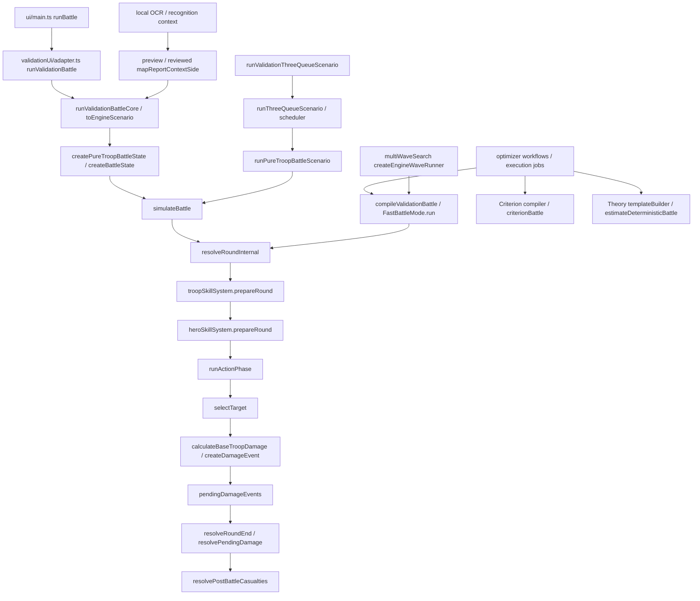

# PVP Engine Logic Audit — 当前代码现实审计

审计日期：2026-10-10（Asia/Shanghai）。项目：`whiteout-survival-pvp-engine@0.2.0`。

本报告以当前 `src/`、相关启动脚本及实际加载的数据为依据；没有用旧文档替代执行器，也没有修改战斗规则。`supported`、`confirmed`、`TENTATIVE` 是代码或配置的标签，不等于本次重新完成了游戏战报验证。本文的“源码确定”仅表示可以从当前代码或引擎实验复现。

## Executive Summary

| 项目 | 当前代码结论 |
|---|---|
| 正式单队入口 | UI `runBattle` → `runValidationBattle` → `runValidationBattleCore` → `simulateBattle`。核心为 `resolveRoundInternal`；不存在另一个名叫 BattleEngine 的独立公式实现。 |
| 生命周期 | 兵种 prepare → 英雄 prepare → 回合快照 → 六个交错行动 → 写回效果/技能状态 → 按事件顺序回合末扣盾、扣血、扣兵 → 混阶分配 → 效果寿命推进 → 死亡/结束。 |
| 基础伤害 | `sqrt(min(initialA,initialB)) * sqrt(sourceAlive) * Cd * Cn * (1+Atk) * (1+Pen)`；目标防御及伤害组在事件层处理。没有 `/2` 或 5000 阈值。 |
| 单兵生命 | `Cn * Cl * (1+Life)`；防御不进入 HP。盾/矛/射 `Cl=300/100/75`。 |
| 乘区数量 | 正式加载的英雄与兵种配置共 **33 个不同 group 名**；运行时另生成 `dodgeNormalAttack`，合计 **34 个具名组**。这不代表每笔伤害都乘 34 次；详见第 7 节。额外的属性、防御、护盾、系数和取整不是同一个 group。 |
| 攻击模式数量 | 法定 `DamageType` **2** 个，`DamageSubtype` **3** 个；本文按行为划分 **6 类执行形态**：主攻击、连射内部段、当前目标 B 附伤、raw 附伤、跨目标/群体附伤、延迟标记附伤。后四类可有交集；不存在正式 `additionalAttack` 类型枚举。 |
| 英雄/技能数量 | **62 位英雄**；**158 个远征战斗定义 + 46 个专武技能定义 = 204 个英雄技能定义**。另保留目录中的非战斗技能，逐项注明未装载。其中 147 个定义标 `supported`、57 个标 `TENTATIVE`（S12–S16）。 |
| 兵种技能数量 | **15** 个定义：每兵种 5 个；其中 3 个 T12 技能各有 Lv1–Lv24 数据。 |
| 重要硬编码 | 玲奈闪避前后判定、S5 miss 不计数、梦之痕延迟绑定、韦恩侧翼/迅雷例外、格温压制覆盖其他易伤、加托护盾专用公式、米娅 proc family 去重、T12 燧星永久层数、旧搜索中的历史结构保护。 |
| 疑似 BUG / 偏差数量 | **3 个需重点复核的问题**：Theory 群体附伤漏掉非主目标（已实验确认）；Criterion 指定目标死亡后回退主目标，与正式引擎不同；三队混阶最终 grade 汇总按队列代表等级归类。另有接口/声明边界问题，分别记录，不把它们都算作当前可达战斗 BUG。 |
| 不确定/冲突条目 | 第 26 节 **18 条**，按 A–E 分类；配置 `TENTATIVE` 的 57 个技能定义另逐项列出，不冒充 57 个独立代码 BUG。 |
| 验证 | 全量 Vitest：111 文件、1261 项，1257 通过、4 超时；4 文件单 worker 复查：33/33 通过。小规模只读实验见第 29 节。 |

**最重要的边界：正式模拟、DeterministicTheory、Criterion 是三个不同的执行模型。** 后两者用于筛选，分数不等于胜率。最终排名使用正式引擎的共同种子样本，但前置预算淘汰仍可能漏掉更优候选。

## 目录

1. [入口与调用链](#1-真实入口与调用关系)
2. [状态](#2-战斗状态)
3. [回合](#3-完整回合生命周期)
4. [伤害](#4-正式基础伤害公式)
5. [生命](#5-生命与扣血)
6. [属性与 OCR](#6-属性构建及战报反推)
7. [全部乘区](#7-全部具名乘区)
8. [伤害通道](#8-攻击模式与-damage-channel)
9. [索敌](#9-索敌规则)
10. [取整](#10-取整与溢出)
11. [护盾](#11-护盾与阻挡)
12. [概率](#12-概率与-rng)
13. [计数](#13-周期攻击计数与冷却)
14. [控制](#14-闪避眩晕与例外)
15. 英雄完整数据库
16. 兵种完整数据库
17. 战后伤亡
18. 连续战斗
19. 英雄实例
20. 专武
21. 近似模型边界
22. 优化器
23. 特殊规则与关键词扫描
24. 正式计算链
25. 规范化规则表
26. 冲突与不确定
27. 审计口径
28. 源码追溯索引
29. 验证与只读完整性

## 1. 真实入口与调用关系



| 模块 | 文件及实际函数 |
|---|---|
| 浏览器单场 | `src/ui/main.ts::runBattle`；`src/pvp/validationUi/adapter.ts::runValidationBattle`（480）、`runValidationBattleCore`（522） |
| 低层单场公共入口 | `src/pvp/battle/simulateBattle.ts::simulateBattle`（43）；`src/pvp/scenario/pureTroopScenario.ts::runPureTroopBattleScenario`（113） |
| 回合引擎 | `src/pvp/round/resolveRound.ts::resolveRoundInternal`（159）、`resolveRoundEnd`（63）；`round/actionPhase.ts::runActionPhase`（141） |
| 快速模式 | `battle/fastBattleMode.ts::FastBattleMode.run`；`validationUi/adapter.ts::compileValidationBattle`（132）。输出胜负、回合、剩余兵；同一回合函数。 |
| 三队/冰火 | `validationUi/adapter.ts::toValidationThreeQueueConfig`（328）、`runValidationThreeQueueScenario`（476）→ `scenario/threeQueueScenario.ts::runThreeQueueScenario` |
| 集结单波 | adapter 将 `RALLY` 映射为 `battleContext="rally"`，仍跑同一引擎；车身经 `bodySkillConfig` 装载。 |
| 多波 | `optimizer/multiWaveSearch.ts::evaluateMultiWaveSequence`（38）、`createEngineWaveRunner`（23）→ compiled `runFastFreshTrial` |
| Theory | `optimizer/theory/templateBuilder.ts::createTheoryTemplateBuilder` → `expectationProgram.ts::createExpectationProgram` → `deterministicBattleEstimator.ts::estimateDeterministicBattle` |
| Criterion | `optimizer/criterion/compiler.ts::prepareCriterionHead/compileCriterionTemplate` → `flow.ts::buildTargetFlow` → `solver.ts::criterionBattle`；`ordered.ts::orderedLifetimePotential` 为廉价潜力积分。 |
| 优化调度 | `src/ui/optimizerRoute.ts::optimizerRoute`；`optimizer/scenarioOptimizer.ts`、`singleWaveSearch.ts`、`threeQueueOptimizer.ts`、`innerEarthOptimizer.ts`。Worker 路由见 `src/ui/optimizerWorker.ts::handleRequest`。 |
| 技能 | `heroSkills/loadout.ts::createConfirmedHeroFormation`、`heroSkills/resolveHeroSkills.ts::createHeroSkillSystem`（99）；`troopSkills/loadout.ts::createConfirmedTroopSkillLoadout`、`troopSkills/resolveTroopSkills.ts::createTroopSkillSystem`（93） |
| 属性/效果 | `validationUi/expectedReportAttribute.ts::deriveExpectedReportAttribute`；`externalBuffs/reportBonusResolver.ts::resolveExternalBuffs`；`effects/attributeModifiers.ts::resolveTroopAttribute`；`effects/effectMatching.ts::getApplicableEffects` |
| OCR/反推 | `scripts/local-ocr.py::recognize`、`src/ui/recognizeLocalReport.ts::recognizeLocalReport`、`battleReportRecognition/recognize.ts`、`mapping.ts::deriveRawReportAttribute/mapReportContextSide`、`src/ui/applyRecognizedReport.ts::applyRecognizedReport` |

注意：直接调用 `simulateBattle` 时若没有传技能 system，不会凭 troop/hero runtime 自动创建技能解析器。UI 与 pure scenario 入口会传入；自定义低层调用者必须自己提供。`runPureTroopBattleScenario` 也没有隐式 RNG：用到概率技能而未注入 RNG/override 会报错。

## 2. 战斗状态

依据 `types/battle.ts`、`types/troop.ts`、`heroSkills/types.ts`、`createBattleState.ts`。

| 层级 | 真正维护的状态 | 语义 |
|---|---|---|
| Battle | round、battleContext、fixedInitialMinTroops、sideA/B、status、pendingDamageEvents、battleLog | round 从 1 开始；status 为 ready/completed。 |
| Side | initialTotalCount、troops、armyEffects、heroStates、heroStatCorrection | 初始总数为本场三个兵种初始 count 求和；不会随死亡递减。 |
| Troop | initialCount、aliveCount、levelComposition、initialLevelComposition、frontUnitHp、maxHpPerUnit、baseHpPerUnit、四属性、Cn/Cd/Cl、buffs/debuffs、skillStates、temporaryShields/temporaryShieldHp | 一个兵种只有一个聚合栈；混阶不是多栈。 |
| Hero runtime | skillId、level、enabled、stacks、remainingDuration、cooldown、lastTriggeredRound、triggerCount、mainAttackCounts | 每个 Side × runtimeInstanceId × skill 独立；mainAttackCounts 有盾/矛/射三个私有计数。 |
| Troop runtime | skillId、level、enabled、stacks、remainingDuration、cooldown、lastTriggeredRound、triggerCount | 每个 Side × 兵种 × skill 独立；没有统一全军 attackCount。 |
| ActiveEffect | sourceId/sourceSkillId/effectId identity、stackCount、applicationCount、appliedRound、activeFromRound、remainingRounds、holderScope | 身份决定刷新/叠层，group 决定数值合并，两者不同。 |
| Shield layer | generatedRound/generatedActionOrder、activeFromRound/expiresAfterRound、generatedShieldHp/remainingShieldHp、来源实例 | 独立于兵种 HP；不是 damageReduction。 |

`fixedInitialMinTroops=min(initialTotalCountA,initialTotalCountB)`，整场固定。连续战的下一场重新构造它，并非整段三队/多波共享第一次的 N0。

`aliveCount` 包含最后一名残血士兵；`frontUnitHp` 表示栈前沿唯一的残血单兵，其后都是满血。兵种存活条件 `aliveCount>0`。正式引擎不保存独立 `aliveMask`，Criterion 才使用三位 bit mask。正式索敌读回合快照，因此行动阶段预计致死的目标仍存在，且预计死亡的攻击者仍能行动。

引擎没有持久的 `hitCount`、全局 `skillCounter` 或每兵种累计 damage 字段。逐笔伤害在 event/trace，累计显示由日志或 batch 汇总。死亡/重伤/轻伤/损失不是战斗中的四种兵员状态，而是战后分类。

### 2.1 输入人数与容量的执行来源

`validationUi/adapter.ts::resolveValidationTroopCounts:719`（实际起始行见28节）区分输入模式：finalReport使用已输入的level composition/count，不再套容量；prediction集结使用 `floor((deployment.totalTroops+rallyFixedCapacityBonus+1500*petLevel)*(1+rallyCapacityBonus))`，然后按ratio分兵。petLevel为0–10整数，不进入攻击/防御/生命等属性。

prediction非集结：petLevel=0时对每个兵种的每个混阶人数分别`floor(count*(1+marchCapacityBonus))`再相加；有pet容量时对全军`floor((total+petCapacity)*(1+bonus))`，再按原兵种比例分配。两条路径可能有不同整数舍入结果，不能用一条连续容量公式抹平。容量是实际人数生成，不是伤害乘区；生成后的count才进入N0与n。

`validationUi/rallyDeployment.ts::allocateRallyTroopsByRatio:20`（实际行号见28节）使用BigInt十进制共同单位、floor和最大余数，等余数盾→矛→射；比例总和容差为0.005百分点，通过后按实际ratioSum归一分配。单队技能/优化器不是每次自行ceil三兵种。simulate/Fast/UI均要求maxRounds为1–1500安全整数；roundLimit不等于自动判残兵多者获胜。

## 3. 完整回合生命周期

源码：`round/resolveRound.ts:159`、`round/actionPhase.ts:141`、`effects/activeEffects.ts`。

```text
resolveRoundInternal(state):
  require ready, empty pending queue
  troopPrepared = troopSystem.prepareRound(state)
      # troop runtime duration/cooldown 各减 1；被动/roundStart；T12层数
  heroPrepared = heroSystem.prepareRound(troopPrepared.state)
      # 被动/roundStart，第一回合生命技能重建单兵 HP
  snapshot = createRoundStartSnapshot(heroPrepared.state)
  for (A盾, B盾, A矛, B矛, A射, B射):
      if snapshot.source.aliveCount == 0: continue
      beforeMainAttack: nextRound眩晕、盾阵跳过行动
      if skipped: continue
      beforeTargetSelection: 兵种beforeAttack，再英雄beforeAttack
      target = selectTarget(snapshot, active targeting effects)
      if no target: continue
      beforeDodge: 攻击尝试计数/周期、梦痕、侧翼、爆破、影刃等
      troop generator.beforeDodge: 在玲奈场景提前判连射/火药
      beforeHit: 防守英雄闪避判定
      if not cancelled: afterDodge: 命中依赖暴击等
      B = calculateBaseTroopDamage(snapshot count, resolved Atk/Pen) * base-group
      primary = createDamageEvent(B, normalAttack,
                   control + troop/hero event providers)
      enqueue primary  # cancelled primary 仍为0事件，但跳过普通event providers
      afterMainAttack: 相关私有计数推进；存在miss例外
      childInputs = troop generator + hero generator
      pool 同行动/同目标/同根的 parentBaseDamage extraDamage
      createDamageEvent(each child); 独立乘区和取整
      merge sameMainAttackSegment into primary
      enqueue remaining children  # 不递归调用攻击生命周期
  write back troop and hero runtime, queued effects and shields
  for each pending event in queue order:
      consume eligible shield using event round/actionOrder
      apply integer damage to frontUnitHp / full soldiers
      discard overflow by default
  allocate mixed-level populations once per troop for this round
  advance army/troop effect durations; expire shields; clear dead-target one-use markers
  completed = any side has 0 troops
  clear pending; log roundEnd; round += 1 only if not completed
```

**效果与兵员不同步。** 兵员和 HP 一律在 roundEnd 扣除；主动触发的效果可进入本回合 resolver 的暂存 map，供后续事件使用。不能把当前实现概括成“所有 buff 都下轮生效”。具体是否读到某个暂存 effect，取决于 provider、scope、activationTiming。

`immediate` 默认 activeFromRound=触发回合；`nextRound` 为触发回合+1。声明 `nextAction` 在 ActiveEffect 中没有独立行动时间轴，同样映射为当前回合；奇袭只作为该行动的 transient 使用，因此没有持久化污染。duration d：immediate 初始 remaining=d，本轮末减 1；nextRound 初始 remaining=d+1，本轮末减 1，故下一轮才算第一轮。没有 duration 则永久保留，`activeRounds`/周期窗口可限制真正生效回合。

刷新 `replace` 替换旧状态；`refresh` 也用新状态重启时序，仅累计 applicationCount；`stack` 增加 stackCount，但保留旧值及旧 activeFromRound/remainingRounds，只有达到层数上限且 `atMaxStacks="refreshDuration"` 时刷新剩余寿命。无 refreshMode 的相同 identity 重复附着会抛错。多个不同 runtime identity 可同时存在，同 group 数值相加。

眩晕检查早于目标选择和攻击型技能，取消整个该兵种行动。闪避晚于 targeting 与若干攻击尝试技能；不是所有技能都取消。被动/roundStart 不因该兵种被眩晕而停止。duration 推进不是 roundStart 通用清理：ActiveEffect 在前轮末推进，兵种 runtime 自身记录在本轮 prepare 时推进。

## 4. 正式基础伤害公式

令 `N0=min(NA_initial,NB_initial)`，n 为攻击兵种回合快照 aliveCount，Cd 为类型伤害系数，Cn 为等级/混阶常数，a/p/d 为**解析后的 decimal bonus**。

\[
B_0=\sqrt{N_0}\sqrt n\,C_d C_n(1+a)(1+p)
\]

`formulas/damage.ts::calculateBaseTroopDamage:28`。本函数不含敌防；Atk/Pen 来自攻击方，防御在每个事件中解析真实目标的属性。敌方穿透减益经属性除区改变 p；动态英雄攻击/穿透同样参与，不只读取原始字段。

基础特殊组先乘进 B：

\[
B=B_0\prod_{g\in baseDamageMultiplier}(1+\sum v_g s_g)
\]

正式主事件/子事件的通式（`damage/createDamageEvent.ts:38`）：

\[
D_f=R\cdot\frac{\prod_{g\in Increase}(1+\sum v_gs_g)}
{(1+d_{target})\prod_{g\in Reduction}(1+\sum v_gs_g)
\prod_{g\in BaseDefense}(1+\sum v_gs_g)}
\cdot\prod_{g\in DefenseReduction}(1+\sum v_gs_g)
\cdot\prod_{g\in Cancellation}(1-\sum v_gs_g)
\]

`R=input.baseDamage`，创建后`event.rawDamage`恒等于该输入；没有另一个可传入的rawDamage字段。普通事件R=B。事件记录 rawDamage、modifiedDamage、finalDamage，最后 `finalDamage=Math.round(Df)`。DefenseReduction **是增加伤害的乘因子**，不是再除一次防御属性；属性减防 `attributeReduction` 则已在 d_target 内完成。

Increase 包括己方 `damageIncrease` 和目标 `incomingDamageIncrease`，按 group 一起聚合；Reduction 包括目标 `damageReduction` 和攻击方 `outgoingDamageReduction`，按 group 一起聚合。普通/技能/克制/易伤并非固定位置的四个字段，而是 scope 匹配后的具名组集合。同组先加、组间乘/除。

**普通免伤、技能免伤、敌方造成伤害降低的当前实现均为除以 `1+rate`，不是乘 `1-rate`。** 后者只用于 `directDamageCancellation`。例如 receivedDamageReduction=.5 是 `/1.5`；不能按文字“降低50%”写成伤害减半。

| 兵种 | Cd | Cl |
|---|---:|---:|
| shield | 1 | 300 |
| lancer | 3 | 100 |
| marksman | 4 | 75 |

系数来自 `data/troopDamageCoefficients.ts`、`data/troopHpCoefficients.ts`。正规的等级忽略测试调用者提供的自定义 Cd/Cl，始终使用类型常量；非游戏 fixture label 可显式自定义。

### 4.1 当前全部合法等级常数

| 等级ID | Cn（正式表原值） |
|---|---|
| `T1` | 1 |
| `T2` | 1.5 |
| `T3` | 2.1 |
| `T4` | 2.73 |
| `T5` | 3.276 |
| `T6` | 3.8657 |
| `T7` | 4.5615 |
| `T8` | 5.3826 |
| `T9` | 6.3514 |
| `T10` | 7.4947 |
| `T10-FC1` | 7.7945 |
| `T10-FC2` | 8.1842 |
| `T10-FC3` | 8.5934 |
| `T10-FC4` | 9.0231 |
| `T10-FC5` | 9.4742 |
| `T10-FC6` | 9.8532 |
| `T10-FC7` | 10.3459 |
| `T10-FC8` | 10.8632 |
| `T10-FC9` | 11.4063 |
| `T10-FC10` | 11.9766 |
| `T11-FC3` | 10.1402 |
| `T11-FC4` | 10.6472 |
| `T11-FC5` | 11.1796 |
| `T11-FC6` | 11.6268 |
| `T11-FC7` | 12.2081 |
| `T11-FC8` | 12.8185 |
| `T11-FC9` | 13.4595 |
| `T11-FC10` | 14.1324 |
| `T12-FC7` | 14.4056 |
| `T12-FC8` | 15.1259 |
| `T12-FC9` | 15.8822 |
| `T12-FC10` | 16.6763 |


数据来源 `data/troopConstants.ts::TROOP_LEVEL_CONSTANTS`（4）。共有 **32** 个键：T1–T10、T10-FC1–10、T11-FC3–10、T12-FC7–10；没有裸 T11/T12、T11-FC1/2、T12-FC1–6。`getTroopConstant` 显式查询，非法值抛错，没有插值或把 Cd/Cl 随等级迭代。

混阶首次 `Ceff=sum(n_i C_i)/sum(n_i)`。回合后 rebase 使用**初始混阶权重**，剔除已经为 0 的等级，再重新计算 C；不让整数分配的小误差持续漂移。兵种技能 loadout 由代表 `troopLevel` 决定，没有按每个混阶士兵单独触发技能。合法兵阶的 UI/ServerStage 校验先于引擎；底层也拒绝以 T数字 开头的非法游戏等级，但接受任意非 T数字 的显式 fixture 标签。

### 4.2 多公式与非正式路径

正式 PVP 根号公式只有 `calculateBaseTroopDamage`。Theory/Criterion 也复用该单位基础公式，但其兵员衰减和技能执行不同（第 21 节）。`gatotShield` 有另一条攻击力 X 公式，仅用于护盾。`resolveReportAttributeBonus` 是旧属性接口，非伤害公式。全文正式 battle/damage/formulas 搜索未发现 `/2`、5000 阈值或打熊根号分支；部分数据/注释写来源于 bear，但执行的是当前 PVP 文件中的组及数值。本报告没有引入外部打熊/PVE 模型。

## 5. 生命与扣血

`formulas/hp.ts::calculateTroopHp:30`：

\[
h=C_n C_l(1+life),\qquad H=(aliveCount-1)h+frontUnitHp
\]

全满血时 H=nh。`defense` 参数只为兼容保留，返回 defenseMultiplier=1，明确不影响 HP。外部生命 debuff 在基础属性 canonical builder 中除入生命倍率；英雄 life modifier 在英雄 prepare 的第一轮重算 maxHpPerUnit。当前英雄配置的 life modifier 是开场被动；若在 round>1 再触发生命修改，会抛 `Dynamic hero HP changes are not supported after battle start`，没有中途加血算法。

`casualty/applyDamageToTroopStack.ts`：伤害小于前沿 HP 时只减 front；否则先杀前沿 1 名，剩余完整单位按 floor(remaining/h) 扣除；最后余量扣到下一名前沿。全部死亡时 alive/front=0，未吸收值返回 overflow。残血不产生小数兵数，仍完整计入 sqrt(n)。

混阶回合末重算 C/HP 时按 `newC/oldC` 同时缩放 baseHp/maxHp/frontHp，所以保留前沿血量比例。正式状态不存每个等级独立 HP。

## 6. 属性构建及战报反推

### 6.1 单位与来源

UI 战报/raw/阵容差/官职均为**百分比点**（25 表示 25%）；引擎 attack/defense/penetration/life 是 decimal bonus（.25），factor 为 1.25。`+837.4%` 在引擎是 8.374，倍率 **9.374**。

| 来源 | 当前执行位置 | 是否再次加进战斗 |
|---|---|---|
| 最终战报属性 | input.troops / queue.attributes | finalReport 直接采用，视为已含静态、装备、外部环境；不再反扣/加回专武静态。 |
| raw/base | historicalReport 经 rawReportSide 反推，或手动 raw 输入 | prediction 的 canonical builder 输入。raw 在本项目不表示“没有英雄”的纯城建数值；其历史静态英雄贡献可仍在其中。 |
| 英雄静态 | hero.stats；calculateHeroStatCorrection | prediction 使用“模拟车头贡献−历史战报车头贡献”；车身不提供静态属性。 |
| 专武静态 | calculateExclusiveWeaponBaseStats | 仅该英雄本兵种穿透/生命，max × weaponLevel/10；作为阵容 delta 一部分。 |
| 城镇/宠物/专家 | resolveExternalBuffs / targetBattleBonuses | 同 stat selfBuff 相加；收到的 debuff 来自对方的 enemyDebuffs。 |
| 官职 | source/target special additive | 百分比点 A；OCR 仅接受官职进入 additive，不构造 additiveFactor。 |
| 专武场景属性技能 | hero-weapon-skill.* 的 attributeModifier | 加入对应外部 buff 同组，与普通外部 buff 先相加；不是 expected 算完后加百分点。 |
| 动态远征属性技能 | resolveTroopAttribute | 乘 `(1+reportBonus)` 的英雄属性组；不直接回写 stored report 字段。 |
| 临时战斗效果 | armyEffects/troop buffs/debuffs、transient providers | 当前回合 active 且 scope 匹配才生效；伤害型效果不改静态战报输入。 |

### 6.2 正向与反向公式

`validationUi/expectedReportAttribute.ts:17`：

\[
R_{expected}=(100+R_{raw}+\Delta_{formation}+A_{current})
\frac{1+B_{normal}+B_{weapon}}{1+D_{current}}-100
\]

`battleReportRecognition/mapping.ts::deriveRawReportAttribute`：

\[
R_{raw}=(100+R_{report})\frac{1+D_{source}}{1+B_{source}}-100-A_{source}
\]

反推只验证 rawFactor>0；A 是百分点减去 `A/100`，不是独立 factor。输入 BUFF/DEBUFF 在保存 matrix 中也是百分点，由 builder `/100` 转 decimal。数学相加顺序不影响实数结果；JS 浮点最后几位可有差异，显示格式化不反写公式。

动态属性：外部/武器属性组整体进入上式；其余英雄属性 group g：

\[
F_{stat}=(1+R_{expected}/100)
\frac{\prod_g(1+\sum v_gs_g)}{\prod_q(1+\sum reduction_qs_q)}
\]

`effects/attributeModifiers.ts` **按 sourceSkillId/group 判断 operation**：专武或 buffAttack/Defense/Penetration/Life → `addToExternalBuff`；其他 → `multiplyAttributeFactor`。即使某旧定义写 `operation="addToAttribute"`，当前执行器也走英雄乘区。必须以这个分流为准，而不能机械照 JSON 的 operation 名解释。

### 6.3 finalReport 与 prediction

`scenario/pureTroopScenario.ts::toBattleSideSetup`：finalReport 将 leader weaponLevel 置 0，关闭专武技能；忽略 reportHeroes correction、外部 modifier 和 targetBattleBonuses，防重复。远征技能仍可运行。prediction 按当前车头 skillLevel/weaponLevel 装载，再校正历史静态贡献及外部环境。

`reportBonusContexts.ts` target 模式为 none / reuseSource / custom。历史 source 数据不能自动成为当前 target；reuseSource 明确复制 source matrix。custom 将自定义目标 matrix 与当前外部 self/enemy 来源相加。普通 finalReport 不是先反推再换阵容。

### 6.4 冰火共享与 lineage

`iceFireContext.ts` 每侧一个共享 pet/expert context，A/B 独立；队列没有各自三份共享环境相乘。`queueConversionSide` 把该侧上下文放入每次队列单场的输入；单场只解析一次。当前加雷斯四技能表 Lv0–20，value=`level*.0025`，降低敌方全军穿透；Lv8=2%、Lv20=5%。缺等级返回 unresolved，external resolver 抛错，不默认为满级或 0。

`queueReportLineage.ts` 在冰火入口、保存、复制、restore、evaluation 边界归一化。无当前英雄且没有有效显式历史 lineage 时 reportHold 清空；有效已确认历史可保留历史车头并允许预期空阵容反扣。`changeQueueAttribute` 手动覆盖时清掉历史 attributes/bonuses 并重新建立当前 baseline。`changeIceFireExpectedHero` 的历史编辑路径则保留绑定历史，不能和旧“清空即一定删除历史”混为一谈。

### 6.5 OCR 当前接入状态

OCR 使用本地 RapidOCR，整图+增强整图识别，保留 box/bbox，TS 以文字/同一行/左右关系解析属性和 special bonuses。UI POST `/api/local-ocr`，模式 `reportAttributesAndSpecialBonuses`。**当前 `recognizeLocalReport` 会丢弃 troopCardReadings，Python 接口也明确禁用 troop inference**；仓库保留兵阶/卡片解析函数及测试，但不能把它们说成当前上传入口已经自动识兵。

recognition context 与 input 是两个变量链；上传/merge/edit 修改 context，正式值通过确认调用 `applyRecognizedReport → mapReportContextSide` 提交；三队只更新所选队。低置信/needsConfirmation 未人工确认时 `accepted` 拒绝。门槛 .85；百分比需 finite、>-100、≤100000、0.01 点格式，兵数必须非负安全整数，兵阶必须在枚举中。

特殊加成完整性为 incomplete / complete / explicitZero；只有用户明确 explicitZero 才使用全零。`specialTotals` 依据**同一历史 report 的选定列与相反列**推断 self/enemy，不能把另一侧正式配置混进 preview。预览输出 `reportValueSource.source="ocrPreview"`。相关未知项按 possibleAttribute 阻塞，未知 stat 则全部阻塞；完整提交仍要求所有待归类项解决。

registry normalize 后 exact canonical/alias 匹配 confidence=1；官职四项有 canonical/alias，0% 不因零值而拒绝。OCR 不识英雄：三队应用时当前 `leaderHeroIds/weaponLevels` 被当作该份导入报告的基线来源，这属于用户必须核对的来源假设，本次无法单凭OCR验证该来源假设；见E2。

### 6.6 AttributeSchema

正式引擎只接收展开后的 12 项。装备锻炉 A 使用 `PER_TROOP_ATTACK_DEFENSE_SEPARATE_PEN_LIFE_PAIRED_9`：每兵种攻击、防御独立，穿透/生命配对；B 使用共享 `ALL_TROOPS_PAIRED_2`。不存在攻击≈防御检查的必要性；三兵种穿透/生命不是因为某图相同就跨兵种共享。Schema 文件负责输入转换，未创建另一条 PVP 伤害公式。

## 7. 全部具名乘区

以下表从**实际导入的 204+15 个定义的所有等级**枚举，不只从关键词或旧说明归纳。每个技能的完整 scope/value/lifecycle 在第 15/16 节。

| 乘区 / 内部group | Effect kind | 同组及组间运算 | 所有原始scope变体 | 全部使用技能ID |
|---|---|---|---|---|
| `aerialSuppressionOverride` | `oneUseIncomingDamageIncrease` | 消费成incoming增伤×(1+Σ)，覆盖其他incoming组例外 | `{"source":"army","target":"currentTarget","damageType":"all"}` | `hero-skill.gewen.aerial-suppression, hero-skill.vulcanus.rifting-blade` |
| `buffAttack` | `attributeModifier` | weapon/buff*先外部相加；其他group为属性factor乘(1+Σ) | `{"source":"army","target":"all","damageType":"all"}` | `hero-weapon-skill.buladeli.defense-attack, hero-weapon-skill.estrella.defense-attack, hero-weapon-skill.fuleide.rally-attack, hero-weapon-skill.fulinte.defense-attack, hero-weapon-skill.gisela.defense-attack, hero-weapon-skill.heketuo.defense-attack, hero-weapon-skill.heluonimo.rally-attack, hero-weapon-skill.jinman.defense-attack, hero-weapon-skill.karol.rally-attack, hero-weapon-skill.lloyd.rally-attack, hero-weapon-skill.miya.rally-attack, hero-weapon-skill.rufus.rally-attack, hero-weapon-skill.s8.hengdelike.rally-attack, hero-weapon-skill.vulcanus.rally-attack, hero-weapon-skill.xiula.defense-attack` |
| `buffDefense` | `attributeModifier` | weapon/buff*先外部相加；其他group为属性factor乘(1+Σ) | `{"source":"army","target":"all","damageType":"all"}` | `hero-weapon-skill.elif.defense-defense, hero-weapon-skill.freya.defense-defense, hero-weapon-skill.hervor.defense-defense, hero-weapon-skill.jiatuo.defense-defense, hero-weapon-skill.luogen.defense-defense, hero-weapon-skill.nuola.defense-defense, hero-weapon-skill.wuming.defense-defense` |
| `buffLife` | `attributeModifier` | weapon/buff*先外部相加；其他group为属性factor乘(1+Σ) | `{"source":"army","target":"all","damageType":"all"}` | `hero-weapon-skill.ahemosi.defense-life, hero-weapon-skill.aidisi.defense-life, hero-weapon-skill.eleonora.defense-life, hero-weapon-skill.feilande.defense-life, hero-weapon-skill.flora.defense-life, hero-weapon-skill.gelaige.rally-life, hero-weapon-skill.hank.defense-life, hero-weapon-skill.magenusi.defense-life` |
| `buffPenetration` | `attributeModifier` | weapon/buff*先外部相加；其他group为属性factor乘(1+Σ) | `{"source":"army","target":"all","damageType":"all"}` | `hero-weapon-skill.alongsuo.rally-penetration, hero-weapon-skill.blanchette.rally-penetration, hero-weapon-skill.cara.defense-penetration, hero-weapon-skill.dominic.rally-penetration, hero-weapon-skill.gedun.rally-penetration, hero-weapon-skill.gewen.rally-penetration, hero-weapon-skill.gregory.defense-penetration, hero-weapon-skill.ligeia.defense-penetration, hero-weapon-skill.linen.defense-penetration, hero-weapon-skill.lingnai.rally-penetration, hero-weapon-skill.moli.defense-penetration, hero-weapon-skill.nataliya.rally-penetration, hero-weapon-skill.ruini.rally-penetration, hero-weapon-skill.suoniya.defense-penetration, hero-weapon-skill.viveca.rally-penetration, hero-weapon-skill.weien.defense-penetration` |
| `commonDamageIncrease` | `damageIncrease, decayingDamageIncrease` | 伤害increase×(1+Σ)，与其他group乘；mark/decay须先解析 | `{"source":"army","target":"all","damageType":"all"} / {"source":"lancer","target":"all","damageType":"all"} / {"source":"marksman","target":"all","damageType":"all"} / {"source":"self","target":"all","damageType":"all"} / {"source":"shield","target":"all","damageType":"all"}` | `hero-skill.ahemosi.fire-blessing, hero-skill.aidisi.offense-and-defense, hero-skill.aishilin.arrow-rain, hero-skill.aishilin.forest-song, hero-skill.buladeli.battlefield-insight, hero-skill.dominic.mirror-maze, hero-skill.dominic.shapeshifting-mechanism, hero-skill.eleonora.soaring-flame, hero-skill.eleonora.solaris-phalanx, hero-skill.estrella.colorful-scene, hero-skill.flora.thorn-bush, hero-skill.freya.agile-strike, hero-skill.fulinte.wildfire, hero-skill.gedun.toxic-phobia, hero-skill.gelaige.sword-of-justice, hero-skill.hank.sparks-fly, hero-skill.heketuo.thunder-strike, hero-skill.heluonimo.periodic-damage, hero-skill.hervor.will-of-war, hero-skill.lloyd.ice-fog-bomb, hero-skill.magenusi.ice-sea-tactics, hero-skill.miya.lucky-blessing, hero-skill.nuola.momentum-pursuit, hero-skill.nuola.multi-troop-combat, hero-skill.suoniya.treasure-hunter, hero-skill.viveca.child-of-mist, hero-skill.wuming.half-moon, hero-skill.xiula.unpredictable-clouds, lancer-radiant-formation-t12, marksman-blazing-star-t12` |
| `criticalNormalAttack` | `damageIncrease` | 伤害increase×(1+Σ)，与其他group乘；mark/decay须先解析 | `{"source":"army","target":"all","damageType":"normalAttack"}` | `hero-skill.gregory.steel-phalanx, hero-skill.weien.lightning-speed` |
| `dreamMarkDamage` | `markedTargetDamageIncrease` | 伤害increase×(1+Σ)，与其他group乘；mark/decay须先解析 | `{"source":"army","target":"currentTarget","damageType":"all"} / {"source":"lancer","target":"currentTarget","damageType":"all"}` | `hero-skill.ruini.dream-catcher, hero-skill.ruini.dream-fragment` |
| `enemyAttackReduction` | `attributeReduction` | 属性除区/(1+Σ) | `{"source":"army","target":"all","damageType":"all"} / {"source":"lancer","target":"all","damageType":"all"} / {"source":"marksman","target":"all","damageType":"all"}` | `hero-skill.elif.light-veil-binding, hero-skill.freya.twilight-mist, hero-skill.jiatuo.kings-army, hero-skill.lingshuang.attack-reduction, hero-skill.luogen.angry-lion-assault, hero-skill.sigel.eternal-fortress, hero-skill.ursa.mushroom-maze, hero-skill.vulcanus.overlord-fury, hero-skill.xieergai.weakening-strike` |
| `enemyDefenseReduction` | `attributeReduction` | 属性除区/(1+Σ) | `{"source":"army","target":"all","damageType":"all"} / {"source":"army","target":"lancer","damageType":"all"} / {"source":"army","target":"shield","damageType":"all"}` | `hero-skill.estrella.eclipse-sorrow, hero-skill.ligeia.steel-fang-gnaw, hero-skill.s8.hengdelike.defense-reduction, hero-skill.ursa.ancestral-horn, hero-skill.vulcanus.shattered-scythe` |
| `enemyOutgoingDamageReduction` | `damageReduction, outgoingDamageReduction` | 同group Σ(value×stackCount)，除/(1+Σ)；incoming/攻击者outgoing一起聚合 | `{"source":"army","target":"all","damageType":"all"} / {"source":"army","target":"currentTarget","damageType":"all"} / {"source":"marksman","target":"all","damageType":"all"}` | `hero-skill.aishilin.arrow-rain, hero-skill.flora.aromatic-mist, hero-skill.fuleide.tidal-offensive, hero-skill.gelaige.law-deterrence, hero-skill.hank.berserk-power, hero-skill.ligeia.venom-fang-assault, shield-immortal-wall-t12` |
| `enemyPenetrationReduction` | `attributeReduction` | 属性除区/(1+Σ) | `{"source":"army","target":"all","damageType":"all"} / {"source":"army","target":"currentTarget","damageType":"all"}` | `hero-skill.alongsuo.steel-will, hero-skill.cara.heavy-mist, hero-skill.fuleide.water-cannon, hero-skill.linen.sorrowful-sound, hero-skill.lloyd.bird-harassment, hero-skill.lloyd.ice-fog-bomb, hero-skill.lumubogen.penetration-reduction, hero-skill.rufus.violent-blast` |
| `flameImpactBaseAttack` | `baseDamageMultiplier` | 先乘入B；(1+Σ) | `{"source":"self","target":"all","damageType":"all"}` | `marksman-flame-impact` |
| `gordonMarksmanOutgoingReduction` | `outgoingDamageReduction` | 同group Σ(value×stackCount)，除/(1+Σ)；incoming/攻击者outgoing一起聚合 | `{"source":"marksman","target":"all","damageType":"all"}` | `hero-skill.gedun.poison-cloud` |
| `gordonPeriodicOutgoingReduction` | `outgoingDamageReduction` | 同group Σ(value×stackCount)，除/(1+Σ)；incoming/攻击者outgoing一起聚合 | `{"source":"army","target":"all","damageType":"all"}` | `hero-skill.gedun.toxic-phobia` |
| `heroAttackBonus` | `attributeModifier` | weapon/buff*先外部相加；其他group为属性factor乘(1+Σ) | `{"source":"army","target":"all","damageType":"all"} / {"source":"marksman","target":"all","damageType":"all"}` | `hero-skill.buladeli.veterans-pride, hero-skill.elif.thousand-blade-formation, hero-skill.estrella.dawn-canvas, hero-skill.feilande.fitness-secret, hero-skill.fulinte.burning-will, hero-skill.gregory.blazing-sun-army, hero-skill.heluonimo.attack, hero-skill.karol.banner-of-glory, hero-skill.magenusi.raging-sea, hero-skill.nataliya.attack, hero-skill.patelike.attack, hero-skill.rufus.fire-brigade, hero-skill.shuyun.attack, hero-skill.suoniya.bounty-temptation, hero-skill.viveca.dark-night-legion, hero-skill.vulcanus.shattered-scythe` |
| `heroDefenseBonus` | `attributeModifier` | weapon/buff*先外部相加；其他group为属性factor乘(1+Σ) | `{"source":"army","target":"all","damageType":"all"} / {"source":"self","target":"all","incomingSourceTroop":"lancer","damageType":"all"} / {"source":"shield","target":"all","damageType":"all"}` | `hero-skill.elif.thousand-blade-formation, hero-skill.estrella.dawn-canvas, hero-skill.feilande.fitness-secret, hero-skill.gisela.alloy-shield, hero-skill.gisela.temporary-fortification, hero-skill.gregory.blazing-sun-army, hero-skill.jiatuo.golden-guard, hero-skill.jinman.defense-life, hero-skill.karol.banner-of-glory, hero-skill.magenusi.steel-phalanx, hero-skill.s8.hengdelike.barnacle-armor, shield-steel-guardian` |
| `heroLifeBonus` | `attributeModifier` | weapon/buff*先外部相加；其他group为属性factor乘(1+Σ) | `{"source":"army","target":"all","damageType":"all"}` | `hero-skill.aidisi.steel-armor, hero-skill.eleonora.sunlight-majesty, hero-skill.gelaige.order-protection, hero-skill.jinman.defense-life, hero-skill.luogen.burning-body, hero-skill.patelike.life, hero-skill.sigel.dark-armor` |
| `heroMarksmanAttackStack` | `attributeModifier` | weapon/buff*先外部相加；其他group为属性factor乘(1+Σ) | `{"source":"marksman","target":"all","damageType":"all"}` | `hero-skill.linen.onaihua` |
| `heroPenetrationBonus` | `attributeModifier` | weapon/buff*先外部相加；其他group为属性factor乘(1+Σ) | `{"source":"army","target":"all","damageType":"all"} / {"source":"lancer","target":"all","damageType":"all"} / {"source":"marksman","target":"all","damageType":"all"}` | `hero-skill.alongsuo.stormy-waves, hero-skill.blanchette.crimson-hunting-blade, hero-skill.fulinte.endless-fire, hero-skill.hank.roaring-fury, hero-skill.heluonimo.penetration, hero-skill.hervor.war-cry, hero-skill.jiesaier.penetration, hero-skill.jiexi.penetration, hero-skill.jinman.penetration, hero-skill.linen.lion-song, hero-skill.lloyd.endless-ingenuity, hero-skill.moli.penetration, hero-skill.nataliya.penetration, hero-skill.ursa.ancestral-horn` |
| `lightforgedBaseDefense` | `baseDefenseMultiplier` | 独立基础防御除区/(1+Σ) | `{"source":"self","target":"shield","damageType":"all"}` | `shield-lightforged-body` |
| `normalAttackDamageIncrease` | `damageIncrease` | 伤害increase×(1+Σ)，与其他group乘；mark/decay须先解析 | `{"source":"army","target":"all","damageType":"normalAttack"}` | `hero-skill.cara.mechanical-pet, hero-skill.lingnai.assassin-instinct` |
| `poisonOutgoingDamageReduction` | `outgoingDamageReduction` | 同group Σ(value×stackCount)，除/(1+Σ)；incoming/攻击者outgoing一起聚合 | `{"source":"army","target":"currentTarget","damageType":"all"}` | `hero-skill.gedun.poisoned-blade` |
| `receivedDamageReduction` | `damageReduction` | 同group Σ(value×stackCount)，除/(1+Σ)；incoming/攻击者outgoing一起聚合 | `{"source":"army","target":"all","damageType":"all"} / {"source":"army","target":"marksman","damageType":"all"} / {"source":"army","target":"shield","damageType":"all"} / {"source":"self","target":"lancer","damageType":"all"} / {"source":"self","target":"shield","damageType":"all"} / {"source":"shield","target":"shield","damageType":"all"}` | `hero-skill.aidisi.iron-body, hero-skill.aidisi.offense-and-defense, hero-skill.baxiti.danger-sense, hero-skill.dominic.mirror-maze, hero-skill.eleonora.soaring-flame, hero-skill.eleonora.solaris-phalanx, hero-skill.estrella.colorful-scene, hero-skill.feilande.stimulant, hero-skill.flora.thorn-bush, hero-skill.freya.agile-strike, hero-skill.gisela.prototype-shield, hero-skill.gregory.steel-defense, hero-skill.hank.sparks-fly, hero-skill.heketuo.survival-instinct, hero-skill.hervor.will-of-war, hero-skill.jiexi.mechanical-barrier, hero-skill.karol.guardian-wings, hero-skill.luogen.lion-intimidation, hero-skill.magenusi.ice-sea-tactics, hero-skill.miya.secret-interpretation, hero-skill.moli.snow-command, hero-skill.nataliya.wild-roar, hero-skill.nuola.momentum-pursuit, hero-skill.nuola.multi-troop-combat, hero-skill.viveca.child-of-mist, hero-skill.xieergai.guardian-power, hero-skill.xiula.mist-spores, hero-skill.xiula.unpredictable-clouds, lancer-crimson-field, lancer-radiant-formation-t12, shield-crystal-shield, shield-lightforged-body` |
| `receivedNormalAttackReduction` | `damageReduction` | 同group Σ(value×stackCount)，除/(1+Σ)；incoming/攻击者outgoing一起聚合 | `{"source":"army","target":"shield","damageType":"normalAttack"}` | `hero-skill.hervor.immortal-army, hero-skill.sigel.night-vanguard, hero-skill.wuming.wind-shelter` |
| `receivedSkillDamageReduction` | `damageReduction` | 同group Σ(value×stackCount)，除/(1+Σ)；incoming/攻击者outgoing一起聚合 | `{"source":"army","target":"shield","damageType":"skillDamage"}` | `hero-skill.hervor.immortal-army, hero-skill.sigel.night-vanguard, hero-skill.wuming.wind-shelter` |
| `selfAttackReduction` | `attributeReduction` | 属性除区/(1+Σ) | `{"source":"shield","target":"all","damageType":"all"}` | `hero-skill.sigel.eternal-fortress` |
| `skillDamageIncrease` | `damageIncrease` | 伤害increase×(1+Σ)，与其他group乘；mark/decay须先解析 | `{"source":"army","target":"all","damageType":"skillDamage"}` | `hero-skill.wuming.four-images` |
| `troopCounterDamage` | `damageIncrease` | 伤害increase×(1+Σ)，与其他group乘；mark/decay须先解析 | `{"source":"self","target":"lancer","damageType":"all"} / {"source":"self","target":"marksman","damageType":"all"} / {"source":"self","target":"shield","damageType":"all"}` | `lancer-charge, marksman-remote-strike, shield-dense-formation` |
| `troopVsTroopDamage` | `damageIncrease` | 伤害increase×(1+Σ)，与其他group乘；mark/decay须先解析 | `{"source":"army","target":"lancer","damageType":"all"} / {"source":"army","target":"shield","damageType":"all"}` | `hero-skill.buladeli.head-cannon, hero-skill.karol.formation-breaking-spear` |
| `viperPhalanxOtherReduction` | `damageReduction` | 同group Σ(value×stackCount)，除/(1+Σ)；incoming/攻击者outgoing一起聚合 | `{"source":"army","target":"lancer","damageType":"all"} / {"source":"army","target":"marksman","damageType":"all"}` | `hero-skill.ahemosi.viper-phalanx` |
| `viperPhalanxShieldReduction` | `damageReduction` | 同group Σ(value×stackCount)，除/(1+Σ)；incoming/攻击者outgoing一起聚合 | `{"source":"army","target":"shield","damageType":"all"}` | `hero-skill.ahemosi.viper-phalanx` |
| `vulnerability` | `incomingDamageIncrease` | 伤害increase×(1+Σ)，与其他group乘；mark/decay须先解析 | `{"source":"army","target":"currentTarget","damageType":"all"} / {"source":"army","target":"shield","damageType":"all"}` | `hero-skill.ahemosi.light-forged-blade, hero-skill.dominic.rose-thrust, hero-skill.flora.aromatic-mist, hero-skill.flora.thorn-vine-dance, hero-skill.fuleide.acid-solution, hero-skill.gedun.poison-cloud, hero-skill.gewen.eagle-vision, hero-skill.hank.berserk-power, hero-skill.ligeia.disintegrating-poison, hero-skill.miya.doom-entanglement, hero-skill.rufus.armor-breaking-strike, hero-skill.ursa.poison-blade, hero-skill.xiula.piercing-arrow` |
| `dodgeNormalAttack` | directDamageCancellation | runtime生成，(1−Σ)，成功Σ=1令primary为0 | 仅normal主/连射内部；独立extra不重新dodge | hero-skill.lingnai.swift-shadow-dance / createDodgeCancellationEffect |


补充运行时组 `dodgeNormalAttack`：`createDodgeCancellationEffect`（hero resolver:1727）生成 directDamageCancellation=1，只匹配 normalAttack，乘 0。`dreamMarkDamage` 在绑定标记时转换为 incomingDamageIncrease；`aerialSuppressionOverride` 从 one-use marker 转为 incomingDamageIncrease 后，伤害构造器会排除其他所有 incomingDamageIncrease 组，不是普通易伤相加。

`skillLifeReduction` 是 `constants/attributeSkillGroups.ts` 的预留名字，当前加载技能没有使用；外部敌生命减益进入 report 属性除区，不等于此 group 已被正式英雄使用。通用 API 允许 fixture 提供其他 group 字符串；33/34 是本次正式数据集合计数，不是类型系统对 group 字符串的上限。

**extraDamage 不是一个 multiplier bucket。** 正式 extra child 一律 `damageType=skillDamage, damageSubtype=extraDamage`，使用技能增伤/技能免伤和 all scope 组，不吃 normalAttack-only 组。但 basis 有两种实际配置：parentBaseDamage 和 parentRawDamage；当前event.rawDamage恒等于其baseDamage，因此同目标这两个basis数值起点相同；但raw不参加B合池，也不按跨目标skill属性重新计算B，其运算/取整路径不同。parentModifiedDamage/parentFinalDamage 是支持的 API 选项，当前英雄实际数据未使用。

## 8. 攻击模式与 Damage Channel

| 执行形态 | 当前行为 |
|---|---|
| 主攻击 | 存活兵种每回合最多一个行动；索敌后 normalAttack 事件。被眩晕/跳过则整次没有；被闪避仍构造 0 主事件。 |
| 连射内部第二段 | sameMainAttackSegment，复用主目标/B/本次防御概率，作为 normalAttack 内部段独立计算和取整，再合入主事件；不增加主攻击计数、不再索敌、不重判技能/暴击/闪避，不递归。 |
| B 当前目标附伤 | 以 parentBaseDamage×coefficient 创建 skillDamage/extraDamage；同根/同目标可合池再取整。不是额外主攻击。 |
| raw 附伤 | parentRawDamage×coefficient，独立 skillDamage/extraDamage；不参加 B extra pool，逐项取整；诺拉/格温群体使用这一路。 |
| 跨目标/全体附伤 | fixed troop 或 all 展开多个具体目标；不是改主攻击优先级。目标当时 alive=0 则没有该笔，不回退前排。 |
| 标记延迟附伤 | 梦痕标记下一轮对绑定目标发 2B，source 仍为本次 lancer 行动；不增加单独主攻击，也不触发另一次攻击生命周期。 |

`AdditionalDamageGenerator` 是 callback 接口名，不代表 `DamageType="additionalAttack"`。正式 types/combat.ts 只有 2+3 枚举；Criterion 的 `AttackChannel.kind="additionalAttack"` 是连射的数值近似标签。

子事件仍调用 `createDamageEvent` 和 event effect providers，因而可重新判烈晶盾牌/炽红力场；不会调用新一轮 beforeTarget/beforeHit/afterMainAttack。不存在“被攻击事件”再触发英雄攻击链的通用递归框架。随机目标是 Criterion 支持的 channel 功能；当前英雄 extra compiler 只实现当前/具体/全体，没有正式随机目标伤害定义。

## 9. 索敌规则

默认 `shield → lancer → marksman`；A盾/B盾/A矛/B矛/A射/B射各自对目标方按此顺序寻找 snapshot alive>0 的栈。不是按行动顺序寻找目标。

矛奇袭 T7+，`beforeAttack` 每个矛主行动判一次 p=.2，改优先级为 `marksman → shield → lancer`。本次攻击附带的 currentTarget 附伤/连射继承选定目标；指定目标/全体技能仍自己展开。眩晕导致没有行动，则没有奇袭 RNG。若多个不同 targetingOverride 优先级同时有效，`selectTarget` 抛 `RULE_UNKNOWN`；相同优先级可共存，不实行“最后英雄无条件覆盖”。

| 技能 | 攻击来源 | 完整目标/系数规则 | 主攻重定向还是新增通道 | 源码 |
|---|---|---|---|---|
| 兵种奇袭 | lancer | 主目标priority marksman→shield→lancer；p=.2 | 主攻击重定向，继承current target的extra；不是新增主攻击 | `src/pvp/troopSkills/definitions/lancer.ts:29` |
| S5 诺拉 / `hero-skill.nuola.catch-off-guard` | `lancer` | `[{"id":"hero-effect.nuola.catch-off-guard.all-enemies","kind":"extraDamage","coefficient":1,"basis":"parentRawDamage","scope":{"source":"lancer","target":"all","damageType":"skillDamage"}}]` | 独立extra/延迟目标绑定；不是新的main；specified死则不发 | `src/pvp/heroSkills/definitions/s5Heroes.ts:88` |
| S5 格温 / `hero-skill.gewen.demolition-squad` | `marksman` | `[{"id":"hero-effect.gewen.demolition-squad.all-enemies","kind":"extraDamage","coefficient":0.5,"basis":"parentRawDamage","scope":{"source":"marksman","target":"all","damageType":"skillDamage"}}]` | 独立extra/延迟目标绑定；不是新的main；specified死则不发 | `src/pvp/heroSkills/definitions/s5Heroes.ts:162` |
| S6 芮妮 / `hero-skill.ruini.dream-mark` | `lancer` | `[{"kind":"targetBoundMark","schedule":{"source":"lancer","interval":2,"mode":"onCompleted"},"markId":"reneeDreamMark","damageDelayRounds":1,"damageCoefficient":2,"markDurationRounds":1}]` | 独立extra/延迟目标绑定；不是新的main；specified死则不发 | `src/pvp/heroSkills/definitions/s6Heroes.ts:65` |
| S6 韦恩 / `hero-skill.weien.flanking-strike` | `marksman` | `[{"id":"hero-effect.weien.flanking-strike.lancer","kind":"extraDamage","coefficient":0.08,"basis":"parentBaseDamage","scope":{"source":"marksman","target":"lancer","damageType":"skillDamage"}},{"id":"hero-effect.weien.flanking-strike.marksman","kind":"extraDamage","coefficient":0.04,"basis":"parentBaseDamage","scope":{"source":"marksman","target":"marksman","damageType":"skillDamage"}},{"id":"hero-effect.weien.flanking-strike.lancer","kind":"extraDamage","coefficient":0.16,"basis":"parentBaseDamage","scope":{"source":"marksman","target":"lancer","damageType":"skillDamage"}},{"id":"hero-effect.weien.flanking-strike.marksman","kind":"extraDamage","coefficient":0.08,"basis":"parentBaseDamage","scope":{"source":"marksman","target":"marksman","damageType":"skillDamage"}},{"id":"hero-effect.weien.flanking-strike.lancer","kind":"extraDamage","coefficient":0.24,"basis":"parentBaseDamage","scope":{"source":"marksman","target":"lancer","damageType":"skillDamage"}},{"id":"hero-effect.weien.flanking-strike.marksman","kind":"extraDamage","coefficient":0.12,"basis":"parentBaseDamage","scope":{"source":"marksman","target":"marksman","damageType":"skillDamage"}},{"id":"hero-effect.weien.flanking-strike.lancer","kind":"extraDamage","coefficient":0.32,"basis":"parentBaseDamage","scope":{"source":"marksman","target":"lancer","damageType":"skillDamage"}},{"id":"hero-effect.weien.flanking-strike.marksman","kind":"extraDamage","coefficient":0.16,"basis":"parentBaseDamage","scope":{"source":"marksman","target":"marksman","damageType":"skillDamage"}},{"id":"hero-effect.weien.flanking-strike.lancer","kind":"extraDamage","coefficient":0.4,"basis":"parentBaseDamage","scope":{"source":"marksman","target":"lancer","damageType":"skillDamage"}},{"id":"hero-effect.weien.flanking-strike.marksman","kind":"extraDamage","coefficient":0.2,"basis":"parentBaseDamage","scope":{"source":"marksman","target":"marksman","damageType":"skillDamage"}}]` | 独立extra/延迟目标绑定；不是新的main；specified死则不发 | `src/pvp/heroSkills/definitions/s6Heroes.ts:122` |
| S8 亨德里克 / `hero-skill.s8.hengdelike.heir-of-forest` | `marksman` | `[{"id":"hero-effect.s8.hengdelike.heir-of-forest.all","kind":"extraDamage","coefficient":0.4,"basis":"parentBaseDamage","scope":{"source":"marksman","target":"all","damageType":"skillDamage"}}]` | 独立extra/延迟目标绑定；不是新的main；specified死则不发 | `src/pvp/heroSkills/definitions/s8Heroes.ts:140` |
| S10 布兰琪 / `hero-skill.blanchette.dawn-sniper` | `marksman` | `[{"id":"hero-effect.blanchette.dawn-sniper.lancer","kind":"extraDamage","coefficient":0.4,"basis":"parentBaseDamage","scope":{"source":"marksman","target":"lancer","damageType":"skillDamage"}},{"id":"hero-effect.blanchette.dawn-sniper.marksman","kind":"extraDamage","coefficient":0.2,"basis":"parentBaseDamage","scope":{"source":"marksman","target":"marksman","damageType":"skillDamage"}}]` | 独立extra/延迟目标绑定；不是新的main；specified死则不发 | `src/pvp/heroSkills/definitions/s10Heroes.ts:104` |
| S14 卡拉 / `hero-skill.cara.witch-assault` | `marksman` | `[{"id":"hero-effect.cara.witch-assault.1","kind":"extraDamage","coefficient":0.4,"basis":"parentBaseDamage","scope":{"source":"marksman","target":"lancer","damageType":"skillDamage"}},{"id":"hero-effect.cara.witch-assault.2","kind":"extraDamage","coefficient":0.2,"basis":"parentBaseDamage","scope":{"source":"marksman","target":"marksman","damageType":"skillDamage"}}]` | 独立extra/延迟目标绑定；不是新的main；specified死则不发 | `src/pvp/heroSkills/definitions/s14Heroes.ts:90` |
| S15 维薇卡 / `hero-skill.viveca.shadow-vision` | `marksman` | `[{"id":"hero-effect.viveca.shadow-vision.1","kind":"extraDamage","coefficient":1,"basis":"parentBaseDamage","scope":{"source":"marksman","target":"all","damageType":"skillDamage"}}]` | 独立extra/延迟目标绑定；不是新的main；specified死则不发 | `src/pvp/heroSkills/definitions/s15Heroes.ts:75` |
| S16 艾诗琳 / `hero-skill.aishilin.forest-fury` | `marksman` | `[{"id":"hero-effect.aishilin.forest-fury.1","kind":"extraDamage","coefficient":0.4,"basis":"parentBaseDamage","scope":{"source":"marksman","target":"all","damageType":"skillDamage"}}]` | 独立extra/延迟目标绑定；不是新的main；specified死则不发 | `src/pvp/heroSkills/definitions/s16Heroes.ts:99` |

当前英雄定义没有target=random配置；Criterion保留random通道接口，不等于正式库已启用随机英雄目标。


## 10. 取整与溢出

源码：`createDamageEvent.ts:111`、`strategies/casualtyRounding.ts:29`、`resolvePendingDamage.ts:80`、`applyDamageToTroopStack.ts`。

| 环节 | 当前规则 |
|---|---|
| 浮点公式 → event | Math.round；非负 .5 向上，不是银行家舍入。 |
| 多个 parentBaseDamage extra | 同一次主行动、同具体目标、同父且 skillDamage/extraDamage 的 eligible 输入先相加再创建一个 event，只取整一次；component 记录各来源。 |
| raw basis extra / 不同目标 | 各自创建 event、各自取整。 |
| 连射 | 第二段独立取整再合入主事件的 finalDamage；不是把两段浮点和再 round。 |
| 护盾 | event 已经取整，随后盾吸收；盾值及减盾后剩余可为浮点，HP 函数 incomingAlreadyNormalized 避免再 round。 |
| 扣满血士兵 | floor，前沿被击穿先算 1 名；残余扣下一名前沿。 |
| 混阶战斗内部 | 整数守恒投影；报表每等级列另用 ceil。 |
| 溢出 | 默认 CONFIRMED_DISCARD_OVERFLOW_DAMAGE 分配空列表；不跨下一个兵种、不自动重索敌。 |

roundEnd 是“所有 events 延后扣血”，**不是把每兵种所有伤害先相加再 round/扣盾**。按 queue 顺序逐笔处理；目标被先前 event 结算为 0 后，后续 event 可记录零有效杀伤和丢弃溢出。最多 64 个 resolution steps 的保护会报错；这是硬上限，不是游戏机制证据。

## 11. 护盾与阻挡

### 11.1 真实 HP 护盾

当前英雄配置中的真实 temporaryShield：加托 `kings-gift` 与 S14 艾丽芙 `brocade-veil`（后者 TENTATIVE 模板复用）。均在盾兵完成主攻击后的技能阶段生成，nextRound、duration=1、replace；miss 时不经过通用命中后生成段。

加托公式 `heroSkills/gatotShield.ts::calculateGatotShield:16`：

\[
X=100 C_n\sqrt{n_{shield}}(1+reportAttackBonus),\quad S=qX,
\quad q_{Lv4}=.24,\ q_{Lv5}=.30
\]

不含 N0、穿透、防御、动态远征攻击；使用 source.attack 报表层。虽保存 previousShield 供 audit，refreshedShield=generatedShield，不与旧盾相加。scope 文本 target=all 不能解读成“给三兵种各一份”：生成层挂当前 sourceTroop，实际上为盾栈。

同层 id+activeFromRound 会 replace；不同来源/成员 runtime 是不同层，可并存，按数组顺序吸收。连续两轮触发的当前有效旧层与下轮新层可以暂时共存，不能因为新层 nextRound 就删掉当前有效层。

`casualty/resolvePendingDamage.ts::applyTemporaryShields:198` 要求 event.round 落在窗口，并且 shield generatedRound 更早，或同轮 generatedActionOrder **严格小于** event.actionOrder。因此即时盾不能倒吸收生成之前/同一行动的事件。先所有伤害组和 round，再 shield，再 HP；盾本身不再吃第二遍减伤。剩余量只在其生命周期内跨轮；兵种死亡后 roundEnd 清层。

### 11.2 名称含“盾”但不是 HP 护盾

烈晶盾牌是每独立 DamageEvent 概率给 receivedDamageReduction 除区；不是固定抵消池。光铸是独立基础防御乘因子+盾牌联动；钢铁守护是防御属性乘区。不朽之壁是前五轮的伤害 reduction。玲奈闪避为 directDamageCancellation=1，不消耗 HP shield。当前没有一般性的“固定 N 点免疫盾”配置，也没有 separate immunity enum。

## 12. 概率与 RNG

`troopSkills/runtime.ts::createSeededRandomSource` 是 32-bit seeded generator（加 0x6d2b79f5 后 imul 混合，除 2^32），不用 Math.random。UI/formal single 每场给 troop/hero 两个 system 注入**同一个随机序列对象**；每次 eligible 技能各调用 next，不是每英雄自有 RNG 实例。不同 runtime 独立判定，但 seed 结果依赖遍历顺序；不能保证重复车身互换后固定 seed 逐场结果不变。

trigger override 先于随机，可强制 true/false。英雄 override 支持 round:side:troop:skill 等逐级回退；兵种使用 side/troop/skill 回退，未限定 round。probability=1 若显式存在也仍取一次 random；确定性技能 probability 未配置时不取。

RULE_UNKNOWN 没 explicit override 不触发；**TENTATIVE 不阻止执行**，是 S12+ 未实战验证的标签。ActiveEffect 的 ruleStatus 为 RULE_UNKNOWN 时也不会 active。

主行动眩晕不会判攻击型概率；被动/roundStart 或防御 event 概率另计。dodge 之前可已取 targeting、攻击尝试和部分独立附伤的 RNG；命中依赖技能取消。连射内段共用主防御/闪避结果，不重取防御 RNG；独立 extra 每笔重取防御 RNG。各等级概率完整列如下，不把说明文本当 p。

当前数据中36个定义显式有probability（含p=1）；未在此表的定义没有随机概率字段，周期本身不等于概率。

| 来源 | 技能ID | Hook | 每个已录入级的概率 | 源码 |
|---|---|---|---|---|
| 英雄/SR 巴希提 | `hero-skill.baxiti.unstable-field` | beforeAttack | `Lv5=0.5` | `src/pvp/heroSkills/definitions/simpleHeroes.ts:86` |
| 英雄/S1 娜塔莉亚 | `hero-skill.nataliya.wild-roar` | roundStart | `Lv5=0.4` | `src/pvp/heroSkills/definitions/s1Heroes.ts:27` |
| 英雄/S1 茉莉 | `hero-skill.moli.snow-command` | roundStart | `Lv5=0.4` | `src/pvp/heroSkills/definitions/s1Heroes.ts:34` |
| 英雄/S1 茉莉 | `hero-skill.moli.ice-field` | beforeAttack | `Lv5=0.5` | `src/pvp/heroSkills/definitions/s1Heroes.ts:36` |
| 英雄/S2 菲兰德 | `hero-skill.feilande.strengthening-potion` | beforeAttack | `Lv1=0.25; Lv2=0.25; Lv3=0.25; Lv4=0.25; Lv5=0.25` | `src/pvp/heroSkills/definitions/s2Heroes.ts:34` |
| 英雄/S2 菲兰德 | `hero-skill.feilande.stimulant` | roundStart | `Lv1=0.4; Lv2=0.4; Lv3=0.4; Lv4=0.4; Lv5=0.4` | `src/pvp/heroSkills/definitions/s2Heroes.ts:40` |
| 英雄/S2 阿隆索 | `hero-skill.alongsuo.stormy-waves` | roundStart | `Lv1=0.4; Lv2=0.4; Lv3=0.4; Lv4=0.4; Lv5=0.4` | `src/pvp/heroSkills/definitions/s2Heroes.ts:46` |
| 英雄/S2 阿隆索 | `hero-skill.alongsuo.steel-will` | beforeAttack | `Lv1=0.2; Lv2=0.2; Lv3=0.2; Lv4=0.2; Lv5=0.2` | `src/pvp/heroSkills/definitions/s2Heroes.ts:51` |
| 英雄/S2 阿隆索 | `hero-skill.alongsuo.sharp-harpoon` | beforeAttack | `Lv1=0.5; Lv2=0.5; Lv3=0.5; Lv4=0.5; Lv5=0.5` | `src/pvp/heroSkills/definitions/s2Heroes.ts:58` |
| 英雄/S3 米娅 | `hero-skill.miya.doom-entanglement` | beforeAttack | `Lv5=0.5` | `src/pvp/heroSkills/definitions/s3Heroes.ts:37` |
| 英雄/S3 米娅 | `hero-skill.miya.lucky-blessing` | roundStart | `Lv5=0.5` | `src/pvp/heroSkills/definitions/s3Heroes.ts:51` |
| 英雄/S3 米娅 | `hero-skill.miya.secret-interpretation` | roundStart | `Lv5=0.4` | `src/pvp/heroSkills/definitions/s3Heroes.ts:64` |
| 英雄/S3 格雷格 | `hero-skill.gelaige.sword-of-justice` | roundStart | `Lv5=0.2` | `src/pvp/heroSkills/definitions/s3Heroes.ts:81` |
| 英雄/S3 格雷格 | `hero-skill.gelaige.law-deterrence` | beforeAttack | `Lv5=0.2` | `src/pvp/heroSkills/definitions/s3Heroes.ts:94` |
| 英雄/S4 玲奈 | `hero-skill.lingnai.swift-shadow-dance` | beforeAttack | `Lv2=0.08; Lv5=0.2` | `src/pvp/heroSkills/definitions/s4Heroes.ts:89` |
| 英雄/S4 玲奈 | `hero-skill.lingnai.shadow-blade` | afterNormalAttack | `Lv4=0.25; Lv5=0.25` | `src/pvp/heroSkills/definitions/s4Heroes.ts:105` |
| 英雄/S4 琳恩 | `hero-skill.linen.lion-song` | roundStart | `Lv5=0.4` | `src/pvp/heroSkills/definitions/s4Heroes.ts:123` |
| 英雄/S5 赫克托 | `hero-skill.heketuo.survival-instinct` | roundStart | `Lv5=0.4` | `src/pvp/heroSkills/definitions/s5Heroes.ts:26` |
| 英雄/S5 赫克托 | `hero-skill.heketuo.gale-strike` | afterNormalAttack | `Lv5=0.25` | `src/pvp/heroSkills/definitions/s5Heroes.ts:51` |
| 英雄/S5 诺拉 | `hero-skill.nuola.catch-off-guard` | afterNormalAttack | `Lv5=0.2` | `src/pvp/heroSkills/definitions/s5Heroes.ts:88` |
| 英雄/S6 韦恩 | `hero-skill.weien.lightning-speed` | beforeAttack | `Lv1=0.05; Lv2=0.1; Lv3=0.15000000000000002; Lv4=0.2; Lv5=0.25` | `src/pvp/heroSkills/definitions/s6Heroes.ts:142` |
| 英雄/S9 马格努斯 | `hero-skill.magenusi.steel-phalanx` | afterNormalAttack | `Lv5=0.4` | `src/pvp/heroSkills/definitions/s9Heroes.ts:28` |
| 英雄/S10 格里高利 | `hero-skill.gregory.steel-phalanx` | beforeAttack | `Lv5=0.25` | `src/pvp/heroSkills/definitions/s10Heroes.ts:30` |
| 英雄/S10 芙蕾雅 | `hero-skill.freya.crescent-scythe` | afterNormalAttack | `Lv5=0.5` | `src/pvp/heroSkills/definitions/s10Heroes.ts:58` |
| 英雄/S11 劳埃德 | `hero-skill.lloyd.endless-ingenuity` | roundStart | `Lv5=0.4` | `src/pvp/heroSkills/definitions/s11Heroes.ts:87` |
| 英雄/S11 鲁弗斯 | `hero-skill.rufus.violent-blast` | beforeAttack | `Lv5=0.2` | `src/pvp/heroSkills/definitions/s11Heroes.ts:120` |
| 英雄/S13 吉塞拉 | `hero-skill.gisela.temporary-fortification` | afterNormalAttack | `Lv5=0.4` | `src/pvp/heroSkills/definitions/s13Heroes.ts:31` |
| 英雄/S13 吉塞拉 | `hero-skill.gisela.prototype-shield` | roundStart | `Lv5=0.4` | `src/pvp/heroSkills/definitions/s13Heroes.ts:37` |
| 英雄/S13 弗洛拉 | `hero-skill.flora.thorn-vine-dance` | beforeAttack | `Lv5=0.5` | `src/pvp/heroSkills/definitions/s13Heroes.ts:50` |
| 英雄/S15 维薇卡 | `hero-skill.viveca.shadow-vision` | afterNormalAttack | `Lv5=0.2` | `src/pvp/heroSkills/definitions/s15Heroes.ts:75` |
| 兵种/shield | `shield-crystal-shield` | beforeDamage | `Lv1=0.25; Lv2=0.375` | `src/pvp/troopSkills/definitions/shield.ts:65` |
| 兵种/lancer | `lancer-ambush` | beforeAttack | `Lv1=0.2` | `src/pvp/troopSkills/definitions/lancer.ts:29` |
| 兵种/lancer | `lancer-crystal-spear` | beforeAttack | `Lv1=0.1; Lv2=0.15` | `src/pvp/troopSkills/definitions/lancer.ts:47` |
| 兵种/lancer | `lancer-crimson-field` | beforeDamage | `Lv1=0.1; Lv2=0.15` | `src/pvp/troopSkills/definitions/lancer.ts:64` |
| 兵种/marksman | `marksman-rapid-fire` | afterNormalAttack | `Lv1=0.1` | `src/pvp/troopSkills/definitions/marksman.ts:21` |
| 兵种/marksman | `marksman-crystal-powder` | afterNormalAttack | `Lv1=0.2; Lv2=0.3` | `src/pvp/troopSkills/definitions/marksman.ts:41` |


## 13. 周期、攻击计数与冷却

`heroSkills/resolveHeroSkills.ts:1261/1292/1305/1856`。不存在“所有技能读同一个 attackCount”的实现。每技能 runtime 的三个 mainAttackCounts 只在 definitionObservesMainAttack 判断成立时推进：skipMainAttack、attackCountTrigger、targetBoundMark、decayingDamageIncrease。army schedule 意味着该技能观察所有兵种，但仍是**三个独立计数**，不是盾+矛+射求和到一个 N。

onCompleted：afterCount>0 且 afterCount%interval=0；nextAttack：beforeCount>0 且 beforeCount%interval=0。眩晕、跳过、没有目标不推进；连射/extra/延迟伤害不另加。一般 miss 仍推进，S5 标签与戈登 poisoned-blade 是命中计数例外。自然轮技能使用 round及 periodStartRound/periodRounds，不用存活兵种累计攻击次数代替 round。

下表包括自然轮、攻击计数、activeRounds、持续/叠层和冷却声明；dodge/stun/仅命中计数按14节和各技能字段判，不把所有schedule简化为every N rounds。

| 技能 | Trigger | 原始全部调度/寿命字段 | 源码 |
|---|---|---|---|
| `hero-skill.heluonimo.periodic-damage` | passive | `[{"level":"5","effects":[{"id":"hero-effect.heluonimo.periodic-damage","kind":"damageIncrease","lifecycle":{"periodRounds":4,"firstActiveRound":5,"activeWindowRounds":2}}]}]` | `src/pvp/heroSkills/definitions/s1Heroes.ts:20` |
| `hero-skill.nataliya.wild-roar` | roundStart | `[{"level":"5","effects":[{"id":"hero-effect.nataliya.wild-roar","kind":"damageReduction","lifecycle":{"durationRounds":1,"refreshMode":"replace"}}]}]` | `src/pvp/heroSkills/definitions/s1Heroes.ts:27` |
| `hero-skill.moli.snow-command` | roundStart | `[{"level":"5","effects":[{"id":"hero-effect.moli.snow-command","kind":"damageReduction","lifecycle":{"durationRounds":1,"refreshMode":"replace"}}]}]` | `src/pvp/heroSkills/definitions/s1Heroes.ts:34` |
| `hero-skill.feilande.stimulant` | roundStart | `[{"level":"1","effects":[{"id":"hero-effect.feilande.stimulant","kind":"damageReduction","lifecycle":{"durationRounds":1,"refreshMode":"replace"}}]},{"level":"2","effects":[{"id":"hero-effect.feilande.stimulant","kind":"damageReduction","lifecycle":{"durationRounds":1,"refreshMode":"replace"}}]},{"level":"3","effects":[{"id":"hero-effect.feilande.stimulant","kind":"damageReduction","lifecycle":{"durationRounds":1,"refreshMode":"replace"}}]},{"level":"4","effects":[{"id":"hero-effect.feilande.stimulant","kind":"damageReduction","lifecycle":{"durationRounds":1,"refreshMode":"replace"}}]},{"level":"5","effects":[{"id":"hero-effect.feilande.stimulant","kind":"damageReduction","lifecycle":{"durationRounds":1,"refreshMode":"replace"}}]}]` | `src/pvp/heroSkills/definitions/s2Heroes.ts:40` |
| `hero-skill.alongsuo.stormy-waves` | roundStart | `[{"level":"1","effects":[{"id":"hero-effect.alongsuo.stormy-waves","kind":"attributeModifier","lifecycle":{"durationRounds":1,"refreshMode":"replace"}}]},{"level":"2","effects":[{"id":"hero-effect.alongsuo.stormy-waves","kind":"attributeModifier","lifecycle":{"durationRounds":1,"refreshMode":"replace"}}]},{"level":"3","effects":[{"id":"hero-effect.alongsuo.stormy-waves","kind":"attributeModifier","lifecycle":{"durationRounds":1,"refreshMode":"replace"}}]},{"level":"4","effects":[{"id":"hero-effect.alongsuo.stormy-waves","kind":"attributeModifier","lifecycle":{"durationRounds":1,"refreshMode":"replace"}}]},{"level":"5","effects":[{"id":"hero-effect.alongsuo.stormy-waves","kind":"attributeModifier","lifecycle":{"durationRounds":1,"refreshMode":"replace"}}]}]` | `src/pvp/heroSkills/definitions/s2Heroes.ts:46` |
| `hero-skill.alongsuo.steel-will` | beforeAttack | `[{"level":"1","effects":[{"id":"hero-effect.alongsuo.steel-will.penetration-reduction","kind":"attributeReduction","lifecycle":{"activationTiming":"nextRound","durationRounds":2,"refreshMode":"replace"}}]},{"level":"2","effects":[{"id":"hero-effect.alongsuo.steel-will.penetration-reduction","kind":"attributeReduction","lifecycle":{"activationTiming":"nextRound","durationRounds":2,"refreshMode":"replace"}}]},{"level":"3","effects":[{"id":"hero-effect.alongsuo.steel-will.penetration-reduction","kind":"attributeReduction","lifecycle":{"activationTiming":"nextRound","durationRounds":2,"refreshMode":"replace"}}]},{"level":"4","effects":[{"id":"hero-effect.alongsuo.steel-will.penetration-reduction","kind":"attributeReduction","lifecycle":{"activationTiming":"nextRound","durationRounds":2,"refreshMode":"replace"}}]},{"level":"5","effects":[{"id":"hero-effect.alongsuo.steel-will.penetration-reduction","kind":"attributeReduction","lifecycle":{"activationTiming":"nextRound","durationRounds":2,"refreshMode":"replace"}}]}]` | `src/pvp/heroSkills/definitions/s2Heroes.ts:51` |
| `hero-skill.miya.doom-entanglement` | beforeAttack | `[{"durationRounds":1},{"level":"5","effects":[{"id":"hero-effect.miya.doom-entanglement","kind":"incomingDamageIncrease","lifecycle":{"activationTiming":"nextRound","durationRounds":1,"refreshMode":"replace"}}]}]` | `src/pvp/heroSkills/definitions/s3Heroes.ts:37` |
| `hero-skill.miya.lucky-blessing` | roundStart | `[{"durationRounds":1},{"level":"5","effects":[{"id":"hero-effect.miya.lucky-blessing","kind":"damageIncrease","lifecycle":{"activationTiming":"immediate","durationRounds":1,"refreshMode":"replace"}}]}]` | `src/pvp/heroSkills/definitions/s3Heroes.ts:51` |
| `hero-skill.miya.secret-interpretation` | roundStart | `[{"durationRounds":1},{"level":"5","effects":[{"id":"hero-effect.miya.secret-interpretation","kind":"damageReduction","lifecycle":{"activationTiming":"immediate","durationRounds":1,"refreshMode":"replace"}}]}]` | `src/pvp/heroSkills/definitions/s3Heroes.ts:64` |
| `hero-skill.gelaige.sword-of-justice` | roundStart | `[{"durationRounds":3},{"level":"5","effects":[{"id":"hero-effect.gelaige.sword-of-justice","kind":"damageIncrease","lifecycle":{"activationTiming":"immediate","durationRounds":3,"refreshMode":"replace"}}]}]` | `src/pvp/heroSkills/definitions/s3Heroes.ts:81` |
| `hero-skill.gelaige.law-deterrence` | beforeAttack | `[{"durationRounds":2},{"level":"5","effects":[{"id":"hero-effect.gelaige.law-deterrence","kind":"outgoingDamageReduction","lifecycle":{"activationTiming":"immediate","durationRounds":2,"refreshMode":"replace"}}]}]` | `src/pvp/heroSkills/definitions/s3Heroes.ts:94` |
| `hero-skill.ahemosi.viper-phalanx` | beforeAttack | `[{"actionMechanic":{"kind":"skipMainAttack","sourceTroop":"shield","afterCompletedAttacks":4}},{"level":"5","effects":[{"id":"hero-effect.ahemosi.viper-phalanx.shield-reduction","kind":"damageReduction","lifecycle":{"activationTiming":"immediate","durationRounds":2,"refreshMode":"replace"}},{"id":"hero-effect.ahemosi.viper-phalanx.lancer-reduction","kind":"damageReduction","lifecycle":{"activationTiming":"immediate","durationRounds":2,"refreshMode":"replace"}},{"id":"hero-effect.ahemosi.viper-phalanx.marksman-reduction","kind":"damageReduction","lifecycle":{"activationTiming":"immediate","durationRounds":2,"refreshMode":"replace"}}]}]` | `src/pvp/heroSkills/definitions/s4Heroes.ts:18` |
| `hero-skill.ahemosi.light-forged-blade` | afterNormalAttack | `[{"level":"5","effects":[{"id":"hero-effect.ahemosi.light-forged-blade.vulnerability","kind":"incomingDamageIncrease","lifecycle":{"activationTiming":"nextRound","durationRounds":1,"refreshMode":"replace"}}]}]` | `src/pvp/heroSkills/definitions/s4Heroes.ts:60` |
| `hero-skill.lingnai.swift-shadow-dance` | beforeAttack | `[{"actionMechanic":{"kind":"dodgeNormalAttack"}}]` | `src/pvp/heroSkills/definitions/s4Heroes.ts:89` |
| `hero-skill.linen.lion-song` | roundStart | `[{"level":"5","effects":[{"id":"hero-effect.linen.lion-song","kind":"attributeModifier","lifecycle":{"activationTiming":"immediate","durationRounds":1,"refreshMode":"replace"}}]}]` | `src/pvp/heroSkills/definitions/s4Heroes.ts:123` |
| `hero-skill.linen.onaihua` | afterNormalAttack | `[{"actionMechanic":{"kind":"attackCountTrigger","schedule":{"source":"marksman","interval":3,"mode":"onCompleted"}}},{"level":"5","effects":[{"id":"hero-effect.linen.onaihua.marksman-attack","kind":"attributeModifier","lifecycle":{"activationTiming":"nextRound","refreshMode":"stack"}}]}]` | `src/pvp/heroSkills/definitions/s4Heroes.ts:145` |
| `hero-skill.heketuo.survival-instinct` | roundStart | `[{"level":"5","effects":[{"id":"hero-effect.heketuo.survival-instinct","kind":"damageReduction","lifecycle":{"activationTiming":"immediate","durationRounds":1,"refreshMode":"replace"}}]}]` | `src/pvp/heroSkills/definitions/s5Heroes.ts:26` |
| `hero-skill.heketuo.thunder-strike` | passive | `[{"level":"5","effects":[{"id":"hero-effect.heketuo.thunder-strike","kind":"decayingDamageIncrease","initialValues":{"shield":2,"marksman":1},"decayFactor":0.85,"maxMainAttacks":10}]}]` | `src/pvp/heroSkills/definitions/s5Heroes.ts:38` |
| `hero-skill.nuola.catch-off-guard` | afterNormalAttack | `[{"actionMechanic":{"kind":"attackCountTrigger","schedule":{"source":"lancer","interval":1,"mode":"onCompleted"}}}]` | `src/pvp/heroSkills/definitions/s5Heroes.ts:88` |
| `hero-skill.nuola.momentum-pursuit` | afterNormalAttack | `[{"actionMechanic":{"kind":"attackCountTrigger","schedule":{"source":"lancer","interval":5,"mode":"onCompleted"}}},{"level":"5","effects":[{"id":"hero-effect.nuola.momentum-pursuit.damage","kind":"damageIncrease","lifecycle":{"activationTiming":"nextRound","durationRounds":2,"refreshMode":"replace"}},{"id":"hero-effect.nuola.momentum-pursuit.reduction","kind":"damageReduction","lifecycle":{"activationTiming":"nextRound","durationRounds":2,"refreshMode":"replace"}}]}]` | `src/pvp/heroSkills/definitions/s5Heroes.ts:102` |
| `hero-skill.gewen.eagle-vision` | beforeAttack | `[{"level":"5","effects":[{"id":"hero-effect.gewen.eagle-vision.vulnerability","kind":"incomingDamageIncrease","lifecycle":{"activationTiming":"nextRound","refreshMode":"replace","maxStacks":1}}]}]` | `src/pvp/heroSkills/definitions/s5Heroes.ts:127` |
| `hero-skill.gewen.aerial-suppression` | afterNormalAttack | `[{"actionMechanic":{"kind":"attackCountTrigger","schedule":{"source":"army","interval":6,"mode":"onCompleted"}}},{"level":"5","effects":[{"id":"hero-effect.gewen.aerial-suppression.vulnerability","kind":"oneUseIncomingDamageIncrease","lifecycle":{"activationTiming":"immediate","refreshMode":"replace"}}]}]` | `src/pvp/heroSkills/definitions/s5Heroes.ts:140` |
| `hero-skill.gewen.demolition-squad` | afterNormalAttack | `[{"actionMechanic":{"kind":"attackCountTrigger","schedule":{"source":"marksman","interval":5,"mode":"onCompleted"}}}]` | `src/pvp/heroSkills/definitions/s5Heroes.ts:162` |
| `hero-skill.ruini.dream-mark` | beforeAttack | `[{"actionMechanic":{"kind":"targetBoundMark","schedule":{"source":"lancer","interval":2,"mode":"onCompleted"},"markId":"reneeDreamMark","damageDelayRounds":1,"damageCoefficient":2,"markDurationRounds":1}}]` | `src/pvp/heroSkills/definitions/s6Heroes.ts:65` |
| `hero-skill.weien.thunder-raid` | roundStart | `[{"level":"1","periodRounds":4,"periodStartRound":4,"effects":[]},{"level":"2","periodRounds":4,"periodStartRound":4,"effects":[]},{"level":"3","periodRounds":4,"periodStartRound":4,"effects":[]},{"level":"4","periodRounds":4,"periodStartRound":4,"effects":[]},{"level":"5","periodRounds":4,"periodStartRound":4,"effects":[]}]` | `src/pvp/heroSkills/definitions/s6Heroes.ts:101` |
| `hero-skill.weien.flanking-strike` | beforeAttack | `[{"actionMechanic":{"kind":"attackCountTrigger","schedule":{"source":"marksman","interval":2,"mode":"onCompleted"}}}]` | `src/pvp/heroSkills/definitions/s6Heroes.ts:122` |
| `hero-skill.gedun.poisoned-blade` | afterNormalAttack | `[{"actionMechanic":{"kind":"attackCountTrigger","schedule":{"source":"lancer","interval":2,"mode":"onCompleted"}}},{"level":"1","effects":[{"id":"hero-effect.gedun.poison","kind":"outgoingDamageReduction","lifecycle":{"activationTiming":"nextRound","durationRounds":1,"refreshMode":"replace"}}]},{"level":"5","effects":[{"id":"hero-effect.gedun.poison","kind":"outgoingDamageReduction","lifecycle":{"activationTiming":"nextRound","durationRounds":1,"refreshMode":"replace"}}]}]` | `src/pvp/heroSkills/definitions/s7Heroes.ts:55` |
| `hero-skill.gedun.toxic-phobia` | roundStart | `[{"level":"1","periodRounds":3,"periodStartRound":3,"effects":[{"id":"hero-effect.gedun.toxic-phobia.lancer-damage","kind":"damageIncrease","lifecycle":{"activationTiming":"immediate","durationRounds":1,"refreshMode":"replace"}},{"id":"hero-effect.gedun.toxic-phobia.enemy-outgoing","kind":"outgoingDamageReduction","lifecycle":{"activationTiming":"immediate","durationRounds":1,"refreshMode":"replace"}}]},{"level":"5","periodRounds":3,"periodStartRound":3,"effects":[{"id":"hero-effect.gedun.toxic-phobia.lancer-damage","kind":"damageIncrease","lifecycle":{"activationTiming":"immediate","durationRounds":1,"refreshMode":"replace"}},{"id":"hero-effect.gedun.toxic-phobia.enemy-outgoing","kind":"outgoingDamageReduction","lifecycle":{"activationTiming":"immediate","durationRounds":1,"refreshMode":"replace"}}]}]` | `src/pvp/heroSkills/definitions/s7Heroes.ts:95` |
| `hero-skill.gedun.poison-cloud` | roundStart | `[{"level":"1","periodRounds":4,"periodStartRound":4,"effects":[{"id":"hero-effect.gedun.poison-cloud.shield-vulnerability","kind":"incomingDamageIncrease","lifecycle":{"activationTiming":"immediate","durationRounds":2,"refreshMode":"replace"}},{"id":"hero-effect.gedun.poison-cloud.marksman-outgoing","kind":"outgoingDamageReduction","lifecycle":{"activationTiming":"immediate","durationRounds":2,"refreshMode":"replace"}}]},{"level":"5","periodRounds":4,"periodStartRound":4,"effects":[{"id":"hero-effect.gedun.poison-cloud.shield-vulnerability","kind":"incomingDamageIncrease","lifecycle":{"activationTiming":"immediate","durationRounds":2,"refreshMode":"replace"}},{"id":"hero-effect.gedun.poison-cloud.marksman-outgoing","kind":"outgoingDamageReduction","lifecycle":{"activationTiming":"immediate","durationRounds":2,"refreshMode":"replace"}}]}]` | `src/pvp/heroSkills/definitions/s7Heroes.ts:140` |
| `hero-skill.buladeli.battlefield-insight` | passive | `[{"level":"5","effects":[{"id":"hero-effect.buladeli.battlefield-insight","kind":"damageIncrease","lifecycle":{"periodRounds":4,"firstActiveRound":5,"activeWindowRounds":2}}]}]` | `src/pvp/heroSkills/definitions/s7Heroes.ts:215` |
| `hero-skill.jiatuo.kings-gift` | afterNormalAttack | `[{"actionMechanic":{"kind":"attackCountTrigger","schedule":{"source":"shield","interval":1,"mode":"onCompleted"}}},{"level":"4","effects":[{"id":"hero-effect.jiatuo.kings-gift","kind":"temporaryShield","lifecycle":{"activationTiming":"nextRound","durationRounds":1,"refreshMode":"replace"}}]},{"level":"5","effects":[{"id":"hero-effect.jiatuo.kings-gift","kind":"temporaryShield","lifecycle":{"activationTiming":"nextRound","durationRounds":1,"refreshMode":"replace"}}]}]` | `src/pvp/heroSkills/definitions/s8Heroes.ts:30` |
| `hero-skill.suoniya.bounty-temptation` | afterNormalAttack | `[{"actionMechanic":{"kind":"attackCountTrigger","schedule":{"source":"lancer","interval":2,"mode":"onCompleted"}}},{"level":"5","effects":[{"id":"hero-effect.suoniya.bounty-temptation.attack","kind":"attributeModifier","lifecycle":{"activationTiming":"nextRound","durationRounds":1,"refreshMode":"replace"}}]}]` | `src/pvp/heroSkills/definitions/s8Heroes.ts:79` |
| `hero-skill.suoniya.torrent-impact` | afterNormalAttack | `[{"actionMechanic":{"kind":"naturalRoundTrigger","source":"lancer"}},{"level":"5","periodRounds":5,"periodStartRound":5,"effects":[{"id":"hero-effect.suoniya.torrent-impact.stun","kind":"skipNextRoundAction","lifecycle":{"activationTiming":"nextRound","durationRounds":1,"refreshMode":"replace"}}]}]` | `src/pvp/heroSkills/definitions/s8Heroes.ts:98` |
| `hero-skill.s8.hengdelike.barnacle-armor` | passive | `[{"level":"5","effects":[{"id":"hero-effect.s8.hengdelike.barnacle-armor","kind":"attributeModifier","lifecycle":{"periodRounds":4,"firstActiveRound":5,"activeWindowRounds":2,"refreshMode":"replace"}}]}]` | `src/pvp/heroSkills/definitions/s8Heroes.ts:126` |
| `hero-skill.s8.hengdelike.heir-of-forest` | afterNormalAttack | `[{"actionMechanic":{"kind":"naturalRoundTrigger","source":"marksman"}},{"level":"5","periodRounds":3,"periodStartRound":3,"effects":[]}]` | `src/pvp/heroSkills/definitions/s8Heroes.ts:140` |
| `hero-skill.magenusi.steel-phalanx` | afterNormalAttack | `[{"actionMechanic":{"kind":"attackCountTrigger","schedule":{"source":"shield","interval":1,"mode":"onCompleted"}}},{"level":"5","effects":[{"id":"hero-effect.magenusi.steel-phalanx","kind":"attributeModifier","lifecycle":{"activationTiming":"immediate","durationRounds":1,"refreshMode":"replace"}}]}]` | `src/pvp/heroSkills/definitions/s9Heroes.ts:28` |
| `hero-skill.fuleide.tidal-offensive` | afterNormalAttack | `[{"actionMechanic":{"kind":"attackCountTrigger","schedule":{"source":"lancer","interval":4,"mode":"onCompleted"}}},{"level":"5","effects":[{"id":"hero-effect.fuleide.tidal-offensive.enemy-outgoing","kind":"outgoingDamageReduction","lifecycle":{"activationTiming":"nextRound","durationRounds":1,"refreshMode":"replace"}}]}]` | `src/pvp/heroSkills/definitions/s9Heroes.ts:84` |
| `hero-skill.xiula.piercing-arrow` | afterNormalAttack | `[{"actionMechanic":{"kind":"attackCountTrigger","schedule":{"source":"marksman","interval":2,"mode":"onCompleted"}}},{"level":"5","effects":[{"id":"hero-effect.xiula.piercing-arrow.vulnerability","kind":"incomingDamageIncrease","lifecycle":{"activationTiming":"nextRound","durationRounds":1,"refreshMode":"replace"}}]}]` | `src/pvp/heroSkills/definitions/s9Heroes.ts:118` |
| `hero-skill.blanchette.crimson-burst` | afterNormalAttack | `[{"actionMechanic":{"kind":"naturalRoundTrigger","source":"marksman"}},{"level":"5","periodRounds":3,"periodStartRound":3,"effects":[]}]` | `src/pvp/heroSkills/definitions/s10Heroes.ts:91` |
| `hero-skill.blanchette.dawn-sniper` | beforeAttack | `[{"actionMechanic":{"kind":"attackCountTrigger","schedule":{"source":"marksman","interval":2,"mode":"onCompleted"}}}]` | `src/pvp/heroSkills/definitions/s10Heroes.ts:104` |
| `hero-skill.eleonora.soaring-flame` | afterNormalAttack | `[{"actionMechanic":{"kind":"attackCountTrigger","schedule":{"source":"shield","interval":5,"mode":"onCompleted"}}},{"level":"5","effects":[{"id":"hero-effect.eleonora.soaring-flame.damage","kind":"damageIncrease","lifecycle":{"activationTiming":"nextRound","durationRounds":2,"refreshMode":"replace"}},{"id":"hero-effect.eleonora.soaring-flame.reduction","kind":"damageReduction","lifecycle":{"activationTiming":"nextRound","durationRounds":2,"refreshMode":"replace"}}]}]` | `src/pvp/heroSkills/definitions/s11Heroes.ts:37` |
| `hero-skill.lloyd.ice-fog-bomb` | passive | `[{"level":"5","effects":[{"id":"hero-effect.lloyd.ice-fog-bomb.lancer-damage","kind":"damageIncrease","lifecycle":{"periodRounds":3,"firstActiveRound":3,"activeWindowRounds":1}},{"id":"hero-effect.lloyd.ice-fog-bomb.penetration","kind":"attributeReduction","lifecycle":{"periodRounds":3,"firstActiveRound":3,"activeWindowRounds":1}}]}]` | `src/pvp/heroSkills/definitions/s11Heroes.ts:71` |
| `hero-skill.lloyd.endless-ingenuity` | roundStart | `[{"level":"5","effects":[{"id":"hero-effect.lloyd.endless-ingenuity","kind":"attributeModifier","lifecycle":{"activationTiming":"immediate","durationRounds":1,"refreshMode":"replace"}}]}]` | `src/pvp/heroSkills/definitions/s11Heroes.ts:87` |
| `hero-skill.rufus.armor-breaking-strike` | afterNormalAttack | `[{"level":"5","effects":[{"id":"hero-effect.rufus.armor-breaking-strike.vulnerability","kind":"incomingDamageIncrease","lifecycle":{"activationTiming":"nextRound","durationRounds":1,"refreshMode":"replace"}}]}]` | `src/pvp/heroSkills/definitions/s11Heroes.ts:108` |
| `hero-skill.rufus.violent-blast` | beforeAttack | `[{"level":"5","effects":[{"id":"hero-effect.rufus.violent-blast.penetration-reduction","kind":"attributeReduction","lifecycle":{"activationTiming":"immediate","durationRounds":2,"refreshMode":"replace"}}]}]` | `src/pvp/heroSkills/definitions/s11Heroes.ts:120` |
| `hero-skill.ligeia.disintegrating-poison` | afterNormalAttack | `[{"actionMechanic":{"kind":"attackCountTrigger","schedule":{"source":"marksman","interval":2,"mode":"onCompleted"}}},{"level":"5","effects":[{"id":"hero-effect.ligeia.disintegrating-poison.vulnerability","kind":"incomingDamageIncrease","lifecycle":{"activationTiming":"nextRound","durationRounds":1,"refreshMode":"replace"}}]}]` | `src/pvp/heroSkills/definitions/s12Heroes.ts:86` |
| `hero-skill.ligeia.venom-fang-assault` | afterNormalAttack | `[{"actionMechanic":{"kind":"attackCountTrigger","schedule":{"source":"marksman","interval":2,"mode":"onCompleted"}}},{"level":"5","effects":[{"id":"hero-effect.ligeia.venom-fang-assault.poison","kind":"outgoingDamageReduction","lifecycle":{"activationTiming":"nextRound","durationRounds":1,"refreshMode":"replace"}}]}]` | `src/pvp/heroSkills/definitions/s12Heroes.ts:102` |
| `hero-skill.gisela.temporary-fortification` | afterNormalAttack | `[{"actionMechanic":{"kind":"attackCountTrigger","schedule":{"source":"shield","interval":1,"mode":"onCompleted"}}},{"level":"5","effects":[{"id":"hero-effect.gisela.temporary-fortification.1","kind":"attributeModifier","lifecycle":{"activationTiming":"immediate","durationRounds":1,"refreshMode":"replace"}}]}]` | `src/pvp/heroSkills/definitions/s13Heroes.ts:31` |
| `hero-skill.gisela.prototype-shield` | roundStart | `[{"level":"5","effects":[{"id":"hero-effect.gisela.prototype-shield","kind":"damageReduction","lifecycle":{"activationTiming":"immediate","durationRounds":1,"refreshMode":"replace"}}]}]` | `src/pvp/heroSkills/definitions/s13Heroes.ts:37` |
| `hero-skill.flora.thorn-vine-dance` | beforeAttack | `[{"durationRounds":1},{"level":"5","effects":[{"id":"hero-effect.flora.thorn-vine-dance.1","kind":"incomingDamageIncrease","lifecycle":{"activationTiming":"nextRound","durationRounds":1,"refreshMode":"replace"}}]}]` | `src/pvp/heroSkills/definitions/s13Heroes.ts:50` |
| `hero-skill.flora.aromatic-mist` | passive | `[{"level":"5","effects":[{"id":"hero-effect.flora.aromatic-mist.shield-vulnerability","kind":"incomingDamageIncrease","lifecycle":{"periodRounds":4,"firstActiveRound":5,"activeWindowRounds":2}},{"id":"hero-effect.flora.aromatic-mist.marksman-outgoing","kind":"outgoingDamageReduction","lifecycle":{"periodRounds":4,"firstActiveRound":5,"activeWindowRounds":2}}]}]` | `src/pvp/heroSkills/definitions/s13Heroes.ts:68` |
| `hero-skill.vulcanus.rifting-blade` | afterNormalAttack | `[{"actionMechanic":{"kind":"attackCountTrigger","schedule":{"source":"army","interval":6,"mode":"onCompleted"}}},{"level":"5","effects":[{"id":"hero-effect.vulcanus.rifting-blade.2","kind":"oneUseIncomingDamageIncrease","lifecycle":{"activationTiming":"immediate","refreshMode":"replace"}}]}]` | `src/pvp/heroSkills/definitions/s13Heroes.ts:88` |
| `hero-skill.vulcanus.shattered-scythe` | passive | `[{"level":"5","effects":[{"id":"hero-effect.vulcanus.shattered-scythe.shield-defense","kind":"attributeReduction","lifecycle":{"periodRounds":3,"firstActiveRound":3,"activeWindowRounds":1}},{"id":"hero-effect.vulcanus.shattered-scythe.lancer-defense","kind":"attributeReduction","lifecycle":{"periodRounds":3,"firstActiveRound":3,"activeWindowRounds":1}},{"id":"hero-effect.vulcanus.shattered-scythe.marksman-attack","kind":"attributeModifier","lifecycle":{"periodRounds":3,"firstActiveRound":3,"activeWindowRounds":1}}]}]` | `src/pvp/heroSkills/definitions/s13Heroes.ts:96` |
| `hero-skill.elif.brocade-veil` | afterNormalAttack | `[{"actionMechanic":{"kind":"attackCountTrigger","schedule":{"source":"shield","interval":1,"mode":"onCompleted"}}},{"level":"5","effects":[{"id":"hero-effect.elif.brocade-veil.1","kind":"temporaryShield","lifecycle":{"activationTiming":"nextRound","durationRounds":1,"refreshMode":"replace"}}]}]` | `src/pvp/heroSkills/definitions/s14Heroes.ts:41` |
| `hero-skill.dominic.rose-thrust` | afterNormalAttack | `[{"level":"5","effects":[{"id":"hero-effect.dominic.rose-thrust.2","kind":"incomingDamageIncrease","lifecycle":{"activationTiming":"nextRound","durationRounds":1,"refreshMode":"replace"}}]}]` | `src/pvp/heroSkills/definitions/s14Heroes.ts:58` |
| `hero-skill.cara.witch-assault` | beforeAttack | `[{"actionMechanic":{"kind":"attackCountTrigger","schedule":{"source":"marksman","interval":2,"mode":"onCompleted"}}}]` | `src/pvp/heroSkills/definitions/s14Heroes.ts:90` |
| `hero-skill.hank.sparks-fly` | afterNormalAttack | `[{"actionMechanic":{"kind":"attackCountTrigger","schedule":{"source":"shield","interval":5,"mode":"onCompleted"}}},{"level":"5","effects":[{"id":"hero-effect.hank.sparks-fly.1","kind":"damageIncrease","lifecycle":{"activationTiming":"nextRound","durationRounds":2,"refreshMode":"replace"}},{"id":"hero-effect.hank.sparks-fly.2","kind":"damageReduction","lifecycle":{"activationTiming":"nextRound","durationRounds":2,"refreshMode":"replace"}}]}]` | `src/pvp/heroSkills/definitions/s15Heroes.ts:30` |
| `hero-skill.hank.berserk-power` | passive | `[{"level":"5","effects":[{"id":"hero-effect.hank.berserk-power.1","kind":"incomingDamageIncrease","lifecycle":{"periodRounds":4,"firstActiveRound":5,"activeWindowRounds":2}},{"id":"hero-effect.hank.berserk-power.2","kind":"outgoingDamageReduction","lifecycle":{"periodRounds":4,"firstActiveRound":5,"activeWindowRounds":2}}]}]` | `src/pvp/heroSkills/definitions/s15Heroes.ts:36` |
| `hero-skill.viveca.shadow-vision` | afterNormalAttack | `[{"actionMechanic":{"kind":"attackCountTrigger","schedule":{"source":"marksman","interval":1,"mode":"onCompleted"}}}]` | `src/pvp/heroSkills/definitions/s15Heroes.ts:75` |
| `hero-skill.ursa.ancestral-horn` | passive | `[{"level":"5","effects":[{"id":"hero-effect.ursa.lancer-penetration","kind":"attributeModifier","lifecycle":{"periodRounds":2,"firstActiveRound":2,"activeWindowRounds":1}},{"id":"hero-effect.ursa.marksman-penetration","kind":"attributeModifier","lifecycle":{"periodRounds":2,"firstActiveRound":2,"activeWindowRounds":1}},{"id":"hero-effect.ursa.enemy-defense","kind":"attributeReduction","lifecycle":{"periodRounds":2,"firstActiveRound":2,"activeWindowRounds":1}}]}]` | `src/pvp/heroSkills/definitions/s16Heroes.ts:55` |
| `hero-skill.ursa.poison-blade` | afterNormalAttack | `[{"actionMechanic":{"kind":"attackCountTrigger","schedule":{"source":"lancer","interval":2,"mode":"onCompleted"}}},{"level":"5","effects":[{"id":"hero-effect.ursa.poison-blade.2","kind":"incomingDamageIncrease","lifecycle":{"activationTiming":"nextRound","durationRounds":1,"refreshMode":"replace"}}]}]` | `src/pvp/heroSkills/definitions/s16Heroes.ts:70` |
| `hero-skill.aishilin.arrow-rain` | passive | `[{"level":"5","effects":[{"id":"hero-effect.aishilin.marksman-damage","kind":"damageIncrease","lifecycle":{"periodRounds":3,"firstActiveRound":3,"activeWindowRounds":1}},{"id":"hero-effect.aishilin.enemy-outgoing","kind":"outgoingDamageReduction","lifecycle":{"periodRounds":3,"firstActiveRound":3,"activeWindowRounds":1}}]}]` | `src/pvp/heroSkills/definitions/s16Heroes.ts:84` |
| `hero-skill.aishilin.forest-fury` | afterNormalAttack | `[{"actionMechanic":{"kind":"naturalRoundTrigger","source":"marksman"}},{"level":"5","periodRounds":3,"periodStartRound":3,"effects":[]}]` | `src/pvp/heroSkills/definitions/s16Heroes.ts:99` |
| `shield-immortal-wall-t12` | passive | `[{"level":"1","effects":[{"id":"shield-immortal-wall-enemy-outgoing","kind":"damageReduction","lifecycle":{"activeRounds":[1,2,3,4,5]}}]},{"level":"2","effects":[{"id":"shield-immortal-wall-enemy-outgoing","kind":"damageReduction","lifecycle":{"activeRounds":[1,2,3,4,5]}}]},{"level":"3","effects":[{"id":"shield-immortal-wall-enemy-outgoing","kind":"damageReduction","lifecycle":{"activeRounds":[1,2,3,4,5]}}]},{"level":"4","effects":[{"id":"shield-immortal-wall-enemy-outgoing","kind":"damageReduction","lifecycle":{"activeRounds":[1,2,3,4,5]}}]},{"level":"5","effects":[{"id":"shield-immortal-wall-enemy-outgoing","kind":"damageReduction","lifecycle":{"activeRounds":[1,2,3,4,5]}}]},{"level":"6","effects":[{"id":"shield-immortal-wall-enemy-outgoing","kind":"damageReduction","lifecycle":{"activeRounds":[1,2,3,4,5]}}]},{"level":"7","effects":[{"id":"shield-immortal-wall-enemy-outgoing","kind":"damageReduction","lifecycle":{"activeRounds":[1,2,3,4,5]}}]},{"level":"8","effects":[{"id":"shield-immortal-wall-enemy-outgoing","kind":"damageReduction","lifecycle":{"activeRounds":[1,2,3,4,5]}}]},{"level":"9","effects":[{"id":"shield-immortal-wall-enemy-outgoing","kind":"damageReduction","lifecycle":{"activeRounds":[1,2,3,4,5]}}]},{"level":"10","effects":[{"id":"shield-immortal-wall-enemy-outgoing","kind":"damageReduction","lifecycle":{"activeRounds":[1,2,3,4,5]}}]},{"level":"11","effects":[{"id":"shield-immortal-wall-enemy-outgoing","kind":"damageReduction","lifecycle":{"activeRounds":[1,2,3,4,5]}}]},{"level":"12","effects":[{"id":"shield-immortal-wall-enemy-outgoing","kind":"damageReduction","lifecycle":{"activeRounds":[1,2,3,4,5]}}]},{"level":"13","effects":[{"id":"shield-immortal-wall-enemy-outgoing","kind":"damageReduction","lifecycle":{"activeRounds":[1,2,3,4,5]}}]},{"level":"14","effects":[{"id":"shield-immortal-wall-enemy-outgoing","kind":"damageReduction","lifecycle":{"activeRounds":[1,2,3,4,5]}}]},{"level":"15","effects":[{"id":"shield-immortal-wall-enemy-outgoing","kind":"damageReduction","lifecycle":{"activeRounds":[1,2,3,4,5]}}]},{"level":"16","effects":[{"id":"shield-immortal-wall-enemy-outgoing","kind":"damageReduction","lifecycle":{"activeRounds":[1,2,3,4,5]}}]},{"level":"17","effects":[{"id":"shield-immortal-wall-enemy-outgoing","kind":"damageReduction","lifecycle":{"activeRounds":[1,2,3,4,5]}}]},{"level":"18","effects":[{"id":"shield-immortal-wall-enemy-outgoing","kind":"damageReduction","lifecycle":{"activeRounds":[1,2,3,4,5]}}]},{"level":"19","effects":[{"id":"shield-immortal-wall-enemy-outgoing","kind":"damageReduction","lifecycle":{"activeRounds":[1,2,3,4,5]}}]},{"level":"20","effects":[{"id":"shield-immortal-wall-enemy-outgoing","kind":"damageReduction","lifecycle":{"activeRounds":[1,2,3,4,5]}}]},{"level":"21","effects":[{"id":"shield-immortal-wall-enemy-outgoing","kind":"damageReduction","lifecycle":{"activeRounds":[1,2,3,4,5]}}]},{"level":"22","effects":[{"id":"shield-immortal-wall-enemy-outgoing","kind":"damageReduction","lifecycle":{"activeRounds":[1,2,3,4,5]}}]},{"level":"23","effects":[{"id":"shield-immortal-wall-enemy-outgoing","kind":"damageReduction","lifecycle":{"activeRounds":[1,2,3,4,5]}}]},{"level":"24","effects":[{"id":"shield-immortal-wall-enemy-outgoing","kind":"damageReduction","lifecycle":{"activeRounds":[1,2,3,4,5]}}]}]` | `src/pvp/troopSkills/definitions/shield.ts:101` |
| `lancer-ambush` | beforeAttack | `[{"level":"1","effects":[{"id":"lancer-ambush-targeting","kind":"targetingOverride","lifecycle":{"activationTiming":"nextAction"}}]}]` | `src/pvp/troopSkills/definitions/lancer.ts:29` |
| `lancer-radiant-formation-t12` | passive | `[{"level":"1","effects":[{"id":"lancer-radiant-shield-reduction","kind":"damageReduction","lifecycle":{"activeRounds":[1,2,3,4,5]}},{"id":"lancer-radiant-marksman-increase","kind":"damageIncrease","lifecycle":{"activeRounds":[1,2,3,4,5]}}]},{"level":"2","effects":[{"id":"lancer-radiant-shield-reduction","kind":"damageReduction","lifecycle":{"activeRounds":[1,2,3,4,5]}},{"id":"lancer-radiant-marksman-increase","kind":"damageIncrease","lifecycle":{"activeRounds":[1,2,3,4,5]}}]},{"level":"3","effects":[{"id":"lancer-radiant-shield-reduction","kind":"damageReduction","lifecycle":{"activeRounds":[1,2,3,4,5]}},{"id":"lancer-radiant-marksman-increase","kind":"damageIncrease","lifecycle":{"activeRounds":[1,2,3,4,5]}}]},{"level":"4","effects":[{"id":"lancer-radiant-shield-reduction","kind":"damageReduction","lifecycle":{"activeRounds":[1,2,3,4,5]}},{"id":"lancer-radiant-marksman-increase","kind":"damageIncrease","lifecycle":{"activeRounds":[1,2,3,4,5]}}]},{"level":"5","effects":[{"id":"lancer-radiant-shield-reduction","kind":"damageReduction","lifecycle":{"activeRounds":[1,2,3,4,5]}},{"id":"lancer-radiant-marksman-increase","kind":"damageIncrease","lifecycle":{"activeRounds":[1,2,3,4,5]}}]},{"level":"6","effects":[{"id":"lancer-radiant-shield-reduction","kind":"damageReduction","lifecycle":{"activeRounds":[1,2,3,4,5]}},{"id":"lancer-radiant-marksman-increase","kind":"damageIncrease","lifecycle":{"activeRounds":[1,2,3,4,5]}}]},{"level":"7","effects":[{"id":"lancer-radiant-shield-reduction","kind":"damageReduction","lifecycle":{"activeRounds":[1,2,3,4,5]}},{"id":"lancer-radiant-marksman-increase","kind":"damageIncrease","lifecycle":{"activeRounds":[1,2,3,4,5]}}]},{"level":"8","effects":[{"id":"lancer-radiant-shield-reduction","kind":"damageReduction","lifecycle":{"activeRounds":[1,2,3,4,5]}},{"id":"lancer-radiant-marksman-increase","kind":"damageIncrease","lifecycle":{"activeRounds":[1,2,3,4,5]}}]},{"level":"9","effects":[{"id":"lancer-radiant-shield-reduction","kind":"damageReduction","lifecycle":{"activeRounds":[1,2,3,4,5]}},{"id":"lancer-radiant-marksman-increase","kind":"damageIncrease","lifecycle":{"activeRounds":[1,2,3,4,5]}}]},{"level":"10","effects":[{"id":"lancer-radiant-shield-reduction","kind":"damageReduction","lifecycle":{"activeRounds":[1,2,3,4,5]}},{"id":"lancer-radiant-marksman-increase","kind":"damageIncrease","lifecycle":{"activeRounds":[1,2,3,4,5]}}]},{"level":"11","effects":[{"id":"lancer-radiant-shield-reduction","kind":"damageReduction","lifecycle":{"activeRounds":[1,2,3,4,5]}},{"id":"lancer-radiant-marksman-increase","kind":"damageIncrease","lifecycle":{"activeRounds":[1,2,3,4,5]}}]},{"level":"12","effects":[{"id":"lancer-radiant-shield-reduction","kind":"damageReduction","lifecycle":{"activeRounds":[1,2,3,4,5]}},{"id":"lancer-radiant-marksman-increase","kind":"damageIncrease","lifecycle":{"activeRounds":[1,2,3,4,5]}}]},{"level":"13","effects":[{"id":"lancer-radiant-shield-reduction","kind":"damageReduction","lifecycle":{"activeRounds":[1,2,3,4,5]}},{"id":"lancer-radiant-marksman-increase","kind":"damageIncrease","lifecycle":{"activeRounds":[1,2,3,4,5]}}]},{"level":"14","effects":[{"id":"lancer-radiant-shield-reduction","kind":"damageReduction","lifecycle":{"activeRounds":[1,2,3,4,5]}},{"id":"lancer-radiant-marksman-increase","kind":"damageIncrease","lifecycle":{"activeRounds":[1,2,3,4,5]}}]},{"level":"15","effects":[{"id":"lancer-radiant-shield-reduction","kind":"damageReduction","lifecycle":{"activeRounds":[1,2,3,4,5]}},{"id":"lancer-radiant-marksman-increase","kind":"damageIncrease","lifecycle":{"activeRounds":[1,2,3,4,5]}}]},{"level":"16","effects":[{"id":"lancer-radiant-shield-reduction","kind":"damageReduction","lifecycle":{"activeRounds":[1,2,3,4,5]}},{"id":"lancer-radiant-marksman-increase","kind":"damageIncrease","lifecycle":{"activeRounds":[1,2,3,4,5]}}]},{"level":"17","effects":[{"id":"lancer-radiant-shield-reduction","kind":"damageReduction","lifecycle":{"activeRounds":[1,2,3,4,5]}},{"id":"lancer-radiant-marksman-increase","kind":"damageIncrease","lifecycle":{"activeRounds":[1,2,3,4,5]}}]},{"level":"18","effects":[{"id":"lancer-radiant-shield-reduction","kind":"damageReduction","lifecycle":{"activeRounds":[1,2,3,4,5]}},{"id":"lancer-radiant-marksman-increase","kind":"damageIncrease","lifecycle":{"activeRounds":[1,2,3,4,5]}}]},{"level":"19","effects":[{"id":"lancer-radiant-shield-reduction","kind":"damageReduction","lifecycle":{"activeRounds":[1,2,3,4,5]}},{"id":"lancer-radiant-marksman-increase","kind":"damageIncrease","lifecycle":{"activeRounds":[1,2,3,4,5]}}]},{"level":"20","effects":[{"id":"lancer-radiant-shield-reduction","kind":"damageReduction","lifecycle":{"activeRounds":[1,2,3,4,5]}},{"id":"lancer-radiant-marksman-increase","kind":"damageIncrease","lifecycle":{"activeRounds":[1,2,3,4,5]}}]},{"level":"21","effects":[{"id":"lancer-radiant-shield-reduction","kind":"damageReduction","lifecycle":{"activeRounds":[1,2,3,4,5]}},{"id":"lancer-radiant-marksman-increase","kind":"damageIncrease","lifecycle":{"activeRounds":[1,2,3,4,5]}}]},{"level":"22","effects":[{"id":"lancer-radiant-shield-reduction","kind":"damageReduction","lifecycle":{"activeRounds":[1,2,3,4,5]}},{"id":"lancer-radiant-marksman-increase","kind":"damageIncrease","lifecycle":{"activeRounds":[1,2,3,4,5]}}]},{"level":"23","effects":[{"id":"lancer-radiant-shield-reduction","kind":"damageReduction","lifecycle":{"activeRounds":[1,2,3,4,5]}},{"id":"lancer-radiant-marksman-increase","kind":"damageIncrease","lifecycle":{"activeRounds":[1,2,3,4,5]}}]},{"level":"24","effects":[{"id":"lancer-radiant-shield-reduction","kind":"damageReduction","lifecycle":{"activeRounds":[1,2,3,4,5]}},{"id":"lancer-radiant-marksman-increase","kind":"damageIncrease","lifecycle":{"activeRounds":[1,2,3,4,5]}}]}]` | `src/pvp/troopSkills/definitions/lancer.ts:82` |
| `marksman-blazing-star-t12` | passive | `[{"level":"1","effects":[{"id":"marksman-blazing-star-increase","kind":"damageIncrease","lifecycle":{"refreshMode":"replace"}}]},{"level":"2","effects":[{"id":"marksman-blazing-star-increase","kind":"damageIncrease","lifecycle":{"refreshMode":"replace"}}]},{"level":"3","effects":[{"id":"marksman-blazing-star-increase","kind":"damageIncrease","lifecycle":{"refreshMode":"replace"}}]},{"level":"4","effects":[{"id":"marksman-blazing-star-increase","kind":"damageIncrease","lifecycle":{"refreshMode":"replace"}}]},{"level":"5","effects":[{"id":"marksman-blazing-star-increase","kind":"damageIncrease","lifecycle":{"refreshMode":"replace"}}]},{"level":"6","effects":[{"id":"marksman-blazing-star-increase","kind":"damageIncrease","lifecycle":{"refreshMode":"replace"}}]},{"level":"7","effects":[{"id":"marksman-blazing-star-increase","kind":"damageIncrease","lifecycle":{"refreshMode":"replace"}}]},{"level":"8","effects":[{"id":"marksman-blazing-star-increase","kind":"damageIncrease","lifecycle":{"refreshMode":"replace"}}]},{"level":"9","effects":[{"id":"marksman-blazing-star-increase","kind":"damageIncrease","lifecycle":{"refreshMode":"replace"}}]},{"level":"10","effects":[{"id":"marksman-blazing-star-increase","kind":"damageIncrease","lifecycle":{"refreshMode":"replace"}}]},{"level":"11","effects":[{"id":"marksman-blazing-star-increase","kind":"damageIncrease","lifecycle":{"refreshMode":"replace"}}]},{"level":"12","effects":[{"id":"marksman-blazing-star-increase","kind":"damageIncrease","lifecycle":{"refreshMode":"replace"}}]},{"level":"13","effects":[{"id":"marksman-blazing-star-increase","kind":"damageIncrease","lifecycle":{"refreshMode":"replace"}}]},{"level":"14","effects":[{"id":"marksman-blazing-star-increase","kind":"damageIncrease","lifecycle":{"refreshMode":"replace"}}]},{"level":"15","effects":[{"id":"marksman-blazing-star-increase","kind":"damageIncrease","lifecycle":{"refreshMode":"replace"}}]},{"level":"16","effects":[{"id":"marksman-blazing-star-increase","kind":"damageIncrease","lifecycle":{"refreshMode":"replace"}}]},{"level":"17","effects":[{"id":"marksman-blazing-star-increase","kind":"damageIncrease","lifecycle":{"refreshMode":"replace"}}]},{"level":"18","effects":[{"id":"marksman-blazing-star-increase","kind":"damageIncrease","lifecycle":{"refreshMode":"replace"}}]},{"level":"19","effects":[{"id":"marksman-blazing-star-increase","kind":"damageIncrease","lifecycle":{"refreshMode":"replace"}}]},{"level":"20","effects":[{"id":"marksman-blazing-star-increase","kind":"damageIncrease","lifecycle":{"refreshMode":"replace"}}]},{"level":"21","effects":[{"id":"marksman-blazing-star-increase","kind":"damageIncrease","lifecycle":{"refreshMode":"replace"}}]},{"level":"22","effects":[{"id":"marksman-blazing-star-increase","kind":"damageIncrease","lifecycle":{"refreshMode":"replace"}}]},{"level":"23","effects":[{"id":"marksman-blazing-star-increase","kind":"damageIncrease","lifecycle":{"refreshMode":"replace"}}]},{"level":"24","effects":[{"id":"marksman-blazing-star-increase","kind":"damageIncrease","lifecycle":{"refreshMode":"replace"}}]}]` | `src/pvp/troopSkills/definitions/marksman.ts:76` |


decayingDamageIncrease 如赫克托 thunder-strike：每 sourceTroop 私有主计数决定 initialValue*decayFactor^count，到 maxMainAttacks 停止；子事件使用 count−1 补偿 parent 的 afterMainAttack 已推进，主事件与子事件序号不能简单照同一个 runtimeCount 解释。

阿赫摩斯 skipMainAttack：到四次已完成盾攻击后下一次行动跳过、triggerCount 前进而攻击计数不前进，然后重新积累下一组四次。闪避计数处理按第 14 节。

兵种 runtime prepare 时 cooldown/remainingDuration 各减 1；触发 cooldown=c+1，后续 skip c 完整轮。**英雄 decideTrigger 记录 cooldown/remainingDuration，但不检查 cooldown，也没有通用 decrement；当前正式英雄定义均未配置非零 cooldown，因此是预留接口不完整，不代表当前每个技能都冷却失效。** 真正 Effect duration 仍由 ActiveEffect 正常推进。英雄 levelValue.durationRounds 只填 runtime，compile lifecycle fallback 用 effect.lifecycle 或 skill.durationRounds，不能声称任意自定义 level duration 都生效（现有数据未出现差异）。

## 14. 闪避、眩晕与例外

玲奈 swift-shadow-dance actionMechanic=dodgeNormalAttack。每次 incoming 主行动检查对方启用的 dodge runtime；成功后 primary 被直取消。多个防守 dodge 来源仍分别判定，命中取消取 OR，不提前退出。其 empty effects 配置不表示技能没实现，真正逻辑在 actionMechanic。

| 技能/族 | 眩晕影响 | 闪避影响 / 主攻 miss 后行为 |
|---|---|---|
| 被动/roundStart 属性及增减伤 | 不取消已经存在/当轮附着 | 不因某次 miss 删除；event scope 仍有效。 |
| 玲奈影刃 shadow-blade | 攻击行动被跳过则无 | beforeDodge 独立概率附伤保留。 |
| 格温 demolition-squad | 跳过无尝试 | 第五次射主攻击尝试阶段已排期，miss 后群伤保留。 |
| 韦恩 flanking-strike、wayneFlankingTemplate | 跳过无尝试 | beforeDodge 计数，miss 后指定矛/射附伤保留。 |
| 梦之痕 dream-mark | 自己矛行动被跳过则不布标/不发延迟伤害 | 布标计数在闪避前；已到期的延迟伤害在 cancelled return 前产生。 |
| 韦恩 thunder-raid | 仍依赖 source 当前行动存在 | roundStart 触发记录在本轮，专门在 cancelled return 前发射；不能推广至所有 roundStart extra。 |
| mainAttackAttempt 标记的技能 | 跳过无 | beforeDodge 计数/排期或判定，独立输出在 cancelled return 前产生。 |
| successfulNormalAttackHit 标记的技能 | 跳过无 | miss 不判/不产生命中后效果。 |
| S5 的完成攻击计数技能 | 跳过无 | miss 不计数；诺拉 catch-off-guard 命中后出群伤。 |
| 戈登 poisoned-blade | 跳过无 | miss 不计数、不出毒刃。 |
| 暴击 criticalNormalAttack、巴希提不稳定 | 跳过无 | 在玲奈场景推迟到 afterDodge；miss 不判暴击。无 dodge 场景部分技能走 beforeAttack。 |
| 加托/艾丽芙护盾 | 跳过无 | 通用 hitCancelled return 之后生成，miss 不刷新。 |
| 矛奇袭 | 跳过不判 | 闪避前已选目标，miss 不回滚 RNG。 |
| 炎晶战矛 | 跳过无 | 玲奈场景只在命中后判；miss 无额外 damage。 |
| 连射/燃晶火药 | 跳过无 | 玲奈场景 beforeDodge 判；火药独立伤害可在 miss 后保留；连射仍属普攻，继承取消效果而为0。 |
| 烈晶盾牌/炽红力场 | 受击方眩晕不禁用防御技能 | cancelled primary 跳过 event providers；独立技能事件仍各自判防御。 |

这是 resolver 的实际分支表，不是把“技能类型”统一映射成游戏必然规则。第 15 节每技能的 interaction 单元格引用上述规则并显示实际 tag / triggerTiming / mechanic。

## 15. 英雄系统：正式完整数据库

目录内62英雄，战斗远征158定义。按R/SR与S1–S16分组；未配置等级调用会缺definition level，不能从最高值推算。原始技能描述属于目录描述，执行以同ID定义和resolver为准。
同组字段和effect语义见第3/6/7/14节；本节每个技能独立给出Trigger–Implementation，不把整代摘要当逐技能数据。

### R / SR（无generation字段）

#### 尤金 — `hero.r.youjin`

| 身份/来源 | 数据 |
|---|---|
| 稀有度 / 兵种 | R / shield |
| 英雄目录位置 | `src/pvp/heroSkills/data/expeditionHeroes.ts:19` |
| 静态完整数据 | `{"troopType":"shield","attackBonus":0.9007,"defenseBonus":0.9007,"penetrationBonus":0,"lifeBonus":0}` |
| 专武目录静态/映射 | `null` |

**全部目录远征项（包括未接入PVP的非战斗项）：**

| Slot / 目录ID | 名称/描述 | 全部目录字段 | 当前PVP装载 |
|---|---|---|---|
| 1 / `expedition.youjin.ancestral-craft` | 祖传技艺；伐木收益+25%。 | `{"id":"expedition.youjin.ancestral-craft","name":"祖传技艺","expeditionSkillSlot":1,"levelValues":{"1":0.05,"2":0.1,"3":0.15,"4":0.2,"5":0.25},"combatRelevant":false,"description":"伐木收益+25%。"}` | 不装载：非战斗目录数据 |
| 2 / `expedition.youjin.logging-master` | 伐木大师；木材采集速度+25%。 | `{"id":"expedition.youjin.logging-master","name":"伐木大师","expeditionSkillSlot":2,"levelValues":{"1":0.05,"2":0.1,"3":0.15,"4":0.2,"5":0.25},"combatRelevant":false,"description":"木材采集速度+25%。"}` | 不装载：非战斗目录数据 |


此英雄没有正式PVP远征战斗定义，目录技能不自动产生效果。

#### 史密斯 — `hero.r.shimisi`

| 身份/来源 | 数据 |
|---|---|
| 稀有度 / 兵种 | R / shield |
| 英雄目录位置 | `src/pvp/heroSkills/data/expeditionHeroes.ts:23` |
| 静态完整数据 | `{"troopType":"shield","attackBonus":0.9007,"defenseBonus":0.9007,"penetrationBonus":0,"lifeBonus":0}` |
| 专武目录静态/映射 | `null` |

**全部目录远征项（包括未接入PVP的非战斗项）：**

| Slot / 目录ID | 名称/描述 | 全部目录字段 | 当前PVP装载 |
|---|---|---|---|
| 1 / `expedition.shimisi.strike-while-hot` | 趁热打铁；铁矿厂收益+25%。 | `{"id":"expedition.shimisi.strike-while-hot","name":"趁热打铁","expeditionSkillSlot":1,"levelValues":{"1":0.05,"2":0.1,"3":0.15,"4":0.2,"5":0.25},"combatRelevant":false,"description":"铁矿厂收益+25%。"}` | 不装载：非战斗目录数据 |
| 2 / `expedition.shimisi.blacksmith-spirit` | 铁匠精神；铁矿采集速度+25%。 | `{"id":"expedition.shimisi.blacksmith-spirit","name":"铁匠精神","expeditionSkillSlot":2,"levelValues":{"1":0.05,"2":0.1,"3":0.15,"4":0.2,"5":0.25},"combatRelevant":false,"description":"铁矿采集速度+25%。"}` | 不装载：非战斗目录数据 |


此英雄没有正式PVP远征战斗定义，目录技能不自动产生效果。

#### 查理 — `hero.r.chali`

| 身份/来源 | 数据 |
|---|---|
| 稀有度 / 兵种 | R / lancer |
| 英雄目录位置 | `src/pvp/heroSkills/data/expeditionHeroes.ts:27` |
| 静态完整数据 | `{"troopType":"lancer","attackBonus":0.9007,"defenseBonus":0.9007,"penetrationBonus":0,"lifeBonus":0}` |
| 专武目录静态/映射 | `null` |

**全部目录远征项（包括未接入PVP的非战斗项）：**

| Slot / 目录ID | 名称/描述 | 全部目录字段 | 当前PVP装载 |
|---|---|---|---|
| 1 / `expedition.chali.blasting` | 爆破专精；煤矿厂收益+25%。 | `{"id":"expedition.chali.blasting","name":"爆破专精","expeditionSkillSlot":1,"levelValues":{"1":0.05,"2":0.1,"3":0.15,"4":0.2,"5":0.25},"combatRelevant":false,"description":"煤矿厂收益+25%。"}` | 不装载：非战斗目录数据 |
| 2 / `expedition.chali.coal-mining` | 煤矿开采；煤矿采集速度+25%。 | `{"id":"expedition.chali.coal-mining","name":"煤矿开采","expeditionSkillSlot":2,"levelValues":{"1":0.05,"2":0.1,"3":0.15,"4":0.2,"5":0.25},"combatRelevant":false,"description":"煤矿采集速度+25%。"}` | 不装载：非战斗目录数据 |


此英雄没有正式PVP远征战斗定义，目录技能不自动产生效果。

#### 克劳瑞斯 — `hero.r.kelaoruisi`

| 身份/来源 | 数据 |
|---|---|
| 稀有度 / 兵种 | R / marksman |
| 英雄目录位置 | `src/pvp/heroSkills/data/expeditionHeroes.ts:31` |
| 静态完整数据 | `{"troopType":"marksman","attackBonus":0.9007,"defenseBonus":0.9007,"penetrationBonus":0,"lifeBonus":0}` |
| 专武目录静态/映射 | `null` |

**全部目录远征项（包括未接入PVP的非战斗项）：**

| Slot / 目录ID | 名称/描述 | 全部目录字段 | 当前PVP装载 |
|---|---|---|---|
| 1 / `expedition.kelaoruisi.ace-hunter` | 王牌猎人；狩猎收益+25%。 | `{"id":"expedition.kelaoruisi.ace-hunter","name":"王牌猎人","expeditionSkillSlot":1,"levelValues":{"1":0.05,"2":0.1,"3":0.15,"4":0.2,"5":0.25},"combatRelevant":false,"description":"狩猎收益+25%。"}` | 不装载：非战斗目录数据 |
| 2 / `expedition.kelaoruisi.carnivore` | 肉食者；生肉采集速度+25%。 | `{"id":"expedition.kelaoruisi.carnivore","name":"肉食者","expeditionSkillSlot":2,"levelValues":{"1":0.05,"2":0.1,"3":0.15,"4":0.2,"5":0.25},"combatRelevant":false,"description":"生肉采集速度+25%。"}` | 不装载：非战斗目录数据 |


此英雄没有正式PVP远征战斗定义，目录技能不自动产生效果。

#### 谢尔盖 — `hero.sr.xieergai`

| 身份/来源 | 数据 |
|---|---|
| 稀有度 / 兵种 | SR / shield |
| 英雄目录位置 | `src/pvp/heroSkills/data/expeditionHeroes.ts:35` |
| 静态完整数据 | `{"troopType":"shield","attackBonus":1.4011,"defenseBonus":1.4011,"penetrationBonus":0,"lifeBonus":0}` |
| 专武目录静态/映射 | `null` |

**全部目录远征项（包括未接入PVP的非战斗项）：**

| Slot / 目录ID | 名称/描述 | 全部目录字段 | 当前PVP装载 |
|---|---|---|---|
| 1 / `expedition.xieergai.guardian-power` | 守护之力；全军受到伤害降低20%。 | `{"id":"expedition.xieergai.guardian-power","name":"守护之力","expeditionSkillSlot":1,"levelValues":{"1":0.04,"2":0.08,"3":0.12,"4":0.16,"5":0.2},"combatRelevant":true,"combatSkillDefinitionId":"hero-skill.xieergai.guardian-power","description":"全军受到伤害降低20%。"}` | 战斗定义见下；`hero-skill.xieergai.guardian-power` |
| 2 / `expedition.xieergai.weakening-strike` | 虚弱打击；敌军攻击力降低20%。 | `{"id":"expedition.xieergai.weakening-strike","name":"虚弱打击","expeditionSkillSlot":2,"levelValues":{"1":0.04,"2":0.08,"3":0.12,"4":0.16,"5":0.2},"combatRelevant":true,"combatSkillDefinitionId":"hero-skill.xieergai.weakening-strike","description":"敌军攻击力降低20%。"}` | 战斗定义见下；`hero-skill.xieergai.weakening-strike` |


##### Sergei Guardian Power — `hero-skill.xieergai.guardian-power`

| 字段 | 当前执行/原始声明 |
|---|---|
| Trigger | `passive`；probability `Lv1=未配置：不抽随机; Lv2=未配置：不抽随机; Lv3=未配置：不抽随机; Lv4=未配置：不抽随机; Lv5=未配置：不抽随机` |
| Target | `{"source":"army","target":"all","damageType":"all"}`；recipient在各effect原始数据中，限定source/target不是目标猜测 |
| Effect | `damageReduction`；下表保留每个effect完整字段 |
| Multiplier Bucket | `receivedDamageReduction` |
| Timing | `immediate`；triggerTiming `未配置` |
| Duration | `{}`；definition.durationRounds=未设；缺值按3/13节继承，不自行补1轮 |
| Stacking | effect.lifecycle原值见上/下表；同identity按refresh/replace/stack；无refresh的重复附着报错 |
| Dodge interaction | 既存effect不因miss删除；只按对应event scope生效；roundStart extra通常仍需命中 |
| Stun interaction | 被动/roundStart不因主行动stun停用；若输出附伤仍须source行动存在 |
| attackCount interaction | 无mainAttackCount调度；概率/triggerCount记录不等于新增主攻击 |
| Implementation | `src/pvp/heroSkills/definitions/simpleHeroes.ts:56`；`src/pvp/heroSkills/resolveHeroSkills.ts:99::createHeroSkillSystem；src/pvp/heroSkills/resolveHeroSkills.ts:1856::decideTrigger；src/pvp/heroSkills/resolveHeroSkills.ts:1961::compileActiveEffects` |
| 规则可信度 | `supported` = 配置标签；源码行为确定不等于真实战报已复核 |

**Definition header（完整，levelValues在下表）：**
```json
{
  "id": "hero-skill.xieergai.guardian-power",
  "heroId": "hero.sr.xieergai",
  "name": "Sergei Guardian Power",
  "positionRule": {
    "kind": "expeditionSkillSlot",
    "expeditionSkillSlot": 1,
    "allowedPositions": [
      "leader",
      "member"
    ]
  },
  "trigger": "passive",
  "activationTiming": "immediate",
  "metadata": {
    "ruleStatus": "supported",
    "source": "confirmed expedition PVP rules, synchronized 2026-09-20",
    "tags": [
      "confirmed",
      "expeditionSlot1"
    ]
  }
}
```

| 已配置技能级 | 该级完整LevelValue（decimal值，未配置等级不插值） |
|---|---|
| 1 | `{"versionLabel":"Expedition Lv.1","effects":[{"id":"hero-effect.xieergai.guardian-power","name":"hero-effect.xieergai.guardian-power","kind":"damageReduction","recipient":"selfArmy","group":"receivedDamageReduction","value":0.04,"scope":{"source":"army","target":"all","damageType":"all"}}]}` |
| 2 | `{"versionLabel":"Expedition Lv.2","effects":[{"id":"hero-effect.xieergai.guardian-power","name":"hero-effect.xieergai.guardian-power","kind":"damageReduction","recipient":"selfArmy","group":"receivedDamageReduction","value":0.08,"scope":{"source":"army","target":"all","damageType":"all"}}]}` |
| 3 | `{"versionLabel":"Expedition Lv.3","effects":[{"id":"hero-effect.xieergai.guardian-power","name":"hero-effect.xieergai.guardian-power","kind":"damageReduction","recipient":"selfArmy","group":"receivedDamageReduction","value":0.12,"scope":{"source":"army","target":"all","damageType":"all"}}]}` |
| 4 | `{"versionLabel":"Expedition Lv.4","effects":[{"id":"hero-effect.xieergai.guardian-power","name":"hero-effect.xieergai.guardian-power","kind":"damageReduction","recipient":"selfArmy","group":"receivedDamageReduction","value":0.16,"scope":{"source":"army","target":"all","damageType":"all"}}]}` |
| 5 | `{"versionLabel":"Expedition Lv.5","effects":[{"id":"hero-effect.xieergai.guardian-power","name":"hero-effect.xieergai.guardian-power","kind":"damageReduction","recipient":"selfArmy","group":"receivedDamageReduction","value":0.2,"scope":{"source":"army","target":"all","damageType":"all"}}]}` |


##### Sergei Weakening Strike — `hero-skill.xieergai.weakening-strike`

| 字段 | 当前执行/原始声明 |
|---|---|
| Trigger | `passive`；probability `Lv1=未配置：不抽随机; Lv2=未配置：不抽随机; Lv3=未配置：不抽随机; Lv4=未配置：不抽随机; Lv5=未配置：不抽随机` |
| Target | `{"source":"army","target":"all","damageType":"all"}`；recipient在各effect原始数据中，限定source/target不是目标猜测 |
| Effect | `attributeReduction`；下表保留每个effect完整字段 |
| Multiplier Bucket | `enemyAttackReduction` |
| Timing | `immediate`；triggerTiming `未配置` |
| Duration | `{}`；definition.durationRounds=未设；缺值按3/13节继承，不自行补1轮 |
| Stacking | effect.lifecycle原值见上/下表；同identity按refresh/replace/stack；无refresh的重复附着报错 |
| Dodge interaction | 既存effect不因miss删除；只按对应event scope生效；roundStart extra通常仍需命中 |
| Stun interaction | 被动/roundStart不因主行动stun停用；若输出附伤仍须source行动存在 |
| attackCount interaction | 无mainAttackCount调度；概率/triggerCount记录不等于新增主攻击 |
| Implementation | `src/pvp/heroSkills/definitions/simpleHeroes.ts:62`；`src/pvp/heroSkills/resolveHeroSkills.ts:99::createHeroSkillSystem；src/pvp/heroSkills/resolveHeroSkills.ts:1856::decideTrigger；src/pvp/heroSkills/resolveHeroSkills.ts:1961::compileActiveEffects` |
| 规则可信度 | `supported` = 配置标签；源码行为确定不等于真实战报已复核 |

**Definition header（完整，levelValues在下表）：**
```json
{
  "id": "hero-skill.xieergai.weakening-strike",
  "heroId": "hero.sr.xieergai",
  "name": "Sergei Weakening Strike",
  "positionRule": {
    "kind": "expeditionSkillSlot",
    "expeditionSkillSlot": 2,
    "allowedPositions": [
      "leader",
      "member"
    ]
  },
  "trigger": "passive",
  "activationTiming": "immediate",
  "metadata": {
    "ruleStatus": "supported",
    "source": "confirmed expedition PVP rules, synchronized 2026-09-20",
    "tags": [
      "confirmed",
      "expeditionSlot2"
    ]
  }
}
```

| 已配置技能级 | 该级完整LevelValue（decimal值，未配置等级不插值） |
|---|---|
| 1 | `{"versionLabel":"Expedition Lv.1","effects":[{"id":"hero-effect.xieergai.weakening-strike","name":"hero-effect.xieergai.weakening-strike","kind":"attributeReduction","recipient":"enemyArmy","attribute":"attack","group":"enemyAttackReduction","value":0.04,"scope":{"source":"army","target":"all","damageType":"all"}}]}` |
| 2 | `{"versionLabel":"Expedition Lv.2","effects":[{"id":"hero-effect.xieergai.weakening-strike","name":"hero-effect.xieergai.weakening-strike","kind":"attributeReduction","recipient":"enemyArmy","attribute":"attack","group":"enemyAttackReduction","value":0.08,"scope":{"source":"army","target":"all","damageType":"all"}}]}` |
| 3 | `{"versionLabel":"Expedition Lv.3","effects":[{"id":"hero-effect.xieergai.weakening-strike","name":"hero-effect.xieergai.weakening-strike","kind":"attributeReduction","recipient":"enemyArmy","attribute":"attack","group":"enemyAttackReduction","value":0.12,"scope":{"source":"army","target":"all","damageType":"all"}}]}` |
| 4 | `{"versionLabel":"Expedition Lv.4","effects":[{"id":"hero-effect.xieergai.weakening-strike","name":"hero-effect.xieergai.weakening-strike","kind":"attributeReduction","recipient":"enemyArmy","attribute":"attack","group":"enemyAttackReduction","value":0.16,"scope":{"source":"army","target":"all","damageType":"all"}}]}` |
| 5 | `{"versionLabel":"Expedition Lv.5","effects":[{"id":"hero-effect.xieergai.weakening-strike","name":"hero-effect.xieergai.weakening-strike","kind":"attributeReduction","recipient":"enemyArmy","attribute":"attack","group":"enemyAttackReduction","value":0.2,"scope":{"source":"army","target":"all","damageType":"all"}}]}` |


#### 帕特里克 — `hero.sr.patelike`

| 身份/来源 | 数据 |
|---|---|
| 稀有度 / 兵种 | SR / lancer |
| 英雄目录位置 | `src/pvp/heroSkills/data/expeditionHeroes.ts:39` |
| 静态完整数据 | `{"troopType":"lancer","attackBonus":1.4011,"defenseBonus":1.4011,"penetrationBonus":0,"lifeBonus":0}` |
| 专武目录静态/映射 | `null` |

**全部目录远征项（包括未接入PVP的非战斗项）：**

| Slot / 目录ID | 名称/描述 | 全部目录字段 | 当前PVP装载 |
|---|---|---|---|
| 1 / `expedition.patelike.food-effect` | 美食功效；全军生命值提升25%。 | `{"id":"expedition.patelike.food-effect","name":"美食功效","expeditionSkillSlot":1,"levelValues":{"1":0.05,"2":0.1,"3":0.15,"4":0.2,"5":0.25},"combatRelevant":true,"combatSkillDefinitionId":"hero-skill.patelike.life","description":"全军生命值提升25%。"}` | 战斗定义见下；`hero-skill.patelike.life` |
| 2 / `expedition.patelike.energy-intake` | 能量摄入；全军攻击力提升25%。 | `{"id":"expedition.patelike.energy-intake","name":"能量摄入","expeditionSkillSlot":2,"levelValues":{"1":0.05,"2":0.1,"3":0.15,"4":0.2,"5":0.25},"combatRelevant":true,"combatSkillDefinitionId":"hero-skill.patelike.attack","description":"全军攻击力提升25%。"}` | 战斗定义见下；`hero-skill.patelike.attack` |


##### Patrick Food Effect — `hero-skill.patelike.life`

| 字段 | 当前执行/原始声明 |
|---|---|
| Trigger | `passive`；probability `Lv1=未配置：不抽随机; Lv2=未配置：不抽随机; Lv3=未配置：不抽随机; Lv4=未配置：不抽随机; Lv5=未配置：不抽随机` |
| Target | `{"source":"army","target":"all","damageType":"all"}`；recipient在各effect原始数据中，限定source/target不是目标猜测 |
| Effect | `attributeModifier`；下表保留每个effect完整字段 |
| Multiplier Bucket | `heroLifeBonus` |
| Timing | `immediate`；triggerTiming `未配置` |
| Duration | `{}`；definition.durationRounds=未设；缺值按3/13节继承，不自行补1轮 |
| Stacking | effect.lifecycle原值见上/下表；同identity按refresh/replace/stack；无refresh的重复附着报错 |
| Dodge interaction | 既存effect不因miss删除；只按对应event scope生效；roundStart extra通常仍需命中 |
| Stun interaction | 被动/roundStart不因主行动stun停用；若输出附伤仍须source行动存在 |
| attackCount interaction | 无mainAttackCount调度；概率/triggerCount记录不等于新增主攻击 |
| Implementation | `src/pvp/heroSkills/definitions/simpleHeroes.ts:68`；`src/pvp/heroSkills/resolveHeroSkills.ts:99::createHeroSkillSystem；src/pvp/heroSkills/resolveHeroSkills.ts:1856::decideTrigger；src/pvp/heroSkills/resolveHeroSkills.ts:1961::compileActiveEffects` |
| 规则可信度 | `supported` = 配置标签；源码行为确定不等于真实战报已复核 |

**Definition header（完整，levelValues在下表）：**
```json
{
  "id": "hero-skill.patelike.life",
  "heroId": "hero.sr.patelike",
  "name": "Patrick Food Effect",
  "positionRule": {
    "kind": "expeditionSkillSlot",
    "expeditionSkillSlot": 1,
    "allowedPositions": [
      "leader",
      "member"
    ]
  },
  "trigger": "passive",
  "activationTiming": "immediate",
  "metadata": {
    "ruleStatus": "supported",
    "source": "confirmed expedition PVP rules, synchronized 2026-09-20",
    "tags": [
      "confirmed",
      "expeditionSlot1"
    ]
  }
}
```

| 已配置技能级 | 该级完整LevelValue（decimal值，未配置等级不插值） |
|---|---|
| 1 | `{"versionLabel":"Expedition Lv.1","effects":[{"id":"hero-effect.patelike.life","name":"hero-effect.patelike.life","kind":"attributeModifier","recipient":"selfArmy","attribute":"life","operation":"addToAttribute","group":"heroLifeBonus","value":0.05,"scope":{"source":"army","target":"all","damageType":"all"}}]}` |
| 2 | `{"versionLabel":"Expedition Lv.2","effects":[{"id":"hero-effect.patelike.life","name":"hero-effect.patelike.life","kind":"attributeModifier","recipient":"selfArmy","attribute":"life","operation":"addToAttribute","group":"heroLifeBonus","value":0.1,"scope":{"source":"army","target":"all","damageType":"all"}}]}` |
| 3 | `{"versionLabel":"Expedition Lv.3","effects":[{"id":"hero-effect.patelike.life","name":"hero-effect.patelike.life","kind":"attributeModifier","recipient":"selfArmy","attribute":"life","operation":"addToAttribute","group":"heroLifeBonus","value":0.15,"scope":{"source":"army","target":"all","damageType":"all"}}]}` |
| 4 | `{"versionLabel":"Expedition Lv.4","effects":[{"id":"hero-effect.patelike.life","name":"hero-effect.patelike.life","kind":"attributeModifier","recipient":"selfArmy","attribute":"life","operation":"addToAttribute","group":"heroLifeBonus","value":0.2,"scope":{"source":"army","target":"all","damageType":"all"}}]}` |
| 5 | `{"versionLabel":"Expedition Lv.5","effects":[{"id":"hero-effect.patelike.life","name":"hero-effect.patelike.life","kind":"attributeModifier","recipient":"selfArmy","attribute":"life","operation":"addToAttribute","group":"heroLifeBonus","value":0.25,"scope":{"source":"army","target":"all","damageType":"all"}}]}` |


##### Patrick Energy Intake — `hero-skill.patelike.attack`

| 字段 | 当前执行/原始声明 |
|---|---|
| Trigger | `passive`；probability `Lv1=未配置：不抽随机; Lv2=未配置：不抽随机; Lv3=未配置：不抽随机; Lv4=未配置：不抽随机; Lv5=未配置：不抽随机` |
| Target | `{"source":"army","target":"all","damageType":"all"}`；recipient在各effect原始数据中，限定source/target不是目标猜测 |
| Effect | `attributeModifier`；下表保留每个effect完整字段 |
| Multiplier Bucket | `heroAttackBonus` |
| Timing | `immediate`；triggerTiming `未配置` |
| Duration | `{}`；definition.durationRounds=未设；缺值按3/13节继承，不自行补1轮 |
| Stacking | effect.lifecycle原值见上/下表；同identity按refresh/replace/stack；无refresh的重复附着报错 |
| Dodge interaction | 既存effect不因miss删除；只按对应event scope生效；roundStart extra通常仍需命中 |
| Stun interaction | 被动/roundStart不因主行动stun停用；若输出附伤仍须source行动存在 |
| attackCount interaction | 无mainAttackCount调度；概率/triggerCount记录不等于新增主攻击 |
| Implementation | `src/pvp/heroSkills/definitions/simpleHeroes.ts:74`；`src/pvp/heroSkills/resolveHeroSkills.ts:99::createHeroSkillSystem；src/pvp/heroSkills/resolveHeroSkills.ts:1856::decideTrigger；src/pvp/heroSkills/resolveHeroSkills.ts:1961::compileActiveEffects` |
| 规则可信度 | `supported` = 配置标签；源码行为确定不等于真实战报已复核 |

**Definition header（完整，levelValues在下表）：**
```json
{
  "id": "hero-skill.patelike.attack",
  "heroId": "hero.sr.patelike",
  "name": "Patrick Energy Intake",
  "positionRule": {
    "kind": "expeditionSkillSlot",
    "expeditionSkillSlot": 2,
    "allowedPositions": [
      "leader",
      "member"
    ]
  },
  "trigger": "passive",
  "activationTiming": "immediate",
  "metadata": {
    "ruleStatus": "supported",
    "source": "confirmed expedition PVP rules, synchronized 2026-09-20",
    "tags": [
      "confirmed",
      "expeditionSlot2"
    ]
  }
}
```

| 已配置技能级 | 该级完整LevelValue（decimal值，未配置等级不插值） |
|---|---|
| 1 | `{"versionLabel":"Expedition Lv.1","effects":[{"id":"hero-effect.patelike.attack","name":"hero-effect.patelike.attack","kind":"attributeModifier","recipient":"selfArmy","attribute":"attack","operation":"addToAttribute","group":"heroAttackBonus","value":0.05,"scope":{"source":"army","target":"all","damageType":"all"}}]}` |
| 2 | `{"versionLabel":"Expedition Lv.2","effects":[{"id":"hero-effect.patelike.attack","name":"hero-effect.patelike.attack","kind":"attributeModifier","recipient":"selfArmy","attribute":"attack","operation":"addToAttribute","group":"heroAttackBonus","value":0.1,"scope":{"source":"army","target":"all","damageType":"all"}}]}` |
| 3 | `{"versionLabel":"Expedition Lv.3","effects":[{"id":"hero-effect.patelike.attack","name":"hero-effect.patelike.attack","kind":"attributeModifier","recipient":"selfArmy","attribute":"attack","operation":"addToAttribute","group":"heroAttackBonus","value":0.15,"scope":{"source":"army","target":"all","damageType":"all"}}]}` |
| 4 | `{"versionLabel":"Expedition Lv.4","effects":[{"id":"hero-effect.patelike.attack","name":"hero-effect.patelike.attack","kind":"attributeModifier","recipient":"selfArmy","attribute":"attack","operation":"addToAttribute","group":"heroAttackBonus","value":0.2,"scope":{"source":"army","target":"all","damageType":"all"}}]}` |
| 5 | `{"versionLabel":"Expedition Lv.5","effects":[{"id":"hero-effect.patelike.attack","name":"hero-effect.patelike.attack","kind":"attributeModifier","recipient":"selfArmy","attribute":"attack","operation":"addToAttribute","group":"heroAttackBonus","value":0.25,"scope":{"source":"army","target":"all","damageType":"all"}}]}` |


#### 巴希提 — `hero.sr.baxiti`

| 身份/来源 | 数据 |
|---|---|
| 稀有度 / 兵种 | SR / marksman |
| 英雄目录位置 | `src/pvp/heroSkills/data/expeditionHeroes.ts:43` |
| 静态完整数据 | `{"troopType":"marksman","attackBonus":1.4011,"defenseBonus":1.4011,"penetrationBonus":0,"lifeBonus":0}` |
| 专武目录静态/映射 | `null` |

**全部目录远征项（包括未接入PVP的非战斗项）：**

| Slot / 目录ID | 名称/描述 | 全部目录字段 | 当前PVP装载 |
|---|---|---|---|
| 1 / `expedition.baxiti.danger-sense` | 危险感知；全军受到伤害降低20%。 | `{"id":"expedition.baxiti.danger-sense","name":"危险感知","expeditionSkillSlot":1,"levelValues":{"1":0.04,"2":0.08,"3":0.12,"4":0.16,"5":0.2},"combatRelevant":true,"combatSkillDefinitionId":"hero-skill.baxiti.danger-sense","description":"全军受到伤害降低20%。"}` | 战斗定义见下；`hero-skill.baxiti.danger-sense` |
| 2 / `expedition.baxiti.unstable-field` | 不稳定力场；每个兵种主攻击时独立50%概率，触发后追加基于本次基础伤害B的50%额外技能伤害。 | `{"id":"expedition.baxiti.unstable-field","name":"不稳定力场","expeditionSkillSlot":2,"levelValues":{"5":0.5},"combatRelevant":true,"combatSkillDefinitionId":"hero-skill.baxiti.unstable-field","description":"每个兵种主攻击时独立50%概率，触发后追加基于本次基础伤害B的50%额外技能伤害。"}` | 战斗定义见下；`hero-skill.baxiti.unstable-field` |


##### Bahiti Danger Sense — `hero-skill.baxiti.danger-sense`

| 字段 | 当前执行/原始声明 |
|---|---|
| Trigger | `passive`；probability `Lv1=未配置：不抽随机; Lv2=未配置：不抽随机; Lv3=未配置：不抽随机; Lv4=未配置：不抽随机; Lv5=未配置：不抽随机` |
| Target | `{"source":"army","target":"all","damageType":"all"}`；recipient在各effect原始数据中，限定source/target不是目标猜测 |
| Effect | `damageReduction`；下表保留每个effect完整字段 |
| Multiplier Bucket | `receivedDamageReduction` |
| Timing | `immediate`；triggerTiming `未配置` |
| Duration | `{}`；definition.durationRounds=未设；缺值按3/13节继承，不自行补1轮 |
| Stacking | effect.lifecycle原值见上/下表；同identity按refresh/replace/stack；无refresh的重复附着报错 |
| Dodge interaction | 既存effect不因miss删除；只按对应event scope生效；roundStart extra通常仍需命中 |
| Stun interaction | 被动/roundStart不因主行动stun停用；若输出附伤仍须source行动存在 |
| attackCount interaction | 无mainAttackCount调度；概率/triggerCount记录不等于新增主攻击 |
| Implementation | `src/pvp/heroSkills/definitions/simpleHeroes.ts:80`；`src/pvp/heroSkills/resolveHeroSkills.ts:99::createHeroSkillSystem；src/pvp/heroSkills/resolveHeroSkills.ts:1856::decideTrigger；src/pvp/heroSkills/resolveHeroSkills.ts:1961::compileActiveEffects` |
| 规则可信度 | `supported` = 配置标签；源码行为确定不等于真实战报已复核 |

**Definition header（完整，levelValues在下表）：**
```json
{
  "id": "hero-skill.baxiti.danger-sense",
  "heroId": "hero.sr.baxiti",
  "name": "Bahiti Danger Sense",
  "positionRule": {
    "kind": "expeditionSkillSlot",
    "expeditionSkillSlot": 1,
    "allowedPositions": [
      "leader",
      "member"
    ]
  },
  "trigger": "passive",
  "activationTiming": "immediate",
  "metadata": {
    "ruleStatus": "supported",
    "source": "confirmed expedition PVP rules, synchronized 2026-09-20",
    "tags": [
      "confirmed",
      "expeditionSlot1"
    ]
  }
}
```

| 已配置技能级 | 该级完整LevelValue（decimal值，未配置等级不插值） |
|---|---|
| 1 | `{"versionLabel":"Expedition Lv.1","effects":[{"id":"hero-effect.baxiti.danger-sense","name":"hero-effect.baxiti.danger-sense","kind":"damageReduction","recipient":"selfArmy","group":"receivedDamageReduction","value":0.04,"scope":{"source":"army","target":"all","damageType":"all"}}]}` |
| 2 | `{"versionLabel":"Expedition Lv.2","effects":[{"id":"hero-effect.baxiti.danger-sense","name":"hero-effect.baxiti.danger-sense","kind":"damageReduction","recipient":"selfArmy","group":"receivedDamageReduction","value":0.08,"scope":{"source":"army","target":"all","damageType":"all"}}]}` |
| 3 | `{"versionLabel":"Expedition Lv.3","effects":[{"id":"hero-effect.baxiti.danger-sense","name":"hero-effect.baxiti.danger-sense","kind":"damageReduction","recipient":"selfArmy","group":"receivedDamageReduction","value":0.12,"scope":{"source":"army","target":"all","damageType":"all"}}]}` |
| 4 | `{"versionLabel":"Expedition Lv.4","effects":[{"id":"hero-effect.baxiti.danger-sense","name":"hero-effect.baxiti.danger-sense","kind":"damageReduction","recipient":"selfArmy","group":"receivedDamageReduction","value":0.16,"scope":{"source":"army","target":"all","damageType":"all"}}]}` |
| 5 | `{"versionLabel":"Expedition Lv.5","effects":[{"id":"hero-effect.baxiti.danger-sense","name":"hero-effect.baxiti.danger-sense","kind":"damageReduction","recipient":"selfArmy","group":"receivedDamageReduction","value":0.2,"scope":{"source":"army","target":"all","damageType":"all"}}]}` |


##### Bahiti Unstable Field — `hero-skill.baxiti.unstable-field`

| 字段 | 当前执行/原始声明 |
|---|---|
| Trigger | `beforeAttack`；probability `Lv5=0.5` |
| Target | `{"source":"army","target":"currentTarget","damageType":"skillDamage"}`；recipient在各effect原始数据中，限定source/target不是目标猜测 |
| Effect | `extraDamage`；下表保留每个effect完整字段 |
| Multiplier Bucket | `无group：机制/独立伤害/盾；见basis` |
| Timing | `immediate`；triggerTiming `未配置` |
| Duration | `{}`；definition.durationRounds=未设；缺值按3/13节继承，不自行补1轮 |
| Stacking | effect.lifecycle原值见上/下表；同identity按refresh/replace/stack；无refresh的重复附着报错 |
| Dodge interaction | targeting阶段一般先判；hitTarget/暴击例外命中后；0伤害主event跳过providers |
| Stun interaction | source主行动stun/skip则不进攻击型解析 |
| attackCount interaction | 无mainAttackCount调度；概率/triggerCount记录不等于新增主攻击 |
| Implementation | `src/pvp/heroSkills/definitions/simpleHeroes.ts:86`；`src/pvp/heroSkills/resolveHeroSkills.ts:99::createHeroSkillSystem；src/pvp/heroSkills/resolveHeroSkills.ts:1856::decideTrigger；src/pvp/heroSkills/resolveHeroSkills.ts:1961::compileActiveEffects；src/pvp/heroSkills/resolveHeroSkills.ts:2064::compileExtraDamageInputs` |
| 规则可信度 | `supported` = 配置标签；源码行为确定不等于真实战报已复核 |

**Definition header（完整，levelValues在下表）：**
```json
{
  "id": "hero-skill.baxiti.unstable-field",
  "heroId": "hero.sr.baxiti",
  "name": "Bahiti Unstable Field",
  "positionRule": {
    "kind": "expeditionSkillSlot",
    "expeditionSkillSlot": 2,
    "allowedPositions": [
      "leader",
      "member"
    ]
  },
  "trigger": "beforeAttack",
  "probability": 0.5,
  "activationTiming": "immediate",
  "metadata": {
    "ruleStatus": "supported",
    "source": "confirmed expedition PVP rules, synchronized 2026-09-20",
    "tags": [
      "confirmed",
      "expeditionSlot2"
    ]
  }
}
```

| 已配置技能级 | 该级完整LevelValue（decimal值，未配置等级不插值） |
|---|---|
| 5 | `{"versionLabel":"Expedition Lv.5","effects":[{"id":"hero-effect.baxiti.unstable-field","name":"hero-effect.baxiti.unstable-field","kind":"extraDamage","recipient":"selfArmy","coefficient":0.5,"basis":"parentBaseDamage","scope":{"source":"army","target":"currentTarget","damageType":"skillDamage"}}]}` |


#### 杰西 — `hero.body.jiexi`

| 身份/来源 | 数据 |
|---|---|
| 稀有度 / 兵种 | SR / lancer |
| 英雄目录位置 | `src/pvp/heroSkills/data/expeditionHeroes.ts:47` |
| 静态完整数据 | `{"troopType":"lancer","attackBonus":1.4011,"defenseBonus":1.4011,"penetrationBonus":0,"lifeBonus":0}` |
| 专武目录静态/映射 | `null` |

**全部目录远征项（包括未接入PVP的非战斗项）：**

| Slot / 目录ID | 名称/描述 | 全部目录字段 | 当前PVP装载 |
|---|---|---|---|
| 1 / `expedition.jiexi.fully-armed` | 全副武装；全军穿透力提升25%。 | `{"id":"expedition.jiexi.fully-armed","name":"全副武装","expeditionSkillSlot":1,"levelValues":{"1":0.05,"2":0.1,"3":0.15,"4":0.2,"5":0.25},"combatRelevant":true,"combatSkillDefinitionId":"hero-skill.jiexi.penetration","description":"全军穿透力提升25%。"}` | 战斗定义见下；`hero-skill.jiexi.penetration` |
| 2 / `expedition.jiexi.mechanical-barrier` | 机械屏障；全军受到伤害降低20%。 | `{"id":"expedition.jiexi.mechanical-barrier","name":"机械屏障","expeditionSkillSlot":2,"levelValues":{"1":0.04,"2":0.08,"3":0.12,"4":0.16,"5":0.2},"combatRelevant":true,"combatSkillDefinitionId":"hero-skill.jiexi.mechanical-barrier","description":"全军受到伤害降低20%。"}` | 战斗定义见下；`hero-skill.jiexi.mechanical-barrier` |


##### Jessie Fully Armed — `hero-skill.jiexi.penetration`

| 字段 | 当前执行/原始声明 |
|---|---|
| Trigger | `passive`；probability `Lv1=未配置：不抽随机; Lv2=未配置：不抽随机; Lv3=未配置：不抽随机; Lv4=未配置：不抽随机; Lv5=未配置：不抽随机` |
| Target | `{"source":"army","target":"all","damageType":"all"}`；recipient在各effect原始数据中，限定source/target不是目标猜测 |
| Effect | `attributeModifier`；下表保留每个effect完整字段 |
| Multiplier Bucket | `heroPenetrationBonus` |
| Timing | `immediate`；triggerTiming `未配置` |
| Duration | `{}`；definition.durationRounds=未设；缺值按3/13节继承，不自行补1轮 |
| Stacking | effect.lifecycle原值见上/下表；同identity按refresh/replace/stack；无refresh的重复附着报错 |
| Dodge interaction | 既存effect不因miss删除；只按对应event scope生效；roundStart extra通常仍需命中 |
| Stun interaction | 被动/roundStart不因主行动stun停用；若输出附伤仍须source行动存在 |
| attackCount interaction | 无mainAttackCount调度；概率/triggerCount记录不等于新增主攻击 |
| Implementation | `src/pvp/heroSkills/definitions/simpleHeroes.ts:31`；`src/pvp/heroSkills/resolveHeroSkills.ts:99::createHeroSkillSystem；src/pvp/heroSkills/resolveHeroSkills.ts:1856::decideTrigger；src/pvp/heroSkills/resolveHeroSkills.ts:1961::compileActiveEffects` |
| 规则可信度 | `supported` = 配置标签；源码行为确定不等于真实战报已复核 |

**Definition header（完整，levelValues在下表）：**
```json
{
  "id": "hero-skill.jiexi.penetration",
  "heroId": "hero.body.jiexi",
  "name": "Jessie Fully Armed",
  "positionRule": {
    "kind": "expeditionSkillSlot",
    "expeditionSkillSlot": 1,
    "allowedPositions": [
      "leader",
      "member"
    ]
  },
  "trigger": "passive",
  "activationTiming": "immediate",
  "metadata": {
    "ruleStatus": "supported",
    "source": "confirmed expedition PVP rules, synchronized 2026-09-20",
    "tags": [
      "confirmed",
      "expeditionSlot1"
    ]
  }
}
```

| 已配置技能级 | 该级完整LevelValue（decimal值，未配置等级不插值） |
|---|---|
| 1 | `{"versionLabel":"Expedition Lv.1","effects":[{"id":"hero-effect.jiexi.penetration","name":"hero-effect.jiexi.penetration","kind":"attributeModifier","recipient":"selfArmy","attribute":"penetration","operation":"addToAttribute","group":"heroPenetrationBonus","value":0.05,"scope":{"source":"army","target":"all","damageType":"all"}}]}` |
| 2 | `{"versionLabel":"Expedition Lv.2","effects":[{"id":"hero-effect.jiexi.penetration","name":"hero-effect.jiexi.penetration","kind":"attributeModifier","recipient":"selfArmy","attribute":"penetration","operation":"addToAttribute","group":"heroPenetrationBonus","value":0.1,"scope":{"source":"army","target":"all","damageType":"all"}}]}` |
| 3 | `{"versionLabel":"Expedition Lv.3","effects":[{"id":"hero-effect.jiexi.penetration","name":"hero-effect.jiexi.penetration","kind":"attributeModifier","recipient":"selfArmy","attribute":"penetration","operation":"addToAttribute","group":"heroPenetrationBonus","value":0.15,"scope":{"source":"army","target":"all","damageType":"all"}}]}` |
| 4 | `{"versionLabel":"Expedition Lv.4","effects":[{"id":"hero-effect.jiexi.penetration","name":"hero-effect.jiexi.penetration","kind":"attributeModifier","recipient":"selfArmy","attribute":"penetration","operation":"addToAttribute","group":"heroPenetrationBonus","value":0.2,"scope":{"source":"army","target":"all","damageType":"all"}}]}` |
| 5 | `{"versionLabel":"Expedition Lv.5","effects":[{"id":"hero-effect.jiexi.penetration","name":"hero-effect.jiexi.penetration","kind":"attributeModifier","recipient":"selfArmy","attribute":"penetration","operation":"addToAttribute","group":"heroPenetrationBonus","value":0.25,"scope":{"source":"army","target":"all","damageType":"all"}}]}` |


##### Jessie Mechanical Barrier — `hero-skill.jiexi.mechanical-barrier`

| 字段 | 当前执行/原始声明 |
|---|---|
| Trigger | `passive`；probability `Lv1=未配置：不抽随机; Lv2=未配置：不抽随机; Lv3=未配置：不抽随机; Lv4=未配置：不抽随机; Lv5=未配置：不抽随机` |
| Target | `{"source":"army","target":"all","damageType":"all"}`；recipient在各effect原始数据中，限定source/target不是目标猜测 |
| Effect | `damageReduction`；下表保留每个effect完整字段 |
| Multiplier Bucket | `receivedDamageReduction` |
| Timing | `immediate`；triggerTiming `未配置` |
| Duration | `{}`；definition.durationRounds=未设；缺值按3/13节继承，不自行补1轮 |
| Stacking | effect.lifecycle原值见上/下表；同identity按refresh/replace/stack；无refresh的重复附着报错 |
| Dodge interaction | 既存effect不因miss删除；只按对应event scope生效；roundStart extra通常仍需命中 |
| Stun interaction | 被动/roundStart不因主行动stun停用；若输出附伤仍须source行动存在 |
| attackCount interaction | 无mainAttackCount调度；概率/triggerCount记录不等于新增主攻击 |
| Implementation | `src/pvp/heroSkills/definitions/simpleHeroes.ts:37`；`src/pvp/heroSkills/resolveHeroSkills.ts:99::createHeroSkillSystem；src/pvp/heroSkills/resolveHeroSkills.ts:1856::decideTrigger；src/pvp/heroSkills/resolveHeroSkills.ts:1961::compileActiveEffects` |
| 规则可信度 | `supported` = 配置标签；源码行为确定不等于真实战报已复核 |

**Definition header（完整，levelValues在下表）：**
```json
{
  "id": "hero-skill.jiexi.mechanical-barrier",
  "heroId": "hero.body.jiexi",
  "name": "Jessie Mechanical Barrier",
  "positionRule": {
    "kind": "expeditionSkillSlot",
    "expeditionSkillSlot": 2,
    "allowedPositions": [
      "leader",
      "member"
    ]
  },
  "trigger": "passive",
  "activationTiming": "immediate",
  "metadata": {
    "ruleStatus": "supported",
    "source": "confirmed expedition PVP rules, synchronized 2026-09-20",
    "tags": [
      "confirmed",
      "expeditionSlot2"
    ]
  }
}
```

| 已配置技能级 | 该级完整LevelValue（decimal值，未配置等级不插值） |
|---|---|
| 1 | `{"versionLabel":"Expedition Lv.1","effects":[{"id":"hero-effect.jiexi.mechanical-barrier","name":"hero-effect.jiexi.mechanical-barrier","kind":"damageReduction","recipient":"selfArmy","group":"receivedDamageReduction","value":0.04,"scope":{"source":"army","target":"all","damageType":"all"}}]}` |
| 2 | `{"versionLabel":"Expedition Lv.2","effects":[{"id":"hero-effect.jiexi.mechanical-barrier","name":"hero-effect.jiexi.mechanical-barrier","kind":"damageReduction","recipient":"selfArmy","group":"receivedDamageReduction","value":0.08,"scope":{"source":"army","target":"all","damageType":"all"}}]}` |
| 3 | `{"versionLabel":"Expedition Lv.3","effects":[{"id":"hero-effect.jiexi.mechanical-barrier","name":"hero-effect.jiexi.mechanical-barrier","kind":"damageReduction","recipient":"selfArmy","group":"receivedDamageReduction","value":0.12,"scope":{"source":"army","target":"all","damageType":"all"}}]}` |
| 4 | `{"versionLabel":"Expedition Lv.4","effects":[{"id":"hero-effect.jiexi.mechanical-barrier","name":"hero-effect.jiexi.mechanical-barrier","kind":"damageReduction","recipient":"selfArmy","group":"receivedDamageReduction","value":0.16,"scope":{"source":"army","target":"all","damageType":"all"}}]}` |
| 5 | `{"versionLabel":"Expedition Lv.5","effects":[{"id":"hero-effect.jiexi.mechanical-barrier","name":"hero-effect.jiexi.mechanical-barrier","kind":"damageReduction","recipient":"selfArmy","group":"receivedDamageReduction","value":0.2,"scope":{"source":"army","target":"all","damageType":"all"}}]}` |


#### 书允 — `hero.body.shuyun`

| 身份/来源 | 数据 |
|---|---|
| 稀有度 / 兵种 | SR / marksman |
| 英雄目录位置 | `src/pvp/heroSkills/data/expeditionHeroes.ts:51` |
| 静态完整数据 | `{"troopType":"marksman","attackBonus":1.4011,"defenseBonus":1.4011,"penetrationBonus":0,"lifeBonus":0}` |
| 专武目录静态/映射 | `null` |

**全部目录远征项（包括未接入PVP的非战斗项）：**

| Slot / 目录ID | 名称/描述 | 全部目录字段 | 当前PVP装载 |
|---|---|---|---|
| 1 / `expedition.shuyun.war-drum` | 征伐的战鼓；全军攻击力提升25%。 | `{"id":"expedition.shuyun.war-drum","name":"征伐的战鼓","expeditionSkillSlot":1,"levelValues":{"1":0.05,"2":0.1,"3":0.15,"4":0.2,"5":0.25},"combatRelevant":true,"combatSkillDefinitionId":"hero-skill.shuyun.attack","description":"全军攻击力提升25%。"}` | 战斗定义见下；`hero-skill.shuyun.attack` |
| 2 / `expedition.shuyun.healing-dance` | 疗愈之舞；军医所治疗速度+50%。 | `{"id":"expedition.shuyun.healing-dance","name":"疗愈之舞","expeditionSkillSlot":2,"levelValues":{"1":0.1,"2":0.2,"3":0.3,"4":0.4,"5":0.5},"combatRelevant":false,"description":"军医所治疗速度+50%。"}` | 不装载：非战斗目录数据 |


##### Seo-yoon War Drum — `hero-skill.shuyun.attack`

| 字段 | 当前执行/原始声明 |
|---|---|
| Trigger | `passive`；probability `Lv1=未配置：不抽随机; Lv2=未配置：不抽随机; Lv3=未配置：不抽随机; Lv4=未配置：不抽随机; Lv5=未配置：不抽随机` |
| Target | `{"source":"army","target":"all","damageType":"all"}`；recipient在各effect原始数据中，限定source/target不是目标猜测 |
| Effect | `attributeModifier`；下表保留每个effect完整字段 |
| Multiplier Bucket | `heroAttackBonus` |
| Timing | `immediate`；triggerTiming `未配置` |
| Duration | `{}`；definition.durationRounds=未设；缺值按3/13节继承，不自行补1轮 |
| Stacking | effect.lifecycle原值见上/下表；同identity按refresh/replace/stack；无refresh的重复附着报错 |
| Dodge interaction | 既存effect不因miss删除；只按对应event scope生效；roundStart extra通常仍需命中 |
| Stun interaction | 被动/roundStart不因主行动stun停用；若输出附伤仍须source行动存在 |
| attackCount interaction | 无mainAttackCount调度；概率/triggerCount记录不等于新增主攻击 |
| Implementation | `src/pvp/heroSkills/definitions/simpleHeroes.ts:49`；`src/pvp/heroSkills/resolveHeroSkills.ts:99::createHeroSkillSystem；src/pvp/heroSkills/resolveHeroSkills.ts:1856::decideTrigger；src/pvp/heroSkills/resolveHeroSkills.ts:1961::compileActiveEffects` |
| 规则可信度 | `supported` = 配置标签；源码行为确定不等于真实战报已复核 |

**Definition header（完整，levelValues在下表）：**
```json
{
  "id": "hero-skill.shuyun.attack",
  "heroId": "hero.body.shuyun",
  "name": "Seo-yoon War Drum",
  "positionRule": {
    "kind": "expeditionSkillSlot",
    "expeditionSkillSlot": 1,
    "allowedPositions": [
      "leader",
      "member"
    ]
  },
  "trigger": "passive",
  "activationTiming": "immediate",
  "metadata": {
    "ruleStatus": "supported",
    "source": "confirmed expedition PVP rules, synchronized 2026-09-20",
    "tags": [
      "confirmed",
      "expeditionSlot1"
    ]
  }
}
```

| 已配置技能级 | 该级完整LevelValue（decimal值，未配置等级不插值） |
|---|---|
| 1 | `{"versionLabel":"Expedition Lv.1","effects":[{"id":"hero-effect.shuyun.attack","name":"hero-effect.shuyun.attack","kind":"attributeModifier","recipient":"selfArmy","attribute":"attack","operation":"addToAttribute","group":"heroAttackBonus","value":0.05,"scope":{"source":"army","target":"all","damageType":"all"}}]}` |
| 2 | `{"versionLabel":"Expedition Lv.2","effects":[{"id":"hero-effect.shuyun.attack","name":"hero-effect.shuyun.attack","kind":"attributeModifier","recipient":"selfArmy","attribute":"attack","operation":"addToAttribute","group":"heroAttackBonus","value":0.1,"scope":{"source":"army","target":"all","damageType":"all"}}]}` |
| 3 | `{"versionLabel":"Expedition Lv.3","effects":[{"id":"hero-effect.shuyun.attack","name":"hero-effect.shuyun.attack","kind":"attributeModifier","recipient":"selfArmy","attribute":"attack","operation":"addToAttribute","group":"heroAttackBonus","value":0.15,"scope":{"source":"army","target":"all","damageType":"all"}}]}` |
| 4 | `{"versionLabel":"Expedition Lv.4","effects":[{"id":"hero-effect.shuyun.attack","name":"hero-effect.shuyun.attack","kind":"attributeModifier","recipient":"selfArmy","attribute":"attack","operation":"addToAttribute","group":"heroAttackBonus","value":0.2,"scope":{"source":"army","target":"all","damageType":"all"}}]}` |
| 5 | `{"versionLabel":"Expedition Lv.5","effects":[{"id":"hero-effect.shuyun.attack","name":"hero-effect.shuyun.attack","kind":"attributeModifier","recipient":"selfArmy","attribute":"attack","operation":"addToAttribute","group":"heroAttackBonus","value":0.25,"scope":{"source":"army","target":"all","damageType":"all"}}]}` |


#### 杰塞尔 — `hero.body.jiesaier`

| 身份/来源 | 数据 |
|---|---|
| 稀有度 / 兵种 | SR / marksman |
| 英雄目录位置 | `src/pvp/heroSkills/data/expeditionHeroes.ts:55` |
| 静态完整数据 | `{"troopType":"marksman","attackBonus":1.4011,"defenseBonus":1.4011,"penetrationBonus":0,"lifeBonus":0}` |
| 专武目录静态/映射 | `null` |

**全部目录远征项（包括未接入PVP的非战斗项）：**

| Slot / 目录ID | 名称/描述 | 全部目录字段 | 当前PVP装载 |
|---|---|---|---|
| 1 / `expedition.jiesaier.tactical-deduction` | 战术推演；全军穿透力提升25%。 | `{"id":"expedition.jiesaier.tactical-deduction","name":"战术推演","expeditionSkillSlot":1,"levelValues":{"1":0.05,"2":0.1,"3":0.15,"4":0.2,"5":0.25},"combatRelevant":true,"combatSkillDefinitionId":"hero-skill.jiesaier.penetration","description":"全军穿透力提升25%。"}` | 战斗定义见下；`hero-skill.jiesaier.penetration` |
| 2 / `expedition.jiesaier.erudition` | 博学多闻；科技研究速度+15%。 | `{"id":"expedition.jiesaier.erudition","name":"博学多闻","expeditionSkillSlot":2,"levelValues":{"1":0.03,"2":0.06,"3":0.09,"4":0.12,"5":0.15},"combatRelevant":false,"description":"科技研究速度+15%。"}` | 不装载：非战斗目录数据 |


##### Jasser Tactical Deduction — `hero-skill.jiesaier.penetration`

| 字段 | 当前执行/原始声明 |
|---|---|
| Trigger | `passive`；probability `Lv1=未配置：不抽随机; Lv2=未配置：不抽随机; Lv3=未配置：不抽随机; Lv4=未配置：不抽随机; Lv5=未配置：不抽随机` |
| Target | `{"source":"army","target":"all","damageType":"all"}`；recipient在各effect原始数据中，限定source/target不是目标猜测 |
| Effect | `attributeModifier`；下表保留每个effect完整字段 |
| Multiplier Bucket | `heroPenetrationBonus` |
| Timing | `immediate`；triggerTiming `未配置` |
| Duration | `{}`；definition.durationRounds=未设；缺值按3/13节继承，不自行补1轮 |
| Stacking | effect.lifecycle原值见上/下表；同identity按refresh/replace/stack；无refresh的重复附着报错 |
| Dodge interaction | 既存effect不因miss删除；只按对应event scope生效；roundStart extra通常仍需命中 |
| Stun interaction | 被动/roundStart不因主行动stun停用；若输出附伤仍须source行动存在 |
| attackCount interaction | 无mainAttackCount调度；概率/triggerCount记录不等于新增主攻击 |
| Implementation | `src/pvp/heroSkills/definitions/simpleHeroes.ts:43`；`src/pvp/heroSkills/resolveHeroSkills.ts:99::createHeroSkillSystem；src/pvp/heroSkills/resolveHeroSkills.ts:1856::decideTrigger；src/pvp/heroSkills/resolveHeroSkills.ts:1961::compileActiveEffects` |
| 规则可信度 | `supported` = 配置标签；源码行为确定不等于真实战报已复核 |

**Definition header（完整，levelValues在下表）：**
```json
{
  "id": "hero-skill.jiesaier.penetration",
  "heroId": "hero.body.jiesaier",
  "name": "Jasser Tactical Deduction",
  "positionRule": {
    "kind": "expeditionSkillSlot",
    "expeditionSkillSlot": 1,
    "allowedPositions": [
      "leader",
      "member"
    ]
  },
  "trigger": "passive",
  "activationTiming": "immediate",
  "metadata": {
    "ruleStatus": "supported",
    "source": "confirmed expedition PVP rules, synchronized 2026-09-20",
    "tags": [
      "confirmed",
      "expeditionSlot1"
    ]
  }
}
```

| 已配置技能级 | 该级完整LevelValue（decimal值，未配置等级不插值） |
|---|---|
| 1 | `{"versionLabel":"Expedition Lv.1","effects":[{"id":"hero-effect.jiesaier.penetration","name":"hero-effect.jiesaier.penetration","kind":"attributeModifier","recipient":"selfArmy","attribute":"penetration","operation":"addToAttribute","group":"heroPenetrationBonus","value":0.05,"scope":{"source":"army","target":"all","damageType":"all"}}]}` |
| 2 | `{"versionLabel":"Expedition Lv.2","effects":[{"id":"hero-effect.jiesaier.penetration","name":"hero-effect.jiesaier.penetration","kind":"attributeModifier","recipient":"selfArmy","attribute":"penetration","operation":"addToAttribute","group":"heroPenetrationBonus","value":0.1,"scope":{"source":"army","target":"all","damageType":"all"}}]}` |
| 3 | `{"versionLabel":"Expedition Lv.3","effects":[{"id":"hero-effect.jiesaier.penetration","name":"hero-effect.jiesaier.penetration","kind":"attributeModifier","recipient":"selfArmy","attribute":"penetration","operation":"addToAttribute","group":"heroPenetrationBonus","value":0.15,"scope":{"source":"army","target":"all","damageType":"all"}}]}` |
| 4 | `{"versionLabel":"Expedition Lv.4","effects":[{"id":"hero-effect.jiesaier.penetration","name":"hero-effect.jiesaier.penetration","kind":"attributeModifier","recipient":"selfArmy","attribute":"penetration","operation":"addToAttribute","group":"heroPenetrationBonus","value":0.2,"scope":{"source":"army","target":"all","damageType":"all"}}]}` |
| 5 | `{"versionLabel":"Expedition Lv.5","effects":[{"id":"hero-effect.jiesaier.penetration","name":"hero-effect.jiesaier.penetration","kind":"attributeModifier","recipient":"selfArmy","attribute":"penetration","operation":"addToAttribute","group":"heroPenetrationBonus","value":0.25,"scope":{"source":"army","target":"all","damageType":"all"}}]}` |


#### 卢姆·波根 — `hero.sr.lumubogen`

| 身份/来源 | 数据 |
|---|---|
| 稀有度 / 兵种 | SR / lancer |
| 英雄目录位置 | `src/pvp/heroSkills/data/expeditionHeroes.ts:59` |
| 静态完整数据 | `{"troopType":"lancer","attackBonus":1.4011,"defenseBonus":1.4011,"penetrationBonus":0,"lifeBonus":0}` |
| 专武目录静态/映射 | `null` |

**全部目录远征项（包括未接入PVP的非战斗项）：**

| Slot / 目录ID | 名称/描述 | 全部目录字段 | 当前PVP装载 |
|---|---|---|---|
| 1 / `expedition.lumubogen.deception` | 惑敌战术；敌军穿透力降低20%。 | `{"id":"expedition.lumubogen.deception","name":"惑敌战术","expeditionSkillSlot":1,"levelValues":{"1":0.04,"2":0.08,"3":0.12,"4":0.16,"5":0.2},"combatRelevant":true,"combatSkillDefinitionId":"hero-skill.lumubogen.penetration-reduction","description":"敌军穿透力降低20%。"}` | 战斗定义见下；`hero-skill.lumubogen.penetration-reduction` |
| 2 / `expedition.lumubogen.emerald-warrior` | 翡翠勇士；打怪出征速度+100%。 | `{"id":"expedition.lumubogen.emerald-warrior","name":"翡翠勇士","expeditionSkillSlot":2,"levelValues":{"1":0.2,"2":0.4,"3":0.6,"4":0.8,"5":1},"combatRelevant":false,"description":"打怪出征速度+100%。"}` | 不装载：非战斗目录数据 |


##### Lum Pogen Deception — `hero-skill.lumubogen.penetration-reduction`

| 字段 | 当前执行/原始声明 |
|---|---|
| Trigger | `passive`；probability `Lv1=未配置：不抽随机; Lv2=未配置：不抽随机; Lv3=未配置：不抽随机; Lv4=未配置：不抽随机; Lv5=未配置：不抽随机` |
| Target | `{"source":"army","target":"all","damageType":"all"}`；recipient在各effect原始数据中，限定source/target不是目标猜测 |
| Effect | `attributeReduction`；下表保留每个effect完整字段 |
| Multiplier Bucket | `enemyPenetrationReduction` |
| Timing | `immediate`；triggerTiming `未配置` |
| Duration | `{}`；definition.durationRounds=未设；缺值按3/13节继承，不自行补1轮 |
| Stacking | effect.lifecycle原值见上/下表；同identity按refresh/replace/stack；无refresh的重复附着报错 |
| Dodge interaction | 既存effect不因miss删除；只按对应event scope生效；roundStart extra通常仍需命中 |
| Stun interaction | 被动/roundStart不因主行动stun停用；若输出附伤仍须source行动存在 |
| attackCount interaction | 无mainAttackCount调度；概率/triggerCount记录不等于新增主攻击 |
| Implementation | `src/pvp/heroSkills/definitions/simpleHeroes.ts:100`；`src/pvp/heroSkills/resolveHeroSkills.ts:99::createHeroSkillSystem；src/pvp/heroSkills/resolveHeroSkills.ts:1856::decideTrigger；src/pvp/heroSkills/resolveHeroSkills.ts:1961::compileActiveEffects` |
| 规则可信度 | `supported` = 配置标签；源码行为确定不等于真实战报已复核 |

**Definition header（完整，levelValues在下表）：**
```json
{
  "id": "hero-skill.lumubogen.penetration-reduction",
  "heroId": "hero.sr.lumubogen",
  "name": "Lum Pogen Deception",
  "positionRule": {
    "kind": "expeditionSkillSlot",
    "expeditionSkillSlot": 1,
    "allowedPositions": [
      "leader",
      "member"
    ]
  },
  "trigger": "passive",
  "activationTiming": "immediate",
  "metadata": {
    "ruleStatus": "supported",
    "source": "confirmed expedition PVP rules, synchronized 2026-09-20",
    "tags": [
      "confirmed",
      "expeditionSlot1"
    ]
  }
}
```

| 已配置技能级 | 该级完整LevelValue（decimal值，未配置等级不插值） |
|---|---|
| 1 | `{"versionLabel":"Expedition Lv.1","effects":[{"id":"hero-effect.lumubogen.penetration-reduction","name":"hero-effect.lumubogen.penetration-reduction","kind":"attributeReduction","recipient":"enemyArmy","attribute":"penetration","group":"enemyPenetrationReduction","value":0.04,"scope":{"source":"army","target":"all","damageType":"all"}}]}` |
| 2 | `{"versionLabel":"Expedition Lv.2","effects":[{"id":"hero-effect.lumubogen.penetration-reduction","name":"hero-effect.lumubogen.penetration-reduction","kind":"attributeReduction","recipient":"enemyArmy","attribute":"penetration","group":"enemyPenetrationReduction","value":0.08,"scope":{"source":"army","target":"all","damageType":"all"}}]}` |
| 3 | `{"versionLabel":"Expedition Lv.3","effects":[{"id":"hero-effect.lumubogen.penetration-reduction","name":"hero-effect.lumubogen.penetration-reduction","kind":"attributeReduction","recipient":"enemyArmy","attribute":"penetration","group":"enemyPenetrationReduction","value":0.12,"scope":{"source":"army","target":"all","damageType":"all"}}]}` |
| 4 | `{"versionLabel":"Expedition Lv.4","effects":[{"id":"hero-effect.lumubogen.penetration-reduction","name":"hero-effect.lumubogen.penetration-reduction","kind":"attributeReduction","recipient":"enemyArmy","attribute":"penetration","group":"enemyPenetrationReduction","value":0.16,"scope":{"source":"army","target":"all","damageType":"all"}}]}` |
| 5 | `{"versionLabel":"Expedition Lv.5","effects":[{"id":"hero-effect.lumubogen.penetration-reduction","name":"hero-effect.lumubogen.penetration-reduction","kind":"attributeReduction","recipient":"enemyArmy","attribute":"penetration","group":"enemyPenetrationReduction","value":0.2,"scope":{"source":"army","target":"all","damageType":"all"}}]}` |


#### 凌霜 — `hero.sr.lingshuang`

| 身份/来源 | 数据 |
|---|---|
| 稀有度 / 兵种 | SR / lancer |
| 英雄目录位置 | `src/pvp/heroSkills/data/expeditionHeroes.ts:63` |
| 静态完整数据 | `{"troopType":"lancer","attackBonus":1.4011,"defenseBonus":1.4011,"penetrationBonus":0,"lifeBonus":0}` |
| 专武目录静态/映射 | `null` |

**全部目录远征项（包括未接入PVP的非战斗项）：**

| Slot / 目录ID | 名称/描述 | 全部目录字段 | 当前PVP装载 |
|---|---|---|---|
| 1 / `expedition.lingshuang.commanding-presence` | 威风八面；敌军攻击力降低20%。 | `{"id":"expedition.lingshuang.commanding-presence","name":"威风八面","expeditionSkillSlot":1,"levelValues":{"1":0.04,"2":0.08,"3":0.12,"4":0.16,"5":0.2},"combatRelevant":true,"combatSkillDefinitionId":"hero-skill.lingshuang.attack-reduction","description":"敌军攻击力降低20%。"}` | 战斗定义见下；`hero-skill.lingshuang.attack-reduction` |
| 2 / `expedition.lingshuang.troop-training` | 治兵振旅；训练速度+20%。 | `{"id":"expedition.lingshuang.troop-training","name":"治兵振旅","expeditionSkillSlot":2,"levelValues":{"1":0.04,"2":0.08,"3":0.12,"4":0.16,"5":0.2},"combatRelevant":false,"description":"训练速度+20%。"}` | 不装载：非战斗目录数据 |


##### Ling Shuang Commanding Presence — `hero-skill.lingshuang.attack-reduction`

| 字段 | 当前执行/原始声明 |
|---|---|
| Trigger | `passive`；probability `Lv1=未配置：不抽随机; Lv2=未配置：不抽随机; Lv3=未配置：不抽随机; Lv4=未配置：不抽随机; Lv5=未配置：不抽随机` |
| Target | `{"source":"army","target":"all","damageType":"all"}`；recipient在各effect原始数据中，限定source/target不是目标猜测 |
| Effect | `attributeReduction`；下表保留每个effect完整字段 |
| Multiplier Bucket | `enemyAttackReduction` |
| Timing | `immediate`；triggerTiming `未配置` |
| Duration | `{}`；definition.durationRounds=未设；缺值按3/13节继承，不自行补1轮 |
| Stacking | effect.lifecycle原值见上/下表；同identity按refresh/replace/stack；无refresh的重复附着报错 |
| Dodge interaction | 既存effect不因miss删除；只按对应event scope生效；roundStart extra通常仍需命中 |
| Stun interaction | 被动/roundStart不因主行动stun停用；若输出附伤仍须source行动存在 |
| attackCount interaction | 无mainAttackCount调度；概率/triggerCount记录不等于新增主攻击 |
| Implementation | `src/pvp/heroSkills/definitions/simpleHeroes.ts:106`；`src/pvp/heroSkills/resolveHeroSkills.ts:99::createHeroSkillSystem；src/pvp/heroSkills/resolveHeroSkills.ts:1856::decideTrigger；src/pvp/heroSkills/resolveHeroSkills.ts:1961::compileActiveEffects` |
| 规则可信度 | `supported` = 配置标签；源码行为确定不等于真实战报已复核 |

**Definition header（完整，levelValues在下表）：**
```json
{
  "id": "hero-skill.lingshuang.attack-reduction",
  "heroId": "hero.sr.lingshuang",
  "name": "Ling Shuang Commanding Presence",
  "positionRule": {
    "kind": "expeditionSkillSlot",
    "expeditionSkillSlot": 1,
    "allowedPositions": [
      "leader",
      "member"
    ]
  },
  "trigger": "passive",
  "activationTiming": "immediate",
  "metadata": {
    "ruleStatus": "supported",
    "source": "confirmed expedition PVP rules, synchronized 2026-09-20",
    "tags": [
      "confirmed",
      "expeditionSlot1"
    ]
  }
}
```

| 已配置技能级 | 该级完整LevelValue（decimal值，未配置等级不插值） |
|---|---|
| 1 | `{"versionLabel":"Expedition Lv.1","effects":[{"id":"hero-effect.lingshuang.attack-reduction","name":"hero-effect.lingshuang.attack-reduction","kind":"attributeReduction","recipient":"enemyArmy","attribute":"attack","group":"enemyAttackReduction","value":0.04,"scope":{"source":"army","target":"all","damageType":"all"}}]}` |
| 2 | `{"versionLabel":"Expedition Lv.2","effects":[{"id":"hero-effect.lingshuang.attack-reduction","name":"hero-effect.lingshuang.attack-reduction","kind":"attributeReduction","recipient":"enemyArmy","attribute":"attack","group":"enemyAttackReduction","value":0.08,"scope":{"source":"army","target":"all","damageType":"all"}}]}` |
| 3 | `{"versionLabel":"Expedition Lv.3","effects":[{"id":"hero-effect.lingshuang.attack-reduction","name":"hero-effect.lingshuang.attack-reduction","kind":"attributeReduction","recipient":"enemyArmy","attribute":"attack","group":"enemyAttackReduction","value":0.12,"scope":{"source":"army","target":"all","damageType":"all"}}]}` |
| 4 | `{"versionLabel":"Expedition Lv.4","effects":[{"id":"hero-effect.lingshuang.attack-reduction","name":"hero-effect.lingshuang.attack-reduction","kind":"attributeReduction","recipient":"enemyArmy","attribute":"attack","group":"enemyAttackReduction","value":0.16,"scope":{"source":"army","target":"all","damageType":"all"}}]}` |
| 5 | `{"versionLabel":"Expedition Lv.5","effects":[{"id":"hero-effect.lingshuang.attack-reduction","name":"hero-effect.lingshuang.attack-reduction","kind":"attributeReduction","recipient":"enemyArmy","attribute":"attack","group":"enemyAttackReduction","value":0.2,"scope":{"source":"army","target":"all","damageType":"all"}}]}` |


#### 吉娜 — `hero.sr.jina`

| 身份/来源 | 数据 |
|---|---|
| 稀有度 / 兵种 | SR / marksman |
| 英雄目录位置 | `src/pvp/heroSkills/data/expeditionHeroes.ts:67` |
| 静态完整数据 | `{"troopType":"marksman","attackBonus":1.1008,"defenseBonus":1.1008,"penetrationBonus":0,"lifeBonus":0}` |
| 专武目录静态/映射 | `null` |

**全部目录远征项（包括未接入PVP的非战斗项）：**

| Slot / 目录ID | 名称/描述 | 全部目录字段 | 当前PVP装载 |
|---|---|---|---|
| 1 / `expedition.jina.strong-physique` | 强劲体魄；领主体力消耗减少20%。 | `{"id":"expedition.jina.strong-physique","name":"强劲体魄","expeditionSkillSlot":1,"levelValues":{"1":0.1,"2":0.12,"3":0.15,"4":0.18,"5":0.2},"combatRelevant":false,"description":"领主体力消耗减少20%。"}` | 不装载：非战斗目录数据 |
| 2 / `expedition.jina.swift-action` | 迅捷行动；打怪出征速度+100%。 | `{"id":"expedition.jina.swift-action","name":"迅捷行动","expeditionSkillSlot":2,"levelValues":{"1":0.2,"2":0.4,"3":0.6,"4":0.8,"5":1},"combatRelevant":false,"description":"打怪出征速度+100%。"}` | 不装载：非战斗目录数据 |


此英雄没有正式PVP远征战斗定义，目录技能不自动产生效果。

### S1

#### 赫罗尼莫 — `hero.s1.heluonimo`

| 身份/来源 | 数据 |
|---|---|
| 稀有度 / 兵种 | SSR / shield |
| 英雄目录位置 | `src/pvp/heroSkills/data/expeditionHeroes.ts:71` |
| 静态完整数据 | `{"troopType":"shield","attackBonus":2.602,"defenseBonus":2.602,"penetrationBonus":0,"lifeBonus":0}` |
| 专武目录静态/映射 | `{"maxPenetrationBonus":0.625,"maxLifeBonus":0.625,"skillDefinitionIds":["hero-weapon-skill.heluonimo.rally-attack"],"knownSkillValues":{"hero-weapon-skill.heluonimo.rally-attack":{"1":0.05,"2":0.075,"3":0.1,"4":0.125,"5":0.15}}}` |

**全部目录远征项（包括未接入PVP的非战斗项）：**

| Slot / 目录ID | 名称/描述 | 全部目录字段 | 当前PVP装载 |
|---|---|---|---|
| 1 / `expedition.heluonimo.prebattle-declaration` | 战前宣言；全军穿透+25%。 | `{"id":"expedition.heluonimo.prebattle-declaration","name":"战前宣言","expeditionSkillSlot":1,"levelValues":{"5":0.25},"combatRelevant":true,"combatSkillDefinitionId":"hero-skill.heluonimo.penetration","description":"全军穿透+25%。"}` | 战斗定义见下；`hero-skill.heluonimo.penetration` |
| 2 / `expedition.heluonimo.swordsmanship-guidance` | 剑术指导；全军攻击+25%。 | `{"id":"expedition.heluonimo.swordsmanship-guidance","name":"剑术指导","expeditionSkillSlot":2,"levelValues":{"5":0.25},"combatRelevant":true,"combatSkillDefinitionId":"hero-skill.heluonimo.attack","description":"全军攻击+25%。"}` | 战斗定义见下；`hero-skill.heluonimo.attack` |
| 3 / `expedition.heluonimo.masterful-swordsmanship` | 精湛剑术；从第5回合起，每4回合生效2回合，全军造成伤害+30%。 | `{"id":"expedition.heluonimo.masterful-swordsmanship","name":"精湛剑术","expeditionSkillSlot":3,"levelValues":{"5":0.3},"combatRelevant":true,"combatSkillDefinitionId":"hero-skill.heluonimo.periodic-damage","description":"从第5回合起，每4回合生效2回合，全军造成伤害+30%。"}` | 战斗定义见下；`hero-skill.heluonimo.periodic-damage` |


##### 赫罗尼莫·战前宣言 — `hero-skill.heluonimo.penetration`

| 字段 | 当前执行/原始声明 |
|---|---|
| Trigger | `passive`；probability `Lv5=未配置：不抽随机` |
| Target | `{"source":"army","target":"all","damageType":"all"}`；recipient在各effect原始数据中，限定source/target不是目标猜测 |
| Effect | `attributeModifier`；下表保留每个effect完整字段 |
| Multiplier Bucket | `heroPenetrationBonus` |
| Timing | `immediate`；triggerTiming `未配置` |
| Duration | `{}`；definition.durationRounds=未设；缺值按3/13节继承，不自行补1轮 |
| Stacking | effect.lifecycle原值见上/下表；同identity按refresh/replace/stack；无refresh的重复附着报错 |
| Dodge interaction | 既存effect不因miss删除；只按对应event scope生效；roundStart extra通常仍需命中 |
| Stun interaction | 被动/roundStart不因主行动stun停用；若输出附伤仍须source行动存在 |
| attackCount interaction | 无mainAttackCount调度；概率/triggerCount记录不等于新增主攻击 |
| Implementation | `src/pvp/heroSkills/definitions/s1Heroes.ts:16`；`src/pvp/heroSkills/resolveHeroSkills.ts:99::createHeroSkillSystem；src/pvp/heroSkills/resolveHeroSkills.ts:1856::decideTrigger；src/pvp/heroSkills/resolveHeroSkills.ts:1961::compileActiveEffects` |
| 规则可信度 | `supported` = 配置标签；源码行为确定不等于真实战报已复核 |

**Definition header（完整，levelValues在下表）：**
```json
{
  "id": "hero-skill.heluonimo.penetration",
  "heroId": "hero.s1.heluonimo",
  "name": "赫罗尼莫·战前宣言",
  "positionRule": {
    "kind": "expeditionSkillSlot",
    "expeditionSkillSlot": 1,
    "allowedPositions": [
      "leader",
      "member"
    ]
  },
  "trigger": "passive",
  "activationTiming": "immediate",
  "metadata": {
    "ruleStatus": "supported",
    "source": "confirmed S1 expedition PVP rules, synchronized 2026-09-20",
    "tags": [
      "S1",
      "expeditionSlot1"
    ]
  }
}
```

| 已配置技能级 | 该级完整LevelValue（decimal值，未配置等级不插值） |
|---|---|
| 5 | `{"versionLabel":"Expedition Lv.5","effects":[{"id":"hero-effect.heluonimo.penetration","name":"hero-effect.heluonimo.penetration","kind":"attributeModifier","recipient":"selfArmy","attribute":"penetration","operation":"multiplyAttributeFactor","group":"heroPenetrationBonus","value":0.25,"scope":{"source":"army","target":"all","damageType":"all"}}]}` |


##### 赫罗尼莫·剑术指导 — `hero-skill.heluonimo.attack`

| 字段 | 当前执行/原始声明 |
|---|---|
| Trigger | `passive`；probability `Lv5=未配置：不抽随机` |
| Target | `{"source":"army","target":"all","damageType":"all"}`；recipient在各effect原始数据中，限定source/target不是目标猜测 |
| Effect | `attributeModifier`；下表保留每个effect完整字段 |
| Multiplier Bucket | `heroAttackBonus` |
| Timing | `immediate`；triggerTiming `未配置` |
| Duration | `{}`；definition.durationRounds=未设；缺值按3/13节继承，不自行补1轮 |
| Stacking | effect.lifecycle原值见上/下表；同identity按refresh/replace/stack；无refresh的重复附着报错 |
| Dodge interaction | 既存effect不因miss删除；只按对应event scope生效；roundStart extra通常仍需命中 |
| Stun interaction | 被动/roundStart不因主行动stun停用；若输出附伤仍须source行动存在 |
| attackCount interaction | 无mainAttackCount调度；概率/triggerCount记录不等于新增主攻击 |
| Implementation | `src/pvp/heroSkills/definitions/s1Heroes.ts:18`；`src/pvp/heroSkills/resolveHeroSkills.ts:99::createHeroSkillSystem；src/pvp/heroSkills/resolveHeroSkills.ts:1856::decideTrigger；src/pvp/heroSkills/resolveHeroSkills.ts:1961::compileActiveEffects` |
| 规则可信度 | `supported` = 配置标签；源码行为确定不等于真实战报已复核 |

**Definition header（完整，levelValues在下表）：**
```json
{
  "id": "hero-skill.heluonimo.attack",
  "heroId": "hero.s1.heluonimo",
  "name": "赫罗尼莫·剑术指导",
  "positionRule": {
    "kind": "expeditionSkillSlot",
    "expeditionSkillSlot": 2,
    "allowedPositions": [
      "leader",
      "member"
    ]
  },
  "trigger": "passive",
  "activationTiming": "immediate",
  "metadata": {
    "ruleStatus": "supported",
    "source": "confirmed S1 expedition PVP rules, synchronized 2026-09-20",
    "tags": [
      "S1",
      "expeditionSlot2"
    ]
  }
}
```

| 已配置技能级 | 该级完整LevelValue（decimal值，未配置等级不插值） |
|---|---|
| 5 | `{"versionLabel":"Expedition Lv.5","effects":[{"id":"hero-effect.heluonimo.attack","name":"hero-effect.heluonimo.attack","kind":"attributeModifier","recipient":"selfArmy","attribute":"attack","operation":"multiplyAttributeFactor","group":"heroAttackBonus","value":0.25,"scope":{"source":"army","target":"all","damageType":"all"}}]}` |


##### 赫罗尼莫·精湛剑术 — `hero-skill.heluonimo.periodic-damage`

| 字段 | 当前执行/原始声明 |
|---|---|
| Trigger | `passive`；probability `Lv5=未配置：不抽随机` |
| Target | `{"source":"army","target":"all","damageType":"all"}`；recipient在各effect原始数据中，限定source/target不是目标猜测 |
| Effect | `damageIncrease`；下表保留每个effect完整字段 |
| Multiplier Bucket | `commonDamageIncrease` |
| Timing | `immediate`；triggerTiming `未配置` |
| Duration | `{"periodRounds":4,"firstActiveRound":5,"activeWindowRounds":2}`；definition.durationRounds=未设；缺值按3/13节继承，不自行补1轮 |
| Stacking | effect.lifecycle原值见上/下表；同identity按refresh/replace/stack；无refresh的重复附着报错 |
| Dodge interaction | 既存effect不因miss删除；只按对应event scope生效；roundStart extra通常仍需命中 |
| Stun interaction | 被动/roundStart不因主行动stun停用；若输出附伤仍须source行动存在 |
| attackCount interaction | 无mainAttackCount调度；概率/triggerCount记录不等于新增主攻击 |
| Implementation | `src/pvp/heroSkills/definitions/s1Heroes.ts:20`；`src/pvp/heroSkills/resolveHeroSkills.ts:99::createHeroSkillSystem；src/pvp/heroSkills/resolveHeroSkills.ts:1856::decideTrigger；src/pvp/heroSkills/resolveHeroSkills.ts:1961::compileActiveEffects` |
| 规则可信度 | `supported` = 配置标签；源码行为确定不等于真实战报已复核 |

**Definition header（完整，levelValues在下表）：**
```json
{
  "id": "hero-skill.heluonimo.periodic-damage",
  "heroId": "hero.s1.heluonimo",
  "name": "赫罗尼莫·精湛剑术",
  "positionRule": {
    "kind": "expeditionSkillSlot",
    "expeditionSkillSlot": 3,
    "allowedPositions": [
      "leader",
      "member"
    ]
  },
  "trigger": "passive",
  "activationTiming": "immediate",
  "metadata": {
    "ruleStatus": "supported",
    "source": "confirmed S1 expedition PVP rules, synchronized 2026-09-20",
    "tags": [
      "S1",
      "expeditionSlot3"
    ]
  }
}
```

| 已配置技能级 | 该级完整LevelValue（decimal值，未配置等级不插值） |
|---|---|
| 5 | `{"versionLabel":"Expedition Lv.5","effects":[{"id":"hero-effect.heluonimo.periodic-damage","name":"hero-effect.heluonimo.periodic-damage","kind":"damageIncrease","recipient":"selfArmy","group":"commonDamageIncrease","value":0.3,"scope":{"source":"army","target":"all","damageType":"all"},"lifecycle":{"periodRounds":4,"firstActiveRound":5,"activeWindowRounds":2}}]}` |


#### 娜塔莉亚 — `hero.s1.nataliya`

| 身份/来源 | 数据 |
|---|---|
| 稀有度 / 兵种 | SSR / shield |
| 英雄目录位置 | `src/pvp/heroSkills/data/expeditionHeroes.ts:78` |
| 静态完整数据 | `{"troopType":"shield","attackBonus":2.0016,"defenseBonus":2.0016,"penetrationBonus":0,"lifeBonus":0}` |
| 专武目录静态/映射 | `{"maxPenetrationBonus":0.55,"maxLifeBonus":0.55,"skillDefinitionIds":["hero-weapon-skill.nataliya.rally-penetration"],"knownSkillValues":{"hero-weapon-skill.nataliya.rally-penetration":{"1":0.05,"2":0.075,"3":0.1,"4":0.125,"5":0.15}}}` |

**全部目录远征项（包括未接入PVP的非战斗项）：**

| Slot / 目录ID | 名称/描述 | 全部目录字段 | 当前PVP装载 |
|---|---|---|---|
| 1 / `expedition.nataliya.wild-roar` | 野性咆哮；每回合40%概率使全军本回合受到伤害降低50%。 | `{"id":"expedition.nataliya.wild-roar","name":"野性咆哮","expeditionSkillSlot":1,"levelValues":{"5":0.5},"combatRelevant":true,"combatSkillDefinitionId":"hero-skill.nataliya.wild-roar","description":"每回合40%概率使全军本回合受到伤害降低50%。"}` | 战斗定义见下；`hero-skill.nataliya.wild-roar` |
| 2 / `expedition.nataliya.pack-leader` | 兽群领袖；全军攻击+25%。 | `{"id":"expedition.nataliya.pack-leader","name":"兽群领袖","expeditionSkillSlot":2,"levelValues":{"5":0.25},"combatRelevant":true,"combatSkillDefinitionId":"hero-skill.nataliya.attack","description":"全军攻击+25%。"}` | 战斗定义见下；`hero-skill.nataliya.attack` |
| 3 / `expedition.nataliya.wild-call` | 狂野呼唤；全军穿透+25%。 | `{"id":"expedition.nataliya.wild-call","name":"狂野呼唤","expeditionSkillSlot":3,"levelValues":{"5":0.25},"combatRelevant":true,"combatSkillDefinitionId":"hero-skill.nataliya.penetration","description":"全军穿透+25%。"}` | 战斗定义见下；`hero-skill.nataliya.penetration` |


##### 娜塔莉亚·野性咆哮 — `hero-skill.nataliya.wild-roar`

| 字段 | 当前执行/原始声明 |
|---|---|
| Trigger | `roundStart`；probability `Lv5=0.4` |
| Target | `{"source":"army","target":"all","damageType":"all"}`；recipient在各effect原始数据中，限定source/target不是目标猜测 |
| Effect | `damageReduction`；下表保留每个effect完整字段 |
| Multiplier Bucket | `receivedDamageReduction` |
| Timing | `immediate`；triggerTiming `未配置` |
| Duration | `{"durationRounds":1,"refreshMode":"replace"}`；definition.durationRounds=未设；缺值按3/13节继承，不自行补1轮 |
| Stacking | effect.lifecycle原值见上/下表；同identity按refresh/replace/stack；无refresh的重复附着报错 |
| Dodge interaction | 既存effect不因miss删除；只按对应event scope生效；roundStart extra通常仍需命中 |
| Stun interaction | 被动/roundStart不因主行动stun停用；若输出附伤仍须source行动存在 |
| attackCount interaction | 无mainAttackCount调度；概率/triggerCount记录不等于新增主攻击 |
| Implementation | `src/pvp/heroSkills/definitions/s1Heroes.ts:27`；`src/pvp/heroSkills/resolveHeroSkills.ts:99::createHeroSkillSystem；src/pvp/heroSkills/resolveHeroSkills.ts:1856::decideTrigger；src/pvp/heroSkills/resolveHeroSkills.ts:1961::compileActiveEffects` |
| 规则可信度 | `supported` = 配置标签；源码行为确定不等于真实战报已复核 |

**Definition header（完整，levelValues在下表）：**
```json
{
  "id": "hero-skill.nataliya.wild-roar",
  "heroId": "hero.s1.nataliya",
  "name": "娜塔莉亚·野性咆哮",
  "positionRule": {
    "kind": "expeditionSkillSlot",
    "expeditionSkillSlot": 1,
    "allowedPositions": [
      "leader",
      "member"
    ]
  },
  "trigger": "roundStart",
  "probability": 0.4,
  "activationTiming": "immediate",
  "metadata": {
    "ruleStatus": "supported",
    "source": "confirmed S1 expedition PVP rules, synchronized 2026-09-20",
    "tags": [
      "S1",
      "expeditionSlot1"
    ]
  }
}
```

| 已配置技能级 | 该级完整LevelValue（decimal值，未配置等级不插值） |
|---|---|
| 5 | `{"versionLabel":"Expedition Lv.5","effects":[{"id":"hero-effect.nataliya.wild-roar","name":"hero-effect.nataliya.wild-roar","kind":"damageReduction","recipient":"selfArmy","group":"receivedDamageReduction","value":0.5,"scope":{"source":"army","target":"all","damageType":"all"},"lifecycle":{"durationRounds":1,"refreshMode":"replace"}}]}` |


##### 娜塔莉亚·兽群领袖 — `hero-skill.nataliya.attack`

| 字段 | 当前执行/原始声明 |
|---|---|
| Trigger | `passive`；probability `Lv5=未配置：不抽随机` |
| Target | `{"source":"army","target":"all","damageType":"all"}`；recipient在各effect原始数据中，限定source/target不是目标猜测 |
| Effect | `attributeModifier`；下表保留每个effect完整字段 |
| Multiplier Bucket | `heroAttackBonus` |
| Timing | `immediate`；triggerTiming `未配置` |
| Duration | `{}`；definition.durationRounds=未设；缺值按3/13节继承，不自行补1轮 |
| Stacking | effect.lifecycle原值见上/下表；同identity按refresh/replace/stack；无refresh的重复附着报错 |
| Dodge interaction | 既存effect不因miss删除；只按对应event scope生效；roundStart extra通常仍需命中 |
| Stun interaction | 被动/roundStart不因主行动stun停用；若输出附伤仍须source行动存在 |
| attackCount interaction | 无mainAttackCount调度；概率/triggerCount记录不等于新增主攻击 |
| Implementation | `src/pvp/heroSkills/definitions/s1Heroes.ts:29`；`src/pvp/heroSkills/resolveHeroSkills.ts:99::createHeroSkillSystem；src/pvp/heroSkills/resolveHeroSkills.ts:1856::decideTrigger；src/pvp/heroSkills/resolveHeroSkills.ts:1961::compileActiveEffects` |
| 规则可信度 | `supported` = 配置标签；源码行为确定不等于真实战报已复核 |

**Definition header（完整，levelValues在下表）：**
```json
{
  "id": "hero-skill.nataliya.attack",
  "heroId": "hero.s1.nataliya",
  "name": "娜塔莉亚·兽群领袖",
  "positionRule": {
    "kind": "expeditionSkillSlot",
    "expeditionSkillSlot": 2,
    "allowedPositions": [
      "leader",
      "member"
    ]
  },
  "trigger": "passive",
  "activationTiming": "immediate",
  "metadata": {
    "ruleStatus": "supported",
    "source": "confirmed S1 expedition PVP rules, synchronized 2026-09-20",
    "tags": [
      "S1",
      "expeditionSlot2"
    ]
  }
}
```

| 已配置技能级 | 该级完整LevelValue（decimal值，未配置等级不插值） |
|---|---|
| 5 | `{"versionLabel":"Expedition Lv.5","effects":[{"id":"hero-effect.nataliya.attack","name":"hero-effect.nataliya.attack","kind":"attributeModifier","recipient":"selfArmy","attribute":"attack","operation":"multiplyAttributeFactor","group":"heroAttackBonus","value":0.25,"scope":{"source":"army","target":"all","damageType":"all"}}]}` |


##### 娜塔莉亚·狂野呼唤 — `hero-skill.nataliya.penetration`

| 字段 | 当前执行/原始声明 |
|---|---|
| Trigger | `passive`；probability `Lv5=未配置：不抽随机` |
| Target | `{"source":"army","target":"all","damageType":"all"}`；recipient在各effect原始数据中，限定source/target不是目标猜测 |
| Effect | `attributeModifier`；下表保留每个effect完整字段 |
| Multiplier Bucket | `heroPenetrationBonus` |
| Timing | `immediate`；triggerTiming `未配置` |
| Duration | `{}`；definition.durationRounds=未设；缺值按3/13节继承，不自行补1轮 |
| Stacking | effect.lifecycle原值见上/下表；同identity按refresh/replace/stack；无refresh的重复附着报错 |
| Dodge interaction | 既存effect不因miss删除；只按对应event scope生效；roundStart extra通常仍需命中 |
| Stun interaction | 被动/roundStart不因主行动stun停用；若输出附伤仍须source行动存在 |
| attackCount interaction | 无mainAttackCount调度；概率/triggerCount记录不等于新增主攻击 |
| Implementation | `src/pvp/heroSkills/definitions/s1Heroes.ts:31`；`src/pvp/heroSkills/resolveHeroSkills.ts:99::createHeroSkillSystem；src/pvp/heroSkills/resolveHeroSkills.ts:1856::decideTrigger；src/pvp/heroSkills/resolveHeroSkills.ts:1961::compileActiveEffects` |
| 规则可信度 | `supported` = 配置标签；源码行为确定不等于真实战报已复核 |

**Definition header（完整，levelValues在下表）：**
```json
{
  "id": "hero-skill.nataliya.penetration",
  "heroId": "hero.s1.nataliya",
  "name": "娜塔莉亚·狂野呼唤",
  "positionRule": {
    "kind": "expeditionSkillSlot",
    "expeditionSkillSlot": 3,
    "allowedPositions": [
      "leader",
      "member"
    ]
  },
  "trigger": "passive",
  "activationTiming": "immediate",
  "metadata": {
    "ruleStatus": "supported",
    "source": "confirmed S1 expedition PVP rules, synchronized 2026-09-20",
    "tags": [
      "S1",
      "expeditionSlot3"
    ]
  }
}
```

| 已配置技能级 | 该级完整LevelValue（decimal值，未配置等级不插值） |
|---|---|
| 5 | `{"versionLabel":"Expedition Lv.5","effects":[{"id":"hero-effect.nataliya.penetration","name":"hero-effect.nataliya.penetration","kind":"attributeModifier","recipient":"selfArmy","attribute":"penetration","operation":"multiplyAttributeFactor","group":"heroPenetrationBonus","value":0.25,"scope":{"source":"army","target":"all","damageType":"all"}}]}` |


#### 茉莉 — `hero.s1.moli`

| 身份/来源 | 数据 |
|---|---|
| 稀有度 / 兵种 | SSR / lancer |
| 英雄目录位置 | `src/pvp/heroSkills/data/expeditionHeroes.ts:85` |
| 静态完整数据 | `{"troopType":"lancer","attackBonus":2.0016,"defenseBonus":2.0016,"penetrationBonus":0,"lifeBonus":0}` |
| 专武目录静态/映射 | `{"maxPenetrationBonus":0.55,"maxLifeBonus":0.55,"skillDefinitionIds":["hero-weapon-skill.moli.defense-penetration"],"knownSkillValues":{"hero-weapon-skill.moli.defense-penetration":{"1":0.05,"2":0.075,"3":0.1,"4":0.125,"5":0.15}}}` |

**全部目录远征项（包括未接入PVP的非战斗项）：**

| Slot / 目录ID | 名称/描述 | 全部目录字段 | 当前PVP装载 |
|---|---|---|---|
| 1 / `expedition.moli.snow-command` | 雪之号令；每回合40%概率使全军本回合受到伤害降低50%。 | `{"id":"expedition.moli.snow-command","name":"雪之号令","expeditionSkillSlot":1,"levelValues":{"5":0.5},"combatRelevant":true,"combatSkillDefinitionId":"hero-skill.moli.snow-command","description":"每回合40%概率使全军本回合受到伤害降低50%。"}` | 战斗定义见下；`hero-skill.moli.snow-command` |
| 2 / `expedition.moli.ice-field` | 冰雪领域；每个兵种主攻击前独立50%判定，触发后产生基于基础伤害B的50%额外技能伤害。 | `{"id":"expedition.moli.ice-field","name":"冰雪领域","expeditionSkillSlot":2,"levelValues":{"5":0.5},"combatRelevant":true,"combatSkillDefinitionId":"hero-skill.moli.ice-field","description":"每个兵种主攻击前独立50%判定，触发后产生基于基础伤害B的50%额外技能伤害。"}` | 战斗定义见下；`hero-skill.moli.ice-field` |
| 3 / `expedition.moli.maiden-fury` | 少女之怒；全军穿透+25%。 | `{"id":"expedition.moli.maiden-fury","name":"少女之怒","expeditionSkillSlot":3,"levelValues":{"5":0.25},"combatRelevant":true,"combatSkillDefinitionId":"hero-skill.moli.penetration","description":"全军穿透+25%。"}` | 战斗定义见下；`hero-skill.moli.penetration` |


##### 茉莉·雪之号令 — `hero-skill.moli.snow-command`

| 字段 | 当前执行/原始声明 |
|---|---|
| Trigger | `roundStart`；probability `Lv5=0.4` |
| Target | `{"source":"army","target":"all","damageType":"all"}`；recipient在各effect原始数据中，限定source/target不是目标猜测 |
| Effect | `damageReduction`；下表保留每个effect完整字段 |
| Multiplier Bucket | `receivedDamageReduction` |
| Timing | `immediate`；triggerTiming `未配置` |
| Duration | `{"durationRounds":1,"refreshMode":"replace"}`；definition.durationRounds=未设；缺值按3/13节继承，不自行补1轮 |
| Stacking | effect.lifecycle原值见上/下表；同identity按refresh/replace/stack；无refresh的重复附着报错 |
| Dodge interaction | 既存effect不因miss删除；只按对应event scope生效；roundStart extra通常仍需命中 |
| Stun interaction | 被动/roundStart不因主行动stun停用；若输出附伤仍须source行动存在 |
| attackCount interaction | 无mainAttackCount调度；概率/triggerCount记录不等于新增主攻击 |
| Implementation | `src/pvp/heroSkills/definitions/s1Heroes.ts:34`；`src/pvp/heroSkills/resolveHeroSkills.ts:99::createHeroSkillSystem；src/pvp/heroSkills/resolveHeroSkills.ts:1856::decideTrigger；src/pvp/heroSkills/resolveHeroSkills.ts:1961::compileActiveEffects` |
| 规则可信度 | `supported` = 配置标签；源码行为确定不等于真实战报已复核 |

**Definition header（完整，levelValues在下表）：**
```json
{
  "id": "hero-skill.moli.snow-command",
  "heroId": "hero.s1.moli",
  "name": "茉莉·雪之号令",
  "positionRule": {
    "kind": "expeditionSkillSlot",
    "expeditionSkillSlot": 1,
    "allowedPositions": [
      "leader",
      "member"
    ]
  },
  "trigger": "roundStart",
  "probability": 0.4,
  "activationTiming": "immediate",
  "metadata": {
    "ruleStatus": "supported",
    "source": "confirmed S1 expedition PVP rules, synchronized 2026-09-20",
    "tags": [
      "S1",
      "expeditionSlot1"
    ]
  }
}
```

| 已配置技能级 | 该级完整LevelValue（decimal值，未配置等级不插值） |
|---|---|
| 5 | `{"versionLabel":"Expedition Lv.5","effects":[{"id":"hero-effect.moli.snow-command","name":"hero-effect.moli.snow-command","kind":"damageReduction","recipient":"selfArmy","group":"receivedDamageReduction","value":0.5,"scope":{"source":"army","target":"all","damageType":"all"},"lifecycle":{"durationRounds":1,"refreshMode":"replace"}}]}` |


##### 茉莉·冰雪领域 — `hero-skill.moli.ice-field`

| 字段 | 当前执行/原始声明 |
|---|---|
| Trigger | `beforeAttack`；probability `Lv5=0.5` |
| Target | `{"source":"army","target":"currentTarget","damageType":"skillDamage"}`；recipient在各effect原始数据中，限定source/target不是目标猜测 |
| Effect | `extraDamage`；下表保留每个effect完整字段 |
| Multiplier Bucket | `无group：机制/独立伤害/盾；见basis` |
| Timing | `immediate`；triggerTiming `未配置` |
| Duration | `{}`；definition.durationRounds=未设；缺值按3/13节继承，不自行补1轮 |
| Stacking | effect.lifecycle原值见上/下表；同identity按refresh/replace/stack；无refresh的重复附着报错 |
| Dodge interaction | targeting阶段一般先判；hitTarget/暴击例外命中后；0伤害主event跳过providers |
| Stun interaction | source主行动stun/skip则不进攻击型解析 |
| attackCount interaction | 无mainAttackCount调度；概率/triggerCount记录不等于新增主攻击 |
| Implementation | `src/pvp/heroSkills/definitions/s1Heroes.ts:36`；`src/pvp/heroSkills/resolveHeroSkills.ts:99::createHeroSkillSystem；src/pvp/heroSkills/resolveHeroSkills.ts:1856::decideTrigger；src/pvp/heroSkills/resolveHeroSkills.ts:1961::compileActiveEffects；src/pvp/heroSkills/resolveHeroSkills.ts:2064::compileExtraDamageInputs` |
| 规则可信度 | `supported` = 配置标签；源码行为确定不等于真实战报已复核 |

**Definition header（完整，levelValues在下表）：**
```json
{
  "id": "hero-skill.moli.ice-field",
  "heroId": "hero.s1.moli",
  "name": "茉莉·冰雪领域",
  "positionRule": {
    "kind": "expeditionSkillSlot",
    "expeditionSkillSlot": 2,
    "allowedPositions": [
      "leader",
      "member"
    ]
  },
  "trigger": "beforeAttack",
  "probability": 0.5,
  "activationTiming": "immediate",
  "metadata": {
    "ruleStatus": "supported",
    "source": "confirmed S1 expedition PVP rules, synchronized 2026-09-20",
    "tags": [
      "S1",
      "expeditionSlot2"
    ]
  }
}
```

| 已配置技能级 | 该级完整LevelValue（decimal值，未配置等级不插值） |
|---|---|
| 5 | `{"versionLabel":"Expedition Lv.5","effects":[{"id":"hero-effect.moli.ice-field","name":"hero-effect.moli.ice-field","kind":"extraDamage","recipient":"selfArmy","coefficient":0.5,"basis":"parentBaseDamage","scope":{"source":"army","target":"currentTarget","damageType":"skillDamage"}}]}` |


##### 茉莉·少女之怒 — `hero-skill.moli.penetration`

| 字段 | 当前执行/原始声明 |
|---|---|
| Trigger | `passive`；probability `Lv5=未配置：不抽随机` |
| Target | `{"source":"army","target":"all","damageType":"all"}`；recipient在各effect原始数据中，限定source/target不是目标猜测 |
| Effect | `attributeModifier`；下表保留每个effect完整字段 |
| Multiplier Bucket | `heroPenetrationBonus` |
| Timing | `immediate`；triggerTiming `未配置` |
| Duration | `{}`；definition.durationRounds=未设；缺值按3/13节继承，不自行补1轮 |
| Stacking | effect.lifecycle原值见上/下表；同identity按refresh/replace/stack；无refresh的重复附着报错 |
| Dodge interaction | 既存effect不因miss删除；只按对应event scope生效；roundStart extra通常仍需命中 |
| Stun interaction | 被动/roundStart不因主行动stun停用；若输出附伤仍须source行动存在 |
| attackCount interaction | 无mainAttackCount调度；概率/triggerCount记录不等于新增主攻击 |
| Implementation | `src/pvp/heroSkills/definitions/s1Heroes.ts:39`；`src/pvp/heroSkills/resolveHeroSkills.ts:99::createHeroSkillSystem；src/pvp/heroSkills/resolveHeroSkills.ts:1856::decideTrigger；src/pvp/heroSkills/resolveHeroSkills.ts:1961::compileActiveEffects` |
| 规则可信度 | `supported` = 配置标签；源码行为确定不等于真实战报已复核 |

**Definition header（完整，levelValues在下表）：**
```json
{
  "id": "hero-skill.moli.penetration",
  "heroId": "hero.s1.moli",
  "name": "茉莉·少女之怒",
  "positionRule": {
    "kind": "expeditionSkillSlot",
    "expeditionSkillSlot": 3,
    "allowedPositions": [
      "leader",
      "member"
    ]
  },
  "trigger": "passive",
  "activationTiming": "immediate",
  "metadata": {
    "ruleStatus": "supported",
    "source": "confirmed S1 expedition PVP rules, synchronized 2026-09-20",
    "tags": [
      "S1",
      "expeditionSlot3"
    ]
  }
}
```

| 已配置技能级 | 该级完整LevelValue（decimal值，未配置等级不插值） |
|---|---|
| 5 | `{"versionLabel":"Expedition Lv.5","effects":[{"id":"hero-effect.moli.penetration","name":"hero-effect.moli.penetration","kind":"attributeModifier","recipient":"selfArmy","attribute":"penetration","operation":"multiplyAttributeFactor","group":"heroPenetrationBonus","value":0.25,"scope":{"source":"army","target":"all","damageType":"all"}}]}` |


#### 津曼 — `hero.s1.jinman`

| 身份/来源 | 数据 |
|---|---|
| 稀有度 / 兵种 | SSR / marksman |
| 英雄目录位置 | `src/pvp/heroSkills/data/expeditionHeroes.ts:92` |
| 静态完整数据 | `{"troopType":"marksman","attackBonus":2.0016,"defenseBonus":2.0016,"penetrationBonus":0,"lifeBonus":0}` |
| 专武目录静态/映射 | `{"maxPenetrationBonus":0.55,"maxLifeBonus":0.55,"skillDefinitionIds":["hero-weapon-skill.jinman.defense-attack"],"knownSkillValues":{"hero-weapon-skill.jinman.defense-attack":{"1":0.05,"2":0.075,"3":0.1,"4":0.125,"5":0.15}}}` |

**全部目录远征项（包括未接入PVP的非战斗项）：**

| Slot / 目录ID | 名称/描述 | 全部目录字段 | 当前PVP装载 |
|---|---|---|---|
| 1 / `expedition.jinman.impregnable` | 固若金汤；全军防御与生命+10%。 | `{"id":"expedition.jinman.impregnable","name":"固若金汤","expeditionSkillSlot":1,"levelValues":{"5":0.1},"combatRelevant":true,"combatSkillDefinitionId":"hero-skill.jinman.defense-life","description":"全军防御与生命+10%。"}` | 战斗定义见下；`hero-skill.jinman.defense-life` |
| 2 / `expedition.jinman.architectural-art` | 建筑艺术；非战斗远征技能。 | `{"id":"expedition.jinman.architectural-art","name":"建筑艺术","expeditionSkillSlot":2,"levelValues":{"5":0.1},"combatRelevant":false,"description":"非战斗远征技能。"}` | 不装载：非战斗目录数据 |
| 3 / `expedition.jinman.positional-warfare` | 阵地战强者；全军穿透+25%。 | `{"id":"expedition.jinman.positional-warfare","name":"阵地战强者","expeditionSkillSlot":3,"levelValues":{"5":0.25},"combatRelevant":true,"combatSkillDefinitionId":"hero-skill.jinman.penetration","description":"全军穿透+25%。"}` | 战斗定义见下；`hero-skill.jinman.penetration` |


##### 津曼·固若金汤 — `hero-skill.jinman.defense-life`

| 字段 | 当前执行/原始声明 |
|---|---|
| Trigger | `passive`；probability `Lv5=未配置：不抽随机` |
| Target | `{"source":"army","target":"all","damageType":"all"}`；recipient在各effect原始数据中，限定source/target不是目标猜测 |
| Effect | `attributeModifier`；下表保留每个effect完整字段 |
| Multiplier Bucket | `heroDefenseBonus, heroLifeBonus` |
| Timing | `immediate`；triggerTiming `未配置` |
| Duration | `{}`；definition.durationRounds=未设；缺值按3/13节继承，不自行补1轮 |
| Stacking | effect.lifecycle原值见上/下表；同identity按refresh/replace/stack；无refresh的重复附着报错 |
| Dodge interaction | 既存effect不因miss删除；只按对应event scope生效；roundStart extra通常仍需命中 |
| Stun interaction | 被动/roundStart不因主行动stun停用；若输出附伤仍须source行动存在 |
| attackCount interaction | 无mainAttackCount调度；概率/triggerCount记录不等于新增主攻击 |
| Implementation | `src/pvp/heroSkills/definitions/s1Heroes.ts:42`；`src/pvp/heroSkills/resolveHeroSkills.ts:99::createHeroSkillSystem；src/pvp/heroSkills/resolveHeroSkills.ts:1856::decideTrigger；src/pvp/heroSkills/resolveHeroSkills.ts:1961::compileActiveEffects` |
| 规则可信度 | `supported` = 配置标签；源码行为确定不等于真实战报已复核 |

**Definition header（完整，levelValues在下表）：**
```json
{
  "id": "hero-skill.jinman.defense-life",
  "heroId": "hero.s1.jinman",
  "name": "津曼·固若金汤",
  "positionRule": {
    "kind": "expeditionSkillSlot",
    "expeditionSkillSlot": 1,
    "allowedPositions": [
      "leader",
      "member"
    ]
  },
  "trigger": "passive",
  "activationTiming": "immediate",
  "metadata": {
    "ruleStatus": "supported",
    "source": "confirmed S1 expedition PVP rules, synchronized 2026-09-20",
    "tags": [
      "S1",
      "expeditionSlot1"
    ]
  }
}
```

| 已配置技能级 | 该级完整LevelValue（decimal值，未配置等级不插值） |
|---|---|
| 5 | `{"versionLabel":"Expedition Lv.5","effects":[{"id":"hero-effect.jinman.defense","name":"hero-effect.jinman.defense","kind":"attributeModifier","recipient":"selfArmy","attribute":"defense","operation":"multiplyAttributeFactor","group":"heroDefenseBonus","value":0.1,"scope":{"source":"army","target":"all","damageType":"all"}},{"id":"hero-effect.jinman.life","name":"hero-effect.jinman.life","kind":"attributeModifier","recipient":"selfArmy","attribute":"life","operation":"multiplyAttributeFactor","group":"heroLifeBonus","value":0.1,"scope":{"source":"army","target":"all","damageType":"all"}}]}` |


##### 津曼·阵地战强者 — `hero-skill.jinman.penetration`

| 字段 | 当前执行/原始声明 |
|---|---|
| Trigger | `passive`；probability `Lv5=未配置：不抽随机` |
| Target | `{"source":"army","target":"all","damageType":"all"}`；recipient在各effect原始数据中，限定source/target不是目标猜测 |
| Effect | `attributeModifier`；下表保留每个effect完整字段 |
| Multiplier Bucket | `heroPenetrationBonus` |
| Timing | `immediate`；triggerTiming `未配置` |
| Duration | `{}`；definition.durationRounds=未设；缺值按3/13节继承，不自行补1轮 |
| Stacking | effect.lifecycle原值见上/下表；同identity按refresh/replace/stack；无refresh的重复附着报错 |
| Dodge interaction | 既存effect不因miss删除；只按对应event scope生效；roundStart extra通常仍需命中 |
| Stun interaction | 被动/roundStart不因主行动stun停用；若输出附伤仍须source行动存在 |
| attackCount interaction | 无mainAttackCount调度；概率/triggerCount记录不等于新增主攻击 |
| Implementation | `src/pvp/heroSkills/definitions/s1Heroes.ts:46`；`src/pvp/heroSkills/resolveHeroSkills.ts:99::createHeroSkillSystem；src/pvp/heroSkills/resolveHeroSkills.ts:1856::decideTrigger；src/pvp/heroSkills/resolveHeroSkills.ts:1961::compileActiveEffects` |
| 规则可信度 | `supported` = 配置标签；源码行为确定不等于真实战报已复核 |

**Definition header（完整，levelValues在下表）：**
```json
{
  "id": "hero-skill.jinman.penetration",
  "heroId": "hero.s1.jinman",
  "name": "津曼·阵地战强者",
  "positionRule": {
    "kind": "expeditionSkillSlot",
    "expeditionSkillSlot": 3,
    "allowedPositions": [
      "leader",
      "member"
    ]
  },
  "trigger": "passive",
  "activationTiming": "immediate",
  "metadata": {
    "ruleStatus": "supported",
    "source": "confirmed S1 expedition PVP rules, synchronized 2026-09-20",
    "tags": [
      "S1",
      "expeditionSlot3"
    ]
  }
}
```

| 已配置技能级 | 该级完整LevelValue（decimal值，未配置等级不插值） |
|---|---|
| 5 | `{"versionLabel":"Expedition Lv.5","effects":[{"id":"hero-effect.jinman.penetration","name":"hero-effect.jinman.penetration","kind":"attributeModifier","recipient":"selfArmy","attribute":"penetration","operation":"multiplyAttributeFactor","group":"heroPenetrationBonus","value":0.25,"scope":{"source":"army","target":"all","damageType":"all"}}]}` |


### S2

#### 弗林特 — `hero.head.fulinte`

| 身份/来源 | 数据 |
|---|---|
| 稀有度 / 兵种 | SSR / shield |
| 英雄目录位置 | `src/pvp/heroSkills/data/expeditionHeroes.ts:99` |
| 静态完整数据 | `{"troopType":"shield","attackBonus":2.4019,"defenseBonus":2.4019,"penetrationBonus":0,"lifeBonus":0}` |
| 专武目录静态/映射 | `{"maxPenetrationBonus":0.6,"maxLifeBonus":0.6,"skillDefinitionIds":["hero-weapon-skill.fulinte.defense-attack"],"knownSkillValues":{"hero-weapon-skill.fulinte.defense-attack":{"1":0.05,"2":0.075,"3":0.1,"4":0.125,"5":0.15}}}` |

**全部目录远征项（包括未接入PVP的非战斗项）：**

| Slot / 目录ID | 名称/描述 | 全部目录字段 | 当前PVP装载 |
|---|---|---|---|
| 1 / `expedition.fulinte.wildfire` | 野火燎原；盾兵造成伤害提升100%。 | `{"id":"expedition.fulinte.wildfire","name":"野火燎原","expeditionSkillSlot":1,"levelValues":{"1":0.2,"2":0.4,"3":0.6,"4":0.8,"5":1},"combatRelevant":true,"combatSkillDefinitionId":"hero-skill.fulinte.wildfire","description":"盾兵造成伤害提升100%。"}` | 战斗定义见下；`hero-skill.fulinte.wildfire` |
| 2 / `expedition.fulinte.burning-will` | 燃烧意志；全军攻击提升25%。 | `{"id":"expedition.fulinte.burning-will","name":"燃烧意志","expeditionSkillSlot":2,"levelValues":{"1":0.05,"2":0.1,"3":0.15,"4":0.2,"5":0.25},"combatRelevant":true,"combatSkillDefinitionId":"hero-skill.fulinte.burning-will","description":"全军攻击提升25%。"}` | 战斗定义见下；`hero-skill.fulinte.burning-will` |
| 3 / `expedition.fulinte.endless-fire` | 无尽烈火；全军穿透提升25%。 | `{"id":"expedition.fulinte.endless-fire","name":"无尽烈火","expeditionSkillSlot":3,"levelValues":{"1":0.05,"2":0.1,"3":0.15,"4":0.2,"5":0.25},"combatRelevant":true,"combatSkillDefinitionId":"hero-skill.fulinte.endless-fire","description":"全军穿透提升25%。"}` | 战斗定义见下；`hero-skill.fulinte.endless-fire` |


##### 弗林特·野火燎原 — `hero-skill.fulinte.wildfire`

| 字段 | 当前执行/原始声明 |
|---|---|
| Trigger | `passive`；probability `Lv1=未配置：不抽随机; Lv2=未配置：不抽随机; Lv3=未配置：不抽随机; Lv4=未配置：不抽随机; Lv5=未配置：不抽随机` |
| Target | `{"source":"shield","target":"all","damageType":"all"}`；recipient在各effect原始数据中，限定source/target不是目标猜测 |
| Effect | `damageIncrease`；下表保留每个effect完整字段 |
| Multiplier Bucket | `commonDamageIncrease` |
| Timing | `effect.lifecycle优先，未设默认immediate`；triggerTiming `未配置` |
| Duration | `{}`；definition.durationRounds=未设；缺值按3/13节继承，不自行补1轮 |
| Stacking | effect.lifecycle原值见上/下表；同identity按refresh/replace/stack；无refresh的重复附着报错 |
| Dodge interaction | 既存effect不因miss删除；只按对应event scope生效；roundStart extra通常仍需命中 |
| Stun interaction | 被动/roundStart不因主行动stun停用；若输出附伤仍须source行动存在 |
| attackCount interaction | 无mainAttackCount调度；概率/triggerCount记录不等于新增主攻击 |
| Implementation | `src/pvp/heroSkills/definitions/s2Heroes.ts:14`；`src/pvp/heroSkills/resolveHeroSkills.ts:99::createHeroSkillSystem；src/pvp/heroSkills/resolveHeroSkills.ts:1856::decideTrigger；src/pvp/heroSkills/resolveHeroSkills.ts:1961::compileActiveEffects` |
| 规则可信度 | `supported` = 配置标签；源码行为确定不等于真实战报已复核 |

**Definition header（完整，levelValues在下表）：**
```json
{
  "id": "hero-skill.fulinte.wildfire",
  "heroId": "hero.head.fulinte",
  "name": "弗林特·野火燎原",
  "positionRule": {
    "kind": "expeditionSkillSlot",
    "expeditionSkillSlot": 1,
    "allowedPositions": [
      "leader",
      "member"
    ]
  },
  "trigger": "passive",
  "metadata": {
    "ruleStatus": "supported",
    "source": "confirmed S2 expedition PVP rules, synchronized 2026-09-20",
    "tags": [
      "S2",
      "expeditionSlot1"
    ]
  }
}
```

| 已配置技能级 | 该级完整LevelValue（decimal值，未配置等级不插值） |
|---|---|
| 1 | `{"versionLabel":"Expedition Lv.1","effects":[{"id":"hero-effect.fulinte.wildfire.shield-damage","name":"hero-effect.fulinte.wildfire.shield-damage","kind":"damageIncrease","recipient":"selfArmy","group":"commonDamageIncrease","value":0.2,"scope":{"source":"shield","target":"all","damageType":"all"}}]}` |
| 2 | `{"versionLabel":"Expedition Lv.2","effects":[{"id":"hero-effect.fulinte.wildfire.shield-damage","name":"hero-effect.fulinte.wildfire.shield-damage","kind":"damageIncrease","recipient":"selfArmy","group":"commonDamageIncrease","value":0.4,"scope":{"source":"shield","target":"all","damageType":"all"}}]}` |
| 3 | `{"versionLabel":"Expedition Lv.3","effects":[{"id":"hero-effect.fulinte.wildfire.shield-damage","name":"hero-effect.fulinte.wildfire.shield-damage","kind":"damageIncrease","recipient":"selfArmy","group":"commonDamageIncrease","value":0.6,"scope":{"source":"shield","target":"all","damageType":"all"}}]}` |
| 4 | `{"versionLabel":"Expedition Lv.4","effects":[{"id":"hero-effect.fulinte.wildfire.shield-damage","name":"hero-effect.fulinte.wildfire.shield-damage","kind":"damageIncrease","recipient":"selfArmy","group":"commonDamageIncrease","value":0.8,"scope":{"source":"shield","target":"all","damageType":"all"}}]}` |
| 5 | `{"versionLabel":"Expedition Lv.5","effects":[{"id":"hero-effect.fulinte.wildfire.shield-damage","name":"hero-effect.fulinte.wildfire.shield-damage","kind":"damageIncrease","recipient":"selfArmy","group":"commonDamageIncrease","value":1,"scope":{"source":"shield","target":"all","damageType":"all"}}]}` |


##### 弗林特·燃烧意志 — `hero-skill.fulinte.burning-will`

| 字段 | 当前执行/原始声明 |
|---|---|
| Trigger | `passive`；probability `Lv1=未配置：不抽随机; Lv2=未配置：不抽随机; Lv3=未配置：不抽随机; Lv4=未配置：不抽随机; Lv5=未配置：不抽随机` |
| Target | `{"source":"army","target":"all","damageType":"all"}`；recipient在各effect原始数据中，限定source/target不是目标猜测 |
| Effect | `attributeModifier`；下表保留每个effect完整字段 |
| Multiplier Bucket | `heroAttackBonus` |
| Timing | `effect.lifecycle优先，未设默认immediate`；triggerTiming `未配置` |
| Duration | `{}`；definition.durationRounds=未设；缺值按3/13节继承，不自行补1轮 |
| Stacking | effect.lifecycle原值见上/下表；同identity按refresh/replace/stack；无refresh的重复附着报错 |
| Dodge interaction | 既存effect不因miss删除；只按对应event scope生效；roundStart extra通常仍需命中 |
| Stun interaction | 被动/roundStart不因主行动stun停用；若输出附伤仍须source行动存在 |
| attackCount interaction | 无mainAttackCount调度；概率/triggerCount记录不等于新增主攻击 |
| Implementation | `src/pvp/heroSkills/definitions/s2Heroes.ts:18`；`src/pvp/heroSkills/resolveHeroSkills.ts:99::createHeroSkillSystem；src/pvp/heroSkills/resolveHeroSkills.ts:1856::decideTrigger；src/pvp/heroSkills/resolveHeroSkills.ts:1961::compileActiveEffects` |
| 规则可信度 | `supported` = 配置标签；源码行为确定不等于真实战报已复核 |

**Definition header（完整，levelValues在下表）：**
```json
{
  "id": "hero-skill.fulinte.burning-will",
  "heroId": "hero.head.fulinte",
  "name": "弗林特·燃烧意志",
  "positionRule": {
    "kind": "expeditionSkillSlot",
    "expeditionSkillSlot": 2,
    "allowedPositions": [
      "leader",
      "member"
    ]
  },
  "trigger": "passive",
  "metadata": {
    "ruleStatus": "supported",
    "source": "confirmed S2 expedition PVP rules, synchronized 2026-09-20",
    "tags": [
      "S2",
      "expeditionSlot2"
    ]
  }
}
```

| 已配置技能级 | 该级完整LevelValue（decimal值，未配置等级不插值） |
|---|---|
| 1 | `{"versionLabel":"Expedition Lv.1","effects":[{"id":"hero-effect.fulinte.burning-will.attack","name":"hero-effect.fulinte.burning-will.attack","kind":"attributeModifier","recipient":"selfArmy","attribute":"attack","operation":"multiplyAttributeFactor","group":"heroAttackBonus","value":0.05,"scope":{"source":"army","target":"all","damageType":"all"}}]}` |
| 2 | `{"versionLabel":"Expedition Lv.2","effects":[{"id":"hero-effect.fulinte.burning-will.attack","name":"hero-effect.fulinte.burning-will.attack","kind":"attributeModifier","recipient":"selfArmy","attribute":"attack","operation":"multiplyAttributeFactor","group":"heroAttackBonus","value":0.1,"scope":{"source":"army","target":"all","damageType":"all"}}]}` |
| 3 | `{"versionLabel":"Expedition Lv.3","effects":[{"id":"hero-effect.fulinte.burning-will.attack","name":"hero-effect.fulinte.burning-will.attack","kind":"attributeModifier","recipient":"selfArmy","attribute":"attack","operation":"multiplyAttributeFactor","group":"heroAttackBonus","value":0.15,"scope":{"source":"army","target":"all","damageType":"all"}}]}` |
| 4 | `{"versionLabel":"Expedition Lv.4","effects":[{"id":"hero-effect.fulinte.burning-will.attack","name":"hero-effect.fulinte.burning-will.attack","kind":"attributeModifier","recipient":"selfArmy","attribute":"attack","operation":"multiplyAttributeFactor","group":"heroAttackBonus","value":0.2,"scope":{"source":"army","target":"all","damageType":"all"}}]}` |
| 5 | `{"versionLabel":"Expedition Lv.5","effects":[{"id":"hero-effect.fulinte.burning-will.attack","name":"hero-effect.fulinte.burning-will.attack","kind":"attributeModifier","recipient":"selfArmy","attribute":"attack","operation":"multiplyAttributeFactor","group":"heroAttackBonus","value":0.25,"scope":{"source":"army","target":"all","damageType":"all"}}]}` |


##### 弗林特·无尽烈火 — `hero-skill.fulinte.endless-fire`

| 字段 | 当前执行/原始声明 |
|---|---|
| Trigger | `passive`；probability `Lv1=未配置：不抽随机; Lv2=未配置：不抽随机; Lv3=未配置：不抽随机; Lv4=未配置：不抽随机; Lv5=未配置：不抽随机` |
| Target | `{"source":"army","target":"all","damageType":"all"}`；recipient在各effect原始数据中，限定source/target不是目标猜测 |
| Effect | `attributeModifier`；下表保留每个effect完整字段 |
| Multiplier Bucket | `heroPenetrationBonus` |
| Timing | `effect.lifecycle优先，未设默认immediate`；triggerTiming `未配置` |
| Duration | `{}`；definition.durationRounds=未设；缺值按3/13节继承，不自行补1轮 |
| Stacking | effect.lifecycle原值见上/下表；同identity按refresh/replace/stack；无refresh的重复附着报错 |
| Dodge interaction | 既存effect不因miss删除；只按对应event scope生效；roundStart extra通常仍需命中 |
| Stun interaction | 被动/roundStart不因主行动stun停用；若输出附伤仍须source行动存在 |
| attackCount interaction | 无mainAttackCount调度；概率/triggerCount记录不等于新增主攻击 |
| Implementation | `src/pvp/heroSkills/definitions/s2Heroes.ts:22`；`src/pvp/heroSkills/resolveHeroSkills.ts:99::createHeroSkillSystem；src/pvp/heroSkills/resolveHeroSkills.ts:1856::decideTrigger；src/pvp/heroSkills/resolveHeroSkills.ts:1961::compileActiveEffects` |
| 规则可信度 | `supported` = 配置标签；源码行为确定不等于真实战报已复核 |

**Definition header（完整，levelValues在下表）：**
```json
{
  "id": "hero-skill.fulinte.endless-fire",
  "heroId": "hero.head.fulinte",
  "name": "弗林特·无尽烈火",
  "positionRule": {
    "kind": "expeditionSkillSlot",
    "expeditionSkillSlot": 3,
    "allowedPositions": [
      "leader",
      "member"
    ]
  },
  "trigger": "passive",
  "metadata": {
    "ruleStatus": "supported",
    "source": "confirmed S2 expedition PVP rules, synchronized 2026-09-20",
    "tags": [
      "S2",
      "expeditionSlot3"
    ]
  }
}
```

| 已配置技能级 | 该级完整LevelValue（decimal值，未配置等级不插值） |
|---|---|
| 1 | `{"versionLabel":"Expedition Lv.1","effects":[{"id":"hero-effect.fulinte.endless-fire.penetration","name":"hero-effect.fulinte.endless-fire.penetration","kind":"attributeModifier","recipient":"selfArmy","attribute":"penetration","operation":"multiplyAttributeFactor","group":"heroPenetrationBonus","value":0.05,"scope":{"source":"army","target":"all","damageType":"all"}}]}` |
| 2 | `{"versionLabel":"Expedition Lv.2","effects":[{"id":"hero-effect.fulinte.endless-fire.penetration","name":"hero-effect.fulinte.endless-fire.penetration","kind":"attributeModifier","recipient":"selfArmy","attribute":"penetration","operation":"multiplyAttributeFactor","group":"heroPenetrationBonus","value":0.1,"scope":{"source":"army","target":"all","damageType":"all"}}]}` |
| 3 | `{"versionLabel":"Expedition Lv.3","effects":[{"id":"hero-effect.fulinte.endless-fire.penetration","name":"hero-effect.fulinte.endless-fire.penetration","kind":"attributeModifier","recipient":"selfArmy","attribute":"penetration","operation":"multiplyAttributeFactor","group":"heroPenetrationBonus","value":0.15,"scope":{"source":"army","target":"all","damageType":"all"}}]}` |
| 4 | `{"versionLabel":"Expedition Lv.4","effects":[{"id":"hero-effect.fulinte.endless-fire.penetration","name":"hero-effect.fulinte.endless-fire.penetration","kind":"attributeModifier","recipient":"selfArmy","attribute":"penetration","operation":"multiplyAttributeFactor","group":"heroPenetrationBonus","value":0.2,"scope":{"source":"army","target":"all","damageType":"all"}}]}` |
| 5 | `{"versionLabel":"Expedition Lv.5","effects":[{"id":"hero-effect.fulinte.endless-fire.penetration","name":"hero-effect.fulinte.endless-fire.penetration","kind":"attributeModifier","recipient":"selfArmy","attribute":"penetration","operation":"multiplyAttributeFactor","group":"heroPenetrationBonus","value":0.25,"scope":{"source":"army","target":"all","damageType":"all"}}]}` |


#### 菲兰德 — `hero.s2.feilande`

| 身份/来源 | 数据 |
|---|---|
| 稀有度 / 兵种 | SSR / lancer |
| 英雄目录位置 | `src/pvp/heroSkills/data/expeditionHeroes.ts:106` |
| 静态完整数据 | `{"troopType":"lancer","attackBonus":2.4019,"defenseBonus":2.4019,"penetrationBonus":0,"lifeBonus":0}` |
| 专武目录静态/映射 | `{"maxPenetrationBonus":0.6,"maxLifeBonus":0.6,"skillDefinitionIds":["hero-weapon-skill.feilande.defense-life"],"knownSkillValues":{"hero-weapon-skill.feilande.defense-life":{"1":0.05,"2":0.075,"3":0.1,"4":0.125,"5":0.15}}}` |

**全部目录远征项（包括未接入PVP的非战斗项）：**

| Slot / 目录ID | 名称/描述 | 全部目录字段 | 当前PVP装载 |
|---|---|---|---|
| 1 / `expedition.feilande.fitness-secret` | 健身秘诀；全军攻击提升15%、防御提升10%。 | `{"id":"expedition.feilande.fitness-secret","name":"健身秘诀","expeditionSkillSlot":1,"levelValues":{"1":0.03,"2":0.06,"3":0.09,"4":0.12,"5":0.15},"combatRelevant":true,"combatSkillDefinitionId":"hero-skill.feilande.fitness-secret","description":"全军攻击提升15%、防御提升10%。"}` | 战斗定义见下；`hero-skill.feilande.fitness-secret` |
| 2 / `expedition.feilande.strengthening-potion` | 强化药剂；盾、矛、射每次主攻击各独立判定25%；成功后暂按该次主攻击 parentRawDamage 基准产生额外技能伤害（载体待战报验证），连射内部第二段不重判。 | `{"id":"expedition.feilande.strengthening-potion","name":"强化药剂","expeditionSkillSlot":2,"levelValues":{"1":0.2,"2":0.4,"3":0.6,"4":0.8,"5":1},"combatRelevant":true,"combatSkillDefinitionId":"hero-skill.feilande.strengthening-potion","description":"盾、矛、射每次主攻击各独立判定25%；成功后暂按该次主攻击 parentRawDamage 基准产生额外技能伤害（载体待战报验证），连射内部第二段不重判。"}` | 战斗定义见下；`hero-skill.feilande.strengthening-potion` |
| 3 / `expedition.feilande.stimulant` | 提神针剂；每回合40%概率使全军受到伤害降低50%。 | `{"id":"expedition.feilande.stimulant","name":"提神针剂","expeditionSkillSlot":3,"levelValues":{"1":0.1,"2":0.2,"3":0.3,"4":0.4,"5":0.5},"combatRelevant":true,"combatSkillDefinitionId":"hero-skill.feilande.stimulant","description":"每回合40%概率使全军受到伤害降低50%。"}` | 战斗定义见下；`hero-skill.feilande.stimulant` |


##### 菲兰德·健身秘诀 — `hero-skill.feilande.fitness-secret`

| 字段 | 当前执行/原始声明 |
|---|---|
| Trigger | `passive`；probability `Lv1=未配置：不抽随机; Lv2=未配置：不抽随机; Lv3=未配置：不抽随机; Lv4=未配置：不抽随机; Lv5=未配置：不抽随机` |
| Target | `{"source":"army","target":"all","damageType":"all"}`；recipient在各effect原始数据中，限定source/target不是目标猜测 |
| Effect | `attributeModifier`；下表保留每个effect完整字段 |
| Multiplier Bucket | `heroAttackBonus, heroDefenseBonus` |
| Timing | `effect.lifecycle优先，未设默认immediate`；triggerTiming `未配置` |
| Duration | `{}`；definition.durationRounds=未设；缺值按3/13节继承，不自行补1轮 |
| Stacking | effect.lifecycle原值见上/下表；同identity按refresh/replace/stack；无refresh的重复附着报错 |
| Dodge interaction | 既存effect不因miss删除；只按对应event scope生效；roundStart extra通常仍需命中 |
| Stun interaction | 被动/roundStart不因主行动stun停用；若输出附伤仍须source行动存在 |
| attackCount interaction | 无mainAttackCount调度；概率/triggerCount记录不等于新增主攻击 |
| Implementation | `src/pvp/heroSkills/definitions/s2Heroes.ts:27`；`src/pvp/heroSkills/resolveHeroSkills.ts:99::createHeroSkillSystem；src/pvp/heroSkills/resolveHeroSkills.ts:1856::decideTrigger；src/pvp/heroSkills/resolveHeroSkills.ts:1961::compileActiveEffects` |
| 规则可信度 | `supported` = 配置标签；源码行为确定不等于真实战报已复核 |

**Definition header（完整，levelValues在下表）：**
```json
{
  "id": "hero-skill.feilande.fitness-secret",
  "heroId": "hero.s2.feilande",
  "name": "菲兰德·健身秘诀",
  "positionRule": {
    "kind": "expeditionSkillSlot",
    "expeditionSkillSlot": 1,
    "allowedPositions": [
      "leader",
      "member"
    ]
  },
  "trigger": "passive",
  "metadata": {
    "ruleStatus": "supported",
    "source": "confirmed S2 expedition PVP rules, synchronized 2026-09-20",
    "tags": [
      "S2",
      "expeditionSlot1"
    ]
  }
}
```

| 已配置技能级 | 该级完整LevelValue（decimal值，未配置等级不插值） |
|---|---|
| 1 | `{"versionLabel":"Expedition Lv.1","effects":[{"id":"hero-effect.feilande.fitness-secret.attack","name":"hero-effect.feilande.fitness-secret.attack","kind":"attributeModifier","recipient":"selfArmy","attribute":"attack","operation":"multiplyAttributeFactor","group":"heroAttackBonus","value":0.03,"scope":{"source":"army","target":"all","damageType":"all"}},{"id":"hero-effect.feilande.fitness-secret.defense","name":"hero-effect.feilande.fitness-secret.defense","kind":"attributeModifier","recipient":"selfArmy","attribute":"defense","operation":"multiplyAttributeFactor","group":"heroDefenseBonus","value":0.02,"scope":{"source":"army","target":"all","damageType":"all"}}]}` |
| 2 | `{"versionLabel":"Expedition Lv.2","effects":[{"id":"hero-effect.feilande.fitness-secret.attack","name":"hero-effect.feilande.fitness-secret.attack","kind":"attributeModifier","recipient":"selfArmy","attribute":"attack","operation":"multiplyAttributeFactor","group":"heroAttackBonus","value":0.06,"scope":{"source":"army","target":"all","damageType":"all"}},{"id":"hero-effect.feilande.fitness-secret.defense","name":"hero-effect.feilande.fitness-secret.defense","kind":"attributeModifier","recipient":"selfArmy","attribute":"defense","operation":"multiplyAttributeFactor","group":"heroDefenseBonus","value":0.04,"scope":{"source":"army","target":"all","damageType":"all"}}]}` |
| 3 | `{"versionLabel":"Expedition Lv.3","effects":[{"id":"hero-effect.feilande.fitness-secret.attack","name":"hero-effect.feilande.fitness-secret.attack","kind":"attributeModifier","recipient":"selfArmy","attribute":"attack","operation":"multiplyAttributeFactor","group":"heroAttackBonus","value":0.09,"scope":{"source":"army","target":"all","damageType":"all"}},{"id":"hero-effect.feilande.fitness-secret.defense","name":"hero-effect.feilande.fitness-secret.defense","kind":"attributeModifier","recipient":"selfArmy","attribute":"defense","operation":"multiplyAttributeFactor","group":"heroDefenseBonus","value":0.06,"scope":{"source":"army","target":"all","damageType":"all"}}]}` |
| 4 | `{"versionLabel":"Expedition Lv.4","effects":[{"id":"hero-effect.feilande.fitness-secret.attack","name":"hero-effect.feilande.fitness-secret.attack","kind":"attributeModifier","recipient":"selfArmy","attribute":"attack","operation":"multiplyAttributeFactor","group":"heroAttackBonus","value":0.12,"scope":{"source":"army","target":"all","damageType":"all"}},{"id":"hero-effect.feilande.fitness-secret.defense","name":"hero-effect.feilande.fitness-secret.defense","kind":"attributeModifier","recipient":"selfArmy","attribute":"defense","operation":"multiplyAttributeFactor","group":"heroDefenseBonus","value":0.08,"scope":{"source":"army","target":"all","damageType":"all"}}]}` |
| 5 | `{"versionLabel":"Expedition Lv.5","effects":[{"id":"hero-effect.feilande.fitness-secret.attack","name":"hero-effect.feilande.fitness-secret.attack","kind":"attributeModifier","recipient":"selfArmy","attribute":"attack","operation":"multiplyAttributeFactor","group":"heroAttackBonus","value":0.15,"scope":{"source":"army","target":"all","damageType":"all"}},{"id":"hero-effect.feilande.fitness-secret.defense","name":"hero-effect.feilande.fitness-secret.defense","kind":"attributeModifier","recipient":"selfArmy","attribute":"defense","operation":"multiplyAttributeFactor","group":"heroDefenseBonus","value":0.1,"scope":{"source":"army","target":"all","damageType":"all"}}]}` |


##### 菲兰德·强化药剂 — `hero-skill.feilande.strengthening-potion`

| 字段 | 当前执行/原始声明 |
|---|---|
| Trigger | `beforeAttack`；probability `Lv1=0.25; Lv2=0.25; Lv3=0.25; Lv4=0.25; Lv5=0.25` |
| Target | `{"source":"army","target":"currentTarget","damageType":"skillDamage"}`；recipient在各effect原始数据中，限定source/target不是目标猜测 |
| Effect | `extraDamage`；下表保留每个effect完整字段 |
| Multiplier Bucket | `无group：机制/独立伤害/盾；见basis` |
| Timing | `effect.lifecycle优先，未设默认immediate`；triggerTiming `未配置` |
| Duration | `{}`；definition.durationRounds=未设；缺值按3/13节继承，不自行补1轮 |
| Stacking | effect.lifecycle原值见上/下表；同identity按refresh/replace/stack；无refresh的重复附着报错 |
| Dodge interaction | targeting阶段一般先判；hitTarget/暴击例外命中后；0伤害主event跳过providers |
| Stun interaction | source主行动stun/skip则不进攻击型解析 |
| attackCount interaction | 无mainAttackCount调度；概率/triggerCount记录不等于新增主攻击 |
| Implementation | `src/pvp/heroSkills/definitions/s2Heroes.ts:34`；`src/pvp/heroSkills/resolveHeroSkills.ts:99::createHeroSkillSystem；src/pvp/heroSkills/resolveHeroSkills.ts:1856::decideTrigger；src/pvp/heroSkills/resolveHeroSkills.ts:1961::compileActiveEffects；src/pvp/heroSkills/resolveHeroSkills.ts:2064::compileExtraDamageInputs` |
| 规则可信度 | `supported` = 配置标签；源码行为确定不等于真实战报已复核 |

**Definition header（完整，levelValues在下表）：**
```json
{
  "id": "hero-skill.feilande.strengthening-potion",
  "heroId": "hero.s2.feilande",
  "name": "菲兰德·强化药剂",
  "positionRule": {
    "kind": "expeditionSkillSlot",
    "expeditionSkillSlot": 2,
    "allowedPositions": [
      "leader",
      "member"
    ]
  },
  "trigger": "beforeAttack",
  "probability": 0.25,
  "metadata": {
    "ruleStatus": "supported",
    "source": "confirmed S2 expedition PVP rules, synchronized 2026-09-20",
    "tags": [
      "S2",
      "expeditionSlot2",
      "perTroopMainAttackProc",
      "noRapidFireReproc"
    ]
  }
}
```

| 已配置技能级 | 该级完整LevelValue（decimal值，未配置等级不插值） |
|---|---|
| 1 | `{"versionLabel":"Expedition Lv.1","effects":[{"id":"hero-effect.feilande.strengthening-potion.extra","name":"hero-effect.feilande.strengthening-potion.extra","kind":"extraDamage","recipient":"selfArmy","coefficient":0.2,"basis":"parentRawDamage","scope":{"source":"army","target":"currentTarget","damageType":"skillDamage"}}]}` |
| 2 | `{"versionLabel":"Expedition Lv.2","effects":[{"id":"hero-effect.feilande.strengthening-potion.extra","name":"hero-effect.feilande.strengthening-potion.extra","kind":"extraDamage","recipient":"selfArmy","coefficient":0.4,"basis":"parentRawDamage","scope":{"source":"army","target":"currentTarget","damageType":"skillDamage"}}]}` |
| 3 | `{"versionLabel":"Expedition Lv.3","effects":[{"id":"hero-effect.feilande.strengthening-potion.extra","name":"hero-effect.feilande.strengthening-potion.extra","kind":"extraDamage","recipient":"selfArmy","coefficient":0.6,"basis":"parentRawDamage","scope":{"source":"army","target":"currentTarget","damageType":"skillDamage"}}]}` |
| 4 | `{"versionLabel":"Expedition Lv.4","effects":[{"id":"hero-effect.feilande.strengthening-potion.extra","name":"hero-effect.feilande.strengthening-potion.extra","kind":"extraDamage","recipient":"selfArmy","coefficient":0.8,"basis":"parentRawDamage","scope":{"source":"army","target":"currentTarget","damageType":"skillDamage"}}]}` |
| 5 | `{"versionLabel":"Expedition Lv.5","effects":[{"id":"hero-effect.feilande.strengthening-potion.extra","name":"hero-effect.feilande.strengthening-potion.extra","kind":"extraDamage","recipient":"selfArmy","coefficient":1,"basis":"parentRawDamage","scope":{"source":"army","target":"currentTarget","damageType":"skillDamage"}}]}` |


##### 菲兰德·提神针剂 — `hero-skill.feilande.stimulant`

| 字段 | 当前执行/原始声明 |
|---|---|
| Trigger | `roundStart`；probability `Lv1=0.4; Lv2=0.4; Lv3=0.4; Lv4=0.4; Lv5=0.4` |
| Target | `{"source":"army","target":"all","damageType":"all"}`；recipient在各effect原始数据中，限定source/target不是目标猜测 |
| Effect | `damageReduction`；下表保留每个effect完整字段 |
| Multiplier Bucket | `receivedDamageReduction` |
| Timing | `effect.lifecycle优先，未设默认immediate`；triggerTiming `未配置` |
| Duration | `{"durationRounds":1,"refreshMode":"replace"}`；definition.durationRounds=未设；缺值按3/13节继承，不自行补1轮 |
| Stacking | effect.lifecycle原值见上/下表；同identity按refresh/replace/stack；无refresh的重复附着报错 |
| Dodge interaction | 既存effect不因miss删除；只按对应event scope生效；roundStart extra通常仍需命中 |
| Stun interaction | 被动/roundStart不因主行动stun停用；若输出附伤仍须source行动存在 |
| attackCount interaction | 无mainAttackCount调度；概率/triggerCount记录不等于新增主攻击 |
| Implementation | `src/pvp/heroSkills/definitions/s2Heroes.ts:40`；`src/pvp/heroSkills/resolveHeroSkills.ts:99::createHeroSkillSystem；src/pvp/heroSkills/resolveHeroSkills.ts:1856::decideTrigger；src/pvp/heroSkills/resolveHeroSkills.ts:1961::compileActiveEffects` |
| 规则可信度 | `supported` = 配置标签；源码行为确定不等于真实战报已复核 |

**Definition header（完整，levelValues在下表）：**
```json
{
  "id": "hero-skill.feilande.stimulant",
  "heroId": "hero.s2.feilande",
  "name": "菲兰德·提神针剂",
  "positionRule": {
    "kind": "expeditionSkillSlot",
    "expeditionSkillSlot": 3,
    "allowedPositions": [
      "leader",
      "member"
    ]
  },
  "trigger": "roundStart",
  "probability": 0.4,
  "metadata": {
    "ruleStatus": "supported",
    "source": "confirmed S2 expedition PVP rules, synchronized 2026-09-20",
    "tags": [
      "S2",
      "expeditionSlot3"
    ]
  }
}
```

| 已配置技能级 | 该级完整LevelValue（decimal值，未配置等级不插值） |
|---|---|
| 1 | `{"versionLabel":"Expedition Lv.1","effects":[{"id":"hero-effect.feilande.stimulant","name":"hero-effect.feilande.stimulant","kind":"damageReduction","recipient":"selfArmy","group":"receivedDamageReduction","value":0.1,"scope":{"source":"army","target":"all","damageType":"all"},"lifecycle":{"durationRounds":1,"refreshMode":"replace"}}]}` |
| 2 | `{"versionLabel":"Expedition Lv.2","effects":[{"id":"hero-effect.feilande.stimulant","name":"hero-effect.feilande.stimulant","kind":"damageReduction","recipient":"selfArmy","group":"receivedDamageReduction","value":0.2,"scope":{"source":"army","target":"all","damageType":"all"},"lifecycle":{"durationRounds":1,"refreshMode":"replace"}}]}` |
| 3 | `{"versionLabel":"Expedition Lv.3","effects":[{"id":"hero-effect.feilande.stimulant","name":"hero-effect.feilande.stimulant","kind":"damageReduction","recipient":"selfArmy","group":"receivedDamageReduction","value":0.3,"scope":{"source":"army","target":"all","damageType":"all"},"lifecycle":{"durationRounds":1,"refreshMode":"replace"}}]}` |
| 4 | `{"versionLabel":"Expedition Lv.4","effects":[{"id":"hero-effect.feilande.stimulant","name":"hero-effect.feilande.stimulant","kind":"damageReduction","recipient":"selfArmy","group":"receivedDamageReduction","value":0.4,"scope":{"source":"army","target":"all","damageType":"all"},"lifecycle":{"durationRounds":1,"refreshMode":"replace"}}]}` |
| 5 | `{"versionLabel":"Expedition Lv.5","effects":[{"id":"hero-effect.feilande.stimulant","name":"hero-effect.feilande.stimulant","kind":"damageReduction","recipient":"selfArmy","group":"receivedDamageReduction","value":0.5,"scope":{"source":"army","target":"all","damageType":"all"},"lifecycle":{"durationRounds":1,"refreshMode":"replace"}}]}` |


#### 阿隆索 — `hero.s2.alongsuo`

| 身份/来源 | 数据 |
|---|---|
| 稀有度 / 兵种 | SSR / marksman |
| 英雄目录位置 | `src/pvp/heroSkills/data/expeditionHeroes.ts:113` |
| 静态完整数据 | `{"troopType":"marksman","attackBonus":2.4019,"defenseBonus":2.4019,"penetrationBonus":0,"lifeBonus":0}` |
| 专武目录静态/映射 | `{"maxPenetrationBonus":0.6,"maxLifeBonus":0.6,"skillDefinitionIds":["hero-weapon-skill.alongsuo.rally-penetration"],"knownSkillValues":{"hero-weapon-skill.alongsuo.rally-penetration":{"1":0.05,"2":0.075,"3":0.1,"4":0.125,"5":0.15}}}` |

**全部目录远征项（包括未接入PVP的非战斗项）：**

| Slot / 目录ID | 名称/描述 | 全部目录字段 | 当前PVP装载 |
|---|---|---|---|
| 1 / `expedition.alongsuo.stormy-waves` | 惊涛骇浪；每回合40%概率使全军当回合穿透提升50%。 | `{"id":"expedition.alongsuo.stormy-waves","name":"惊涛骇浪","expeditionSkillSlot":1,"levelValues":{"1":0.1,"2":0.2,"3":0.3,"4":0.4,"5":0.5},"combatRelevant":true,"combatSkillDefinitionId":"hero-skill.alongsuo.stormy-waves","description":"每回合40%概率使全军当回合穿透提升50%。"}` | 战斗定义见下；`hero-skill.alongsuo.stormy-waves` |
| 2 / `expedition.alongsuo.steel-will` | 钢铁意志；各存活兵种主攻击独立20%判定；命中目标栈从下一回合起穿透降低，持续2回合，重复触发覆盖并重新计时。 | `{"id":"expedition.alongsuo.steel-will","name":"钢铁意志","expeditionSkillSlot":2,"levelValues":{"1":0.1,"2":0.2,"3":0.3,"4":0.4,"5":0.5},"combatRelevant":true,"combatSkillDefinitionId":"hero-skill.alongsuo.steel-will","description":"各存活兵种主攻击独立20%判定；命中目标栈从下一回合起穿透降低，持续2回合，重复触发覆盖并重新计时。"}` | 战斗定义见下；`hero-skill.alongsuo.steel-will` |
| 3 / `expedition.alongsuo.sharp-harpoon` | 锋锐鱼叉；各兵种主攻击时独立50%判定，成功后按等级产生基于基础伤害B的额外技能伤害。 | `{"id":"expedition.alongsuo.sharp-harpoon","name":"锋锐鱼叉","expeditionSkillSlot":3,"levelValues":{"1":0.1,"2":0.2,"3":0.3,"4":0.4,"5":0.5},"combatRelevant":true,"combatSkillDefinitionId":"hero-skill.alongsuo.sharp-harpoon","description":"各兵种主攻击时独立50%判定，成功后按等级产生基于基础伤害B的额外技能伤害。"}` | 战斗定义见下；`hero-skill.alongsuo.sharp-harpoon` |


##### 阿隆索·惊涛骇浪 — `hero-skill.alongsuo.stormy-waves`

| 字段 | 当前执行/原始声明 |
|---|---|
| Trigger | `roundStart`；probability `Lv1=0.4; Lv2=0.4; Lv3=0.4; Lv4=0.4; Lv5=0.4` |
| Target | `{"source":"army","target":"all","damageType":"all"}`；recipient在各effect原始数据中，限定source/target不是目标猜测 |
| Effect | `attributeModifier`；下表保留每个effect完整字段 |
| Multiplier Bucket | `heroPenetrationBonus` |
| Timing | `effect.lifecycle优先，未设默认immediate`；triggerTiming `未配置` |
| Duration | `{"durationRounds":1,"refreshMode":"replace"}`；definition.durationRounds=未设；缺值按3/13节继承，不自行补1轮 |
| Stacking | effect.lifecycle原值见上/下表；同identity按refresh/replace/stack；无refresh的重复附着报错 |
| Dodge interaction | 既存effect不因miss删除；只按对应event scope生效；roundStart extra通常仍需命中 |
| Stun interaction | 被动/roundStart不因主行动stun停用；若输出附伤仍须source行动存在 |
| attackCount interaction | 无mainAttackCount调度；概率/triggerCount记录不等于新增主攻击 |
| Implementation | `src/pvp/heroSkills/definitions/s2Heroes.ts:46`；`src/pvp/heroSkills/resolveHeroSkills.ts:99::createHeroSkillSystem；src/pvp/heroSkills/resolveHeroSkills.ts:1856::decideTrigger；src/pvp/heroSkills/resolveHeroSkills.ts:1961::compileActiveEffects` |
| 规则可信度 | `supported` = 配置标签；源码行为确定不等于真实战报已复核 |

**Definition header（完整，levelValues在下表）：**
```json
{
  "id": "hero-skill.alongsuo.stormy-waves",
  "heroId": "hero.s2.alongsuo",
  "name": "阿隆索·惊涛骇浪",
  "positionRule": {
    "kind": "expeditionSkillSlot",
    "expeditionSkillSlot": 1,
    "allowedPositions": [
      "leader",
      "member"
    ]
  },
  "trigger": "roundStart",
  "probability": 0.4,
  "metadata": {
    "ruleStatus": "supported",
    "source": "confirmed S2 expedition PVP rules, synchronized 2026-09-20",
    "tags": [
      "S2",
      "expeditionSlot1"
    ]
  }
}
```

| 已配置技能级 | 该级完整LevelValue（decimal值，未配置等级不插值） |
|---|---|
| 1 | `{"versionLabel":"Expedition Lv.1","effects":[{"id":"hero-effect.alongsuo.stormy-waves","name":"hero-effect.alongsuo.stormy-waves","kind":"attributeModifier","recipient":"selfArmy","attribute":"penetration","operation":"multiplyAttributeFactor","group":"heroPenetrationBonus","value":0.1,"scope":{"source":"army","target":"all","damageType":"all"},"lifecycle":{"durationRounds":1,"refreshMode":"replace"}}]}` |
| 2 | `{"versionLabel":"Expedition Lv.2","effects":[{"id":"hero-effect.alongsuo.stormy-waves","name":"hero-effect.alongsuo.stormy-waves","kind":"attributeModifier","recipient":"selfArmy","attribute":"penetration","operation":"multiplyAttributeFactor","group":"heroPenetrationBonus","value":0.2,"scope":{"source":"army","target":"all","damageType":"all"},"lifecycle":{"durationRounds":1,"refreshMode":"replace"}}]}` |
| 3 | `{"versionLabel":"Expedition Lv.3","effects":[{"id":"hero-effect.alongsuo.stormy-waves","name":"hero-effect.alongsuo.stormy-waves","kind":"attributeModifier","recipient":"selfArmy","attribute":"penetration","operation":"multiplyAttributeFactor","group":"heroPenetrationBonus","value":0.3,"scope":{"source":"army","target":"all","damageType":"all"},"lifecycle":{"durationRounds":1,"refreshMode":"replace"}}]}` |
| 4 | `{"versionLabel":"Expedition Lv.4","effects":[{"id":"hero-effect.alongsuo.stormy-waves","name":"hero-effect.alongsuo.stormy-waves","kind":"attributeModifier","recipient":"selfArmy","attribute":"penetration","operation":"multiplyAttributeFactor","group":"heroPenetrationBonus","value":0.4,"scope":{"source":"army","target":"all","damageType":"all"},"lifecycle":{"durationRounds":1,"refreshMode":"replace"}}]}` |
| 5 | `{"versionLabel":"Expedition Lv.5","effects":[{"id":"hero-effect.alongsuo.stormy-waves","name":"hero-effect.alongsuo.stormy-waves","kind":"attributeModifier","recipient":"selfArmy","attribute":"penetration","operation":"multiplyAttributeFactor","group":"heroPenetrationBonus","value":0.5,"scope":{"source":"army","target":"all","damageType":"all"},"lifecycle":{"durationRounds":1,"refreshMode":"replace"}}]}` |


##### 阿隆索·钢铁意志 — `hero-skill.alongsuo.steel-will`

| 字段 | 当前执行/原始声明 |
|---|---|
| Trigger | `beforeAttack`；probability `Lv1=0.2; Lv2=0.2; Lv3=0.2; Lv4=0.2; Lv5=0.2` |
| Target | `{"source":"army","target":"currentTarget","damageType":"all"}`；recipient在各effect原始数据中，限定source/target不是目标猜测 |
| Effect | `attributeReduction`；下表保留每个effect完整字段 |
| Multiplier Bucket | `enemyPenetrationReduction` |
| Timing | `nextRound`；triggerTiming `未配置` |
| Duration | `{"activationTiming":"nextRound","durationRounds":2,"refreshMode":"replace"}`；definition.durationRounds=未设；缺值按3/13节继承，不自行补1轮 |
| Stacking | effect.lifecycle原值见上/下表；同identity按refresh/replace/stack；无refresh的重复附着报错 |
| Dodge interaction | targeting阶段一般先判；hitTarget/暴击例外命中后；0伤害主event跳过providers |
| Stun interaction | source主行动stun/skip则不进攻击型解析 |
| attackCount interaction | 无mainAttackCount调度；概率/triggerCount记录不等于新增主攻击 |
| Implementation | `src/pvp/heroSkills/definitions/s2Heroes.ts:51`；`src/pvp/heroSkills/resolveHeroSkills.ts:99::createHeroSkillSystem；src/pvp/heroSkills/resolveHeroSkills.ts:1856::decideTrigger；src/pvp/heroSkills/resolveHeroSkills.ts:1961::compileActiveEffects` |
| 规则可信度 | `supported` = 配置标签；源码行为确定不等于真实战报已复核 |

**Definition header（完整，levelValues在下表）：**
```json
{
  "id": "hero-skill.alongsuo.steel-will",
  "heroId": "hero.s2.alongsuo",
  "name": "阿隆索·钢铁意志",
  "positionRule": {
    "kind": "expeditionSkillSlot",
    "expeditionSkillSlot": 2,
    "allowedPositions": [
      "leader",
      "member"
    ]
  },
  "trigger": "beforeAttack",
  "probability": 0.2,
  "activationTiming": "nextRound",
  "metadata": {
    "ruleStatus": "supported",
    "source": "confirmed S2 expedition PVP rules, synchronized 2026-09-20",
    "tags": [
      "S2",
      "expeditionSlot2",
      "hitTargetTroop"
    ]
  }
}
```

| 已配置技能级 | 该级完整LevelValue（decimal值，未配置等级不插值） |
|---|---|
| 1 | `{"versionLabel":"Expedition Lv.1","effects":[{"id":"hero-effect.alongsuo.steel-will.penetration-reduction","name":"hero-effect.alongsuo.steel-will.penetration-reduction","kind":"attributeReduction","recipient":"enemyArmy","attribute":"penetration","group":"enemyPenetrationReduction","value":0.1,"scope":{"source":"army","target":"currentTarget","damageType":"all"},"lifecycle":{"activationTiming":"nextRound","durationRounds":2,"refreshMode":"replace"}}]}` |
| 2 | `{"versionLabel":"Expedition Lv.2","effects":[{"id":"hero-effect.alongsuo.steel-will.penetration-reduction","name":"hero-effect.alongsuo.steel-will.penetration-reduction","kind":"attributeReduction","recipient":"enemyArmy","attribute":"penetration","group":"enemyPenetrationReduction","value":0.2,"scope":{"source":"army","target":"currentTarget","damageType":"all"},"lifecycle":{"activationTiming":"nextRound","durationRounds":2,"refreshMode":"replace"}}]}` |
| 3 | `{"versionLabel":"Expedition Lv.3","effects":[{"id":"hero-effect.alongsuo.steel-will.penetration-reduction","name":"hero-effect.alongsuo.steel-will.penetration-reduction","kind":"attributeReduction","recipient":"enemyArmy","attribute":"penetration","group":"enemyPenetrationReduction","value":0.3,"scope":{"source":"army","target":"currentTarget","damageType":"all"},"lifecycle":{"activationTiming":"nextRound","durationRounds":2,"refreshMode":"replace"}}]}` |
| 4 | `{"versionLabel":"Expedition Lv.4","effects":[{"id":"hero-effect.alongsuo.steel-will.penetration-reduction","name":"hero-effect.alongsuo.steel-will.penetration-reduction","kind":"attributeReduction","recipient":"enemyArmy","attribute":"penetration","group":"enemyPenetrationReduction","value":0.4,"scope":{"source":"army","target":"currentTarget","damageType":"all"},"lifecycle":{"activationTiming":"nextRound","durationRounds":2,"refreshMode":"replace"}}]}` |
| 5 | `{"versionLabel":"Expedition Lv.5","effects":[{"id":"hero-effect.alongsuo.steel-will.penetration-reduction","name":"hero-effect.alongsuo.steel-will.penetration-reduction","kind":"attributeReduction","recipient":"enemyArmy","attribute":"penetration","group":"enemyPenetrationReduction","value":0.5,"scope":{"source":"army","target":"currentTarget","damageType":"all"},"lifecycle":{"activationTiming":"nextRound","durationRounds":2,"refreshMode":"replace"}}]}` |


##### 阿隆索·锋锐鱼叉 — `hero-skill.alongsuo.sharp-harpoon`

| 字段 | 当前执行/原始声明 |
|---|---|
| Trigger | `beforeAttack`；probability `Lv1=0.5; Lv2=0.5; Lv3=0.5; Lv4=0.5; Lv5=0.5` |
| Target | `{"source":"army","target":"currentTarget","damageType":"skillDamage"}`；recipient在各effect原始数据中，限定source/target不是目标猜测 |
| Effect | `extraDamage`；下表保留每个effect完整字段 |
| Multiplier Bucket | `无group：机制/独立伤害/盾；见basis` |
| Timing | `effect.lifecycle优先，未设默认immediate`；triggerTiming `未配置` |
| Duration | `{}`；definition.durationRounds=未设；缺值按3/13节继承，不自行补1轮 |
| Stacking | effect.lifecycle原值见上/下表；同identity按refresh/replace/stack；无refresh的重复附着报错 |
| Dodge interaction | targeting阶段一般先判；hitTarget/暴击例外命中后；0伤害主event跳过providers |
| Stun interaction | source主行动stun/skip则不进攻击型解析 |
| attackCount interaction | 无mainAttackCount调度；概率/triggerCount记录不等于新增主攻击 |
| Implementation | `src/pvp/heroSkills/definitions/s2Heroes.ts:58`；`src/pvp/heroSkills/resolveHeroSkills.ts:99::createHeroSkillSystem；src/pvp/heroSkills/resolveHeroSkills.ts:1856::decideTrigger；src/pvp/heroSkills/resolveHeroSkills.ts:1961::compileActiveEffects；src/pvp/heroSkills/resolveHeroSkills.ts:2064::compileExtraDamageInputs` |
| 规则可信度 | `supported` = 配置标签；源码行为确定不等于真实战报已复核 |

**Definition header（完整，levelValues在下表）：**
```json
{
  "id": "hero-skill.alongsuo.sharp-harpoon",
  "heroId": "hero.s2.alongsuo",
  "name": "阿隆索·锋锐鱼叉",
  "positionRule": {
    "kind": "expeditionSkillSlot",
    "expeditionSkillSlot": 3,
    "allowedPositions": [
      "leader",
      "member"
    ]
  },
  "trigger": "beforeAttack",
  "probability": 0.5,
  "metadata": {
    "ruleStatus": "supported",
    "source": "confirmed S2 expedition PVP rules, synchronized 2026-09-20",
    "tags": [
      "S2",
      "expeditionSlot3"
    ]
  }
}
```

| 已配置技能级 | 该级完整LevelValue（decimal值，未配置等级不插值） |
|---|---|
| 1 | `{"versionLabel":"Expedition Lv.1","effects":[{"id":"hero-effect.alongsuo.sharp-harpoon","name":"hero-effect.alongsuo.sharp-harpoon","kind":"extraDamage","recipient":"selfArmy","coefficient":0.1,"basis":"parentBaseDamage","scope":{"source":"army","target":"currentTarget","damageType":"skillDamage"}}]}` |
| 2 | `{"versionLabel":"Expedition Lv.2","effects":[{"id":"hero-effect.alongsuo.sharp-harpoon","name":"hero-effect.alongsuo.sharp-harpoon","kind":"extraDamage","recipient":"selfArmy","coefficient":0.2,"basis":"parentBaseDamage","scope":{"source":"army","target":"currentTarget","damageType":"skillDamage"}}]}` |
| 3 | `{"versionLabel":"Expedition Lv.3","effects":[{"id":"hero-effect.alongsuo.sharp-harpoon","name":"hero-effect.alongsuo.sharp-harpoon","kind":"extraDamage","recipient":"selfArmy","coefficient":0.3,"basis":"parentBaseDamage","scope":{"source":"army","target":"currentTarget","damageType":"skillDamage"}}]}` |
| 4 | `{"versionLabel":"Expedition Lv.4","effects":[{"id":"hero-effect.alongsuo.sharp-harpoon","name":"hero-effect.alongsuo.sharp-harpoon","kind":"extraDamage","recipient":"selfArmy","coefficient":0.4,"basis":"parentBaseDamage","scope":{"source":"army","target":"currentTarget","damageType":"skillDamage"}}]}` |
| 5 | `{"versionLabel":"Expedition Lv.5","effects":[{"id":"hero-effect.alongsuo.sharp-harpoon","name":"hero-effect.alongsuo.sharp-harpoon","kind":"extraDamage","recipient":"selfArmy","coefficient":0.5,"basis":"parentBaseDamage","scope":{"source":"army","target":"currentTarget","damageType":"skillDamage"}}]}` |


### S3

#### 罗根 — `hero.s3.luogen`

| 身份/来源 | 数据 |
|---|---|
| 稀有度 / 兵种 | SSR / shield |
| 英雄目录位置 | `src/pvp/heroSkills/data/expeditionHeroes.ts:120` |
| 静态完整数据 | `{"troopType":"shield","attackBonus":2.9023,"defenseBonus":2.9023,"penetrationBonus":0,"lifeBonus":0}` |
| 专武目录静态/映射 | `{"maxPenetrationBonus":0.7,"maxLifeBonus":0.7,"skillDefinitionIds":["hero-weapon-skill.luogen.defense-defense"],"knownSkillValues":{"hero-weapon-skill.luogen.defense-defense":{"1":0.05,"2":0.075,"3":0.1,"4":0.125,"5":0.15}}}` |

**全部目录远征项（包括未接入PVP的非战斗项）：**

| Slot / 目录ID | 名称/描述 | 全部目录字段 | 当前PVP装载 |
|---|---|---|---|
| 1 / `expedition.luogen.angry-lion-assault` | 怒狮强袭；敌军全体攻击力降低20%。 | `{"id":"expedition.luogen.angry-lion-assault","name":"怒狮强袭","expeditionSkillSlot":1,"levelValues":{"5":0.2},"combatRelevant":true,"combatSkillDefinitionId":"hero-skill.luogen.angry-lion-assault","description":"敌军全体攻击力降低20%。"}` | 战斗定义见下；`hero-skill.luogen.angry-lion-assault` |
| 2 / `expedition.luogen.lion-intimidation` | 猛狮恫吓；我军全体受到伤害降低20%。 | `{"id":"expedition.luogen.lion-intimidation","name":"猛狮恫吓","expeditionSkillSlot":2,"levelValues":{"5":0.2},"combatRelevant":true,"combatSkillDefinitionId":"hero-skill.luogen.lion-intimidation","description":"我军全体受到伤害降低20%。"}` | 战斗定义见下；`hero-skill.luogen.lion-intimidation` |
| 3 / `expedition.luogen.burning-body` | 烈火焚身；全军生命提升25%，开场生效。 | `{"id":"expedition.luogen.burning-body","name":"烈火焚身","expeditionSkillSlot":3,"levelValues":{"5":0.25},"combatRelevant":true,"combatSkillDefinitionId":"hero-skill.luogen.burning-body","description":"全军生命提升25%，开场生效。"}` | 战斗定义见下；`hero-skill.luogen.burning-body` |


##### 罗根·怒狮强袭 — `hero-skill.luogen.angry-lion-assault`

| 字段 | 当前执行/原始声明 |
|---|---|
| Trigger | `passive`；probability `Lv5=未配置：不抽随机` |
| Target | `{"source":"army","target":"all","damageType":"all"}`；recipient在各effect原始数据中，限定source/target不是目标猜测 |
| Effect | `attributeReduction`；下表保留每个effect完整字段 |
| Multiplier Bucket | `enemyAttackReduction` |
| Timing | `immediate`；triggerTiming `未配置` |
| Duration | `{}`；definition.durationRounds=未设；缺值按3/13节继承，不自行补1轮 |
| Stacking | effect.lifecycle原值见上/下表；同identity按refresh/replace/stack；无refresh的重复附着报错 |
| Dodge interaction | 既存effect不因miss删除；只按对应event scope生效；roundStart extra通常仍需命中 |
| Stun interaction | 被动/roundStart不因主行动stun停用；若输出附伤仍须source行动存在 |
| attackCount interaction | 无mainAttackCount调度；概率/triggerCount记录不等于新增主攻击 |
| Implementation | `src/pvp/heroSkills/definitions/s3Heroes.ts:13`；`src/pvp/heroSkills/resolveHeroSkills.ts:99::createHeroSkillSystem；src/pvp/heroSkills/resolveHeroSkills.ts:1856::decideTrigger；src/pvp/heroSkills/resolveHeroSkills.ts:1961::compileActiveEffects` |
| 规则可信度 | `supported` = 配置标签；源码行为确定不等于真实战报已复核 |

**Definition header（完整，levelValues在下表）：**
```json
{
  "id": "hero-skill.luogen.angry-lion-assault",
  "heroId": "hero.s3.luogen",
  "name": "罗根·怒狮强袭",
  "positionRule": {
    "kind": "expeditionSkillSlot",
    "expeditionSkillSlot": 1,
    "allowedPositions": [
      "leader",
      "member"
    ]
  },
  "trigger": "passive",
  "activationTiming": "immediate",
  "metadata": {
    "ruleStatus": "supported",
    "source": "confirmed S3 expedition PVP rules, synchronized 2026-09-20",
    "tags": [
      "S3",
      "expeditionSlot1"
    ]
  }
}
```

| 已配置技能级 | 该级完整LevelValue（decimal值，未配置等级不插值） |
|---|---|
| 5 | `{"versionLabel":"Expedition Lv.5","effects":[{"id":"hero-effect.luogen.angry-lion-assault","name":"hero-effect.luogen.angry-lion-assault","kind":"attributeReduction","recipient":"enemyArmy","attribute":"attack","group":"enemyAttackReduction","value":0.2,"scope":{"source":"army","target":"all","damageType":"all"}}]}` |


##### 罗根·猛狮恫吓 — `hero-skill.luogen.lion-intimidation`

| 字段 | 当前执行/原始声明 |
|---|---|
| Trigger | `passive`；probability `Lv5=未配置：不抽随机` |
| Target | `{"source":"army","target":"all","damageType":"all"}`；recipient在各effect原始数据中，限定source/target不是目标猜测 |
| Effect | `damageReduction`；下表保留每个effect完整字段 |
| Multiplier Bucket | `receivedDamageReduction` |
| Timing | `immediate`；triggerTiming `未配置` |
| Duration | `{}`；definition.durationRounds=未设；缺值按3/13节继承，不自行补1轮 |
| Stacking | effect.lifecycle原值见上/下表；同identity按refresh/replace/stack；无refresh的重复附着报错 |
| Dodge interaction | 既存effect不因miss删除；只按对应event scope生效；roundStart extra通常仍需命中 |
| Stun interaction | 被动/roundStart不因主行动stun停用；若输出附伤仍须source行动存在 |
| attackCount interaction | 无mainAttackCount调度；概率/triggerCount记录不等于新增主攻击 |
| Implementation | `src/pvp/heroSkills/definitions/s3Heroes.ts:21`；`src/pvp/heroSkills/resolveHeroSkills.ts:99::createHeroSkillSystem；src/pvp/heroSkills/resolveHeroSkills.ts:1856::decideTrigger；src/pvp/heroSkills/resolveHeroSkills.ts:1961::compileActiveEffects` |
| 规则可信度 | `supported` = 配置标签；源码行为确定不等于真实战报已复核 |

**Definition header（完整，levelValues在下表）：**
```json
{
  "id": "hero-skill.luogen.lion-intimidation",
  "heroId": "hero.s3.luogen",
  "name": "罗根·猛狮恫吓",
  "positionRule": {
    "kind": "expeditionSkillSlot",
    "expeditionSkillSlot": 2,
    "allowedPositions": [
      "leader",
      "member"
    ]
  },
  "trigger": "passive",
  "activationTiming": "immediate",
  "metadata": {
    "ruleStatus": "supported",
    "source": "confirmed S3 expedition PVP rules, synchronized 2026-09-20",
    "tags": [
      "S3",
      "expeditionSlot2"
    ]
  }
}
```

| 已配置技能级 | 该级完整LevelValue（decimal值，未配置等级不插值） |
|---|---|
| 5 | `{"versionLabel":"Expedition Lv.5","effects":[{"id":"hero-effect.luogen.lion-intimidation","name":"hero-effect.luogen.lion-intimidation","kind":"damageReduction","recipient":"selfArmy","group":"receivedDamageReduction","value":0.2,"scope":{"source":"army","target":"all","damageType":"all"}}]}` |


##### 罗根·烈火焚身 — `hero-skill.luogen.burning-body`

| 字段 | 当前执行/原始声明 |
|---|---|
| Trigger | `passive`；probability `Lv5=未配置：不抽随机` |
| Target | `{"source":"army","target":"all","damageType":"all"}`；recipient在各effect原始数据中，限定source/target不是目标猜测 |
| Effect | `attributeModifier`；下表保留每个effect完整字段 |
| Multiplier Bucket | `heroLifeBonus` |
| Timing | `immediate`；triggerTiming `未配置` |
| Duration | `{}`；definition.durationRounds=未设；缺值按3/13节继承，不自行补1轮 |
| Stacking | effect.lifecycle原值见上/下表；同identity按refresh/replace/stack；无refresh的重复附着报错 |
| Dodge interaction | 既存effect不因miss删除；只按对应event scope生效；roundStart extra通常仍需命中 |
| Stun interaction | 被动/roundStart不因主行动stun停用；若输出附伤仍须source行动存在 |
| attackCount interaction | 无mainAttackCount调度；概率/triggerCount记录不等于新增主攻击 |
| Implementation | `src/pvp/heroSkills/definitions/s3Heroes.ts:29`；`src/pvp/heroSkills/resolveHeroSkills.ts:99::createHeroSkillSystem；src/pvp/heroSkills/resolveHeroSkills.ts:1856::decideTrigger；src/pvp/heroSkills/resolveHeroSkills.ts:1961::compileActiveEffects` |
| 规则可信度 | `supported` = 配置标签；源码行为确定不等于真实战报已复核 |

**Definition header（完整，levelValues在下表）：**
```json
{
  "id": "hero-skill.luogen.burning-body",
  "heroId": "hero.s3.luogen",
  "name": "罗根·烈火焚身",
  "positionRule": {
    "kind": "expeditionSkillSlot",
    "expeditionSkillSlot": 3,
    "allowedPositions": [
      "leader",
      "member"
    ]
  },
  "trigger": "passive",
  "activationTiming": "immediate",
  "metadata": {
    "ruleStatus": "supported",
    "source": "confirmed S3 expedition PVP rules, synchronized 2026-09-20",
    "tags": [
      "S3",
      "expeditionSlot3"
    ]
  }
}
```

| 已配置技能级 | 该级完整LevelValue（decimal值，未配置等级不插值） |
|---|---|
| 5 | `{"versionLabel":"Expedition Lv.5","effects":[{"id":"hero-effect.luogen.burning-body","name":"hero-effect.luogen.burning-body","kind":"attributeModifier","recipient":"selfArmy","attribute":"life","operation":"addToAttribute","group":"heroLifeBonus","value":0.25,"scope":{"source":"army","target":"all","damageType":"all"}}]}` |


#### 米娅 — `hero.s3.miya`

| 身份/来源 | 数据 |
|---|---|
| 稀有度 / 兵种 | SSR / lancer |
| 英雄目录位置 | `src/pvp/heroSkills/data/expeditionHeroes.ts:127` |
| 静态完整数据 | `{"troopType":"lancer","attackBonus":2.9023,"defenseBonus":2.9023,"penetrationBonus":0,"lifeBonus":0}` |
| 专武目录静态/映射 | `{"maxPenetrationBonus":0.7,"maxLifeBonus":0.7,"skillDefinitionIds":["hero-weapon-skill.miya.rally-attack"],"knownSkillValues":{"hero-weapon-skill.miya.rally-attack":{"1":0.05,"2":0.075,"3":0.1,"4":0.125,"5":0.15}}}` |

**全部目录远征项（包括未接入PVP的非战斗项）：**

| Slot / 目录ID | 名称/描述 | 全部目录字段 | 当前PVP装载 |
|---|---|---|---|
| 1 / `expedition.miya.doom-entanglement` | 厄运缠身；三兵种每回合各一次普通攻击，每次50%独立触发；仅命中目标栈在下一回合易伤50%，持续1回合。 | `{"id":"expedition.miya.doom-entanglement","name":"厄运缠身","expeditionSkillSlot":1,"levelValues":{"5":0.5},"combatRelevant":true,"combatSkillDefinitionId":"hero-skill.miya.doom-entanglement","description":"三兵种每回合各一次普通攻击，每次50%独立触发；仅命中目标栈在下一回合易伤50%，持续1回合。"}` | 战斗定义见下；`hero-skill.miya.doom-entanglement` |
| 2 / `expedition.miya.lucky-blessing` | 幸运加护；每回合一次50%判定，触发时全军当回合造成伤害提升50%。 | `{"id":"expedition.miya.lucky-blessing","name":"幸运加护","expeditionSkillSlot":2,"levelValues":{"5":0.5},"combatRelevant":true,"combatSkillDefinitionId":"hero-skill.miya.lucky-blessing","description":"每回合一次50%判定，触发时全军当回合造成伤害提升50%。"}` | 战斗定义见下；`hero-skill.miya.lucky-blessing` |
| 3 / `expedition.miya.secret-interpretation` | 秘义解读；每回合一次40%判定，触发时全军当回合受到伤害降低50%。 | `{"id":"expedition.miya.secret-interpretation","name":"秘义解读","expeditionSkillSlot":3,"levelValues":{"5":0.5},"combatRelevant":true,"combatSkillDefinitionId":"hero-skill.miya.secret-interpretation","description":"每回合一次40%判定，触发时全军当回合受到伤害降低50%。"}` | 战斗定义见下；`hero-skill.miya.secret-interpretation` |


##### 米娅·厄运缠身 — `hero-skill.miya.doom-entanglement`

| 字段 | 当前执行/原始声明 |
|---|---|
| Trigger | `beforeAttack`；probability `Lv5=0.5` |
| Target | `{"source":"army","target":"currentTarget","damageType":"all"}`；recipient在各effect原始数据中，限定source/target不是目标猜测 |
| Effect | `incomingDamageIncrease`；下表保留每个effect完整字段 |
| Multiplier Bucket | `vulnerability` |
| Timing | `nextRound`；triggerTiming `未配置` |
| Duration | `{"activationTiming":"nextRound","durationRounds":1,"refreshMode":"replace"}`；definition.durationRounds=1；缺值按3/13节继承，不自行补1轮 |
| Stacking | effect.lifecycle原值见上/下表；同identity按refresh/replace/stack；无refresh的重复附着报错 |
| Dodge interaction | targeting阶段一般先判；hitTarget/暴击例外命中后；0伤害主event跳过providers |
| Stun interaction | source主行动stun/skip则不进攻击型解析 |
| attackCount interaction | 无mainAttackCount调度；概率/triggerCount记录不等于新增主攻击 |
| Implementation | `src/pvp/heroSkills/definitions/s3Heroes.ts:37`；`src/pvp/heroSkills/resolveHeroSkills.ts:99::createHeroSkillSystem；src/pvp/heroSkills/resolveHeroSkills.ts:1856::decideTrigger；src/pvp/heroSkills/resolveHeroSkills.ts:1961::compileActiveEffects` |
| 规则可信度 | `supported` = 配置标签；源码行为确定不等于真实战报已复核 |

**Definition header（完整，levelValues在下表）：**
```json
{
  "id": "hero-skill.miya.doom-entanglement",
  "procEffectFamilyId": "miya-doom-entanglement-family",
  "heroId": "hero.s3.miya",
  "name": "米娅·厄运缠身",
  "positionRule": {
    "kind": "expeditionSkillSlot",
    "expeditionSkillSlot": 1,
    "allowedPositions": [
      "leader",
      "member"
    ]
  },
  "trigger": "beforeAttack",
  "probability": 0.5,
  "durationRounds": 1,
  "activationTiming": "nextRound",
  "metadata": {
    "ruleStatus": "supported",
    "source": "confirmed S3 expedition PVP rules, synchronized 2026-09-20",
    "tags": [
      "S3",
      "expeditionSlot1",
      "hitTargetTroop",
      "perTroopAttack",
      "bearModelSemantic"
    ]
  }
}
```

| 已配置技能级 | 该级完整LevelValue（decimal值，未配置等级不插值） |
|---|---|
| 5 | `{"versionLabel":"Expedition Lv.5","effects":[{"id":"hero-effect.miya.doom-entanglement","name":"hero-effect.miya.doom-entanglement","kind":"incomingDamageIncrease","recipient":"enemyArmy","group":"vulnerability","value":0.5,"scope":{"source":"army","target":"currentTarget","damageType":"all"},"lifecycle":{"activationTiming":"nextRound","durationRounds":1,"refreshMode":"replace"}}]}` |


##### 米娅·幸运加护 — `hero-skill.miya.lucky-blessing`

| 字段 | 当前执行/原始声明 |
|---|---|
| Trigger | `roundStart`；probability `Lv5=0.5` |
| Target | `{"source":"army","target":"all","damageType":"all"}`；recipient在各effect原始数据中，限定source/target不是目标猜测 |
| Effect | `damageIncrease`；下表保留每个effect完整字段 |
| Multiplier Bucket | `commonDamageIncrease` |
| Timing | `immediate`；triggerTiming `未配置` |
| Duration | `{"activationTiming":"immediate","durationRounds":1,"refreshMode":"replace"}`；definition.durationRounds=1；缺值按3/13节继承，不自行补1轮 |
| Stacking | effect.lifecycle原值见上/下表；同identity按refresh/replace/stack；无refresh的重复附着报错 |
| Dodge interaction | 既存effect不因miss删除；只按对应event scope生效；roundStart extra通常仍需命中 |
| Stun interaction | 被动/roundStart不因主行动stun停用；若输出附伤仍须source行动存在 |
| attackCount interaction | 无mainAttackCount调度；概率/triggerCount记录不等于新增主攻击 |
| Implementation | `src/pvp/heroSkills/definitions/s3Heroes.ts:51`；`src/pvp/heroSkills/resolveHeroSkills.ts:99::createHeroSkillSystem；src/pvp/heroSkills/resolveHeroSkills.ts:1856::decideTrigger；src/pvp/heroSkills/resolveHeroSkills.ts:1961::compileActiveEffects` |
| 规则可信度 | `supported` = 配置标签；源码行为确定不等于真实战报已复核 |

**Definition header（完整，levelValues在下表）：**
```json
{
  "id": "hero-skill.miya.lucky-blessing",
  "heroId": "hero.s3.miya",
  "name": "米娅·幸运加护",
  "positionRule": {
    "kind": "expeditionSkillSlot",
    "expeditionSkillSlot": 2,
    "allowedPositions": [
      "leader",
      "member"
    ]
  },
  "trigger": "roundStart",
  "probability": 0.5,
  "durationRounds": 1,
  "activationTiming": "immediate",
  "metadata": {
    "ruleStatus": "supported",
    "source": "confirmed S3 expedition PVP rules, synchronized 2026-09-20",
    "tags": [
      "S3",
      "expeditionSlot2",
      "oncePerRound",
      "bearModelSemantic"
    ]
  }
}
```

| 已配置技能级 | 该级完整LevelValue（decimal值，未配置等级不插值） |
|---|---|
| 5 | `{"versionLabel":"Expedition Lv.5","effects":[{"id":"hero-effect.miya.lucky-blessing","name":"hero-effect.miya.lucky-blessing","kind":"damageIncrease","recipient":"selfArmy","group":"commonDamageIncrease","value":0.5,"scope":{"source":"army","target":"all","damageType":"all"},"lifecycle":{"activationTiming":"immediate","durationRounds":1,"refreshMode":"replace"}}]}` |


##### 米娅·秘义解读 — `hero-skill.miya.secret-interpretation`

| 字段 | 当前执行/原始声明 |
|---|---|
| Trigger | `roundStart`；probability `Lv5=0.4` |
| Target | `{"source":"army","target":"all","damageType":"all"}`；recipient在各effect原始数据中，限定source/target不是目标猜测 |
| Effect | `damageReduction`；下表保留每个effect完整字段 |
| Multiplier Bucket | `receivedDamageReduction` |
| Timing | `immediate`；triggerTiming `未配置` |
| Duration | `{"activationTiming":"immediate","durationRounds":1,"refreshMode":"replace"}`；definition.durationRounds=1；缺值按3/13节继承，不自行补1轮 |
| Stacking | effect.lifecycle原值见上/下表；同identity按refresh/replace/stack；无refresh的重复附着报错 |
| Dodge interaction | 既存effect不因miss删除；只按对应event scope生效；roundStart extra通常仍需命中 |
| Stun interaction | 被动/roundStart不因主行动stun停用；若输出附伤仍须source行动存在 |
| attackCount interaction | 无mainAttackCount调度；概率/triggerCount记录不等于新增主攻击 |
| Implementation | `src/pvp/heroSkills/definitions/s3Heroes.ts:64`；`src/pvp/heroSkills/resolveHeroSkills.ts:99::createHeroSkillSystem；src/pvp/heroSkills/resolveHeroSkills.ts:1856::decideTrigger；src/pvp/heroSkills/resolveHeroSkills.ts:1961::compileActiveEffects` |
| 规则可信度 | `supported` = 配置标签；源码行为确定不等于真实战报已复核 |

**Definition header（完整，levelValues在下表）：**
```json
{
  "id": "hero-skill.miya.secret-interpretation",
  "heroId": "hero.s3.miya",
  "name": "米娅·秘义解读",
  "positionRule": {
    "kind": "expeditionSkillSlot",
    "expeditionSkillSlot": 3,
    "allowedPositions": [
      "leader",
      "member"
    ]
  },
  "trigger": "roundStart",
  "probability": 0.4,
  "durationRounds": 1,
  "activationTiming": "immediate",
  "metadata": {
    "ruleStatus": "supported",
    "source": "confirmed S3 expedition PVP rules, synchronized 2026-09-20",
    "tags": [
      "S3",
      "expeditionSlot3",
      "oncePerRound"
    ]
  }
}
```

| 已配置技能级 | 该级完整LevelValue（decimal值，未配置等级不插值） |
|---|---|
| 5 | `{"versionLabel":"Expedition Lv.5","effects":[{"id":"hero-effect.miya.secret-interpretation","name":"hero-effect.miya.secret-interpretation","kind":"damageReduction","recipient":"selfArmy","group":"receivedDamageReduction","value":0.5,"scope":{"source":"army","target":"all","damageType":"all"},"lifecycle":{"activationTiming":"immediate","durationRounds":1,"refreshMode":"replace"}}]}` |


#### 格雷格 — `hero.s3.gelaige`

| 身份/来源 | 数据 |
|---|---|
| 稀有度 / 兵种 | SSR / marksman |
| 英雄目录位置 | `src/pvp/heroSkills/data/expeditionHeroes.ts:134` |
| 静态完整数据 | `{"troopType":"marksman","attackBonus":2.9023,"defenseBonus":2.9023,"penetrationBonus":0,"lifeBonus":0}` |
| 专武目录静态/映射 | `{"maxPenetrationBonus":0.7,"maxLifeBonus":0.7,"skillDefinitionIds":["hero-weapon-skill.gelaige.rally-life"],"knownSkillValues":{"hero-weapon-skill.gelaige.rally-life":{"1":0.05,"2":0.075,"3":0.1,"4":0.125,"5":0.15}}}` |

**全部目录远征项（包括未接入PVP的非战斗项）：**

| Slot / 目录ID | 名称/描述 | 全部目录字段 | 当前PVP装载 |
|---|---|---|---|
| 1 / `expedition.gelaige.sword-of-justice` | 正义之剑；每回合一次20%判定；触发当回合全军伤害提升40%，持续3回合，重复触发覆盖并重新计时。 | `{"id":"expedition.gelaige.sword-of-justice","name":"正义之剑","expeditionSkillSlot":1,"levelValues":{"5":0.4},"combatRelevant":true,"combatSkillDefinitionId":"hero-skill.gelaige.sword-of-justice","description":"每回合一次20%判定；触发当回合全军伤害提升40%，持续3回合，重复触发覆盖并重新计时。"}` | 战斗定义见下；`hero-skill.gelaige.sword-of-justice` |
| 2 / `expedition.gelaige.law-deterrence` | 律令威慑；各兵种攻击时独立20%判定；命中目标栈造成伤害降低50%，立即生效2回合，重复触发覆盖。 | `{"id":"expedition.gelaige.law-deterrence","name":"律令威慑","expeditionSkillSlot":2,"levelValues":{"5":0.5},"combatRelevant":true,"combatSkillDefinitionId":"hero-skill.gelaige.law-deterrence","description":"各兵种攻击时独立20%判定；命中目标栈造成伤害降低50%，立即生效2回合，重复触发覆盖。"}` | 战斗定义见下；`hero-skill.gelaige.law-deterrence` |
| 3 / `expedition.gelaige.order-protection` | 秩序庇护；全军生命提升25%，开场生效。 | `{"id":"expedition.gelaige.order-protection","name":"秩序庇护","expeditionSkillSlot":3,"levelValues":{"5":0.25},"combatRelevant":true,"combatSkillDefinitionId":"hero-skill.gelaige.order-protection","description":"全军生命提升25%，开场生效。"}` | 战斗定义见下；`hero-skill.gelaige.order-protection` |


##### 格雷格·正义之剑 — `hero-skill.gelaige.sword-of-justice`

| 字段 | 当前执行/原始声明 |
|---|---|
| Trigger | `roundStart`；probability `Lv5=0.2` |
| Target | `{"source":"army","target":"all","damageType":"all"}`；recipient在各effect原始数据中，限定source/target不是目标猜测 |
| Effect | `damageIncrease`；下表保留每个effect完整字段 |
| Multiplier Bucket | `commonDamageIncrease` |
| Timing | `immediate`；triggerTiming `未配置` |
| Duration | `{"activationTiming":"immediate","durationRounds":3,"refreshMode":"replace"}`；definition.durationRounds=3；缺值按3/13节继承，不自行补1轮 |
| Stacking | effect.lifecycle原值见上/下表；同identity按refresh/replace/stack；无refresh的重复附着报错 |
| Dodge interaction | 既存effect不因miss删除；只按对应event scope生效；roundStart extra通常仍需命中 |
| Stun interaction | 被动/roundStart不因主行动stun停用；若输出附伤仍须source行动存在 |
| attackCount interaction | 无mainAttackCount调度；概率/triggerCount记录不等于新增主攻击 |
| Implementation | `src/pvp/heroSkills/definitions/s3Heroes.ts:81`；`src/pvp/heroSkills/resolveHeroSkills.ts:99::createHeroSkillSystem；src/pvp/heroSkills/resolveHeroSkills.ts:1856::decideTrigger；src/pvp/heroSkills/resolveHeroSkills.ts:1961::compileActiveEffects` |
| 规则可信度 | `supported` = 配置标签；源码行为确定不等于真实战报已复核 |

**Definition header（完整，levelValues在下表）：**
```json
{
  "id": "hero-skill.gelaige.sword-of-justice",
  "heroId": "hero.s3.gelaige",
  "name": "格雷格·正义之剑",
  "positionRule": {
    "kind": "expeditionSkillSlot",
    "expeditionSkillSlot": 1,
    "allowedPositions": [
      "leader",
      "member"
    ]
  },
  "trigger": "roundStart",
  "probability": 0.2,
  "durationRounds": 3,
  "activationTiming": "immediate",
  "metadata": {
    "ruleStatus": "supported",
    "source": "confirmed S3 expedition PVP rules, synchronized 2026-09-20",
    "tags": [
      "S3",
      "expeditionSlot1",
      "oncePerRound",
      "bearModelSemantic",
      "replaceOnRetrigger"
    ]
  }
}
```

| 已配置技能级 | 该级完整LevelValue（decimal值，未配置等级不插值） |
|---|---|
| 5 | `{"versionLabel":"Expedition Lv.5","effects":[{"id":"hero-effect.gelaige.sword-of-justice","name":"hero-effect.gelaige.sword-of-justice","kind":"damageIncrease","recipient":"selfArmy","group":"commonDamageIncrease","value":0.4,"scope":{"source":"army","target":"all","damageType":"all"},"lifecycle":{"activationTiming":"immediate","durationRounds":3,"refreshMode":"replace"}}]}` |


##### 格雷格·律令威慑 — `hero-skill.gelaige.law-deterrence`

| 字段 | 当前执行/原始声明 |
|---|---|
| Trigger | `beforeAttack`；probability `Lv5=0.2` |
| Target | `{"source":"army","target":"all","damageType":"all"}`；recipient在各effect原始数据中，限定source/target不是目标猜测 |
| Effect | `outgoingDamageReduction`；下表保留每个effect完整字段 |
| Multiplier Bucket | `enemyOutgoingDamageReduction` |
| Timing | `immediate`；triggerTiming `未配置` |
| Duration | `{"activationTiming":"immediate","durationRounds":2,"refreshMode":"replace"}`；definition.durationRounds=2；缺值按3/13节继承，不自行补1轮 |
| Stacking | effect.lifecycle原值见上/下表；同identity按refresh/replace/stack；无refresh的重复附着报错 |
| Dodge interaction | targeting阶段一般先判；hitTarget/暴击例外命中后；0伤害主event跳过providers |
| Stun interaction | source主行动stun/skip则不进攻击型解析 |
| attackCount interaction | 无mainAttackCount调度；概率/triggerCount记录不等于新增主攻击 |
| Implementation | `src/pvp/heroSkills/definitions/s3Heroes.ts:94`；`src/pvp/heroSkills/resolveHeroSkills.ts:99::createHeroSkillSystem；src/pvp/heroSkills/resolveHeroSkills.ts:1856::decideTrigger；src/pvp/heroSkills/resolveHeroSkills.ts:1961::compileActiveEffects` |
| 规则可信度 | `supported` = 配置标签；源码行为确定不等于真实战报已复核 |

**Definition header（完整，levelValues在下表）：**
```json
{
  "id": "hero-skill.gelaige.law-deterrence",
  "heroId": "hero.s3.gelaige",
  "name": "格雷格·律令威慑",
  "positionRule": {
    "kind": "expeditionSkillSlot",
    "expeditionSkillSlot": 2,
    "allowedPositions": [
      "leader",
      "member"
    ]
  },
  "trigger": "beforeAttack",
  "probability": 0.2,
  "durationRounds": 2,
  "activationTiming": "immediate",
  "metadata": {
    "ruleStatus": "supported",
    "source": "confirmed S3 expedition PVP rules, synchronized 2026-09-20",
    "tags": [
      "S3",
      "expeditionSlot2",
      "hitTargetTroop",
      "perTroopAttack",
      "replaceOnRetrigger"
    ]
  }
}
```

| 已配置技能级 | 该级完整LevelValue（decimal值，未配置等级不插值） |
|---|---|
| 5 | `{"versionLabel":"Expedition Lv.5","effects":[{"id":"hero-effect.gelaige.law-deterrence","name":"hero-effect.gelaige.law-deterrence","kind":"outgoingDamageReduction","recipient":"enemyArmy","group":"enemyOutgoingDamageReduction","value":0.5,"scope":{"source":"army","target":"all","damageType":"all"},"lifecycle":{"activationTiming":"immediate","durationRounds":2,"refreshMode":"replace"}}]}` |


##### 格雷格·秩序庇护 — `hero-skill.gelaige.order-protection`

| 字段 | 当前执行/原始声明 |
|---|---|
| Trigger | `passive`；probability `Lv5=未配置：不抽随机` |
| Target | `{"source":"army","target":"all","damageType":"all"}`；recipient在各effect原始数据中，限定source/target不是目标猜测 |
| Effect | `attributeModifier`；下表保留每个effect完整字段 |
| Multiplier Bucket | `heroLifeBonus` |
| Timing | `immediate`；triggerTiming `未配置` |
| Duration | `{}`；definition.durationRounds=未设；缺值按3/13节继承，不自行补1轮 |
| Stacking | effect.lifecycle原值见上/下表；同identity按refresh/replace/stack；无refresh的重复附着报错 |
| Dodge interaction | 既存effect不因miss删除；只按对应event scope生效；roundStart extra通常仍需命中 |
| Stun interaction | 被动/roundStart不因主行动stun停用；若输出附伤仍须source行动存在 |
| attackCount interaction | 无mainAttackCount调度；概率/triggerCount记录不等于新增主攻击 |
| Implementation | `src/pvp/heroSkills/definitions/s3Heroes.ts:111`；`src/pvp/heroSkills/resolveHeroSkills.ts:99::createHeroSkillSystem；src/pvp/heroSkills/resolveHeroSkills.ts:1856::decideTrigger；src/pvp/heroSkills/resolveHeroSkills.ts:1961::compileActiveEffects` |
| 规则可信度 | `supported` = 配置标签；源码行为确定不等于真实战报已复核 |

**Definition header（完整，levelValues在下表）：**
```json
{
  "id": "hero-skill.gelaige.order-protection",
  "heroId": "hero.s3.gelaige",
  "name": "格雷格·秩序庇护",
  "positionRule": {
    "kind": "expeditionSkillSlot",
    "expeditionSkillSlot": 3,
    "allowedPositions": [
      "leader",
      "member"
    ]
  },
  "trigger": "passive",
  "activationTiming": "immediate",
  "metadata": {
    "ruleStatus": "supported",
    "source": "confirmed S3 expedition PVP rules, synchronized 2026-09-20",
    "tags": [
      "S3",
      "expeditionSlot3"
    ]
  }
}
```

| 已配置技能级 | 该级完整LevelValue（decimal值，未配置等级不插值） |
|---|---|
| 5 | `{"versionLabel":"Expedition Lv.5","effects":[{"id":"hero-effect.gelaige.order-protection","name":"hero-effect.gelaige.order-protection","kind":"attributeModifier","recipient":"selfArmy","attribute":"life","operation":"addToAttribute","group":"heroLifeBonus","value":0.25,"scope":{"source":"army","target":"all","damageType":"all"}}]}` |


### S4

#### 阿赫莫斯 — `hero.s4.ahemosi`

| 身份/来源 | 数据 |
|---|---|
| 稀有度 / 兵种 | SSR / shield |
| 英雄目录位置 | `src/pvp/heroSkills/data/expeditionHeroes.ts:141` |
| 静态完整数据 | `{"troopType":"shield","attackBonus":3.7029,"defenseBonus":3.7029,"penetrationBonus":0,"lifeBonus":0}` |
| 专武目录静态/映射 | `{"maxPenetrationBonus":0.925,"maxLifeBonus":0.925,"skillDefinitionIds":["hero-weapon-skill.ahemosi.defense-life"],"knownSkillValues":{"hero-weapon-skill.ahemosi.defense-life":{"1":0.05,"2":0.075,"3":0.1,"4":0.125,"5":0.15}}}` |

**全部目录远征项（包括未接入PVP的非战斗项）：**

| Slot / 目录ID | 名称/描述 | 全部目录字段 | 当前PVP装载 |
|---|---|---|---|
| 1 / `expedition.ahemosi.viper-phalanx` | 腹蛇方阵；盾兵每完成4次主攻击后跳过下一次；跳过回合及下一回合盾兵减伤70%、矛兵/射手减伤30%。 | `{"id":"expedition.ahemosi.viper-phalanx","name":"腹蛇方阵","expeditionSkillSlot":1,"levelValues":{"5":0.7},"combatRelevant":true,"combatSkillDefinitionId":"hero-skill.ahemosi.viper-phalanx","description":"盾兵每完成4次主攻击后跳过下一次；跳过回合及下一回合盾兵减伤70%、矛兵/射手减伤30%。"}` | 战斗定义见下；`hero-skill.ahemosi.viper-phalanx` |
| 2 / `expedition.ahemosi.fire-blessing` | 火之祝祷；盾兵造成伤害提升100%。 | `{"id":"expedition.ahemosi.fire-blessing","name":"火之祝祷","expeditionSkillSlot":2,"levelValues":{"5":1},"combatRelevant":true,"combatSkillDefinitionId":"hero-skill.ahemosi.fire-blessing","description":"盾兵造成伤害提升100%。"}` | 战斗定义见下；`hero-skill.ahemosi.fire-blessing` |
| 3 / `expedition.ahemosi.light-forged-blade` | 光铸之刃；盾兵主攻击附加60% extraDamage，并使命中目标下一回合易伤25%。 | `{"id":"expedition.ahemosi.light-forged-blade","name":"光铸之刃","expeditionSkillSlot":3,"levelValues":{"5":0.6},"combatRelevant":true,"combatSkillDefinitionId":"hero-skill.ahemosi.light-forged-blade","description":"盾兵主攻击附加60% extraDamage，并使命中目标下一回合易伤25%。"}` | 战斗定义见下；`hero-skill.ahemosi.light-forged-blade` |


##### 阿赫莫斯·腹蛇方阵 — `hero-skill.ahemosi.viper-phalanx`

| 字段 | 当前执行/原始声明 |
|---|---|
| Trigger | `beforeAttack`；probability `Lv5=未配置：不抽随机` |
| Target | `{"source":"army","target":"shield","damageType":"all"} / {"source":"army","target":"lancer","damageType":"all"} / {"source":"army","target":"marksman","damageType":"all"}`；recipient在各effect原始数据中，限定source/target不是目标猜测 |
| Effect | `damageReduction`；下表保留每个effect完整字段 |
| Multiplier Bucket | `viperPhalanxOtherReduction, viperPhalanxShieldReduction` |
| Timing | `immediate`；triggerTiming `未配置` |
| Duration | `{"activationTiming":"immediate","durationRounds":2,"refreshMode":"replace"}`；definition.durationRounds=未设；缺值按3/13节继承，不自行补1轮 |
| Stacking | effect.lifecycle原值见上/下表；同identity按refresh/replace/stack；无refresh的重复附着报错 |
| Dodge interaction | targeting阶段一般先判；hitTarget/暴击例外命中后；0伤害主event跳过providers |
| Stun interaction | source主行动stun/skip则不进攻击型解析 |
| attackCount interaction | {"kind":"skipMainAttack","sourceTroop":"shield","afterCompletedAttacks":4}；第5次尝试skip，本次不增主计数 |
| Implementation | `src/pvp/heroSkills/definitions/s4Heroes.ts:18`；`src/pvp/heroSkills/resolveHeroSkills.ts:99::createHeroSkillSystem；src/pvp/heroSkills/resolveHeroSkills.ts:1856::decideTrigger；src/pvp/heroSkills/resolveHeroSkills.ts:1961::compileActiveEffects` |
| 规则可信度 | `supported` = 配置标签；源码行为确定不等于真实战报已复核 |

**Definition header（完整，levelValues在下表）：**
```json
{
  "id": "hero-skill.ahemosi.viper-phalanx",
  "heroId": "hero.s4.ahemosi",
  "name": "阿赫莫斯·腹蛇方阵",
  "positionRule": {
    "kind": "expeditionSkillSlot",
    "expeditionSkillSlot": 1,
    "allowedPositions": [
      "leader",
      "member"
    ]
  },
  "trigger": "beforeAttack",
  "activationTiming": "immediate",
  "actionMechanic": {
    "kind": "skipMainAttack",
    "sourceTroop": "shield",
    "afterCompletedAttacks": 4
  },
  "metadata": {
    "ruleStatus": "supported",
    "generation": 4,
    "source": "confirmed S4 expedition PVP rules; bear semantics mirrored read-only, 2026-09-20",
    "tags": [
      "S4",
      "expeditionSlot1",
      "usesAttackCount",
      "skipMainAttack"
    ]
  }
}
```

| 已配置技能级 | 该级完整LevelValue（decimal值，未配置等级不插值） |
|---|---|
| 5 | `{"versionLabel":"Expedition Lv.5","effects":[{"id":"hero-effect.ahemosi.viper-phalanx.shield-reduction","name":"hero-effect.ahemosi.viper-phalanx.shield-reduction","kind":"damageReduction","recipient":"selfArmy","group":"viperPhalanxShieldReduction","value":0.7,"scope":{"source":"army","target":"shield","damageType":"all"},"lifecycle":{"activationTiming":"immediate","durationRounds":2,"refreshMode":"replace"}},{"id":"hero-effect.ahemosi.viper-phalanx.lancer-reduction","name":"hero-effect.ahemosi.viper-phalanx.lancer-reduction","kind":"damageReduction","recipient":"selfArmy","group":"viperPhalanxOtherReduction","value":0.3,"scope":{"source":"army","target":"lancer","damageType":"all"},"lifecycle":{"activationTiming":"immediate","durationRounds":2,"refreshMode":"replace"}},{"id":"hero-effect.ahemosi.viper-phalanx.marksman-reduction","name":"hero-effect.ahemosi.viper-phalanx.marksman-reduction","kind":"damageReduction","recipient":"selfArmy","group":"viperPhalanxOtherReduction","value":0.3,"scope":{"source":"army","target":"marksman","damageType":"all"},"lifecycle":{"activationTiming":"immediate","durationRounds":2,"refreshMode":"replace"}}]}` |


##### 阿赫莫斯·火之祝祷 — `hero-skill.ahemosi.fire-blessing`

| 字段 | 当前执行/原始声明 |
|---|---|
| Trigger | `passive`；probability `Lv5=未配置：不抽随机` |
| Target | `{"source":"shield","target":"all","damageType":"all"}`；recipient在各effect原始数据中，限定source/target不是目标猜测 |
| Effect | `damageIncrease`；下表保留每个effect完整字段 |
| Multiplier Bucket | `commonDamageIncrease` |
| Timing | `immediate`；triggerTiming `未配置` |
| Duration | `{}`；definition.durationRounds=未设；缺值按3/13节继承，不自行补1轮 |
| Stacking | effect.lifecycle原值见上/下表；同identity按refresh/replace/stack；无refresh的重复附着报错 |
| Dodge interaction | 既存effect不因miss删除；只按对应event scope生效；roundStart extra通常仍需命中 |
| Stun interaction | 被动/roundStart不因主行动stun停用；若输出附伤仍须source行动存在 |
| attackCount interaction | 无mainAttackCount调度；概率/triggerCount记录不等于新增主攻击 |
| Implementation | `src/pvp/heroSkills/definitions/s4Heroes.ts:48`；`src/pvp/heroSkills/resolveHeroSkills.ts:99::createHeroSkillSystem；src/pvp/heroSkills/resolveHeroSkills.ts:1856::decideTrigger；src/pvp/heroSkills/resolveHeroSkills.ts:1961::compileActiveEffects` |
| 规则可信度 | `supported` = 配置标签；源码行为确定不等于真实战报已复核 |

**Definition header（完整，levelValues在下表）：**
```json
{
  "id": "hero-skill.ahemosi.fire-blessing",
  "heroId": "hero.s4.ahemosi",
  "name": "阿赫莫斯·火之祝祷",
  "positionRule": {
    "kind": "expeditionSkillSlot",
    "expeditionSkillSlot": 2,
    "allowedPositions": [
      "leader",
      "member"
    ]
  },
  "trigger": "passive",
  "activationTiming": "immediate",
  "metadata": {
    "ruleStatus": "supported",
    "generation": 4,
    "source": "confirmed S4 expedition PVP rules; bear semantics mirrored read-only, 2026-09-20",
    "tags": [
      "S4",
      "expeditionSlot2",
      "bearModelSemantic"
    ]
  }
}
```

| 已配置技能级 | 该级完整LevelValue（decimal值，未配置等级不插值） |
|---|---|
| 5 | `{"versionLabel":"Expedition Lv.5","effects":[{"id":"hero-effect.ahemosi.fire-blessing","name":"hero-effect.ahemosi.fire-blessing","kind":"damageIncrease","recipient":"selfArmy","group":"commonDamageIncrease","value":1,"scope":{"source":"shield","target":"all","damageType":"all"}}]}` |


##### 阿赫莫斯·光铸之刃 — `hero-skill.ahemosi.light-forged-blade`

| 字段 | 当前执行/原始声明 |
|---|---|
| Trigger | `afterNormalAttack`；probability `Lv5=未配置：不抽随机` |
| Target | `{"source":"shield","target":"currentTarget","damageType":"skillDamage"} / {"source":"army","target":"currentTarget","damageType":"all"}`；recipient在各effect原始数据中，限定source/target不是目标猜测 |
| Effect | `extraDamage, incomingDamageIncrease`；下表保留每个effect完整字段 |
| Multiplier Bucket | `vulnerability` |
| Timing | `immediate`；triggerTiming `未配置` |
| Duration | `{} / {"activationTiming":"nextRound","durationRounds":1,"refreshMode":"replace"}`；definition.durationRounds=未设；缺值按3/13节继承，不自行补1轮 |
| Stacking | effect.lifecycle原值见上/下表；同identity按refresh/replace/stack；无refresh的重复附着报错 |
| Dodge interaction | 通用hitCancelled return后才输出；miss不出伤害/盾；计数另看Counter |
| Stun interaction | source主行动stun/skip则不进攻击型解析 |
| attackCount interaction | 无mainAttackCount调度；概率/triggerCount记录不等于新增主攻击 |
| Implementation | `src/pvp/heroSkills/definitions/s4Heroes.ts:60`；`src/pvp/heroSkills/resolveHeroSkills.ts:99::createHeroSkillSystem；src/pvp/heroSkills/resolveHeroSkills.ts:1856::decideTrigger；src/pvp/heroSkills/resolveHeroSkills.ts:1961::compileActiveEffects；src/pvp/heroSkills/resolveHeroSkills.ts:2064::compileExtraDamageInputs` |
| 规则可信度 | `supported` = 配置标签；源码行为确定不等于真实战报已复核 |

**Definition header（完整，levelValues在下表）：**
```json
{
  "id": "hero-skill.ahemosi.light-forged-blade",
  "heroId": "hero.s4.ahemosi",
  "name": "阿赫莫斯·光铸之刃",
  "positionRule": {
    "kind": "expeditionSkillSlot",
    "expeditionSkillSlot": 3,
    "allowedPositions": [
      "leader",
      "member"
    ]
  },
  "trigger": "afterNormalAttack",
  "activationTiming": "immediate",
  "metadata": {
    "ruleStatus": "supported",
    "generation": 4,
    "source": "confirmed S4 expedition PVP rules; bear semantics mirrored read-only, 2026-09-20",
    "tags": [
      "S4",
      "expeditionSlot3",
      "hitTargetTroop",
      "bearModelSemantic"
    ]
  }
}
```

| 已配置技能级 | 该级完整LevelValue（decimal值，未配置等级不插值） |
|---|---|
| 5 | `{"versionLabel":"Expedition Lv.5","effects":[{"id":"hero-effect.ahemosi.light-forged-blade.extra","name":"hero-effect.ahemosi.light-forged-blade.extra","kind":"extraDamage","recipient":"selfArmy","coefficient":0.6,"basis":"parentRawDamage","scope":{"source":"shield","target":"currentTarget","damageType":"skillDamage"}},{"id":"hero-effect.ahemosi.light-forged-blade.vulnerability","name":"hero-effect.ahemosi.light-forged-blade.vulnerability","kind":"incomingDamageIncrease","recipient":"enemyArmy","group":"vulnerability","value":0.25,"scope":{"source":"army","target":"currentTarget","damageType":"all"},"lifecycle":{"activationTiming":"nextRound","durationRounds":1,"refreshMode":"replace"}}]}` |


#### 玲奈 — `hero.s4.lingnai`

| 身份/来源 | 数据 |
|---|---|
| 稀有度 / 兵种 | SSR / lancer |
| 英雄目录位置 | `src/pvp/heroSkills/data/expeditionHeroes.ts:148` |
| 静态完整数据 | `{"troopType":"lancer","attackBonus":3.7029,"defenseBonus":3.7029,"penetrationBonus":0,"lifeBonus":0}` |
| 专武目录静态/映射 | `{"maxPenetrationBonus":0.925,"maxLifeBonus":0.925,"skillDefinitionIds":["hero-weapon-skill.lingnai.rally-penetration"],"knownSkillValues":{"hero-weapon-skill.lingnai.rally-penetration":{"1":0.05,"2":0.075,"3":0.1,"4":0.125,"5":0.15}}}` |

**全部目录远征项（包括未接入PVP的非战斗项）：**

| Slot / 目录ID | 名称/描述 | 全部目录字段 | 当前PVP装载 |
|---|---|---|---|
| 1 / `expedition.lingnai.assassin-instinct` | 刺客本能；全军普通攻击伤害提升30%。 | `{"id":"expedition.lingnai.assassin-instinct","name":"刺客本能","expeditionSkillSlot":1,"levelValues":{"5":0.3},"combatRelevant":true,"combatSkillDefinitionId":"hero-skill.lingnai.assassin-instinct","description":"全军普通攻击伤害提升30%。"}` | 战斗定义见下；`hero-skill.lingnai.assassin-instinct` |
| 2 / `expedition.lingnai.swift-shadow-dance` | 迅影舞步；敌方每次主攻击独立判定闪避；Lv2 8%、Lv5 20%。仅取消普通攻击命中，不取消此前已触发的额外伤害。 | `{"id":"expedition.lingnai.swift-shadow-dance","name":"迅影舞步","expeditionSkillSlot":2,"levelValues":{"2":0.08,"5":0.2},"combatRelevant":true,"combatSkillDefinitionId":"hero-skill.lingnai.swift-shadow-dance","description":"敌方每次主攻击独立判定闪避；Lv2 8%、Lv5 20%。仅取消普通攻击命中，不取消此前已触发的额外伤害。"}` | 战斗定义见下；`hero-skill.lingnai.swift-shadow-dance` |
| 3 / `expedition.lingnai.shadow-blade` | 影刃；矛兵每次主攻击尝试独立25%判定；Lv4 附加180%、Lv5 附加200% extraDamage，闪避前判定。 | `{"id":"expedition.lingnai.shadow-blade","name":"影刃","expeditionSkillSlot":3,"levelValues":{"4":1.8,"5":2},"combatRelevant":true,"combatSkillDefinitionId":"hero-skill.lingnai.shadow-blade","description":"矛兵每次主攻击尝试独立25%判定；Lv4 附加180%、Lv5 附加200% extraDamage，闪避前判定。"}` | 战斗定义见下；`hero-skill.lingnai.shadow-blade` |


##### 玲奈·刺客本能 — `hero-skill.lingnai.assassin-instinct`

| 字段 | 当前执行/原始声明 |
|---|---|
| Trigger | `passive`；probability `Lv5=未配置：不抽随机` |
| Target | `{"source":"army","target":"all","damageType":"normalAttack"}`；recipient在各effect原始数据中，限定source/target不是目标猜测 |
| Effect | `damageIncrease`；下表保留每个effect完整字段 |
| Multiplier Bucket | `normalAttackDamageIncrease` |
| Timing | `immediate`；triggerTiming `未配置` |
| Duration | `{}`；definition.durationRounds=未设；缺值按3/13节继承，不自行补1轮 |
| Stacking | effect.lifecycle原值见上/下表；同identity按refresh/replace/stack；无refresh的重复附着报错 |
| Dodge interaction | 既存effect不因miss删除；只按对应event scope生效；roundStart extra通常仍需命中 |
| Stun interaction | 被动/roundStart不因主行动stun停用；若输出附伤仍须source行动存在 |
| attackCount interaction | 无mainAttackCount调度；概率/triggerCount记录不等于新增主攻击 |
| Implementation | `src/pvp/heroSkills/definitions/s4Heroes.ts:77`；`src/pvp/heroSkills/resolveHeroSkills.ts:99::createHeroSkillSystem；src/pvp/heroSkills/resolveHeroSkills.ts:1856::decideTrigger；src/pvp/heroSkills/resolveHeroSkills.ts:1961::compileActiveEffects` |
| 规则可信度 | `supported` = 配置标签；源码行为确定不等于真实战报已复核 |

**Definition header（完整，levelValues在下表）：**
```json
{
  "id": "hero-skill.lingnai.assassin-instinct",
  "heroId": "hero.s4.lingnai",
  "name": "玲奈·刺客本能",
  "positionRule": {
    "kind": "expeditionSkillSlot",
    "expeditionSkillSlot": 1,
    "allowedPositions": [
      "leader",
      "member"
    ]
  },
  "trigger": "passive",
  "activationTiming": "immediate",
  "metadata": {
    "ruleStatus": "supported",
    "generation": 4,
    "source": "confirmed S4 expedition PVP rules; bear semantics mirrored read-only, 2026-09-20",
    "tags": [
      "S4",
      "expeditionSlot1",
      "bearModelSemantic"
    ]
  }
}
```

| 已配置技能级 | 该级完整LevelValue（decimal值，未配置等级不插值） |
|---|---|
| 5 | `{"versionLabel":"Expedition Lv.5","effects":[{"id":"hero-effect.lingnai.assassin-instinct","name":"hero-effect.lingnai.assassin-instinct","kind":"damageIncrease","recipient":"selfArmy","group":"normalAttackDamageIncrease","value":0.3,"scope":{"source":"army","target":"all","damageType":"normalAttack"}}]}` |


##### 玲奈·迅影舞步 — `hero-skill.lingnai.swift-shadow-dance`

| 字段 | 当前执行/原始声明 |
|---|---|
| Trigger | `beforeAttack`；probability `Lv2=0.08; Lv5=0.2` |
| Target | ``；recipient在各effect原始数据中，限定source/target不是目标猜测 |
| Effect | ``；下表保留每个effect完整字段 |
| Multiplier Bucket | `无group：机制/独立伤害/盾；见basis` |
| Timing | `immediate`；triggerTiming `未配置` |
| Duration | ``；definition.durationRounds=未设；缺值按3/13节继承，不自行补1轮 |
| Stacking | effect.lifecycle原值见上/下表；同identity按refresh/replace/stack；无refresh的重复附着报错 |
| Dodge interaction | 受击beforeHit独立抽dodge；可取消主normal与连射内段；独立extra另走event |
| Stun interaction | source主行动stun/skip则不进攻击型解析 |
| attackCount interaction | 无mainAttackCount调度；概率/triggerCount记录不等于新增主攻击 |
| Implementation | `src/pvp/heroSkills/definitions/s4Heroes.ts:89`；`src/pvp/heroSkills/resolveHeroSkills.ts:99::createHeroSkillSystem；src/pvp/heroSkills/resolveHeroSkills.ts:1856::decideTrigger；src/pvp/heroSkills/resolveHeroSkills.ts:1961::compileActiveEffects` |
| 规则可信度 | `supported` = 配置标签；源码行为确定不等于真实战报已复核 |

**Definition header（完整，levelValues在下表）：**
```json
{
  "id": "hero-skill.lingnai.swift-shadow-dance",
  "heroId": "hero.s4.lingnai",
  "name": "玲奈·迅影舞步",
  "positionRule": {
    "kind": "expeditionSkillSlot",
    "expeditionSkillSlot": 2,
    "allowedPositions": [
      "leader",
      "member"
    ]
  },
  "trigger": "beforeAttack",
  "probability": 0.2,
  "activationTiming": "immediate",
  "actionMechanic": {
    "kind": "dodgeNormalAttack"
  },
  "metadata": {
    "ruleStatus": "supported",
    "generation": 4,
    "source": "confirmed S4 expedition PVP rules; bear semantics mirrored read-only, 2026-09-20",
    "tags": [
      "S4",
      "expeditionSlot2",
      "dodgeNormalAttack",
      "sharedRapidFireRoll"
    ]
  }
}
```

| 已配置技能级 | 该级完整LevelValue（decimal值，未配置等级不插值） |
|---|---|
| 2 | `{"versionLabel":"Expedition Lv.2","probability":0.08,"effects":[]}` |
| 5 | `{"versionLabel":"Expedition Lv.5","effects":[]}` |


##### 玲奈·影刃 — `hero-skill.lingnai.shadow-blade`

| 字段 | 当前执行/原始声明 |
|---|---|
| Trigger | `afterNormalAttack`；probability `Lv4=0.25; Lv5=0.25` |
| Target | `{"source":"lancer","target":"currentTarget","damageType":"skillDamage"}`；recipient在各effect原始数据中，限定source/target不是目标猜测 |
| Effect | `extraDamage`；下表保留每个effect完整字段 |
| Multiplier Bucket | `无group：机制/独立伤害/盾；见basis` |
| Timing | `immediate`；triggerTiming `未配置` |
| Duration | `{}`；definition.durationRounds=未设；缺值按3/13节继承，不自行补1轮 |
| Stacking | effect.lifecycle原值见上/下表；同identity按refresh/replace/stack；无refresh的重复附着报错 |
| Dodge interaction | 闪避前专门分支或延迟/迅雷例外；miss后独立输出保留（14/23节） |
| Stun interaction | source主行动stun/skip则不进攻击型解析 |
| attackCount interaction | 无mainAttackCount调度；概率/triggerCount记录不等于新增主攻击 |
| Implementation | `src/pvp/heroSkills/definitions/s4Heroes.ts:105`；`src/pvp/heroSkills/resolveHeroSkills.ts:99::createHeroSkillSystem；src/pvp/heroSkills/resolveHeroSkills.ts:1856::decideTrigger；src/pvp/heroSkills/resolveHeroSkills.ts:1961::compileActiveEffects；src/pvp/heroSkills/resolveHeroSkills.ts:2064::compileExtraDamageInputs` |
| 规则可信度 | `supported` = 配置标签；源码行为确定不等于真实战报已复核 |

**Definition header（完整，levelValues在下表）：**
```json
{
  "id": "hero-skill.lingnai.shadow-blade",
  "heroId": "hero.s4.lingnai",
  "name": "玲奈·影刃",
  "positionRule": {
    "kind": "expeditionSkillSlot",
    "expeditionSkillSlot": 3,
    "allowedPositions": [
      "leader",
      "member"
    ]
  },
  "trigger": "afterNormalAttack",
  "probability": 0.25,
  "activationTiming": "immediate",
  "metadata": {
    "ruleStatus": "supported",
    "generation": 4,
    "source": "confirmed S4 expedition PVP rules; bear semantics mirrored read-only, 2026-09-20",
    "tags": [
      "S4",
      "expeditionSlot3",
      "mainAttackAttempt",
      "preDodge",
      "extraDamageNotAdditionalAttack"
    ]
  }
}
```

| 已配置技能级 | 该级完整LevelValue（decimal值，未配置等级不插值） |
|---|---|
| 4 | `{"versionLabel":"Expedition Lv.4","effects":[{"id":"hero-effect.lingnai.shadow-blade.extra","name":"hero-effect.lingnai.shadow-blade.extra","kind":"extraDamage","recipient":"selfArmy","coefficient":1.8,"basis":"parentRawDamage","scope":{"source":"lancer","target":"currentTarget","damageType":"skillDamage"}}]}` |
| 5 | `{"versionLabel":"Expedition Lv.5","effects":[{"id":"hero-effect.lingnai.shadow-blade.extra","name":"hero-effect.lingnai.shadow-blade.extra","kind":"extraDamage","recipient":"selfArmy","coefficient":2,"basis":"parentRawDamage","scope":{"source":"lancer","target":"currentTarget","damageType":"skillDamage"}}]}` |


#### 琳恩 — `hero.s4.linen`

| 身份/来源 | 数据 |
|---|---|
| 稀有度 / 兵种 | SSR / marksman |
| 英雄目录位置 | `src/pvp/heroSkills/data/expeditionHeroes.ts:155` |
| 静态完整数据 | `{"troopType":"marksman","attackBonus":3.7029,"defenseBonus":3.7029,"penetrationBonus":0,"lifeBonus":0}` |
| 专武目录静态/映射 | `{"maxPenetrationBonus":0.925,"maxLifeBonus":0.925,"skillDefinitionIds":["hero-weapon-skill.linen.defense-penetration"],"knownSkillValues":{"hero-weapon-skill.linen.defense-penetration":{"1":0.05,"2":0.075,"3":0.1,"4":0.125,"5":0.15}}}` |

**全部目录远征项（包括未接入PVP的非战斗项）：**

| Slot / 目录ID | 名称/描述 | 全部目录字段 | 当前PVP装载 |
|---|---|---|---|
| 1 / `expedition.linen.lion-song` | 雄狮之歌；每回合40%概率使全军当回合穿透提升50%。 | `{"id":"expedition.linen.lion-song","name":"雄狮之歌","expeditionSkillSlot":1,"levelValues":{"5":0.5},"combatRelevant":true,"combatSkillDefinitionId":"hero-skill.linen.lion-song","description":"每回合40%概率使全军当回合穿透提升50%。"}` | 战斗定义见下；`hero-skill.linen.lion-song` |
| 2 / `expedition.linen.sorrowful-sound` | 悲戚之音；敌军全体穿透降低20%。 | `{"id":"expedition.linen.sorrowful-sound","name":"悲戚之音","expeditionSkillSlot":2,"levelValues":{"5":0.2},"combatRelevant":true,"combatSkillDefinitionId":"hero-skill.linen.sorrowful-sound","description":"敌军全体穿透降低20%。"}` | 战斗定义见下；`hero-skill.linen.sorrowful-sound` |
| 3 / `expedition.linen.onaihua` | 欧纳伊华；射手每完成3次主攻击，自身攻击叠加5%；无层数上限，持续至战斗结束。 | `{"id":"expedition.linen.onaihua","name":"欧纳伊华","expeditionSkillSlot":3,"levelValues":{"5":0.05},"combatRelevant":true,"combatSkillDefinitionId":"hero-skill.linen.onaihua","description":"射手每完成3次主攻击，自身攻击叠加5%；无层数上限，持续至战斗结束。"}` | 战斗定义见下；`hero-skill.linen.onaihua` |


##### 琳恩·雄狮之歌 — `hero-skill.linen.lion-song`

| 字段 | 当前执行/原始声明 |
|---|---|
| Trigger | `roundStart`；probability `Lv5=0.4` |
| Target | `{"source":"army","target":"all","damageType":"all"}`；recipient在各effect原始数据中，限定source/target不是目标猜测 |
| Effect | `attributeModifier`；下表保留每个effect完整字段 |
| Multiplier Bucket | `heroPenetrationBonus` |
| Timing | `immediate`；triggerTiming `未配置` |
| Duration | `{"activationTiming":"immediate","durationRounds":1,"refreshMode":"replace"}`；definition.durationRounds=未设；缺值按3/13节继承，不自行补1轮 |
| Stacking | effect.lifecycle原值见上/下表；同identity按refresh/replace/stack；无refresh的重复附着报错 |
| Dodge interaction | 既存effect不因miss删除；只按对应event scope生效；roundStart extra通常仍需命中 |
| Stun interaction | 被动/roundStart不因主行动stun停用；若输出附伤仍须source行动存在 |
| attackCount interaction | 无mainAttackCount调度；概率/triggerCount记录不等于新增主攻击 |
| Implementation | `src/pvp/heroSkills/definitions/s4Heroes.ts:123`；`src/pvp/heroSkills/resolveHeroSkills.ts:99::createHeroSkillSystem；src/pvp/heroSkills/resolveHeroSkills.ts:1856::decideTrigger；src/pvp/heroSkills/resolveHeroSkills.ts:1961::compileActiveEffects` |
| 规则可信度 | `supported` = 配置标签；源码行为确定不等于真实战报已复核 |

**Definition header（完整，levelValues在下表）：**
```json
{
  "id": "hero-skill.linen.lion-song",
  "heroId": "hero.s4.linen",
  "name": "琳恩·雄狮之歌",
  "positionRule": {
    "kind": "expeditionSkillSlot",
    "expeditionSkillSlot": 1,
    "allowedPositions": [
      "leader",
      "member"
    ]
  },
  "trigger": "roundStart",
  "probability": 0.4,
  "activationTiming": "immediate",
  "metadata": {
    "ruleStatus": "supported",
    "generation": 4,
    "source": "confirmed S4 expedition PVP rules; bear semantics mirrored read-only, 2026-09-20",
    "tags": [
      "S4",
      "expeditionSlot1",
      "oncePerRound",
      "bearModelSemantic"
    ]
  }
}
```

| 已配置技能级 | 该级完整LevelValue（decimal值，未配置等级不插值） |
|---|---|
| 5 | `{"versionLabel":"Expedition Lv.5","effects":[{"id":"hero-effect.linen.lion-song","name":"hero-effect.linen.lion-song","kind":"attributeModifier","recipient":"selfArmy","attribute":"penetration","operation":"multiplyAttributeFactor","group":"heroPenetrationBonus","value":0.5,"scope":{"source":"army","target":"all","damageType":"all"},"lifecycle":{"activationTiming":"immediate","durationRounds":1,"refreshMode":"replace"}}]}` |


##### 琳恩·悲戚之音 — `hero-skill.linen.sorrowful-sound`

| 字段 | 当前执行/原始声明 |
|---|---|
| Trigger | `passive`；probability `Lv5=未配置：不抽随机` |
| Target | `{"source":"army","target":"all","damageType":"all"}`；recipient在各effect原始数据中，限定source/target不是目标猜测 |
| Effect | `attributeReduction`；下表保留每个effect完整字段 |
| Multiplier Bucket | `enemyPenetrationReduction` |
| Timing | `immediate`；triggerTiming `未配置` |
| Duration | `{}`；definition.durationRounds=未设；缺值按3/13节继承，不自行补1轮 |
| Stacking | effect.lifecycle原值见上/下表；同identity按refresh/replace/stack；无refresh的重复附着报错 |
| Dodge interaction | 既存effect不因miss删除；只按对应event scope生效；roundStart extra通常仍需命中 |
| Stun interaction | 被动/roundStart不因主行动stun停用；若输出附伤仍须source行动存在 |
| attackCount interaction | 无mainAttackCount调度；概率/triggerCount记录不等于新增主攻击 |
| Implementation | `src/pvp/heroSkills/definitions/s4Heroes.ts:135`；`src/pvp/heroSkills/resolveHeroSkills.ts:99::createHeroSkillSystem；src/pvp/heroSkills/resolveHeroSkills.ts:1856::decideTrigger；src/pvp/heroSkills/resolveHeroSkills.ts:1961::compileActiveEffects` |
| 规则可信度 | `supported` = 配置标签；源码行为确定不等于真实战报已复核 |

**Definition header（完整，levelValues在下表）：**
```json
{
  "id": "hero-skill.linen.sorrowful-sound",
  "heroId": "hero.s4.linen",
  "name": "琳恩·悲戚之音",
  "positionRule": {
    "kind": "expeditionSkillSlot",
    "expeditionSkillSlot": 2,
    "allowedPositions": [
      "leader",
      "member"
    ]
  },
  "trigger": "passive",
  "activationTiming": "immediate",
  "metadata": {
    "ruleStatus": "supported",
    "generation": 4,
    "source": "confirmed S4 expedition PVP rules; bear semantics mirrored read-only, 2026-09-20",
    "tags": [
      "S4",
      "expeditionSlot2"
    ]
  }
}
```

| 已配置技能级 | 该级完整LevelValue（decimal值，未配置等级不插值） |
|---|---|
| 5 | `{"versionLabel":"Expedition Lv.5","effects":[{"id":"hero-effect.linen.sorrowful-sound","name":"hero-effect.linen.sorrowful-sound","kind":"attributeReduction","recipient":"enemyArmy","attribute":"penetration","group":"enemyPenetrationReduction","value":0.2,"scope":{"source":"army","target":"all","damageType":"all"}}]}` |


##### 琳恩·欧纳伊华 — `hero-skill.linen.onaihua`

| 字段 | 当前执行/原始声明 |
|---|---|
| Trigger | `afterNormalAttack`；probability `Lv5=未配置：不抽随机` |
| Target | `{"source":"marksman","target":"all","damageType":"all"}`；recipient在各effect原始数据中，限定source/target不是目标猜测 |
| Effect | `attributeModifier`；下表保留每个effect完整字段 |
| Multiplier Bucket | `heroMarksmanAttackStack` |
| Timing | `immediate`；triggerTiming `未配置` |
| Duration | `{"activationTiming":"nextRound","refreshMode":"stack"}`；definition.durationRounds=未设；缺值按3/13节继承，不自行补1轮 |
| Stacking | effect.lifecycle原值见上/下表；同identity按refresh/replace/stack；无refresh的重复附着报错 |
| Dodge interaction | 通用hitCancelled return后才输出；miss不出伤害/盾；计数另看Counter |
| Stun interaction | source主行动stun/skip则不进攻击型解析 |
| attackCount interaction | {"source":"marksman","interval":3,"mode":"onCompleted"}；每runtime×skill×source兵种私有主计数；一般miss仍计数，stun/skip/无目标不计 |
| Implementation | `src/pvp/heroSkills/definitions/s4Heroes.ts:145`；`src/pvp/heroSkills/resolveHeroSkills.ts:99::createHeroSkillSystem；src/pvp/heroSkills/resolveHeroSkills.ts:1856::decideTrigger；src/pvp/heroSkills/resolveHeroSkills.ts:1961::compileActiveEffects` |
| 规则可信度 | `supported` = 配置标签；源码行为确定不等于真实战报已复核 |

**Definition header（完整，levelValues在下表）：**
```json
{
  "id": "hero-skill.linen.onaihua",
  "heroId": "hero.s4.linen",
  "name": "琳恩·欧纳伊华",
  "positionRule": {
    "kind": "expeditionSkillSlot",
    "expeditionSkillSlot": 3,
    "allowedPositions": [
      "leader",
      "member"
    ]
  },
  "trigger": "afterNormalAttack",
  "activationTiming": "immediate",
  "actionMechanic": {
    "kind": "attackCountTrigger",
    "schedule": {
      "source": "marksman",
      "interval": 3,
      "mode": "onCompleted"
    }
  },
  "metadata": {
    "ruleStatus": "supported",
    "generation": 4,
    "source": "confirmed S4 expedition PVP rules; bear semantics mirrored read-only, 2026-09-20",
    "tags": [
      "S4",
      "expeditionSlot3",
      "usesAttackCount",
      "bearModelSemantic"
    ]
  }
}
```

| 已配置技能级 | 该级完整LevelValue（decimal值，未配置等级不插值） |
|---|---|
| 5 | `{"versionLabel":"Expedition Lv.5","effects":[{"id":"hero-effect.linen.onaihua.marksman-attack","name":"hero-effect.linen.onaihua.marksman-attack","kind":"attributeModifier","recipient":"selfArmy","attribute":"attack","operation":"multiplyAttributeFactor","group":"heroMarksmanAttackStack","value":0.05,"scope":{"source":"marksman","target":"all","damageType":"all"},"lifecycle":{"activationTiming":"nextRound","refreshMode":"stack"}}]}` |


### S5

#### 赫克托 — `hero.s5.heketuo`

| 身份/来源 | 数据 |
|---|---|
| 稀有度 / 兵种 | SSR / shield |
| 英雄目录位置 | `src/pvp/heroSkills/data/expeditionHeroes.ts:162` |
| 静态完整数据 | `{"troopType":"shield","attackBonus":4.4435,"defenseBonus":4.4435,"penetrationBonus":0,"lifeBonus":0}` |
| 专武目录静态/映射 | `{"maxPenetrationBonus":1.11,"maxLifeBonus":1.11,"skillDefinitionIds":["hero-weapon-skill.heketuo.defense-attack"],"knownSkillValues":{"hero-weapon-skill.heketuo.defense-attack":{"1":0.05,"2":0.075,"3":0.1,"4":0.125,"5":0.15}}}` |

**全部目录远征项（包括未接入PVP的非战斗项）：**

| Slot / 目录ID | 名称/描述 | 全部目录字段 | 当前PVP装载 |
|---|---|---|---|
| 1 / `expedition.heketuo.survival-instinct` | 生存本能；每回合40%概率使全军当回合受到伤害降低50%。 | `{"id":"expedition.heketuo.survival-instinct","name":"生存本能","expeditionSkillSlot":1,"levelValues":{"5":0.5},"combatRelevant":true,"combatSkillDefinitionId":"hero-skill.heketuo.survival-instinct","description":"每回合40%概率使全军当回合受到伤害降低50%。"}` | 战斗定义见下；`hero-skill.heketuo.survival-instinct` |
| 2 / `expedition.heketuo.thunder-strike` | 雷霆出击；盾兵初始普通增伤乘区+200%、射手+100%，同一兵种每次主攻击后按85%衰减，覆盖10次；此处普通增伤按 scope 作用于普攻与技能伤害。 | `{"id":"expedition.heketuo.thunder-strike","name":"雷霆出击","expeditionSkillSlot":2,"levelValues":{"5":2},"combatRelevant":true,"combatSkillDefinitionId":"hero-skill.heketuo.thunder-strike","description":"盾兵初始普通增伤乘区+200%、射手+100%，同一兵种每次主攻击后按85%衰减，覆盖10次；此处普通增伤按 scope 作用于普攻与技能伤害。"}` | 战斗定义见下；`hero-skill.heketuo.thunder-strike` |
| 3 / `expedition.heketuo.gale-strike` | 疾风猛击；每个兵种成功主攻击后独立25%判定，触发1倍基础伤害的额外技能事件。 | `{"id":"expedition.heketuo.gale-strike","name":"疾风猛击","expeditionSkillSlot":3,"levelValues":{"5":1},"combatRelevant":true,"combatSkillDefinitionId":"hero-skill.heketuo.gale-strike","description":"每个兵种成功主攻击后独立25%判定，触发1倍基础伤害的额外技能事件。"}` | 战斗定义见下；`hero-skill.heketuo.gale-strike` |


##### 赫克托·生存本能 — `hero-skill.heketuo.survival-instinct`

| 字段 | 当前执行/原始声明 |
|---|---|
| Trigger | `roundStart`；probability `Lv5=0.4` |
| Target | `{"source":"army","target":"all","damageType":"all"}`；recipient在各effect原始数据中，限定source/target不是目标猜测 |
| Effect | `damageReduction`；下表保留每个effect完整字段 |
| Multiplier Bucket | `receivedDamageReduction` |
| Timing | `immediate`；triggerTiming `未配置` |
| Duration | `{"activationTiming":"immediate","durationRounds":1,"refreshMode":"replace"}`；definition.durationRounds=未设；缺值按3/13节继承，不自行补1轮 |
| Stacking | effect.lifecycle原值见上/下表；同identity按refresh/replace/stack；无refresh的重复附着报错 |
| Dodge interaction | 既存effect不因miss删除；只按对应event scope生效；roundStart extra通常仍需命中 |
| Stun interaction | 被动/roundStart不因主行动stun停用；若输出附伤仍须source行动存在 |
| attackCount interaction | 无mainAttackCount调度；概率/triggerCount记录不等于新增主攻击 |
| Implementation | `src/pvp/heroSkills/definitions/s5Heroes.ts:26`；`src/pvp/heroSkills/resolveHeroSkills.ts:99::createHeroSkillSystem；src/pvp/heroSkills/resolveHeroSkills.ts:1856::decideTrigger；src/pvp/heroSkills/resolveHeroSkills.ts:1961::compileActiveEffects` |
| 规则可信度 | `supported` = 配置标签；源码行为确定不等于真实战报已复核 |

**Definition header（完整，levelValues在下表）：**
```json
{
  "id": "hero-skill.heketuo.survival-instinct",
  "heroId": "hero.s5.heketuo",
  "name": "赫克托·生存本能",
  "positionRule": {
    "kind": "expeditionSkillSlot",
    "expeditionSkillSlot": 1,
    "allowedPositions": [
      "leader",
      "member"
    ]
  },
  "trigger": "roundStart",
  "probability": 0.4,
  "activationTiming": "immediate",
  "metadata": {
    "ruleStatus": "supported",
    "generation": 5,
    "source": "S5 expedition PVP battle-report confirmation, 2026-09-25; 095fe8e6/已粘贴的文本.txt",
    "tags": [
      "S5",
      "expeditionSlot1",
      "oncePerRound",
      "jasmineReductionTemplate",
      "bearModelSemantic"
    ]
  }
}
```

| 已配置技能级 | 该级完整LevelValue（decimal值，未配置等级不插值） |
|---|---|
| 5 | `{"versionLabel":"Expedition Lv.5","effects":[{"id":"hero-effect.heketuo.survival-instinct","name":"hero-effect.heketuo.survival-instinct","kind":"damageReduction","recipient":"selfArmy","group":"receivedDamageReduction","value":0.5,"scope":{"source":"army","target":"all","damageType":"all"},"lifecycle":{"activationTiming":"immediate","durationRounds":1,"refreshMode":"replace"}}]}` |


##### 赫克托·雷霆出击 — `hero-skill.heketuo.thunder-strike`

| 字段 | 当前执行/原始声明 |
|---|---|
| Trigger | `passive`；probability `Lv5=未配置：不抽随机` |
| Target | `{"source":"army","target":"all","damageType":"all"}`；recipient在各effect原始数据中，限定source/target不是目标猜测 |
| Effect | `decayingDamageIncrease`；下表保留每个effect完整字段 |
| Multiplier Bucket | `commonDamageIncrease` |
| Timing | `immediate`；triggerTiming `未配置` |
| Duration | `{}`；definition.durationRounds=未设；缺值按3/13节继承，不自行补1轮 |
| Stacking | effect.lifecycle原值见上/下表；同identity按refresh/replace/stack；无refresh的重复附着报错 |
| Dodge interaction | 既存effect不因miss删除；只按对应event scope生效；roundStart extra通常仍需命中 |
| Stun interaction | 被动/roundStart不因主行动stun停用；若输出附伤仍须source行动存在 |
| attackCount interaction | 各source兵种主计数；子事件count−1；最多10次 |
| Implementation | `src/pvp/heroSkills/definitions/s5Heroes.ts:38`；`src/pvp/heroSkills/resolveHeroSkills.ts:99::createHeroSkillSystem；src/pvp/heroSkills/resolveHeroSkills.ts:1856::decideTrigger；src/pvp/heroSkills/resolveHeroSkills.ts:1961::compileActiveEffects` |
| 规则可信度 | `supported` = 配置标签；源码行为确定不等于真实战报已复核 |

**Definition header（完整，levelValues在下表）：**
```json
{
  "id": "hero-skill.heketuo.thunder-strike",
  "heroId": "hero.s5.heketuo",
  "name": "赫克托·雷霆出击",
  "positionRule": {
    "kind": "expeditionSkillSlot",
    "expeditionSkillSlot": 2,
    "allowedPositions": [
      "leader",
      "member"
    ]
  },
  "trigger": "passive",
  "activationTiming": "immediate",
  "metadata": {
    "ruleStatus": "supported",
    "generation": 5,
    "source": "S5 expedition PVP battle-report confirmation, 2026-09-25; 095fe8e6/已粘贴的文本.txt",
    "tags": [
      "S5",
      "expeditionSlot2",
      "usesAttackCount",
      "bearModelSemantic",
      "normalAttackDamageNotExtra"
    ]
  }
}
```

| 已配置技能级 | 该级完整LevelValue（decimal值，未配置等级不插值） |
|---|---|
| 5 | `{"versionLabel":"Expedition Lv.5","effects":[{"id":"hero-effect.heketuo.thunder-strike","name":"hero-effect.heketuo.thunder-strike","kind":"decayingDamageIncrease","recipient":"selfArmy","group":"commonDamageIncrease","initialValues":{"shield":2,"marksman":1},"decayFactor":0.85,"maxMainAttacks":10,"scope":{"source":"army","target":"all","damageType":"all"}}]}` |


##### 赫克托·疾风猛击 — `hero-skill.heketuo.gale-strike`

| 字段 | 当前执行/原始声明 |
|---|---|
| Trigger | `afterNormalAttack`；probability `Lv5=0.25` |
| Target | `{"source":"army","target":"currentTarget","damageType":"skillDamage"}`；recipient在各effect原始数据中，限定source/target不是目标猜测 |
| Effect | `extraDamage`；下表保留每个effect完整字段 |
| Multiplier Bucket | `无group：机制/独立伤害/盾；见basis` |
| Timing | `immediate`；triggerTiming `未配置` |
| Duration | `{}`；definition.durationRounds=未设；缺值按3/13节继承，不自行补1轮 |
| Stacking | effect.lifecycle原值见上/下表；同identity按refresh/replace/stack；无refresh的重复附着报错 |
| Dodge interaction | 通用hitCancelled return后才输出；miss不出伤害/盾；计数另看Counter |
| Stun interaction | source主行动stun/skip则不进攻击型解析 |
| attackCount interaction | 无mainAttackCount调度；概率/triggerCount记录不等于新增主攻击 |
| Implementation | `src/pvp/heroSkills/definitions/s5Heroes.ts:51`；`src/pvp/heroSkills/resolveHeroSkills.ts:99::createHeroSkillSystem；src/pvp/heroSkills/resolveHeroSkills.ts:1856::decideTrigger；src/pvp/heroSkills/resolveHeroSkills.ts:1961::compileActiveEffects；src/pvp/heroSkills/resolveHeroSkills.ts:2064::compileExtraDamageInputs` |
| 规则可信度 | `supported` = 配置标签；源码行为确定不等于真实战报已复核 |

**Definition header（完整，levelValues在下表）：**
```json
{
  "id": "hero-skill.heketuo.gale-strike",
  "heroId": "hero.s5.heketuo",
  "name": "赫克托·疾风猛击",
  "positionRule": {
    "kind": "expeditionSkillSlot",
    "expeditionSkillSlot": 3,
    "allowedPositions": [
      "leader",
      "member"
    ]
  },
  "trigger": "afterNormalAttack",
  "probability": 0.25,
  "activationTiming": "immediate",
  "metadata": {
    "ruleStatus": "supported",
    "generation": 5,
    "source": "S5 expedition PVP battle-report confirmation, 2026-09-25; 095fe8e6/已粘贴的文本.txt",
    "tags": [
      "S5",
      "expeditionSlot3",
      "postDodge",
      "perSuccessfulMainAttack",
      "extraDamageNotAdditionalAttack"
    ]
  }
}
```

| 已配置技能级 | 该级完整LevelValue（decimal值，未配置等级不插值） |
|---|---|
| 5 | `{"versionLabel":"Expedition Lv.5","effects":[{"id":"hero-effect.heketuo.gale-strike.extra","name":"赫克托·疾风猛击额外伤害","kind":"extraDamage","recipient":"selfArmy","coefficient":1,"basis":"parentBaseDamage","scope":{"source":"army","target":"currentTarget","damageType":"skillDamage"}}]}` |


#### 诺拉 — `hero.s5.nuola`

| 身份/来源 | 数据 |
|---|---|
| 稀有度 / 兵种 | SSR / lancer |
| 英雄目录位置 | `src/pvp/heroSkills/data/expeditionHeroes.ts:169` |
| 静态完整数据 | `{"troopType":"lancer","attackBonus":4.4435,"defenseBonus":4.4435,"penetrationBonus":0,"lifeBonus":0}` |
| 专武目录静态/映射 | `{"maxPenetrationBonus":1.11,"maxLifeBonus":1.11,"skillDefinitionIds":["hero-weapon-skill.nuola.defense-defense"],"knownSkillValues":{"hero-weapon-skill.nuola.defense-defense":{"1":0.05,"2":0.075,"3":0.1,"4":0.125,"5":0.15}}}` |

**全部目录远征项（包括未接入PVP的非战斗项）：**

| Slot / 目录ID | 名称/描述 | 全部目录字段 | 当前PVP装载 |
|---|---|---|---|
| 1 / `expedition.nuola.multi-troop-combat` | 多兵种作战；盾/射造成伤害+15%，盾/射受到伤害降低15%。 | `{"id":"expedition.nuola.multi-troop-combat","name":"多兵种作战","expeditionSkillSlot":1,"levelValues":{"5":0.15},"combatRelevant":true,"combatSkillDefinitionId":"hero-skill.nuola.multi-troop-combat","description":"盾/射造成伤害+15%，盾/射受到伤害降低15%。"}` | 战斗定义见下；`hero-skill.nuola.multi-troop-combat` |
| 2 / `expedition.nuola.catch-off-guard` | 攻其不备；矛兵成功主攻击后20%判定；每个存活敌军兵种分别受到100% extraDamage。 | `{"id":"expedition.nuola.catch-off-guard","name":"攻其不备","expeditionSkillSlot":2,"levelValues":{"5":1},"combatRelevant":true,"combatSkillDefinitionId":"hero-skill.nuola.catch-off-guard","description":"矛兵成功主攻击后20%判定；每个存活敌军兵种分别受到100% extraDamage。"}` | 战斗定义见下；`hero-skill.nuola.catch-off-guard` |
| 3 / `expedition.nuola.momentum-pursuit` | 乘势追击；矛兵每完成5次成功主攻击后，全军从下一回合起增伤25%、减伤25%，持续2回合。 | `{"id":"expedition.nuola.momentum-pursuit","name":"乘势追击","expeditionSkillSlot":3,"levelValues":{"5":0.25},"combatRelevant":true,"combatSkillDefinitionId":"hero-skill.nuola.momentum-pursuit","description":"矛兵每完成5次成功主攻击后，全军从下一回合起增伤25%、减伤25%，持续2回合。"}` | 战斗定义见下；`hero-skill.nuola.momentum-pursuit` |


##### 诺拉·多兵种作战 — `hero-skill.nuola.multi-troop-combat`

| 字段 | 当前执行/原始声明 |
|---|---|
| Trigger | `passive`；probability `Lv5=未配置：不抽随机` |
| Target | `{"source":"shield","target":"all","damageType":"all"} / {"source":"marksman","target":"all","damageType":"all"} / {"source":"army","target":"shield","damageType":"all"} / {"source":"army","target":"marksman","damageType":"all"}`；recipient在各effect原始数据中，限定source/target不是目标猜测 |
| Effect | `damageIncrease, damageReduction`；下表保留每个effect完整字段 |
| Multiplier Bucket | `commonDamageIncrease, receivedDamageReduction` |
| Timing | `immediate`；triggerTiming `未配置` |
| Duration | `{}`；definition.durationRounds=未设；缺值按3/13节继承，不自行补1轮 |
| Stacking | effect.lifecycle原值见上/下表；同identity按refresh/replace/stack；无refresh的重复附着报错 |
| Dodge interaction | 既存effect不因miss删除；只按对应event scope生效；roundStart extra通常仍需命中 |
| Stun interaction | 被动/roundStart不因主行动stun停用；若输出附伤仍须source行动存在 |
| attackCount interaction | 无mainAttackCount调度；概率/triggerCount记录不等于新增主攻击 |
| Implementation | `src/pvp/heroSkills/definitions/s5Heroes.ts:59`；`src/pvp/heroSkills/resolveHeroSkills.ts:99::createHeroSkillSystem；src/pvp/heroSkills/resolveHeroSkills.ts:1856::decideTrigger；src/pvp/heroSkills/resolveHeroSkills.ts:1961::compileActiveEffects` |
| 规则可信度 | `supported` = 配置标签；源码行为确定不等于真实战报已复核 |

**Definition header（完整，levelValues在下表）：**
```json
{
  "id": "hero-skill.nuola.multi-troop-combat",
  "heroId": "hero.s5.nuola",
  "name": "诺拉·多兵种作战",
  "positionRule": {
    "kind": "expeditionSkillSlot",
    "expeditionSkillSlot": 1,
    "allowedPositions": [
      "leader",
      "member"
    ]
  },
  "trigger": "passive",
  "activationTiming": "immediate",
  "metadata": {
    "ruleStatus": "supported",
    "generation": 5,
    "source": "S5 expedition PVP battle-report confirmation, 2026-09-25; 095fe8e6/已粘贴的文本.txt",
    "tags": [
      "S5",
      "expeditionSlot1",
      "bearModelSemantic",
      "pvpStaticReduction"
    ]
  }
}
```

| 已配置技能级 | 该级完整LevelValue（decimal值，未配置等级不插值） |
|---|---|
| 5 | `{"versionLabel":"Expedition Lv.5","effects":[{"id":"hero-effect.nuola.multi-troop-combat.shield-damage","name":"hero-effect.nuola.multi-troop-combat.shield-damage","kind":"damageIncrease","recipient":"selfArmy","group":"commonDamageIncrease","value":0.15,"scope":{"source":"shield","target":"all","damageType":"all"}},{"id":"hero-effect.nuola.multi-troop-combat.marksman-damage","name":"hero-effect.nuola.multi-troop-combat.marksman-damage","kind":"damageIncrease","recipient":"selfArmy","group":"commonDamageIncrease","value":0.15,"scope":{"source":"marksman","target":"all","damageType":"all"}},{"id":"hero-effect.nuola.multi-troop-combat.shield-reduction","name":"hero-effect.nuola.multi-troop-combat.shield-reduction","kind":"damageReduction","recipient":"selfArmy","group":"receivedDamageReduction","value":0.15,"scope":{"source":"army","target":"shield","damageType":"all"}},{"id":"hero-effect.nuola.multi-troop-combat.marksman-reduction","name":"hero-effect.nuola.multi-troop-combat.marksman-reduction","kind":"damageReduction","recipient":"selfArmy","group":"receivedDamageReduction","value":0.15,"scope":{"source":"army","target":"marksman","damageType":"all"}}]}` |


##### 诺拉·攻其不备 — `hero-skill.nuola.catch-off-guard`

| 字段 | 当前执行/原始声明 |
|---|---|
| Trigger | `afterNormalAttack`；probability `Lv5=0.2` |
| Target | `{"source":"lancer","target":"all","damageType":"skillDamage"}`；recipient在各effect原始数据中，限定source/target不是目标猜测 |
| Effect | `extraDamage`；下表保留每个effect完整字段 |
| Multiplier Bucket | `无group：机制/独立伤害/盾；见basis` |
| Timing | `immediate`；triggerTiming `未配置` |
| Duration | `{}`；definition.durationRounds=未设；缺值按3/13节继承，不自行补1轮 |
| Stacking | effect.lifecycle原值见上/下表；同identity按refresh/replace/stack；无refresh的重复附着报错 |
| Dodge interaction | 通用hitCancelled return后才输出；miss不出伤害/盾；计数另看Counter |
| Stun interaction | source主行动stun/skip则不进攻击型解析 |
| attackCount interaction | {"source":"lancer","interval":1,"mode":"onCompleted"}；每runtime×skill×source兵种私有主计数；miss不计数 |
| Implementation | `src/pvp/heroSkills/definitions/s5Heroes.ts:88`；`src/pvp/heroSkills/resolveHeroSkills.ts:99::createHeroSkillSystem；src/pvp/heroSkills/resolveHeroSkills.ts:1856::decideTrigger；src/pvp/heroSkills/resolveHeroSkills.ts:1961::compileActiveEffects；src/pvp/heroSkills/resolveHeroSkills.ts:2064::compileExtraDamageInputs` |
| 规则可信度 | `supported` = 配置标签；源码行为确定不等于真实战报已复核 |

**Definition header（完整，levelValues在下表）：**
```json
{
  "id": "hero-skill.nuola.catch-off-guard",
  "heroId": "hero.s5.nuola",
  "name": "诺拉·攻其不备",
  "positionRule": {
    "kind": "expeditionSkillSlot",
    "expeditionSkillSlot": 2,
    "allowedPositions": [
      "leader",
      "member"
    ]
  },
  "trigger": "afterNormalAttack",
  "probability": 0.2,
  "activationTiming": "immediate",
  "actionMechanic": {
    "kind": "attackCountTrigger",
    "schedule": {
      "source": "lancer",
      "interval": 1,
      "mode": "onCompleted"
    }
  },
  "metadata": {
    "ruleStatus": "supported",
    "generation": 5,
    "source": "S5 expedition PVP battle-report confirmation, 2026-09-25; 095fe8e6/已粘贴的文本.txt",
    "tags": [
      "S5",
      "expeditionSlot2",
      "usesAttackCount",
      "multiTargetExtraDamage"
    ]
  }
}
```

| 已配置技能级 | 该级完整LevelValue（decimal值，未配置等级不插值） |
|---|---|
| 5 | `{"versionLabel":"Expedition Lv.5","effects":[{"id":"hero-effect.nuola.catch-off-guard.all-enemies","name":"hero-effect.nuola.catch-off-guard.all-enemies","kind":"extraDamage","recipient":"selfArmy","coefficient":1,"basis":"parentRawDamage","scope":{"source":"lancer","target":"all","damageType":"skillDamage"}}]}` |


##### 诺拉·乘势追击 — `hero-skill.nuola.momentum-pursuit`

| 字段 | 当前执行/原始声明 |
|---|---|
| Trigger | `afterNormalAttack`；probability `Lv5=未配置：不抽随机` |
| Target | `{"source":"army","target":"all","damageType":"all"}`；recipient在各effect原始数据中，限定source/target不是目标猜测 |
| Effect | `damageIncrease, damageReduction`；下表保留每个effect完整字段 |
| Multiplier Bucket | `commonDamageIncrease, receivedDamageReduction` |
| Timing | `immediate`；triggerTiming `未配置` |
| Duration | `{"activationTiming":"nextRound","durationRounds":2,"refreshMode":"replace"}`；definition.durationRounds=未设；缺值按3/13节继承，不自行补1轮 |
| Stacking | effect.lifecycle原值见上/下表；同identity按refresh/replace/stack；无refresh的重复附着报错 |
| Dodge interaction | 通用hitCancelled return后才输出；miss不出伤害/盾；计数另看Counter |
| Stun interaction | source主行动stun/skip则不进攻击型解析 |
| attackCount interaction | {"source":"lancer","interval":5,"mode":"onCompleted"}；每runtime×skill×source兵种私有主计数；miss不计数 |
| Implementation | `src/pvp/heroSkills/definitions/s5Heroes.ts:102`；`src/pvp/heroSkills/resolveHeroSkills.ts:99::createHeroSkillSystem；src/pvp/heroSkills/resolveHeroSkills.ts:1856::decideTrigger；src/pvp/heroSkills/resolveHeroSkills.ts:1961::compileActiveEffects` |
| 规则可信度 | `supported` = 配置标签；源码行为确定不等于真实战报已复核 |

**Definition header（完整，levelValues在下表）：**
```json
{
  "id": "hero-skill.nuola.momentum-pursuit",
  "heroId": "hero.s5.nuola",
  "name": "诺拉·乘势追击",
  "positionRule": {
    "kind": "expeditionSkillSlot",
    "expeditionSkillSlot": 3,
    "allowedPositions": [
      "leader",
      "member"
    ]
  },
  "trigger": "afterNormalAttack",
  "activationTiming": "immediate",
  "actionMechanic": {
    "kind": "attackCountTrigger",
    "schedule": {
      "source": "lancer",
      "interval": 5,
      "mode": "onCompleted"
    }
  },
  "metadata": {
    "ruleStatus": "supported",
    "generation": 5,
    "source": "S5 expedition PVP battle-report confirmation, 2026-09-25; 095fe8e6/已粘贴的文本.txt",
    "tags": [
      "S5",
      "expeditionSlot3",
      "usesAttackCount",
      "replaceOnRetrigger"
    ]
  }
}
```

| 已配置技能级 | 该级完整LevelValue（decimal值，未配置等级不插值） |
|---|---|
| 5 | `{"versionLabel":"Expedition Lv.5","effects":[{"id":"hero-effect.nuola.momentum-pursuit.damage","name":"hero-effect.nuola.momentum-pursuit.damage","kind":"damageIncrease","recipient":"selfArmy","group":"commonDamageIncrease","value":0.25,"scope":{"source":"army","target":"all","damageType":"all"},"lifecycle":{"activationTiming":"nextRound","durationRounds":2,"refreshMode":"replace"}},{"id":"hero-effect.nuola.momentum-pursuit.reduction","name":"hero-effect.nuola.momentum-pursuit.reduction","kind":"damageReduction","recipient":"selfArmy","group":"receivedDamageReduction","value":0.25,"scope":{"source":"army","target":"all","damageType":"all"},"lifecycle":{"activationTiming":"nextRound","durationRounds":2,"refreshMode":"replace"}}]}` |


#### 格温 — `hero.s5.gewen`

| 身份/来源 | 数据 |
|---|---|
| 稀有度 / 兵种 | SSR / marksman |
| 英雄目录位置 | `src/pvp/heroSkills/data/expeditionHeroes.ts:176` |
| 静态完整数据 | `{"troopType":"marksman","attackBonus":4.4435,"defenseBonus":4.4435,"penetrationBonus":0,"lifeBonus":0}` |
| 专武目录静态/映射 | `{"maxPenetrationBonus":1.11,"maxLifeBonus":1.11,"skillDefinitionIds":["hero-weapon-skill.gewen.rally-penetration"],"knownSkillValues":{"hero-weapon-skill.gewen.rally-penetration":{"1":0.05,"2":0.075,"3":0.1,"4":0.125,"5":0.15}}}` |

**全部目录远征项（包括未接入PVP的非战斗项）：**

| Slot / 目录ID | 名称/描述 | 全部目录字段 | 当前PVP装载 |
|---|---|---|---|
| 1 / `expedition.gewen.eagle-vision` | 鹰之视野；全军主攻击命中目标后，使该目标从下一回合起永久易伤25%，同目标不叠层。 | `{"id":"expedition.gewen.eagle-vision","name":"鹰之视野","expeditionSkillSlot":1,"levelValues":{"5":0.25},"combatRelevant":true,"combatSkillDefinitionId":"hero-skill.gewen.eagle-vision","description":"全军主攻击命中目标后，使该目标从下一回合起永久易伤25%，同目标不叠层。"}` | 战斗定义见下；`hero-skill.gewen.eagle-vision` |
| 2 / `expedition.gewen.aerial-suppression` | 空中压制；各兵种第6、12、18次成功主攻击附加100% extraDamage，并给目标一次性15%易伤覆盖令牌。 | `{"id":"expedition.gewen.aerial-suppression","name":"空中压制","expeditionSkillSlot":2,"levelValues":{"5":1},"combatRelevant":true,"combatSkillDefinitionId":"hero-skill.gewen.aerial-suppression","description":"各兵种第6、12、18次成功主攻击附加100% extraDamage，并给目标一次性15%易伤覆盖令牌。"}` | 战斗定义见下；`hero-skill.gewen.aerial-suppression` |
| 3 / `expedition.gewen.demolition-squad` | 爆破小队；射手第5、10、15次主攻击尝试时，对每个存活敌军兵种分别造成50% extraDamage；主攻闪避不取消。 | `{"id":"expedition.gewen.demolition-squad","name":"爆破小队","expeditionSkillSlot":3,"levelValues":{"5":0.5},"combatRelevant":true,"combatSkillDefinitionId":"hero-skill.gewen.demolition-squad","description":"射手第5、10、15次主攻击尝试时，对每个存活敌军兵种分别造成50% extraDamage；主攻闪避不取消。"}` | 战斗定义见下；`hero-skill.gewen.demolition-squad` |


##### 格温·鹰之视野 — `hero-skill.gewen.eagle-vision`

| 字段 | 当前执行/原始声明 |
|---|---|
| Trigger | `beforeAttack`；probability `Lv5=未配置：不抽随机` |
| Target | `{"source":"army","target":"currentTarget","damageType":"all"}`；recipient在各effect原始数据中，限定source/target不是目标猜测 |
| Effect | `incomingDamageIncrease`；下表保留每个effect完整字段 |
| Multiplier Bucket | `vulnerability` |
| Timing | `immediate`；triggerTiming `未配置` |
| Duration | `{"activationTiming":"nextRound","refreshMode":"replace","maxStacks":1}`；definition.durationRounds=未设；缺值按3/13节继承，不自行补1轮 |
| Stacking | effect.lifecycle原值见上/下表；同identity按refresh/replace/stack；无refresh的重复附着报错 |
| Dodge interaction | targeting阶段一般先判；hitTarget/暴击例外命中后；0伤害主event跳过providers |
| Stun interaction | source主行动stun/skip则不进攻击型解析 |
| attackCount interaction | 无mainAttackCount调度；概率/triggerCount记录不等于新增主攻击 |
| Implementation | `src/pvp/heroSkills/definitions/s5Heroes.ts:127`；`src/pvp/heroSkills/resolveHeroSkills.ts:99::createHeroSkillSystem；src/pvp/heroSkills/resolveHeroSkills.ts:1856::decideTrigger；src/pvp/heroSkills/resolveHeroSkills.ts:1961::compileActiveEffects` |
| 规则可信度 | `supported` = 配置标签；源码行为确定不等于真实战报已复核 |

**Definition header（完整，levelValues在下表）：**
```json
{
  "id": "hero-skill.gewen.eagle-vision",
  "heroId": "hero.s5.gewen",
  "name": "格温·鹰之视野",
  "positionRule": {
    "kind": "expeditionSkillSlot",
    "expeditionSkillSlot": 1,
    "allowedPositions": [
      "leader",
      "member"
    ]
  },
  "trigger": "beforeAttack",
  "activationTiming": "immediate",
  "metadata": {
    "ruleStatus": "supported",
    "generation": 5,
    "source": "S5 expedition PVP battle-report confirmation, 2026-09-25; 095fe8e6/已粘贴的文本.txt",
    "tags": [
      "S5",
      "expeditionSlot1",
      "hitTargetTroop",
      "bearModelSemantic"
    ]
  }
}
```

| 已配置技能级 | 该级完整LevelValue（decimal值，未配置等级不插值） |
|---|---|
| 5 | `{"versionLabel":"Expedition Lv.5","effects":[{"id":"hero-effect.gewen.eagle-vision.vulnerability","name":"hero-effect.gewen.eagle-vision.vulnerability","kind":"incomingDamageIncrease","recipient":"enemyArmy","group":"vulnerability","value":0.25,"scope":{"source":"army","target":"currentTarget","damageType":"all"},"lifecycle":{"activationTiming":"nextRound","refreshMode":"replace","maxStacks":1}}]}` |


##### 格温·空中压制 — `hero-skill.gewen.aerial-suppression`

| 字段 | 当前执行/原始声明 |
|---|---|
| Trigger | `afterNormalAttack`；probability `Lv5=未配置：不抽随机` |
| Target | `{"source":"army","target":"currentTarget","damageType":"skillDamage"} / {"source":"army","target":"currentTarget","damageType":"all"}`；recipient在各effect原始数据中，限定source/target不是目标猜测 |
| Effect | `extraDamage, oneUseIncomingDamageIncrease`；下表保留每个effect完整字段 |
| Multiplier Bucket | `aerialSuppressionOverride` |
| Timing | `immediate`；triggerTiming `未配置` |
| Duration | `{} / {"activationTiming":"immediate","refreshMode":"replace"}`；definition.durationRounds=未设；缺值按3/13节继承，不自行补1轮 |
| Stacking | effect.lifecycle原值见上/下表；同identity按refresh/replace/stack；无refresh的重复附着报错 |
| Dodge interaction | 通用hitCancelled return后才输出；miss不出伤害/盾；计数另看Counter |
| Stun interaction | source主行动stun/skip则不进攻击型解析 |
| attackCount interaction | {"source":"army","interval":6,"mode":"onCompleted"}；每runtime×skill×source兵种私有主计数；miss不计数 |
| Implementation | `src/pvp/heroSkills/definitions/s5Heroes.ts:140`；`src/pvp/heroSkills/resolveHeroSkills.ts:99::createHeroSkillSystem；src/pvp/heroSkills/resolveHeroSkills.ts:1856::decideTrigger；src/pvp/heroSkills/resolveHeroSkills.ts:1961::compileActiveEffects；src/pvp/heroSkills/resolveHeroSkills.ts:2064::compileExtraDamageInputs` |
| 规则可信度 | `supported` = 配置标签；源码行为确定不等于真实战报已复核 |

**Definition header（完整，levelValues在下表）：**
```json
{
  "id": "hero-skill.gewen.aerial-suppression",
  "heroId": "hero.s5.gewen",
  "name": "格温·空中压制",
  "positionRule": {
    "kind": "expeditionSkillSlot",
    "expeditionSkillSlot": 2,
    "allowedPositions": [
      "leader",
      "member"
    ]
  },
  "trigger": "afterNormalAttack",
  "activationTiming": "immediate",
  "actionMechanic": {
    "kind": "attackCountTrigger",
    "schedule": {
      "source": "army",
      "interval": 6,
      "mode": "onCompleted"
    }
  },
  "metadata": {
    "ruleStatus": "supported",
    "generation": 5,
    "source": "S5 expedition PVP battle-report confirmation, 2026-09-25; 095fe8e6/已粘贴的文本.txt",
    "tags": [
      "S5",
      "expeditionSlot2",
      "usesAttackCount",
      "hitTargetTroop",
      "bearModelSemantic",
      "gwenAerialTemplate"
    ]
  }
}
```

| 已配置技能级 | 该级完整LevelValue（decimal值，未配置等级不插值） |
|---|---|
| 5 | `{"versionLabel":"Expedition Lv.5","effects":[{"id":"hero-effect.gewen.aerial-suppression.extra","name":"hero-effect.gewen.aerial-suppression.extra","kind":"extraDamage","recipient":"selfArmy","coefficient":1,"basis":"parentBaseDamage","scope":{"source":"army","target":"currentTarget","damageType":"skillDamage"}},{"id":"hero-effect.gewen.aerial-suppression.vulnerability","name":"格温·空中压制一次性易伤","kind":"oneUseIncomingDamageIncrease","recipient":"enemyArmy","group":"aerialSuppressionOverride","value":0.15,"scope":{"source":"army","target":"currentTarget","damageType":"all"},"lifecycle":{"activationTiming":"immediate","refreshMode":"replace"}}]}` |


##### 格温·爆破小队 — `hero-skill.gewen.demolition-squad`

| 字段 | 当前执行/原始声明 |
|---|---|
| Trigger | `afterNormalAttack`；probability `Lv5=未配置：不抽随机` |
| Target | `{"source":"marksman","target":"all","damageType":"skillDamage"}`；recipient在各effect原始数据中，限定source/target不是目标猜测 |
| Effect | `extraDamage`；下表保留每个effect完整字段 |
| Multiplier Bucket | `无group：机制/独立伤害/盾；见basis` |
| Timing | `immediate`；triggerTiming `未配置` |
| Duration | `{}`；definition.durationRounds=未设；缺值按3/13节继承，不自行补1轮 |
| Stacking | effect.lifecycle原值见上/下表；同identity按refresh/replace/stack；无refresh的重复附着报错 |
| Dodge interaction | 闪避前专门分支或延迟/迅雷例外；miss后独立输出保留（14/23节） |
| Stun interaction | source主行动stun/skip则不进攻击型解析 |
| attackCount interaction | {"source":"marksman","interval":5,"mode":"onCompleted"}；每runtime×skill×source兵种私有主计数；miss不计数 |
| Implementation | `src/pvp/heroSkills/definitions/s5Heroes.ts:162`；`src/pvp/heroSkills/resolveHeroSkills.ts:99::createHeroSkillSystem；src/pvp/heroSkills/resolveHeroSkills.ts:1856::decideTrigger；src/pvp/heroSkills/resolveHeroSkills.ts:1961::compileActiveEffects；src/pvp/heroSkills/resolveHeroSkills.ts:2064::compileExtraDamageInputs` |
| 规则可信度 | `supported` = 配置标签；源码行为确定不等于真实战报已复核 |

**Definition header（完整，levelValues在下表）：**
```json
{
  "id": "hero-skill.gewen.demolition-squad",
  "heroId": "hero.s5.gewen",
  "name": "格温·爆破小队",
  "positionRule": {
    "kind": "expeditionSkillSlot",
    "expeditionSkillSlot": 3,
    "allowedPositions": [
      "leader",
      "member"
    ]
  },
  "trigger": "afterNormalAttack",
  "activationTiming": "immediate",
  "actionMechanic": {
    "kind": "attackCountTrigger",
    "schedule": {
      "source": "marksman",
      "interval": 5,
      "mode": "onCompleted"
    }
  },
  "metadata": {
    "ruleStatus": "supported",
    "generation": 5,
    "source": "S5 expedition PVP battle-report confirmation, 2026-09-25; 095fe8e6/已粘贴的文本.txt",
    "tags": [
      "S5",
      "expeditionSlot3",
      "usesAttackCount",
      "preDodge",
      "mainAttackAttempt",
      "multiTargetExtraDamage"
    ]
  }
}
```

| 已配置技能级 | 该级完整LevelValue（decimal值，未配置等级不插值） |
|---|---|
| 5 | `{"versionLabel":"Expedition Lv.5","effects":[{"id":"hero-effect.gewen.demolition-squad.all-enemies","name":"hero-effect.gewen.demolition-squad.all-enemies","kind":"extraDamage","recipient":"selfArmy","coefficient":0.5,"basis":"parentRawDamage","scope":{"source":"marksman","target":"all","damageType":"skillDamage"}}]}` |


### S6

#### 无名 — `hero.s6.wuming`

| 身份/来源 | 数据 |
|---|---|
| 稀有度 / 兵种 | SSR / shield |
| 英雄目录位置 | `src/pvp/heroSkills/data/expeditionHeroes.ts:183` |
| 静态完整数据 | `{"troopType":"shield","attackBonus":5.4043,"defenseBonus":5.4043,"penetrationBonus":0,"lifeBonus":0}` |
| 专武目录静态/映射 | `{"maxPenetrationBonus":1.335,"maxLifeBonus":1.335,"skillDefinitionIds":["hero-weapon-skill.wuming.defense-defense"],"knownSkillValues":{"hero-weapon-skill.wuming.defense-defense":{"1":0.05,"2":0.075,"3":0.1,"4":0.125,"5":0.15}}}` |

**全部目录远征项（包括未接入PVP的非战斗项）：**

| Slot / 目录ID | 名称/描述 | 全部目录字段 | 当前PVP装载 |
|---|---|---|---|
| 1 / `expedition.wuming.wind-shelter` | 避风扑雨；盾兵受到普通攻击降低25%，受到技能伤害降低30%。 | `{"id":"expedition.wuming.wind-shelter","name":"避风扑雨","expeditionSkillSlot":1,"levelValues":{"5":0.3},"combatRelevant":true,"combatSkillDefinitionId":"hero-skill.wuming.wind-shelter","description":"盾兵受到普通攻击降低25%，受到技能伤害降低30%。"}` | 战斗定义见下；`hero-skill.wuming.wind-shelter` |
| 2 / `expedition.wuming.half-moon` | 半月冲雪；全军造成伤害提升20%。 | `{"id":"expedition.wuming.half-moon","name":"半月冲雪","expeditionSkillSlot":2,"levelValues":{"5":0.2},"combatRelevant":true,"combatSkillDefinitionId":"hero-skill.wuming.half-moon","description":"全军造成伤害提升20%。"}` | 战斗定义见下；`hero-skill.wuming.half-moon` |
| 3 / `expedition.wuming.four-images` | 四象分明；全军技能伤害提升25%，包括extraDamage。 | `{"id":"expedition.wuming.four-images","name":"四象分明","expeditionSkillSlot":3,"levelValues":{"5":0.25},"combatRelevant":true,"combatSkillDefinitionId":"hero-skill.wuming.four-images","description":"全军技能伤害提升25%，包括extraDamage。"}` | 战斗定义见下；`hero-skill.wuming.four-images` |


##### 无名·避风扑雨 — `hero-skill.wuming.wind-shelter`

| 字段 | 当前执行/原始声明 |
|---|---|
| Trigger | `passive`；probability `Lv5=未配置：不抽随机` |
| Target | `{"source":"army","target":"shield","damageType":"normalAttack"} / {"source":"army","target":"shield","damageType":"skillDamage"}`；recipient在各effect原始数据中，限定source/target不是目标猜测 |
| Effect | `damageReduction`；下表保留每个effect完整字段 |
| Multiplier Bucket | `receivedNormalAttackReduction, receivedSkillDamageReduction` |
| Timing | `immediate`；triggerTiming `未配置` |
| Duration | `{}`；definition.durationRounds=未设；缺值按3/13节继承，不自行补1轮 |
| Stacking | effect.lifecycle原值见上/下表；同identity按refresh/replace/stack；无refresh的重复附着报错 |
| Dodge interaction | 既存effect不因miss删除；只按对应event scope生效；roundStart extra通常仍需命中 |
| Stun interaction | 被动/roundStart不因主行动stun停用；若输出附伤仍须source行动存在 |
| attackCount interaction | 无mainAttackCount调度；概率/triggerCount记录不等于新增主攻击 |
| Implementation | `src/pvp/heroSkills/definitions/s6Heroes.ts:22`；`src/pvp/heroSkills/resolveHeroSkills.ts:99::createHeroSkillSystem；src/pvp/heroSkills/resolveHeroSkills.ts:1856::decideTrigger；src/pvp/heroSkills/resolveHeroSkills.ts:1961::compileActiveEffects` |
| 规则可信度 | `supported` = 配置标签；源码行为确定不等于真实战报已复核 |

**Definition header（完整，levelValues在下表）：**
```json
{
  "id": "hero-skill.wuming.wind-shelter",
  "heroId": "hero.s6.wuming",
  "name": "无名·避风扑雨",
  "positionRule": {
    "kind": "expeditionSkillSlot",
    "expeditionSkillSlot": 1,
    "allowedPositions": [
      "leader",
      "member"
    ]
  },
  "trigger": "passive",
  "activationTiming": "immediate",
  "metadata": {
    "ruleStatus": "supported",
    "generation": 6,
    "source": "confirmed S6 expedition PVP rules and battle reports, 2026-09-25",
    "tags": [
      "S6",
      "expeditionSlot1"
    ]
  }
}
```

| 已配置技能级 | 该级完整LevelValue（decimal值，未配置等级不插值） |
|---|---|
| 5 | `{"versionLabel":"Expedition Lv.5","effects":[{"id":"hero-effect.wuming.wind-shelter.normal","name":"hero-effect.wuming.wind-shelter.normal","kind":"damageReduction","recipient":"selfArmy","group":"receivedNormalAttackReduction","value":0.25,"scope":{"source":"army","target":"shield","damageType":"normalAttack"}},{"id":"hero-effect.wuming.wind-shelter.skill","name":"hero-effect.wuming.wind-shelter.skill","kind":"damageReduction","recipient":"selfArmy","group":"receivedSkillDamageReduction","value":0.3,"scope":{"source":"army","target":"shield","damageType":"skillDamage"}}]}` |


##### 无名·半月冲雪 — `hero-skill.wuming.half-moon`

| 字段 | 当前执行/原始声明 |
|---|---|
| Trigger | `passive`；probability `Lv5=未配置：不抽随机` |
| Target | `{"source":"army","target":"all","damageType":"all"}`；recipient在各effect原始数据中，限定source/target不是目标猜测 |
| Effect | `damageIncrease`；下表保留每个effect完整字段 |
| Multiplier Bucket | `commonDamageIncrease` |
| Timing | `immediate`；triggerTiming `未配置` |
| Duration | `{}`；definition.durationRounds=未设；缺值按3/13节继承，不自行补1轮 |
| Stacking | effect.lifecycle原值见上/下表；同identity按refresh/replace/stack；无refresh的重复附着报错 |
| Dodge interaction | 既存effect不因miss删除；只按对应event scope生效；roundStart extra通常仍需命中 |
| Stun interaction | 被动/roundStart不因主行动stun停用；若输出附伤仍须source行动存在 |
| attackCount interaction | 无mainAttackCount调度；概率/triggerCount记录不等于新增主攻击 |
| Implementation | `src/pvp/heroSkills/definitions/s6Heroes.ts:42`；`src/pvp/heroSkills/resolveHeroSkills.ts:99::createHeroSkillSystem；src/pvp/heroSkills/resolveHeroSkills.ts:1856::decideTrigger；src/pvp/heroSkills/resolveHeroSkills.ts:1961::compileActiveEffects` |
| 规则可信度 | `supported` = 配置标签；源码行为确定不等于真实战报已复核 |

**Definition header（完整，levelValues在下表）：**
```json
{
  "id": "hero-skill.wuming.half-moon",
  "heroId": "hero.s6.wuming",
  "name": "无名·半月冲雪",
  "positionRule": {
    "kind": "expeditionSkillSlot",
    "expeditionSkillSlot": 2,
    "allowedPositions": [
      "leader",
      "member"
    ]
  },
  "trigger": "passive",
  "activationTiming": "immediate",
  "metadata": {
    "ruleStatus": "supported",
    "generation": 6,
    "source": "confirmed S6 expedition PVP rules and battle reports, 2026-09-25",
    "tags": [
      "S6",
      "expeditionSlot2",
      "bearModelSemantic"
    ]
  }
}
```

| 已配置技能级 | 该级完整LevelValue（decimal值，未配置等级不插值） |
|---|---|
| 5 | `{"versionLabel":"Expedition Lv.5","effects":[{"id":"hero-effect.wuming.half-moon","name":"hero-effect.wuming.half-moon","kind":"damageIncrease","recipient":"selfArmy","group":"commonDamageIncrease","value":0.2,"scope":{"source":"army","target":"all","damageType":"all"}}]}` |


##### 无名·四象分明 — `hero-skill.wuming.four-images`

| 字段 | 当前执行/原始声明 |
|---|---|
| Trigger | `passive`；probability `Lv5=未配置：不抽随机` |
| Target | `{"source":"army","target":"all","damageType":"skillDamage"}`；recipient在各effect原始数据中，限定source/target不是目标猜测 |
| Effect | `damageIncrease`；下表保留每个effect完整字段 |
| Multiplier Bucket | `skillDamageIncrease` |
| Timing | `immediate`；triggerTiming `未配置` |
| Duration | `{}`；definition.durationRounds=未设；缺值按3/13节继承，不自行补1轮 |
| Stacking | effect.lifecycle原值见上/下表；同identity按refresh/replace/stack；无refresh的重复附着报错 |
| Dodge interaction | 既存effect不因miss删除；只按对应event scope生效；roundStart extra通常仍需命中 |
| Stun interaction | 被动/roundStart不因主行动stun停用；若输出附伤仍须source行动存在 |
| attackCount interaction | 无mainAttackCount调度；概率/triggerCount记录不等于新增主攻击 |
| Implementation | `src/pvp/heroSkills/definitions/s6Heroes.ts:53`；`src/pvp/heroSkills/resolveHeroSkills.ts:99::createHeroSkillSystem；src/pvp/heroSkills/resolveHeroSkills.ts:1856::decideTrigger；src/pvp/heroSkills/resolveHeroSkills.ts:1961::compileActiveEffects` |
| 规则可信度 | `supported` = 配置标签；源码行为确定不等于真实战报已复核 |

**Definition header（完整，levelValues在下表）：**
```json
{
  "id": "hero-skill.wuming.four-images",
  "heroId": "hero.s6.wuming",
  "name": "无名·四象分明",
  "positionRule": {
    "kind": "expeditionSkillSlot",
    "expeditionSkillSlot": 3,
    "allowedPositions": [
      "leader",
      "member"
    ]
  },
  "trigger": "passive",
  "activationTiming": "immediate",
  "metadata": {
    "ruleStatus": "supported",
    "generation": 6,
    "source": "confirmed S6 expedition PVP rules and battle reports, 2026-09-25",
    "tags": [
      "S6",
      "expeditionSlot3",
      "bearModelSemantic",
      "includesExtraDamage"
    ]
  }
}
```

| 已配置技能级 | 该级完整LevelValue（decimal值，未配置等级不插值） |
|---|---|
| 5 | `{"versionLabel":"Expedition Lv.5","effects":[{"id":"hero-effect.wuming.four-images","name":"hero-effect.wuming.four-images","kind":"damageIncrease","recipient":"selfArmy","group":"skillDamageIncrease","value":0.25,"scope":{"source":"army","target":"all","damageType":"skillDamage"}}]}` |


#### 芮妮 — `hero.s6.ruini`

| 身份/来源 | 数据 |
|---|---|
| 稀有度 / 兵种 | SSR / lancer |
| 英雄目录位置 | `src/pvp/heroSkills/data/expeditionHeroes.ts:190` |
| 静态完整数据 | `{"troopType":"lancer","attackBonus":5.4043,"defenseBonus":5.4043,"penetrationBonus":0,"lifeBonus":0}` |
| 专武目录静态/映射 | `{"maxPenetrationBonus":1.335,"maxLifeBonus":1.335,"skillDefinitionIds":["hero-weapon-skill.ruini.rally-penetration"],"knownSkillValues":{"hero-weapon-skill.ruini.rally-penetration":{"1":0.05,"2":0.075,"3":0.1,"4":0.125,"5":0.15}}}` |

**全部目录远征项（包括未接入PVP的非战斗项）：**

| Slot / 目录ID | 名称/描述 | 全部目录字段 | 当前PVP装载 |
|---|---|---|---|
| 1 / `expedition.ruini.dream-mark` | 惊梦留痕；矛兵每2次主攻击尝试在闪避前标记选定目标；下回合对该目标造成200%独立技能额外伤害。 | `{"id":"expedition.ruini.dream-mark","name":"惊梦留痕","expeditionSkillSlot":1,"levelValues":{"5":2},"combatRelevant":true,"combatSkillDefinitionId":"hero-skill.ruini.dream-mark","description":"矛兵每2次主攻击尝试在闪避前标记选定目标；下回合对该目标造成200%独立技能额外伤害。"}` | 战斗定义见下；`hero-skill.ruini.dream-mark` |
| 2 / `expedition.ruini.dream-catcher` | 捕梦手；矛兵对DreamMark目标伤害提升150%。 | `{"id":"expedition.ruini.dream-catcher","name":"捕梦手","expeditionSkillSlot":2,"levelValues":{"5":1.5},"combatRelevant":true,"combatSkillDefinitionId":"hero-skill.ruini.dream-catcher","description":"矛兵对DreamMark目标伤害提升150%。"}` | 战斗定义见下；`hero-skill.ruini.dream-catcher` |
| 3 / `expedition.ruini.dream-fragment` | 梦境切片；全军对DreamMark目标伤害提升75%。 | `{"id":"expedition.ruini.dream-fragment","name":"梦境切片","expeditionSkillSlot":3,"levelValues":{"5":0.75},"combatRelevant":true,"combatSkillDefinitionId":"hero-skill.ruini.dream-fragment","description":"全军对DreamMark目标伤害提升75%。"}` | 战斗定义见下；`hero-skill.ruini.dream-fragment` |


##### 芮妮·惊梦留痕 — `hero-skill.ruini.dream-mark`

| 字段 | 当前执行/原始声明 |
|---|---|
| Trigger | `beforeAttack`；probability `Lv5=未配置：不抽随机` |
| Target | `{"source":"lancer","target":"currentTarget","damageType":"all"}`；recipient在各effect原始数据中，限定source/target不是目标猜测 |
| Effect | `targetBoundMark`；下表保留每个effect完整字段 |
| Multiplier Bucket | `无group：机制/独立伤害/盾；见basis` |
| Timing | `immediate`；triggerTiming `未配置` |
| Duration | `{}`；definition.durationRounds=未设；缺值按3/13节继承，不自行补1轮 |
| Stacking | effect.lifecycle原值见上/下表；同identity按refresh/replace/stack；无refresh的重复附着报错 |
| Dodge interaction | 闪避前专门分支或延迟/迅雷例外；miss后独立输出保留（14/23节） |
| Stun interaction | source主行动stun/skip则不进攻击型解析 |
| attackCount interaction | {"source":"lancer","interval":2,"mode":"onCompleted"}；每runtime×skill×source兵种私有主计数；一般miss仍计数，stun/skip/无目标不计 |
| Implementation | `src/pvp/heroSkills/definitions/s6Heroes.ts:65`；`src/pvp/heroSkills/resolveHeroSkills.ts:99::createHeroSkillSystem；src/pvp/heroSkills/resolveHeroSkills.ts:1856::decideTrigger；src/pvp/heroSkills/resolveHeroSkills.ts:1961::compileActiveEffects；src/pvp/heroSkills/resolveHeroSkills.ts:1632::compileTargetBoundMarkDamageInputs` |
| 规则可信度 | `supported` = 配置标签；源码行为确定不等于真实战报已复核 |

**Definition header（完整，levelValues在下表）：**
```json
{
  "id": "hero-skill.ruini.dream-mark",
  "heroId": "hero.s6.ruini",
  "name": "芮妮·惊梦留痕",
  "positionRule": {
    "kind": "expeditionSkillSlot",
    "expeditionSkillSlot": 1,
    "allowedPositions": [
      "leader",
      "member"
    ]
  },
  "trigger": "beforeAttack",
  "activationTiming": "immediate",
  "actionMechanic": {
    "kind": "targetBoundMark",
    "schedule": {
      "source": "lancer",
      "interval": 2,
      "mode": "onCompleted"
    },
    "markId": "reneeDreamMark",
    "damageDelayRounds": 1,
    "damageCoefficient": 2,
    "markDurationRounds": 1
  },
  "metadata": {
    "ruleStatus": "supported",
    "generation": 6,
    "source": "confirmed S6 expedition PVP rules and battle reports, 2026-09-25",
    "tags": [
      "S6",
      "expeditionSlot1",
      "usesAttackCount",
      "hitTargetTroop",
      "targetBoundMark",
      "bearModelSemantic"
    ]
  }
}
```

| 已配置技能级 | 该级完整LevelValue（decimal值，未配置等级不插值） |
|---|---|
| 5 | `{"versionLabel":"Expedition Lv.5","effects":[{"id":"hero-effect.ruini.dream-mark","name":"hero-effect.ruini.dream-mark","kind":"targetBoundMark","recipient":"enemyArmy","markId":"reneeDreamMark","scope":{"source":"lancer","target":"currentTarget","damageType":"all"}}]}` |


##### 芮妮·捕梦手 — `hero-skill.ruini.dream-catcher`

| 字段 | 当前执行/原始声明 |
|---|---|
| Trigger | `passive`；probability `Lv5=未配置：不抽随机` |
| Target | `{"source":"lancer","target":"currentTarget","damageType":"all"}`；recipient在各effect原始数据中，限定source/target不是目标猜测 |
| Effect | `markedTargetDamageIncrease`；下表保留每个effect完整字段 |
| Multiplier Bucket | `dreamMarkDamage` |
| Timing | `immediate`；triggerTiming `未配置` |
| Duration | `{}`；definition.durationRounds=未设；缺值按3/13节继承，不自行补1轮 |
| Stacking | effect.lifecycle原值见上/下表；同identity按refresh/replace/stack；无refresh的重复附着报错 |
| Dodge interaction | 既存effect不因miss删除；只按对应event scope生效；roundStart extra通常仍需命中 |
| Stun interaction | 被动/roundStart不因主行动stun停用；若输出附伤仍须source行动存在 |
| attackCount interaction | 无mainAttackCount调度；概率/triggerCount记录不等于新增主攻击 |
| Implementation | `src/pvp/heroSkills/definitions/s6Heroes.ts:81`；`src/pvp/heroSkills/resolveHeroSkills.ts:99::createHeroSkillSystem；src/pvp/heroSkills/resolveHeroSkills.ts:1856::decideTrigger；src/pvp/heroSkills/resolveHeroSkills.ts:1961::compileActiveEffects` |
| 规则可信度 | `supported` = 配置标签；源码行为确定不等于真实战报已复核 |

**Definition header（完整，levelValues在下表）：**
```json
{
  "id": "hero-skill.ruini.dream-catcher",
  "heroId": "hero.s6.ruini",
  "name": "芮妮·捕梦手",
  "positionRule": {
    "kind": "expeditionSkillSlot",
    "expeditionSkillSlot": 2,
    "allowedPositions": [
      "leader",
      "member"
    ]
  },
  "trigger": "passive",
  "activationTiming": "immediate",
  "metadata": {
    "ruleStatus": "supported",
    "generation": 6,
    "source": "confirmed S6 expedition PVP rules and battle reports, 2026-09-25",
    "tags": [
      "S6",
      "expeditionSlot2",
      "targetBoundMark",
      "bearModelSemantic"
    ]
  }
}
```

| 已配置技能级 | 该级完整LevelValue（decimal值，未配置等级不插值） |
|---|---|
| 5 | `{"versionLabel":"Expedition Lv.5","effects":[{"id":"hero-effect.ruini.dream-catcher","name":"hero-effect.ruini.dream-catcher","kind":"markedTargetDamageIncrease","recipient":"enemyArmy","markId":"reneeDreamMark","group":"dreamMarkDamage","value":1.5,"scope":{"source":"lancer","target":"currentTarget","damageType":"all"}}]}` |


##### 芮妮·梦境切片 — `hero-skill.ruini.dream-fragment`

| 字段 | 当前执行/原始声明 |
|---|---|
| Trigger | `passive`；probability `Lv5=未配置：不抽随机` |
| Target | `{"source":"army","target":"currentTarget","damageType":"all"}`；recipient在各effect原始数据中，限定source/target不是目标猜测 |
| Effect | `markedTargetDamageIncrease`；下表保留每个effect完整字段 |
| Multiplier Bucket | `dreamMarkDamage` |
| Timing | `immediate`；triggerTiming `未配置` |
| Duration | `{}`；definition.durationRounds=未设；缺值按3/13节继承，不自行补1轮 |
| Stacking | effect.lifecycle原值见上/下表；同identity按refresh/replace/stack；无refresh的重复附着报错 |
| Dodge interaction | 既存effect不因miss删除；只按对应event scope生效；roundStart extra通常仍需命中 |
| Stun interaction | 被动/roundStart不因主行动stun停用；若输出附伤仍须source行动存在 |
| attackCount interaction | 无mainAttackCount调度；概率/triggerCount记录不等于新增主攻击 |
| Implementation | `src/pvp/heroSkills/definitions/s6Heroes.ts:91`；`src/pvp/heroSkills/resolveHeroSkills.ts:99::createHeroSkillSystem；src/pvp/heroSkills/resolveHeroSkills.ts:1856::decideTrigger；src/pvp/heroSkills/resolveHeroSkills.ts:1961::compileActiveEffects` |
| 规则可信度 | `supported` = 配置标签；源码行为确定不等于真实战报已复核 |

**Definition header（完整，levelValues在下表）：**
```json
{
  "id": "hero-skill.ruini.dream-fragment",
  "heroId": "hero.s6.ruini",
  "name": "芮妮·梦境切片",
  "positionRule": {
    "kind": "expeditionSkillSlot",
    "expeditionSkillSlot": 3,
    "allowedPositions": [
      "leader",
      "member"
    ]
  },
  "trigger": "passive",
  "activationTiming": "immediate",
  "metadata": {
    "ruleStatus": "supported",
    "generation": 6,
    "source": "confirmed S6 expedition PVP rules and battle reports, 2026-09-25",
    "tags": [
      "S6",
      "expeditionSlot3",
      "targetBoundMark",
      "bearModelSemantic"
    ]
  }
}
```

| 已配置技能级 | 该级完整LevelValue（decimal值，未配置等级不插值） |
|---|---|
| 5 | `{"versionLabel":"Expedition Lv.5","effects":[{"id":"hero-effect.ruini.dream-fragment","name":"hero-effect.ruini.dream-fragment","kind":"markedTargetDamageIncrease","recipient":"enemyArmy","markId":"reneeDreamMark","group":"dreamMarkDamage","value":0.75,"scope":{"source":"army","target":"currentTarget","damageType":"all"}}]}` |


#### 韦恩 — `hero.s6.weien`

| 身份/来源 | 数据 |
|---|---|
| 稀有度 / 兵种 | SSR / marksman |
| 英雄目录位置 | `src/pvp/heroSkills/data/expeditionHeroes.ts:197` |
| 静态完整数据 | `{"troopType":"marksman","attackBonus":5.4043,"defenseBonus":5.4043,"penetrationBonus":0,"lifeBonus":0}` |
| 专武目录静态/映射 | `{"maxPenetrationBonus":1.335,"maxLifeBonus":1.335,"skillDefinitionIds":["hero-weapon-skill.weien.defense-penetration"],"knownSkillValues":{"hero-weapon-skill.weien.defense-penetration":{"1":0.05,"2":0.075,"3":0.1,"4":0.125,"5":0.15}}}` |

**全部目录远征项（包括未接入PVP的非战斗项）：**

| Slot / 目录ID | 名称/描述 | 全部目录字段 | 当前PVP装载 |
|---|---|---|---|
| 1 / `expedition.weien.thunder-raid` | 惊雷奇袭；每4自然回合，我军各存活兵种分别发动一次独立技能额外打击；Lv5为100%。 | `{"id":"expedition.weien.thunder-raid","name":"惊雷奇袭","expeditionSkillSlot":1,"levelValues":{"1":0.2,"2":0.4,"3":0.6,"4":0.8,"5":1},"combatRelevant":true,"combatSkillDefinitionId":"hero-skill.weien.thunder-raid","description":"每4自然回合，我军各存活兵种分别发动一次独立技能额外打击；Lv5为100%。"}` | 战斗定义见下；`hero-skill.weien.thunder-raid` |
| 2 / `expedition.weien.flanking-strike` | 迂回打击；射手每2次主攻击尝试，在闪避前对存活矛兵/射手产生独立技能伤害；Lv5为40%/20%。 | `{"id":"expedition.weien.flanking-strike","name":"迂回打击","expeditionSkillSlot":2,"levelValues":{"1":0.08,"2":0.16,"3":0.24,"4":0.32,"5":0.4},"combatRelevant":true,"combatSkillDefinitionId":"hero-skill.weien.flanking-strike","description":"射手每2次主攻击尝试，在闪避前对存活矛兵/射手产生独立技能伤害；Lv5为40%/20%。"}` | 战斗定义见下；`hero-skill.weien.flanking-strike` |
| 3 / `expedition.weien.lightning-speed` | 电光石火；全军各兵种主普攻通过闪避后分别判定暴击；触发时该次普通攻击伤害×2，不生成独立技能事件；Lv5概率25%。 | `{"id":"expedition.weien.lightning-speed","name":"电光石火","expeditionSkillSlot":3,"levelValues":{"1":0.05,"2":0.1,"3":0.15,"4":0.2,"5":0.25},"combatRelevant":true,"combatSkillDefinitionId":"hero-skill.weien.lightning-speed","description":"全军各兵种主普攻通过闪避后分别判定暴击；触发时该次普通攻击伤害×2，不生成独立技能事件；Lv5概率25%。"}` | 战斗定义见下；`hero-skill.weien.lightning-speed` |


##### 韦恩·惊雷奇袭 — `hero-skill.weien.thunder-raid`

| 字段 | 当前执行/原始声明 |
|---|---|
| Trigger | `roundStart`；probability `Lv1=未配置：不抽随机; Lv2=未配置：不抽随机; Lv3=未配置：不抽随机; Lv4=未配置：不抽随机; Lv5=未配置：不抽随机` |
| Target | `{"source":"army","target":"currentTarget","damageType":"skillDamage"}`；recipient在各effect原始数据中，限定source/target不是目标猜测 |
| Effect | `extraDamage`；下表保留每个effect完整字段 |
| Multiplier Bucket | `无group：机制/独立伤害/盾；见basis` |
| Timing | `immediate`；triggerTiming `未配置` |
| Duration | `{}`；definition.durationRounds=未设；缺值按3/13节继承，不自行补1轮 |
| Stacking | effect.lifecycle原值见上/下表；同identity按refresh/replace/stack；无refresh的重复附着报错 |
| Dodge interaction | 闪避前专门分支或延迟/迅雷例外；miss后独立输出保留（14/23节） |
| Stun interaction | 被动/roundStart不因主行动stun停用；若输出附伤仍须source行动存在 |
| attackCount interaction | 无mainAttackCount调度；概率/triggerCount记录不等于新增主攻击 |
| Implementation | `src/pvp/heroSkills/definitions/s6Heroes.ts:101`；`src/pvp/heroSkills/resolveHeroSkills.ts:99::createHeroSkillSystem；src/pvp/heroSkills/resolveHeroSkills.ts:1856::decideTrigger；src/pvp/heroSkills/resolveHeroSkills.ts:1961::compileActiveEffects；src/pvp/heroSkills/resolveHeroSkills.ts:2064::compileExtraDamageInputs` |
| 规则可信度 | `supported` = 配置标签；源码行为确定不等于真实战报已复核 |

**Definition header（完整，levelValues在下表）：**
```json
{
  "id": "hero-skill.weien.thunder-raid",
  "heroId": "hero.s6.weien",
  "name": "韦恩·惊雷奇袭",
  "positionRule": {
    "kind": "expeditionSkillSlot",
    "expeditionSkillSlot": 1,
    "allowedPositions": [
      "leader",
      "member"
    ]
  },
  "trigger": "roundStart",
  "activationTiming": "immediate",
  "metadata": {
    "ruleStatus": "supported",
    "generation": 6,
    "source": "confirmed S6 expedition PVP rules and battle reports, 2026-09-25",
    "tags": [
      "S6",
      "expeditionSlot1",
      "roundBasedExtraDamage",
      "extraDamageNotAdditionalAttack"
    ]
  }
}
```

| 已配置技能级 | 该级完整LevelValue（decimal值，未配置等级不插值） |
|---|---|
| 1 | `{"versionLabel":"Expedition Lv.1","periodRounds":4,"periodStartRound":4,"effects":[{"id":"hero-effect.weien.thunder-raid.extra","name":"hero-effect.weien.thunder-raid.extra","kind":"extraDamage","recipient":"selfArmy","coefficient":0.2,"basis":"parentRawDamage","scope":{"source":"army","target":"currentTarget","damageType":"skillDamage"}}]}` |
| 2 | `{"versionLabel":"Expedition Lv.2","periodRounds":4,"periodStartRound":4,"effects":[{"id":"hero-effect.weien.thunder-raid.extra","name":"hero-effect.weien.thunder-raid.extra","kind":"extraDamage","recipient":"selfArmy","coefficient":0.4,"basis":"parentRawDamage","scope":{"source":"army","target":"currentTarget","damageType":"skillDamage"}}]}` |
| 3 | `{"versionLabel":"Expedition Lv.3","periodRounds":4,"periodStartRound":4,"effects":[{"id":"hero-effect.weien.thunder-raid.extra","name":"hero-effect.weien.thunder-raid.extra","kind":"extraDamage","recipient":"selfArmy","coefficient":0.6,"basis":"parentRawDamage","scope":{"source":"army","target":"currentTarget","damageType":"skillDamage"}}]}` |
| 4 | `{"versionLabel":"Expedition Lv.4","periodRounds":4,"periodStartRound":4,"effects":[{"id":"hero-effect.weien.thunder-raid.extra","name":"hero-effect.weien.thunder-raid.extra","kind":"extraDamage","recipient":"selfArmy","coefficient":0.8,"basis":"parentRawDamage","scope":{"source":"army","target":"currentTarget","damageType":"skillDamage"}}]}` |
| 5 | `{"versionLabel":"Expedition Lv.5","periodRounds":4,"periodStartRound":4,"effects":[{"id":"hero-effect.weien.thunder-raid.extra","name":"hero-effect.weien.thunder-raid.extra","kind":"extraDamage","recipient":"selfArmy","coefficient":1,"basis":"parentRawDamage","scope":{"source":"army","target":"currentTarget","damageType":"skillDamage"}}]}` |


##### 韦恩·迂回打击 — `hero-skill.weien.flanking-strike`

| 字段 | 当前执行/原始声明 |
|---|---|
| Trigger | `beforeAttack`；probability `Lv1=未配置：不抽随机; Lv2=未配置：不抽随机; Lv3=未配置：不抽随机; Lv4=未配置：不抽随机; Lv5=未配置：不抽随机` |
| Target | `{"source":"marksman","target":"lancer","damageType":"skillDamage"} / {"source":"marksman","target":"marksman","damageType":"skillDamage"}`；recipient在各effect原始数据中，限定source/target不是目标猜测 |
| Effect | `extraDamage`；下表保留每个effect完整字段 |
| Multiplier Bucket | `无group：机制/独立伤害/盾；见basis` |
| Timing | `immediate`；triggerTiming `未配置` |
| Duration | `{}`；definition.durationRounds=未设；缺值按3/13节继承，不自行补1轮 |
| Stacking | effect.lifecycle原值见上/下表；同identity按refresh/replace/stack；无refresh的重复附着报错 |
| Dodge interaction | 闪避前专门分支或延迟/迅雷例外；miss后独立输出保留（14/23节） |
| Stun interaction | source主行动stun/skip则不进攻击型解析 |
| attackCount interaction | {"source":"marksman","interval":2,"mode":"onCompleted"}；每runtime×skill×source兵种私有主计数；一般miss仍计数，stun/skip/无目标不计 |
| Implementation | `src/pvp/heroSkills/definitions/s6Heroes.ts:122`；`src/pvp/heroSkills/resolveHeroSkills.ts:99::createHeroSkillSystem；src/pvp/heroSkills/resolveHeroSkills.ts:1856::decideTrigger；src/pvp/heroSkills/resolveHeroSkills.ts:1961::compileActiveEffects；src/pvp/heroSkills/resolveHeroSkills.ts:2064::compileExtraDamageInputs` |
| 规则可信度 | `supported` = 配置标签；源码行为确定不等于真实战报已复核 |

**Definition header（完整，levelValues在下表）：**
```json
{
  "id": "hero-skill.weien.flanking-strike",
  "heroId": "hero.s6.weien",
  "name": "韦恩·迂回打击",
  "positionRule": {
    "kind": "expeditionSkillSlot",
    "expeditionSkillSlot": 2,
    "allowedPositions": [
      "leader",
      "member"
    ]
  },
  "trigger": "beforeAttack",
  "activationTiming": "immediate",
  "actionMechanic": {
    "kind": "attackCountTrigger",
    "schedule": {
      "source": "marksman",
      "interval": 2,
      "mode": "onCompleted"
    }
  },
  "metadata": {
    "ruleStatus": "supported",
    "generation": 6,
    "source": "2026-09-27 user-confirmed S10 reuse of Wayne critical and flanking templates; original S6 battle reports require recheck",
    "tags": [
      "S6",
      "expeditionSlot2",
      "usesAttackCount",
      "multiTargetExtraDamage",
      "noRetarget"
    ]
  }
}
```

| 已配置技能级 | 该级完整LevelValue（decimal值，未配置等级不插值） |
|---|---|
| 1 | `{"versionLabel":"Expedition Lv.1","effects":[{"id":"hero-effect.weien.flanking-strike.lancer","name":"hero-effect.weien.flanking-strike.lancer","kind":"extraDamage","recipient":"selfArmy","coefficient":0.08,"basis":"parentBaseDamage","scope":{"source":"marksman","target":"lancer","damageType":"skillDamage"}},{"id":"hero-effect.weien.flanking-strike.marksman","name":"hero-effect.weien.flanking-strike.marksman","kind":"extraDamage","recipient":"selfArmy","coefficient":0.04,"basis":"parentBaseDamage","scope":{"source":"marksman","target":"marksman","damageType":"skillDamage"}}]}` |
| 2 | `{"versionLabel":"Expedition Lv.2","effects":[{"id":"hero-effect.weien.flanking-strike.lancer","name":"hero-effect.weien.flanking-strike.lancer","kind":"extraDamage","recipient":"selfArmy","coefficient":0.16,"basis":"parentBaseDamage","scope":{"source":"marksman","target":"lancer","damageType":"skillDamage"}},{"id":"hero-effect.weien.flanking-strike.marksman","name":"hero-effect.weien.flanking-strike.marksman","kind":"extraDamage","recipient":"selfArmy","coefficient":0.08,"basis":"parentBaseDamage","scope":{"source":"marksman","target":"marksman","damageType":"skillDamage"}}]}` |
| 3 | `{"versionLabel":"Expedition Lv.3","effects":[{"id":"hero-effect.weien.flanking-strike.lancer","name":"hero-effect.weien.flanking-strike.lancer","kind":"extraDamage","recipient":"selfArmy","coefficient":0.24,"basis":"parentBaseDamage","scope":{"source":"marksman","target":"lancer","damageType":"skillDamage"}},{"id":"hero-effect.weien.flanking-strike.marksman","name":"hero-effect.weien.flanking-strike.marksman","kind":"extraDamage","recipient":"selfArmy","coefficient":0.12,"basis":"parentBaseDamage","scope":{"source":"marksman","target":"marksman","damageType":"skillDamage"}}]}` |
| 4 | `{"versionLabel":"Expedition Lv.4","effects":[{"id":"hero-effect.weien.flanking-strike.lancer","name":"hero-effect.weien.flanking-strike.lancer","kind":"extraDamage","recipient":"selfArmy","coefficient":0.32,"basis":"parentBaseDamage","scope":{"source":"marksman","target":"lancer","damageType":"skillDamage"}},{"id":"hero-effect.weien.flanking-strike.marksman","name":"hero-effect.weien.flanking-strike.marksman","kind":"extraDamage","recipient":"selfArmy","coefficient":0.16,"basis":"parentBaseDamage","scope":{"source":"marksman","target":"marksman","damageType":"skillDamage"}}]}` |
| 5 | `{"versionLabel":"Expedition Lv.5","effects":[{"id":"hero-effect.weien.flanking-strike.lancer","name":"hero-effect.weien.flanking-strike.lancer","kind":"extraDamage","recipient":"selfArmy","coefficient":0.4,"basis":"parentBaseDamage","scope":{"source":"marksman","target":"lancer","damageType":"skillDamage"}},{"id":"hero-effect.weien.flanking-strike.marksman","name":"hero-effect.weien.flanking-strike.marksman","kind":"extraDamage","recipient":"selfArmy","coefficient":0.2,"basis":"parentBaseDamage","scope":{"source":"marksman","target":"marksman","damageType":"skillDamage"}}]}` |


##### 韦恩·电光石火 — `hero-skill.weien.lightning-speed`

| 字段 | 当前执行/原始声明 |
|---|---|
| Trigger | `beforeAttack`；probability `Lv1=0.05; Lv2=0.1; Lv3=0.15000000000000002; Lv4=0.2; Lv5=0.25` |
| Target | `{"source":"army","target":"all","damageType":"normalAttack"}`；recipient在各effect原始数据中，限定source/target不是目标猜测 |
| Effect | `damageIncrease`；下表保留每个effect完整字段 |
| Multiplier Bucket | `criticalNormalAttack` |
| Timing | `immediate`；triggerTiming `未配置` |
| Duration | `{}`；definition.durationRounds=未设；缺值按3/13节继承，不自行补1轮 |
| Stacking | effect.lifecycle原值见上/下表；同identity按refresh/replace/stack；无refresh的重复附着报错 |
| Dodge interaction | targeting阶段一般先判；hitTarget/暴击例外命中后；0伤害主event跳过providers |
| Stun interaction | source主行动stun/skip则不进攻击型解析 |
| attackCount interaction | 无mainAttackCount调度；概率/triggerCount记录不等于新增主攻击 |
| Implementation | `src/pvp/heroSkills/definitions/s6Heroes.ts:142`；`src/pvp/heroSkills/resolveHeroSkills.ts:99::createHeroSkillSystem；src/pvp/heroSkills/resolveHeroSkills.ts:1856::decideTrigger；src/pvp/heroSkills/resolveHeroSkills.ts:1961::compileActiveEffects` |
| 规则可信度 | `supported` = 配置标签；源码行为确定不等于真实战报已复核 |

**Definition header（完整，levelValues在下表）：**
```json
{
  "id": "hero-skill.weien.lightning-speed",
  "heroId": "hero.s6.weien",
  "name": "韦恩·电光石火",
  "positionRule": {
    "kind": "expeditionSkillSlot",
    "expeditionSkillSlot": 3,
    "allowedPositions": [
      "leader",
      "member"
    ]
  },
  "trigger": "beforeAttack",
  "probability": 0.25,
  "activationTiming": "immediate",
  "metadata": {
    "ruleStatus": "supported",
    "generation": 6,
    "source": "2026-09-27 user-confirmed S10 reuse of Wayne critical and flanking templates; original S6 battle reports require recheck",
    "tags": [
      "S6",
      "expeditionSlot3",
      "criticalNormalAttack",
      "perTroopAttack"
    ]
  }
}
```

| 已配置技能级 | 该级完整LevelValue（decimal值，未配置等级不插值） |
|---|---|
| 1 | `{"versionLabel":"Expedition Lv.1","probability":0.05,"effects":[{"id":"hero-effect.weien.lightning-speed.critical","name":"hero-effect.weien.lightning-speed.critical","kind":"damageIncrease","recipient":"selfArmy","group":"criticalNormalAttack","value":1,"scope":{"source":"army","target":"all","damageType":"normalAttack"}}]}` |
| 2 | `{"versionLabel":"Expedition Lv.2","probability":0.1,"effects":[{"id":"hero-effect.weien.lightning-speed.critical","name":"hero-effect.weien.lightning-speed.critical","kind":"damageIncrease","recipient":"selfArmy","group":"criticalNormalAttack","value":1,"scope":{"source":"army","target":"all","damageType":"normalAttack"}}]}` |
| 3 | `{"versionLabel":"Expedition Lv.3","probability":0.15000000000000002,"effects":[{"id":"hero-effect.weien.lightning-speed.critical","name":"hero-effect.weien.lightning-speed.critical","kind":"damageIncrease","recipient":"selfArmy","group":"criticalNormalAttack","value":1,"scope":{"source":"army","target":"all","damageType":"normalAttack"}}]}` |
| 4 | `{"versionLabel":"Expedition Lv.4","probability":0.2,"effects":[{"id":"hero-effect.weien.lightning-speed.critical","name":"hero-effect.weien.lightning-speed.critical","kind":"damageIncrease","recipient":"selfArmy","group":"criticalNormalAttack","value":1,"scope":{"source":"army","target":"all","damageType":"normalAttack"}}]}` |
| 5 | `{"versionLabel":"Expedition Lv.5","probability":0.25,"effects":[{"id":"hero-effect.weien.lightning-speed.critical","name":"hero-effect.weien.lightning-speed.critical","kind":"damageIncrease","recipient":"selfArmy","group":"criticalNormalAttack","value":1,"scope":{"source":"army","target":"all","damageType":"normalAttack"}}]}` |


### S7

#### 艾迪丝 — `hero.s7.aidisi`

| 身份/来源 | 数据 |
|---|---|
| 稀有度 / 兵种 | SSR / shield |
| 英雄目录位置 | `src/pvp/heroSkills/data/expeditionHeroes.ts:204` |
| 静态完整数据 | `{"troopType":"shield","attackBonus":6.5052,"defenseBonus":6.5052,"penetrationBonus":0,"lifeBonus":0}` |
| 专武目录静态/映射 | `{"maxPenetrationBonus":1.605,"maxLifeBonus":1.605,"skillDefinitionIds":["hero-weapon-skill.aidisi.defense-life"],"knownSkillValues":{"hero-weapon-skill.aidisi.defense-life":{"1":0.05,"2":0.075,"3":0.1,"4":0.125,"5":0.15}}}` |

**全部目录远征项（包括未接入PVP的非战斗项）：**

| Slot / 目录ID | 名称/描述 | 全部目录字段 | 当前PVP装载 |
|---|---|---|---|
| 1 / `expedition.aidisi.offense-and-defense` | 攻守兼备；射手承伤降低20%，矛兵伤害提升20%。 | `{"id":"expedition.aidisi.offense-and-defense","name":"攻守兼备","expeditionSkillSlot":1,"levelValues":{"5":0.2},"combatRelevant":true,"combatSkillDefinitionId":"hero-skill.aidisi.offense-and-defense","description":"射手承伤降低20%，矛兵伤害提升20%。"}` | 战斗定义见下；`hero-skill.aidisi.offense-and-defense` |
| 2 / `expedition.aidisi.iron-body` | 铜头铁臂；盾兵受到伤害降低20%。 | `{"id":"expedition.aidisi.iron-body","name":"铜头铁臂","expeditionSkillSlot":2,"levelValues":{"5":0.2},"combatRelevant":true,"combatSkillDefinitionId":"hero-skill.aidisi.iron-body","description":"盾兵受到伤害降低20%。"}` | 战斗定义见下；`hero-skill.aidisi.iron-body` |
| 3 / `expedition.aidisi.steel-armor` | 钢甲护体；全军生命提升25%。 | `{"id":"expedition.aidisi.steel-armor","name":"钢甲护体","expeditionSkillSlot":3,"levelValues":{"5":0.25},"combatRelevant":true,"combatSkillDefinitionId":"hero-skill.aidisi.steel-armor","description":"全军生命提升25%。"}` | 战斗定义见下；`hero-skill.aidisi.steel-armor` |


##### 艾迪丝·攻守兼备 — `hero-skill.aidisi.offense-and-defense`

| 字段 | 当前执行/原始声明 |
|---|---|
| Trigger | `passive`；probability `Lv5=未配置：不抽随机` |
| Target | `{"source":"army","target":"marksman","damageType":"all"} / {"source":"lancer","target":"all","damageType":"all"}`；recipient在各effect原始数据中，限定source/target不是目标猜测 |
| Effect | `damageIncrease, damageReduction`；下表保留每个effect完整字段 |
| Multiplier Bucket | `commonDamageIncrease, receivedDamageReduction` |
| Timing | `immediate`；triggerTiming `未配置` |
| Duration | `{}`；definition.durationRounds=未设；缺值按3/13节继承，不自行补1轮 |
| Stacking | effect.lifecycle原值见上/下表；同identity按refresh/replace/stack；无refresh的重复附着报错 |
| Dodge interaction | 既存effect不因miss删除；只按对应event scope生效；roundStart extra通常仍需命中 |
| Stun interaction | 被动/roundStart不因主行动stun停用；若输出附伤仍须source行动存在 |
| attackCount interaction | 无mainAttackCount调度；概率/triggerCount记录不等于新增主攻击 |
| Implementation | `src/pvp/heroSkills/definitions/s7Heroes.ts:17`；`src/pvp/heroSkills/resolveHeroSkills.ts:99::createHeroSkillSystem；src/pvp/heroSkills/resolveHeroSkills.ts:1856::decideTrigger；src/pvp/heroSkills/resolveHeroSkills.ts:1961::compileActiveEffects` |
| 规则可信度 | `supported` = 配置标签；源码行为确定不等于真实战报已复核 |

**Definition header（完整，levelValues在下表）：**
```json
{
  "id": "hero-skill.aidisi.offense-and-defense",
  "heroId": "hero.s7.aidisi",
  "name": "艾迪丝·攻守兼备",
  "positionRule": {
    "kind": "expeditionSkillSlot",
    "expeditionSkillSlot": 1,
    "allowedPositions": [
      "leader",
      "member"
    ]
  },
  "trigger": "passive",
  "activationTiming": "immediate",
  "metadata": {
    "ruleStatus": "supported",
    "generation": 7,
    "source": "confirmed S7 expedition PVP battle reports, 2026-09-25",
    "tags": [
      "S7",
      "expeditionSlot1"
    ]
  }
}
```

| 已配置技能级 | 该级完整LevelValue（decimal值，未配置等级不插值） |
|---|---|
| 5 | `{"versionLabel":"Expedition Lv.5","effects":[{"id":"hero-effect.aidisi.marksman-reduction","name":"hero-effect.aidisi.marksman-reduction","kind":"damageReduction","recipient":"selfArmy","group":"receivedDamageReduction","value":0.2,"scope":{"source":"army","target":"marksman","damageType":"all"}},{"id":"hero-effect.aidisi.lancer-damage","name":"hero-effect.aidisi.lancer-damage","kind":"damageIncrease","recipient":"selfArmy","group":"commonDamageIncrease","value":0.2,"scope":{"source":"lancer","target":"all","damageType":"all"}}]}` |


##### 艾迪丝·铜头铁臂 — `hero-skill.aidisi.iron-body`

| 字段 | 当前执行/原始声明 |
|---|---|
| Trigger | `passive`；probability `Lv5=未配置：不抽随机` |
| Target | `{"source":"army","target":"shield","damageType":"all"}`；recipient在各effect原始数据中，限定source/target不是目标猜测 |
| Effect | `damageReduction`；下表保留每个effect完整字段 |
| Multiplier Bucket | `receivedDamageReduction` |
| Timing | `immediate`；triggerTiming `未配置` |
| Duration | `{}`；definition.durationRounds=未设；缺值按3/13节继承，不自行补1轮 |
| Stacking | effect.lifecycle原值见上/下表；同identity按refresh/replace/stack；无refresh的重复附着报错 |
| Dodge interaction | 既存effect不因miss删除；只按对应event scope生效；roundStart extra通常仍需命中 |
| Stun interaction | 被动/roundStart不因主行动stun停用；若输出附伤仍须source行动存在 |
| attackCount interaction | 无mainAttackCount调度；概率/triggerCount记录不等于新增主攻击 |
| Implementation | `src/pvp/heroSkills/definitions/s7Heroes.ts:35`；`src/pvp/heroSkills/resolveHeroSkills.ts:99::createHeroSkillSystem；src/pvp/heroSkills/resolveHeroSkills.ts:1856::decideTrigger；src/pvp/heroSkills/resolveHeroSkills.ts:1961::compileActiveEffects` |
| 规则可信度 | `supported` = 配置标签；源码行为确定不等于真实战报已复核 |

**Definition header（完整，levelValues在下表）：**
```json
{
  "id": "hero-skill.aidisi.iron-body",
  "heroId": "hero.s7.aidisi",
  "name": "艾迪丝·铜头铁臂",
  "positionRule": {
    "kind": "expeditionSkillSlot",
    "expeditionSkillSlot": 2,
    "allowedPositions": [
      "leader",
      "member"
    ]
  },
  "trigger": "passive",
  "activationTiming": "immediate",
  "metadata": {
    "ruleStatus": "supported",
    "generation": 7,
    "source": "confirmed S7 expedition PVP battle reports, 2026-09-25",
    "tags": [
      "S7",
      "expeditionSlot2"
    ]
  }
}
```

| 已配置技能级 | 该级完整LevelValue（decimal值，未配置等级不插值） |
|---|---|
| 5 | `{"versionLabel":"Expedition Lv.5","effects":[{"id":"hero-effect.aidisi.shield-reduction","name":"hero-effect.aidisi.shield-reduction","kind":"damageReduction","recipient":"selfArmy","group":"receivedDamageReduction","value":0.2,"scope":{"source":"army","target":"shield","damageType":"all"}}]}` |


##### 艾迪丝·钢甲护体 — `hero-skill.aidisi.steel-armor`

| 字段 | 当前执行/原始声明 |
|---|---|
| Trigger | `passive`；probability `Lv5=未配置：不抽随机` |
| Target | `{"source":"army","target":"all","damageType":"all"}`；recipient在各effect原始数据中，限定source/target不是目标猜测 |
| Effect | `attributeModifier`；下表保留每个effect完整字段 |
| Multiplier Bucket | `heroLifeBonus` |
| Timing | `immediate`；triggerTiming `未配置` |
| Duration | `{}`；definition.durationRounds=未设；缺值按3/13节继承，不自行补1轮 |
| Stacking | effect.lifecycle原值见上/下表；同identity按refresh/replace/stack；无refresh的重复附着报错 |
| Dodge interaction | 既存effect不因miss删除；只按对应event scope生效；roundStart extra通常仍需命中 |
| Stun interaction | 被动/roundStart不因主行动stun停用；若输出附伤仍须source行动存在 |
| attackCount interaction | 无mainAttackCount调度；概率/triggerCount记录不等于新增主攻击 |
| Implementation | `src/pvp/heroSkills/definitions/s7Heroes.ts:46`；`src/pvp/heroSkills/resolveHeroSkills.ts:99::createHeroSkillSystem；src/pvp/heroSkills/resolveHeroSkills.ts:1856::decideTrigger；src/pvp/heroSkills/resolveHeroSkills.ts:1961::compileActiveEffects` |
| 规则可信度 | `supported` = 配置标签；源码行为确定不等于真实战报已复核 |

**Definition header（完整，levelValues在下表）：**
```json
{
  "id": "hero-skill.aidisi.steel-armor",
  "heroId": "hero.s7.aidisi",
  "name": "艾迪丝·钢甲护体",
  "positionRule": {
    "kind": "expeditionSkillSlot",
    "expeditionSkillSlot": 3,
    "allowedPositions": [
      "leader",
      "member"
    ]
  },
  "trigger": "passive",
  "activationTiming": "immediate",
  "metadata": {
    "ruleStatus": "supported",
    "generation": 7,
    "source": "confirmed S7 expedition PVP battle reports, 2026-09-25",
    "tags": [
      "S7",
      "expeditionSlot3"
    ]
  }
}
```

| 已配置技能级 | 该级完整LevelValue（decimal值，未配置等级不插值） |
|---|---|
| 5 | `{"versionLabel":"Expedition Lv.5","effects":[{"id":"hero-effect.aidisi.life","name":"hero-effect.aidisi.life","kind":"attributeModifier","recipient":"selfArmy","attribute":"life","operation":"addToAttribute","group":"heroLifeBonus","value":0.25,"scope":{"source":"army","target":"all","damageType":"all"}}]}` |


#### 哥顿 — `hero.s7.gedun`

| 身份/来源 | 数据 |
|---|---|
| 稀有度 / 兵种 | SSR / lancer |
| 英雄目录位置 | `src/pvp/heroSkills/data/expeditionHeroes.ts:211` |
| 静态完整数据 | `{"troopType":"lancer","attackBonus":6.5052,"defenseBonus":6.5052,"penetrationBonus":0,"lifeBonus":0}` |
| 专武目录静态/映射 | `{"maxPenetrationBonus":1.605,"maxLifeBonus":1.605,"skillDefinitionIds":["hero-weapon-skill.gedun.rally-penetration"],"knownSkillValues":{"hero-weapon-skill.gedun.rally-penetration":{"1":0.05,"2":0.075,"3":0.1,"4":0.125,"5":0.15}}}` |

**全部目录远征项（包括未接入PVP的非战斗项）：**

| Slot / 目录ID | 名称/描述 | 全部目录字段 | 当前PVP装载 |
|---|---|---|---|
| 1 / `expedition.gedun.poisoned-blade` | 浸毒锋刃；每2次成功矛兵主攻击对实际命中目标附加技能额外伤害，并使该目标下一回合造成伤害降低；Lv5分别为100%与20%。 | `{"id":"expedition.gedun.poisoned-blade","name":"浸毒锋刃","expeditionSkillSlot":1,"levelValues":{"1":0.2,"5":1},"combatRelevant":true,"combatSkillDefinitionId":"hero-skill.gedun.poisoned-blade","description":"每2次成功矛兵主攻击对实际命中目标附加技能额外伤害，并使该目标下一回合造成伤害降低；Lv5分别为100%与20%。"}` | 战斗定义见下；`hero-skill.gedun.poisoned-blade` |
| 2 / `expedition.gedun.toxic-phobia` | 恐惧威慑；R3/6/9…当回合矛兵伤害提升、敌军全军造成伤害降低；Lv5分别为150%与30%。 | `{"id":"expedition.gedun.toxic-phobia","name":"恐惧威慑","expeditionSkillSlot":2,"levelValues":{"1":0.3,"5":1.5},"combatRelevant":true,"combatSkillDefinitionId":"hero-skill.gedun.toxic-phobia","description":"R3/6/9…当回合矛兵伤害提升、敌军全军造成伤害降低；Lv5分别为150%与30%。"}` | 战斗定义见下；`hero-skill.gedun.toxic-phobia` |
| 3 / `expedition.gedun.poison-cloud` | 腐蚀云雾；R4/R5、R8/R9…使敌方盾兵易伤、敌方射手造成伤害降低；Lv5均为30%。 | `{"id":"expedition.gedun.poison-cloud","name":"腐蚀云雾","expeditionSkillSlot":3,"levelValues":{"1":0.06,"5":0.3},"combatRelevant":true,"combatSkillDefinitionId":"hero-skill.gedun.poison-cloud","description":"R4/R5、R8/R9…使敌方盾兵易伤、敌方射手造成伤害降低；Lv5均为30%。"}` | 战斗定义见下；`hero-skill.gedun.poison-cloud` |


##### 哥顿·浸毒锋刃 — `hero-skill.gedun.poisoned-blade`

| 字段 | 当前执行/原始声明 |
|---|---|
| Trigger | `afterNormalAttack`；probability `Lv1=未配置：不抽随机; Lv5=未配置：不抽随机` |
| Target | `{"source":"lancer","target":"currentTarget","damageType":"skillDamage"} / {"source":"army","target":"currentTarget","damageType":"all"}`；recipient在各effect原始数据中，限定source/target不是目标猜测 |
| Effect | `extraDamage, outgoingDamageReduction`；下表保留每个effect完整字段 |
| Multiplier Bucket | `poisonOutgoingDamageReduction` |
| Timing | `immediate`；triggerTiming `未配置` |
| Duration | `{} / {"activationTiming":"nextRound","durationRounds":1,"refreshMode":"replace"}`；definition.durationRounds=未设；缺值按3/13节继承，不自行补1轮 |
| Stacking | effect.lifecycle原值见上/下表；同identity按refresh/replace/stack；无refresh的重复附着报错 |
| Dodge interaction | 通用hitCancelled return后才输出；miss不出伤害/盾；计数另看Counter |
| Stun interaction | source主行动stun/skip则不进攻击型解析 |
| attackCount interaction | {"source":"lancer","interval":2,"mode":"onCompleted"}；每runtime×skill×source兵种私有主计数；miss不计数 |
| Implementation | `src/pvp/heroSkills/definitions/s7Heroes.ts:55`；`src/pvp/heroSkills/resolveHeroSkills.ts:99::createHeroSkillSystem；src/pvp/heroSkills/resolveHeroSkills.ts:1856::decideTrigger；src/pvp/heroSkills/resolveHeroSkills.ts:1961::compileActiveEffects；src/pvp/heroSkills/resolveHeroSkills.ts:2064::compileExtraDamageInputs` |
| 规则可信度 | `supported` = 配置标签；源码行为确定不等于真实战报已复核 |

**Definition header（完整，levelValues在下表）：**
```json
{
  "id": "hero-skill.gedun.poisoned-blade",
  "heroId": "hero.s7.gedun",
  "name": "哥顿·浸毒锋刃",
  "positionRule": {
    "kind": "expeditionSkillSlot",
    "expeditionSkillSlot": 1,
    "allowedPositions": [
      "leader",
      "member"
    ]
  },
  "trigger": "afterNormalAttack",
  "activationTiming": "immediate",
  "actionMechanic": {
    "kind": "attackCountTrigger",
    "schedule": {
      "source": "lancer",
      "interval": 2,
      "mode": "onCompleted"
    }
  },
  "metadata": {
    "ruleStatus": "supported",
    "generation": 7,
    "source": "confirmed S7 expedition PVP battle reports, 2026-09-25",
    "tags": [
      "S7",
      "expeditionSlot1",
      "usesAttackCount",
      "hitTargetTroop",
      "poisonTarget"
    ]
  }
}
```

| 已配置技能级 | 该级完整LevelValue（decimal值，未配置等级不插值） |
|---|---|
| 1 | `{"versionLabel":"Expedition Lv.1","effects":[{"id":"hero-effect.gedun.poisoned-blade.extra","name":"hero-effect.gedun.poisoned-blade.extra","kind":"extraDamage","recipient":"selfArmy","coefficient":0.2,"basis":"parentRawDamage","scope":{"source":"lancer","target":"currentTarget","damageType":"skillDamage"}},{"id":"hero-effect.gedun.poison","name":"hero-effect.gedun.poison","kind":"outgoingDamageReduction","recipient":"enemyArmy","group":"poisonOutgoingDamageReduction","value":0.04,"scope":{"source":"army","target":"currentTarget","damageType":"all"},"lifecycle":{"activationTiming":"nextRound","durationRounds":1,"refreshMode":"replace"}}]}` |
| 5 | `{"versionLabel":"Expedition Lv.5","effects":[{"id":"hero-effect.gedun.poisoned-blade.extra","name":"hero-effect.gedun.poisoned-blade.extra","kind":"extraDamage","recipient":"selfArmy","coefficient":1,"basis":"parentRawDamage","scope":{"source":"lancer","target":"currentTarget","damageType":"skillDamage"}},{"id":"hero-effect.gedun.poison","name":"hero-effect.gedun.poison","kind":"outgoingDamageReduction","recipient":"enemyArmy","group":"poisonOutgoingDamageReduction","value":0.2,"scope":{"source":"army","target":"currentTarget","damageType":"all"},"lifecycle":{"activationTiming":"nextRound","durationRounds":1,"refreshMode":"replace"}}]}` |


##### 哥顿·恐惧威慑 — `hero-skill.gedun.toxic-phobia`

| 字段 | 当前执行/原始声明 |
|---|---|
| Trigger | `roundStart`；probability `Lv1=未配置：不抽随机; Lv5=未配置：不抽随机` |
| Target | `{"source":"lancer","target":"all","damageType":"all"} / {"source":"army","target":"all","damageType":"all"}`；recipient在各effect原始数据中，限定source/target不是目标猜测 |
| Effect | `damageIncrease, outgoingDamageReduction`；下表保留每个effect完整字段 |
| Multiplier Bucket | `commonDamageIncrease, gordonPeriodicOutgoingReduction` |
| Timing | `immediate`；triggerTiming `未配置` |
| Duration | `{"activationTiming":"immediate","durationRounds":1,"refreshMode":"replace"}`；definition.durationRounds=未设；缺值按3/13节继承，不自行补1轮 |
| Stacking | effect.lifecycle原值见上/下表；同identity按refresh/replace/stack；无refresh的重复附着报错 |
| Dodge interaction | 既存effect不因miss删除；只按对应event scope生效；roundStart extra通常仍需命中 |
| Stun interaction | 被动/roundStart不因主行动stun停用；若输出附伤仍须source行动存在 |
| attackCount interaction | 无mainAttackCount调度；概率/triggerCount记录不等于新增主攻击 |
| Implementation | `src/pvp/heroSkills/definitions/s7Heroes.ts:95`；`src/pvp/heroSkills/resolveHeroSkills.ts:99::createHeroSkillSystem；src/pvp/heroSkills/resolveHeroSkills.ts:1856::decideTrigger；src/pvp/heroSkills/resolveHeroSkills.ts:1961::compileActiveEffects` |
| 规则可信度 | `supported` = 配置标签；源码行为确定不等于真实战报已复核 |

**Definition header（完整，levelValues在下表）：**
```json
{
  "id": "hero-skill.gedun.toxic-phobia",
  "heroId": "hero.s7.gedun",
  "name": "哥顿·恐惧威慑",
  "positionRule": {
    "kind": "expeditionSkillSlot",
    "expeditionSkillSlot": 2,
    "allowedPositions": [
      "leader",
      "member"
    ]
  },
  "trigger": "roundStart",
  "activationTiming": "immediate",
  "metadata": {
    "ruleStatus": "supported",
    "generation": 7,
    "source": "confirmed S7 expedition PVP battle reports, 2026-09-25",
    "tags": [
      "S7",
      "expeditionSlot2",
      "bearModelSemantic",
      "periodic"
    ]
  }
}
```

| 已配置技能级 | 该级完整LevelValue（decimal值，未配置等级不插值） |
|---|---|
| 1 | `{"versionLabel":"Expedition Lv.1","periodRounds":3,"periodStartRound":3,"effects":[{"id":"hero-effect.gedun.toxic-phobia.lancer-damage","name":"hero-effect.gedun.toxic-phobia.lancer-damage","kind":"damageIncrease","recipient":"selfArmy","group":"commonDamageIncrease","value":0.3,"scope":{"source":"lancer","target":"all","damageType":"all"},"lifecycle":{"activationTiming":"immediate","durationRounds":1,"refreshMode":"replace"}},{"id":"hero-effect.gedun.toxic-phobia.enemy-outgoing","name":"hero-effect.gedun.toxic-phobia.enemy-outgoing","kind":"outgoingDamageReduction","recipient":"enemyArmy","group":"gordonPeriodicOutgoingReduction","value":0.06,"scope":{"source":"army","target":"all","damageType":"all"},"lifecycle":{"activationTiming":"immediate","durationRounds":1,"refreshMode":"replace"}}]}` |
| 5 | `{"versionLabel":"Expedition Lv.5","periodRounds":3,"periodStartRound":3,"effects":[{"id":"hero-effect.gedun.toxic-phobia.lancer-damage","name":"hero-effect.gedun.toxic-phobia.lancer-damage","kind":"damageIncrease","recipient":"selfArmy","group":"commonDamageIncrease","value":1.5,"scope":{"source":"lancer","target":"all","damageType":"all"},"lifecycle":{"activationTiming":"immediate","durationRounds":1,"refreshMode":"replace"}},{"id":"hero-effect.gedun.toxic-phobia.enemy-outgoing","name":"hero-effect.gedun.toxic-phobia.enemy-outgoing","kind":"outgoingDamageReduction","recipient":"enemyArmy","group":"gordonPeriodicOutgoingReduction","value":0.3,"scope":{"source":"army","target":"all","damageType":"all"},"lifecycle":{"activationTiming":"immediate","durationRounds":1,"refreshMode":"replace"}}]}` |


##### 哥顿·腐蚀云雾 — `hero-skill.gedun.poison-cloud`

| 字段 | 当前执行/原始声明 |
|---|---|
| Trigger | `roundStart`；probability `Lv1=未配置：不抽随机; Lv5=未配置：不抽随机` |
| Target | `{"source":"army","target":"shield","damageType":"all"} / {"source":"marksman","target":"all","damageType":"all"}`；recipient在各effect原始数据中，限定source/target不是目标猜测 |
| Effect | `incomingDamageIncrease, outgoingDamageReduction`；下表保留每个effect完整字段 |
| Multiplier Bucket | `gordonMarksmanOutgoingReduction, vulnerability` |
| Timing | `immediate`；triggerTiming `未配置` |
| Duration | `{"activationTiming":"immediate","durationRounds":2,"refreshMode":"replace"}`；definition.durationRounds=未设；缺值按3/13节继承，不自行补1轮 |
| Stacking | effect.lifecycle原值见上/下表；同identity按refresh/replace/stack；无refresh的重复附着报错 |
| Dodge interaction | 既存effect不因miss删除；只按对应event scope生效；roundStart extra通常仍需命中 |
| Stun interaction | 被动/roundStart不因主行动stun停用；若输出附伤仍须source行动存在 |
| attackCount interaction | 无mainAttackCount调度；概率/triggerCount记录不等于新增主攻击 |
| Implementation | `src/pvp/heroSkills/definitions/s7Heroes.ts:140`；`src/pvp/heroSkills/resolveHeroSkills.ts:99::createHeroSkillSystem；src/pvp/heroSkills/resolveHeroSkills.ts:1856::decideTrigger；src/pvp/heroSkills/resolveHeroSkills.ts:1961::compileActiveEffects` |
| 规则可信度 | `supported` = 配置标签；源码行为确定不等于真实战报已复核 |

**Definition header（完整，levelValues在下表）：**
```json
{
  "id": "hero-skill.gedun.poison-cloud",
  "heroId": "hero.s7.gedun",
  "name": "哥顿·腐蚀云雾",
  "positionRule": {
    "kind": "expeditionSkillSlot",
    "expeditionSkillSlot": 3,
    "allowedPositions": [
      "leader",
      "member"
    ]
  },
  "trigger": "roundStart",
  "activationTiming": "immediate",
  "metadata": {
    "ruleStatus": "supported",
    "generation": 7,
    "source": "confirmed S7 expedition PVP battle reports, 2026-09-25",
    "tags": [
      "S7",
      "expeditionSlot3",
      "bearModelSemantic",
      "periodic",
      "rounds4-5-8-9"
    ]
  }
}
```

| 已配置技能级 | 该级完整LevelValue（decimal值，未配置等级不插值） |
|---|---|
| 1 | `{"versionLabel":"Expedition Lv.1","periodRounds":4,"periodStartRound":4,"effects":[{"id":"hero-effect.gedun.poison-cloud.shield-vulnerability","name":"hero-effect.gedun.poison-cloud.shield-vulnerability","kind":"incomingDamageIncrease","recipient":"enemyArmy","group":"vulnerability","value":0.06,"scope":{"source":"army","target":"shield","damageType":"all"},"lifecycle":{"activationTiming":"immediate","durationRounds":2,"refreshMode":"replace"}},{"id":"hero-effect.gedun.poison-cloud.marksman-outgoing","name":"hero-effect.gedun.poison-cloud.marksman-outgoing","kind":"outgoingDamageReduction","recipient":"enemyArmy","group":"gordonMarksmanOutgoingReduction","value":0.06,"scope":{"source":"marksman","target":"all","damageType":"all"},"lifecycle":{"activationTiming":"immediate","durationRounds":2,"refreshMode":"replace"}}]}` |
| 5 | `{"versionLabel":"Expedition Lv.5","periodRounds":4,"periodStartRound":4,"effects":[{"id":"hero-effect.gedun.poison-cloud.shield-vulnerability","name":"hero-effect.gedun.poison-cloud.shield-vulnerability","kind":"incomingDamageIncrease","recipient":"enemyArmy","group":"vulnerability","value":0.3,"scope":{"source":"army","target":"shield","damageType":"all"},"lifecycle":{"activationTiming":"immediate","durationRounds":2,"refreshMode":"replace"}},{"id":"hero-effect.gedun.poison-cloud.marksman-outgoing","name":"hero-effect.gedun.poison-cloud.marksman-outgoing","kind":"outgoingDamageReduction","recipient":"enemyArmy","group":"gordonMarksmanOutgoingReduction","value":0.3,"scope":{"source":"marksman","target":"all","damageType":"all"},"lifecycle":{"activationTiming":"immediate","durationRounds":2,"refreshMode":"replace"}}]}` |


#### 布拉德利 — `hero.s7.buladeli`

| 身份/来源 | 数据 |
|---|---|
| 稀有度 / 兵种 | SSR / marksman |
| 英雄目录位置 | `src/pvp/heroSkills/data/expeditionHeroes.ts:218` |
| 静态完整数据 | `{"troopType":"marksman","attackBonus":6.5052,"defenseBonus":6.5052,"penetrationBonus":0,"lifeBonus":0}` |
| 专武目录静态/映射 | `{"maxPenetrationBonus":1.605,"maxLifeBonus":1.605,"skillDefinitionIds":["hero-weapon-skill.buladeli.defense-attack"],"knownSkillValues":{"hero-weapon-skill.buladeli.defense-attack":{"1":0.05,"2":0.075,"3":0.1,"4":0.125,"5":0.15}}}` |

**全部目录远征项（包括未接入PVP的非战斗项）：**

| Slot / 目录ID | 名称/描述 | 全部目录字段 | 当前PVP装载 |
|---|---|---|---|
| 1 / `expedition.buladeli.veterans-pride` | 老兵的骄傲；全军攻击提升25%。 | `{"id":"expedition.buladeli.veterans-pride","name":"老兵的骄傲","expeditionSkillSlot":1,"levelValues":{"5":0.25},"combatRelevant":true,"combatSkillDefinitionId":"hero-skill.buladeli.veterans-pride","description":"全军攻击提升25%。"}` | 战斗定义见下；`hero-skill.buladeli.veterans-pride` |
| 2 / `expedition.buladeli.head-cannon` | 当头炮；全军对矛兵伤害提升30%、对盾兵伤害提升25%。 | `{"id":"expedition.buladeli.head-cannon","name":"当头炮","expeditionSkillSlot":2,"levelValues":{"5":0.3},"combatRelevant":true,"combatSkillDefinitionId":"hero-skill.buladeli.head-cannon","description":"全军对矛兵伤害提升30%、对盾兵伤害提升25%。"}` | 战斗定义见下；`hero-skill.buladeli.head-cannon` |
| 3 / `expedition.buladeli.battlefield-insight` | 洞悉战局；R5/6/9/10全军伤害提升30%。 | `{"id":"expedition.buladeli.battlefield-insight","name":"洞悉战局","expeditionSkillSlot":3,"levelValues":{"5":0.3},"combatRelevant":true,"combatSkillDefinitionId":"hero-skill.buladeli.battlefield-insight","description":"R5/6/9/10全军伤害提升30%。"}` | 战斗定义见下；`hero-skill.buladeli.battlefield-insight` |


##### 布拉德利·老兵的骄傲 — `hero-skill.buladeli.veterans-pride`

| 字段 | 当前执行/原始声明 |
|---|---|
| Trigger | `passive`；probability `Lv5=未配置：不抽随机` |
| Target | `{"source":"army","target":"all","damageType":"all"}`；recipient在各effect原始数据中，限定source/target不是目标猜测 |
| Effect | `attributeModifier`；下表保留每个effect完整字段 |
| Multiplier Bucket | `heroAttackBonus` |
| Timing | `immediate`；triggerTiming `未配置` |
| Duration | `{}`；definition.durationRounds=未设；缺值按3/13节继承，不自行补1轮 |
| Stacking | effect.lifecycle原值见上/下表；同identity按refresh/replace/stack；无refresh的重复附着报错 |
| Dodge interaction | 既存effect不因miss删除；只按对应event scope生效；roundStart extra通常仍需命中 |
| Stun interaction | 被动/roundStart不因主行动stun停用；若输出附伤仍须source行动存在 |
| attackCount interaction | 无mainAttackCount调度；概率/triggerCount记录不等于新增主攻击 |
| Implementation | `src/pvp/heroSkills/definitions/s7Heroes.ts:187`；`src/pvp/heroSkills/resolveHeroSkills.ts:99::createHeroSkillSystem；src/pvp/heroSkills/resolveHeroSkills.ts:1856::decideTrigger；src/pvp/heroSkills/resolveHeroSkills.ts:1961::compileActiveEffects` |
| 规则可信度 | `supported` = 配置标签；源码行为确定不等于真实战报已复核 |

**Definition header（完整，levelValues在下表）：**
```json
{
  "id": "hero-skill.buladeli.veterans-pride",
  "heroId": "hero.s7.buladeli",
  "name": "布拉德利·老兵的骄傲",
  "positionRule": {
    "kind": "expeditionSkillSlot",
    "expeditionSkillSlot": 1,
    "allowedPositions": [
      "leader",
      "member"
    ]
  },
  "trigger": "passive",
  "activationTiming": "immediate",
  "metadata": {
    "ruleStatus": "supported",
    "generation": 7,
    "source": "confirmed S7 expedition PVP battle reports, 2026-09-25",
    "tags": [
      "S7",
      "expeditionSlot1"
    ]
  }
}
```

| 已配置技能级 | 该级完整LevelValue（decimal值，未配置等级不插值） |
|---|---|
| 5 | `{"versionLabel":"Expedition Lv.5","effects":[{"id":"hero-effect.buladeli.attack","name":"hero-effect.buladeli.attack","kind":"attributeModifier","recipient":"selfArmy","attribute":"attack","operation":"addToAttribute","group":"heroAttackBonus","value":0.25,"scope":{"source":"army","target":"all","damageType":"all"}}]}` |


##### 布拉德利·当头炮 — `hero-skill.buladeli.head-cannon`

| 字段 | 当前执行/原始声明 |
|---|---|
| Trigger | `passive`；probability `Lv5=未配置：不抽随机` |
| Target | `{"source":"army","target":"lancer","damageType":"all"} / {"source":"army","target":"shield","damageType":"all"}`；recipient在各effect原始数据中，限定source/target不是目标猜测 |
| Effect | `damageIncrease`；下表保留每个effect完整字段 |
| Multiplier Bucket | `troopVsTroopDamage` |
| Timing | `immediate`；triggerTiming `未配置` |
| Duration | `{}`；definition.durationRounds=未设；缺值按3/13节继承，不自行补1轮 |
| Stacking | effect.lifecycle原值见上/下表；同identity按refresh/replace/stack；无refresh的重复附着报错 |
| Dodge interaction | 既存effect不因miss删除；只按对应event scope生效；roundStart extra通常仍需命中 |
| Stun interaction | 被动/roundStart不因主行动stun停用；若输出附伤仍须source行动存在 |
| attackCount interaction | 无mainAttackCount调度；概率/triggerCount记录不等于新增主攻击 |
| Implementation | `src/pvp/heroSkills/definitions/s7Heroes.ts:196`；`src/pvp/heroSkills/resolveHeroSkills.ts:99::createHeroSkillSystem；src/pvp/heroSkills/resolveHeroSkills.ts:1856::decideTrigger；src/pvp/heroSkills/resolveHeroSkills.ts:1961::compileActiveEffects` |
| 规则可信度 | `supported` = 配置标签；源码行为确定不等于真实战报已复核 |

**Definition header（完整，levelValues在下表）：**
```json
{
  "id": "hero-skill.buladeli.head-cannon",
  "heroId": "hero.s7.buladeli",
  "name": "布拉德利·当头炮",
  "positionRule": {
    "kind": "expeditionSkillSlot",
    "expeditionSkillSlot": 2,
    "allowedPositions": [
      "leader",
      "member"
    ]
  },
  "trigger": "passive",
  "activationTiming": "immediate",
  "metadata": {
    "ruleStatus": "supported",
    "generation": 7,
    "source": "confirmed S7 expedition PVP battle reports, 2026-09-25",
    "tags": [
      "S7",
      "expeditionSlot2",
      "bearModelSemantic",
      "targetTroopModifier"
    ]
  }
}
```

| 已配置技能级 | 该级完整LevelValue（decimal值，未配置等级不插值） |
|---|---|
| 5 | `{"versionLabel":"Expedition Lv.5","effects":[{"id":"hero-effect.buladeli.vs-lancer","name":"hero-effect.buladeli.vs-lancer","kind":"damageIncrease","recipient":"selfArmy","group":"troopVsTroopDamage","value":0.3,"scope":{"source":"army","target":"lancer","damageType":"all"}},{"id":"hero-effect.buladeli.vs-shield","name":"hero-effect.buladeli.vs-shield","kind":"damageIncrease","recipient":"selfArmy","group":"troopVsTroopDamage","value":0.25,"scope":{"source":"army","target":"shield","damageType":"all"}}]}` |


##### 布拉德利·洞悉战局 — `hero-skill.buladeli.battlefield-insight`

| 字段 | 当前执行/原始声明 |
|---|---|
| Trigger | `passive`；probability `Lv5=未配置：不抽随机` |
| Target | `{"source":"army","target":"all","damageType":"all"}`；recipient在各effect原始数据中，限定source/target不是目标猜测 |
| Effect | `damageIncrease`；下表保留每个effect完整字段 |
| Multiplier Bucket | `commonDamageIncrease` |
| Timing | `immediate`；triggerTiming `未配置` |
| Duration | `{"periodRounds":4,"firstActiveRound":5,"activeWindowRounds":2}`；definition.durationRounds=未设；缺值按3/13节继承，不自行补1轮 |
| Stacking | effect.lifecycle原值见上/下表；同identity按refresh/replace/stack；无refresh的重复附着报错 |
| Dodge interaction | 既存effect不因miss删除；只按对应event scope生效；roundStart extra通常仍需命中 |
| Stun interaction | 被动/roundStart不因主行动stun停用；若输出附伤仍须source行动存在 |
| attackCount interaction | 无mainAttackCount调度；概率/triggerCount记录不等于新增主攻击 |
| Implementation | `src/pvp/heroSkills/definitions/s7Heroes.ts:215`；`src/pvp/heroSkills/resolveHeroSkills.ts:99::createHeroSkillSystem；src/pvp/heroSkills/resolveHeroSkills.ts:1856::decideTrigger；src/pvp/heroSkills/resolveHeroSkills.ts:1961::compileActiveEffects` |
| 规则可信度 | `supported` = 配置标签；源码行为确定不等于真实战报已复核 |

**Definition header（完整，levelValues在下表）：**
```json
{
  "id": "hero-skill.buladeli.battlefield-insight",
  "heroId": "hero.s7.buladeli",
  "name": "布拉德利·洞悉战局",
  "positionRule": {
    "kind": "expeditionSkillSlot",
    "expeditionSkillSlot": 3,
    "allowedPositions": [
      "leader",
      "member"
    ]
  },
  "trigger": "passive",
  "activationTiming": "immediate",
  "metadata": {
    "ruleStatus": "supported",
    "generation": 7,
    "source": "confirmed S7 expedition PVP battle reports, 2026-09-25",
    "tags": [
      "S7",
      "expeditionSlot3",
      "bearModelSemantic",
      "periodic",
      "rounds5-6-9-10"
    ]
  }
}
```

| 已配置技能级 | 该级完整LevelValue（decimal值，未配置等级不插值） |
|---|---|
| 5 | `{"versionLabel":"Expedition Lv.5","effects":[{"id":"hero-effect.buladeli.battlefield-insight","name":"hero-effect.buladeli.battlefield-insight","kind":"damageIncrease","recipient":"selfArmy","group":"commonDamageIncrease","value":0.3,"scope":{"source":"army","target":"all","damageType":"all"},"lifecycle":{"periodRounds":4,"firstActiveRound":5,"activeWindowRounds":2}}]}` |


### S8

#### 加托 — `hero.s8.jiatuo`

| 身份/来源 | 数据 |
|---|---|
| 稀有度 / 兵种 | SSR / shield |
| 英雄目录位置 | `src/pvp/heroSkills/data/expeditionHeroes.ts:225` |
| 静态完整数据 | `{"troopType":"shield","attackBonus":7.8062,"defenseBonus":7.8062,"penetrationBonus":0,"lifeBonus":0}` |
| 专武目录静态/映射 | `{"maxPenetrationBonus":1.93,"maxLifeBonus":1.93,"skillDefinitionIds":["hero-weapon-skill.jiatuo.defense-defense"],"knownSkillValues":{"hero-weapon-skill.jiatuo.defense-defense":{"1":0.05,"2":0.075,"3":0.1,"4":0.125,"5":0.15}}}` |

**全部目录远征项（包括未接入PVP的非战斗项）：**

| Slot / 目录ID | 名称/描述 | 全部目录字段 | 当前PVP装载 |
|---|---|---|---|
| 1 / `expedition.jiatuo.golden-guard` | 黄金近卫；盾兵防御提升30%。 | `{"id":"expedition.jiatuo.golden-guard","name":"黄金近卫","expeditionSkillSlot":1,"levelValues":{"5":0.3},"combatRelevant":true,"combatSkillDefinitionId":"hero-skill.jiatuo.golden-guard","description":"盾兵防御提升30%。"}` | 战斗定义见下；`hero-skill.jiatuo.golden-guard` |
| 2 / `expedition.jiatuo.kings-gift` | 列王恩赐；盾兵每次完成主攻击后触发，下一回合护盾生效并覆盖旧盾：X=100×当前盾兵常数×√当前盾兵数×(1+战报攻击加成)；Lv4=0.24X，Lv5=0.30X。英雄远征技能攻击增减不进入X。 | `{"id":"expedition.jiatuo.kings-gift","name":"列王恩赐","expeditionSkillSlot":2,"levelValues":{"4":0.24,"5":0.3},"combatRelevant":true,"combatSkillDefinitionId":"hero-skill.jiatuo.kings-gift","description":"盾兵每次完成主攻击后触发，下一回合护盾生效并覆盖旧盾：X=100×当前盾兵常数×√当前盾兵数×(1+战报攻击加成)；Lv4=0.24X，Lv5=0.30X。英雄远征技能攻击增减不进入X。"}` | 战斗定义见下；`hero-skill.jiatuo.kings-gift` |
| 3 / `expedition.jiatuo.kings-army` | 王者之师；敌军全军攻击降低25%。 | `{"id":"expedition.jiatuo.kings-army","name":"王者之师","expeditionSkillSlot":3,"levelValues":{"5":0.25},"combatRelevant":true,"combatSkillDefinitionId":"hero-skill.jiatuo.kings-army","description":"敌军全军攻击降低25%。"}` | 战斗定义见下；`hero-skill.jiatuo.kings-army` |


##### 加托·黄金近卫 — `hero-skill.jiatuo.golden-guard`

| 字段 | 当前执行/原始声明 |
|---|---|
| Trigger | `passive`；probability `Lv5=未配置：不抽随机` |
| Target | `{"source":"shield","target":"all","damageType":"all"}`；recipient在各effect原始数据中，限定source/target不是目标猜测 |
| Effect | `attributeModifier`；下表保留每个effect完整字段 |
| Multiplier Bucket | `heroDefenseBonus` |
| Timing | `immediate`；triggerTiming `未配置` |
| Duration | `{}`；definition.durationRounds=未设；缺值按3/13节继承，不自行补1轮 |
| Stacking | effect.lifecycle原值见上/下表；同identity按refresh/replace/stack；无refresh的重复附着报错 |
| Dodge interaction | 既存effect不因miss删除；只按对应event scope生效；roundStart extra通常仍需命中 |
| Stun interaction | 被动/roundStart不因主行动stun停用；若输出附伤仍须source行动存在 |
| attackCount interaction | 无mainAttackCount调度；概率/triggerCount记录不等于新增主攻击 |
| Implementation | `src/pvp/heroSkills/definitions/s8Heroes.ts:20`；`src/pvp/heroSkills/resolveHeroSkills.ts:99::createHeroSkillSystem；src/pvp/heroSkills/resolveHeroSkills.ts:1856::decideTrigger；src/pvp/heroSkills/resolveHeroSkills.ts:1961::compileActiveEffects` |
| 规则可信度 | `supported` = 配置标签；源码行为确定不等于真实战报已复核 |

**Definition header（完整，levelValues在下表）：**
```json
{
  "id": "hero-skill.jiatuo.golden-guard",
  "heroId": "hero.s8.jiatuo",
  "name": "加托·黄金近卫",
  "positionRule": {
    "kind": "expeditionSkillSlot",
    "expeditionSkillSlot": 1,
    "allowedPositions": [
      "leader",
      "member"
    ]
  },
  "trigger": "passive",
  "activationTiming": "immediate",
  "metadata": {
    "ruleStatus": "supported",
    "generation": 8,
    "source": "2026-09-27 user-confirmed S8 PVP rules",
    "tags": [
      "S8",
      "expeditionSlot1"
    ]
  }
}
```

| 已配置技能级 | 该级完整LevelValue（decimal值，未配置等级不插值） |
|---|---|
| 5 | `{"versionLabel":"Expedition Lv.5","effects":[{"id":"hero-effect.jiatuo.shield-defense","name":"hero-effect.jiatuo.shield-defense","kind":"attributeModifier","recipient":"selfArmy","attribute":"defense","operation":"addToAttribute","group":"heroDefenseBonus","value":0.3,"scope":{"source":"shield","target":"all","damageType":"all"}}]}` |


##### 加托·列王恩赐 — `hero-skill.jiatuo.kings-gift`

| 字段 | 当前执行/原始声明 |
|---|---|
| Trigger | `afterNormalAttack`；probability `Lv4=未配置：不抽随机; Lv5=未配置：不抽随机` |
| Target | `{"source":"shield","target":"all","damageType":"all"}`；recipient在各effect原始数据中，限定source/target不是目标猜测 |
| Effect | `temporaryShield`；下表保留每个effect完整字段 |
| Multiplier Bucket | `无group：机制/独立伤害/盾；见basis` |
| Timing | `nextRound`；triggerTiming `未配置` |
| Duration | `{"activationTiming":"nextRound","durationRounds":1,"refreshMode":"replace"}`；definition.durationRounds=未设；缺值按3/13节继承，不自行补1轮 |
| Stacking | effect.lifecycle原值见上/下表；同identity按refresh/replace/stack；无refresh的重复附着报错 |
| Dodge interaction | 通用hitCancelled return后才输出；miss不出伤害/盾；计数另看Counter |
| Stun interaction | source主行动stun/skip则不进攻击型解析 |
| attackCount interaction | {"source":"shield","interval":1,"mode":"onCompleted"}；每runtime×skill×source兵种私有主计数；一般miss仍计数，stun/skip/无目标不计 |
| Implementation | `src/pvp/heroSkills/definitions/s8Heroes.ts:30`；`src/pvp/heroSkills/resolveHeroSkills.ts:99::createHeroSkillSystem；src/pvp/heroSkills/resolveHeroSkills.ts:1856::decideTrigger；src/pvp/heroSkills/resolveHeroSkills.ts:1961::compileActiveEffects；src/pvp/heroSkills/resolveHeroSkills.ts:1510::compileTemporaryShieldLayers` |
| 规则可信度 | `supported` = 配置标签；源码行为确定不等于真实战报已复核 |

**Definition header（完整，levelValues在下表）：**
```json
{
  "id": "hero-skill.jiatuo.kings-gift",
  "heroId": "hero.s8.jiatuo",
  "name": "加托·列王恩赐",
  "positionRule": {
    "kind": "expeditionSkillSlot",
    "expeditionSkillSlot": 2,
    "allowedPositions": [
      "leader",
      "member"
    ]
  },
  "trigger": "afterNormalAttack",
  "activationTiming": "nextRound",
  "actionMechanic": {
    "kind": "attackCountTrigger",
    "schedule": {
      "source": "shield",
      "interval": 1,
      "mode": "onCompleted"
    }
  },
  "metadata": {
    "ruleStatus": "supported",
    "generation": 8,
    "source": "2026-09-27 user-confirmed Gatot PVP shield formula and Sheet2/Sheet3 level-4 experiments",
    "tags": [
      "S8",
      "expeditionSlot2",
      "temporaryShieldHp",
      "gatotReportAttackPower",
      "nextRound",
      "replaceOnMainAttack"
    ]
  }
}
```

| 已配置技能级 | 该级完整LevelValue（decimal值，未配置等级不插值） |
|---|---|
| 4 | `{"versionLabel":"Expedition Lv.4 (Sheet2/Sheet3)","effects":[{"id":"hero-effect.jiatuo.kings-gift","name":"hero-effect.jiatuo.kings-gift","kind":"temporaryShield","recipient":"selfArmy","coefficient":0.24,"basis":"gatotReportAttackPower","scope":{"source":"shield","target":"all","damageType":"all"},"lifecycle":{"activationTiming":"nextRound","durationRounds":1,"refreshMode":"replace"}}]}` |
| 5 | `{"versionLabel":"Expedition Lv.5","effects":[{"id":"hero-effect.jiatuo.kings-gift","name":"hero-effect.jiatuo.kings-gift","kind":"temporaryShield","recipient":"selfArmy","coefficient":0.3,"basis":"gatotReportAttackPower","scope":{"source":"shield","target":"all","damageType":"all"},"lifecycle":{"activationTiming":"nextRound","durationRounds":1,"refreshMode":"replace"}}]}` |


##### 加托·王者之师 — `hero-skill.jiatuo.kings-army`

| 字段 | 当前执行/原始声明 |
|---|---|
| Trigger | `passive`；probability `Lv5=未配置：不抽随机` |
| Target | `{"source":"army","target":"all","damageType":"all"}`；recipient在各effect原始数据中，限定source/target不是目标猜测 |
| Effect | `attributeReduction`；下表保留每个effect完整字段 |
| Multiplier Bucket | `enemyAttackReduction` |
| Timing | `immediate`；triggerTiming `未配置` |
| Duration | `{}`；definition.durationRounds=未设；缺值按3/13节继承，不自行补1轮 |
| Stacking | effect.lifecycle原值见上/下表；同identity按refresh/replace/stack；无refresh的重复附着报错 |
| Dodge interaction | 既存effect不因miss删除；只按对应event scope生效；roundStart extra通常仍需命中 |
| Stun interaction | 被动/roundStart不因主行动stun停用；若输出附伤仍须source行动存在 |
| attackCount interaction | 无mainAttackCount调度；概率/triggerCount记录不等于新增主攻击 |
| Implementation | `src/pvp/heroSkills/definitions/s8Heroes.ts:54`；`src/pvp/heroSkills/resolveHeroSkills.ts:99::createHeroSkillSystem；src/pvp/heroSkills/resolveHeroSkills.ts:1856::decideTrigger；src/pvp/heroSkills/resolveHeroSkills.ts:1961::compileActiveEffects` |
| 规则可信度 | `supported` = 配置标签；源码行为确定不等于真实战报已复核 |

**Definition header（完整，levelValues在下表）：**
```json
{
  "id": "hero-skill.jiatuo.kings-army",
  "heroId": "hero.s8.jiatuo",
  "name": "加托·王者之师",
  "positionRule": {
    "kind": "expeditionSkillSlot",
    "expeditionSkillSlot": 3,
    "allowedPositions": [
      "leader",
      "member"
    ]
  },
  "trigger": "passive",
  "activationTiming": "immediate",
  "metadata": {
    "ruleStatus": "supported",
    "generation": 8,
    "source": "2026-09-27 user-confirmed S8 PVP rules",
    "tags": [
      "S8",
      "expeditionSlot3"
    ]
  }
}
```

| 已配置技能级 | 该级完整LevelValue（decimal值，未配置等级不插值） |
|---|---|
| 5 | `{"versionLabel":"Expedition Lv.5","effects":[{"id":"hero-effect.jiatuo.enemy-attack-reduction","name":"hero-effect.jiatuo.enemy-attack-reduction","kind":"attributeReduction","recipient":"enemyArmy","attribute":"attack","group":"enemyAttackReduction","value":0.25,"scope":{"source":"army","target":"all","damageType":"all"}}]}` |


#### 索妮娅 — `hero.s8.suoniya`

| 身份/来源 | 数据 |
|---|---|
| 稀有度 / 兵种 | SSR / lancer |
| 英雄目录位置 | `src/pvp/heroSkills/data/expeditionHeroes.ts:232` |
| 静态完整数据 | `{"troopType":"lancer","attackBonus":7.8062,"defenseBonus":7.8062,"penetrationBonus":0,"lifeBonus":0}` |
| 专武目录静态/映射 | `{"maxPenetrationBonus":1.93,"maxLifeBonus":1.93,"skillDefinitionIds":["hero-weapon-skill.suoniya.defense-penetration"],"knownSkillValues":{"hero-weapon-skill.suoniya.defense-penetration":{"1":0.05,"2":0.075,"3":0.1,"4":0.125,"5":0.15}}}` |

**全部目录远征项（包括未接入PVP的非战斗项）：**

| Slot / 目录ID | 名称/描述 | 全部目录字段 | 当前PVP装载 |
|---|---|---|---|
| 1 / `expedition.suoniya.treasure-hunter` | 宝藏猎人；全军伤害提升20%。 | `{"id":"expedition.suoniya.treasure-hunter","name":"宝藏猎人","expeditionSkillSlot":1,"levelValues":{"5":0.2},"combatRelevant":true,"combatSkillDefinitionId":"hero-skill.suoniya.treasure-hunter","description":"全军伤害提升20%。"}` | 战斗定义见下；`hero-skill.suoniya.treasure-hunter` |
| 2 / `expedition.suoniya.bounty-temptation` | 赏金诱惑；每完成2次矛兵主攻击立即造成0.75B技能额外伤害；全军攻击+25%从下一回合起持续1回合。 | `{"id":"expedition.suoniya.bounty-temptation","name":"赏金诱惑","expeditionSkillSlot":2,"levelValues":{"5":0.75},"combatRelevant":true,"combatSkillDefinitionId":"hero-skill.suoniya.bounty-temptation","description":"每完成2次矛兵主攻击立即造成0.75B技能额外伤害；全军攻击+25%从下一回合起持续1回合。"}` | 战斗定义见下；`hero-skill.suoniya.bounty-temptation` |
| 3 / `expedition.suoniya.torrent-impact` | 激流冲击；每5个自然回合（R5/10/15…）对实际命中目标造成2.50B技能额外伤害；该目标下一回合跳过行动。 | `{"id":"expedition.suoniya.torrent-impact","name":"激流冲击","expeditionSkillSlot":3,"levelValues":{"5":2.5},"combatRelevant":true,"combatSkillDefinitionId":"hero-skill.suoniya.torrent-impact","description":"每5个自然回合（R5/10/15…）对实际命中目标造成2.50B技能额外伤害；该目标下一回合跳过行动。"}` | 战斗定义见下；`hero-skill.suoniya.torrent-impact` |


##### 索妮娅·宝藏猎人 — `hero-skill.suoniya.treasure-hunter`

| 字段 | 当前执行/原始声明 |
|---|---|
| Trigger | `passive`；probability `Lv5=未配置：不抽随机` |
| Target | `{"source":"army","target":"all","damageType":"all"}`；recipient在各effect原始数据中，限定source/target不是目标猜测 |
| Effect | `damageIncrease`；下表保留每个effect完整字段 |
| Multiplier Bucket | `commonDamageIncrease` |
| Timing | `immediate`；triggerTiming `未配置` |
| Duration | `{}`；definition.durationRounds=未设；缺值按3/13节继承，不自行补1轮 |
| Stacking | effect.lifecycle原值见上/下表；同identity按refresh/replace/stack；无refresh的重复附着报错 |
| Dodge interaction | 既存effect不因miss删除；只按对应event scope生效；roundStart extra通常仍需命中 |
| Stun interaction | 被动/roundStart不因主行动stun停用；若输出附伤仍须source行动存在 |
| attackCount interaction | 无mainAttackCount调度；概率/triggerCount记录不等于新增主攻击 |
| Implementation | `src/pvp/heroSkills/definitions/s8Heroes.ts:67`；`src/pvp/heroSkills/resolveHeroSkills.ts:99::createHeroSkillSystem；src/pvp/heroSkills/resolveHeroSkills.ts:1856::decideTrigger；src/pvp/heroSkills/resolveHeroSkills.ts:1961::compileActiveEffects` |
| 规则可信度 | `supported` = 配置标签；源码行为确定不等于真实战报已复核 |

**Definition header（完整，levelValues在下表）：**
```json
{
  "id": "hero-skill.suoniya.treasure-hunter",
  "heroId": "hero.s8.suoniya",
  "name": "索妮娅·宝藏猎人",
  "positionRule": {
    "kind": "expeditionSkillSlot",
    "expeditionSkillSlot": 1,
    "allowedPositions": [
      "leader",
      "member"
    ]
  },
  "trigger": "passive",
  "activationTiming": "immediate",
  "metadata": {
    "ruleStatus": "supported",
    "generation": 8,
    "source": "2026-09-27 user-confirmed S8 PVP rules",
    "tags": [
      "S8",
      "expeditionSlot1",
      "bearModelSemantic"
    ]
  }
}
```

| 已配置技能级 | 该级完整LevelValue（decimal值，未配置等级不插值） |
|---|---|
| 5 | `{"versionLabel":"Expedition Lv.5","effects":[{"id":"hero-effect.suoniya.treasure-hunter","name":"hero-effect.suoniya.treasure-hunter","kind":"damageIncrease","recipient":"selfArmy","group":"commonDamageIncrease","value":0.2,"scope":{"source":"army","target":"all","damageType":"all"}}]}` |


##### 索妮娅·赏金诱惑 — `hero-skill.suoniya.bounty-temptation`

| 字段 | 当前执行/原始声明 |
|---|---|
| Trigger | `afterNormalAttack`；probability `Lv5=未配置：不抽随机` |
| Target | `{"source":"lancer","target":"currentTarget","damageType":"skillDamage"} / {"source":"army","target":"all","damageType":"all"}`；recipient在各effect原始数据中，限定source/target不是目标猜测 |
| Effect | `attributeModifier, extraDamage`；下表保留每个effect完整字段 |
| Multiplier Bucket | `heroAttackBonus` |
| Timing | `immediate`；triggerTiming `未配置` |
| Duration | `{} / {"activationTiming":"nextRound","durationRounds":1,"refreshMode":"replace"}`；definition.durationRounds=未设；缺值按3/13节继承，不自行补1轮 |
| Stacking | effect.lifecycle原值见上/下表；同identity按refresh/replace/stack；无refresh的重复附着报错 |
| Dodge interaction | 通用hitCancelled return后才输出；miss不出伤害/盾；计数另看Counter |
| Stun interaction | source主行动stun/skip则不进攻击型解析 |
| attackCount interaction | {"source":"lancer","interval":2,"mode":"onCompleted"}；每runtime×skill×source兵种私有主计数；一般miss仍计数，stun/skip/无目标不计 |
| Implementation | `src/pvp/heroSkills/definitions/s8Heroes.ts:79`；`src/pvp/heroSkills/resolveHeroSkills.ts:99::createHeroSkillSystem；src/pvp/heroSkills/resolveHeroSkills.ts:1856::decideTrigger；src/pvp/heroSkills/resolveHeroSkills.ts:1961::compileActiveEffects；src/pvp/heroSkills/resolveHeroSkills.ts:2064::compileExtraDamageInputs` |
| 规则可信度 | `supported` = 配置标签；源码行为确定不等于真实战报已复核 |

**Definition header（完整，levelValues在下表）：**
```json
{
  "id": "hero-skill.suoniya.bounty-temptation",
  "heroId": "hero.s8.suoniya",
  "name": "索妮娅·赏金诱惑",
  "positionRule": {
    "kind": "expeditionSkillSlot",
    "expeditionSkillSlot": 2,
    "allowedPositions": [
      "leader",
      "member"
    ]
  },
  "trigger": "afterNormalAttack",
  "activationTiming": "immediate",
  "actionMechanic": {
    "kind": "attackCountTrigger",
    "schedule": {
      "source": "lancer",
      "interval": 2,
      "mode": "onCompleted"
    }
  },
  "metadata": {
    "ruleStatus": "supported",
    "generation": 8,
    "source": "2026-09-27 user-confirmed S8 PVP rules",
    "tags": [
      "S8",
      "expeditionSlot2",
      "usesAttackCount",
      "bearModelSemantic"
    ]
  }
}
```

| 已配置技能级 | 该级完整LevelValue（decimal值，未配置等级不插值） |
|---|---|
| 5 | `{"versionLabel":"Expedition Lv.5","effects":[{"id":"hero-effect.suoniya.bounty-temptation.extra","name":"hero-effect.suoniya.bounty-temptation.extra","kind":"extraDamage","recipient":"selfArmy","coefficient":0.75,"basis":"parentBaseDamage","scope":{"source":"lancer","target":"currentTarget","damageType":"skillDamage"}},{"id":"hero-effect.suoniya.bounty-temptation.attack","name":"hero-effect.suoniya.bounty-temptation.attack","kind":"attributeModifier","recipient":"selfArmy","attribute":"attack","operation":"addToAttribute","group":"heroAttackBonus","value":0.25,"scope":{"source":"army","target":"all","damageType":"all"},"lifecycle":{"activationTiming":"nextRound","durationRounds":1,"refreshMode":"replace"}}]}` |


##### 索妮娅·激流冲击 — `hero-skill.suoniya.torrent-impact`

| 字段 | 当前执行/原始声明 |
|---|---|
| Trigger | `afterNormalAttack`；probability `Lv5=未配置：不抽随机` |
| Target | `{"source":"lancer","target":"currentTarget","damageType":"skillDamage"} / {"source":"lancer","target":"currentTarget","damageType":"all"}`；recipient在各effect原始数据中，限定source/target不是目标猜测 |
| Effect | `extraDamage, skipNextRoundAction`；下表保留每个effect完整字段 |
| Multiplier Bucket | `无group：机制/独立伤害/盾；见basis` |
| Timing | `immediate`；triggerTiming `未配置` |
| Duration | `{} / {"activationTiming":"nextRound","durationRounds":1,"refreshMode":"replace"}`；definition.durationRounds=未设；缺值按3/13节继承，不自行补1轮 |
| Stacking | effect.lifecycle原值见上/下表；同identity按refresh/replace/stack；无refresh的重复附着报错 |
| Dodge interaction | 通用hitCancelled return后才输出；miss不出伤害/盾；计数另看Counter |
| Stun interaction | source主行动stun/skip则不进攻击型解析 |
| attackCount interaction | 自然round触发，不用attackCount；{"kind":"naturalRoundTrigger","source":"lancer"} |
| Implementation | `src/pvp/heroSkills/definitions/s8Heroes.ts:98`；`src/pvp/heroSkills/resolveHeroSkills.ts:99::createHeroSkillSystem；src/pvp/heroSkills/resolveHeroSkills.ts:1856::decideTrigger；src/pvp/heroSkills/resolveHeroSkills.ts:1961::compileActiveEffects；src/pvp/heroSkills/resolveHeroSkills.ts:2064::compileExtraDamageInputs` |
| 规则可信度 | `supported` = 配置标签；源码行为确定不等于真实战报已复核 |

**Definition header（完整，levelValues在下表）：**
```json
{
  "id": "hero-skill.suoniya.torrent-impact",
  "heroId": "hero.s8.suoniya",
  "name": "索妮娅·激流冲击",
  "positionRule": {
    "kind": "expeditionSkillSlot",
    "expeditionSkillSlot": 3,
    "allowedPositions": [
      "leader",
      "member"
    ]
  },
  "trigger": "afterNormalAttack",
  "activationTiming": "immediate",
  "actionMechanic": {
    "kind": "naturalRoundTrigger",
    "source": "lancer"
  },
  "metadata": {
    "ruleStatus": "supported",
    "generation": 8,
    "source": "2026-09-27 user-confirmed S8 PVP rules",
    "tags": [
      "S8",
      "expeditionSlot3",
      "periodic",
      "hitTargetTroop",
      "stun",
      "bearModelSemantic"
    ]
  }
}
```

| 已配置技能级 | 该级完整LevelValue（decimal值，未配置等级不插值） |
|---|---|
| 5 | `{"versionLabel":"Expedition Lv.5","periodRounds":5,"periodStartRound":5,"effects":[{"id":"hero-effect.suoniya.torrent-impact.extra","name":"hero-effect.suoniya.torrent-impact.extra","kind":"extraDamage","recipient":"selfArmy","coefficient":2.5,"basis":"parentBaseDamage","scope":{"source":"lancer","target":"currentTarget","damageType":"skillDamage"}},{"id":"hero-effect.suoniya.torrent-impact.stun","name":"hero-effect.suoniya.torrent-impact.stun","kind":"skipNextRoundAction","recipient":"enemyArmy","scope":{"source":"lancer","target":"currentTarget","damageType":"all"},"lifecycle":{"activationTiming":"nextRound","durationRounds":1,"refreshMode":"replace"}}]}` |


#### 亨德里克 — `hero.s8.hengdelike`

| 身份/来源 | 数据 |
|---|---|
| 稀有度 / 兵种 | SSR / marksman |
| 英雄目录位置 | `src/pvp/heroSkills/data/expeditionHeroes.ts:239` |
| 静态完整数据 | `{"troopType":"marksman","attackBonus":7.8062,"defenseBonus":7.8062,"penetrationBonus":0,"lifeBonus":0}` |
| 专武目录静态/映射 | `{"maxPenetrationBonus":1.93,"maxLifeBonus":1.93,"skillDefinitionIds":["hero-weapon-skill.s8.hengdelike.rally-attack"],"knownSkillValues":{"hero-weapon-skill.s8.hengdelike.rally-attack":{"1":0.05,"2":0.075,"3":0.1,"4":0.125,"5":0.15}}}` |

**全部目录远征项（包括未接入PVP的非战斗项）：**

| Slot / 目录ID | 名称/描述 | 全部目录字段 | 当前PVP装载 |
|---|---|---|---|
| 1 / `expedition.s8.hengdelike.defense-reduction` | 蝙虫之噬；敌军全军防御属性降低25%，进入enemyDefenseReduction属性组。 | `{"id":"expedition.s8.hengdelike.defense-reduction","name":"蝙虫之噬","expeditionSkillSlot":1,"levelValues":{"5":0.25},"combatRelevant":true,"combatSkillDefinitionId":"hero-skill.s8.hengdelike.defense-reduction","description":"敌军全军防御属性降低25%，进入enemyDefenseReduction属性组。"}` | 战斗定义见下；`hero-skill.s8.hengdelike.defense-reduction` |
| 2 / `expedition.s8.hengdelike.barnacle-armor` | 藤壶之铠；每4个自然回合连续生效2回合（R5/6、R9/10…），全军heroDefenseBonus+30%。 | `{"id":"expedition.s8.hengdelike.barnacle-armor","name":"藤壶之铠","expeditionSkillSlot":2,"levelValues":{"5":0.3},"combatRelevant":true,"combatSkillDefinitionId":"hero-skill.s8.hengdelike.barnacle-armor","description":"每4个自然回合连续生效2回合（R5/6、R9/10…），全军heroDefenseBonus+30%。"}` | 战斗定义见下；`hero-skill.s8.hengdelike.barnacle-armor` |
| 3 / `expedition.s8.hengdelike.heir-of-forest` | 大森之嗣；每3个自然回合（R3/6/9…）由射手对每个存活敌军兵种栈分别造成0.40B技能额外伤害。 | `{"id":"expedition.s8.hengdelike.heir-of-forest","name":"大森之嗣","expeditionSkillSlot":3,"levelValues":{"5":0.4},"combatRelevant":true,"combatSkillDefinitionId":"hero-skill.s8.hengdelike.heir-of-forest","description":"每3个自然回合（R3/6/9…）由射手对每个存活敌军兵种栈分别造成0.40B技能额外伤害。"}` | 战斗定义见下；`hero-skill.s8.hengdelike.heir-of-forest` |


##### 亨德里克·蝙虫之噬 — `hero-skill.s8.hengdelike.defense-reduction`

| 字段 | 当前执行/原始声明 |
|---|---|
| Trigger | `passive`；probability `Lv5=未配置：不抽随机` |
| Target | `{"source":"army","target":"all","damageType":"all"}`；recipient在各effect原始数据中，限定source/target不是目标猜测 |
| Effect | `attributeReduction`；下表保留每个effect完整字段 |
| Multiplier Bucket | `enemyDefenseReduction` |
| Timing | `immediate`；triggerTiming `未配置` |
| Duration | `{}`；definition.durationRounds=未设；缺值按3/13节继承，不自行补1轮 |
| Stacking | effect.lifecycle原值见上/下表；同identity按refresh/replace/stack；无refresh的重复附着报错 |
| Dodge interaction | 既存effect不因miss删除；只按对应event scope生效；roundStart extra通常仍需命中 |
| Stun interaction | 被动/roundStart不因主行动stun停用；若输出附伤仍须source行动存在 |
| attackCount interaction | 无mainAttackCount调度；概率/triggerCount记录不等于新增主攻击 |
| Implementation | `src/pvp/heroSkills/definitions/s8Heroes.ts:113`；`src/pvp/heroSkills/resolveHeroSkills.ts:99::createHeroSkillSystem；src/pvp/heroSkills/resolveHeroSkills.ts:1856::decideTrigger；src/pvp/heroSkills/resolveHeroSkills.ts:1961::compileActiveEffects` |
| 规则可信度 | `supported` = 配置标签；源码行为确定不等于真实战报已复核 |

**Definition header（完整，levelValues在下表）：**
```json
{
  "id": "hero-skill.s8.hengdelike.defense-reduction",
  "heroId": "hero.s8.hengdelike",
  "name": "亨德里克·蝙虫之噬",
  "positionRule": {
    "kind": "expeditionSkillSlot",
    "expeditionSkillSlot": 1,
    "allowedPositions": [
      "leader",
      "member"
    ]
  },
  "trigger": "passive",
  "activationTiming": "immediate",
  "metadata": {
    "ruleStatus": "supported",
    "generation": 8,
    "source": "2026-09-27 user-confirmed S8 PVP rules",
    "tags": [
      "S8",
      "expeditionSlot1"
    ]
  }
}
```

| 已配置技能级 | 该级完整LevelValue（decimal值，未配置等级不插值） |
|---|---|
| 5 | `{"versionLabel":"Expedition Lv.5","effects":[{"id":"hero-effect.s8.hengdelike.defense-reduction","name":"hero-effect.s8.hengdelike.defense-reduction","kind":"attributeReduction","recipient":"enemyArmy","attribute":"defense","group":"enemyDefenseReduction","value":0.25,"scope":{"source":"army","target":"all","damageType":"all"}}]}` |


##### 亨德里克·藤壶之铠 — `hero-skill.s8.hengdelike.barnacle-armor`

| 字段 | 当前执行/原始声明 |
|---|---|
| Trigger | `passive`；probability `Lv5=未配置：不抽随机` |
| Target | `{"source":"army","target":"all","damageType":"all"}`；recipient在各effect原始数据中，限定source/target不是目标猜测 |
| Effect | `attributeModifier`；下表保留每个effect完整字段 |
| Multiplier Bucket | `heroDefenseBonus` |
| Timing | `immediate`；triggerTiming `未配置` |
| Duration | `{"periodRounds":4,"firstActiveRound":5,"activeWindowRounds":2,"refreshMode":"replace"}`；definition.durationRounds=未设；缺值按3/13节继承，不自行补1轮 |
| Stacking | effect.lifecycle原值见上/下表；同identity按refresh/replace/stack；无refresh的重复附着报错 |
| Dodge interaction | 既存effect不因miss删除；只按对应event scope生效；roundStart extra通常仍需命中 |
| Stun interaction | 被动/roundStart不因主行动stun停用；若输出附伤仍须source行动存在 |
| attackCount interaction | 无mainAttackCount调度；概率/triggerCount记录不等于新增主攻击 |
| Implementation | `src/pvp/heroSkills/definitions/s8Heroes.ts:126`；`src/pvp/heroSkills/resolveHeroSkills.ts:99::createHeroSkillSystem；src/pvp/heroSkills/resolveHeroSkills.ts:1856::decideTrigger；src/pvp/heroSkills/resolveHeroSkills.ts:1961::compileActiveEffects` |
| 规则可信度 | `supported` = 配置标签；源码行为确定不等于真实战报已复核 |

**Definition header（完整，levelValues在下表）：**
```json
{
  "id": "hero-skill.s8.hengdelike.barnacle-armor",
  "heroId": "hero.s8.hengdelike",
  "name": "亨德里克·藤壶之铠",
  "positionRule": {
    "kind": "expeditionSkillSlot",
    "expeditionSkillSlot": 2,
    "allowedPositions": [
      "leader",
      "member"
    ]
  },
  "trigger": "passive",
  "activationTiming": "immediate",
  "metadata": {
    "ruleStatus": "supported",
    "generation": 8,
    "source": "2026-09-27 user-confirmed S8 PVP rules",
    "tags": [
      "S8",
      "expeditionSlot2",
      "periodicDefenseBuff",
      "rounds5-6-9-10"
    ]
  }
}
```

| 已配置技能级 | 该级完整LevelValue（decimal值，未配置等级不插值） |
|---|---|
| 5 | `{"versionLabel":"Expedition Lv.5","effects":[{"id":"hero-effect.s8.hengdelike.barnacle-armor","name":"hero-effect.s8.hengdelike.barnacle-armor","kind":"attributeModifier","recipient":"selfArmy","attribute":"defense","operation":"multiplyAttributeFactor","group":"heroDefenseBonus","value":0.3,"scope":{"source":"army","target":"all","damageType":"all"},"lifecycle":{"periodRounds":4,"firstActiveRound":5,"activeWindowRounds":2,"refreshMode":"replace"}}]}` |


##### 亨德里克·大森之嗣 — `hero-skill.s8.hengdelike.heir-of-forest`

| 字段 | 当前执行/原始声明 |
|---|---|
| Trigger | `afterNormalAttack`；probability `Lv5=未配置：不抽随机` |
| Target | `{"source":"marksman","target":"all","damageType":"skillDamage"}`；recipient在各effect原始数据中，限定source/target不是目标猜测 |
| Effect | `extraDamage`；下表保留每个effect完整字段 |
| Multiplier Bucket | `无group：机制/独立伤害/盾；见basis` |
| Timing | `immediate`；triggerTiming `未配置` |
| Duration | `{}`；definition.durationRounds=未设；缺值按3/13节继承，不自行补1轮 |
| Stacking | effect.lifecycle原值见上/下表；同identity按refresh/replace/stack；无refresh的重复附着报错 |
| Dodge interaction | 通用hitCancelled return后才输出；miss不出伤害/盾；计数另看Counter |
| Stun interaction | source主行动stun/skip则不进攻击型解析 |
| attackCount interaction | 自然round触发，不用attackCount；{"kind":"naturalRoundTrigger","source":"marksman"} |
| Implementation | `src/pvp/heroSkills/definitions/s8Heroes.ts:140`；`src/pvp/heroSkills/resolveHeroSkills.ts:99::createHeroSkillSystem；src/pvp/heroSkills/resolveHeroSkills.ts:1856::decideTrigger；src/pvp/heroSkills/resolveHeroSkills.ts:1961::compileActiveEffects；src/pvp/heroSkills/resolveHeroSkills.ts:2064::compileExtraDamageInputs` |
| 规则可信度 | `supported` = 配置标签；源码行为确定不等于真实战报已复核 |

**Definition header（完整，levelValues在下表）：**
```json
{
  "id": "hero-skill.s8.hengdelike.heir-of-forest",
  "heroId": "hero.s8.hengdelike",
  "name": "亨德里克·大森之嗣",
  "positionRule": {
    "kind": "expeditionSkillSlot",
    "expeditionSkillSlot": 3,
    "allowedPositions": [
      "leader",
      "member"
    ]
  },
  "trigger": "afterNormalAttack",
  "activationTiming": "immediate",
  "actionMechanic": {
    "kind": "naturalRoundTrigger",
    "source": "marksman"
  },
  "metadata": {
    "ruleStatus": "supported",
    "generation": 8,
    "source": "2026-09-27 user-confirmed S8 PVP rules",
    "tags": [
      "S8",
      "expeditionSlot3",
      "periodic",
      "multiTargetExtraDamage",
      "bearModelSemantic"
    ]
  }
}
```

| 已配置技能级 | 该级完整LevelValue（decimal值，未配置等级不插值） |
|---|---|
| 5 | `{"versionLabel":"Expedition Lv.5","periodRounds":3,"periodStartRound":3,"effects":[{"id":"hero-effect.s8.hengdelike.heir-of-forest.all","name":"hero-effect.s8.hengdelike.heir-of-forest.all","kind":"extraDamage","recipient":"selfArmy","coefficient":0.4,"basis":"parentBaseDamage","scope":{"source":"marksman","target":"all","damageType":"skillDamage"}}]}` |


### S9

#### 马格努斯 — `hero.s9.magenusi`

| 身份/来源 | 数据 |
|---|---|
| 稀有度 / 兵种 | SSR / shield |
| 英雄目录位置 | `src/pvp/heroSkills/data/expeditionHeroes.ts:246` |
| 静态完整数据 | `{"troopType":"shield","attackBonus":9.4075,"defenseBonus":9.4075,"penetrationBonus":0,"lifeBonus":0}` |
| 专武目录静态/映射 | `{"maxPenetrationBonus":2.32,"maxLifeBonus":2.32,"skillDefinitionIds":["hero-weapon-skill.magenusi.defense-life"],"knownSkillValues":{"hero-weapon-skill.magenusi.defense-life":{"1":0.05,"2":0.075,"3":0.1,"4":0.125,"5":0.15}}}` |

**全部目录远征项（包括未接入PVP的非战斗项）：**

| Slot / 目录ID | 名称/描述 | 全部目录字段 | 当前PVP装载 |
|---|---|---|---|
| 1 / `expedition.magenusi.raging-sea` | 怒海狂涛；全军攻击提升25%。 | `{"id":"expedition.magenusi.raging-sea","name":"怒海狂涛","expeditionSkillSlot":1,"levelValues":{"5":0.25},"combatRelevant":true,"combatSkillDefinitionId":"hero-skill.magenusi.raging-sea","description":"全军攻击提升25%。"}` | 战斗定义见下；`hero-skill.magenusi.raging-sea` |
| 2 / `expedition.magenusi.steel-phalanx` | 钢铁方阵；每次盾兵发起主攻击即独立40%判定，普通攻击被闪避仍判定；成功后全军 heroDefenseBonus +50%，当轮触发点起立即生效，次轮失效。 | `{"id":"expedition.magenusi.steel-phalanx","name":"钢铁方阵","expeditionSkillSlot":2,"levelValues":{"5":0.5},"combatRelevant":true,"combatSkillDefinitionId":"hero-skill.magenusi.steel-phalanx","description":"每次盾兵发起主攻击即独立40%判定，普通攻击被闪避仍判定；成功后全军 heroDefenseBonus +50%，当轮触发点起立即生效，次轮失效。"}` | 战斗定义见下；`hero-skill.magenusi.steel-phalanx` |
| 3 / `expedition.magenusi.ice-sea-tactics` | 冰海战法；盾兵承伤降低10%，射手伤害提升10%。 | `{"id":"expedition.magenusi.ice-sea-tactics","name":"冰海战法","expeditionSkillSlot":3,"levelValues":{"5":0.1},"combatRelevant":true,"combatSkillDefinitionId":"hero-skill.magenusi.ice-sea-tactics","description":"盾兵承伤降低10%，射手伤害提升10%。"}` | 战斗定义见下；`hero-skill.magenusi.ice-sea-tactics` |


##### 马格努斯·怒海狂涛 — `hero-skill.magenusi.raging-sea`

| 字段 | 当前执行/原始声明 |
|---|---|
| Trigger | `passive`；probability `Lv5=未配置：不抽随机` |
| Target | `{"source":"army","target":"all","damageType":"all"}`；recipient在各effect原始数据中，限定source/target不是目标猜测 |
| Effect | `attributeModifier`；下表保留每个effect完整字段 |
| Multiplier Bucket | `heroAttackBonus` |
| Timing | `immediate`；triggerTiming `未配置` |
| Duration | `{}`；definition.durationRounds=未设；缺值按3/13节继承，不自行补1轮 |
| Stacking | effect.lifecycle原值见上/下表；同identity按refresh/replace/stack；无refresh的重复附着报错 |
| Dodge interaction | 既存effect不因miss删除；只按对应event scope生效；roundStart extra通常仍需命中 |
| Stun interaction | 被动/roundStart不因主行动stun停用；若输出附伤仍须source行动存在 |
| attackCount interaction | 无mainAttackCount调度；概率/triggerCount记录不等于新增主攻击 |
| Implementation | `src/pvp/heroSkills/definitions/s9Heroes.ts:19`；`src/pvp/heroSkills/resolveHeroSkills.ts:99::createHeroSkillSystem；src/pvp/heroSkills/resolveHeroSkills.ts:1856::decideTrigger；src/pvp/heroSkills/resolveHeroSkills.ts:1961::compileActiveEffects` |
| 规则可信度 | `supported` = 配置标签；源码行为确定不等于真实战报已复核 |

**Definition header（完整，levelValues在下表）：**
```json
{
  "id": "hero-skill.magenusi.raging-sea",
  "heroId": "hero.s9.magenusi",
  "name": "马格努斯·怒海狂涛",
  "positionRule": {
    "kind": "expeditionSkillSlot",
    "expeditionSkillSlot": 1,
    "allowedPositions": [
      "leader",
      "member"
    ]
  },
  "trigger": "passive",
  "activationTiming": "immediate",
  "metadata": {
    "ruleStatus": "supported",
    "generation": 9,
    "source": "confirmed S9 expedition PVP rules, 2026-09-27",
    "tags": [
      "S9",
      "expeditionSlot1"
    ]
  }
}
```

| 已配置技能级 | 该级完整LevelValue（decimal值，未配置等级不插值） |
|---|---|
| 5 | `{"versionLabel":"Expedition Lv.5","effects":[{"id":"hero-effect.magenusi.attack","name":"hero-effect.magenusi.attack","kind":"attributeModifier","recipient":"selfArmy","attribute":"attack","operation":"addToAttribute","group":"heroAttackBonus","value":0.25,"scope":{"source":"army","target":"all","damageType":"all"}}]}` |


##### 马格努斯·钢铁方阵 — `hero-skill.magenusi.steel-phalanx`

| 字段 | 当前执行/原始声明 |
|---|---|
| Trigger | `afterNormalAttack`；probability `Lv5=0.4` |
| Target | `{"source":"army","target":"all","damageType":"all"}`；recipient在各effect原始数据中，限定source/target不是目标猜测 |
| Effect | `attributeModifier`；下表保留每个effect完整字段 |
| Multiplier Bucket | `heroDefenseBonus` |
| Timing | `immediate`；triggerTiming `mainAttackAttempt` |
| Duration | `{"activationTiming":"immediate","durationRounds":1,"refreshMode":"replace"}`；definition.durationRounds=未设；缺值按3/13节继承，不自行补1轮 |
| Stacking | effect.lifecycle原值见上/下表；同identity按refresh/replace/stack；无refresh的重复附着报错 |
| Dodge interaction | beforeDodge判定/计数；miss后已排期输出保留（14节） |
| Stun interaction | source主行动stun/skip则不进攻击型解析 |
| attackCount interaction | {"source":"shield","interval":1,"mode":"onCompleted"}；每runtime×skill×source兵种私有主计数；一般miss仍计数，stun/skip/无目标不计 |
| Implementation | `src/pvp/heroSkills/definitions/s9Heroes.ts:28`；`src/pvp/heroSkills/resolveHeroSkills.ts:99::createHeroSkillSystem；src/pvp/heroSkills/resolveHeroSkills.ts:1856::decideTrigger；src/pvp/heroSkills/resolveHeroSkills.ts:1961::compileActiveEffects` |
| 规则可信度 | `supported` = 配置标签；源码行为确定不等于真实战报已复核 |

**Definition header（完整，levelValues在下表）：**
```json
{
  "id": "hero-skill.magenusi.steel-phalanx",
  "heroId": "hero.s9.magenusi",
  "name": "马格努斯·钢铁方阵",
  "positionRule": {
    "kind": "expeditionSkillSlot",
    "expeditionSkillSlot": 2,
    "allowedPositions": [
      "leader",
      "member"
    ]
  },
  "trigger": "afterNormalAttack",
  "probability": 0.4,
  "activationTiming": "immediate",
  "actionMechanic": {
    "kind": "attackCountTrigger",
    "schedule": {
      "source": "shield",
      "interval": 1,
      "mode": "onCompleted"
    }
  },
  "triggerTiming": "mainAttackAttempt",
  "metadata": {
    "ruleStatus": "supported",
    "generation": 9,
    "source": "confirmed S9 expedition PVP rules, 2026-09-27",
    "tags": [
      "S9",
      "expeditionSlot2",
      "immediateCurrentRoundDefenseBuff"
    ]
  }
}
```

| 已配置技能级 | 该级完整LevelValue（decimal值，未配置等级不插值） |
|---|---|
| 5 | `{"versionLabel":"Expedition Lv.5","effects":[{"id":"hero-effect.magenusi.steel-phalanx","name":"hero-effect.magenusi.steel-phalanx","kind":"attributeModifier","recipient":"selfArmy","attribute":"defense","operation":"multiplyAttributeFactor","group":"heroDefenseBonus","value":0.5,"scope":{"source":"army","target":"all","damageType":"all"},"lifecycle":{"activationTiming":"immediate","durationRounds":1,"refreshMode":"replace"}}]}` |


##### 马格努斯·冰海战法 — `hero-skill.magenusi.ice-sea-tactics`

| 字段 | 当前执行/原始声明 |
|---|---|
| Trigger | `passive`；probability `Lv5=未配置：不抽随机` |
| Target | `{"source":"army","target":"shield","damageType":"all"} / {"source":"marksman","target":"all","damageType":"all"}`；recipient在各effect原始数据中，限定source/target不是目标猜测 |
| Effect | `damageIncrease, damageReduction`；下表保留每个effect完整字段 |
| Multiplier Bucket | `commonDamageIncrease, receivedDamageReduction` |
| Timing | `immediate`；triggerTiming `未配置` |
| Duration | `{}`；definition.durationRounds=未设；缺值按3/13节继承，不自行补1轮 |
| Stacking | effect.lifecycle原值见上/下表；同identity按refresh/replace/stack；无refresh的重复附着报错 |
| Dodge interaction | 既存effect不因miss删除；只按对应event scope生效；roundStart extra通常仍需命中 |
| Stun interaction | 被动/roundStart不因主行动stun停用；若输出附伤仍须source行动存在 |
| attackCount interaction | 无mainAttackCount调度；概率/triggerCount记录不等于新增主攻击 |
| Implementation | `src/pvp/heroSkills/definitions/s9Heroes.ts:45`；`src/pvp/heroSkills/resolveHeroSkills.ts:99::createHeroSkillSystem；src/pvp/heroSkills/resolveHeroSkills.ts:1856::decideTrigger；src/pvp/heroSkills/resolveHeroSkills.ts:1961::compileActiveEffects` |
| 规则可信度 | `supported` = 配置标签；源码行为确定不等于真实战报已复核 |

**Definition header（完整，levelValues在下表）：**
```json
{
  "id": "hero-skill.magenusi.ice-sea-tactics",
  "heroId": "hero.s9.magenusi",
  "name": "马格努斯·冰海战法",
  "positionRule": {
    "kind": "expeditionSkillSlot",
    "expeditionSkillSlot": 3,
    "allowedPositions": [
      "leader",
      "member"
    ]
  },
  "trigger": "passive",
  "activationTiming": "immediate",
  "metadata": {
    "ruleStatus": "supported",
    "generation": 9,
    "source": "confirmed S9 expedition PVP rules, 2026-09-27",
    "tags": [
      "S9",
      "expeditionSlot3"
    ]
  }
}
```

| 已配置技能级 | 该级完整LevelValue（decimal值，未配置等级不插值） |
|---|---|
| 5 | `{"versionLabel":"Expedition Lv.5","effects":[{"id":"hero-effect.magenusi.shield-reduction","name":"hero-effect.magenusi.shield-reduction","kind":"damageReduction","recipient":"selfArmy","group":"receivedDamageReduction","value":0.1,"scope":{"source":"army","target":"shield","damageType":"all"}},{"id":"hero-effect.magenusi.marksman-damage","name":"hero-effect.magenusi.marksman-damage","kind":"damageIncrease","recipient":"selfArmy","group":"commonDamageIncrease","value":0.1,"scope":{"source":"marksman","target":"all","damageType":"all"}}]}` |


#### 弗雷德 — `hero.s9.fuleide`

| 身份/来源 | 数据 |
|---|---|
| 稀有度 / 兵种 | SSR / lancer |
| 英雄目录位置 | `src/pvp/heroSkills/data/expeditionHeroes.ts:253` |
| 静态完整数据 | `{"troopType":"lancer","attackBonus":9.4075,"defenseBonus":9.4075,"penetrationBonus":0,"lifeBonus":0}` |
| 专武目录静态/映射 | `{"maxPenetrationBonus":2.32,"maxLifeBonus":2.32,"skillDefinitionIds":["hero-weapon-skill.fuleide.rally-attack"],"knownSkillValues":{"hero-weapon-skill.fuleide.rally-attack":{"1":0.05,"2":0.075,"3":0.1,"4":0.125,"5":0.15}}}` |

**全部目录远征项（包括未接入PVP的非战斗项）：**

| Slot / 目录ID | 名称/描述 | 全部目录字段 | 当前PVP装载 |
|---|---|---|---|
| 1 / `expedition.fuleide.water-cannon` | 水炮压制；敌军全军穿透降低20%。 | `{"id":"expedition.fuleide.water-cannon","name":"水炮压制","expeditionSkillSlot":1,"levelValues":{"5":0.2},"combatRelevant":true,"combatSkillDefinitionId":"hero-skill.fuleide.water-cannon","description":"敌军全军穿透降低20%。"}` | 战斗定义见下；`hero-skill.fuleide.water-cannon` |
| 2 / `expedition.fuleide.acid-solution` | 酸性溶液；仅敌方盾兵常驻易伤20%。 | `{"id":"expedition.fuleide.acid-solution","name":"酸性溶液","expeditionSkillSlot":2,"levelValues":{"5":0.2},"combatRelevant":true,"combatSkillDefinitionId":"hero-skill.fuleide.acid-solution","description":"仅敌方盾兵常驻易伤20%。"}` | 战斗定义见下；`hero-skill.fuleide.acid-solution` |
| 3 / `expedition.fuleide.tidal-offensive` | 攻势如潮；每4次矛兵主攻击尝试对原目标造成2B技能额外伤害，普通攻击被闪避仍触发；敌军全体下一回合造成伤害降低20%。 | `{"id":"expedition.fuleide.tidal-offensive","name":"攻势如潮","expeditionSkillSlot":3,"levelValues":{"5":2},"combatRelevant":true,"combatSkillDefinitionId":"hero-skill.fuleide.tidal-offensive","description":"每4次矛兵主攻击尝试对原目标造成2B技能额外伤害，普通攻击被闪避仍触发；敌军全体下一回合造成伤害降低20%。"}` | 战斗定义见下；`hero-skill.fuleide.tidal-offensive` |


##### 弗雷德·水炮压制 — `hero-skill.fuleide.water-cannon`

| 字段 | 当前执行/原始声明 |
|---|---|
| Trigger | `passive`；probability `Lv5=未配置：不抽随机` |
| Target | `{"source":"army","target":"all","damageType":"all"}`；recipient在各effect原始数据中，限定source/target不是目标猜测 |
| Effect | `attributeReduction`；下表保留每个effect完整字段 |
| Multiplier Bucket | `enemyPenetrationReduction` |
| Timing | `immediate`；triggerTiming `未配置` |
| Duration | `{}`；definition.durationRounds=未设；缺值按3/13节继承，不自行补1轮 |
| Stacking | effect.lifecycle原值见上/下表；同identity按refresh/replace/stack；无refresh的重复附着报错 |
| Dodge interaction | 既存effect不因miss删除；只按对应event scope生效；roundStart extra通常仍需命中 |
| Stun interaction | 被动/roundStart不因主行动stun停用；若输出附伤仍须source行动存在 |
| attackCount interaction | 无mainAttackCount调度；概率/triggerCount记录不等于新增主攻击 |
| Implementation | `src/pvp/heroSkills/definitions/s9Heroes.ts:63`；`src/pvp/heroSkills/resolveHeroSkills.ts:99::createHeroSkillSystem；src/pvp/heroSkills/resolveHeroSkills.ts:1856::decideTrigger；src/pvp/heroSkills/resolveHeroSkills.ts:1961::compileActiveEffects` |
| 规则可信度 | `supported` = 配置标签；源码行为确定不等于真实战报已复核 |

**Definition header（完整，levelValues在下表）：**
```json
{
  "id": "hero-skill.fuleide.water-cannon",
  "heroId": "hero.s9.fuleide",
  "name": "弗雷德·水炮压制",
  "positionRule": {
    "kind": "expeditionSkillSlot",
    "expeditionSkillSlot": 1,
    "allowedPositions": [
      "leader",
      "member"
    ]
  },
  "trigger": "passive",
  "activationTiming": "immediate",
  "metadata": {
    "ruleStatus": "supported",
    "generation": 9,
    "source": "confirmed S9 expedition PVP rules, 2026-09-27",
    "tags": [
      "S9",
      "expeditionSlot1"
    ]
  }
}
```

| 已配置技能级 | 该级完整LevelValue（decimal值，未配置等级不插值） |
|---|---|
| 5 | `{"versionLabel":"Expedition Lv.5","effects":[{"id":"hero-effect.fuleide.enemy-penetration","name":"hero-effect.fuleide.enemy-penetration","kind":"attributeReduction","recipient":"enemyArmy","attribute":"penetration","group":"enemyPenetrationReduction","value":0.2,"scope":{"source":"army","target":"all","damageType":"all"}}]}` |


##### 弗雷德·酸性溶液 — `hero-skill.fuleide.acid-solution`

| 字段 | 当前执行/原始声明 |
|---|---|
| Trigger | `passive`；probability `Lv5=未配置：不抽随机` |
| Target | `{"source":"army","target":"shield","damageType":"all"}`；recipient在各effect原始数据中，限定source/target不是目标猜测 |
| Effect | `incomingDamageIncrease`；下表保留每个effect完整字段 |
| Multiplier Bucket | `vulnerability` |
| Timing | `immediate`；triggerTiming `未配置` |
| Duration | `{}`；definition.durationRounds=未设；缺值按3/13节继承，不自行补1轮 |
| Stacking | effect.lifecycle原值见上/下表；同identity按refresh/replace/stack；无refresh的重复附着报错 |
| Dodge interaction | 既存effect不因miss删除；只按对应event scope生效；roundStart extra通常仍需命中 |
| Stun interaction | 被动/roundStart不因主行动stun停用；若输出附伤仍须source行动存在 |
| attackCount interaction | 无mainAttackCount调度；概率/triggerCount记录不等于新增主攻击 |
| Implementation | `src/pvp/heroSkills/definitions/s9Heroes.ts:73`；`src/pvp/heroSkills/resolveHeroSkills.ts:99::createHeroSkillSystem；src/pvp/heroSkills/resolveHeroSkills.ts:1856::decideTrigger；src/pvp/heroSkills/resolveHeroSkills.ts:1961::compileActiveEffects` |
| 规则可信度 | `supported` = 配置标签；源码行为确定不等于真实战报已复核 |

**Definition header（完整，levelValues在下表）：**
```json
{
  "id": "hero-skill.fuleide.acid-solution",
  "heroId": "hero.s9.fuleide",
  "name": "弗雷德·酸性溶液",
  "positionRule": {
    "kind": "expeditionSkillSlot",
    "expeditionSkillSlot": 2,
    "allowedPositions": [
      "leader",
      "member"
    ]
  },
  "trigger": "passive",
  "activationTiming": "immediate",
  "metadata": {
    "ruleStatus": "supported",
    "generation": 9,
    "source": "confirmed S9 expedition PVP rules, 2026-09-27",
    "tags": [
      "S9",
      "expeditionSlot2"
    ]
  }
}
```

| 已配置技能级 | 该级完整LevelValue（decimal值，未配置等级不插值） |
|---|---|
| 5 | `{"versionLabel":"Expedition Lv.5","effects":[{"id":"hero-effect.fuleide.acid-solution","name":"hero-effect.fuleide.acid-solution","kind":"incomingDamageIncrease","recipient":"enemyArmy","group":"vulnerability","value":0.2,"scope":{"source":"army","target":"shield","damageType":"all"}}]}` |


##### 弗雷德·攻势如潮 — `hero-skill.fuleide.tidal-offensive`

| 字段 | 当前执行/原始声明 |
|---|---|
| Trigger | `afterNormalAttack`；probability `Lv5=未配置：不抽随机` |
| Target | `{"source":"lancer","target":"currentTarget","damageType":"skillDamage"} / {"source":"army","target":"all","damageType":"all"}`；recipient在各effect原始数据中，限定source/target不是目标猜测 |
| Effect | `extraDamage, outgoingDamageReduction`；下表保留每个effect完整字段 |
| Multiplier Bucket | `enemyOutgoingDamageReduction` |
| Timing | `immediate`；triggerTiming `mainAttackAttempt` |
| Duration | `{} / {"activationTiming":"nextRound","durationRounds":1,"refreshMode":"replace"}`；definition.durationRounds=未设；缺值按3/13节继承，不自行补1轮 |
| Stacking | effect.lifecycle原值见上/下表；同identity按refresh/replace/stack；无refresh的重复附着报错 |
| Dodge interaction | beforeDodge判定/计数；miss后已排期输出保留（14节） |
| Stun interaction | source主行动stun/skip则不进攻击型解析 |
| attackCount interaction | {"source":"lancer","interval":4,"mode":"onCompleted"}；每runtime×skill×source兵种私有主计数；一般miss仍计数，stun/skip/无目标不计 |
| Implementation | `src/pvp/heroSkills/definitions/s9Heroes.ts:84`；`src/pvp/heroSkills/resolveHeroSkills.ts:99::createHeroSkillSystem；src/pvp/heroSkills/resolveHeroSkills.ts:1856::decideTrigger；src/pvp/heroSkills/resolveHeroSkills.ts:1961::compileActiveEffects；src/pvp/heroSkills/resolveHeroSkills.ts:2064::compileExtraDamageInputs` |
| 规则可信度 | `supported` = 配置标签；源码行为确定不等于真实战报已复核 |

**Definition header（完整，levelValues在下表）：**
```json
{
  "id": "hero-skill.fuleide.tidal-offensive",
  "heroId": "hero.s9.fuleide",
  "name": "弗雷德·攻势如潮",
  "positionRule": {
    "kind": "expeditionSkillSlot",
    "expeditionSkillSlot": 3,
    "allowedPositions": [
      "leader",
      "member"
    ]
  },
  "trigger": "afterNormalAttack",
  "activationTiming": "immediate",
  "actionMechanic": {
    "kind": "attackCountTrigger",
    "schedule": {
      "source": "lancer",
      "interval": 4,
      "mode": "onCompleted"
    }
  },
  "triggerTiming": "mainAttackAttempt",
  "metadata": {
    "ruleStatus": "supported",
    "generation": 9,
    "source": "confirmed S9 expedition PVP rules, 2026-09-27",
    "tags": [
      "S9",
      "expeditionSlot3",
      "usesAttackCount",
      "bearModelSemantic"
    ]
  }
}
```

| 已配置技能级 | 该级完整LevelValue（decimal值，未配置等级不插值） |
|---|---|
| 5 | `{"versionLabel":"Expedition Lv.5","effects":[{"id":"hero-effect.fuleide.tidal-offensive.extra","name":"hero-effect.fuleide.tidal-offensive.extra","kind":"extraDamage","recipient":"selfArmy","coefficient":2,"basis":"parentBaseDamage","scope":{"source":"lancer","target":"currentTarget","damageType":"skillDamage"}},{"id":"hero-effect.fuleide.tidal-offensive.enemy-outgoing","name":"hero-effect.fuleide.tidal-offensive.enemy-outgoing","kind":"outgoingDamageReduction","recipient":"enemyArmy","group":"enemyOutgoingDamageReduction","value":0.2,"scope":{"source":"army","target":"all","damageType":"all"},"lifecycle":{"activationTiming":"nextRound","durationRounds":1,"refreshMode":"replace"}}]}` |


#### 修拉 — `hero.s9.xiula`

| 身份/来源 | 数据 |
|---|---|
| 稀有度 / 兵种 | SSR / marksman |
| 英雄目录位置 | `src/pvp/heroSkills/data/expeditionHeroes.ts:260` |
| 静态完整数据 | `{"troopType":"marksman","attackBonus":9.4075,"defenseBonus":9.4075,"penetrationBonus":0,"lifeBonus":0}` |
| 专武目录静态/映射 | `{"maxPenetrationBonus":2.32,"maxLifeBonus":2.32,"skillDefinitionIds":["hero-weapon-skill.xiula.defense-attack"],"knownSkillValues":{"hero-weapon-skill.xiula.defense-attack":{"1":0.05,"2":0.075,"3":0.1,"4":0.125,"5":0.15}}}` |

**全部目录远征项（包括未接入PVP的非战斗项）：**

| Slot / 目录ID | 名称/描述 | 全部目录字段 | 当前PVP装载 |
|---|---|---|---|
| 1 / `expedition.xiula.mist-spores` | 迷雾孢子；全军受到伤害降低20%。 | `{"id":"expedition.xiula.mist-spores","name":"迷雾孢子","expeditionSkillSlot":1,"levelValues":{"5":0.2},"combatRelevant":true,"combatSkillDefinitionId":"hero-skill.xiula.mist-spores","description":"全军受到伤害降低20%。"}` | 战斗定义见下；`hero-skill.xiula.mist-spores` |
| 2 / `expedition.xiula.piercing-arrow` | 贯穿之矢；每2次射手主攻击尝试对原目标造成1B技能额外伤害，普通攻击被闪避仍触发；原目标下一回合易伤25%。 | `{"id":"expedition.xiula.piercing-arrow","name":"贯穿之矢","expeditionSkillSlot":2,"levelValues":{"5":1},"combatRelevant":true,"combatSkillDefinitionId":"hero-skill.xiula.piercing-arrow","description":"每2次射手主攻击尝试对原目标造成1B技能额外伤害，普通攻击被闪避仍触发；原目标下一回合易伤25%。"}` | 战斗定义见下；`hero-skill.xiula.piercing-arrow` |
| 3 / `expedition.xiula.unpredictable-clouds` | 波云诡谲；射手承伤降低15%，射手伤害提升10%。 | `{"id":"expedition.xiula.unpredictable-clouds","name":"波云诡谲","expeditionSkillSlot":3,"levelValues":{"5":0.15},"combatRelevant":true,"combatSkillDefinitionId":"hero-skill.xiula.unpredictable-clouds","description":"射手承伤降低15%，射手伤害提升10%。"}` | 战斗定义见下；`hero-skill.xiula.unpredictable-clouds` |


##### 修拉·迷雾孢子 — `hero-skill.xiula.mist-spores`

| 字段 | 当前执行/原始声明 |
|---|---|
| Trigger | `passive`；probability `Lv5=未配置：不抽随机` |
| Target | `{"source":"army","target":"all","damageType":"all"}`；recipient在各effect原始数据中，限定source/target不是目标猜测 |
| Effect | `damageReduction`；下表保留每个effect完整字段 |
| Multiplier Bucket | `receivedDamageReduction` |
| Timing | `immediate`；triggerTiming `未配置` |
| Duration | `{}`；definition.durationRounds=未设；缺值按3/13节继承，不自行补1轮 |
| Stacking | effect.lifecycle原值见上/下表；同identity按refresh/replace/stack；无refresh的重复附着报错 |
| Dodge interaction | 既存effect不因miss删除；只按对应event scope生效；roundStart extra通常仍需命中 |
| Stun interaction | 被动/roundStart不因主行动stun停用；若输出附伤仍须source行动存在 |
| attackCount interaction | 无mainAttackCount调度；概率/triggerCount记录不等于新增主攻击 |
| Implementation | `src/pvp/heroSkills/definitions/s9Heroes.ts:108`；`src/pvp/heroSkills/resolveHeroSkills.ts:99::createHeroSkillSystem；src/pvp/heroSkills/resolveHeroSkills.ts:1856::decideTrigger；src/pvp/heroSkills/resolveHeroSkills.ts:1961::compileActiveEffects` |
| 规则可信度 | `supported` = 配置标签；源码行为确定不等于真实战报已复核 |

**Definition header（完整，levelValues在下表）：**
```json
{
  "id": "hero-skill.xiula.mist-spores",
  "heroId": "hero.s9.xiula",
  "name": "修拉·迷雾孢子",
  "positionRule": {
    "kind": "expeditionSkillSlot",
    "expeditionSkillSlot": 1,
    "allowedPositions": [
      "leader",
      "member"
    ]
  },
  "trigger": "passive",
  "activationTiming": "immediate",
  "metadata": {
    "ruleStatus": "supported",
    "generation": 9,
    "source": "confirmed S9 expedition PVP rules, 2026-09-27",
    "tags": [
      "S9",
      "expeditionSlot1"
    ]
  }
}
```

| 已配置技能级 | 该级完整LevelValue（decimal值，未配置等级不插值） |
|---|---|
| 5 | `{"versionLabel":"Expedition Lv.5","effects":[{"id":"hero-effect.xiula.mist-spores","name":"hero-effect.xiula.mist-spores","kind":"damageReduction","recipient":"selfArmy","group":"receivedDamageReduction","value":0.2,"scope":{"source":"army","target":"all","damageType":"all"}}]}` |


##### 修拉·贯穿之矢 — `hero-skill.xiula.piercing-arrow`

| 字段 | 当前执行/原始声明 |
|---|---|
| Trigger | `afterNormalAttack`；probability `Lv5=未配置：不抽随机` |
| Target | `{"source":"marksman","target":"currentTarget","damageType":"skillDamage"} / {"source":"army","target":"currentTarget","damageType":"all"}`；recipient在各effect原始数据中，限定source/target不是目标猜测 |
| Effect | `extraDamage, incomingDamageIncrease`；下表保留每个effect完整字段 |
| Multiplier Bucket | `vulnerability` |
| Timing | `immediate`；triggerTiming `mainAttackAttempt` |
| Duration | `{} / {"activationTiming":"nextRound","durationRounds":1,"refreshMode":"replace"}`；definition.durationRounds=未设；缺值按3/13节继承，不自行补1轮 |
| Stacking | effect.lifecycle原值见上/下表；同identity按refresh/replace/stack；无refresh的重复附着报错 |
| Dodge interaction | beforeDodge判定/计数；miss后已排期输出保留（14节） |
| Stun interaction | source主行动stun/skip则不进攻击型解析 |
| attackCount interaction | {"source":"marksman","interval":2,"mode":"onCompleted"}；每runtime×skill×source兵种私有主计数；一般miss仍计数，stun/skip/无目标不计 |
| Implementation | `src/pvp/heroSkills/definitions/s9Heroes.ts:118`；`src/pvp/heroSkills/resolveHeroSkills.ts:99::createHeroSkillSystem；src/pvp/heroSkills/resolveHeroSkills.ts:1856::decideTrigger；src/pvp/heroSkills/resolveHeroSkills.ts:1961::compileActiveEffects；src/pvp/heroSkills/resolveHeroSkills.ts:2064::compileExtraDamageInputs` |
| 规则可信度 | `supported` = 配置标签；源码行为确定不等于真实战报已复核 |

**Definition header（完整，levelValues在下表）：**
```json
{
  "id": "hero-skill.xiula.piercing-arrow",
  "heroId": "hero.s9.xiula",
  "name": "修拉·贯穿之矢",
  "positionRule": {
    "kind": "expeditionSkillSlot",
    "expeditionSkillSlot": 2,
    "allowedPositions": [
      "leader",
      "member"
    ]
  },
  "trigger": "afterNormalAttack",
  "activationTiming": "immediate",
  "actionMechanic": {
    "kind": "attackCountTrigger",
    "schedule": {
      "source": "marksman",
      "interval": 2,
      "mode": "onCompleted"
    }
  },
  "triggerTiming": "mainAttackAttempt",
  "metadata": {
    "ruleStatus": "supported",
    "generation": 9,
    "source": "confirmed S9 expedition PVP rules, 2026-09-27",
    "tags": [
      "S9",
      "expeditionSlot2",
      "usesAttackCount",
      "hitTargetTroop",
      "bearModelSemantic"
    ]
  }
}
```

| 已配置技能级 | 该级完整LevelValue（decimal值，未配置等级不插值） |
|---|---|
| 5 | `{"versionLabel":"Expedition Lv.5","effects":[{"id":"hero-effect.xiula.piercing-arrow.extra","name":"hero-effect.xiula.piercing-arrow.extra","kind":"extraDamage","recipient":"selfArmy","coefficient":1,"basis":"parentBaseDamage","scope":{"source":"marksman","target":"currentTarget","damageType":"skillDamage"}},{"id":"hero-effect.xiula.piercing-arrow.vulnerability","name":"hero-effect.xiula.piercing-arrow.vulnerability","kind":"incomingDamageIncrease","recipient":"enemyArmy","group":"vulnerability","value":0.25,"scope":{"source":"army","target":"currentTarget","damageType":"all"},"lifecycle":{"activationTiming":"nextRound","durationRounds":1,"refreshMode":"replace"}}]}` |


##### 修拉·波云诡谲 — `hero-skill.xiula.unpredictable-clouds`

| 字段 | 当前执行/原始声明 |
|---|---|
| Trigger | `passive`；probability `Lv5=未配置：不抽随机` |
| Target | `{"source":"army","target":"marksman","damageType":"all"} / {"source":"marksman","target":"all","damageType":"all"}`；recipient在各effect原始数据中，限定source/target不是目标猜测 |
| Effect | `damageIncrease, damageReduction`；下表保留每个effect完整字段 |
| Multiplier Bucket | `commonDamageIncrease, receivedDamageReduction` |
| Timing | `immediate`；triggerTiming `未配置` |
| Duration | `{}`；definition.durationRounds=未设；缺值按3/13节继承，不自行补1轮 |
| Stacking | effect.lifecycle原值见上/下表；同identity按refresh/replace/stack；无refresh的重复附着报错 |
| Dodge interaction | 既存effect不因miss删除；只按对应event scope生效；roundStart extra通常仍需命中 |
| Stun interaction | 被动/roundStart不因主行动stun停用；若输出附伤仍须source行动存在 |
| attackCount interaction | 无mainAttackCount调度；概率/triggerCount记录不等于新增主攻击 |
| Implementation | `src/pvp/heroSkills/definitions/s9Heroes.ts:142`；`src/pvp/heroSkills/resolveHeroSkills.ts:99::createHeroSkillSystem；src/pvp/heroSkills/resolveHeroSkills.ts:1856::decideTrigger；src/pvp/heroSkills/resolveHeroSkills.ts:1961::compileActiveEffects` |
| 规则可信度 | `supported` = 配置标签；源码行为确定不等于真实战报已复核 |

**Definition header（完整，levelValues在下表）：**
```json
{
  "id": "hero-skill.xiula.unpredictable-clouds",
  "heroId": "hero.s9.xiula",
  "name": "修拉·波云诡谲",
  "positionRule": {
    "kind": "expeditionSkillSlot",
    "expeditionSkillSlot": 3,
    "allowedPositions": [
      "leader",
      "member"
    ]
  },
  "trigger": "passive",
  "activationTiming": "immediate",
  "metadata": {
    "ruleStatus": "supported",
    "generation": 9,
    "source": "confirmed S9 expedition PVP rules, 2026-09-27",
    "tags": [
      "S9",
      "expeditionSlot3"
    ]
  }
}
```

| 已配置技能级 | 该级完整LevelValue（decimal值，未配置等级不插值） |
|---|---|
| 5 | `{"versionLabel":"Expedition Lv.5","effects":[{"id":"hero-effect.xiula.marksman-reduction","name":"hero-effect.xiula.marksman-reduction","kind":"damageReduction","recipient":"selfArmy","group":"receivedDamageReduction","value":0.15,"scope":{"source":"army","target":"marksman","damageType":"all"}},{"id":"hero-effect.xiula.marksman-damage","name":"hero-effect.xiula.marksman-damage","kind":"damageIncrease","recipient":"selfArmy","group":"commonDamageIncrease","value":0.1,"scope":{"source":"marksman","target":"all","damageType":"all"}}]}` |


### S10

#### 格里高利 — `hero.s10.gregory`

| 身份/来源 | 数据 |
|---|---|
| 稀有度 / 兵种 | SSR / shield |
| 英雄目录位置 | `src/pvp/heroSkills/data/expeditionHeroes.ts:267` |
| 静态完整数据 | `{"troopType":"shield","attackBonus":11.1088,"defenseBonus":11.1088,"penetrationBonus":0,"lifeBonus":0}` |
| 专武目录静态/映射 | `{"maxPenetrationBonus":2.775,"maxLifeBonus":2.775,"skillDefinitionIds":["hero-weapon-skill.gregory.defense-penetration"],"knownSkillValues":{"hero-weapon-skill.gregory.defense-penetration":{"1":0.05,"2":0.075,"3":0.1,"4":0.125,"5":0.15}}}` |

**全部目录远征项（包括未接入PVP的非战斗项）：**

| Slot / 目录ID | 名称/描述 | 全部目录字段 | 当前PVP装载 |
|---|---|---|---|
| 1 / `expedition.gregory.blazing-sun-army` | 炽阳之师；全军攻击+15%、防御+10%。 | `{"id":"expedition.gregory.blazing-sun-army","name":"炽阳之师","expeditionSkillSlot":1,"levelValues":{"5":0.15},"combatRelevant":true,"combatSkillDefinitionId":"hero-skill.gregory.blazing-sun-army","description":"全军攻击+15%、防御+10%。"}` | 战斗定义见下；`hero-skill.gregory.blazing-sun-army` |
| 2 / `expedition.gregory.steel-phalanx` | 钢铁方阵；全军普通主攻击25%概率暴击，暴击倍率2。 | `{"id":"expedition.gregory.steel-phalanx","name":"钢铁方阵","expeditionSkillSlot":2,"levelValues":{"5":2},"combatRelevant":true,"combatSkillDefinitionId":"hero-skill.gregory.steel-phalanx","description":"全军普通主攻击25%概率暴击，暴击倍率2。"}` | 战斗定义见下；`hero-skill.gregory.steel-phalanx` |
| 3 / `expedition.gregory.steel-defense` | 钢铁防线；盾兵受到伤害降低20%。 | `{"id":"expedition.gregory.steel-defense","name":"钢铁防线","expeditionSkillSlot":3,"levelValues":{"5":0.2},"combatRelevant":true,"combatSkillDefinitionId":"hero-skill.gregory.steel-defense","description":"盾兵受到伤害降低20%。"}` | 战斗定义见下；`hero-skill.gregory.steel-defense` |


##### 格里高利·炽阳之师 — `hero-skill.gregory.blazing-sun-army`

| 字段 | 当前执行/原始声明 |
|---|---|
| Trigger | `passive`；probability `Lv5=未配置：不抽随机` |
| Target | `{"source":"army","target":"all","damageType":"all"}`；recipient在各effect原始数据中，限定source/target不是目标猜测 |
| Effect | `attributeModifier`；下表保留每个effect完整字段 |
| Multiplier Bucket | `heroAttackBonus, heroDefenseBonus` |
| Timing | `immediate`；triggerTiming `未配置` |
| Duration | `{}`；definition.durationRounds=未设；缺值按3/13节继承，不自行补1轮 |
| Stacking | effect.lifecycle原值见上/下表；同identity按refresh/replace/stack；无refresh的重复附着报错 |
| Dodge interaction | 既存effect不因miss删除；只按对应event scope生效；roundStart extra通常仍需命中 |
| Stun interaction | 被动/roundStart不因主行动stun停用；若输出附伤仍须source行动存在 |
| attackCount interaction | 无mainAttackCount调度；概率/triggerCount记录不等于新增主攻击 |
| Implementation | `src/pvp/heroSkills/definitions/s10Heroes.ts:20`；`src/pvp/heroSkills/resolveHeroSkills.ts:99::createHeroSkillSystem；src/pvp/heroSkills/resolveHeroSkills.ts:1856::decideTrigger；src/pvp/heroSkills/resolveHeroSkills.ts:1961::compileActiveEffects` |
| 规则可信度 | `supported` = 配置标签；源码行为确定不等于真实战报已复核 |

**Definition header（完整，levelValues在下表）：**
```json
{
  "id": "hero-skill.gregory.blazing-sun-army",
  "heroId": "hero.s10.gregory",
  "name": "格里高利·炽阳之师",
  "positionRule": {
    "kind": "expeditionSkillSlot",
    "expeditionSkillSlot": 1,
    "allowedPositions": [
      "leader",
      "member"
    ]
  },
  "trigger": "passive",
  "activationTiming": "immediate",
  "metadata": {
    "ruleStatus": "supported",
    "generation": 10,
    "source": "confirmed S10 expedition PVP rules, 2026-09-27",
    "tags": [
      "S10",
      "expeditionSlot1"
    ]
  }
}
```

| 已配置技能级 | 该级完整LevelValue（decimal值，未配置等级不插值） |
|---|---|
| 5 | `{"versionLabel":"Expedition Lv.5","effects":[{"id":"hero-effect.gregory.attack","name":"hero-effect.gregory.attack","kind":"attributeModifier","recipient":"selfArmy","attribute":"attack","operation":"addToAttribute","group":"heroAttackBonus","value":0.15,"scope":{"source":"army","target":"all","damageType":"all"}},{"id":"hero-effect.gregory.defense","name":"hero-effect.gregory.defense","kind":"attributeModifier","recipient":"selfArmy","attribute":"defense","operation":"addToAttribute","group":"heroDefenseBonus","value":0.1,"scope":{"source":"army","target":"all","damageType":"all"}}]}` |


##### 格里高利·钢铁方阵 — `hero-skill.gregory.steel-phalanx`

| 字段 | 当前执行/原始声明 |
|---|---|
| Trigger | `beforeAttack`；probability `Lv5=0.25` |
| Target | `{"source":"army","target":"all","damageType":"normalAttack"}`；recipient在各effect原始数据中，限定source/target不是目标猜测 |
| Effect | `damageIncrease`；下表保留每个effect完整字段 |
| Multiplier Bucket | `criticalNormalAttack` |
| Timing | `immediate`；triggerTiming `未配置` |
| Duration | `{}`；definition.durationRounds=未设；缺值按3/13节继承，不自行补1轮 |
| Stacking | effect.lifecycle原值见上/下表；同identity按refresh/replace/stack；无refresh的重复附着报错 |
| Dodge interaction | targeting阶段一般先判；hitTarget/暴击例外命中后；0伤害主event跳过providers |
| Stun interaction | source主行动stun/skip则不进攻击型解析 |
| attackCount interaction | 无mainAttackCount调度；概率/triggerCount记录不等于新增主攻击 |
| Implementation | `src/pvp/heroSkills/definitions/s10Heroes.ts:30`；`src/pvp/heroSkills/resolveHeroSkills.ts:99::createHeroSkillSystem；src/pvp/heroSkills/resolveHeroSkills.ts:1856::decideTrigger；src/pvp/heroSkills/resolveHeroSkills.ts:1961::compileActiveEffects` |
| 规则可信度 | `supported` = 配置标签；源码行为确定不等于真实战报已复核 |

**Definition header（完整，levelValues在下表）：**
```json
{
  "id": "hero-skill.gregory.steel-phalanx",
  "heroId": "hero.s10.gregory",
  "name": "格里高利·钢铁方阵",
  "positionRule": {
    "kind": "expeditionSkillSlot",
    "expeditionSkillSlot": 2,
    "allowedPositions": [
      "leader",
      "member"
    ]
  },
  "trigger": "beforeAttack",
  "probability": 0.25,
  "activationTiming": "immediate",
  "metadata": {
    "ruleStatus": "supported",
    "generation": 10,
    "source": "confirmed S10 expedition PVP rules, 2026-09-27",
    "tags": [
      "S10",
      "expeditionSlot2",
      "criticalNormalAttack",
      "perTroopAttack",
      "wayneCriticalTemplate"
    ]
  }
}
```

| 已配置技能级 | 该级完整LevelValue（decimal值，未配置等级不插值） |
|---|---|
| 5 | `{"versionLabel":"Expedition Lv.5","effects":[{"id":"hero-effect.gregory.steel-phalanx.critical","name":"hero-effect.gregory.steel-phalanx.critical","kind":"damageIncrease","recipient":"selfArmy","group":"criticalNormalAttack","value":1,"scope":{"source":"army","target":"all","damageType":"normalAttack"}}]}` |


##### 格里高利·钢铁防线 — `hero-skill.gregory.steel-defense`

| 字段 | 当前执行/原始声明 |
|---|---|
| Trigger | `passive`；probability `Lv5=未配置：不抽随机` |
| Target | `{"source":"army","target":"shield","damageType":"all"}`；recipient在各effect原始数据中，限定source/target不是目标猜测 |
| Effect | `damageReduction`；下表保留每个effect完整字段 |
| Multiplier Bucket | `receivedDamageReduction` |
| Timing | `immediate`；triggerTiming `未配置` |
| Duration | `{}`；definition.durationRounds=未设；缺值按3/13节继承，不自行补1轮 |
| Stacking | effect.lifecycle原值见上/下表；同identity按refresh/replace/stack；无refresh的重复附着报错 |
| Dodge interaction | 既存effect不因miss删除；只按对应event scope生效；roundStart extra通常仍需命中 |
| Stun interaction | 被动/roundStart不因主行动stun停用；若输出附伤仍须source行动存在 |
| attackCount interaction | 无mainAttackCount调度；概率/triggerCount记录不等于新增主攻击 |
| Implementation | `src/pvp/heroSkills/definitions/s10Heroes.ts:38`；`src/pvp/heroSkills/resolveHeroSkills.ts:99::createHeroSkillSystem；src/pvp/heroSkills/resolveHeroSkills.ts:1856::decideTrigger；src/pvp/heroSkills/resolveHeroSkills.ts:1961::compileActiveEffects` |
| 规则可信度 | `supported` = 配置标签；源码行为确定不等于真实战报已复核 |

**Definition header（完整，levelValues在下表）：**
```json
{
  "id": "hero-skill.gregory.steel-defense",
  "heroId": "hero.s10.gregory",
  "name": "格里高利·钢铁防线",
  "positionRule": {
    "kind": "expeditionSkillSlot",
    "expeditionSkillSlot": 3,
    "allowedPositions": [
      "leader",
      "member"
    ]
  },
  "trigger": "passive",
  "activationTiming": "immediate",
  "metadata": {
    "ruleStatus": "supported",
    "generation": 10,
    "source": "confirmed S10 expedition PVP rules, 2026-09-27",
    "tags": [
      "S10",
      "expeditionSlot3"
    ]
  }
}
```

| 已配置技能级 | 该级完整LevelValue（decimal值，未配置等级不插值） |
|---|---|
| 5 | `{"versionLabel":"Expedition Lv.5","effects":[{"id":"hero-effect.gregory.steel-defense","name":"hero-effect.gregory.steel-defense","kind":"damageReduction","recipient":"selfArmy","group":"receivedDamageReduction","value":0.2,"scope":{"source":"army","target":"shield","damageType":"all"}}]}` |


#### 芙蕾雅 — `hero.s10.freya`

| 身份/来源 | 数据 |
|---|---|
| 稀有度 / 兵种 | SSR / lancer |
| 英雄目录位置 | `src/pvp/heroSkills/data/expeditionHeroes.ts:274` |
| 静态完整数据 | `{"troopType":"lancer","attackBonus":11.1088,"defenseBonus":11.1088,"penetrationBonus":0,"lifeBonus":0}` |
| 专武目录静态/映射 | `{"maxPenetrationBonus":2.775,"maxLifeBonus":2.775,"skillDefinitionIds":["hero-weapon-skill.freya.defense-defense"],"knownSkillValues":{"hero-weapon-skill.freya.defense-defense":{"1":0.05,"2":0.075,"3":0.1,"4":0.125,"5":0.15}}}` |

**全部目录远征项（包括未接入PVP的非战斗项）：**

| Slot / 目录ID | 名称/描述 | 全部目录字段 | 当前PVP装载 |
|---|---|---|---|
| 1 / `expedition.freya.twilight-mist` | 暮色迷雾；敌军全体攻击降低20%。 | `{"id":"expedition.freya.twilight-mist","name":"暮色迷雾","expeditionSkillSlot":1,"levelValues":{"5":0.2},"combatRelevant":true,"combatSkillDefinitionId":"hero-skill.freya.twilight-mist","description":"敌军全体攻击降低20%。"}` | 战斗定义见下；`hero-skill.freya.twilight-mist` |
| 2 / `expedition.freya.crescent-scythe` | 新月之镰；仅矛兵普通主攻击成功命中后独立50%判定，触发时对原目标造成1B技能额外伤害；闪避时不判定。 | `{"id":"expedition.freya.crescent-scythe","name":"新月之镰","expeditionSkillSlot":2,"levelValues":{"5":1},"combatRelevant":true,"combatSkillDefinitionId":"hero-skill.freya.crescent-scythe","description":"仅矛兵普通主攻击成功命中后独立50%判定，触发时对原目标造成1B技能额外伤害；闪避时不判定。"}` | 战斗定义见下；`hero-skill.freya.crescent-scythe` |
| 3 / `expedition.freya.agile-strike` | 灵动一击；盾兵/射手承伤降低15%，盾兵/射手伤害提升15%。 | `{"id":"expedition.freya.agile-strike","name":"灵动一击","expeditionSkillSlot":3,"levelValues":{"5":0.15},"combatRelevant":true,"combatSkillDefinitionId":"hero-skill.freya.agile-strike","description":"盾兵/射手承伤降低15%，盾兵/射手伤害提升15%。"}` | 战斗定义见下；`hero-skill.freya.agile-strike` |


##### 芙蕾雅·暮色迷雾 — `hero-skill.freya.twilight-mist`

| 字段 | 当前执行/原始声明 |
|---|---|
| Trigger | `passive`；probability `Lv5=未配置：不抽随机` |
| Target | `{"source":"army","target":"all","damageType":"all"}`；recipient在各effect原始数据中，限定source/target不是目标猜测 |
| Effect | `attributeReduction`；下表保留每个effect完整字段 |
| Multiplier Bucket | `enemyAttackReduction` |
| Timing | `immediate`；triggerTiming `未配置` |
| Duration | `{}`；definition.durationRounds=未设；缺值按3/13节继承，不自行补1轮 |
| Stacking | effect.lifecycle原值见上/下表；同identity按refresh/replace/stack；无refresh的重复附着报错 |
| Dodge interaction | 既存effect不因miss删除；只按对应event scope生效；roundStart extra通常仍需命中 |
| Stun interaction | 被动/roundStart不因主行动stun停用；若输出附伤仍须source行动存在 |
| attackCount interaction | 无mainAttackCount调度；概率/triggerCount记录不等于新增主攻击 |
| Implementation | `src/pvp/heroSkills/definitions/s10Heroes.ts:49`；`src/pvp/heroSkills/resolveHeroSkills.ts:99::createHeroSkillSystem；src/pvp/heroSkills/resolveHeroSkills.ts:1856::decideTrigger；src/pvp/heroSkills/resolveHeroSkills.ts:1961::compileActiveEffects` |
| 规则可信度 | `supported` = 配置标签；源码行为确定不等于真实战报已复核 |

**Definition header（完整，levelValues在下表）：**
```json
{
  "id": "hero-skill.freya.twilight-mist",
  "heroId": "hero.s10.freya",
  "name": "芙蕾雅·暮色迷雾",
  "positionRule": {
    "kind": "expeditionSkillSlot",
    "expeditionSkillSlot": 1,
    "allowedPositions": [
      "leader",
      "member"
    ]
  },
  "trigger": "passive",
  "activationTiming": "immediate",
  "metadata": {
    "ruleStatus": "supported",
    "generation": 10,
    "source": "confirmed S10 expedition PVP rules, 2026-09-27",
    "tags": [
      "S10",
      "expeditionSlot1"
    ]
  }
}
```

| 已配置技能级 | 该级完整LevelValue（decimal值，未配置等级不插值） |
|---|---|
| 5 | `{"versionLabel":"Expedition Lv.5","effects":[{"id":"hero-effect.freya.twilight-mist","name":"hero-effect.freya.twilight-mist","kind":"attributeReduction","recipient":"enemyArmy","attribute":"attack","group":"enemyAttackReduction","value":0.2,"scope":{"source":"army","target":"all","damageType":"all"}}]}` |


##### 芙蕾雅·新月之镰 — `hero-skill.freya.crescent-scythe`

| 字段 | 当前执行/原始声明 |
|---|---|
| Trigger | `afterNormalAttack`；probability `Lv5=0.5` |
| Target | `{"source":"lancer","target":"currentTarget","damageType":"skillDamage"}`；recipient在各effect原始数据中，限定source/target不是目标猜测 |
| Effect | `extraDamage`；下表保留每个effect完整字段 |
| Multiplier Bucket | `无group：机制/独立伤害/盾；见basis` |
| Timing | `immediate`；triggerTiming `successfulNormalAttackHit` |
| Duration | `{}`；definition.durationRounds=未设；缺值按3/13节继承，不自行补1轮 |
| Stacking | effect.lifecycle原值见上/下表；同identity按refresh/replace/stack；无refresh的重复附着报错 |
| Dodge interaction | 成功命中才判定/输出；miss取消 |
| Stun interaction | source主行动stun/skip则不进攻击型解析 |
| attackCount interaction | 无mainAttackCount调度；概率/triggerCount记录不等于新增主攻击 |
| Implementation | `src/pvp/heroSkills/definitions/s10Heroes.ts:58`；`src/pvp/heroSkills/resolveHeroSkills.ts:99::createHeroSkillSystem；src/pvp/heroSkills/resolveHeroSkills.ts:1856::decideTrigger；src/pvp/heroSkills/resolveHeroSkills.ts:1961::compileActiveEffects；src/pvp/heroSkills/resolveHeroSkills.ts:2064::compileExtraDamageInputs` |
| 规则可信度 | `supported` = 配置标签；源码行为确定不等于真实战报已复核 |

**Definition header（完整，levelValues在下表）：**
```json
{
  "id": "hero-skill.freya.crescent-scythe",
  "heroId": "hero.s10.freya",
  "name": "芙蕾雅·新月之镰",
  "positionRule": {
    "kind": "expeditionSkillSlot",
    "expeditionSkillSlot": 2,
    "allowedPositions": [
      "leader",
      "member"
    ]
  },
  "trigger": "afterNormalAttack",
  "probability": 0.5,
  "activationTiming": "immediate",
  "triggerTiming": "successfulNormalAttackHit",
  "metadata": {
    "ruleStatus": "supported",
    "generation": 10,
    "source": "confirmed S10 expedition PVP rules, 2026-09-27",
    "tags": [
      "S10",
      "expeditionSlot2",
      "perTroopAttack",
      "extraDamageNotAdditionalAttack",
      "bearModelSemantic"
    ]
  }
}
```

| 已配置技能级 | 该级完整LevelValue（decimal值，未配置等级不插值） |
|---|---|
| 5 | `{"versionLabel":"Expedition Lv.5","effects":[{"id":"hero-effect.freya.crescent-scythe.extra","name":"hero-effect.freya.crescent-scythe.extra","kind":"extraDamage","recipient":"selfArmy","coefficient":1,"basis":"parentBaseDamage","scope":{"source":"lancer","target":"currentTarget","damageType":"skillDamage"}}]}` |


##### 芙蕾雅·灵动一击 — `hero-skill.freya.agile-strike`

| 字段 | 当前执行/原始声明 |
|---|---|
| Trigger | `passive`；probability `Lv5=未配置：不抽随机` |
| Target | `{"source":"army","target":"shield","damageType":"all"} / {"source":"army","target":"marksman","damageType":"all"} / {"source":"shield","target":"all","damageType":"all"} / {"source":"marksman","target":"all","damageType":"all"}`；recipient在各effect原始数据中，限定source/target不是目标猜测 |
| Effect | `damageIncrease, damageReduction`；下表保留每个effect完整字段 |
| Multiplier Bucket | `commonDamageIncrease, receivedDamageReduction` |
| Timing | `immediate`；triggerTiming `未配置` |
| Duration | `{}`；definition.durationRounds=未设；缺值按3/13节继承，不自行补1轮 |
| Stacking | effect.lifecycle原值见上/下表；同identity按refresh/replace/stack；无refresh的重复附着报错 |
| Dodge interaction | 既存effect不因miss删除；只按对应event scope生效；roundStart extra通常仍需命中 |
| Stun interaction | 被动/roundStart不因主行动stun停用；若输出附伤仍须source行动存在 |
| attackCount interaction | 无mainAttackCount调度；概率/triggerCount记录不等于新增主攻击 |
| Implementation | `src/pvp/heroSkills/definitions/s10Heroes.ts:70`；`src/pvp/heroSkills/resolveHeroSkills.ts:99::createHeroSkillSystem；src/pvp/heroSkills/resolveHeroSkills.ts:1856::decideTrigger；src/pvp/heroSkills/resolveHeroSkills.ts:1961::compileActiveEffects` |
| 规则可信度 | `supported` = 配置标签；源码行为确定不等于真实战报已复核 |

**Definition header（完整，levelValues在下表）：**
```json
{
  "id": "hero-skill.freya.agile-strike",
  "heroId": "hero.s10.freya",
  "name": "芙蕾雅·灵动一击",
  "positionRule": {
    "kind": "expeditionSkillSlot",
    "expeditionSkillSlot": 3,
    "allowedPositions": [
      "leader",
      "member"
    ]
  },
  "trigger": "passive",
  "activationTiming": "immediate",
  "metadata": {
    "ruleStatus": "supported",
    "generation": 10,
    "source": "confirmed S10 expedition PVP rules, 2026-09-27",
    "tags": [
      "S10",
      "expeditionSlot3"
    ]
  }
}
```

| 已配置技能级 | 该级完整LevelValue（decimal值，未配置等级不插值） |
|---|---|
| 5 | `{"versionLabel":"Expedition Lv.5","effects":[{"id":"hero-effect.freya.shield-reduction","name":"hero-effect.freya.shield-reduction","kind":"damageReduction","recipient":"selfArmy","group":"receivedDamageReduction","value":0.15,"scope":{"source":"army","target":"shield","damageType":"all"}},{"id":"hero-effect.freya.marksman-reduction","name":"hero-effect.freya.marksman-reduction","kind":"damageReduction","recipient":"selfArmy","group":"receivedDamageReduction","value":0.15,"scope":{"source":"army","target":"marksman","damageType":"all"}},{"id":"hero-effect.freya.shield-damage","name":"hero-effect.freya.shield-damage","kind":"damageIncrease","recipient":"selfArmy","group":"commonDamageIncrease","value":0.15,"scope":{"source":"shield","target":"all","damageType":"all"}},{"id":"hero-effect.freya.marksman-damage","name":"hero-effect.freya.marksman-damage","kind":"damageIncrease","recipient":"selfArmy","group":"commonDamageIncrease","value":0.15,"scope":{"source":"marksman","target":"all","damageType":"all"}}]}` |


#### 布兰琪 — `hero.s10.blanchette`

| 身份/来源 | 数据 |
|---|---|
| 稀有度 / 兵种 | SSR / marksman |
| 英雄目录位置 | `src/pvp/heroSkills/data/expeditionHeroes.ts:281` |
| 静态完整数据 | `{"troopType":"marksman","attackBonus":11.1088,"defenseBonus":11.1088,"penetrationBonus":0,"lifeBonus":0}` |
| 专武目录静态/映射 | `{"maxPenetrationBonus":2.775,"maxLifeBonus":2.775,"skillDefinitionIds":["hero-weapon-skill.blanchette.rally-penetration"],"knownSkillValues":{"hero-weapon-skill.blanchette.rally-penetration":{"1":0.05,"2":0.075,"3":0.1,"4":0.125,"5":0.15}}}` |

**全部目录远征项（包括未接入PVP的非战斗项）：**

| Slot / 目录ID | 名称/描述 | 全部目录字段 | 当前PVP装载 |
|---|---|---|---|
| 1 / `expedition.blanchette.crimson-hunting-blade` | 真红猎刃；全军穿透提升25%。 | `{"id":"expedition.blanchette.crimson-hunting-blade","name":"真红猎刃","expeditionSkillSlot":1,"levelValues":{"5":0.25},"combatRelevant":true,"combatSkillDefinitionId":"hero-skill.blanchette.crimson-hunting-blade","description":"全军穿透提升25%。"}` | 战斗定义见下；`hero-skill.blanchette.crimson-hunting-blade` |
| 2 / `expedition.blanchette.crimson-burst` | 炽红爆裂；自然回合R3/R6/R9…射手对当前目标造成0.75B技能额外伤害；周期不随攻击次数或闪避漂移。 | `{"id":"expedition.blanchette.crimson-burst","name":"炽红爆裂","expeditionSkillSlot":2,"levelValues":{"5":0.75},"combatRelevant":true,"combatSkillDefinitionId":"hero-skill.blanchette.crimson-burst","description":"自然回合R3/R6/R9…射手对当前目标造成0.75B技能额外伤害；周期不随攻击次数或闪避漂移。"}` | 战斗定义见下；`hero-skill.blanchette.crimson-burst` |
| 3 / `expedition.blanchette.dawn-sniper` | 曙红狙刺；每2次射手主攻击对存活矛兵造成40%、射手造成20% extraDamage。 | `{"id":"expedition.blanchette.dawn-sniper","name":"曙红狙刺","expeditionSkillSlot":3,"levelValues":{"5":0.4},"combatRelevant":true,"combatSkillDefinitionId":"hero-skill.blanchette.dawn-sniper","description":"每2次射手主攻击对存活矛兵造成40%、射手造成20% extraDamage。"}` | 战斗定义见下；`hero-skill.blanchette.dawn-sniper` |


##### 布兰琪·真红猎刃 — `hero-skill.blanchette.crimson-hunting-blade`

| 字段 | 当前执行/原始声明 |
|---|---|
| Trigger | `passive`；probability `Lv5=未配置：不抽随机` |
| Target | `{"source":"army","target":"all","damageType":"all"}`；recipient在各effect原始数据中，限定source/target不是目标猜测 |
| Effect | `attributeModifier`；下表保留每个effect完整字段 |
| Multiplier Bucket | `heroPenetrationBonus` |
| Timing | `immediate`；triggerTiming `未配置` |
| Duration | `{}`；definition.durationRounds=未设；缺值按3/13节继承，不自行补1轮 |
| Stacking | effect.lifecycle原值见上/下表；同identity按refresh/replace/stack；无refresh的重复附着报错 |
| Dodge interaction | 既存effect不因miss删除；只按对应event scope生效；roundStart extra通常仍需命中 |
| Stun interaction | 被动/roundStart不因主行动stun停用；若输出附伤仍须source行动存在 |
| attackCount interaction | 无mainAttackCount调度；概率/triggerCount记录不等于新增主攻击 |
| Implementation | `src/pvp/heroSkills/definitions/s10Heroes.ts:82`；`src/pvp/heroSkills/resolveHeroSkills.ts:99::createHeroSkillSystem；src/pvp/heroSkills/resolveHeroSkills.ts:1856::decideTrigger；src/pvp/heroSkills/resolveHeroSkills.ts:1961::compileActiveEffects` |
| 规则可信度 | `supported` = 配置标签；源码行为确定不等于真实战报已复核 |

**Definition header（完整，levelValues在下表）：**
```json
{
  "id": "hero-skill.blanchette.crimson-hunting-blade",
  "heroId": "hero.s10.blanchette",
  "name": "布兰琪·真红猎刃",
  "positionRule": {
    "kind": "expeditionSkillSlot",
    "expeditionSkillSlot": 1,
    "allowedPositions": [
      "leader",
      "member"
    ]
  },
  "trigger": "passive",
  "activationTiming": "immediate",
  "metadata": {
    "ruleStatus": "supported",
    "generation": 10,
    "source": "confirmed S10 expedition PVP rules, 2026-09-27",
    "tags": [
      "S10",
      "expeditionSlot1"
    ]
  }
}
```

| 已配置技能级 | 该级完整LevelValue（decimal值，未配置等级不插值） |
|---|---|
| 5 | `{"versionLabel":"Expedition Lv.5","effects":[{"id":"hero-effect.blanchette.penetration","name":"hero-effect.blanchette.penetration","kind":"attributeModifier","recipient":"selfArmy","attribute":"penetration","operation":"addToAttribute","group":"heroPenetrationBonus","value":0.25,"scope":{"source":"army","target":"all","damageType":"all"}}]}` |


##### 布兰琪·炽红爆裂 — `hero-skill.blanchette.crimson-burst`

| 字段 | 当前执行/原始声明 |
|---|---|
| Trigger | `afterNormalAttack`；probability `Lv5=未配置：不抽随机` |
| Target | `{"source":"marksman","target":"currentTarget","damageType":"skillDamage"}`；recipient在各effect原始数据中，限定source/target不是目标猜测 |
| Effect | `extraDamage`；下表保留每个effect完整字段 |
| Multiplier Bucket | `无group：机制/独立伤害/盾；见basis` |
| Timing | `immediate`；triggerTiming `mainAttackAttempt` |
| Duration | `{}`；definition.durationRounds=未设；缺值按3/13节继承，不自行补1轮 |
| Stacking | effect.lifecycle原值见上/下表；同identity按refresh/replace/stack；无refresh的重复附着报错 |
| Dodge interaction | beforeDodge判定/计数；miss后已排期输出保留（14节） |
| Stun interaction | source主行动stun/skip则不进攻击型解析 |
| attackCount interaction | 自然round触发，不用attackCount；{"kind":"naturalRoundTrigger","source":"marksman"} |
| Implementation | `src/pvp/heroSkills/definitions/s10Heroes.ts:91`；`src/pvp/heroSkills/resolveHeroSkills.ts:99::createHeroSkillSystem；src/pvp/heroSkills/resolveHeroSkills.ts:1856::decideTrigger；src/pvp/heroSkills/resolveHeroSkills.ts:1961::compileActiveEffects；src/pvp/heroSkills/resolveHeroSkills.ts:2064::compileExtraDamageInputs` |
| 规则可信度 | `supported` = 配置标签；源码行为确定不等于真实战报已复核 |

**Definition header（完整，levelValues在下表）：**
```json
{
  "id": "hero-skill.blanchette.crimson-burst",
  "heroId": "hero.s10.blanchette",
  "name": "布兰琪·炽红爆裂",
  "positionRule": {
    "kind": "expeditionSkillSlot",
    "expeditionSkillSlot": 2,
    "allowedPositions": [
      "leader",
      "member"
    ]
  },
  "trigger": "afterNormalAttack",
  "activationTiming": "immediate",
  "actionMechanic": {
    "kind": "naturalRoundTrigger",
    "source": "marksman"
  },
  "triggerTiming": "mainAttackAttempt",
  "metadata": {
    "ruleStatus": "supported",
    "generation": 10,
    "source": "confirmed S10 expedition PVP rules, 2026-09-27",
    "tags": [
      "S10",
      "expeditionSlot2",
      "periodic",
      "bearModelSemantic",
      "extraDamageNotAdditionalAttack"
    ]
  }
}
```

| 已配置技能级 | 该级完整LevelValue（decimal值，未配置等级不插值） |
|---|---|
| 5 | `{"versionLabel":"Expedition Lv.5","periodRounds":3,"periodStartRound":3,"effects":[{"id":"hero-effect.blanchette.crimson-burst.extra","name":"hero-effect.blanchette.crimson-burst.extra","kind":"extraDamage","recipient":"selfArmy","coefficient":0.75,"basis":"parentBaseDamage","scope":{"source":"marksman","target":"currentTarget","damageType":"skillDamage"}}]}` |


##### 布兰琪·曙红狙刺 — `hero-skill.blanchette.dawn-sniper`

| 字段 | 当前执行/原始声明 |
|---|---|
| Trigger | `beforeAttack`；probability `Lv5=未配置：不抽随机` |
| Target | `{"source":"marksman","target":"lancer","damageType":"skillDamage"} / {"source":"marksman","target":"marksman","damageType":"skillDamage"}`；recipient在各effect原始数据中，限定source/target不是目标猜测 |
| Effect | `extraDamage`；下表保留每个effect完整字段 |
| Multiplier Bucket | `无group：机制/独立伤害/盾；见basis` |
| Timing | `immediate`；triggerTiming `未配置` |
| Duration | `{}`；definition.durationRounds=未设；缺值按3/13节继承，不自行补1轮 |
| Stacking | effect.lifecycle原值见上/下表；同identity按refresh/replace/stack；无refresh的重复附着报错 |
| Dodge interaction | 闪避前专门分支或延迟/迅雷例外；miss后独立输出保留（14/23节） |
| Stun interaction | source主行动stun/skip则不进攻击型解析 |
| attackCount interaction | {"source":"marksman","interval":2,"mode":"onCompleted"}；每runtime×skill×source兵种私有主计数；一般miss仍计数，stun/skip/无目标不计 |
| Implementation | `src/pvp/heroSkills/definitions/s10Heroes.ts:104`；`src/pvp/heroSkills/resolveHeroSkills.ts:99::createHeroSkillSystem；src/pvp/heroSkills/resolveHeroSkills.ts:1856::decideTrigger；src/pvp/heroSkills/resolveHeroSkills.ts:1961::compileActiveEffects；src/pvp/heroSkills/resolveHeroSkills.ts:2064::compileExtraDamageInputs` |
| 规则可信度 | `supported` = 配置标签；源码行为确定不等于真实战报已复核 |

**Definition header（完整，levelValues在下表）：**
```json
{
  "id": "hero-skill.blanchette.dawn-sniper",
  "heroId": "hero.s10.blanchette",
  "name": "布兰琪·曙红狙刺",
  "positionRule": {
    "kind": "expeditionSkillSlot",
    "expeditionSkillSlot": 3,
    "allowedPositions": [
      "leader",
      "member"
    ]
  },
  "trigger": "beforeAttack",
  "activationTiming": "immediate",
  "actionMechanic": {
    "kind": "attackCountTrigger",
    "schedule": {
      "source": "marksman",
      "interval": 2,
      "mode": "onCompleted"
    }
  },
  "metadata": {
    "ruleStatus": "supported",
    "generation": 10,
    "source": "confirmed S10 expedition PVP rules, 2026-09-27",
    "tags": [
      "S10",
      "expeditionSlot3",
      "usesAttackCount",
      "multiTargetExtraDamage",
      "noRetarget",
      "wayneFlankingTemplate"
    ]
  }
}
```

| 已配置技能级 | 该级完整LevelValue（decimal值，未配置等级不插值） |
|---|---|
| 5 | `{"versionLabel":"Expedition Lv.5","effects":[{"id":"hero-effect.blanchette.dawn-sniper.lancer","name":"hero-effect.blanchette.dawn-sniper.lancer","kind":"extraDamage","recipient":"selfArmy","coefficient":0.4,"basis":"parentBaseDamage","scope":{"source":"marksman","target":"lancer","damageType":"skillDamage"}},{"id":"hero-effect.blanchette.dawn-sniper.marksman","name":"hero-effect.blanchette.dawn-sniper.marksman","kind":"extraDamage","recipient":"selfArmy","coefficient":0.2,"basis":"parentBaseDamage","scope":{"source":"marksman","target":"marksman","damageType":"skillDamage"}}]}` |


### S11

#### 埃莱奥诺拉 — `hero.s11.eleonora`

| 身份/来源 | 数据 |
|---|---|
| 稀有度 / 兵种 | SSR / shield |
| 英雄目录位置 | `src/pvp/heroSkills/data/expeditionHeroes.ts:288` |
| 静态完整数据 | `{"troopType":"shield","attackBonus":12.8102,"defenseBonus":12.8102,"penetrationBonus":0,"lifeBonus":0}` |
| 专武目录静态/映射 | `{"maxPenetrationBonus":3.2,"maxLifeBonus":3.2,"skillDefinitionIds":["hero-weapon-skill.eleonora.defense-life"],"knownSkillValues":{"hero-weapon-skill.eleonora.defense-life":{"1":0.05,"2":0.075,"3":0.1,"4":0.125,"5":0.15}}}` |

**全部目录远征项（包括未接入PVP的非战斗项）：**

| Slot / 目录ID | 名称/描述 | 全部目录字段 | 当前PVP装载 |
|---|---|---|---|
| 1 / `expedition.eleonora.sunlight-majesty` | 烈日威光；全军生命提升25%。 | `{"id":"expedition.eleonora.sunlight-majesty","name":"烈日威光","expeditionSkillSlot":1,"levelValues":{"5":0.25},"combatRelevant":true,"combatSkillDefinitionId":"hero-skill.eleonora.sunlight-majesty","description":"全军生命提升25%。"}` | 战斗定义见下；`hero-skill.eleonora.sunlight-majesty` |
| 2 / `expedition.eleonora.solaris-phalanx` | 索拉里斯方阵；盾兵承伤降低10%，射手伤害提升10%。 | `{"id":"expedition.eleonora.solaris-phalanx","name":"索拉里斯方阵","expeditionSkillSlot":2,"levelValues":{"5":0.1},"combatRelevant":true,"combatSkillDefinitionId":"hero-skill.eleonora.solaris-phalanx","description":"盾兵承伤降低10%，射手伤害提升10%。"}` | 战斗定义见下；`hero-skill.eleonora.solaris-phalanx` |
| 3 / `expedition.eleonora.soaring-flame` | 腾焰飞芒；每5次盾兵主攻击尝试后，全军从下一回合起通用伤害提升25%、承伤降低25%，持续2回合；普通攻击被闪避仍计数，跳过行动不计数。 | `{"id":"expedition.eleonora.soaring-flame","name":"腾焰飞芒","expeditionSkillSlot":3,"levelValues":{"5":0.25},"combatRelevant":true,"combatSkillDefinitionId":"hero-skill.eleonora.soaring-flame","description":"每5次盾兵主攻击尝试后，全军从下一回合起通用伤害提升25%、承伤降低25%，持续2回合；普通攻击被闪避仍计数，跳过行动不计数。"}` | 战斗定义见下；`hero-skill.eleonora.soaring-flame` |


##### 埃莱奥诺拉·烈日威光 — `hero-skill.eleonora.sunlight-majesty`

| 字段 | 当前执行/原始声明 |
|---|---|
| Trigger | `passive`；probability `Lv5=未配置：不抽随机` |
| Target | `{"source":"army","target":"all","damageType":"all"}`；recipient在各effect原始数据中，限定source/target不是目标猜测 |
| Effect | `attributeModifier`；下表保留每个effect完整字段 |
| Multiplier Bucket | `heroLifeBonus` |
| Timing | `immediate`；triggerTiming `未配置` |
| Duration | `{}`；definition.durationRounds=未设；缺值按3/13节继承，不自行补1轮 |
| Stacking | effect.lifecycle原值见上/下表；同identity按refresh/replace/stack；无refresh的重复附着报错 |
| Dodge interaction | 既存effect不因miss删除；只按对应event scope生效；roundStart extra通常仍需命中 |
| Stun interaction | 被动/roundStart不因主行动stun停用；若输出附伤仍须source行动存在 |
| attackCount interaction | 无mainAttackCount调度；概率/triggerCount记录不等于新增主攻击 |
| Implementation | `src/pvp/heroSkills/definitions/s11Heroes.ts:18`；`src/pvp/heroSkills/resolveHeroSkills.ts:99::createHeroSkillSystem；src/pvp/heroSkills/resolveHeroSkills.ts:1856::decideTrigger；src/pvp/heroSkills/resolveHeroSkills.ts:1961::compileActiveEffects` |
| 规则可信度 | `supported` = 配置标签；源码行为确定不等于真实战报已复核 |

**Definition header（完整，levelValues在下表）：**
```json
{
  "id": "hero-skill.eleonora.sunlight-majesty",
  "heroId": "hero.s11.eleonora",
  "name": "埃莱奥诺拉·烈日威光",
  "positionRule": {
    "kind": "expeditionSkillSlot",
    "expeditionSkillSlot": 1,
    "allowedPositions": [
      "leader",
      "member"
    ]
  },
  "trigger": "passive",
  "activationTiming": "immediate",
  "metadata": {
    "ruleStatus": "supported",
    "generation": 11,
    "source": "2026-09-27 user-confirmed S11 expedition PVP rules",
    "tags": [
      "S11",
      "expeditionSlot1"
    ]
  }
}
```

| 已配置技能级 | 该级完整LevelValue（decimal值，未配置等级不插值） |
|---|---|
| 5 | `{"versionLabel":"Expedition Lv.5","effects":[{"id":"hero-effect.eleonora.life","name":"hero-effect.eleonora.life","kind":"attributeModifier","recipient":"selfArmy","attribute":"life","operation":"addToAttribute","group":"heroLifeBonus","value":0.25,"scope":{"source":"army","target":"all","damageType":"all"}}]}` |


##### 埃莱奥诺拉·索拉里斯方阵 — `hero-skill.eleonora.solaris-phalanx`

| 字段 | 当前执行/原始声明 |
|---|---|
| Trigger | `passive`；probability `Lv5=未配置：不抽随机` |
| Target | `{"source":"army","target":"shield","damageType":"all"} / {"source":"marksman","target":"all","damageType":"all"}`；recipient在各effect原始数据中，限定source/target不是目标猜测 |
| Effect | `damageIncrease, damageReduction`；下表保留每个effect完整字段 |
| Multiplier Bucket | `commonDamageIncrease, receivedDamageReduction` |
| Timing | `immediate`；triggerTiming `未配置` |
| Duration | `{}`；definition.durationRounds=未设；缺值按3/13节继承，不自行补1轮 |
| Stacking | effect.lifecycle原值见上/下表；同identity按refresh/replace/stack；无refresh的重复附着报错 |
| Dodge interaction | 既存effect不因miss删除；只按对应event scope生效；roundStart extra通常仍需命中 |
| Stun interaction | 被动/roundStart不因主行动stun停用；若输出附伤仍须source行动存在 |
| attackCount interaction | 无mainAttackCount调度；概率/triggerCount记录不等于新增主攻击 |
| Implementation | `src/pvp/heroSkills/definitions/s11Heroes.ts:27`；`src/pvp/heroSkills/resolveHeroSkills.ts:99::createHeroSkillSystem；src/pvp/heroSkills/resolveHeroSkills.ts:1856::decideTrigger；src/pvp/heroSkills/resolveHeroSkills.ts:1961::compileActiveEffects` |
| 规则可信度 | `supported` = 配置标签；源码行为确定不等于真实战报已复核 |

**Definition header（完整，levelValues在下表）：**
```json
{
  "id": "hero-skill.eleonora.solaris-phalanx",
  "heroId": "hero.s11.eleonora",
  "name": "埃莱奥诺拉·索拉里斯方阵",
  "positionRule": {
    "kind": "expeditionSkillSlot",
    "expeditionSkillSlot": 2,
    "allowedPositions": [
      "leader",
      "member"
    ]
  },
  "trigger": "passive",
  "activationTiming": "immediate",
  "metadata": {
    "ruleStatus": "supported",
    "generation": 11,
    "source": "2026-09-27 user-confirmed S11 expedition PVP rules",
    "tags": [
      "S11",
      "expeditionSlot2"
    ]
  }
}
```

| 已配置技能级 | 该级完整LevelValue（decimal值，未配置等级不插值） |
|---|---|
| 5 | `{"versionLabel":"Expedition Lv.5","effects":[{"id":"hero-effect.eleonora.shield-reduction","name":"hero-effect.eleonora.shield-reduction","kind":"damageReduction","recipient":"selfArmy","group":"receivedDamageReduction","value":0.1,"scope":{"source":"army","target":"shield","damageType":"all"}},{"id":"hero-effect.eleonora.marksman-damage","name":"hero-effect.eleonora.marksman-damage","kind":"damageIncrease","recipient":"selfArmy","group":"commonDamageIncrease","value":0.1,"scope":{"source":"marksman","target":"all","damageType":"all"}}]}` |


##### 埃莱奥诺拉·腾焰飞芒 — `hero-skill.eleonora.soaring-flame`

| 字段 | 当前执行/原始声明 |
|---|---|
| Trigger | `afterNormalAttack`；probability `Lv5=未配置：不抽随机` |
| Target | `{"source":"army","target":"all","damageType":"all"}`；recipient在各effect原始数据中，限定source/target不是目标猜测 |
| Effect | `damageIncrease, damageReduction`；下表保留每个effect完整字段 |
| Multiplier Bucket | `commonDamageIncrease, receivedDamageReduction` |
| Timing | `immediate`；triggerTiming `mainAttackAttempt` |
| Duration | `{"activationTiming":"nextRound","durationRounds":2,"refreshMode":"replace"}`；definition.durationRounds=未设；缺值按3/13节继承，不自行补1轮 |
| Stacking | effect.lifecycle原值见上/下表；同identity按refresh/replace/stack；无refresh的重复附着报错 |
| Dodge interaction | beforeDodge判定/计数；miss后已排期输出保留（14节） |
| Stun interaction | source主行动stun/skip则不进攻击型解析 |
| attackCount interaction | {"source":"shield","interval":5,"mode":"onCompleted"}；每runtime×skill×source兵种私有主计数；一般miss仍计数，stun/skip/无目标不计 |
| Implementation | `src/pvp/heroSkills/definitions/s11Heroes.ts:37`；`src/pvp/heroSkills/resolveHeroSkills.ts:99::createHeroSkillSystem；src/pvp/heroSkills/resolveHeroSkills.ts:1856::decideTrigger；src/pvp/heroSkills/resolveHeroSkills.ts:1961::compileActiveEffects` |
| 规则可信度 | `supported` = 配置标签；源码行为确定不等于真实战报已复核 |

**Definition header（完整，levelValues在下表）：**
```json
{
  "id": "hero-skill.eleonora.soaring-flame",
  "heroId": "hero.s11.eleonora",
  "name": "埃莱奥诺拉·腾焰飞芒",
  "positionRule": {
    "kind": "expeditionSkillSlot",
    "expeditionSkillSlot": 3,
    "allowedPositions": [
      "leader",
      "member"
    ]
  },
  "trigger": "afterNormalAttack",
  "activationTiming": "immediate",
  "actionMechanic": {
    "kind": "attackCountTrigger",
    "schedule": {
      "source": "shield",
      "interval": 5,
      "mode": "onCompleted"
    }
  },
  "triggerTiming": "mainAttackAttempt",
  "metadata": {
    "ruleStatus": "supported",
    "generation": 11,
    "source": "2026-09-27 user-confirmed S11 expedition PVP rules",
    "tags": [
      "S11",
      "expeditionSlot3",
      "usesAttackCount",
      "norahMomentumTemplate",
      "replaceOnRetrigger",
      "soaringFlameTemplate"
    ]
  }
}
```

| 已配置技能级 | 该级完整LevelValue（decimal值，未配置等级不插值） |
|---|---|
| 5 | `{"versionLabel":"Expedition Lv.5","effects":[{"id":"hero-effect.eleonora.soaring-flame.damage","name":"hero-effect.eleonora.soaring-flame.damage","kind":"damageIncrease","recipient":"selfArmy","group":"commonDamageIncrease","value":0.25,"scope":{"source":"army","target":"all","damageType":"all"},"lifecycle":{"activationTiming":"nextRound","durationRounds":2,"refreshMode":"replace"}},{"id":"hero-effect.eleonora.soaring-flame.reduction","name":"hero-effect.eleonora.soaring-flame.reduction","kind":"damageReduction","recipient":"selfArmy","group":"receivedDamageReduction","value":0.25,"scope":{"source":"army","target":"all","damageType":"all"},"lifecycle":{"activationTiming":"nextRound","durationRounds":2,"refreshMode":"replace"}}]}` |


#### 劳埃德 — `hero.s11.lloyd`

| 身份/来源 | 数据 |
|---|---|
| 稀有度 / 兵种 | SSR / lancer |
| 英雄目录位置 | `src/pvp/heroSkills/data/expeditionHeroes.ts:295` |
| 静态完整数据 | `{"troopType":"lancer","attackBonus":12.8102,"defenseBonus":12.8102,"penetrationBonus":0,"lifeBonus":0}` |
| 专武目录静态/映射 | `{"maxPenetrationBonus":3.2,"maxLifeBonus":3.2,"skillDefinitionIds":["hero-weapon-skill.lloyd.rally-attack"],"knownSkillValues":{"hero-weapon-skill.lloyd.rally-attack":{"1":0.05,"2":0.075,"3":0.1,"4":0.125,"5":0.15}}}` |

**全部目录远征项（包括未接入PVP的非战斗项）：**

| Slot / 目录ID | 名称/描述 | 全部目录字段 | 当前PVP装载 |
|---|---|---|---|
| 1 / `expedition.lloyd.bird-harassment` | 群鸟侵扰；敌军全体穿透降低20%。 | `{"id":"expedition.lloyd.bird-harassment","name":"群鸟侵扰","expeditionSkillSlot":1,"levelValues":{"5":0.2},"combatRelevant":true,"combatSkillDefinitionId":"hero-skill.lloyd.bird-harassment","description":"敌军全体穿透降低20%。"}` | 战斗定义见下；`hero-skill.lloyd.bird-harassment` |
| 2 / `expedition.lloyd.ice-fog-bomb` | 冰雾爆弹；自然R3/R6/R9…当轮矛兵通用伤害提升150%、敌军全体穿透属性降低30%，与群鸟侵扰20%同组加算。 | `{"id":"expedition.lloyd.ice-fog-bomb","name":"冰雾爆弹","expeditionSkillSlot":2,"levelValues":{"5":1.5},"combatRelevant":true,"combatSkillDefinitionId":"hero-skill.lloyd.ice-fog-bomb","description":"自然R3/R6/R9…当轮矛兵通用伤害提升150%、敌军全体穿透属性降低30%，与群鸟侵扰20%同组加算。"}` | 战斗定义见下；`hero-skill.lloyd.ice-fog-bomb` |
| 3 / `expedition.lloyd.endless-ingenuity` | 机巧万变；每回合40%概率使全军当回合穿透提升50%。 | `{"id":"expedition.lloyd.endless-ingenuity","name":"机巧万变","expeditionSkillSlot":3,"levelValues":{"5":0.5},"combatRelevant":true,"combatSkillDefinitionId":"hero-skill.lloyd.endless-ingenuity","description":"每回合40%概率使全军当回合穿透提升50%。"}` | 战斗定义见下；`hero-skill.lloyd.endless-ingenuity` |


##### 劳埃德·群鸟侵扰 — `hero-skill.lloyd.bird-harassment`

| 字段 | 当前执行/原始声明 |
|---|---|
| Trigger | `passive`；probability `Lv5=未配置：不抽随机` |
| Target | `{"source":"army","target":"all","damageType":"all"}`；recipient在各effect原始数据中，限定source/target不是目标猜测 |
| Effect | `attributeReduction`；下表保留每个effect完整字段 |
| Multiplier Bucket | `enemyPenetrationReduction` |
| Timing | `immediate`；triggerTiming `未配置` |
| Duration | `{}`；definition.durationRounds=未设；缺值按3/13节继承，不自行补1轮 |
| Stacking | effect.lifecycle原值见上/下表；同identity按refresh/replace/stack；无refresh的重复附着报错 |
| Dodge interaction | 既存effect不因miss删除；只按对应event scope生效；roundStart extra通常仍需命中 |
| Stun interaction | 被动/roundStart不因主行动stun停用；若输出附伤仍须source行动存在 |
| attackCount interaction | 无mainAttackCount调度；概率/triggerCount记录不等于新增主攻击 |
| Implementation | `src/pvp/heroSkills/definitions/s11Heroes.ts:53`；`src/pvp/heroSkills/resolveHeroSkills.ts:99::createHeroSkillSystem；src/pvp/heroSkills/resolveHeroSkills.ts:1856::decideTrigger；src/pvp/heroSkills/resolveHeroSkills.ts:1961::compileActiveEffects` |
| 规则可信度 | `supported` = 配置标签；源码行为确定不等于真实战报已复核 |

**Definition header（完整，levelValues在下表）：**
```json
{
  "id": "hero-skill.lloyd.bird-harassment",
  "heroId": "hero.s11.lloyd",
  "name": "劳埃德·群鸟侵扰",
  "positionRule": {
    "kind": "expeditionSkillSlot",
    "expeditionSkillSlot": 1,
    "allowedPositions": [
      "leader",
      "member"
    ]
  },
  "trigger": "passive",
  "activationTiming": "immediate",
  "metadata": {
    "ruleStatus": "supported",
    "generation": 11,
    "source": "2026-09-27 user-confirmed S11 expedition PVP rules",
    "tags": [
      "S11",
      "expeditionSlot1"
    ]
  }
}
```

| 已配置技能级 | 该级完整LevelValue（decimal值，未配置等级不插值） |
|---|---|
| 5 | `{"versionLabel":"Expedition Lv.5","effects":[{"id":"hero-effect.lloyd.bird-harassment","name":"hero-effect.lloyd.bird-harassment","kind":"attributeReduction","recipient":"enemyArmy","attribute":"penetration","group":"enemyPenetrationReduction","value":0.2,"scope":{"source":"army","target":"all","damageType":"all"}}]}` |


##### 劳埃德·冰雾爆弹 — `hero-skill.lloyd.ice-fog-bomb`

| 字段 | 当前执行/原始声明 |
|---|---|
| Trigger | `passive`；probability `Lv5=未配置：不抽随机` |
| Target | `{"source":"lancer","target":"all","damageType":"all"} / {"source":"army","target":"all","damageType":"all"}`；recipient在各effect原始数据中，限定source/target不是目标猜测 |
| Effect | `attributeReduction, damageIncrease`；下表保留每个effect完整字段 |
| Multiplier Bucket | `commonDamageIncrease, enemyPenetrationReduction` |
| Timing | `immediate`；triggerTiming `未配置` |
| Duration | `{"periodRounds":3,"firstActiveRound":3,"activeWindowRounds":1}`；definition.durationRounds=未设；缺值按3/13节继承，不自行补1轮 |
| Stacking | effect.lifecycle原值见上/下表；同identity按refresh/replace/stack；无refresh的重复附着报错 |
| Dodge interaction | 既存effect不因miss删除；只按对应event scope生效；roundStart extra通常仍需命中 |
| Stun interaction | 被动/roundStart不因主行动stun停用；若输出附伤仍须source行动存在 |
| attackCount interaction | 无mainAttackCount调度；概率/triggerCount记录不等于新增主攻击 |
| Implementation | `src/pvp/heroSkills/definitions/s11Heroes.ts:71`；`src/pvp/heroSkills/resolveHeroSkills.ts:99::createHeroSkillSystem；src/pvp/heroSkills/resolveHeroSkills.ts:1856::decideTrigger；src/pvp/heroSkills/resolveHeroSkills.ts:1961::compileActiveEffects` |
| 规则可信度 | `supported` = 配置标签；源码行为确定不等于真实战报已复核 |

**Definition header（完整，levelValues在下表）：**
```json
{
  "id": "hero-skill.lloyd.ice-fog-bomb",
  "heroId": "hero.s11.lloyd",
  "name": "劳埃德·冰雾爆弹",
  "positionRule": {
    "kind": "expeditionSkillSlot",
    "expeditionSkillSlot": 2,
    "allowedPositions": [
      "leader",
      "member"
    ]
  },
  "trigger": "passive",
  "activationTiming": "immediate",
  "metadata": {
    "ruleStatus": "supported",
    "generation": 11,
    "source": "2026-09-27 user-confirmed S11 expedition PVP rules",
    "tags": [
      "S11",
      "expeditionSlot2",
      "periodic",
      "bearModelSemantic"
    ]
  }
}
```

| 已配置技能级 | 该级完整LevelValue（decimal值，未配置等级不插值） |
|---|---|
| 5 | `{"versionLabel":"Expedition Lv.5","effects":[{"id":"hero-effect.lloyd.ice-fog-bomb.lancer-damage","name":"hero-effect.lloyd.ice-fog-bomb.lancer-damage","kind":"damageIncrease","recipient":"selfArmy","group":"commonDamageIncrease","value":1.5,"scope":{"source":"lancer","target":"all","damageType":"all"},"lifecycle":{"periodRounds":3,"firstActiveRound":3,"activeWindowRounds":1}},{"id":"hero-effect.lloyd.ice-fog-bomb.penetration","name":"hero-effect.lloyd.ice-fog-bomb.penetration","kind":"attributeReduction","recipient":"enemyArmy","attribute":"penetration","group":"enemyPenetrationReduction","value":0.3,"scope":{"source":"army","target":"all","damageType":"all"},"lifecycle":{"periodRounds":3,"firstActiveRound":3,"activeWindowRounds":1}}]}` |


##### 劳埃德·机巧万变 — `hero-skill.lloyd.endless-ingenuity`

| 字段 | 当前执行/原始声明 |
|---|---|
| Trigger | `roundStart`；probability `Lv5=0.4` |
| Target | `{"source":"army","target":"all","damageType":"all"}`；recipient在各effect原始数据中，限定source/target不是目标猜测 |
| Effect | `attributeModifier`；下表保留每个effect完整字段 |
| Multiplier Bucket | `heroPenetrationBonus` |
| Timing | `immediate`；triggerTiming `未配置` |
| Duration | `{"activationTiming":"immediate","durationRounds":1,"refreshMode":"replace"}`；definition.durationRounds=未设；缺值按3/13节继承，不自行补1轮 |
| Stacking | effect.lifecycle原值见上/下表；同identity按refresh/replace/stack；无refresh的重复附着报错 |
| Dodge interaction | 既存effect不因miss删除；只按对应event scope生效；roundStart extra通常仍需命中 |
| Stun interaction | 被动/roundStart不因主行动stun停用；若输出附伤仍须source行动存在 |
| attackCount interaction | 无mainAttackCount调度；概率/triggerCount记录不等于新增主攻击 |
| Implementation | `src/pvp/heroSkills/definitions/s11Heroes.ts:87`；`src/pvp/heroSkills/resolveHeroSkills.ts:99::createHeroSkillSystem；src/pvp/heroSkills/resolveHeroSkills.ts:1856::decideTrigger；src/pvp/heroSkills/resolveHeroSkills.ts:1961::compileActiveEffects` |
| 规则可信度 | `supported` = 配置标签；源码行为确定不等于真实战报已复核 |

**Definition header（完整，levelValues在下表）：**
```json
{
  "id": "hero-skill.lloyd.endless-ingenuity",
  "heroId": "hero.s11.lloyd",
  "name": "劳埃德·机巧万变",
  "positionRule": {
    "kind": "expeditionSkillSlot",
    "expeditionSkillSlot": 3,
    "allowedPositions": [
      "leader",
      "member"
    ]
  },
  "trigger": "roundStart",
  "probability": 0.4,
  "activationTiming": "immediate",
  "metadata": {
    "ruleStatus": "supported",
    "generation": 11,
    "source": "2026-09-27 user-confirmed S11 expedition PVP rules",
    "tags": [
      "S11",
      "expeditionSlot3",
      "oncePerRound",
      "lynnAlonsoPenetrationTemplate"
    ]
  }
}
```

| 已配置技能级 | 该级完整LevelValue（decimal值，未配置等级不插值） |
|---|---|
| 5 | `{"versionLabel":"Expedition Lv.5","effects":[{"id":"hero-effect.lloyd.endless-ingenuity","name":"hero-effect.lloyd.endless-ingenuity","kind":"attributeModifier","recipient":"selfArmy","attribute":"penetration","operation":"addToAttribute","group":"heroPenetrationBonus","value":0.5,"scope":{"source":"army","target":"all","damageType":"all"},"lifecycle":{"activationTiming":"immediate","durationRounds":1,"refreshMode":"replace"}}]}` |


#### 鲁弗斯 — `hero.s11.rufus`

| 身份/来源 | 数据 |
|---|---|
| 稀有度 / 兵种 | SSR / marksman |
| 英雄目录位置 | `src/pvp/heroSkills/data/expeditionHeroes.ts:302` |
| 静态完整数据 | `{"troopType":"marksman","attackBonus":12.8102,"defenseBonus":12.8102,"penetrationBonus":0,"lifeBonus":0}` |
| 专武目录静态/映射 | `{"maxPenetrationBonus":3.2,"maxLifeBonus":3.2,"skillDefinitionIds":["hero-weapon-skill.rufus.rally-attack"],"knownSkillValues":{"hero-weapon-skill.rufus.rally-attack":{"1":0.05,"2":0.075,"3":0.1,"4":0.125,"5":0.15}}}` |

**全部目录远征项（包括未接入PVP的非战斗项）：**

| Slot / 目录ID | 名称/描述 | 全部目录字段 | 当前PVP装载 |
|---|---|---|---|
| 1 / `expedition.rufus.fire-brigade` | 火焰战团；全军攻击提升25%。 | `{"id":"expedition.rufus.fire-brigade","name":"火焰战团","expeditionSkillSlot":1,"levelValues":{"5":0.25},"combatRelevant":true,"combatSkillDefinitionId":"hero-skill.rufus.fire-brigade","description":"全军攻击提升25%。"}` | 战斗定义见下；`hero-skill.rufus.fire-brigade` |
| 2 / `expedition.rufus.armor-breaking-strike` | 碎甲一击；射手普通主攻击成功命中后对原目标造成0.6B技能额外伤害，并使其下一回合易伤25%；闪避或跳过行动时不触发。 | `{"id":"expedition.rufus.armor-breaking-strike","name":"碎甲一击","expeditionSkillSlot":2,"levelValues":{"5":0.6},"combatRelevant":true,"combatSkillDefinitionId":"hero-skill.rufus.armor-breaking-strike","description":"射手普通主攻击成功命中后对原目标造成0.6B技能额外伤害，并使其下一回合易伤25%；闪避或跳过行动时不触发。"}` | 战斗定义见下；`hero-skill.rufus.armor-breaking-strike` |
| 3 / `expedition.rufus.violent-blast` | 暴烈震爆；盾/矛/射每次主攻击尝试分别20%判定；触发使本次选中目标穿透降低50%持续2回合，闪避仍判定，同一目标重复触发覆盖刷新。 | `{"id":"expedition.rufus.violent-blast","name":"暴烈震爆","expeditionSkillSlot":3,"levelValues":{"5":0.5},"combatRelevant":true,"combatSkillDefinitionId":"hero-skill.rufus.violent-blast","description":"盾/矛/射每次主攻击尝试分别20%判定；触发使本次选中目标穿透降低50%持续2回合，闪避仍判定，同一目标重复触发覆盖刷新。"}` | 战斗定义见下；`hero-skill.rufus.violent-blast` |


##### 鲁弗斯·火焰战团 — `hero-skill.rufus.fire-brigade`

| 字段 | 当前执行/原始声明 |
|---|---|
| Trigger | `passive`；probability `Lv5=未配置：不抽随机` |
| Target | `{"source":"army","target":"all","damageType":"all"}`；recipient在各effect原始数据中，限定source/target不是目标猜测 |
| Effect | `attributeModifier`；下表保留每个effect完整字段 |
| Multiplier Bucket | `heroAttackBonus` |
| Timing | `immediate`；triggerTiming `未配置` |
| Duration | `{}`；definition.durationRounds=未设；缺值按3/13节继承，不自行补1轮 |
| Stacking | effect.lifecycle原值见上/下表；同identity按refresh/replace/stack；无refresh的重复附着报错 |
| Dodge interaction | 既存effect不因miss删除；只按对应event scope生效；roundStart extra通常仍需命中 |
| Stun interaction | 被动/roundStart不因主行动stun停用；若输出附伤仍须source行动存在 |
| attackCount interaction | 无mainAttackCount调度；概率/triggerCount记录不等于新增主攻击 |
| Implementation | `src/pvp/heroSkills/definitions/s11Heroes.ts:99`；`src/pvp/heroSkills/resolveHeroSkills.ts:99::createHeroSkillSystem；src/pvp/heroSkills/resolveHeroSkills.ts:1856::decideTrigger；src/pvp/heroSkills/resolveHeroSkills.ts:1961::compileActiveEffects` |
| 规则可信度 | `supported` = 配置标签；源码行为确定不等于真实战报已复核 |

**Definition header（完整，levelValues在下表）：**
```json
{
  "id": "hero-skill.rufus.fire-brigade",
  "heroId": "hero.s11.rufus",
  "name": "鲁弗斯·火焰战团",
  "positionRule": {
    "kind": "expeditionSkillSlot",
    "expeditionSkillSlot": 1,
    "allowedPositions": [
      "leader",
      "member"
    ]
  },
  "trigger": "passive",
  "activationTiming": "immediate",
  "metadata": {
    "ruleStatus": "supported",
    "generation": 11,
    "source": "2026-09-27 user-confirmed S11 expedition PVP rules",
    "tags": [
      "S11",
      "expeditionSlot1"
    ]
  }
}
```

| 已配置技能级 | 该级完整LevelValue（decimal值，未配置等级不插值） |
|---|---|
| 5 | `{"versionLabel":"Expedition Lv.5","effects":[{"id":"hero-effect.rufus.attack","name":"hero-effect.rufus.attack","kind":"attributeModifier","recipient":"selfArmy","attribute":"attack","operation":"addToAttribute","group":"heroAttackBonus","value":0.25,"scope":{"source":"army","target":"all","damageType":"all"}}]}` |


##### 鲁弗斯·碎甲一击 — `hero-skill.rufus.armor-breaking-strike`

| 字段 | 当前执行/原始声明 |
|---|---|
| Trigger | `afterNormalAttack`；probability `Lv5=未配置：不抽随机` |
| Target | `{"source":"marksman","target":"currentTarget","damageType":"skillDamage"} / {"source":"army","target":"currentTarget","damageType":"all"}`；recipient在各effect原始数据中，限定source/target不是目标猜测 |
| Effect | `extraDamage, incomingDamageIncrease`；下表保留每个effect完整字段 |
| Multiplier Bucket | `vulnerability` |
| Timing | `immediate`；triggerTiming `successfulNormalAttackHit` |
| Duration | `{} / {"activationTiming":"nextRound","durationRounds":1,"refreshMode":"replace"}`；definition.durationRounds=未设；缺值按3/13节继承，不自行补1轮 |
| Stacking | effect.lifecycle原值见上/下表；同identity按refresh/replace/stack；无refresh的重复附着报错 |
| Dodge interaction | 成功命中才判定/输出；miss取消 |
| Stun interaction | source主行动stun/skip则不进攻击型解析 |
| attackCount interaction | 无mainAttackCount调度；概率/triggerCount记录不等于新增主攻击 |
| Implementation | `src/pvp/heroSkills/definitions/s11Heroes.ts:108`；`src/pvp/heroSkills/resolveHeroSkills.ts:99::createHeroSkillSystem；src/pvp/heroSkills/resolveHeroSkills.ts:1856::decideTrigger；src/pvp/heroSkills/resolveHeroSkills.ts:1961::compileActiveEffects；src/pvp/heroSkills/resolveHeroSkills.ts:2064::compileExtraDamageInputs` |
| 规则可信度 | `supported` = 配置标签；源码行为确定不等于真实战报已复核 |

**Definition header（完整，levelValues在下表）：**
```json
{
  "id": "hero-skill.rufus.armor-breaking-strike",
  "heroId": "hero.s11.rufus",
  "name": "鲁弗斯·碎甲一击",
  "positionRule": {
    "kind": "expeditionSkillSlot",
    "expeditionSkillSlot": 2,
    "allowedPositions": [
      "leader",
      "member"
    ]
  },
  "trigger": "afterNormalAttack",
  "activationTiming": "immediate",
  "triggerTiming": "successfulNormalAttackHit",
  "metadata": {
    "ruleStatus": "supported",
    "generation": 11,
    "source": "2026-09-27 user-confirmed S11 expedition PVP rules",
    "tags": [
      "S11",
      "expeditionSlot2",
      "hitTargetTroop",
      "extraDamageNotAdditionalAttack",
      "bearModelSemantic"
    ]
  }
}
```

| 已配置技能级 | 该级完整LevelValue（decimal值，未配置等级不插值） |
|---|---|
| 5 | `{"versionLabel":"Expedition Lv.5","effects":[{"id":"hero-effect.rufus.armor-breaking-strike.extra","name":"hero-effect.rufus.armor-breaking-strike.extra","kind":"extraDamage","recipient":"selfArmy","coefficient":0.6,"basis":"parentBaseDamage","scope":{"source":"marksman","target":"currentTarget","damageType":"skillDamage"}},{"id":"hero-effect.rufus.armor-breaking-strike.vulnerability","name":"hero-effect.rufus.armor-breaking-strike.vulnerability","kind":"incomingDamageIncrease","recipient":"enemyArmy","group":"vulnerability","value":0.25,"scope":{"source":"army","target":"currentTarget","damageType":"all"},"lifecycle":{"activationTiming":"nextRound","durationRounds":1,"refreshMode":"replace"}}]}` |


##### 鲁弗斯·暴烈震爆 — `hero-skill.rufus.violent-blast`

| 字段 | 当前执行/原始声明 |
|---|---|
| Trigger | `beforeAttack`；probability `Lv5=0.2` |
| Target | `{"source":"army","target":"currentTarget","damageType":"all"}`；recipient在各effect原始数据中，限定source/target不是目标猜测 |
| Effect | `attributeReduction`；下表保留每个effect完整字段 |
| Multiplier Bucket | `enemyPenetrationReduction` |
| Timing | `immediate`；triggerTiming `mainAttackAttempt` |
| Duration | `{"activationTiming":"immediate","durationRounds":2,"refreshMode":"replace"}`；definition.durationRounds=未设；缺值按3/13节继承，不自行补1轮 |
| Stacking | effect.lifecycle原值见上/下表；同identity按refresh/replace/stack；无refresh的重复附着报错 |
| Dodge interaction | beforeDodge判定/计数；miss后已排期输出保留（14节） |
| Stun interaction | source主行动stun/skip则不进攻击型解析 |
| attackCount interaction | 无mainAttackCount调度；概率/triggerCount记录不等于新增主攻击 |
| Implementation | `src/pvp/heroSkills/definitions/s11Heroes.ts:120`；`src/pvp/heroSkills/resolveHeroSkills.ts:99::createHeroSkillSystem；src/pvp/heroSkills/resolveHeroSkills.ts:1856::decideTrigger；src/pvp/heroSkills/resolveHeroSkills.ts:1961::compileActiveEffects` |
| 规则可信度 | `supported` = 配置标签；源码行为确定不等于真实战报已复核 |

**Definition header（完整，levelValues在下表）：**
```json
{
  "id": "hero-skill.rufus.violent-blast",
  "heroId": "hero.s11.rufus",
  "name": "鲁弗斯·暴烈震爆",
  "positionRule": {
    "kind": "expeditionSkillSlot",
    "expeditionSkillSlot": 3,
    "allowedPositions": [
      "leader",
      "member"
    ]
  },
  "trigger": "beforeAttack",
  "probability": 0.2,
  "activationTiming": "immediate",
  "triggerTiming": "mainAttackAttempt",
  "metadata": {
    "ruleStatus": "supported",
    "generation": 11,
    "source": "2026-09-27 user-confirmed S11 expedition PVP rules",
    "tags": [
      "S11",
      "expeditionSlot3",
      "hitTargetTroop",
      "perTroopAttack",
      "replaceOnRetrigger"
    ]
  }
}
```

| 已配置技能级 | 该级完整LevelValue（decimal值，未配置等级不插值） |
|---|---|
| 5 | `{"versionLabel":"Expedition Lv.5","effects":[{"id":"hero-effect.rufus.violent-blast.penetration-reduction","name":"hero-effect.rufus.violent-blast.penetration-reduction","kind":"attributeReduction","recipient":"enemyArmy","attribute":"penetration","group":"enemyPenetrationReduction","value":0.5,"scope":{"source":"army","target":"currentTarget","damageType":"all"},"lifecycle":{"activationTiming":"immediate","durationRounds":2,"refreshMode":"replace"}}]}` |


### S12

#### 赫尔薇尔 — `hero.s12.hervor`

| 身份/来源 | 数据 |
|---|---|
| 稀有度 / 兵种 | SSR / shield |
| 英雄目录位置 | `src/pvp/heroSkills/data/expeditionHeroes.ts:309` |
| 静态完整数据 | `{"troopType":"shield","attackBonus":14.5116,"defenseBonus":14.5116,"penetrationBonus":0,"lifeBonus":0}` |
| 专武目录静态/映射 | `{"maxPenetrationBonus":3.625,"maxLifeBonus":3.625,"skillDefinitionIds":["hero-weapon-skill.hervor.defense-defense"],"knownSkillValues":{"hero-weapon-skill.hervor.defense-defense":{"1":0.05,"2":0.075,"3":0.1,"4":0.125,"5":0.15}}}` |

**全部目录远征项（包括未接入PVP的非战斗项）：**

| Slot / 目录ID | 名称/描述 | 全部目录字段 | 当前PVP装载 |
|---|---|---|---|
| 1 / `expedition.hervor.war-cry` | 战争怒吼；全军穿透提升25%。 | `{"id":"expedition.hervor.war-cry","name":"战争怒吼","expeditionSkillSlot":1,"levelValues":{"5":0.25},"combatRelevant":true,"combatSkillDefinitionId":"hero-skill.hervor.war-cry","description":"全军穿透提升25%。"}` | 战斗定义见下；`hero-skill.hervor.war-cry` |
| 2 / `expedition.hervor.immortal-army` | 不灭之师；盾兵受到普通攻击降低25%、技能伤害降低30%。 | `{"id":"expedition.hervor.immortal-army","name":"不灭之师","expeditionSkillSlot":2,"levelValues":{"5":0.3},"combatRelevant":true,"combatSkillDefinitionId":"hero-skill.hervor.immortal-army","description":"盾兵受到普通攻击降低25%、技能伤害降低30%。"}` | 战斗定义见下；`hero-skill.hervor.immortal-army` |
| 3 / `expedition.hervor.will-of-war` | 战火意志；盾兵承伤降低15%、伤害提升10%。 | `{"id":"expedition.hervor.will-of-war","name":"战火意志","expeditionSkillSlot":3,"levelValues":{"5":0.15},"combatRelevant":true,"combatSkillDefinitionId":"hero-skill.hervor.will-of-war","description":"盾兵承伤降低15%、伤害提升10%。"}` | 战斗定义见下；`hero-skill.hervor.will-of-war` |


##### 赫尔薇尔·战争怒吼 — `hero-skill.hervor.war-cry`

| 字段 | 当前执行/原始声明 |
|---|---|
| Trigger | `passive`；probability `Lv5=未配置：不抽随机` |
| Target | `{"source":"army","target":"all","damageType":"all"}`；recipient在各effect原始数据中，限定source/target不是目标猜测 |
| Effect | `attributeModifier`；下表保留每个effect完整字段 |
| Multiplier Bucket | `heroPenetrationBonus` |
| Timing | `immediate`；triggerTiming `未配置` |
| Duration | `{}`；definition.durationRounds=未设；缺值按3/13节继承，不自行补1轮 |
| Stacking | effect.lifecycle原值见上/下表；同identity按refresh/replace/stack；无refresh的重复附着报错 |
| Dodge interaction | 既存effect不因miss删除；只按对应event scope生效；roundStart extra通常仍需命中 |
| Stun interaction | 被动/roundStart不因主行动stun停用；若输出附伤仍须source行动存在 |
| attackCount interaction | 无mainAttackCount调度；概率/triggerCount记录不等于新增主攻击 |
| Implementation | `src/pvp/heroSkills/definitions/s12Heroes.ts:18`；`src/pvp/heroSkills/resolveHeroSkills.ts:99::createHeroSkillSystem；src/pvp/heroSkills/resolveHeroSkills.ts:1856::decideTrigger；src/pvp/heroSkills/resolveHeroSkills.ts:1961::compileActiveEffects` |
| 规则可信度 | `TENTATIVE` = 配置标签；源码行为确定不等于真实战报已复核 |

**Definition header（完整，levelValues在下表）：**
```json
{
  "id": "hero-skill.hervor.war-cry",
  "heroId": "hero.s12.hervor",
  "name": "赫尔薇尔·战争怒吼",
  "positionRule": {
    "kind": "expeditionSkillSlot",
    "expeditionSkillSlot": 1,
    "allowedPositions": [
      "leader",
      "member"
    ]
  },
  "trigger": "passive",
  "activationTiming": "immediate",
  "metadata": {
    "ruleStatus": "TENTATIVE",
    "generation": 12,
    "verificationStatus": "inferredFromPriorGenerations",
    "source": "2026-09-27 S12 rules inferred from earlier generations; PVP battle report unavailable",
    "tags": [
      "S12",
      "expeditionSlot1"
    ]
  }
}
```

| 已配置技能级 | 该级完整LevelValue（decimal值，未配置等级不插值） |
|---|---|
| 5 | `{"versionLabel":"Expedition Lv.5","effects":[{"id":"hero-effect.hervor.penetration","name":"hero-effect.hervor.penetration","kind":"attributeModifier","recipient":"selfArmy","attribute":"penetration","operation":"addToAttribute","group":"heroPenetrationBonus","value":0.25,"scope":{"source":"army","target":"all","damageType":"all"}}]}` |


##### 赫尔薇尔·不灭之师 — `hero-skill.hervor.immortal-army`

| 字段 | 当前执行/原始声明 |
|---|---|
| Trigger | `passive`；probability `Lv5=未配置：不抽随机` |
| Target | `{"source":"army","target":"shield","damageType":"normalAttack"} / {"source":"army","target":"shield","damageType":"skillDamage"}`；recipient在各effect原始数据中，限定source/target不是目标猜测 |
| Effect | `damageReduction`；下表保留每个effect完整字段 |
| Multiplier Bucket | `receivedNormalAttackReduction, receivedSkillDamageReduction` |
| Timing | `immediate`；triggerTiming `未配置` |
| Duration | `{}`；definition.durationRounds=未设；缺值按3/13节继承，不自行补1轮 |
| Stacking | effect.lifecycle原值见上/下表；同identity按refresh/replace/stack；无refresh的重复附着报错 |
| Dodge interaction | 既存effect不因miss删除；只按对应event scope生效；roundStart extra通常仍需命中 |
| Stun interaction | 被动/roundStart不因主行动stun停用；若输出附伤仍须source行动存在 |
| attackCount interaction | 无mainAttackCount调度；概率/triggerCount记录不等于新增主攻击 |
| Implementation | `src/pvp/heroSkills/definitions/s12Heroes.ts:27`；`src/pvp/heroSkills/resolveHeroSkills.ts:99::createHeroSkillSystem；src/pvp/heroSkills/resolveHeroSkills.ts:1856::decideTrigger；src/pvp/heroSkills/resolveHeroSkills.ts:1961::compileActiveEffects` |
| 规则可信度 | `TENTATIVE` = 配置标签；源码行为确定不等于真实战报已复核 |

**Definition header（完整，levelValues在下表）：**
```json
{
  "id": "hero-skill.hervor.immortal-army",
  "heroId": "hero.s12.hervor",
  "name": "赫尔薇尔·不灭之师",
  "positionRule": {
    "kind": "expeditionSkillSlot",
    "expeditionSkillSlot": 2,
    "allowedPositions": [
      "leader",
      "member"
    ]
  },
  "trigger": "passive",
  "activationTiming": "immediate",
  "metadata": {
    "ruleStatus": "TENTATIVE",
    "generation": 12,
    "verificationStatus": "inferredFromPriorGenerations",
    "source": "2026-09-27 S12 rules inferred from earlier generations; PVP battle report unavailable",
    "tags": [
      "S12",
      "expeditionSlot2",
      "wuMingDamageTypeReductionTemplate"
    ]
  }
}
```

| 已配置技能级 | 该级完整LevelValue（decimal值，未配置等级不插值） |
|---|---|
| 5 | `{"versionLabel":"Expedition Lv.5","effects":[{"id":"hero-effect.hervor.immortal-army.normal","name":"hero-effect.hervor.immortal-army.normal","kind":"damageReduction","recipient":"selfArmy","group":"receivedNormalAttackReduction","value":0.25,"scope":{"source":"army","target":"shield","damageType":"normalAttack"}},{"id":"hero-effect.hervor.immortal-army.skill","name":"hero-effect.hervor.immortal-army.skill","kind":"damageReduction","recipient":"selfArmy","group":"receivedSkillDamageReduction","value":0.3,"scope":{"source":"army","target":"shield","damageType":"skillDamage"}}]}` |


##### 赫尔薇尔·战火意志 — `hero-skill.hervor.will-of-war`

| 字段 | 当前执行/原始声明 |
|---|---|
| Trigger | `passive`；probability `Lv5=未配置：不抽随机` |
| Target | `{"source":"army","target":"shield","damageType":"all"} / {"source":"shield","target":"all","damageType":"all"}`；recipient在各effect原始数据中，限定source/target不是目标猜测 |
| Effect | `damageIncrease, damageReduction`；下表保留每个effect完整字段 |
| Multiplier Bucket | `commonDamageIncrease, receivedDamageReduction` |
| Timing | `immediate`；triggerTiming `未配置` |
| Duration | `{}`；definition.durationRounds=未设；缺值按3/13节继承，不自行补1轮 |
| Stacking | effect.lifecycle原值见上/下表；同identity按refresh/replace/stack；无refresh的重复附着报错 |
| Dodge interaction | 既存effect不因miss删除；只按对应event scope生效；roundStart extra通常仍需命中 |
| Stun interaction | 被动/roundStart不因主行动stun停用；若输出附伤仍须source行动存在 |
| attackCount interaction | 无mainAttackCount调度；概率/triggerCount记录不等于新增主攻击 |
| Implementation | `src/pvp/heroSkills/definitions/s12Heroes.ts:38`；`src/pvp/heroSkills/resolveHeroSkills.ts:99::createHeroSkillSystem；src/pvp/heroSkills/resolveHeroSkills.ts:1856::decideTrigger；src/pvp/heroSkills/resolveHeroSkills.ts:1961::compileActiveEffects` |
| 规则可信度 | `TENTATIVE` = 配置标签；源码行为确定不等于真实战报已复核 |

**Definition header（完整，levelValues在下表）：**
```json
{
  "id": "hero-skill.hervor.will-of-war",
  "heroId": "hero.s12.hervor",
  "name": "赫尔薇尔·战火意志",
  "positionRule": {
    "kind": "expeditionSkillSlot",
    "expeditionSkillSlot": 3,
    "allowedPositions": [
      "leader",
      "member"
    ]
  },
  "trigger": "passive",
  "activationTiming": "immediate",
  "metadata": {
    "ruleStatus": "TENTATIVE",
    "generation": 12,
    "verificationStatus": "inferredFromPriorGenerations",
    "source": "2026-09-27 S12 rules inferred from earlier generations; PVP battle report unavailable",
    "tags": [
      "S12",
      "expeditionSlot3"
    ]
  }
}
```

| 已配置技能级 | 该级完整LevelValue（decimal值，未配置等级不插值） |
|---|---|
| 5 | `{"versionLabel":"Expedition Lv.5","effects":[{"id":"hero-effect.hervor.shield-reduction","name":"hero-effect.hervor.shield-reduction","kind":"damageReduction","recipient":"selfArmy","group":"receivedDamageReduction","value":0.15,"scope":{"source":"army","target":"shield","damageType":"all"}},{"id":"hero-effect.hervor.shield-damage","name":"hero-effect.hervor.shield-damage","kind":"damageIncrease","recipient":"selfArmy","group":"commonDamageIncrease","value":0.1,"scope":{"source":"shield","target":"all","damageType":"all"}}]}` |


#### 加罗尔 — `hero.s12.karol`

| 身份/来源 | 数据 |
|---|---|
| 稀有度 / 兵种 | SSR / lancer |
| 英雄目录位置 | `src/pvp/heroSkills/data/expeditionHeroes.ts:316` |
| 静态完整数据 | `{"troopType":"lancer","attackBonus":14.5116,"defenseBonus":14.5116,"penetrationBonus":0,"lifeBonus":0}` |
| 专武目录静态/映射 | `{"maxPenetrationBonus":3.625,"maxLifeBonus":3.625,"skillDefinitionIds":["hero-weapon-skill.karol.rally-attack"],"knownSkillValues":{"hero-weapon-skill.karol.rally-attack":{"1":0.05,"2":0.075,"3":0.1,"4":0.125,"5":0.15}}}` |

**全部目录远征项（包括未接入PVP的非战斗项）：**

| Slot / 目录ID | 名称/描述 | 全部目录字段 | 当前PVP装载 |
|---|---|---|---|
| 1 / `expedition.karol.guardian-wings` | 守护之翼；全军受到伤害降低20%。 | `{"id":"expedition.karol.guardian-wings","name":"守护之翼","expeditionSkillSlot":1,"levelValues":{"5":0.2},"combatRelevant":true,"combatSkillDefinitionId":"hero-skill.karol.guardian-wings","description":"全军受到伤害降低20%。"}` | 战斗定义见下；`hero-skill.karol.guardian-wings` |
| 2 / `expedition.karol.formation-breaking-spear` | 破阵之矛；全军对矛兵伤害+30%、对盾兵伤害+25%。 | `{"id":"expedition.karol.formation-breaking-spear","name":"破阵之矛","expeditionSkillSlot":2,"levelValues":{"5":0.3},"combatRelevant":true,"combatSkillDefinitionId":"hero-skill.karol.formation-breaking-spear","description":"全军对矛兵伤害+30%、对盾兵伤害+25%。"}` | 战斗定义见下；`hero-skill.karol.formation-breaking-spear` |
| 3 / `expedition.karol.banner-of-glory` | 荣耀战旗；全军攻击+15%、防御+10%。 | `{"id":"expedition.karol.banner-of-glory","name":"荣耀战旗","expeditionSkillSlot":3,"levelValues":{"5":0.15},"combatRelevant":true,"combatSkillDefinitionId":"hero-skill.karol.banner-of-glory","description":"全军攻击+15%、防御+10%。"}` | 战斗定义见下；`hero-skill.karol.banner-of-glory` |


##### 加罗尔·守护之翼 — `hero-skill.karol.guardian-wings`

| 字段 | 当前执行/原始声明 |
|---|---|
| Trigger | `passive`；probability `Lv5=未配置：不抽随机` |
| Target | `{"source":"army","target":"all","damageType":"all"}`；recipient在各effect原始数据中，限定source/target不是目标猜测 |
| Effect | `damageReduction`；下表保留每个effect完整字段 |
| Multiplier Bucket | `receivedDamageReduction` |
| Timing | `immediate`；triggerTiming `未配置` |
| Duration | `{}`；definition.durationRounds=未设；缺值按3/13节继承，不自行补1轮 |
| Stacking | effect.lifecycle原值见上/下表；同identity按refresh/replace/stack；无refresh的重复附着报错 |
| Dodge interaction | 既存effect不因miss删除；只按对应event scope生效；roundStart extra通常仍需命中 |
| Stun interaction | 被动/roundStart不因主行动stun停用；若输出附伤仍须source行动存在 |
| attackCount interaction | 无mainAttackCount调度；概率/triggerCount记录不等于新增主攻击 |
| Implementation | `src/pvp/heroSkills/definitions/s12Heroes.ts:48`；`src/pvp/heroSkills/resolveHeroSkills.ts:99::createHeroSkillSystem；src/pvp/heroSkills/resolveHeroSkills.ts:1856::decideTrigger；src/pvp/heroSkills/resolveHeroSkills.ts:1961::compileActiveEffects` |
| 规则可信度 | `TENTATIVE` = 配置标签；源码行为确定不等于真实战报已复核 |

**Definition header（完整，levelValues在下表）：**
```json
{
  "id": "hero-skill.karol.guardian-wings",
  "heroId": "hero.s12.karol",
  "name": "加罗尔·守护之翼",
  "positionRule": {
    "kind": "expeditionSkillSlot",
    "expeditionSkillSlot": 1,
    "allowedPositions": [
      "leader",
      "member"
    ]
  },
  "trigger": "passive",
  "activationTiming": "immediate",
  "metadata": {
    "ruleStatus": "TENTATIVE",
    "generation": 12,
    "verificationStatus": "inferredFromPriorGenerations",
    "source": "2026-09-27 S12 rules inferred from earlier generations; PVP battle report unavailable",
    "tags": [
      "S12",
      "expeditionSlot1"
    ]
  }
}
```

| 已配置技能级 | 该级完整LevelValue（decimal值，未配置等级不插值） |
|---|---|
| 5 | `{"versionLabel":"Expedition Lv.5","effects":[{"id":"hero-effect.karol.guardian-wings","name":"hero-effect.karol.guardian-wings","kind":"damageReduction","recipient":"selfArmy","group":"receivedDamageReduction","value":0.2,"scope":{"source":"army","target":"all","damageType":"all"}}]}` |


##### 加罗尔·破阵之矛 — `hero-skill.karol.formation-breaking-spear`

| 字段 | 当前执行/原始声明 |
|---|---|
| Trigger | `passive`；probability `Lv5=未配置：不抽随机` |
| Target | `{"source":"army","target":"lancer","damageType":"all"} / {"source":"army","target":"shield","damageType":"all"}`；recipient在各effect原始数据中，限定source/target不是目标猜测 |
| Effect | `damageIncrease`；下表保留每个effect完整字段 |
| Multiplier Bucket | `troopVsTroopDamage` |
| Timing | `immediate`；triggerTiming `未配置` |
| Duration | `{}`；definition.durationRounds=未设；缺值按3/13节继承，不自行补1轮 |
| Stacking | effect.lifecycle原值见上/下表；同identity按refresh/replace/stack；无refresh的重复附着报错 |
| Dodge interaction | 既存effect不因miss删除；只按对应event scope生效；roundStart extra通常仍需命中 |
| Stun interaction | 被动/roundStart不因主行动stun停用；若输出附伤仍须source行动存在 |
| attackCount interaction | 无mainAttackCount调度；概率/triggerCount记录不等于新增主攻击 |
| Implementation | `src/pvp/heroSkills/definitions/s12Heroes.ts:58`；`src/pvp/heroSkills/resolveHeroSkills.ts:99::createHeroSkillSystem；src/pvp/heroSkills/resolveHeroSkills.ts:1856::decideTrigger；src/pvp/heroSkills/resolveHeroSkills.ts:1961::compileActiveEffects` |
| 规则可信度 | `TENTATIVE` = 配置标签；源码行为确定不等于真实战报已复核 |

**Definition header（完整，levelValues在下表）：**
```json
{
  "id": "hero-skill.karol.formation-breaking-spear",
  "heroId": "hero.s12.karol",
  "name": "加罗尔·破阵之矛",
  "positionRule": {
    "kind": "expeditionSkillSlot",
    "expeditionSkillSlot": 2,
    "allowedPositions": [
      "leader",
      "member"
    ]
  },
  "trigger": "passive",
  "activationTiming": "immediate",
  "metadata": {
    "ruleStatus": "TENTATIVE",
    "generation": 12,
    "verificationStatus": "inferredFromPriorGenerations",
    "source": "2026-09-27 S12 rules inferred from earlier generations; PVP battle report unavailable",
    "tags": [
      "S12",
      "expeditionSlot2",
      "targetTroopModifier",
      "bearModelSemantic"
    ]
  }
}
```

| 已配置技能级 | 该级完整LevelValue（decimal值，未配置等级不插值） |
|---|---|
| 5 | `{"versionLabel":"Expedition Lv.5","effects":[{"id":"hero-effect.karol.vs-lancer","name":"hero-effect.karol.vs-lancer","kind":"damageIncrease","recipient":"selfArmy","group":"troopVsTroopDamage","value":0.3,"scope":{"source":"army","target":"lancer","damageType":"all"}},{"id":"hero-effect.karol.vs-shield","name":"hero-effect.karol.vs-shield","kind":"damageIncrease","recipient":"selfArmy","group":"troopVsTroopDamage","value":0.25,"scope":{"source":"army","target":"shield","damageType":"all"}}]}` |


##### 加罗尔·荣耀战旗 — `hero-skill.karol.banner-of-glory`

| 字段 | 当前执行/原始声明 |
|---|---|
| Trigger | `passive`；probability `Lv5=未配置：不抽随机` |
| Target | `{"source":"army","target":"all","damageType":"all"}`；recipient在各effect原始数据中，限定source/target不是目标猜测 |
| Effect | `attributeModifier`；下表保留每个effect完整字段 |
| Multiplier Bucket | `heroAttackBonus, heroDefenseBonus` |
| Timing | `immediate`；triggerTiming `未配置` |
| Duration | `{}`；definition.durationRounds=未设；缺值按3/13节继承，不自行补1轮 |
| Stacking | effect.lifecycle原值见上/下表；同identity按refresh/replace/stack；无refresh的重复附着报错 |
| Dodge interaction | 既存effect不因miss删除；只按对应event scope生效；roundStart extra通常仍需命中 |
| Stun interaction | 被动/roundStart不因主行动stun停用；若输出附伤仍须source行动存在 |
| attackCount interaction | 无mainAttackCount调度；概率/triggerCount记录不等于新增主攻击 |
| Implementation | `src/pvp/heroSkills/definitions/s12Heroes.ts:69`；`src/pvp/heroSkills/resolveHeroSkills.ts:99::createHeroSkillSystem；src/pvp/heroSkills/resolveHeroSkills.ts:1856::decideTrigger；src/pvp/heroSkills/resolveHeroSkills.ts:1961::compileActiveEffects` |
| 规则可信度 | `TENTATIVE` = 配置标签；源码行为确定不等于真实战报已复核 |

**Definition header（完整，levelValues在下表）：**
```json
{
  "id": "hero-skill.karol.banner-of-glory",
  "heroId": "hero.s12.karol",
  "name": "加罗尔·荣耀战旗",
  "positionRule": {
    "kind": "expeditionSkillSlot",
    "expeditionSkillSlot": 3,
    "allowedPositions": [
      "leader",
      "member"
    ]
  },
  "trigger": "passive",
  "activationTiming": "immediate",
  "metadata": {
    "ruleStatus": "TENTATIVE",
    "generation": 12,
    "verificationStatus": "inferredFromPriorGenerations",
    "source": "2026-09-27 S12 rules inferred from earlier generations; PVP battle report unavailable",
    "tags": [
      "S12",
      "expeditionSlot3"
    ]
  }
}
```

| 已配置技能级 | 该级完整LevelValue（decimal值，未配置等级不插值） |
|---|---|
| 5 | `{"versionLabel":"Expedition Lv.5","effects":[{"id":"hero-effect.karol.attack","name":"hero-effect.karol.attack","kind":"attributeModifier","recipient":"selfArmy","attribute":"attack","operation":"addToAttribute","group":"heroAttackBonus","value":0.15,"scope":{"source":"army","target":"all","damageType":"all"}},{"id":"hero-effect.karol.defense","name":"hero-effect.karol.defense","kind":"attributeModifier","recipient":"selfArmy","attribute":"defense","operation":"addToAttribute","group":"heroDefenseBonus","value":0.1,"scope":{"source":"army","target":"all","damageType":"all"}}]}` |


#### 丽姬娅 — `hero.s12.ligeia`

| 身份/来源 | 数据 |
|---|---|
| 稀有度 / 兵种 | SSR / marksman |
| 英雄目录位置 | `src/pvp/heroSkills/data/expeditionHeroes.ts:323` |
| 静态完整数据 | `{"troopType":"marksman","attackBonus":14.5116,"defenseBonus":14.5116,"penetrationBonus":0,"lifeBonus":0}` |
| 专武目录静态/映射 | `{"maxPenetrationBonus":3.625,"maxLifeBonus":3.625,"skillDefinitionIds":["hero-weapon-skill.ligeia.defense-penetration"],"knownSkillValues":{"hero-weapon-skill.ligeia.defense-penetration":{"1":0.05,"2":0.075,"3":0.1,"4":0.125,"5":0.15}}}` |

**全部目录远征项（包括未接入PVP的非战斗项）：**

| Slot / 目录ID | 名称/描述 | 全部目录字段 | 当前PVP装载 |
|---|---|---|---|
| 1 / `expedition.ligeia.steel-fang-gnaw` | 钢牙啃噬；敌军全体防御降低25%。 | `{"id":"expedition.ligeia.steel-fang-gnaw","name":"钢牙啃噬","expeditionSkillSlot":1,"levelValues":{"5":0.25},"combatRelevant":true,"combatSkillDefinitionId":"hero-skill.ligeia.steel-fang-gnaw","description":"敌军全体防御降低25%。"}` | 战斗定义见下；`hero-skill.ligeia.steel-fang-gnaw` |
| 2 / `expedition.ligeia.disintegrating-poison` | 瓦解之毒；每第2次射手主攻击尝试若成功命中，对本次目标造成1B并预约次轮易伤25%；闪避仍计数但不产生效果。 | `{"id":"expedition.ligeia.disintegrating-poison","name":"瓦解之毒","expeditionSkillSlot":2,"levelValues":{"5":1},"combatRelevant":true,"combatSkillDefinitionId":"hero-skill.ligeia.disintegrating-poison","description":"每第2次射手主攻击尝试若成功命中，对本次目标造成1B并预约次轮易伤25%；闪避仍计数但不产生效果。"}` | 战斗定义见下；`hero-skill.ligeia.disintegrating-poison` |
| 3 / `expedition.ligeia.venom-fang-assault` | 毒牙侵袭；与瓦解之毒共用每第2次射手主攻计数；命中后对本次目标追加1B并使其次轮造成伤害降低20%；两笔同目标1B合并为2B。 | `{"id":"expedition.ligeia.venom-fang-assault","name":"毒牙侵袭","expeditionSkillSlot":3,"levelValues":{"5":1},"combatRelevant":true,"combatSkillDefinitionId":"hero-skill.ligeia.venom-fang-assault","description":"与瓦解之毒共用每第2次射手主攻计数；命中后对本次目标追加1B并使其次轮造成伤害降低20%；两笔同目标1B合并为2B。"}` | 战斗定义见下；`hero-skill.ligeia.venom-fang-assault` |


##### 丽姬娅·钢牙啃噬 — `hero-skill.ligeia.steel-fang-gnaw`

| 字段 | 当前执行/原始声明 |
|---|---|
| Trigger | `passive`；probability `Lv5=未配置：不抽随机` |
| Target | `{"source":"army","target":"all","damageType":"all"}`；recipient在各effect原始数据中，限定source/target不是目标猜测 |
| Effect | `attributeReduction`；下表保留每个effect完整字段 |
| Multiplier Bucket | `enemyDefenseReduction` |
| Timing | `immediate`；triggerTiming `未配置` |
| Duration | `{}`；definition.durationRounds=未设；缺值按3/13节继承，不自行补1轮 |
| Stacking | effect.lifecycle原值见上/下表；同identity按refresh/replace/stack；无refresh的重复附着报错 |
| Dodge interaction | 既存effect不因miss删除；只按对应event scope生效；roundStart extra通常仍需命中 |
| Stun interaction | 被动/roundStart不因主行动stun停用；若输出附伤仍须source行动存在 |
| attackCount interaction | 无mainAttackCount调度；概率/triggerCount记录不等于新增主攻击 |
| Implementation | `src/pvp/heroSkills/definitions/s12Heroes.ts:79`；`src/pvp/heroSkills/resolveHeroSkills.ts:99::createHeroSkillSystem；src/pvp/heroSkills/resolveHeroSkills.ts:1856::decideTrigger；src/pvp/heroSkills/resolveHeroSkills.ts:1961::compileActiveEffects` |
| 规则可信度 | `TENTATIVE` = 配置标签；源码行为确定不等于真实战报已复核 |

**Definition header（完整，levelValues在下表）：**
```json
{
  "id": "hero-skill.ligeia.steel-fang-gnaw",
  "heroId": "hero.s12.ligeia",
  "name": "丽姬娅·钢牙啃噬",
  "positionRule": {
    "kind": "expeditionSkillSlot",
    "expeditionSkillSlot": 1,
    "allowedPositions": [
      "leader",
      "member"
    ]
  },
  "trigger": "passive",
  "activationTiming": "immediate",
  "metadata": {
    "ruleStatus": "TENTATIVE",
    "generation": 12,
    "verificationStatus": "inferredFromPriorGenerations",
    "source": "2026-09-27 S12 rules inferred from earlier generations; PVP battle report unavailable",
    "tags": [
      "S12",
      "expeditionSlot1"
    ]
  }
}
```

| 已配置技能级 | 该级完整LevelValue（decimal值，未配置等级不插值） |
|---|---|
| 5 | `{"versionLabel":"Expedition Lv.5","effects":[{"id":"hero-effect.ligeia.defense-reduction","name":"hero-effect.ligeia.defense-reduction","kind":"attributeReduction","recipient":"enemyArmy","attribute":"defense","group":"enemyDefenseReduction","value":0.25,"scope":{"source":"army","target":"all","damageType":"all"}}]}` |


##### 丽姬娅·瓦解之毒 — `hero-skill.ligeia.disintegrating-poison`

| 字段 | 当前执行/原始声明 |
|---|---|
| Trigger | `afterNormalAttack`；probability `Lv5=未配置：不抽随机` |
| Target | `{"source":"marksman","target":"currentTarget","damageType":"skillDamage"} / {"source":"army","target":"currentTarget","damageType":"all"}`；recipient在各effect原始数据中，限定source/target不是目标猜测 |
| Effect | `extraDamage, incomingDamageIncrease`；下表保留每个effect完整字段 |
| Multiplier Bucket | `vulnerability` |
| Timing | `immediate`；triggerTiming `successfulNormalAttackHit` |
| Duration | `{} / {"activationTiming":"nextRound","durationRounds":1,"refreshMode":"replace"}`；definition.durationRounds=未设；缺值按3/13节继承，不自行补1轮 |
| Stacking | effect.lifecycle原值见上/下表；同identity按refresh/replace/stack；无refresh的重复附着报错 |
| Dodge interaction | 成功命中才判定/输出；miss取消 |
| Stun interaction | source主行动stun/skip则不进攻击型解析 |
| attackCount interaction | {"source":"marksman","interval":2,"mode":"onCompleted"}；每runtime×skill×source兵种私有主计数；一般miss仍计数，stun/skip/无目标不计 |
| Implementation | `src/pvp/heroSkills/definitions/s12Heroes.ts:86`；`src/pvp/heroSkills/resolveHeroSkills.ts:99::createHeroSkillSystem；src/pvp/heroSkills/resolveHeroSkills.ts:1856::decideTrigger；src/pvp/heroSkills/resolveHeroSkills.ts:1961::compileActiveEffects；src/pvp/heroSkills/resolveHeroSkills.ts:2064::compileExtraDamageInputs` |
| 规则可信度 | `TENTATIVE` = 配置标签；源码行为确定不等于真实战报已复核 |

**Definition header（完整，levelValues在下表）：**
```json
{
  "id": "hero-skill.ligeia.disintegrating-poison",
  "heroId": "hero.s12.ligeia",
  "name": "丽姬娅·瓦解之毒",
  "positionRule": {
    "kind": "expeditionSkillSlot",
    "expeditionSkillSlot": 2,
    "allowedPositions": [
      "leader",
      "member"
    ]
  },
  "trigger": "afterNormalAttack",
  "activationTiming": "immediate",
  "actionMechanic": {
    "kind": "attackCountTrigger",
    "schedule": {
      "source": "marksman",
      "interval": 2,
      "mode": "onCompleted"
    }
  },
  "triggerTiming": "successfulNormalAttackHit",
  "metadata": {
    "ruleStatus": "TENTATIVE",
    "generation": 12,
    "verificationStatus": "inferredFromPriorGenerations",
    "source": "2026-09-27 S12 rules inferred from earlier generations; PVP battle report unavailable",
    "tags": [
      "S12",
      "expeditionSlot2",
      "usesAttackCount",
      "sharedMarksmanAttackCounter",
      "hitTargetTroop",
      "bearModelSemantic"
    ]
  }
}
```

| 已配置技能级 | 该级完整LevelValue（decimal值，未配置等级不插值） |
|---|---|
| 5 | `{"versionLabel":"Expedition Lv.5","effects":[{"id":"hero-effect.ligeia.disintegrating-poison.extra","name":"hero-effect.ligeia.disintegrating-poison.extra","kind":"extraDamage","recipient":"selfArmy","coefficient":1,"basis":"parentBaseDamage","scope":{"source":"marksman","target":"currentTarget","damageType":"skillDamage"}},{"id":"hero-effect.ligeia.disintegrating-poison.vulnerability","name":"hero-effect.ligeia.disintegrating-poison.vulnerability","kind":"incomingDamageIncrease","recipient":"enemyArmy","group":"vulnerability","value":0.25,"scope":{"source":"army","target":"currentTarget","damageType":"all"},"lifecycle":{"activationTiming":"nextRound","durationRounds":1,"refreshMode":"replace"}}]}` |


##### 丽姬娅·毒牙侵袭 — `hero-skill.ligeia.venom-fang-assault`

| 字段 | 当前执行/原始声明 |
|---|---|
| Trigger | `afterNormalAttack`；probability `Lv5=未配置：不抽随机` |
| Target | `{"source":"marksman","target":"currentTarget","damageType":"skillDamage"} / {"source":"army","target":"currentTarget","damageType":"all"}`；recipient在各effect原始数据中，限定source/target不是目标猜测 |
| Effect | `extraDamage, outgoingDamageReduction`；下表保留每个effect完整字段 |
| Multiplier Bucket | `enemyOutgoingDamageReduction` |
| Timing | `immediate`；triggerTiming `successfulNormalAttackHit` |
| Duration | `{} / {"activationTiming":"nextRound","durationRounds":1,"refreshMode":"replace"}`；definition.durationRounds=未设；缺值按3/13节继承，不自行补1轮 |
| Stacking | effect.lifecycle原值见上/下表；同identity按refresh/replace/stack；无refresh的重复附着报错 |
| Dodge interaction | 成功命中才判定/输出；miss取消 |
| Stun interaction | source主行动stun/skip则不进攻击型解析 |
| attackCount interaction | {"source":"marksman","interval":2,"mode":"onCompleted"}；每runtime×skill×source兵种私有主计数；一般miss仍计数，stun/skip/无目标不计 |
| Implementation | `src/pvp/heroSkills/definitions/s12Heroes.ts:102`；`src/pvp/heroSkills/resolveHeroSkills.ts:99::createHeroSkillSystem；src/pvp/heroSkills/resolveHeroSkills.ts:1856::decideTrigger；src/pvp/heroSkills/resolveHeroSkills.ts:1961::compileActiveEffects；src/pvp/heroSkills/resolveHeroSkills.ts:2064::compileExtraDamageInputs` |
| 规则可信度 | `TENTATIVE` = 配置标签；源码行为确定不等于真实战报已复核 |

**Definition header（完整，levelValues在下表）：**
```json
{
  "id": "hero-skill.ligeia.venom-fang-assault",
  "heroId": "hero.s12.ligeia",
  "name": "丽姬娅·毒牙侵袭",
  "positionRule": {
    "kind": "expeditionSkillSlot",
    "expeditionSkillSlot": 3,
    "allowedPositions": [
      "leader",
      "member"
    ]
  },
  "trigger": "afterNormalAttack",
  "activationTiming": "immediate",
  "actionMechanic": {
    "kind": "attackCountTrigger",
    "schedule": {
      "source": "marksman",
      "interval": 2,
      "mode": "onCompleted"
    }
  },
  "triggerTiming": "successfulNormalAttackHit",
  "metadata": {
    "ruleStatus": "TENTATIVE",
    "generation": 12,
    "verificationStatus": "inferredFromPriorGenerations",
    "source": "2026-09-27 S12 rules inferred from earlier generations; PVP battle report unavailable",
    "tags": [
      "S12",
      "expeditionSlot3",
      "usesAttackCount",
      "sharedMarksmanAttackCounter",
      "hitTargetTroop",
      "poisonTarget",
      "gordonPoisonTemplate"
    ]
  }
}
```

| 已配置技能级 | 该级完整LevelValue（decimal值，未配置等级不插值） |
|---|---|
| 5 | `{"versionLabel":"Expedition Lv.5","effects":[{"id":"hero-effect.ligeia.venom-fang-assault.extra","name":"hero-effect.ligeia.venom-fang-assault.extra","kind":"extraDamage","recipient":"selfArmy","coefficient":1,"basis":"parentBaseDamage","scope":{"source":"marksman","target":"currentTarget","damageType":"skillDamage"}},{"id":"hero-effect.ligeia.venom-fang-assault.poison","name":"hero-effect.ligeia.venom-fang-assault.poison","kind":"outgoingDamageReduction","recipient":"enemyArmy","group":"enemyOutgoingDamageReduction","value":0.2,"scope":{"source":"army","target":"currentTarget","damageType":"all"},"lifecycle":{"activationTiming":"nextRound","durationRounds":1,"refreshMode":"replace"}}]}` |


### S13

#### 吉塞拉 — `hero.s13.gisela`

| 身份/来源 | 数据 |
|---|---|
| 稀有度 / 兵种 | SSR / shield |
| 英雄目录位置 | `src/pvp/heroSkills/data/expeditionHeroes.ts:330` |
| 静态完整数据 | `{"troopType":"shield","attackBonus":16.2129,"defenseBonus":16.2129,"penetrationBonus":0,"lifeBonus":0}` |
| 专武目录静态/映射 | `{"maxPenetrationBonus":4.05,"maxLifeBonus":4.05,"skillDefinitionIds":["hero-weapon-skill.gisela.defense-attack"],"knownSkillValues":{"hero-weapon-skill.gisela.defense-attack":{"1":0.05,"2":0.075,"3":0.1,"4":0.125,"5":0.15}}}` |

**全部目录远征项（包括未接入PVP的非战斗项）：**

| Slot / 目录ID | 名称/描述 | 全部目录字段 | 当前PVP装载 |
|---|---|---|---|
| 1 / `expedition.gisela.alloy-shield` | 合金盾牌；盾兵防御提升30%。 | `{"id":"expedition.gisela.alloy-shield","name":"合金盾牌","expeditionSkillSlot":1,"levelValues":{"5":0.3},"combatRelevant":true,"combatSkillDefinitionId":"hero-skill.gisela.alloy-shield","description":"盾兵防御提升30%。"}` | 战斗定义见下；`hero-skill.gisela.alloy-shield` |
| 2 / `expedition.gisela.temporary-fortification` | 临时工事；盾兵主攻击时40%概率使全军本回合防御提升50%。 | `{"id":"expedition.gisela.temporary-fortification","name":"临时工事","expeditionSkillSlot":2,"levelValues":{"5":0.5},"combatRelevant":true,"combatSkillDefinitionId":"hero-skill.gisela.temporary-fortification","description":"盾兵主攻击时40%概率使全军本回合防御提升50%。"}` | 战斗定义见下；`hero-skill.gisela.temporary-fortification` |
| 3 / `expedition.gisela.prototype-shield` | 试作护盾；每回合一次40%判定，成功后全军本回合受到伤害降低50%。 | `{"id":"expedition.gisela.prototype-shield","name":"试作护盾","expeditionSkillSlot":3,"levelValues":{"5":0.5},"combatRelevant":true,"combatSkillDefinitionId":"hero-skill.gisela.prototype-shield","description":"每回合一次40%判定，成功后全军本回合受到伤害降低50%。"}` | 战斗定义见下；`hero-skill.gisela.prototype-shield` |


##### 吉塞拉·合金盾牌 — `hero-skill.gisela.alloy-shield`

| 字段 | 当前执行/原始声明 |
|---|---|
| Trigger | `passive`；probability `Lv5=未配置：不抽随机` |
| Target | `{"source":"shield","target":"all","damageType":"all"}`；recipient在各effect原始数据中，限定source/target不是目标猜测 |
| Effect | `attributeModifier`；下表保留每个effect完整字段 |
| Multiplier Bucket | `heroDefenseBonus` |
| Timing | `immediate`；triggerTiming `未配置` |
| Duration | `{}`；definition.durationRounds=未设；缺值按3/13节继承，不自行补1轮 |
| Stacking | effect.lifecycle原值见上/下表；同identity按refresh/replace/stack；无refresh的重复附着报错 |
| Dodge interaction | 既存effect不因miss删除；只按对应event scope生效；roundStart extra通常仍需命中 |
| Stun interaction | 被动/roundStart不因主行动stun停用；若输出附伤仍须source行动存在 |
| attackCount interaction | 无mainAttackCount调度；概率/triggerCount记录不等于新增主攻击 |
| Implementation | `src/pvp/heroSkills/definitions/s13Heroes.ts:21`；`src/pvp/heroSkills/resolveHeroSkills.ts:99::createHeroSkillSystem；src/pvp/heroSkills/resolveHeroSkills.ts:1856::decideTrigger；src/pvp/heroSkills/resolveHeroSkills.ts:1961::compileActiveEffects` |
| 规则可信度 | `TENTATIVE` = 配置标签；源码行为确定不等于真实战报已复核 |

**Definition header（完整，levelValues在下表）：**
```json
{
  "id": "hero-skill.gisela.alloy-shield",
  "heroId": "hero.s13.gisela",
  "name": "吉塞拉·合金盾牌",
  "positionRule": {
    "kind": "expeditionSkillSlot",
    "expeditionSkillSlot": 1,
    "allowedPositions": [
      "leader",
      "member"
    ]
  },
  "trigger": "passive",
  "activationTiming": "immediate",
  "metadata": {
    "ruleStatus": "TENTATIVE",
    "generation": 13,
    "verificationStatus": "inferredFromPriorGenerations",
    "source": "2026-09-27 S13 rules inferred from earlier generations; PVP battle report unavailable",
    "tags": [
      "S13",
      "expeditionSlot1"
    ]
  }
}
```

| 已配置技能级 | 该级完整LevelValue（decimal值，未配置等级不插值） |
|---|---|
| 5 | `{"versionLabel":"Expedition Lv.5","effects":[{"id":"hero-effect.gisela.shield-defense","name":"hero-effect.gisela.shield-defense","kind":"attributeModifier","recipient":"selfArmy","attribute":"defense","operation":"addToAttribute","group":"heroDefenseBonus","value":0.3,"scope":{"source":"shield","target":"all","damageType":"all"}}]}` |


##### 吉塞拉·临时工事 — `hero-skill.gisela.temporary-fortification`

| 字段 | 当前执行/原始声明 |
|---|---|
| Trigger | `afterNormalAttack`；probability `Lv5=0.4` |
| Target | `{"source":"army","target":"all","damageType":"all"}`；recipient在各effect原始数据中，限定source/target不是目标猜测 |
| Effect | `attributeModifier`；下表保留每个effect完整字段 |
| Multiplier Bucket | `heroDefenseBonus` |
| Timing | `immediate`；triggerTiming `mainAttackAttempt` |
| Duration | `{"activationTiming":"immediate","durationRounds":1,"refreshMode":"replace"}`；definition.durationRounds=未设；缺值按3/13节继承，不自行补1轮 |
| Stacking | effect.lifecycle原值见上/下表；同identity按refresh/replace/stack；无refresh的重复附着报错 |
| Dodge interaction | beforeDodge判定/计数；miss后已排期输出保留（14节） |
| Stun interaction | source主行动stun/skip则不进攻击型解析 |
| attackCount interaction | {"source":"shield","interval":1,"mode":"onCompleted"}；每runtime×skill×source兵种私有主计数；一般miss仍计数，stun/skip/无目标不计 |
| Implementation | `src/pvp/heroSkills/definitions/s13Heroes.ts:31`；`src/pvp/heroSkills/resolveHeroSkills.ts:99::createHeroSkillSystem；src/pvp/heroSkills/resolveHeroSkills.ts:1856::decideTrigger；src/pvp/heroSkills/resolveHeroSkills.ts:1961::compileActiveEffects` |
| 规则可信度 | `TENTATIVE` = 配置标签；源码行为确定不等于真实战报已复核 |

**Definition header（完整，levelValues在下表）：**
```json
{
  "id": "hero-skill.gisela.temporary-fortification",
  "heroId": "hero.s13.gisela",
  "name": "吉塞拉·临时工事",
  "positionRule": {
    "kind": "expeditionSkillSlot",
    "expeditionSkillSlot": 2,
    "allowedPositions": [
      "leader",
      "member"
    ]
  },
  "trigger": "afterNormalAttack",
  "probability": 0.4,
  "activationTiming": "immediate",
  "actionMechanic": {
    "kind": "attackCountTrigger",
    "schedule": {
      "source": "shield",
      "interval": 1,
      "mode": "onCompleted"
    }
  },
  "triggerTiming": "mainAttackAttempt",
  "metadata": {
    "ruleStatus": "TENTATIVE",
    "generation": 13,
    "verificationStatus": "inferredFromPriorGenerations",
    "templateSource": "hero-skill.magenusi.steel-phalanx",
    "source": "2026-09-27 S13 rules inferred from earlier generations; PVP battle report unavailable",
    "tags": [
      "S13",
      "expeditionSlot2",
      "immediateCurrentRoundDefenseBuff"
    ]
  }
}
```

| 已配置技能级 | 该级完整LevelValue（decimal值，未配置等级不插值） |
|---|---|
| 5 | `{"versionLabel":"Expedition Lv.5","effects":[{"id":"hero-effect.gisela.temporary-fortification.1","name":"吉塞拉·临时工事·效果1","kind":"attributeModifier","recipient":"selfArmy","attribute":"defense","operation":"multiplyAttributeFactor","group":"heroDefenseBonus","value":0.5,"scope":{"source":"army","target":"all","damageType":"all"},"lifecycle":{"activationTiming":"immediate","durationRounds":1,"refreshMode":"replace"}}]}` |


##### 吉塞拉·试作护盾 — `hero-skill.gisela.prototype-shield`

| 字段 | 当前执行/原始声明 |
|---|---|
| Trigger | `roundStart`；probability `Lv5=0.4` |
| Target | `{"source":"army","target":"all","damageType":"all"}`；recipient在各effect原始数据中，限定source/target不是目标猜测 |
| Effect | `damageReduction`；下表保留每个effect完整字段 |
| Multiplier Bucket | `receivedDamageReduction` |
| Timing | `immediate`；triggerTiming `未配置` |
| Duration | `{"activationTiming":"immediate","durationRounds":1,"refreshMode":"replace"}`；definition.durationRounds=未设；缺值按3/13节继承，不自行补1轮 |
| Stacking | effect.lifecycle原值见上/下表；同identity按refresh/replace/stack；无refresh的重复附着报错 |
| Dodge interaction | 既存effect不因miss删除；只按对应event scope生效；roundStart extra通常仍需命中 |
| Stun interaction | 被动/roundStart不因主行动stun停用；若输出附伤仍须source行动存在 |
| attackCount interaction | 无mainAttackCount调度；概率/triggerCount记录不等于新增主攻击 |
| Implementation | `src/pvp/heroSkills/definitions/s13Heroes.ts:37`；`src/pvp/heroSkills/resolveHeroSkills.ts:99::createHeroSkillSystem；src/pvp/heroSkills/resolveHeroSkills.ts:1856::decideTrigger；src/pvp/heroSkills/resolveHeroSkills.ts:1961::compileActiveEffects` |
| 规则可信度 | `TENTATIVE` = 配置标签；源码行为确定不等于真实战报已复核 |

**Definition header（完整，levelValues在下表）：**
```json
{
  "id": "hero-skill.gisela.prototype-shield",
  "heroId": "hero.s13.gisela",
  "name": "吉塞拉·试作护盾",
  "positionRule": {
    "kind": "expeditionSkillSlot",
    "expeditionSkillSlot": 3,
    "allowedPositions": [
      "leader",
      "member"
    ]
  },
  "trigger": "roundStart",
  "probability": 0.4,
  "activationTiming": "immediate",
  "metadata": {
    "ruleStatus": "TENTATIVE",
    "generation": 13,
    "verificationStatus": "inferredFromPriorGenerations",
    "source": "2026-09-27 S13 rules inferred from earlier generations; PVP battle report unavailable",
    "tags": [
      "S13",
      "expeditionSlot3",
      "oncePerRound",
      "allArmy"
    ]
  }
}
```

| 已配置技能级 | 该级完整LevelValue（decimal值，未配置等级不插值） |
|---|---|
| 5 | `{"versionLabel":"Expedition Lv.5","effects":[{"id":"hero-effect.gisela.prototype-shield","name":"hero-effect.gisela.prototype-shield","kind":"damageReduction","recipient":"selfArmy","group":"receivedDamageReduction","value":0.5,"scope":{"source":"army","target":"all","damageType":"all"},"lifecycle":{"activationTiming":"immediate","durationRounds":1,"refreshMode":"replace"}}]}` |


#### 弗洛拉 — `hero.s13.flora`

| 身份/来源 | 数据 |
|---|---|
| 稀有度 / 兵种 | SSR / lancer |
| 英雄目录位置 | `src/pvp/heroSkills/data/expeditionHeroes.ts:337` |
| 静态完整数据 | `{"troopType":"lancer","attackBonus":16.2129,"defenseBonus":16.2129,"penetrationBonus":0,"lifeBonus":0}` |
| 专武目录静态/映射 | `{"maxPenetrationBonus":4.05,"maxLifeBonus":4.05,"skillDefinitionIds":["hero-weapon-skill.flora.defense-life"],"knownSkillValues":{"hero-weapon-skill.flora.defense-life":{"1":0.05,"2":0.075,"3":0.1,"4":0.125,"5":0.15}}}` |

**全部目录远征项（包括未接入PVP的非战斗项）：**

| Slot / 目录ID | 名称/描述 | 全部目录字段 | 当前PVP装载 |
|---|---|---|---|
| 1 / `expedition.flora.thorn-vine-dance` | 刺藤曼舞；三兵种每次主攻击尝试各自50%判定，本次选中目标下一回合易伤50%；闪避不撤销已发生的判定。 | `{"id":"expedition.flora.thorn-vine-dance","name":"刺藤曼舞","expeditionSkillSlot":1,"levelValues":{"5":0.5},"combatRelevant":true,"combatSkillDefinitionId":"hero-skill.flora.thorn-vine-dance","description":"三兵种每次主攻击尝试各自50%判定，本次选中目标下一回合易伤50%；闪避不撤销已发生的判定。"}` | 战斗定义见下；`hero-skill.flora.thorn-vine-dance` |
| 2 / `expedition.flora.thorn-bush` | 荆棘花丛；盾兵承伤降低25%、矛兵伤害提升25%。 | `{"id":"expedition.flora.thorn-bush","name":"荆棘花丛","expeditionSkillSlot":2,"levelValues":{"5":0.25},"combatRelevant":true,"combatSkillDefinitionId":"hero-skill.flora.thorn-bush","description":"盾兵承伤降低25%、矛兵伤害提升25%。"}` | 战斗定义见下；`hero-skill.flora.thorn-bush` |
| 3 / `expedition.flora.aromatic-mist` | 芳香迷雾；自然R5/6、R9/10…使敌盾易伤30%、敌射造成伤害降低30%。 | `{"id":"expedition.flora.aromatic-mist","name":"芳香迷雾","expeditionSkillSlot":3,"levelValues":{"5":0.3},"combatRelevant":true,"combatSkillDefinitionId":"hero-skill.flora.aromatic-mist","description":"自然R5/6、R9/10…使敌盾易伤30%、敌射造成伤害降低30%。"}` | 战斗定义见下；`hero-skill.flora.aromatic-mist` |


##### 弗洛拉·刺藤曼舞 — `hero-skill.flora.thorn-vine-dance`

| 字段 | 当前执行/原始声明 |
|---|---|
| Trigger | `beforeAttack`；probability `Lv5=0.5` |
| Target | `{"source":"army","target":"currentTarget","damageType":"all"}`；recipient在各effect原始数据中，限定source/target不是目标猜测 |
| Effect | `incomingDamageIncrease`；下表保留每个effect完整字段 |
| Multiplier Bucket | `vulnerability` |
| Timing | `nextRound`；triggerTiming `mainAttackAttempt` |
| Duration | `{"activationTiming":"nextRound","durationRounds":1,"refreshMode":"replace"}`；definition.durationRounds=1；缺值按3/13节继承，不自行补1轮 |
| Stacking | effect.lifecycle原值见上/下表；同identity按refresh/replace/stack；无refresh的重复附着报错 |
| Dodge interaction | beforeDodge判定/计数；miss后已排期输出保留（14节） |
| Stun interaction | source主行动stun/skip则不进攻击型解析 |
| attackCount interaction | 无mainAttackCount调度；概率/triggerCount记录不等于新增主攻击 |
| Implementation | `src/pvp/heroSkills/definitions/s13Heroes.ts:50`；`src/pvp/heroSkills/resolveHeroSkills.ts:99::createHeroSkillSystem；src/pvp/heroSkills/resolveHeroSkills.ts:1856::decideTrigger；src/pvp/heroSkills/resolveHeroSkills.ts:1961::compileActiveEffects` |
| 规则可信度 | `TENTATIVE` = 配置标签；源码行为确定不等于真实战报已复核 |

**Definition header（完整，levelValues在下表）：**
```json
{
  "id": "hero-skill.flora.thorn-vine-dance",
  "heroId": "hero.s13.flora",
  "name": "弗洛拉·刺藤曼舞",
  "positionRule": {
    "kind": "expeditionSkillSlot",
    "expeditionSkillSlot": 1,
    "allowedPositions": [
      "leader",
      "member"
    ]
  },
  "trigger": "beforeAttack",
  "probability": 0.5,
  "durationRounds": 1,
  "activationTiming": "nextRound",
  "metadata": {
    "ruleStatus": "TENTATIVE",
    "generation": 13,
    "verificationStatus": "inferredFromPriorGenerations",
    "templateSource": "hero-skill.miya.doom-entanglement",
    "source": "2026-09-27 S13 rules inferred from earlier generations; PVP battle report unavailable",
    "tags": [
      "S13",
      "expeditionSlot1",
      "hitTargetTroop",
      "perTroopAttack",
      "bearModelSemantic"
    ]
  },
  "triggerTiming": "mainAttackAttempt"
}
```

| 已配置技能级 | 该级完整LevelValue（decimal值，未配置等级不插值） |
|---|---|
| 5 | `{"versionLabel":"Expedition Lv.5","effects":[{"id":"hero-effect.flora.thorn-vine-dance.1","name":"弗洛拉·刺藤曼舞·效果1","kind":"incomingDamageIncrease","recipient":"enemyArmy","group":"vulnerability","value":0.5,"scope":{"source":"army","target":"currentTarget","damageType":"all"},"lifecycle":{"activationTiming":"nextRound","durationRounds":1,"refreshMode":"replace"}}]}` |


##### 弗洛拉·荆棘花丛 — `hero-skill.flora.thorn-bush`

| 字段 | 当前执行/原始声明 |
|---|---|
| Trigger | `passive`；probability `Lv5=未配置：不抽随机` |
| Target | `{"source":"army","target":"shield","damageType":"all"} / {"source":"lancer","target":"all","damageType":"all"}`；recipient在各effect原始数据中，限定source/target不是目标猜测 |
| Effect | `damageIncrease, damageReduction`；下表保留每个effect完整字段 |
| Multiplier Bucket | `commonDamageIncrease, receivedDamageReduction` |
| Timing | `immediate`；triggerTiming `未配置` |
| Duration | `{}`；definition.durationRounds=未设；缺值按3/13节继承，不自行补1轮 |
| Stacking | effect.lifecycle原值见上/下表；同identity按refresh/replace/stack；无refresh的重复附着报错 |
| Dodge interaction | 既存effect不因miss删除；只按对应event scope生效；roundStart extra通常仍需命中 |
| Stun interaction | 被动/roundStart不因主行动stun停用；若输出附伤仍须source行动存在 |
| attackCount interaction | 无mainAttackCount调度；概率/triggerCount记录不等于新增主攻击 |
| Implementation | `src/pvp/heroSkills/definitions/s13Heroes.ts:58`；`src/pvp/heroSkills/resolveHeroSkills.ts:99::createHeroSkillSystem；src/pvp/heroSkills/resolveHeroSkills.ts:1856::decideTrigger；src/pvp/heroSkills/resolveHeroSkills.ts:1961::compileActiveEffects` |
| 规则可信度 | `TENTATIVE` = 配置标签；源码行为确定不等于真实战报已复核 |

**Definition header（完整，levelValues在下表）：**
```json
{
  "id": "hero-skill.flora.thorn-bush",
  "heroId": "hero.s13.flora",
  "name": "弗洛拉·荆棘花丛",
  "positionRule": {
    "kind": "expeditionSkillSlot",
    "expeditionSkillSlot": 2,
    "allowedPositions": [
      "leader",
      "member"
    ]
  },
  "trigger": "passive",
  "activationTiming": "immediate",
  "metadata": {
    "ruleStatus": "TENTATIVE",
    "generation": 13,
    "verificationStatus": "inferredFromPriorGenerations",
    "source": "2026-09-27 S13 rules inferred from earlier generations; PVP battle report unavailable",
    "tags": [
      "S13",
      "expeditionSlot2"
    ]
  }
}
```

| 已配置技能级 | 该级完整LevelValue（decimal值，未配置等级不插值） |
|---|---|
| 5 | `{"versionLabel":"Expedition Lv.5","effects":[{"id":"hero-effect.flora.shield-reduction","name":"hero-effect.flora.shield-reduction","kind":"damageReduction","recipient":"selfArmy","group":"receivedDamageReduction","value":0.25,"scope":{"source":"army","target":"shield","damageType":"all"}},{"id":"hero-effect.flora.lancer-damage","name":"hero-effect.flora.lancer-damage","kind":"damageIncrease","recipient":"selfArmy","group":"commonDamageIncrease","value":0.25,"scope":{"source":"lancer","target":"all","damageType":"all"}}]}` |


##### 弗洛拉·芳香迷雾 — `hero-skill.flora.aromatic-mist`

| 字段 | 当前执行/原始声明 |
|---|---|
| Trigger | `passive`；probability `Lv5=未配置：不抽随机` |
| Target | `{"source":"army","target":"shield","damageType":"all"} / {"source":"marksman","target":"all","damageType":"all"}`；recipient在各effect原始数据中，限定source/target不是目标猜测 |
| Effect | `incomingDamageIncrease, outgoingDamageReduction`；下表保留每个effect完整字段 |
| Multiplier Bucket | `enemyOutgoingDamageReduction, vulnerability` |
| Timing | `immediate`；triggerTiming `未配置` |
| Duration | `{"periodRounds":4,"firstActiveRound":5,"activeWindowRounds":2}`；definition.durationRounds=未设；缺值按3/13节继承，不自行补1轮 |
| Stacking | effect.lifecycle原值见上/下表；同identity按refresh/replace/stack；无refresh的重复附着报错 |
| Dodge interaction | 既存effect不因miss删除；只按对应event scope生效；roundStart extra通常仍需命中 |
| Stun interaction | 被动/roundStart不因主行动stun停用；若输出附伤仍须source行动存在 |
| attackCount interaction | 无mainAttackCount调度；概率/triggerCount记录不等于新增主攻击 |
| Implementation | `src/pvp/heroSkills/definitions/s13Heroes.ts:68`；`src/pvp/heroSkills/resolveHeroSkills.ts:99::createHeroSkillSystem；src/pvp/heroSkills/resolveHeroSkills.ts:1856::decideTrigger；src/pvp/heroSkills/resolveHeroSkills.ts:1961::compileActiveEffects` |
| 规则可信度 | `TENTATIVE` = 配置标签；源码行为确定不等于真实战报已复核 |

**Definition header（完整，levelValues在下表）：**
```json
{
  "id": "hero-skill.flora.aromatic-mist",
  "heroId": "hero.s13.flora",
  "name": "弗洛拉·芳香迷雾",
  "positionRule": {
    "kind": "expeditionSkillSlot",
    "expeditionSkillSlot": 3,
    "allowedPositions": [
      "leader",
      "member"
    ]
  },
  "trigger": "passive",
  "activationTiming": "immediate",
  "metadata": {
    "ruleStatus": "TENTATIVE",
    "generation": 13,
    "verificationStatus": "inferredFromPriorGenerations",
    "source": "2026-09-27 S13 rules inferred from earlier generations; PVP battle report unavailable",
    "tags": [
      "S13",
      "expeditionSlot3",
      "periodic",
      "gordonPoisonCloudTemplate"
    ]
  }
}
```

| 已配置技能级 | 该级完整LevelValue（decimal值，未配置等级不插值） |
|---|---|
| 5 | `{"versionLabel":"Expedition Lv.5","effects":[{"id":"hero-effect.flora.aromatic-mist.shield-vulnerability","name":"hero-effect.flora.aromatic-mist.shield-vulnerability","kind":"incomingDamageIncrease","recipient":"enemyArmy","group":"vulnerability","value":0.3,"scope":{"source":"army","target":"shield","damageType":"all"},"lifecycle":{"periodRounds":4,"firstActiveRound":5,"activeWindowRounds":2}},{"id":"hero-effect.flora.aromatic-mist.marksman-outgoing","name":"hero-effect.flora.aromatic-mist.marksman-outgoing","kind":"outgoingDamageReduction","recipient":"enemyArmy","group":"enemyOutgoingDamageReduction","value":0.3,"scope":{"source":"marksman","target":"all","damageType":"all"},"lifecycle":{"periodRounds":4,"firstActiveRound":5,"activeWindowRounds":2}}]}` |


#### 乌尔卡努斯 — `hero.s13.vulcanus`

| 身份/来源 | 数据 |
|---|---|
| 稀有度 / 兵种 | SSR / marksman |
| 英雄目录位置 | `src/pvp/heroSkills/data/expeditionHeroes.ts:344` |
| 静态完整数据 | `{"troopType":"marksman","attackBonus":16.2129,"defenseBonus":16.2129,"penetrationBonus":0,"lifeBonus":0}` |
| 专武目录静态/映射 | `{"maxPenetrationBonus":4.05,"maxLifeBonus":4.05,"skillDefinitionIds":["hero-weapon-skill.vulcanus.rally-attack"],"knownSkillValues":{"hero-weapon-skill.vulcanus.rally-attack":{"1":0.05,"2":0.075,"3":0.1,"4":0.125,"5":0.15}}}` |

**全部目录远征项（包括未接入PVP的非战斗项）：**

| Slot / 目录ID | 名称/描述 | 全部目录字段 | 当前PVP装载 |
|---|---|---|---|
| 1 / `expedition.vulcanus.overlord-fury` | 枭雄之怒；敌军全体攻击降低20%。 | `{"id":"expedition.vulcanus.overlord-fury","name":"枭雄之怒","expeditionSkillSlot":1,"levelValues":{"5":0.2},"combatRelevant":true,"combatSkillDefinitionId":"hero-skill.vulcanus.overlord-fury","description":"敌军全体攻击降低20%。"}` | 战斗定义见下；`hero-skill.vulcanus.overlord-fury` |
| 2 / `expedition.vulcanus.rifting-blade` | 架裂之刃；完全沿用格温空中压制：各兵种第6/12/18…次成功主攻击产生1B及目标一次性15%易伤令牌。 | `{"id":"expedition.vulcanus.rifting-blade","name":"架裂之刃","expeditionSkillSlot":2,"levelValues":{"5":1},"combatRelevant":true,"combatSkillDefinitionId":"hero-skill.vulcanus.rifting-blade","description":"完全沿用格温空中压制：各兵种第6/12/18…次成功主攻击产生1B及目标一次性15%易伤令牌。"}` | 战斗定义见下；`hero-skill.vulcanus.rifting-blade` |
| 3 / `expedition.vulcanus.shattered-scythe` | 破碎之镰；每3回合敌盾/矛防御降低60%、我方射手攻击提升60%，持续1回合。 | `{"id":"expedition.vulcanus.shattered-scythe","name":"破碎之镰","expeditionSkillSlot":3,"levelValues":{"5":0.6},"combatRelevant":true,"combatSkillDefinitionId":"hero-skill.vulcanus.shattered-scythe","description":"每3回合敌盾/矛防御降低60%、我方射手攻击提升60%，持续1回合。"}` | 战斗定义见下；`hero-skill.vulcanus.shattered-scythe` |


##### 乌尔卡努斯·枭雄之怒 — `hero-skill.vulcanus.overlord-fury`

| 字段 | 当前执行/原始声明 |
|---|---|
| Trigger | `passive`；probability `Lv5=未配置：不抽随机` |
| Target | `{"source":"army","target":"all","damageType":"all"}`；recipient在各effect原始数据中，限定source/target不是目标猜测 |
| Effect | `attributeReduction`；下表保留每个effect完整字段 |
| Multiplier Bucket | `enemyAttackReduction` |
| Timing | `immediate`；triggerTiming `未配置` |
| Duration | `{}`；definition.durationRounds=未设；缺值按3/13节继承，不自行补1轮 |
| Stacking | effect.lifecycle原值见上/下表；同identity按refresh/replace/stack；无refresh的重复附着报错 |
| Dodge interaction | 既存effect不因miss删除；只按对应event scope生效；roundStart extra通常仍需命中 |
| Stun interaction | 被动/roundStart不因主行动stun停用；若输出附伤仍须source行动存在 |
| attackCount interaction | 无mainAttackCount调度；概率/triggerCount记录不等于新增主攻击 |
| Implementation | `src/pvp/heroSkills/definitions/s13Heroes.ts:79`；`src/pvp/heroSkills/resolveHeroSkills.ts:99::createHeroSkillSystem；src/pvp/heroSkills/resolveHeroSkills.ts:1856::decideTrigger；src/pvp/heroSkills/resolveHeroSkills.ts:1961::compileActiveEffects` |
| 规则可信度 | `TENTATIVE` = 配置标签；源码行为确定不等于真实战报已复核 |

**Definition header（完整，levelValues在下表）：**
```json
{
  "id": "hero-skill.vulcanus.overlord-fury",
  "heroId": "hero.s13.vulcanus",
  "name": "乌尔卡努斯·枭雄之怒",
  "positionRule": {
    "kind": "expeditionSkillSlot",
    "expeditionSkillSlot": 1,
    "allowedPositions": [
      "leader",
      "member"
    ]
  },
  "trigger": "passive",
  "activationTiming": "immediate",
  "metadata": {
    "ruleStatus": "TENTATIVE",
    "generation": 13,
    "verificationStatus": "inferredFromPriorGenerations",
    "source": "2026-09-27 S13 rules inferred from earlier generations; PVP battle report unavailable",
    "tags": [
      "S13",
      "expeditionSlot1"
    ]
  }
}
```

| 已配置技能级 | 该级完整LevelValue（decimal值，未配置等级不插值） |
|---|---|
| 5 | `{"versionLabel":"Expedition Lv.5","effects":[{"id":"hero-effect.vulcanus.overlord-fury","name":"hero-effect.vulcanus.overlord-fury","kind":"attributeReduction","recipient":"enemyArmy","attribute":"attack","group":"enemyAttackReduction","value":0.2,"scope":{"source":"army","target":"all","damageType":"all"}}]}` |


##### 乌尔卡努斯·架裂之刃 — `hero-skill.vulcanus.rifting-blade`

| 字段 | 当前执行/原始声明 |
|---|---|
| Trigger | `afterNormalAttack`；probability `Lv5=未配置：不抽随机` |
| Target | `{"source":"army","target":"currentTarget","damageType":"skillDamage"} / {"source":"army","target":"currentTarget","damageType":"all"}`；recipient在各effect原始数据中，限定source/target不是目标猜测 |
| Effect | `extraDamage, oneUseIncomingDamageIncrease`；下表保留每个effect完整字段 |
| Multiplier Bucket | `aerialSuppressionOverride` |
| Timing | `immediate`；triggerTiming `未配置` |
| Duration | `{} / {"activationTiming":"immediate","refreshMode":"replace"}`；definition.durationRounds=未设；缺值按3/13节继承，不自行补1轮 |
| Stacking | effect.lifecycle原值见上/下表；同identity按refresh/replace/stack；无refresh的重复附着报错 |
| Dodge interaction | 通用hitCancelled return后才输出；miss不出伤害/盾；计数另看Counter |
| Stun interaction | source主行动stun/skip则不进攻击型解析 |
| attackCount interaction | {"source":"army","interval":6,"mode":"onCompleted"}；每runtime×skill×source兵种私有主计数；一般miss仍计数，stun/skip/无目标不计 |
| Implementation | `src/pvp/heroSkills/definitions/s13Heroes.ts:88`；`src/pvp/heroSkills/resolveHeroSkills.ts:99::createHeroSkillSystem；src/pvp/heroSkills/resolveHeroSkills.ts:1856::decideTrigger；src/pvp/heroSkills/resolveHeroSkills.ts:1961::compileActiveEffects；src/pvp/heroSkills/resolveHeroSkills.ts:2064::compileExtraDamageInputs` |
| 规则可信度 | `TENTATIVE` = 配置标签；源码行为确定不等于真实战报已复核 |

**Definition header（完整，levelValues在下表）：**
```json
{
  "id": "hero-skill.vulcanus.rifting-blade",
  "heroId": "hero.s13.vulcanus",
  "name": "乌尔卡努斯·架裂之刃",
  "positionRule": {
    "kind": "expeditionSkillSlot",
    "expeditionSkillSlot": 2,
    "allowedPositions": [
      "leader",
      "member"
    ]
  },
  "trigger": "afterNormalAttack",
  "activationTiming": "immediate",
  "actionMechanic": {
    "kind": "attackCountTrigger",
    "schedule": {
      "source": "army",
      "interval": 6,
      "mode": "onCompleted"
    }
  },
  "metadata": {
    "ruleStatus": "TENTATIVE",
    "generation": 13,
    "verificationStatus": "inferredFromPriorGenerations",
    "templateSource": "hero-skill.gewen.aerial-suppression",
    "source": "2026-09-27 S13 rules inferred from earlier generations; PVP battle report unavailable",
    "tags": [
      "S13",
      "expeditionSlot2",
      "usesAttackCount",
      "hitTargetTroop",
      "bearModelSemantic",
      "gwenAerialTemplate"
    ]
  }
}
```

| 已配置技能级 | 该级完整LevelValue（decimal值，未配置等级不插值） |
|---|---|
| 5 | `{"versionLabel":"Expedition Lv.5","effects":[{"id":"hero-effect.vulcanus.rifting-blade.1","name":"乌尔卡努斯·架裂之刃·效果1","kind":"extraDamage","recipient":"selfArmy","coefficient":1,"basis":"parentBaseDamage","scope":{"source":"army","target":"currentTarget","damageType":"skillDamage"}},{"id":"hero-effect.vulcanus.rifting-blade.2","name":"乌尔卡努斯·架裂之刃·效果2","kind":"oneUseIncomingDamageIncrease","recipient":"enemyArmy","group":"aerialSuppressionOverride","value":0.15,"scope":{"source":"army","target":"currentTarget","damageType":"all"},"lifecycle":{"activationTiming":"immediate","refreshMode":"replace"}}]}` |


##### 乌尔卡努斯·破碎之镰 — `hero-skill.vulcanus.shattered-scythe`

| 字段 | 当前执行/原始声明 |
|---|---|
| Trigger | `passive`；probability `Lv5=未配置：不抽随机` |
| Target | `{"source":"army","target":"shield","damageType":"all"} / {"source":"army","target":"lancer","damageType":"all"} / {"source":"marksman","target":"all","damageType":"all"}`；recipient在各effect原始数据中，限定source/target不是目标猜测 |
| Effect | `attributeModifier, attributeReduction`；下表保留每个effect完整字段 |
| Multiplier Bucket | `enemyDefenseReduction, heroAttackBonus` |
| Timing | `immediate`；triggerTiming `未配置` |
| Duration | `{"periodRounds":3,"firstActiveRound":3,"activeWindowRounds":1}`；definition.durationRounds=未设；缺值按3/13节继承，不自行补1轮 |
| Stacking | effect.lifecycle原值见上/下表；同identity按refresh/replace/stack；无refresh的重复附着报错 |
| Dodge interaction | 既存effect不因miss删除；只按对应event scope生效；roundStart extra通常仍需命中 |
| Stun interaction | 被动/roundStart不因主行动stun停用；若输出附伤仍须source行动存在 |
| attackCount interaction | 无mainAttackCount调度；概率/triggerCount记录不等于新增主攻击 |
| Implementation | `src/pvp/heroSkills/definitions/s13Heroes.ts:96`；`src/pvp/heroSkills/resolveHeroSkills.ts:99::createHeroSkillSystem；src/pvp/heroSkills/resolveHeroSkills.ts:1856::decideTrigger；src/pvp/heroSkills/resolveHeroSkills.ts:1961::compileActiveEffects` |
| 规则可信度 | `TENTATIVE` = 配置标签；源码行为确定不等于真实战报已复核 |

**Definition header（完整，levelValues在下表）：**
```json
{
  "id": "hero-skill.vulcanus.shattered-scythe",
  "heroId": "hero.s13.vulcanus",
  "name": "乌尔卡努斯·破碎之镰",
  "positionRule": {
    "kind": "expeditionSkillSlot",
    "expeditionSkillSlot": 3,
    "allowedPositions": [
      "leader",
      "member"
    ]
  },
  "trigger": "passive",
  "activationTiming": "immediate",
  "metadata": {
    "ruleStatus": "TENTATIVE",
    "generation": 13,
    "verificationStatus": "inferredFromPriorGenerations",
    "source": "2026-09-27 S13 rules inferred from earlier generations; PVP battle report unavailable",
    "tags": [
      "S13",
      "expeditionSlot3",
      "periodic",
      "bearModelSemantic"
    ]
  }
}
```

| 已配置技能级 | 该级完整LevelValue（decimal值，未配置等级不插值） |
|---|---|
| 5 | `{"versionLabel":"Expedition Lv.5","effects":[{"id":"hero-effect.vulcanus.shattered-scythe.shield-defense","name":"hero-effect.vulcanus.shattered-scythe.shield-defense","kind":"attributeReduction","recipient":"enemyArmy","attribute":"defense","group":"enemyDefenseReduction","value":0.6,"scope":{"source":"army","target":"shield","damageType":"all"},"lifecycle":{"periodRounds":3,"firstActiveRound":3,"activeWindowRounds":1}},{"id":"hero-effect.vulcanus.shattered-scythe.lancer-defense","name":"hero-effect.vulcanus.shattered-scythe.lancer-defense","kind":"attributeReduction","recipient":"enemyArmy","attribute":"defense","group":"enemyDefenseReduction","value":0.6,"scope":{"source":"army","target":"lancer","damageType":"all"},"lifecycle":{"periodRounds":3,"firstActiveRound":3,"activeWindowRounds":1}},{"id":"hero-effect.vulcanus.shattered-scythe.marksman-attack","name":"hero-effect.vulcanus.shattered-scythe.marksman-attack","kind":"attributeModifier","recipient":"selfArmy","attribute":"attack","operation":"addToAttribute","group":"heroAttackBonus","value":0.6,"scope":{"source":"marksman","target":"all","damageType":"all"},"lifecycle":{"periodRounds":3,"firstActiveRound":3,"activeWindowRounds":1}}]}` |


### S14

#### 艾丽芙 — `hero.s14.elif`

| 身份/来源 | 数据 |
|---|---|
| 稀有度 / 兵种 | SSR / shield |
| 英雄目录位置 | `src/pvp/heroSkills/data/expeditionHeroes.ts:351` |
| 静态完整数据 | `{"troopType":"shield","attackBonus":17.9143,"defenseBonus":17.9143,"penetrationBonus":0,"lifeBonus":0}` |
| 专武目录静态/映射 | `{"maxPenetrationBonus":4.475,"maxLifeBonus":4.475,"skillDefinitionIds":["hero-weapon-skill.elif.defense-defense"],"knownSkillValues":{"hero-weapon-skill.elif.defense-defense":{"1":0.05,"2":0.075,"3":0.1,"4":0.125,"5":0.15}}}` |

**全部目录远征项（包括未接入PVP的非战斗项）：**

| Slot / 目录ID | 名称/描述 | 全部目录字段 | 当前PVP装载 |
|---|---|---|---|
| 1 / `expedition.elif.light-veil-binding` | 轻纱之缚；敌军全体攻击降低25%。 | `{"id":"expedition.elif.light-veil-binding","name":"轻纱之缚","expeditionSkillSlot":1,"levelValues":{"5":0.25},"combatRelevant":true,"combatSkillDefinitionId":"hero-skill.elif.light-veil-binding","description":"敌军全体攻击降低25%。"}` | 战斗定义见下；`hero-skill.elif.light-veil-binding` |
| 2 / `expedition.elif.thousand-blade-formation` | 千刃之阵；全军攻击+15%、防御+10%。 | `{"id":"expedition.elif.thousand-blade-formation","name":"千刃之阵","expeditionSkillSlot":2,"levelValues":{"5":0.15},"combatRelevant":true,"combatSkillDefinitionId":"hero-skill.elif.thousand-blade-formation","description":"全军攻击+15%、防御+10%。"}` | 战斗定义见下；`hero-skill.elif.thousand-blade-formation` |
| 3 / `expedition.elif.brocade-veil` | 绫绮之幕；沿用加托列王恩赐：每次盾兵主攻后按0.30×100×Ct×√当前盾兵数×(1+A_report)生成下一回合护盾，覆盖刷新。 | `{"id":"expedition.elif.brocade-veil","name":"绫绮之幕","expeditionSkillSlot":3,"levelValues":{"5":0.3},"combatRelevant":true,"combatSkillDefinitionId":"hero-skill.elif.brocade-veil","description":"沿用加托列王恩赐：每次盾兵主攻后按0.30×100×Ct×√当前盾兵数×(1+A_report)生成下一回合护盾，覆盖刷新。"}` | 战斗定义见下；`hero-skill.elif.brocade-veil` |


##### 艾丽芙·轻纱之缚 — `hero-skill.elif.light-veil-binding`

| 字段 | 当前执行/原始声明 |
|---|---|
| Trigger | `passive`；probability `Lv5=未配置：不抽随机` |
| Target | `{"source":"army","target":"all","damageType":"all"}`；recipient在各effect原始数据中，限定source/target不是目标猜测 |
| Effect | `attributeReduction`；下表保留每个effect完整字段 |
| Multiplier Bucket | `enemyAttackReduction` |
| Timing | `immediate`；triggerTiming `未配置` |
| Duration | `{}`；definition.durationRounds=未设；缺值按3/13节继承，不自行补1轮 |
| Stacking | effect.lifecycle原值见上/下表；同identity按refresh/replace/stack；无refresh的重复附着报错 |
| Dodge interaction | 既存effect不因miss删除；只按对应event scope生效；roundStart extra通常仍需命中 |
| Stun interaction | 被动/roundStart不因主行动stun停用；若输出附伤仍须source行动存在 |
| attackCount interaction | 无mainAttackCount调度；概率/triggerCount记录不等于新增主攻击 |
| Implementation | `src/pvp/heroSkills/definitions/s14Heroes.ts:22`；`src/pvp/heroSkills/resolveHeroSkills.ts:99::createHeroSkillSystem；src/pvp/heroSkills/resolveHeroSkills.ts:1856::decideTrigger；src/pvp/heroSkills/resolveHeroSkills.ts:1961::compileActiveEffects` |
| 规则可信度 | `TENTATIVE` = 配置标签；源码行为确定不等于真实战报已复核 |

**Definition header（完整，levelValues在下表）：**
```json
{
  "id": "hero-skill.elif.light-veil-binding",
  "heroId": "hero.s14.elif",
  "name": "艾丽芙·轻纱之缚",
  "positionRule": {
    "kind": "expeditionSkillSlot",
    "expeditionSkillSlot": 1,
    "allowedPositions": [
      "leader",
      "member"
    ]
  },
  "trigger": "passive",
  "activationTiming": "immediate",
  "metadata": {
    "ruleStatus": "TENTATIVE",
    "generation": 14,
    "verificationStatus": "inferredFromPriorGenerations",
    "source": "2026-09-27 S14 rules inferred from earlier generations; PVP battle report unavailable",
    "tags": [
      "S14",
      "expeditionSlot1"
    ]
  }
}
```

| 已配置技能级 | 该级完整LevelValue（decimal值，未配置等级不插值） |
|---|---|
| 5 | `{"versionLabel":"Expedition Lv.5","effects":[{"id":"hero-effect.elif.light-veil-binding","name":"hero-effect.elif.light-veil-binding","kind":"attributeReduction","recipient":"enemyArmy","attribute":"attack","group":"enemyAttackReduction","value":0.25,"scope":{"source":"army","target":"all","damageType":"all"}}]}` |


##### 艾丽芙·千刃之阵 — `hero-skill.elif.thousand-blade-formation`

| 字段 | 当前执行/原始声明 |
|---|---|
| Trigger | `passive`；probability `Lv5=未配置：不抽随机` |
| Target | `{"source":"army","target":"all","damageType":"all"}`；recipient在各effect原始数据中，限定source/target不是目标猜测 |
| Effect | `attributeModifier`；下表保留每个effect完整字段 |
| Multiplier Bucket | `heroAttackBonus, heroDefenseBonus` |
| Timing | `immediate`；triggerTiming `未配置` |
| Duration | `{}`；definition.durationRounds=未设；缺值按3/13节继承，不自行补1轮 |
| Stacking | effect.lifecycle原值见上/下表；同identity按refresh/replace/stack；无refresh的重复附着报错 |
| Dodge interaction | 既存effect不因miss删除；只按对应event scope生效；roundStart extra通常仍需命中 |
| Stun interaction | 被动/roundStart不因主行动stun停用；若输出附伤仍须source行动存在 |
| attackCount interaction | 无mainAttackCount调度；概率/triggerCount记录不等于新增主攻击 |
| Implementation | `src/pvp/heroSkills/definitions/s14Heroes.ts:31`；`src/pvp/heroSkills/resolveHeroSkills.ts:99::createHeroSkillSystem；src/pvp/heroSkills/resolveHeroSkills.ts:1856::decideTrigger；src/pvp/heroSkills/resolveHeroSkills.ts:1961::compileActiveEffects` |
| 规则可信度 | `TENTATIVE` = 配置标签；源码行为确定不等于真实战报已复核 |

**Definition header（完整，levelValues在下表）：**
```json
{
  "id": "hero-skill.elif.thousand-blade-formation",
  "heroId": "hero.s14.elif",
  "name": "艾丽芙·千刃之阵",
  "positionRule": {
    "kind": "expeditionSkillSlot",
    "expeditionSkillSlot": 2,
    "allowedPositions": [
      "leader",
      "member"
    ]
  },
  "trigger": "passive",
  "activationTiming": "immediate",
  "metadata": {
    "ruleStatus": "TENTATIVE",
    "generation": 14,
    "verificationStatus": "inferredFromPriorGenerations",
    "source": "2026-09-27 S14 rules inferred from earlier generations; PVP battle report unavailable",
    "tags": [
      "S14",
      "expeditionSlot2"
    ]
  }
}
```

| 已配置技能级 | 该级完整LevelValue（decimal值，未配置等级不插值） |
|---|---|
| 5 | `{"versionLabel":"Expedition Lv.5","effects":[{"id":"hero-effect.elif.attack","name":"hero-effect.elif.attack","kind":"attributeModifier","recipient":"selfArmy","attribute":"attack","operation":"addToAttribute","group":"heroAttackBonus","value":0.15,"scope":{"source":"army","target":"all","damageType":"all"}},{"id":"hero-effect.elif.defense","name":"hero-effect.elif.defense","kind":"attributeModifier","recipient":"selfArmy","attribute":"defense","operation":"addToAttribute","group":"heroDefenseBonus","value":0.1,"scope":{"source":"army","target":"all","damageType":"all"}}]}` |


##### 艾丽芙·绫绮之幕 — `hero-skill.elif.brocade-veil`

| 字段 | 当前执行/原始声明 |
|---|---|
| Trigger | `afterNormalAttack`；probability `Lv5=未配置：不抽随机` |
| Target | `{"source":"shield","target":"all","damageType":"all"}`；recipient在各effect原始数据中，限定source/target不是目标猜测 |
| Effect | `temporaryShield`；下表保留每个effect完整字段 |
| Multiplier Bucket | `无group：机制/独立伤害/盾；见basis` |
| Timing | `nextRound`；triggerTiming `未配置` |
| Duration | `{"activationTiming":"nextRound","durationRounds":1,"refreshMode":"replace"}`；definition.durationRounds=未设；缺值按3/13节继承，不自行补1轮 |
| Stacking | effect.lifecycle原值见上/下表；同identity按refresh/replace/stack；无refresh的重复附着报错 |
| Dodge interaction | 通用hitCancelled return后才输出；miss不出伤害/盾；计数另看Counter |
| Stun interaction | source主行动stun/skip则不进攻击型解析 |
| attackCount interaction | {"source":"shield","interval":1,"mode":"onCompleted"}；每runtime×skill×source兵种私有主计数；一般miss仍计数，stun/skip/无目标不计 |
| Implementation | `src/pvp/heroSkills/definitions/s14Heroes.ts:41`；`src/pvp/heroSkills/resolveHeroSkills.ts:99::createHeroSkillSystem；src/pvp/heroSkills/resolveHeroSkills.ts:1856::decideTrigger；src/pvp/heroSkills/resolveHeroSkills.ts:1961::compileActiveEffects；src/pvp/heroSkills/resolveHeroSkills.ts:1510::compileTemporaryShieldLayers` |
| 规则可信度 | `TENTATIVE` = 配置标签；源码行为确定不等于真实战报已复核 |

**Definition header（完整，levelValues在下表）：**
```json
{
  "id": "hero-skill.elif.brocade-veil",
  "heroId": "hero.s14.elif",
  "name": "艾丽芙·绫绮之幕",
  "positionRule": {
    "kind": "expeditionSkillSlot",
    "expeditionSkillSlot": 3,
    "allowedPositions": [
      "leader",
      "member"
    ]
  },
  "trigger": "afterNormalAttack",
  "activationTiming": "nextRound",
  "actionMechanic": {
    "kind": "attackCountTrigger",
    "schedule": {
      "source": "shield",
      "interval": 1,
      "mode": "onCompleted"
    }
  },
  "metadata": {
    "ruleStatus": "TENTATIVE",
    "generation": 14,
    "verificationStatus": "inferredFromPriorGenerations",
    "templateSource": "hero-skill.jiatuo.kings-gift",
    "source": "2026-09-27 S14 rules inferred from earlier generations; PVP battle report unavailable",
    "tags": [
      "S14",
      "expeditionSlot3",
      "temporaryShieldHp",
      "gatotReportAttackPower",
      "nextRound",
      "replaceOnMainAttack"
    ]
  }
}
```

| 已配置技能级 | 该级完整LevelValue（decimal值，未配置等级不插值） |
|---|---|
| 5 | `{"versionLabel":"Expedition Lv.5","effects":[{"id":"hero-effect.elif.brocade-veil.1","name":"艾丽芙·绫绮之幕·效果1","kind":"temporaryShield","recipient":"selfArmy","coefficient":0.3,"basis":"gatotReportAttackPower","scope":{"source":"shield","target":"all","damageType":"all"},"lifecycle":{"activationTiming":"nextRound","durationRounds":1,"refreshMode":"replace"}}]}` |


#### 多米尼克 — `hero.s14.dominic`

| 身份/来源 | 数据 |
|---|---|
| 稀有度 / 兵种 | SSR / lancer |
| 英雄目录位置 | `src/pvp/heroSkills/data/expeditionHeroes.ts:358` |
| 静态完整数据 | `{"troopType":"lancer","attackBonus":17.9143,"defenseBonus":17.9143,"penetrationBonus":0,"lifeBonus":0}` |
| 专武目录静态/映射 | `{"maxPenetrationBonus":4.475,"maxLifeBonus":4.475,"skillDefinitionIds":["hero-weapon-skill.dominic.rally-penetration"],"knownSkillValues":{"hero-weapon-skill.dominic.rally-penetration":{"1":0.05,"2":0.075,"3":0.1,"4":0.125,"5":0.15}}}` |

**全部目录远征项（包括未接入PVP的非战斗项）：**

| Slot / 目录ID | 名称/描述 | 全部目录字段 | 当前PVP装载 |
|---|---|---|---|
| 1 / `expedition.dominic.shapeshifting-mechanism` | 幻形机巧；全军伤害提升20%。 | `{"id":"expedition.dominic.shapeshifting-mechanism","name":"幻形机巧","expeditionSkillSlot":1,"levelValues":{"5":0.2},"combatRelevant":true,"combatSkillDefinitionId":"hero-skill.dominic.shapeshifting-mechanism","description":"全军伤害提升20%。"}` | 战斗定义见下；`hero-skill.dominic.shapeshifting-mechanism` |
| 2 / `expedition.dominic.rose-thrust` | 玫瑰突刺；矛兵普通主攻击成功命中后，对本次目标产生0.6B并预约次轮易伤25%；闪避时均取消。 | `{"id":"expedition.dominic.rose-thrust","name":"玫瑰突刺","expeditionSkillSlot":2,"levelValues":{"5":0.6},"combatRelevant":true,"combatSkillDefinitionId":"hero-skill.dominic.rose-thrust","description":"矛兵普通主攻击成功命中后，对本次目标产生0.6B并预约次轮易伤25%；闪避时均取消。"}` | 战斗定义见下；`hero-skill.dominic.rose-thrust` |
| 3 / `expedition.dominic.mirror-maze` | 魔镜迷宫；盾兵/射手承伤降低15%，盾兵/射手伤害提升15%。 | `{"id":"expedition.dominic.mirror-maze","name":"魔镜迷宫","expeditionSkillSlot":3,"levelValues":{"5":0.15},"combatRelevant":true,"combatSkillDefinitionId":"hero-skill.dominic.mirror-maze","description":"盾兵/射手承伤降低15%，盾兵/射手伤害提升15%。"}` | 战斗定义见下；`hero-skill.dominic.mirror-maze` |


##### 多米尼克·幻形机巧 — `hero-skill.dominic.shapeshifting-mechanism`

| 字段 | 当前执行/原始声明 |
|---|---|
| Trigger | `passive`；probability `Lv5=未配置：不抽随机` |
| Target | `{"source":"army","target":"all","damageType":"all"}`；recipient在各effect原始数据中，限定source/target不是目标猜测 |
| Effect | `damageIncrease`；下表保留每个effect完整字段 |
| Multiplier Bucket | `commonDamageIncrease` |
| Timing | `immediate`；triggerTiming `未配置` |
| Duration | `{}`；definition.durationRounds=未设；缺值按3/13节继承，不自行补1轮 |
| Stacking | effect.lifecycle原值见上/下表；同identity按refresh/replace/stack；无refresh的重复附着报错 |
| Dodge interaction | 既存effect不因miss删除；只按对应event scope生效；roundStart extra通常仍需命中 |
| Stun interaction | 被动/roundStart不因主行动stun停用；若输出附伤仍须source行动存在 |
| attackCount interaction | 无mainAttackCount调度；概率/triggerCount记录不等于新增主攻击 |
| Implementation | `src/pvp/heroSkills/definitions/s14Heroes.ts:47`；`src/pvp/heroSkills/resolveHeroSkills.ts:99::createHeroSkillSystem；src/pvp/heroSkills/resolveHeroSkills.ts:1856::decideTrigger；src/pvp/heroSkills/resolveHeroSkills.ts:1961::compileActiveEffects` |
| 规则可信度 | `TENTATIVE` = 配置标签；源码行为确定不等于真实战报已复核 |

**Definition header（完整，levelValues在下表）：**
```json
{
  "id": "hero-skill.dominic.shapeshifting-mechanism",
  "heroId": "hero.s14.dominic",
  "name": "多米尼克·幻形机巧",
  "positionRule": {
    "kind": "expeditionSkillSlot",
    "expeditionSkillSlot": 1,
    "allowedPositions": [
      "leader",
      "member"
    ]
  },
  "trigger": "passive",
  "activationTiming": "immediate",
  "metadata": {
    "ruleStatus": "TENTATIVE",
    "generation": 14,
    "verificationStatus": "inferredFromPriorGenerations",
    "source": "2026-09-27 S14 rules inferred from earlier generations; PVP battle report unavailable",
    "tags": [
      "S14",
      "expeditionSlot1"
    ]
  }
}
```

| 已配置技能级 | 该级完整LevelValue（decimal值，未配置等级不插值） |
|---|---|
| 5 | `{"versionLabel":"Expedition Lv.5","effects":[{"id":"hero-effect.dominic.shapeshifting-mechanism","name":"hero-effect.dominic.shapeshifting-mechanism","kind":"damageIncrease","recipient":"selfArmy","group":"commonDamageIncrease","value":0.2,"scope":{"source":"army","target":"all","damageType":"all"}}]}` |


##### 多米尼克·玫瑰突刺 — `hero-skill.dominic.rose-thrust`

| 字段 | 当前执行/原始声明 |
|---|---|
| Trigger | `afterNormalAttack`；probability `Lv5=未配置：不抽随机` |
| Target | `{"source":"lancer","target":"currentTarget","damageType":"skillDamage"} / {"source":"army","target":"currentTarget","damageType":"all"}`；recipient在各effect原始数据中，限定source/target不是目标猜测 |
| Effect | `extraDamage, incomingDamageIncrease`；下表保留每个effect完整字段 |
| Multiplier Bucket | `vulnerability` |
| Timing | `immediate`；triggerTiming `successfulNormalAttackHit` |
| Duration | `{} / {"activationTiming":"nextRound","durationRounds":1,"refreshMode":"replace"}`；definition.durationRounds=未设；缺值按3/13节继承，不自行补1轮 |
| Stacking | effect.lifecycle原值见上/下表；同identity按refresh/replace/stack；无refresh的重复附着报错 |
| Dodge interaction | 成功命中才判定/输出；miss取消 |
| Stun interaction | source主行动stun/skip则不进攻击型解析 |
| attackCount interaction | 无mainAttackCount调度；概率/triggerCount记录不等于新增主攻击 |
| Implementation | `src/pvp/heroSkills/definitions/s14Heroes.ts:58`；`src/pvp/heroSkills/resolveHeroSkills.ts:99::createHeroSkillSystem；src/pvp/heroSkills/resolveHeroSkills.ts:1856::decideTrigger；src/pvp/heroSkills/resolveHeroSkills.ts:1961::compileActiveEffects；src/pvp/heroSkills/resolveHeroSkills.ts:2064::compileExtraDamageInputs` |
| 规则可信度 | `TENTATIVE` = 配置标签；源码行为确定不等于真实战报已复核 |

**Definition header（完整，levelValues在下表）：**
```json
{
  "id": "hero-skill.dominic.rose-thrust",
  "heroId": "hero.s14.dominic",
  "name": "多米尼克·玫瑰突刺",
  "positionRule": {
    "kind": "expeditionSkillSlot",
    "expeditionSkillSlot": 2,
    "allowedPositions": [
      "leader",
      "member"
    ]
  },
  "trigger": "afterNormalAttack",
  "activationTiming": "immediate",
  "triggerTiming": "successfulNormalAttackHit",
  "metadata": {
    "ruleStatus": "TENTATIVE",
    "generation": 14,
    "verificationStatus": "inferredFromPriorGenerations",
    "templateSource": "hero-skill.rufus.armor-breaking-strike",
    "source": "2026-09-27 S14 rules inferred from earlier generations; PVP battle report unavailable",
    "tags": [
      "S14",
      "expeditionSlot2",
      "hitTargetTroop",
      "extraDamageNotAdditionalAttack",
      "bearModelSemantic"
    ]
  }
}
```

| 已配置技能级 | 该级完整LevelValue（decimal值，未配置等级不插值） |
|---|---|
| 5 | `{"versionLabel":"Expedition Lv.5","effects":[{"id":"hero-effect.dominic.rose-thrust.1","name":"多米尼克·玫瑰突刺·效果1","kind":"extraDamage","recipient":"selfArmy","coefficient":0.6,"basis":"parentBaseDamage","scope":{"source":"lancer","target":"currentTarget","damageType":"skillDamage"}},{"id":"hero-effect.dominic.rose-thrust.2","name":"多米尼克·玫瑰突刺·效果2","kind":"incomingDamageIncrease","recipient":"enemyArmy","group":"vulnerability","value":0.25,"scope":{"source":"army","target":"currentTarget","damageType":"all"},"lifecycle":{"activationTiming":"nextRound","durationRounds":1,"refreshMode":"replace"}}]}` |


##### 多米尼克·魔镜迷宫 — `hero-skill.dominic.mirror-maze`

| 字段 | 当前执行/原始声明 |
|---|---|
| Trigger | `passive`；probability `Lv5=未配置：不抽随机` |
| Target | `{"source":"army","target":"shield","damageType":"all"} / {"source":"army","target":"marksman","damageType":"all"} / {"source":"shield","target":"all","damageType":"all"} / {"source":"marksman","target":"all","damageType":"all"}`；recipient在各effect原始数据中，限定source/target不是目标猜测 |
| Effect | `damageIncrease, damageReduction`；下表保留每个effect完整字段 |
| Multiplier Bucket | `commonDamageIncrease, receivedDamageReduction` |
| Timing | `immediate`；triggerTiming `未配置` |
| Duration | `{}`；definition.durationRounds=未设；缺值按3/13节继承，不自行补1轮 |
| Stacking | effect.lifecycle原值见上/下表；同identity按refresh/replace/stack；无refresh的重复附着报错 |
| Dodge interaction | 既存effect不因miss删除；只按对应event scope生效；roundStart extra通常仍需命中 |
| Stun interaction | 被动/roundStart不因主行动stun停用；若输出附伤仍须source行动存在 |
| attackCount interaction | 无mainAttackCount调度；概率/triggerCount记录不等于新增主攻击 |
| Implementation | `src/pvp/heroSkills/definitions/s14Heroes.ts:64`；`src/pvp/heroSkills/resolveHeroSkills.ts:99::createHeroSkillSystem；src/pvp/heroSkills/resolveHeroSkills.ts:1856::decideTrigger；src/pvp/heroSkills/resolveHeroSkills.ts:1961::compileActiveEffects` |
| 规则可信度 | `TENTATIVE` = 配置标签；源码行为确定不等于真实战报已复核 |

**Definition header（完整，levelValues在下表）：**
```json
{
  "id": "hero-skill.dominic.mirror-maze",
  "heroId": "hero.s14.dominic",
  "name": "多米尼克·魔镜迷宫",
  "positionRule": {
    "kind": "expeditionSkillSlot",
    "expeditionSkillSlot": 3,
    "allowedPositions": [
      "leader",
      "member"
    ]
  },
  "trigger": "passive",
  "activationTiming": "immediate",
  "metadata": {
    "ruleStatus": "TENTATIVE",
    "generation": 14,
    "verificationStatus": "inferredFromPriorGenerations",
    "templateSource": "hero-skill.freya.agile-strike",
    "source": "2026-09-27 S14 rules inferred from earlier generations; PVP battle report unavailable",
    "tags": [
      "S14",
      "expeditionSlot3"
    ]
  }
}
```

| 已配置技能级 | 该级完整LevelValue（decimal值，未配置等级不插值） |
|---|---|
| 5 | `{"versionLabel":"Expedition Lv.5","effects":[{"id":"hero-effect.dominic.mirror-maze.1","name":"多米尼克·魔镜迷宫·效果1","kind":"damageReduction","recipient":"selfArmy","group":"receivedDamageReduction","value":0.15,"scope":{"source":"army","target":"shield","damageType":"all"}},{"id":"hero-effect.dominic.mirror-maze.2","name":"多米尼克·魔镜迷宫·效果2","kind":"damageReduction","recipient":"selfArmy","group":"receivedDamageReduction","value":0.15,"scope":{"source":"army","target":"marksman","damageType":"all"}},{"id":"hero-effect.dominic.mirror-maze.3","name":"多米尼克·魔镜迷宫·效果3","kind":"damageIncrease","recipient":"selfArmy","group":"commonDamageIncrease","value":0.15,"scope":{"source":"shield","target":"all","damageType":"all"}},{"id":"hero-effect.dominic.mirror-maze.4","name":"多米尼克·魔镜迷宫·效果4","kind":"damageIncrease","recipient":"selfArmy","group":"commonDamageIncrease","value":0.15,"scope":{"source":"marksman","target":"all","damageType":"all"}}]}` |


#### 卡拉 — `hero.s14.cara`

| 身份/来源 | 数据 |
|---|---|
| 稀有度 / 兵种 | SSR / marksman |
| 英雄目录位置 | `src/pvp/heroSkills/data/expeditionHeroes.ts:365` |
| 静态完整数据 | `{"troopType":"marksman","attackBonus":17.9143,"defenseBonus":17.9143,"penetrationBonus":0,"lifeBonus":0}` |
| 专武目录静态/映射 | `{"maxPenetrationBonus":4.475,"maxLifeBonus":4.475,"skillDefinitionIds":["hero-weapon-skill.cara.defense-penetration"],"knownSkillValues":{"hero-weapon-skill.cara.defense-penetration":{"1":0.05,"2":0.075,"3":0.1,"4":0.125,"5":0.15}}}` |

**全部目录远征项（包括未接入PVP的非战斗项）：**

| Slot / 目录ID | 名称/描述 | 全部目录字段 | 当前PVP装载 |
|---|---|---|---|
| 1 / `expedition.cara.heavy-mist` | 迷雾重重；敌军全体穿透降低20%。 | `{"id":"expedition.cara.heavy-mist","name":"迷雾重重","expeditionSkillSlot":1,"levelValues":{"5":0.2},"combatRelevant":true,"combatSkillDefinitionId":"hero-skill.cara.heavy-mist","description":"敌军全体穿透降低20%。"}` | 战斗定义见下；`hero-skill.cara.heavy-mist` |
| 2 / `expedition.cara.mechanical-pet` | 机械魔宠；全军普通攻击伤害提升30%。 | `{"id":"expedition.cara.mechanical-pet","name":"机械魔宠","expeditionSkillSlot":2,"levelValues":{"5":0.3},"combatRelevant":true,"combatSkillDefinitionId":"hero-skill.cara.mechanical-pet","description":"全军普通攻击伤害提升30%。"}` | 战斗定义见下；`hero-skill.cara.mechanical-pet` |
| 3 / `expedition.cara.witch-assault` | 魔女的强袭；沿用韦恩迂回打击：每第2次射手主攻尝试对存活敌矛造成0.4B、敌射造成0.2B；闪避仍触发，缺失目标不转移。 | `{"id":"expedition.cara.witch-assault","name":"魔女的强袭","expeditionSkillSlot":3,"levelValues":{"5":0.4},"combatRelevant":true,"combatSkillDefinitionId":"hero-skill.cara.witch-assault","description":"沿用韦恩迂回打击：每第2次射手主攻尝试对存活敌矛造成0.4B、敌射造成0.2B；闪避仍触发，缺失目标不转移。"}` | 战斗定义见下；`hero-skill.cara.witch-assault` |


##### 卡拉·迷雾重重 — `hero-skill.cara.heavy-mist`

| 字段 | 当前执行/原始声明 |
|---|---|
| Trigger | `passive`；probability `Lv5=未配置：不抽随机` |
| Target | `{"source":"army","target":"all","damageType":"all"}`；recipient在各effect原始数据中，限定source/target不是目标猜测 |
| Effect | `attributeReduction`；下表保留每个effect完整字段 |
| Multiplier Bucket | `enemyPenetrationReduction` |
| Timing | `immediate`；triggerTiming `未配置` |
| Duration | `{}`；definition.durationRounds=未设；缺值按3/13节继承，不自行补1轮 |
| Stacking | effect.lifecycle原值见上/下表；同identity按refresh/replace/stack；无refresh的重复附着报错 |
| Dodge interaction | 既存effect不因miss删除；只按对应event scope生效；roundStart extra通常仍需命中 |
| Stun interaction | 被动/roundStart不因主行动stun停用；若输出附伤仍须source行动存在 |
| attackCount interaction | 无mainAttackCount调度；概率/triggerCount记录不等于新增主攻击 |
| Implementation | `src/pvp/heroSkills/definitions/s14Heroes.ts:70`；`src/pvp/heroSkills/resolveHeroSkills.ts:99::createHeroSkillSystem；src/pvp/heroSkills/resolveHeroSkills.ts:1856::decideTrigger；src/pvp/heroSkills/resolveHeroSkills.ts:1961::compileActiveEffects` |
| 规则可信度 | `TENTATIVE` = 配置标签；源码行为确定不等于真实战报已复核 |

**Definition header（完整，levelValues在下表）：**
```json
{
  "id": "hero-skill.cara.heavy-mist",
  "heroId": "hero.s14.cara",
  "name": "卡拉·迷雾重重",
  "positionRule": {
    "kind": "expeditionSkillSlot",
    "expeditionSkillSlot": 1,
    "allowedPositions": [
      "leader",
      "member"
    ]
  },
  "trigger": "passive",
  "activationTiming": "immediate",
  "metadata": {
    "ruleStatus": "TENTATIVE",
    "generation": 14,
    "verificationStatus": "inferredFromPriorGenerations",
    "source": "2026-09-27 S14 rules inferred from earlier generations; PVP battle report unavailable",
    "tags": [
      "S14",
      "expeditionSlot1"
    ]
  }
}
```

| 已配置技能级 | 该级完整LevelValue（decimal值，未配置等级不插值） |
|---|---|
| 5 | `{"versionLabel":"Expedition Lv.5","effects":[{"id":"hero-effect.cara.heavy-mist","name":"hero-effect.cara.heavy-mist","kind":"attributeReduction","recipient":"enemyArmy","attribute":"penetration","group":"enemyPenetrationReduction","value":0.2,"scope":{"source":"army","target":"all","damageType":"all"}}]}` |


##### 卡拉·机械魔宠 — `hero-skill.cara.mechanical-pet`

| 字段 | 当前执行/原始声明 |
|---|---|
| Trigger | `passive`；probability `Lv5=未配置：不抽随机` |
| Target | `{"source":"army","target":"all","damageType":"normalAttack"}`；recipient在各effect原始数据中，限定source/target不是目标猜测 |
| Effect | `damageIncrease`；下表保留每个effect完整字段 |
| Multiplier Bucket | `normalAttackDamageIncrease` |
| Timing | `immediate`；triggerTiming `未配置` |
| Duration | `{}`；definition.durationRounds=未设；缺值按3/13节继承，不自行补1轮 |
| Stacking | effect.lifecycle原值见上/下表；同identity按refresh/replace/stack；无refresh的重复附着报错 |
| Dodge interaction | 既存effect不因miss删除；只按对应event scope生效；roundStart extra通常仍需命中 |
| Stun interaction | 被动/roundStart不因主行动stun停用；若输出附伤仍须source行动存在 |
| attackCount interaction | 无mainAttackCount调度；概率/triggerCount记录不等于新增主攻击 |
| Implementation | `src/pvp/heroSkills/definitions/s14Heroes.ts:79`；`src/pvp/heroSkills/resolveHeroSkills.ts:99::createHeroSkillSystem；src/pvp/heroSkills/resolveHeroSkills.ts:1856::decideTrigger；src/pvp/heroSkills/resolveHeroSkills.ts:1961::compileActiveEffects` |
| 规则可信度 | `TENTATIVE` = 配置标签；源码行为确定不等于真实战报已复核 |

**Definition header（完整，levelValues在下表）：**
```json
{
  "id": "hero-skill.cara.mechanical-pet",
  "heroId": "hero.s14.cara",
  "name": "卡拉·机械魔宠",
  "positionRule": {
    "kind": "expeditionSkillSlot",
    "expeditionSkillSlot": 2,
    "allowedPositions": [
      "leader",
      "member"
    ]
  },
  "trigger": "passive",
  "activationTiming": "immediate",
  "metadata": {
    "ruleStatus": "TENTATIVE",
    "generation": 14,
    "verificationStatus": "inferredFromPriorGenerations",
    "source": "2026-09-27 S14 rules inferred from earlier generations; PVP battle report unavailable",
    "tags": [
      "S14",
      "expeditionSlot2"
    ]
  }
}
```

| 已配置技能级 | 该级完整LevelValue（decimal值，未配置等级不插值） |
|---|---|
| 5 | `{"versionLabel":"Expedition Lv.5","effects":[{"id":"hero-effect.cara.mechanical-pet","name":"hero-effect.cara.mechanical-pet","kind":"damageIncrease","recipient":"selfArmy","group":"normalAttackDamageIncrease","value":0.3,"scope":{"source":"army","target":"all","damageType":"normalAttack"}}]}` |


##### 卡拉·魔女的强袭 — `hero-skill.cara.witch-assault`

| 字段 | 当前执行/原始声明 |
|---|---|
| Trigger | `beforeAttack`；probability `Lv5=未配置：不抽随机` |
| Target | `{"source":"marksman","target":"lancer","damageType":"skillDamage"} / {"source":"marksman","target":"marksman","damageType":"skillDamage"}`；recipient在各effect原始数据中，限定source/target不是目标猜测 |
| Effect | `extraDamage`；下表保留每个effect完整字段 |
| Multiplier Bucket | `无group：机制/独立伤害/盾；见basis` |
| Timing | `immediate`；triggerTiming `未配置` |
| Duration | `{}`；definition.durationRounds=未设；缺值按3/13节继承，不自行补1轮 |
| Stacking | effect.lifecycle原值见上/下表；同identity按refresh/replace/stack；无refresh的重复附着报错 |
| Dodge interaction | 闪避前专门分支或延迟/迅雷例外；miss后独立输出保留（14/23节） |
| Stun interaction | source主行动stun/skip则不进攻击型解析 |
| attackCount interaction | {"source":"marksman","interval":2,"mode":"onCompleted"}；每runtime×skill×source兵种私有主计数；一般miss仍计数，stun/skip/无目标不计 |
| Implementation | `src/pvp/heroSkills/definitions/s14Heroes.ts:90`；`src/pvp/heroSkills/resolveHeroSkills.ts:99::createHeroSkillSystem；src/pvp/heroSkills/resolveHeroSkills.ts:1856::decideTrigger；src/pvp/heroSkills/resolveHeroSkills.ts:1961::compileActiveEffects；src/pvp/heroSkills/resolveHeroSkills.ts:2064::compileExtraDamageInputs` |
| 规则可信度 | `TENTATIVE` = 配置标签；源码行为确定不等于真实战报已复核 |

**Definition header（完整，levelValues在下表）：**
```json
{
  "id": "hero-skill.cara.witch-assault",
  "heroId": "hero.s14.cara",
  "name": "卡拉·魔女的强袭",
  "positionRule": {
    "kind": "expeditionSkillSlot",
    "expeditionSkillSlot": 3,
    "allowedPositions": [
      "leader",
      "member"
    ]
  },
  "trigger": "beforeAttack",
  "activationTiming": "immediate",
  "actionMechanic": {
    "kind": "attackCountTrigger",
    "schedule": {
      "source": "marksman",
      "interval": 2,
      "mode": "onCompleted"
    }
  },
  "metadata": {
    "ruleStatus": "TENTATIVE",
    "generation": 14,
    "verificationStatus": "inferredFromPriorGenerations",
    "templateSource": "hero-skill.weien.flanking-strike",
    "source": "2026-09-27 S14 rules inferred from earlier generations; PVP battle report unavailable",
    "tags": [
      "S14",
      "expeditionSlot3",
      "usesAttackCount",
      "multiTargetExtraDamage",
      "noRetarget",
      "wayneFlankingTemplate"
    ]
  }
}
```

| 已配置技能级 | 该级完整LevelValue（decimal值，未配置等级不插值） |
|---|---|
| 5 | `{"versionLabel":"Expedition Lv.5","effects":[{"id":"hero-effect.cara.witch-assault.1","name":"卡拉·魔女的强袭·效果1","kind":"extraDamage","recipient":"selfArmy","coefficient":0.4,"basis":"parentBaseDamage","scope":{"source":"marksman","target":"lancer","damageType":"skillDamage"}},{"id":"hero-effect.cara.witch-assault.2","name":"卡拉·魔女的强袭·效果2","kind":"extraDamage","recipient":"selfArmy","coefficient":0.2,"basis":"parentBaseDamage","scope":{"source":"marksman","target":"marksman","damageType":"skillDamage"}}]}` |


### S15

#### 汉克 — `hero.s15.hank`

| 身份/来源 | 数据 |
|---|---|
| 稀有度 / 兵种 | SSR / shield |
| 英雄目录位置 | `src/pvp/heroSkills/data/expeditionHeroes.ts:372` |
| 静态完整数据 | `{"troopType":"shield","attackBonus":19.6151,"defenseBonus":19.6151,"penetrationBonus":0,"lifeBonus":0}` |
| 专武目录静态/映射 | `{"maxPenetrationBonus":4.9,"maxLifeBonus":4.9,"skillDefinitionIds":["hero-weapon-skill.hank.defense-life"],"knownSkillValues":{"hero-weapon-skill.hank.defense-life":{"1":0.05,"2":0.075,"3":0.1,"4":0.125,"5":0.15}}}` |

**全部目录远征项（包括未接入PVP的非战斗项）：**

| Slot / 目录ID | 名称/描述 | 全部目录字段 | 当前PVP装载 |
|---|---|---|---|
| 1 / `expedition.hank.roaring-fury` | 轰鸣的怒火；全军穿透提升25%。 | `{"id":"expedition.hank.roaring-fury","name":"轰鸣的怒火","expeditionSkillSlot":1,"levelValues":{"5":0.25},"combatRelevant":true,"combatSkillDefinitionId":"hero-skill.hank.roaring-fury","description":"全军穿透提升25%。"}` | 战斗定义见下；`hero-skill.hank.roaring-fury` |
| 2 / `expedition.hank.sparks-fly` | 火花四溅；沿用埃莱奥诺拉腾焰飞芒：每第5次盾兵主攻尝试后，下两回合全军通用伤害提升25%、承伤降低25%；闪避仍计数。 | `{"id":"expedition.hank.sparks-fly","name":"火花四溅","expeditionSkillSlot":2,"levelValues":{"5":0.25},"combatRelevant":true,"combatSkillDefinitionId":"hero-skill.hank.sparks-fly","description":"沿用埃莱奥诺拉腾焰飞芒：每第5次盾兵主攻尝试后，下两回合全军通用伤害提升25%、承伤降低25%；闪避仍计数。"}` | 战斗定义见下；`hero-skill.hank.sparks-fly` |
| 3 / `expedition.hank.berserk-power` | 狂暴之力；沿用弗洛拉芳香迷雾：自然R5/6、R9/10…使敌盾易伤30%、敌射造成伤害降低30%。 | `{"id":"expedition.hank.berserk-power","name":"狂暴之力","expeditionSkillSlot":3,"levelValues":{"5":0.3},"combatRelevant":true,"combatSkillDefinitionId":"hero-skill.hank.berserk-power","description":"沿用弗洛拉芳香迷雾：自然R5/6、R9/10…使敌盾易伤30%、敌射造成伤害降低30%。"}` | 战斗定义见下；`hero-skill.hank.berserk-power` |


##### 汉克·轰鸣的怒火 — `hero-skill.hank.roaring-fury`

| 字段 | 当前执行/原始声明 |
|---|---|
| Trigger | `passive`；probability `Lv5=未配置：不抽随机` |
| Target | `{"source":"army","target":"all","damageType":"all"}`；recipient在各effect原始数据中，限定source/target不是目标猜测 |
| Effect | `attributeModifier`；下表保留每个effect完整字段 |
| Multiplier Bucket | `heroPenetrationBonus` |
| Timing | `immediate`；triggerTiming `未配置` |
| Duration | `{}`；definition.durationRounds=未设；缺值按3/13节继承，不自行补1轮 |
| Stacking | effect.lifecycle原值见上/下表；同identity按refresh/replace/stack；无refresh的重复附着报错 |
| Dodge interaction | 既存effect不因miss删除；只按对应event scope生效；roundStart extra通常仍需命中 |
| Stun interaction | 被动/roundStart不因主行动stun停用；若输出附伤仍须source行动存在 |
| attackCount interaction | 无mainAttackCount调度；概率/triggerCount记录不等于新增主攻击 |
| Implementation | `src/pvp/heroSkills/definitions/s15Heroes.ts:21`；`src/pvp/heroSkills/resolveHeroSkills.ts:99::createHeroSkillSystem；src/pvp/heroSkills/resolveHeroSkills.ts:1856::decideTrigger；src/pvp/heroSkills/resolveHeroSkills.ts:1961::compileActiveEffects` |
| 规则可信度 | `TENTATIVE` = 配置标签；源码行为确定不等于真实战报已复核 |

**Definition header（完整，levelValues在下表）：**
```json
{
  "id": "hero-skill.hank.roaring-fury",
  "heroId": "hero.s15.hank",
  "name": "汉克·轰鸣的怒火",
  "positionRule": {
    "kind": "expeditionSkillSlot",
    "expeditionSkillSlot": 1,
    "allowedPositions": [
      "leader",
      "member"
    ]
  },
  "trigger": "passive",
  "activationTiming": "immediate",
  "metadata": {
    "ruleStatus": "TENTATIVE",
    "generation": 15,
    "verificationStatus": "inferredFromPriorGenerations",
    "source": "2026-09-27 S15 rules inferred from earlier generations; PVP battle report unavailable",
    "tags": [
      "S15",
      "expeditionSlot1"
    ]
  }
}
```

| 已配置技能级 | 该级完整LevelValue（decimal值，未配置等级不插值） |
|---|---|
| 5 | `{"versionLabel":"Expedition Lv.5","effects":[{"id":"hero-effect.hank.penetration","name":"hero-effect.hank.penetration","kind":"attributeModifier","recipient":"selfArmy","attribute":"penetration","operation":"addToAttribute","group":"heroPenetrationBonus","value":0.25,"scope":{"source":"army","target":"all","damageType":"all"}}]}` |


##### 汉克·火花四溅 — `hero-skill.hank.sparks-fly`

| 字段 | 当前执行/原始声明 |
|---|---|
| Trigger | `afterNormalAttack`；probability `Lv5=未配置：不抽随机` |
| Target | `{"source":"army","target":"all","damageType":"all"}`；recipient在各effect原始数据中，限定source/target不是目标猜测 |
| Effect | `damageIncrease, damageReduction`；下表保留每个effect完整字段 |
| Multiplier Bucket | `commonDamageIncrease, receivedDamageReduction` |
| Timing | `immediate`；triggerTiming `mainAttackAttempt` |
| Duration | `{"activationTiming":"nextRound","durationRounds":2,"refreshMode":"replace"}`；definition.durationRounds=未设；缺值按3/13节继承，不自行补1轮 |
| Stacking | effect.lifecycle原值见上/下表；同identity按refresh/replace/stack；无refresh的重复附着报错 |
| Dodge interaction | beforeDodge判定/计数；miss后已排期输出保留（14节） |
| Stun interaction | source主行动stun/skip则不进攻击型解析 |
| attackCount interaction | {"source":"shield","interval":5,"mode":"onCompleted"}；每runtime×skill×source兵种私有主计数；一般miss仍计数，stun/skip/无目标不计 |
| Implementation | `src/pvp/heroSkills/definitions/s15Heroes.ts:30`；`src/pvp/heroSkills/resolveHeroSkills.ts:99::createHeroSkillSystem；src/pvp/heroSkills/resolveHeroSkills.ts:1856::decideTrigger；src/pvp/heroSkills/resolveHeroSkills.ts:1961::compileActiveEffects` |
| 规则可信度 | `TENTATIVE` = 配置标签；源码行为确定不等于真实战报已复核 |

**Definition header（完整，levelValues在下表）：**
```json
{
  "id": "hero-skill.hank.sparks-fly",
  "heroId": "hero.s15.hank",
  "name": "汉克·火花四溅",
  "positionRule": {
    "kind": "expeditionSkillSlot",
    "expeditionSkillSlot": 2,
    "allowedPositions": [
      "leader",
      "member"
    ]
  },
  "trigger": "afterNormalAttack",
  "activationTiming": "immediate",
  "actionMechanic": {
    "kind": "attackCountTrigger",
    "schedule": {
      "source": "shield",
      "interval": 5,
      "mode": "onCompleted"
    }
  },
  "triggerTiming": "mainAttackAttempt",
  "metadata": {
    "ruleStatus": "TENTATIVE",
    "generation": 15,
    "verificationStatus": "inferredFromPriorGenerations",
    "templateSource": "hero-skill.eleonora.soaring-flame",
    "source": "2026-09-27 S15 rules inferred from earlier generations; PVP battle report unavailable",
    "tags": [
      "S15",
      "expeditionSlot2",
      "usesAttackCount",
      "norahMomentumTemplate",
      "replaceOnRetrigger",
      "soaringFlameTemplate"
    ]
  }
}
```

| 已配置技能级 | 该级完整LevelValue（decimal值，未配置等级不插值） |
|---|---|
| 5 | `{"versionLabel":"Expedition Lv.5","effects":[{"id":"hero-effect.hank.sparks-fly.1","name":"汉克·火花四溅·效果1","kind":"damageIncrease","recipient":"selfArmy","group":"commonDamageIncrease","value":0.25,"scope":{"source":"army","target":"all","damageType":"all"},"lifecycle":{"activationTiming":"nextRound","durationRounds":2,"refreshMode":"replace"}},{"id":"hero-effect.hank.sparks-fly.2","name":"汉克·火花四溅·效果2","kind":"damageReduction","recipient":"selfArmy","group":"receivedDamageReduction","value":0.25,"scope":{"source":"army","target":"all","damageType":"all"},"lifecycle":{"activationTiming":"nextRound","durationRounds":2,"refreshMode":"replace"}}]}` |


##### 汉克·狂暴之力 — `hero-skill.hank.berserk-power`

| 字段 | 当前执行/原始声明 |
|---|---|
| Trigger | `passive`；probability `Lv5=未配置：不抽随机` |
| Target | `{"source":"army","target":"shield","damageType":"all"} / {"source":"marksman","target":"all","damageType":"all"}`；recipient在各effect原始数据中，限定source/target不是目标猜测 |
| Effect | `incomingDamageIncrease, outgoingDamageReduction`；下表保留每个effect完整字段 |
| Multiplier Bucket | `enemyOutgoingDamageReduction, vulnerability` |
| Timing | `immediate`；triggerTiming `未配置` |
| Duration | `{"periodRounds":4,"firstActiveRound":5,"activeWindowRounds":2}`；definition.durationRounds=未设；缺值按3/13节继承，不自行补1轮 |
| Stacking | effect.lifecycle原值见上/下表；同identity按refresh/replace/stack；无refresh的重复附着报错 |
| Dodge interaction | 既存effect不因miss删除；只按对应event scope生效；roundStart extra通常仍需命中 |
| Stun interaction | 被动/roundStart不因主行动stun停用；若输出附伤仍须source行动存在 |
| attackCount interaction | 无mainAttackCount调度；概率/triggerCount记录不等于新增主攻击 |
| Implementation | `src/pvp/heroSkills/definitions/s15Heroes.ts:36`；`src/pvp/heroSkills/resolveHeroSkills.ts:99::createHeroSkillSystem；src/pvp/heroSkills/resolveHeroSkills.ts:1856::decideTrigger；src/pvp/heroSkills/resolveHeroSkills.ts:1961::compileActiveEffects` |
| 规则可信度 | `TENTATIVE` = 配置标签；源码行为确定不等于真实战报已复核 |

**Definition header（完整，levelValues在下表）：**
```json
{
  "id": "hero-skill.hank.berserk-power",
  "heroId": "hero.s15.hank",
  "name": "汉克·狂暴之力",
  "positionRule": {
    "kind": "expeditionSkillSlot",
    "expeditionSkillSlot": 3,
    "allowedPositions": [
      "leader",
      "member"
    ]
  },
  "trigger": "passive",
  "activationTiming": "immediate",
  "metadata": {
    "ruleStatus": "TENTATIVE",
    "generation": 15,
    "verificationStatus": "inferredFromPriorGenerations",
    "templateSource": "hero-skill.flora.aromatic-mist",
    "source": "2026-09-27 S15 rules inferred from earlier generations; PVP battle report unavailable",
    "tags": [
      "S15",
      "expeditionSlot3",
      "periodic",
      "gordonPoisonCloudTemplate"
    ]
  }
}
```

| 已配置技能级 | 该级完整LevelValue（decimal值，未配置等级不插值） |
|---|---|
| 5 | `{"versionLabel":"Expedition Lv.5","effects":[{"id":"hero-effect.hank.berserk-power.1","name":"汉克·狂暴之力·效果1","kind":"incomingDamageIncrease","recipient":"enemyArmy","group":"vulnerability","value":0.3,"scope":{"source":"army","target":"shield","damageType":"all"},"lifecycle":{"periodRounds":4,"firstActiveRound":5,"activeWindowRounds":2}},{"id":"hero-effect.hank.berserk-power.2","name":"汉克·狂暴之力·效果2","kind":"outgoingDamageReduction","recipient":"enemyArmy","group":"enemyOutgoingDamageReduction","value":0.3,"scope":{"source":"marksman","target":"all","damageType":"all"},"lifecycle":{"periodRounds":4,"firstActiveRound":5,"activeWindowRounds":2}}]}` |


#### 艾丝黛拉 — `hero.s15.estrella`

| 身份/来源 | 数据 |
|---|---|
| 稀有度 / 兵种 | SSR / lancer |
| 英雄目录位置 | `src/pvp/heroSkills/data/expeditionHeroes.ts:379` |
| 静态完整数据 | `{"troopType":"lancer","attackBonus":19.6151,"defenseBonus":19.6151,"penetrationBonus":0,"lifeBonus":0}` |
| 专武目录静态/映射 | `{"maxPenetrationBonus":4.9,"maxLifeBonus":4.9,"skillDefinitionIds":["hero-weapon-skill.estrella.defense-attack"],"knownSkillValues":{"hero-weapon-skill.estrella.defense-attack":{"1":0.05,"2":0.075,"3":0.1,"4":0.125,"5":0.15}}}` |

**全部目录远征项（包括未接入PVP的非战斗项）：**

| Slot / 目录ID | 名称/描述 | 全部目录字段 | 当前PVP装载 |
|---|---|---|---|
| 1 / `expedition.estrella.eclipse-sorrow` | 月蚀哀色；敌军全体防御降低25%。 | `{"id":"expedition.estrella.eclipse-sorrow","name":"月蚀哀色","expeditionSkillSlot":1,"levelValues":{"5":0.25},"combatRelevant":true,"combatSkillDefinitionId":"hero-skill.estrella.eclipse-sorrow","description":"敌军全体防御降低25%。"}` | 战斗定义见下；`hero-skill.estrella.eclipse-sorrow` |
| 2 / `expedition.estrella.dawn-canvas` | 黎明画卷；全军攻击+15%、防御+10%。 | `{"id":"expedition.estrella.dawn-canvas","name":"黎明画卷","expeditionSkillSlot":2,"levelValues":{"5":0.15},"combatRelevant":true,"combatSkillDefinitionId":"hero-skill.estrella.dawn-canvas","description":"全军攻击+15%、防御+10%。"}` | 战斗定义见下；`hero-skill.estrella.dawn-canvas` |
| 3 / `expedition.estrella.colorful-scene` | 浮彩盛景；盾兵承伤降低25%、矛兵伤害提升25%。 | `{"id":"expedition.estrella.colorful-scene","name":"浮彩盛景","expeditionSkillSlot":3,"levelValues":{"5":0.25},"combatRelevant":true,"combatSkillDefinitionId":"hero-skill.estrella.colorful-scene","description":"盾兵承伤降低25%、矛兵伤害提升25%。"}` | 战斗定义见下；`hero-skill.estrella.colorful-scene` |


##### 艾丝黛拉·月蚀哀色 — `hero-skill.estrella.eclipse-sorrow`

| 字段 | 当前执行/原始声明 |
|---|---|
| Trigger | `passive`；probability `Lv5=未配置：不抽随机` |
| Target | `{"source":"army","target":"all","damageType":"all"}`；recipient在各effect原始数据中，限定source/target不是目标猜测 |
| Effect | `attributeReduction`；下表保留每个effect完整字段 |
| Multiplier Bucket | `enemyDefenseReduction` |
| Timing | `immediate`；triggerTiming `未配置` |
| Duration | `{}`；definition.durationRounds=未设；缺值按3/13节继承，不自行补1轮 |
| Stacking | effect.lifecycle原值见上/下表；同identity按refresh/replace/stack；无refresh的重复附着报错 |
| Dodge interaction | 既存effect不因miss删除；只按对应event scope生效；roundStart extra通常仍需命中 |
| Stun interaction | 被动/roundStart不因主行动stun停用；若输出附伤仍须source行动存在 |
| attackCount interaction | 无mainAttackCount调度；概率/triggerCount记录不等于新增主攻击 |
| Implementation | `src/pvp/heroSkills/definitions/s15Heroes.ts:42`；`src/pvp/heroSkills/resolveHeroSkills.ts:99::createHeroSkillSystem；src/pvp/heroSkills/resolveHeroSkills.ts:1856::decideTrigger；src/pvp/heroSkills/resolveHeroSkills.ts:1961::compileActiveEffects` |
| 规则可信度 | `TENTATIVE` = 配置标签；源码行为确定不等于真实战报已复核 |

**Definition header（完整，levelValues在下表）：**
```json
{
  "id": "hero-skill.estrella.eclipse-sorrow",
  "heroId": "hero.s15.estrella",
  "name": "艾丝黛拉·月蚀哀色",
  "positionRule": {
    "kind": "expeditionSkillSlot",
    "expeditionSkillSlot": 1,
    "allowedPositions": [
      "leader",
      "member"
    ]
  },
  "trigger": "passive",
  "activationTiming": "immediate",
  "metadata": {
    "ruleStatus": "TENTATIVE",
    "generation": 15,
    "verificationStatus": "inferredFromPriorGenerations",
    "source": "2026-09-27 S15 rules inferred from earlier generations; PVP battle report unavailable",
    "tags": [
      "S15",
      "expeditionSlot1"
    ]
  }
}
```

| 已配置技能级 | 该级完整LevelValue（decimal值，未配置等级不插值） |
|---|---|
| 5 | `{"versionLabel":"Expedition Lv.5","effects":[{"id":"hero-effect.estrella.defense-reduction","name":"hero-effect.estrella.defense-reduction","kind":"attributeReduction","recipient":"enemyArmy","attribute":"defense","group":"enemyDefenseReduction","value":0.25,"scope":{"source":"army","target":"all","damageType":"all"}}]}` |


##### 艾丝黛拉·黎明画卷 — `hero-skill.estrella.dawn-canvas`

| 字段 | 当前执行/原始声明 |
|---|---|
| Trigger | `passive`；probability `Lv5=未配置：不抽随机` |
| Target | `{"source":"army","target":"all","damageType":"all"}`；recipient在各effect原始数据中，限定source/target不是目标猜测 |
| Effect | `attributeModifier`；下表保留每个effect完整字段 |
| Multiplier Bucket | `heroAttackBonus, heroDefenseBonus` |
| Timing | `immediate`；triggerTiming `未配置` |
| Duration | `{}`；definition.durationRounds=未设；缺值按3/13节继承，不自行补1轮 |
| Stacking | effect.lifecycle原值见上/下表；同identity按refresh/replace/stack；无refresh的重复附着报错 |
| Dodge interaction | 既存effect不因miss删除；只按对应event scope生效；roundStart extra通常仍需命中 |
| Stun interaction | 被动/roundStart不因主行动stun停用；若输出附伤仍须source行动存在 |
| attackCount interaction | 无mainAttackCount调度；概率/triggerCount记录不等于新增主攻击 |
| Implementation | `src/pvp/heroSkills/definitions/s15Heroes.ts:49`；`src/pvp/heroSkills/resolveHeroSkills.ts:99::createHeroSkillSystem；src/pvp/heroSkills/resolveHeroSkills.ts:1856::decideTrigger；src/pvp/heroSkills/resolveHeroSkills.ts:1961::compileActiveEffects` |
| 规则可信度 | `TENTATIVE` = 配置标签；源码行为确定不等于真实战报已复核 |

**Definition header（完整，levelValues在下表）：**
```json
{
  "id": "hero-skill.estrella.dawn-canvas",
  "heroId": "hero.s15.estrella",
  "name": "艾丝黛拉·黎明画卷",
  "positionRule": {
    "kind": "expeditionSkillSlot",
    "expeditionSkillSlot": 2,
    "allowedPositions": [
      "leader",
      "member"
    ]
  },
  "trigger": "passive",
  "activationTiming": "immediate",
  "metadata": {
    "ruleStatus": "TENTATIVE",
    "generation": 15,
    "verificationStatus": "inferredFromPriorGenerations",
    "source": "2026-09-27 S15 rules inferred from earlier generations; PVP battle report unavailable",
    "tags": [
      "S15",
      "expeditionSlot2"
    ]
  }
}
```

| 已配置技能级 | 该级完整LevelValue（decimal值，未配置等级不插值） |
|---|---|
| 5 | `{"versionLabel":"Expedition Lv.5","effects":[{"id":"hero-effect.estrella.attack","name":"hero-effect.estrella.attack","kind":"attributeModifier","recipient":"selfArmy","attribute":"attack","operation":"addToAttribute","group":"heroAttackBonus","value":0.15,"scope":{"source":"army","target":"all","damageType":"all"}},{"id":"hero-effect.estrella.defense","name":"hero-effect.estrella.defense","kind":"attributeModifier","recipient":"selfArmy","attribute":"defense","operation":"addToAttribute","group":"heroDefenseBonus","value":0.1,"scope":{"source":"army","target":"all","damageType":"all"}}]}` |


##### 艾丝黛拉·浮彩盛景 — `hero-skill.estrella.colorful-scene`

| 字段 | 当前执行/原始声明 |
|---|---|
| Trigger | `passive`；probability `Lv5=未配置：不抽随机` |
| Target | `{"source":"army","target":"shield","damageType":"all"} / {"source":"lancer","target":"all","damageType":"all"}`；recipient在各effect原始数据中，限定source/target不是目标猜测 |
| Effect | `damageIncrease, damageReduction`；下表保留每个effect完整字段 |
| Multiplier Bucket | `commonDamageIncrease, receivedDamageReduction` |
| Timing | `immediate`；triggerTiming `未配置` |
| Duration | `{}`；definition.durationRounds=未设；缺值按3/13节继承，不自行补1轮 |
| Stacking | effect.lifecycle原值见上/下表；同identity按refresh/replace/stack；无refresh的重复附着报错 |
| Dodge interaction | 既存effect不因miss删除；只按对应event scope生效；roundStart extra通常仍需命中 |
| Stun interaction | 被动/roundStart不因主行动stun停用；若输出附伤仍须source行动存在 |
| attackCount interaction | 无mainAttackCount调度；概率/triggerCount记录不等于新增主攻击 |
| Implementation | `src/pvp/heroSkills/definitions/s15Heroes.ts:59`；`src/pvp/heroSkills/resolveHeroSkills.ts:99::createHeroSkillSystem；src/pvp/heroSkills/resolveHeroSkills.ts:1856::decideTrigger；src/pvp/heroSkills/resolveHeroSkills.ts:1961::compileActiveEffects` |
| 规则可信度 | `TENTATIVE` = 配置标签；源码行为确定不等于真实战报已复核 |

**Definition header（完整，levelValues在下表）：**
```json
{
  "id": "hero-skill.estrella.colorful-scene",
  "heroId": "hero.s15.estrella",
  "name": "艾丝黛拉·浮彩盛景",
  "positionRule": {
    "kind": "expeditionSkillSlot",
    "expeditionSkillSlot": 3,
    "allowedPositions": [
      "leader",
      "member"
    ]
  },
  "trigger": "passive",
  "activationTiming": "immediate",
  "metadata": {
    "ruleStatus": "TENTATIVE",
    "generation": 15,
    "verificationStatus": "inferredFromPriorGenerations",
    "templateSource": "hero-skill.flora.thorn-bush",
    "source": "2026-09-27 S15 rules inferred from earlier generations; PVP battle report unavailable",
    "tags": [
      "S15",
      "expeditionSlot3"
    ]
  }
}
```

| 已配置技能级 | 该级完整LevelValue（decimal值，未配置等级不插值） |
|---|---|
| 5 | `{"versionLabel":"Expedition Lv.5","effects":[{"id":"hero-effect.estrella.colorful-scene.1","name":"艾丝黛拉·浮彩盛景·效果1","kind":"damageReduction","recipient":"selfArmy","group":"receivedDamageReduction","value":0.25,"scope":{"source":"army","target":"shield","damageType":"all"}},{"id":"hero-effect.estrella.colorful-scene.2","name":"艾丝黛拉·浮彩盛景·效果2","kind":"damageIncrease","recipient":"selfArmy","group":"commonDamageIncrease","value":0.25,"scope":{"source":"lancer","target":"all","damageType":"all"}}]}` |


#### 维薇卡 — `hero.s15.viveca`

| 身份/来源 | 数据 |
|---|---|
| 稀有度 / 兵种 | SSR / marksman |
| 英雄目录位置 | `src/pvp/heroSkills/data/expeditionHeroes.ts:386` |
| 静态完整数据 | `{"troopType":"marksman","attackBonus":19.6151,"defenseBonus":19.6151,"penetrationBonus":0,"lifeBonus":0}` |
| 专武目录静态/映射 | `{"maxPenetrationBonus":4.9,"maxLifeBonus":4.9,"skillDefinitionIds":["hero-weapon-skill.viveca.rally-penetration"],"knownSkillValues":{"hero-weapon-skill.viveca.rally-penetration":{"1":0.05,"2":0.075,"3":0.1,"4":0.125,"5":0.15}}}` |

**全部目录远征项（包括未接入PVP的非战斗项）：**

| Slot / 目录ID | 名称/描述 | 全部目录字段 | 当前PVP装载 |
|---|---|---|---|
| 1 / `expedition.viveca.dark-night-legion` | 暗夜军团；全军攻击提升25%。 | `{"id":"expedition.viveca.dark-night-legion","name":"暗夜军团","expeditionSkillSlot":1,"levelValues":{"5":0.25},"combatRelevant":true,"combatSkillDefinitionId":"hero-skill.viveca.dark-night-legion","description":"全军攻击提升25%。"}` | 战斗定义见下；`hero-skill.viveca.dark-night-legion` |
| 2 / `expedition.viveca.shadow-vision` | 暗影视界；射手普攻成功命中后独立20%判定，成功对每个仍存活敌军兵种栈分别造成1B；闪避时不判定。 | `{"id":"expedition.viveca.shadow-vision","name":"暗影视界","expeditionSkillSlot":2,"levelValues":{"5":1},"combatRelevant":true,"combatSkillDefinitionId":"hero-skill.viveca.shadow-vision","description":"射手普攻成功命中后独立20%判定，成功对每个仍存活敌军兵种栈分别造成1B；闪避时不判定。"}` | 战斗定义见下；`hero-skill.viveca.shadow-vision` |
| 3 / `expedition.viveca.child-of-mist` | 迷雾之子；盾兵承伤降低10%、射手伤害提升10%。 | `{"id":"expedition.viveca.child-of-mist","name":"迷雾之子","expeditionSkillSlot":3,"levelValues":{"5":0.1},"combatRelevant":true,"combatSkillDefinitionId":"hero-skill.viveca.child-of-mist","description":"盾兵承伤降低10%、射手伤害提升10%。"}` | 战斗定义见下；`hero-skill.viveca.child-of-mist` |


##### 维薇卡·暗夜军团 — `hero-skill.viveca.dark-night-legion`

| 字段 | 当前执行/原始声明 |
|---|---|
| Trigger | `passive`；probability `Lv5=未配置：不抽随机` |
| Target | `{"source":"army","target":"all","damageType":"all"}`；recipient在各effect原始数据中，限定source/target不是目标猜测 |
| Effect | `attributeModifier`；下表保留每个effect完整字段 |
| Multiplier Bucket | `heroAttackBonus` |
| Timing | `immediate`；triggerTiming `未配置` |
| Duration | `{}`；definition.durationRounds=未设；缺值按3/13节继承，不自行补1轮 |
| Stacking | effect.lifecycle原值见上/下表；同identity按refresh/replace/stack；无refresh的重复附着报错 |
| Dodge interaction | 既存effect不因miss删除；只按对应event scope生效；roundStart extra通常仍需命中 |
| Stun interaction | 被动/roundStart不因主行动stun停用；若输出附伤仍须source行动存在 |
| attackCount interaction | 无mainAttackCount调度；概率/triggerCount记录不等于新增主攻击 |
| Implementation | `src/pvp/heroSkills/definitions/s15Heroes.ts:65`；`src/pvp/heroSkills/resolveHeroSkills.ts:99::createHeroSkillSystem；src/pvp/heroSkills/resolveHeroSkills.ts:1856::decideTrigger；src/pvp/heroSkills/resolveHeroSkills.ts:1961::compileActiveEffects` |
| 规则可信度 | `TENTATIVE` = 配置标签；源码行为确定不等于真实战报已复核 |

**Definition header（完整，levelValues在下表）：**
```json
{
  "id": "hero-skill.viveca.dark-night-legion",
  "heroId": "hero.s15.viveca",
  "name": "维薇卡·暗夜军团",
  "positionRule": {
    "kind": "expeditionSkillSlot",
    "expeditionSkillSlot": 1,
    "allowedPositions": [
      "leader",
      "member"
    ]
  },
  "trigger": "passive",
  "activationTiming": "immediate",
  "metadata": {
    "ruleStatus": "TENTATIVE",
    "generation": 15,
    "verificationStatus": "inferredFromPriorGenerations",
    "source": "2026-09-27 S15 rules inferred from earlier generations; PVP battle report unavailable",
    "tags": [
      "S15",
      "expeditionSlot1"
    ]
  }
}
```

| 已配置技能级 | 该级完整LevelValue（decimal值，未配置等级不插值） |
|---|---|
| 5 | `{"versionLabel":"Expedition Lv.5","effects":[{"id":"hero-effect.viveca.attack","name":"hero-effect.viveca.attack","kind":"attributeModifier","recipient":"selfArmy","attribute":"attack","operation":"addToAttribute","group":"heroAttackBonus","value":0.25,"scope":{"source":"army","target":"all","damageType":"all"}}]}` |


##### 维薇卡·暗影视界 — `hero-skill.viveca.shadow-vision`

| 字段 | 当前执行/原始声明 |
|---|---|
| Trigger | `afterNormalAttack`；probability `Lv5=0.2` |
| Target | `{"source":"marksman","target":"all","damageType":"skillDamage"}`；recipient在各effect原始数据中，限定source/target不是目标猜测 |
| Effect | `extraDamage`；下表保留每个effect完整字段 |
| Multiplier Bucket | `无group：机制/独立伤害/盾；见basis` |
| Timing | `immediate`；triggerTiming `successfulNormalAttackHit` |
| Duration | `{}`；definition.durationRounds=未设；缺值按3/13节继承，不自行补1轮 |
| Stacking | effect.lifecycle原值见上/下表；同identity按refresh/replace/stack；无refresh的重复附着报错 |
| Dodge interaction | 成功命中才判定/输出；miss取消 |
| Stun interaction | source主行动stun/skip则不进攻击型解析 |
| attackCount interaction | {"source":"marksman","interval":1,"mode":"onCompleted"}；每runtime×skill×source兵种私有主计数；一般miss仍计数，stun/skip/无目标不计 |
| Implementation | `src/pvp/heroSkills/definitions/s15Heroes.ts:75`；`src/pvp/heroSkills/resolveHeroSkills.ts:99::createHeroSkillSystem；src/pvp/heroSkills/resolveHeroSkills.ts:1856::decideTrigger；src/pvp/heroSkills/resolveHeroSkills.ts:1961::compileActiveEffects；src/pvp/heroSkills/resolveHeroSkills.ts:2064::compileExtraDamageInputs` |
| 规则可信度 | `TENTATIVE` = 配置标签；源码行为确定不等于真实战报已复核 |

**Definition header（完整，levelValues在下表）：**
```json
{
  "id": "hero-skill.viveca.shadow-vision",
  "heroId": "hero.s15.viveca",
  "name": "维薇卡·暗影视界",
  "positionRule": {
    "kind": "expeditionSkillSlot",
    "expeditionSkillSlot": 2,
    "allowedPositions": [
      "leader",
      "member"
    ]
  },
  "trigger": "afterNormalAttack",
  "probability": 0.2,
  "activationTiming": "immediate",
  "actionMechanic": {
    "kind": "attackCountTrigger",
    "schedule": {
      "source": "marksman",
      "interval": 1,
      "mode": "onCompleted"
    }
  },
  "metadata": {
    "ruleStatus": "TENTATIVE",
    "generation": 15,
    "verificationStatus": "inferredFromPriorGenerations",
    "templateSource": "hero-skill.nuola.catch-off-guard",
    "source": "2026-09-27 S15 rules inferred from earlier generations; PVP battle report unavailable",
    "tags": [
      "S15",
      "expeditionSlot2",
      "usesAttackCount",
      "multiTargetExtraDamage"
    ]
  },
  "triggerTiming": "successfulNormalAttackHit"
}
```

| 已配置技能级 | 该级完整LevelValue（decimal值，未配置等级不插值） |
|---|---|
| 5 | `{"versionLabel":"Expedition Lv.5","effects":[{"id":"hero-effect.viveca.shadow-vision.1","name":"维薇卡·暗影视界·效果1","kind":"extraDamage","recipient":"selfArmy","coefficient":1,"basis":"parentBaseDamage","scope":{"source":"marksman","target":"all","damageType":"skillDamage"}}]}` |


##### 维薇卡·迷雾之子 — `hero-skill.viveca.child-of-mist`

| 字段 | 当前执行/原始声明 |
|---|---|
| Trigger | `passive`；probability `Lv5=未配置：不抽随机` |
| Target | `{"source":"army","target":"shield","damageType":"all"} / {"source":"marksman","target":"all","damageType":"all"}`；recipient在各effect原始数据中，限定source/target不是目标猜测 |
| Effect | `damageIncrease, damageReduction`；下表保留每个effect完整字段 |
| Multiplier Bucket | `commonDamageIncrease, receivedDamageReduction` |
| Timing | `immediate`；triggerTiming `未配置` |
| Duration | `{}`；definition.durationRounds=未设；缺值按3/13节继承，不自行补1轮 |
| Stacking | effect.lifecycle原值见上/下表；同identity按refresh/replace/stack；无refresh的重复附着报错 |
| Dodge interaction | 既存effect不因miss删除；只按对应event scope生效；roundStart extra通常仍需命中 |
| Stun interaction | 被动/roundStart不因主行动stun停用；若输出附伤仍须source行动存在 |
| attackCount interaction | 无mainAttackCount调度；概率/triggerCount记录不等于新增主攻击 |
| Implementation | `src/pvp/heroSkills/definitions/s15Heroes.ts:84`；`src/pvp/heroSkills/resolveHeroSkills.ts:99::createHeroSkillSystem；src/pvp/heroSkills/resolveHeroSkills.ts:1856::decideTrigger；src/pvp/heroSkills/resolveHeroSkills.ts:1961::compileActiveEffects` |
| 规则可信度 | `TENTATIVE` = 配置标签；源码行为确定不等于真实战报已复核 |

**Definition header（完整，levelValues在下表）：**
```json
{
  "id": "hero-skill.viveca.child-of-mist",
  "heroId": "hero.s15.viveca",
  "name": "维薇卡·迷雾之子",
  "positionRule": {
    "kind": "expeditionSkillSlot",
    "expeditionSkillSlot": 3,
    "allowedPositions": [
      "leader",
      "member"
    ]
  },
  "trigger": "passive",
  "activationTiming": "immediate",
  "metadata": {
    "ruleStatus": "TENTATIVE",
    "generation": 15,
    "verificationStatus": "inferredFromPriorGenerations",
    "templateSource": "hero-skill.magenusi.ice-sea-tactics",
    "source": "2026-09-27 S15 rules inferred from earlier generations; PVP battle report unavailable",
    "tags": [
      "S15",
      "expeditionSlot3"
    ]
  }
}
```

| 已配置技能级 | 该级完整LevelValue（decimal值，未配置等级不插值） |
|---|---|
| 5 | `{"versionLabel":"Expedition Lv.5","effects":[{"id":"hero-effect.viveca.child-of-mist.1","name":"维薇卡·迷雾之子·效果1","kind":"damageReduction","recipient":"selfArmy","group":"receivedDamageReduction","value":0.1,"scope":{"source":"army","target":"shield","damageType":"all"}},{"id":"hero-effect.viveca.child-of-mist.2","name":"维薇卡·迷雾之子·效果2","kind":"damageIncrease","recipient":"selfArmy","group":"commonDamageIncrease","value":0.1,"scope":{"source":"marksman","target":"all","damageType":"all"}}]}` |


### S16

#### 西格尔 — `hero.s16.sigel`

| 身份/来源 | 数据 |
|---|---|
| 稀有度 / 兵种 | SSR / shield |
| 英雄目录位置 | `src/pvp/heroSkills/data/expeditionHeroes.ts:393` |
| 静态完整数据 | `{"troopType":"shield","attackBonus":21.317,"defenseBonus":21.317,"penetrationBonus":0,"lifeBonus":0}` |
| 专武目录静态/映射 | `null` |

**全部目录远征项（包括未接入PVP的非战斗项）：**

| Slot / 目录ID | 名称/描述 | 全部目录字段 | 当前PVP装载 |
|---|---|---|---|
| 1 / `expedition.sigel.dark-armor` | 暗夜铠胄；全军生命提升25%。 | `{"id":"expedition.sigel.dark-armor","name":"暗夜铠胄","expeditionSkillSlot":1,"levelValues":{"5":0.25},"combatRelevant":true,"combatSkillDefinitionId":"hero-skill.sigel.dark-armor","description":"全军生命提升25%。"}` | 战斗定义见下；`hero-skill.sigel.dark-armor` |
| 2 / `expedition.sigel.eternal-fortress` | 永夜坚城；己方盾兵攻击属性降低20%；敌方矛兵、射手攻击属性降低35%。 | `{"id":"expedition.sigel.eternal-fortress","name":"永夜坚城","expeditionSkillSlot":2,"levelValues":{"5":0.35},"combatRelevant":true,"combatSkillDefinitionId":"hero-skill.sigel.eternal-fortress","description":"己方盾兵攻击属性降低20%；敌方矛兵、射手攻击属性降低35%。"}` | 战斗定义见下；`hero-skill.sigel.eternal-fortress` |
| 3 / `expedition.sigel.night-vanguard` | 极夜先锋；盾兵受到普通攻击伤害降低25%、技能伤害降低30%，沿用赫尔薇尔不灭之师。 | `{"id":"expedition.sigel.night-vanguard","name":"极夜先锋","expeditionSkillSlot":3,"levelValues":{"5":0.3},"combatRelevant":true,"combatSkillDefinitionId":"hero-skill.sigel.night-vanguard","description":"盾兵受到普通攻击伤害降低25%、技能伤害降低30%，沿用赫尔薇尔不灭之师。"}` | 战斗定义见下；`hero-skill.sigel.night-vanguard` |


##### 西格尔·暗夜铠胄 — `hero-skill.sigel.dark-armor`

| 字段 | 当前执行/原始声明 |
|---|---|
| Trigger | `passive`；probability `Lv5=未配置：不抽随机` |
| Target | `{"source":"army","target":"all","damageType":"all"}`；recipient在各effect原始数据中，限定source/target不是目标猜测 |
| Effect | `attributeModifier`；下表保留每个effect完整字段 |
| Multiplier Bucket | `heroLifeBonus` |
| Timing | `immediate`；triggerTiming `未配置` |
| Duration | `{}`；definition.durationRounds=未设；缺值按3/13节继承，不自行补1轮 |
| Stacking | effect.lifecycle原值见上/下表；同identity按refresh/replace/stack；无refresh的重复附着报错 |
| Dodge interaction | 既存effect不因miss删除；只按对应event scope生效；roundStart extra通常仍需命中 |
| Stun interaction | 被动/roundStart不因主行动stun停用；若输出附伤仍须source行动存在 |
| attackCount interaction | 无mainAttackCount调度；概率/triggerCount记录不等于新增主攻击 |
| Implementation | `src/pvp/heroSkills/definitions/s16Heroes.ts:21`；`src/pvp/heroSkills/resolveHeroSkills.ts:99::createHeroSkillSystem；src/pvp/heroSkills/resolveHeroSkills.ts:1856::decideTrigger；src/pvp/heroSkills/resolveHeroSkills.ts:1961::compileActiveEffects` |
| 规则可信度 | `TENTATIVE` = 配置标签；源码行为确定不等于真实战报已复核 |

**Definition header（完整，levelValues在下表）：**
```json
{
  "id": "hero-skill.sigel.dark-armor",
  "heroId": "hero.s16.sigel",
  "name": "西格尔·暗夜铠胄",
  "positionRule": {
    "kind": "expeditionSkillSlot",
    "expeditionSkillSlot": 1,
    "allowedPositions": [
      "leader",
      "member"
    ]
  },
  "trigger": "passive",
  "activationTiming": "immediate",
  "metadata": {
    "ruleStatus": "TENTATIVE",
    "generation": 16,
    "verificationStatus": "inferredFromPriorGenerations",
    "source": "2026-09-27 provisional S16 model inferred from earlier generations; PVP battle report unavailable",
    "tags": [
      "S16",
      "expeditionSlot1"
    ]
  }
}
```

| 已配置技能级 | 该级完整LevelValue（decimal值，未配置等级不插值） |
|---|---|
| 5 | `{"versionLabel":"Expedition Lv.5","effects":[{"id":"hero-effect.sigel.life","name":"hero-effect.sigel.life","kind":"attributeModifier","recipient":"selfArmy","attribute":"life","operation":"addToAttribute","group":"heroLifeBonus","value":0.25,"scope":{"source":"army","target":"all","damageType":"all"}}]}` |


##### 西格尔·永夜坚城 — `hero-skill.sigel.eternal-fortress`

| 字段 | 当前执行/原始声明 |
|---|---|
| Trigger | `passive`；probability `Lv5=未配置：不抽随机` |
| Target | `{"source":"shield","target":"all","damageType":"all"} / {"source":"lancer","target":"all","damageType":"all"} / {"source":"marksman","target":"all","damageType":"all"}`；recipient在各effect原始数据中，限定source/target不是目标猜测 |
| Effect | `attributeReduction`；下表保留每个effect完整字段 |
| Multiplier Bucket | `enemyAttackReduction, selfAttackReduction` |
| Timing | `immediate`；triggerTiming `未配置` |
| Duration | `{}`；definition.durationRounds=未设；缺值按3/13节继承，不自行补1轮 |
| Stacking | effect.lifecycle原值见上/下表；同identity按refresh/replace/stack；无refresh的重复附着报错 |
| Dodge interaction | 既存effect不因miss删除；只按对应event scope生效；roundStart extra通常仍需命中 |
| Stun interaction | 被动/roundStart不因主行动stun停用；若输出附伤仍须source行动存在 |
| attackCount interaction | 无mainAttackCount调度；概率/triggerCount记录不等于新增主攻击 |
| Implementation | `src/pvp/heroSkills/definitions/s16Heroes.ts:28`；`src/pvp/heroSkills/resolveHeroSkills.ts:99::createHeroSkillSystem；src/pvp/heroSkills/resolveHeroSkills.ts:1856::decideTrigger；src/pvp/heroSkills/resolveHeroSkills.ts:1961::compileActiveEffects` |
| 规则可信度 | `TENTATIVE` = 配置标签；源码行为确定不等于真实战报已复核 |

**Definition header（完整，levelValues在下表）：**
```json
{
  "id": "hero-skill.sigel.eternal-fortress",
  "heroId": "hero.s16.sigel",
  "name": "西格尔·永夜坚城",
  "positionRule": {
    "kind": "expeditionSkillSlot",
    "expeditionSkillSlot": 2,
    "allowedPositions": [
      "leader",
      "member"
    ]
  },
  "trigger": "passive",
  "activationTiming": "immediate",
  "metadata": {
    "ruleStatus": "TENTATIVE",
    "generation": 16,
    "verificationStatus": "inferredFromPriorGenerations",
    "source": "2026-09-27 provisional S16 model inferred from earlier generations; PVP battle report unavailable",
    "tags": [
      "S16",
      "expeditionSlot2"
    ]
  }
}
```

| 已配置技能级 | 该级完整LevelValue（decimal值，未配置等级不插值） |
|---|---|
| 5 | `{"versionLabel":"Expedition Lv.5","effects":[{"id":"hero-effect.sigel.self-shield-attack","name":"hero-effect.sigel.self-shield-attack","kind":"attributeReduction","recipient":"selfArmy","attribute":"attack","group":"selfAttackReduction","value":0.2,"scope":{"source":"shield","target":"all","damageType":"all"}},{"id":"hero-effect.sigel.enemy-lancer-attack","name":"hero-effect.sigel.enemy-lancer-attack","kind":"attributeReduction","recipient":"enemyArmy","attribute":"attack","group":"enemyAttackReduction","value":0.35,"scope":{"source":"lancer","target":"all","damageType":"all"}},{"id":"hero-effect.sigel.enemy-marksman-attack","name":"hero-effect.sigel.enemy-marksman-attack","kind":"attributeReduction","recipient":"enemyArmy","attribute":"attack","group":"enemyAttackReduction","value":0.35,"scope":{"source":"marksman","target":"all","damageType":"all"}}]}` |


##### 西格尔·极夜先锋 — `hero-skill.sigel.night-vanguard`

| 字段 | 当前执行/原始声明 |
|---|---|
| Trigger | `passive`；probability `Lv5=未配置：不抽随机` |
| Target | `{"source":"army","target":"shield","damageType":"normalAttack"} / {"source":"army","target":"shield","damageType":"skillDamage"}`；recipient在各effect原始数据中，限定source/target不是目标猜测 |
| Effect | `damageReduction`；下表保留每个effect完整字段 |
| Multiplier Bucket | `receivedNormalAttackReduction, receivedSkillDamageReduction` |
| Timing | `immediate`；triggerTiming `未配置` |
| Duration | `{}`；definition.durationRounds=未设；缺值按3/13节继承，不自行补1轮 |
| Stacking | effect.lifecycle原值见上/下表；同identity按refresh/replace/stack；无refresh的重复附着报错 |
| Dodge interaction | 既存effect不因miss删除；只按对应event scope生效；roundStart extra通常仍需命中 |
| Stun interaction | 被动/roundStart不因主行动stun停用；若输出附伤仍须source行动存在 |
| attackCount interaction | 无mainAttackCount调度；概率/triggerCount记录不等于新增主攻击 |
| Implementation | `src/pvp/heroSkills/definitions/s16Heroes.ts:42`；`src/pvp/heroSkills/resolveHeroSkills.ts:99::createHeroSkillSystem；src/pvp/heroSkills/resolveHeroSkills.ts:1856::decideTrigger；src/pvp/heroSkills/resolveHeroSkills.ts:1961::compileActiveEffects` |
| 规则可信度 | `TENTATIVE` = 配置标签；源码行为确定不等于真实战报已复核 |

**Definition header（完整，levelValues在下表）：**
```json
{
  "id": "hero-skill.sigel.night-vanguard",
  "heroId": "hero.s16.sigel",
  "name": "西格尔·极夜先锋",
  "positionRule": {
    "kind": "expeditionSkillSlot",
    "expeditionSkillSlot": 3,
    "allowedPositions": [
      "leader",
      "member"
    ]
  },
  "trigger": "passive",
  "activationTiming": "immediate",
  "metadata": {
    "ruleStatus": "TENTATIVE",
    "generation": 16,
    "verificationStatus": "inferredFromPriorGenerations",
    "templateSource": "hero-skill.hervor.immortal-army",
    "source": "2026-09-27 provisional S16 model inferred from earlier generations; PVP battle report unavailable",
    "tags": [
      "S16",
      "expeditionSlot3",
      "wuMingDamageTypeReductionTemplate"
    ]
  }
}
```

| 已配置技能级 | 该级完整LevelValue（decimal值，未配置等级不插值） |
|---|---|
| 5 | `{"versionLabel":"Expedition Lv.5","effects":[{"id":"hero-effect.sigel.night-vanguard.1","name":"西格尔·极夜先锋·效果1","kind":"damageReduction","recipient":"selfArmy","group":"receivedNormalAttackReduction","value":0.25,"scope":{"source":"army","target":"shield","damageType":"normalAttack"}},{"id":"hero-effect.sigel.night-vanguard.2","name":"西格尔·极夜先锋·效果2","kind":"damageReduction","recipient":"selfArmy","group":"receivedSkillDamageReduction","value":0.3,"scope":{"source":"army","target":"shield","damageType":"skillDamage"}}]}` |


#### 乌尔撒 — `hero.s16.ursa`

| 身份/来源 | 数据 |
|---|---|
| 稀有度 / 兵种 | SSR / lancer |
| 英雄目录位置 | `src/pvp/heroSkills/data/expeditionHeroes.ts:398` |
| 静态完整数据 | `{"troopType":"lancer","attackBonus":21.317,"defenseBonus":21.317,"penetrationBonus":0,"lifeBonus":0}` |
| 专武目录静态/映射 | `null` |

**全部目录远征项（包括未接入PVP的非战斗项）：**

| Slot / 目录ID | 名称/描述 | 全部目录字段 | 当前PVP装载 |
|---|---|---|---|
| 1 / `expedition.ursa.mushroom-maze` | 蕈林迷踪；敌军全体攻击属性降低25%。 | `{"id":"expedition.ursa.mushroom-maze","name":"蕈林迷踪","expeditionSkillSlot":1,"levelValues":{"5":0.25},"combatRelevant":true,"combatSkillDefinitionId":"hero-skill.ursa.mushroom-maze","description":"敌军全体攻击属性降低25%。"}` | 战斗定义见下；`hero-skill.ursa.mushroom-maze` |
| 2 / `expedition.ursa.ancestral-horn` | 先祖号角；自然R2/4/6…当轮我方矛兵、射手穿透提升30%，敌军全体防御属性降低30%。 | `{"id":"expedition.ursa.ancestral-horn","name":"先祖号角","expeditionSkillSlot":2,"levelValues":{"5":0.3},"combatRelevant":true,"combatSkillDefinitionId":"hero-skill.ursa.ancestral-horn","description":"自然R2/4/6…当轮我方矛兵、射手穿透提升30%，敌军全体防御属性降低30%。"}` | 战斗定义见下；`hero-skill.ursa.ancestral-horn` |
| 3 / `expedition.ursa.poison-blade` | 蕈毒尖刃；每第2次矛兵主攻击尝试若命中，产生1B并使本次目标次轮易伤25%；闪避仍计数但取消效果。 | `{"id":"expedition.ursa.poison-blade","name":"蕈毒尖刃","expeditionSkillSlot":3,"levelValues":{"5":1},"combatRelevant":true,"combatSkillDefinitionId":"hero-skill.ursa.poison-blade","description":"每第2次矛兵主攻击尝试若命中，产生1B并使本次目标次轮易伤25%；闪避仍计数但取消效果。"}` | 战斗定义见下；`hero-skill.ursa.poison-blade` |


##### 乌尔撒·蕈林迷踪 — `hero-skill.ursa.mushroom-maze`

| 字段 | 当前执行/原始声明 |
|---|---|
| Trigger | `passive`；probability `Lv5=未配置：不抽随机` |
| Target | `{"source":"army","target":"all","damageType":"all"}`；recipient在各effect原始数据中，限定source/target不是目标猜测 |
| Effect | `attributeReduction`；下表保留每个effect完整字段 |
| Multiplier Bucket | `enemyAttackReduction` |
| Timing | `immediate`；triggerTiming `未配置` |
| Duration | `{}`；definition.durationRounds=未设；缺值按3/13节继承，不自行补1轮 |
| Stacking | effect.lifecycle原值见上/下表；同identity按refresh/replace/stack；无refresh的重复附着报错 |
| Dodge interaction | 既存effect不因miss删除；只按对应event scope生效；roundStart extra通常仍需命中 |
| Stun interaction | 被动/roundStart不因主行动stun停用；若输出附伤仍须source行动存在 |
| attackCount interaction | 无mainAttackCount调度；概率/triggerCount记录不等于新增主攻击 |
| Implementation | `src/pvp/heroSkills/definitions/s16Heroes.ts:48`；`src/pvp/heroSkills/resolveHeroSkills.ts:99::createHeroSkillSystem；src/pvp/heroSkills/resolveHeroSkills.ts:1856::decideTrigger；src/pvp/heroSkills/resolveHeroSkills.ts:1961::compileActiveEffects` |
| 规则可信度 | `TENTATIVE` = 配置标签；源码行为确定不等于真实战报已复核 |

**Definition header（完整，levelValues在下表）：**
```json
{
  "id": "hero-skill.ursa.mushroom-maze",
  "heroId": "hero.s16.ursa",
  "name": "乌尔撒·蕈林迷踪",
  "positionRule": {
    "kind": "expeditionSkillSlot",
    "expeditionSkillSlot": 1,
    "allowedPositions": [
      "leader",
      "member"
    ]
  },
  "trigger": "passive",
  "activationTiming": "immediate",
  "metadata": {
    "ruleStatus": "TENTATIVE",
    "generation": 16,
    "verificationStatus": "inferredFromPriorGenerations",
    "source": "2026-09-27 provisional S16 model inferred from earlier generations; PVP battle report unavailable",
    "tags": [
      "S16",
      "expeditionSlot1"
    ]
  }
}
```

| 已配置技能级 | 该级完整LevelValue（decimal值，未配置等级不插值） |
|---|---|
| 5 | `{"versionLabel":"Expedition Lv.5","effects":[{"id":"hero-effect.ursa.enemy-attack","name":"hero-effect.ursa.enemy-attack","kind":"attributeReduction","recipient":"enemyArmy","attribute":"attack","group":"enemyAttackReduction","value":0.25,"scope":{"source":"army","target":"all","damageType":"all"}}]}` |


##### 乌尔撒·先祖号角 — `hero-skill.ursa.ancestral-horn`

| 字段 | 当前执行/原始声明 |
|---|---|
| Trigger | `passive`；probability `Lv5=未配置：不抽随机` |
| Target | `{"source":"lancer","target":"all","damageType":"all"} / {"source":"marksman","target":"all","damageType":"all"} / {"source":"army","target":"all","damageType":"all"}`；recipient在各effect原始数据中，限定source/target不是目标猜测 |
| Effect | `attributeModifier, attributeReduction`；下表保留每个effect完整字段 |
| Multiplier Bucket | `enemyDefenseReduction, heroPenetrationBonus` |
| Timing | `immediate`；triggerTiming `未配置` |
| Duration | `{"periodRounds":2,"firstActiveRound":2,"activeWindowRounds":1}`；definition.durationRounds=未设；缺值按3/13节继承，不自行补1轮 |
| Stacking | effect.lifecycle原值见上/下表；同identity按refresh/replace/stack；无refresh的重复附着报错 |
| Dodge interaction | 既存effect不因miss删除；只按对应event scope生效；roundStart extra通常仍需命中 |
| Stun interaction | 被动/roundStart不因主行动stun停用；若输出附伤仍须source行动存在 |
| attackCount interaction | 无mainAttackCount调度；概率/triggerCount记录不等于新增主攻击 |
| Implementation | `src/pvp/heroSkills/definitions/s16Heroes.ts:55`；`src/pvp/heroSkills/resolveHeroSkills.ts:99::createHeroSkillSystem；src/pvp/heroSkills/resolveHeroSkills.ts:1856::decideTrigger；src/pvp/heroSkills/resolveHeroSkills.ts:1961::compileActiveEffects` |
| 规则可信度 | `TENTATIVE` = 配置标签；源码行为确定不等于真实战报已复核 |

**Definition header（完整，levelValues在下表）：**
```json
{
  "id": "hero-skill.ursa.ancestral-horn",
  "heroId": "hero.s16.ursa",
  "name": "乌尔撒·先祖号角",
  "positionRule": {
    "kind": "expeditionSkillSlot",
    "expeditionSkillSlot": 2,
    "allowedPositions": [
      "leader",
      "member"
    ]
  },
  "trigger": "passive",
  "activationTiming": "immediate",
  "metadata": {
    "ruleStatus": "TENTATIVE",
    "generation": 16,
    "verificationStatus": "inferredFromPriorGenerations",
    "source": "2026-09-27 provisional S16 model inferred from earlier generations; PVP battle report unavailable",
    "tags": [
      "S16",
      "expeditionSlot2",
      "periodic",
      "naturalRoundOnly"
    ]
  }
}
```

| 已配置技能级 | 该级完整LevelValue（decimal值，未配置等级不插值） |
|---|---|
| 5 | `{"versionLabel":"Expedition Lv.5","effects":[{"id":"hero-effect.ursa.lancer-penetration","name":"hero-effect.ursa.lancer-penetration","kind":"attributeModifier","recipient":"selfArmy","attribute":"penetration","operation":"addToAttribute","group":"heroPenetrationBonus","value":0.3,"scope":{"source":"lancer","target":"all","damageType":"all"},"lifecycle":{"periodRounds":2,"firstActiveRound":2,"activeWindowRounds":1}},{"id":"hero-effect.ursa.marksman-penetration","name":"hero-effect.ursa.marksman-penetration","kind":"attributeModifier","recipient":"selfArmy","attribute":"penetration","operation":"addToAttribute","group":"heroPenetrationBonus","value":0.3,"scope":{"source":"marksman","target":"all","damageType":"all"},"lifecycle":{"periodRounds":2,"firstActiveRound":2,"activeWindowRounds":1}},{"id":"hero-effect.ursa.enemy-defense","name":"hero-effect.ursa.enemy-defense","kind":"attributeReduction","recipient":"enemyArmy","attribute":"defense","group":"enemyDefenseReduction","value":0.3,"scope":{"source":"army","target":"all","damageType":"all"},"lifecycle":{"periodRounds":2,"firstActiveRound":2,"activeWindowRounds":1}}]}` |


##### 乌尔撒·蕈毒尖刃 — `hero-skill.ursa.poison-blade`

| 字段 | 当前执行/原始声明 |
|---|---|
| Trigger | `afterNormalAttack`；probability `Lv5=未配置：不抽随机` |
| Target | `{"source":"lancer","target":"currentTarget","damageType":"skillDamage"} / {"source":"army","target":"currentTarget","damageType":"all"}`；recipient在各effect原始数据中，限定source/target不是目标猜测 |
| Effect | `extraDamage, incomingDamageIncrease`；下表保留每个effect完整字段 |
| Multiplier Bucket | `vulnerability` |
| Timing | `immediate`；triggerTiming `successfulNormalAttackHit` |
| Duration | `{} / {"activationTiming":"nextRound","durationRounds":1,"refreshMode":"replace"}`；definition.durationRounds=未设；缺值按3/13节继承，不自行补1轮 |
| Stacking | effect.lifecycle原值见上/下表；同identity按refresh/replace/stack；无refresh的重复附着报错 |
| Dodge interaction | 成功命中才判定/输出；miss取消 |
| Stun interaction | source主行动stun/skip则不进攻击型解析 |
| attackCount interaction | {"source":"lancer","interval":2,"mode":"onCompleted"}；每runtime×skill×source兵种私有主计数；一般miss仍计数，stun/skip/无目标不计 |
| Implementation | `src/pvp/heroSkills/definitions/s16Heroes.ts:70`；`src/pvp/heroSkills/resolveHeroSkills.ts:99::createHeroSkillSystem；src/pvp/heroSkills/resolveHeroSkills.ts:1856::decideTrigger；src/pvp/heroSkills/resolveHeroSkills.ts:1961::compileActiveEffects；src/pvp/heroSkills/resolveHeroSkills.ts:2064::compileExtraDamageInputs` |
| 规则可信度 | `TENTATIVE` = 配置标签；源码行为确定不等于真实战报已复核 |

**Definition header（完整，levelValues在下表）：**
```json
{
  "id": "hero-skill.ursa.poison-blade",
  "heroId": "hero.s16.ursa",
  "name": "乌尔撒·蕈毒尖刃",
  "positionRule": {
    "kind": "expeditionSkillSlot",
    "expeditionSkillSlot": 3,
    "allowedPositions": [
      "leader",
      "member"
    ]
  },
  "trigger": "afterNormalAttack",
  "activationTiming": "immediate",
  "actionMechanic": {
    "kind": "attackCountTrigger",
    "schedule": {
      "source": "lancer",
      "interval": 2,
      "mode": "onCompleted"
    }
  },
  "triggerTiming": "successfulNormalAttackHit",
  "metadata": {
    "ruleStatus": "TENTATIVE",
    "generation": 16,
    "verificationStatus": "inferredFromPriorGenerations",
    "templateSource": "hero-skill.ligeia.disintegrating-poison",
    "source": "2026-09-27 provisional S16 model inferred from earlier generations; PVP battle report unavailable",
    "tags": [
      "S16",
      "expeditionSlot3",
      "usesAttackCount",
      "hitTargetTroop",
      "bearModelSemantic"
    ]
  }
}
```

| 已配置技能级 | 该级完整LevelValue（decimal值，未配置等级不插值） |
|---|---|
| 5 | `{"versionLabel":"Expedition Lv.5","effects":[{"id":"hero-effect.ursa.poison-blade.1","name":"乌尔撒·蕈毒尖刃·效果1","kind":"extraDamage","recipient":"selfArmy","coefficient":1,"basis":"parentBaseDamage","scope":{"source":"lancer","target":"currentTarget","damageType":"skillDamage"}},{"id":"hero-effect.ursa.poison-blade.2","name":"乌尔撒·蕈毒尖刃·效果2","kind":"incomingDamageIncrease","recipient":"enemyArmy","group":"vulnerability","value":0.25,"scope":{"source":"army","target":"currentTarget","damageType":"all"},"lifecycle":{"activationTiming":"nextRound","durationRounds":1,"refreshMode":"replace"}}]}` |


#### 艾诗琳 — `hero.s16.aishilin`

| 身份/来源 | 数据 |
|---|---|
| 稀有度 / 兵种 | SSR / marksman |
| 英雄目录位置 | `src/pvp/heroSkills/data/expeditionHeroes.ts:403` |
| 静态完整数据 | `{"troopType":"marksman","attackBonus":21.317,"defenseBonus":21.317,"penetrationBonus":0,"lifeBonus":0}` |
| 专武目录静态/映射 | `null` |

**全部目录远征项（包括未接入PVP的非战斗项）：**

| Slot / 目录ID | 名称/描述 | 全部目录字段 | 当前PVP装载 |
|---|---|---|---|
| 1 / `expedition.aishilin.forest-song` | 林间战曲；全军通用伤害提升20%。 | `{"id":"expedition.aishilin.forest-song","name":"林间战曲","expeditionSkillSlot":1,"levelValues":{"5":0.2},"combatRelevant":true,"combatSkillDefinitionId":"hero-skill.aishilin.forest-song","description":"全军通用伤害提升20%。"}` | 战斗定义见下；`hero-skill.aishilin.forest-song` |
| 2 / `expedition.aishilin.arrow-rain` | 矢石如雨；自然R3/6/9…当轮射手通用伤害提升150%，敌军造成伤害降低30%。 | `{"id":"expedition.aishilin.arrow-rain","name":"矢石如雨","expeditionSkillSlot":2,"levelValues":{"5":1.5},"combatRelevant":true,"combatSkillDefinitionId":"hero-skill.aishilin.arrow-rain","description":"自然R3/6/9…当轮射手通用伤害提升150%，敌军造成伤害降低30%。"}` | 战斗定义见下；`hero-skill.aishilin.arrow-rain` |
| 3 / `expedition.aishilin.forest-fury` | 森林之怒；自然R3/6/9…射手对每个仍存活敌方兵种栈分别造成0.4B技能额外伤害。 | `{"id":"expedition.aishilin.forest-fury","name":"森林之怒","expeditionSkillSlot":3,"levelValues":{"5":0.4},"combatRelevant":true,"combatSkillDefinitionId":"hero-skill.aishilin.forest-fury","description":"自然R3/6/9…射手对每个仍存活敌方兵种栈分别造成0.4B技能额外伤害。"}` | 战斗定义见下；`hero-skill.aishilin.forest-fury` |


##### 艾诗琳·林间战曲 — `hero-skill.aishilin.forest-song`

| 字段 | 当前执行/原始声明 |
|---|---|
| Trigger | `passive`；probability `Lv5=未配置：不抽随机` |
| Target | `{"source":"army","target":"all","damageType":"all"}`；recipient在各effect原始数据中，限定source/target不是目标猜测 |
| Effect | `damageIncrease`；下表保留每个effect完整字段 |
| Multiplier Bucket | `commonDamageIncrease` |
| Timing | `immediate`；triggerTiming `未配置` |
| Duration | `{}`；definition.durationRounds=未设；缺值按3/13节继承，不自行补1轮 |
| Stacking | effect.lifecycle原值见上/下表；同identity按refresh/replace/stack；无refresh的重复附着报错 |
| Dodge interaction | 既存effect不因miss删除；只按对应event scope生效；roundStart extra通常仍需命中 |
| Stun interaction | 被动/roundStart不因主行动stun停用；若输出附伤仍须source行动存在 |
| attackCount interaction | 无mainAttackCount调度；概率/triggerCount记录不等于新增主攻击 |
| Implementation | `src/pvp/heroSkills/definitions/s16Heroes.ts:76`；`src/pvp/heroSkills/resolveHeroSkills.ts:99::createHeroSkillSystem；src/pvp/heroSkills/resolveHeroSkills.ts:1856::decideTrigger；src/pvp/heroSkills/resolveHeroSkills.ts:1961::compileActiveEffects` |
| 规则可信度 | `TENTATIVE` = 配置标签；源码行为确定不等于真实战报已复核 |

**Definition header（完整，levelValues在下表）：**
```json
{
  "id": "hero-skill.aishilin.forest-song",
  "heroId": "hero.s16.aishilin",
  "name": "艾诗琳·林间战曲",
  "positionRule": {
    "kind": "expeditionSkillSlot",
    "expeditionSkillSlot": 1,
    "allowedPositions": [
      "leader",
      "member"
    ]
  },
  "trigger": "passive",
  "activationTiming": "immediate",
  "metadata": {
    "ruleStatus": "TENTATIVE",
    "generation": 16,
    "verificationStatus": "inferredFromPriorGenerations",
    "source": "2026-09-27 provisional S16 model inferred from earlier generations; PVP battle report unavailable",
    "tags": [
      "S16",
      "expeditionSlot1"
    ]
  }
}
```

| 已配置技能级 | 该级完整LevelValue（decimal值，未配置等级不插值） |
|---|---|
| 5 | `{"versionLabel":"Expedition Lv.5","effects":[{"id":"hero-effect.aishilin.army-damage","name":"hero-effect.aishilin.army-damage","kind":"damageIncrease","recipient":"selfArmy","group":"commonDamageIncrease","value":0.2,"scope":{"source":"army","target":"all","damageType":"all"}}]}` |


##### 艾诗琳·矢石如雨 — `hero-skill.aishilin.arrow-rain`

| 字段 | 当前执行/原始声明 |
|---|---|
| Trigger | `passive`；probability `Lv5=未配置：不抽随机` |
| Target | `{"source":"marksman","target":"all","damageType":"all"} / {"source":"army","target":"all","damageType":"all"}`；recipient在各effect原始数据中，限定source/target不是目标猜测 |
| Effect | `damageIncrease, outgoingDamageReduction`；下表保留每个effect完整字段 |
| Multiplier Bucket | `commonDamageIncrease, enemyOutgoingDamageReduction` |
| Timing | `immediate`；triggerTiming `未配置` |
| Duration | `{"periodRounds":3,"firstActiveRound":3,"activeWindowRounds":1}`；definition.durationRounds=未设；缺值按3/13节继承，不自行补1轮 |
| Stacking | effect.lifecycle原值见上/下表；同identity按refresh/replace/stack；无refresh的重复附着报错 |
| Dodge interaction | 既存effect不因miss删除；只按对应event scope生效；roundStart extra通常仍需命中 |
| Stun interaction | 被动/roundStart不因主行动stun停用；若输出附伤仍须source行动存在 |
| attackCount interaction | 无mainAttackCount调度；概率/triggerCount记录不等于新增主攻击 |
| Implementation | `src/pvp/heroSkills/definitions/s16Heroes.ts:84`；`src/pvp/heroSkills/resolveHeroSkills.ts:99::createHeroSkillSystem；src/pvp/heroSkills/resolveHeroSkills.ts:1856::decideTrigger；src/pvp/heroSkills/resolveHeroSkills.ts:1961::compileActiveEffects` |
| 规则可信度 | `TENTATIVE` = 配置标签；源码行为确定不等于真实战报已复核 |

**Definition header（完整，levelValues在下表）：**
```json
{
  "id": "hero-skill.aishilin.arrow-rain",
  "heroId": "hero.s16.aishilin",
  "name": "艾诗琳·矢石如雨",
  "positionRule": {
    "kind": "expeditionSkillSlot",
    "expeditionSkillSlot": 2,
    "allowedPositions": [
      "leader",
      "member"
    ]
  },
  "trigger": "passive",
  "activationTiming": "immediate",
  "metadata": {
    "ruleStatus": "TENTATIVE",
    "generation": 16,
    "verificationStatus": "inferredFromPriorGenerations",
    "source": "2026-09-27 provisional S16 model inferred from earlier generations; PVP battle report unavailable",
    "tags": [
      "S16",
      "expeditionSlot2",
      "periodic",
      "naturalRoundOnly"
    ]
  }
}
```

| 已配置技能级 | 该级完整LevelValue（decimal值，未配置等级不插值） |
|---|---|
| 5 | `{"versionLabel":"Expedition Lv.5","effects":[{"id":"hero-effect.aishilin.marksman-damage","name":"hero-effect.aishilin.marksman-damage","kind":"damageIncrease","recipient":"selfArmy","group":"commonDamageIncrease","value":1.5,"scope":{"source":"marksman","target":"all","damageType":"all"},"lifecycle":{"periodRounds":3,"firstActiveRound":3,"activeWindowRounds":1}},{"id":"hero-effect.aishilin.enemy-outgoing","name":"hero-effect.aishilin.enemy-outgoing","kind":"outgoingDamageReduction","recipient":"enemyArmy","group":"enemyOutgoingDamageReduction","value":0.3,"scope":{"source":"army","target":"all","damageType":"all"},"lifecycle":{"periodRounds":3,"firstActiveRound":3,"activeWindowRounds":1}}]}` |


##### 艾诗琳·森林之怒 — `hero-skill.aishilin.forest-fury`

| 字段 | 当前执行/原始声明 |
|---|---|
| Trigger | `afterNormalAttack`；probability `Lv5=未配置：不抽随机` |
| Target | `{"source":"marksman","target":"all","damageType":"skillDamage"}`；recipient在各effect原始数据中，限定source/target不是目标猜测 |
| Effect | `extraDamage`；下表保留每个effect完整字段 |
| Multiplier Bucket | `无group：机制/独立伤害/盾；见basis` |
| Timing | `immediate`；triggerTiming `未配置` |
| Duration | `{}`；definition.durationRounds=未设；缺值按3/13节继承，不自行补1轮 |
| Stacking | effect.lifecycle原值见上/下表；同identity按refresh/replace/stack；无refresh的重复附着报错 |
| Dodge interaction | 通用hitCancelled return后才输出；miss不出伤害/盾；计数另看Counter |
| Stun interaction | source主行动stun/skip则不进攻击型解析 |
| attackCount interaction | 自然round触发，不用attackCount；{"kind":"naturalRoundTrigger","source":"marksman"} |
| Implementation | `src/pvp/heroSkills/definitions/s16Heroes.ts:99`；`src/pvp/heroSkills/resolveHeroSkills.ts:99::createHeroSkillSystem；src/pvp/heroSkills/resolveHeroSkills.ts:1856::decideTrigger；src/pvp/heroSkills/resolveHeroSkills.ts:1961::compileActiveEffects；src/pvp/heroSkills/resolveHeroSkills.ts:2064::compileExtraDamageInputs` |
| 规则可信度 | `TENTATIVE` = 配置标签；源码行为确定不等于真实战报已复核 |

**Definition header（完整，levelValues在下表）：**
```json
{
  "id": "hero-skill.aishilin.forest-fury",
  "heroId": "hero.s16.aishilin",
  "name": "艾诗琳·森林之怒",
  "positionRule": {
    "kind": "expeditionSkillSlot",
    "expeditionSkillSlot": 3,
    "allowedPositions": [
      "leader",
      "member"
    ]
  },
  "trigger": "afterNormalAttack",
  "activationTiming": "immediate",
  "actionMechanic": {
    "kind": "naturalRoundTrigger",
    "source": "marksman"
  },
  "metadata": {
    "ruleStatus": "TENTATIVE",
    "generation": 16,
    "verificationStatus": "inferredFromPriorGenerations",
    "templateSource": "hero-skill.s8.hengdelike.heir-of-forest",
    "source": "2026-09-27 provisional S16 model inferred from earlier generations; PVP battle report unavailable",
    "tags": [
      "S16",
      "expeditionSlot3",
      "periodic",
      "multiTargetExtraDamage",
      "bearModelSemantic"
    ]
  }
}
```

| 已配置技能级 | 该级完整LevelValue（decimal值，未配置等级不插值） |
|---|---|
| 5 | `{"versionLabel":"Expedition Lv.5","periodRounds":3,"periodStartRound":3,"effects":[{"id":"hero-effect.aishilin.forest-fury.1","name":"艾诗琳·森林之怒·效果1","kind":"extraDamage","recipient":"selfArmy","coefficient":0.4,"basis":"parentBaseDamage","scope":{"source":"marksman","target":"all","damageType":"skillDamage"}}]}` |


## 16. 兵种技能：正式完整数据库

正式loadout：`src/pvp/troopSkills/loadout.ts:43::createConfirmedTroopSkillLoadout`。混阶仍按代表tier/FC选技能，T12 level为单独0–24输入；0表示不装载。

| 条件 | 技能/等级 |
|---|---|
| 所有兵阶 | 密集战阵/兵种基础克制、矛盾克制、远程打击各Lv1 |
| T7及以上tier | 钢铁守护、奇袭、连射各Lv1 |
| FC3 / FC5 | 烈晶盾牌、炎晶战矛、燃晶火药Lv1 / Lv2 |
| FC8 / FC10 | 光铸之躯、炽红力场、火焰冲击Lv1 / Lv2 |
| T12-FC7及以上 | 不朽之壁、烈辉战阵、炽火燧星；各Lv1–24，具体T12Level输入 |

连射不是extraDamage，而是sameMainAttackSegment。配置probability与T12 activeRounds完整列于各LevelValue；level effects优先于名称理解。

### shield

##### 密集战阵 — `shield-dense-formation`

| 字段 | 当前执行/原始声明 |
|---|---|
| Unlock | `{"kind":"always"}`；loadout选择见16节解锁表 |
| Trigger | `passive`；probability `Lv1=未配置：不抽随机` |
| Target | `{"source":"self","target":"lancer","damageType":"all"}`；recipient在各effect原始数据中，限定source/target不是目标猜测 |
| Effect | `damageIncrease`；下表保留每个effect完整字段 |
| Multiplier Bucket | `troopCounterDamage` |
| Timing | `effect.lifecycle优先，未设默认immediate`；triggerTiming `未配置` |
| Duration | `{}`；definition.durationRounds=未设；缺值按3/13节继承，不自行补1轮 |
| Stacking | effect.lifecycle原值见上/下表；同identity按refresh/replace/stack；无refresh的重复附着报错 |
| Dodge interaction | 防御技能在独立event判；被动效果按event scope；cancelled primary跳过providers |
| Stun interaction | 攻击触发被stun/skip阻断；被动/受击防御不因此禁用 |
| attackCount interaction | 没有hero主attack counter；period/activeRounds见原数据；blazing-star在round6/11/...按自然轮层数 |
| Implementation | `src/pvp/troopSkills/definitions/shield.ts:14`；`src/pvp/troopSkills/resolveTroopSkills.ts:93::createTroopSkillSystem；src/pvp/troopSkills/resolveTroopSkills.ts:690::decideTrigger；src/pvp/troopSkills/resolveTroopSkills.ts:809::compileActiveEffects；src/pvp/troopSkills/resolveTroopSkills.ts:963::compileExtraDamageInputs` |
| 规则可信度 | `supported` = 配置标签；源码行为确定不等于真实战报已复核 |

**Definition header（完整，levelValues在下表）：**
```json
{
  "id": "shield-dense-formation",
  "name": "密集战阵",
  "troopType": "shield",
  "unlockCondition": {
    "kind": "always"
  },
  "trigger": "passive",
  "metadata": {
    "ruleStatus": "supported",
    "tags": [
      "base",
      "troopCounterDamage"
    ]
  }
}
```

| 已配置技能级 | 该级完整LevelValue（decimal值，未配置等级不插值） |
|---|---|
| 1 | `{"versionLabel":"默认","effects":[{"id":"shield-dense-formation-counter","name":"密集战阵：对矛兵伤害","kind":"damageIncrease","group":"troopCounterDamage","value":0.1,"scope":{"source":"self","target":"lancer","damageType":"all"}}]}` |


##### 钢铁守护 — `shield-steel-guardian`

| 字段 | 当前执行/原始声明 |
|---|---|
| Unlock | `{"kind":"troopLevel","requiredLevel":"T7","ruleStatus":"supported"}`；loadout选择见16节解锁表 |
| Trigger | `passive`；probability `Lv1=未配置：不抽随机` |
| Target | `{"source":"self","target":"all","incomingSourceTroop":"lancer","damageType":"all"}`；recipient在各effect原始数据中，限定source/target不是目标猜测 |
| Effect | `attributeModifier`；下表保留每个effect完整字段 |
| Multiplier Bucket | `heroDefenseBonus` |
| Timing | `effect.lifecycle优先，未设默认immediate`；triggerTiming `未配置` |
| Duration | `{}`；definition.durationRounds=未设；缺值按3/13节继承，不自行补1轮 |
| Stacking | effect.lifecycle原值见上/下表；同identity按refresh/replace/stack；无refresh的重复附着报错 |
| Dodge interaction | 防御技能在独立event判；被动效果按event scope；cancelled primary跳过providers |
| Stun interaction | 攻击触发被stun/skip阻断；被动/受击防御不因此禁用 |
| attackCount interaction | 没有hero主attack counter；period/activeRounds见原数据；blazing-star在round6/11/...按自然轮层数 |
| Implementation | `src/pvp/troopSkills/definitions/shield.ts:36`；`src/pvp/troopSkills/resolveTroopSkills.ts:93::createTroopSkillSystem；src/pvp/troopSkills/resolveTroopSkills.ts:690::decideTrigger；src/pvp/troopSkills/resolveTroopSkills.ts:809::compileActiveEffects；src/pvp/troopSkills/resolveTroopSkills.ts:963::compileExtraDamageInputs` |
| 规则可信度 | `supported` = 配置标签；源码行为确定不等于真实战报已复核 |

**Definition header（完整，levelValues在下表）：**
```json
{
  "id": "shield-steel-guardian",
  "name": "钢铁守护",
  "troopType": "shield",
  "unlockCondition": {
    "kind": "troopLevel",
    "requiredLevel": "T7",
    "ruleStatus": "supported"
  },
  "trigger": "passive",
  "metadata": {
    "ruleStatus": "supported",
    "tags": [
      "base",
      "defense"
    ]
  }
}
```

| 已配置技能级 | 该级完整LevelValue（decimal值，未配置等级不插值） |
|---|---|
| 1 | `{"versionLabel":"T7","effects":[{"id":"shield-steel-guardian-defense","name":"钢铁守护：对矛兵防御","kind":"attributeModifier","attribute":"defense","operation":"multiplyAttributeFactor","group":"heroDefenseBonus","value":0.1,"scope":{"source":"self","target":"all","incomingSourceTroop":"lancer","damageType":"all"}}]}` |


##### 烈晶盾牌 — `shield-crystal-shield`

| 字段 | 当前执行/原始声明 |
|---|---|
| Unlock | `{"kind":"troopLevel","requiredLevel":"FC3","ruleStatus":"supported"}`；loadout选择见16节解锁表 |
| Trigger | `beforeDamage`；probability `Lv1=0.25; Lv2=0.375` |
| Target | `{"source":"self","target":"shield","damageType":"all"}`；recipient在各effect原始数据中，限定source/target不是目标猜测 |
| Effect | `damageReduction`；下表保留每个effect完整字段 |
| Multiplier Bucket | `receivedDamageReduction` |
| Timing | `effect.lifecycle优先，未设默认immediate`；triggerTiming `未配置` |
| Duration | `{}`；definition.durationRounds=未设；缺值按3/13节继承，不自行补1轮 |
| Stacking | effect.lifecycle原值见上/下表；同identity按refresh/replace/stack；无refresh的重复附着报错 |
| Dodge interaction | 防御技能在独立event判；被动效果按event scope；cancelled primary跳过providers |
| Stun interaction | 攻击触发被stun/skip阻断；被动/受击防御不因此禁用 |
| attackCount interaction | 没有hero主attack counter；period/activeRounds见原数据；blazing-star在round6/11/...按自然轮层数 |
| Implementation | `src/pvp/troopSkills/definitions/shield.ts:65`；`src/pvp/troopSkills/resolveTroopSkills.ts:93::createTroopSkillSystem；src/pvp/troopSkills/resolveTroopSkills.ts:690::decideTrigger；src/pvp/troopSkills/resolveTroopSkills.ts:809::compileActiveEffects；src/pvp/troopSkills/resolveTroopSkills.ts:963::compileExtraDamageInputs` |
| 规则可信度 | `supported` = 配置标签；源码行为确定不等于真实战报已复核 |

**Definition header（完整，levelValues在下表）：**
```json
{
  "id": "shield-crystal-shield",
  "name": "烈晶盾牌",
  "uiSummary": "每笔独立受击 DamageEvent 各判一次；成功后与其他受到伤害降低同组加算，连射内部第二段不另判",
  "troopType": "shield",
  "unlockCondition": {
    "kind": "troopLevel",
    "requiredLevel": "FC3",
    "ruleStatus": "supported"
  },
  "trigger": "beforeDamage",
  "metadata": {
    "ruleStatus": "supported",
    "tags": [
      "fireCrystal",
      "receivedDamageReduction"
    ]
  }
}
```

| 已配置技能级 | 该级完整LevelValue（decimal值，未配置等级不插值） |
|---|---|
| 1 | `{"versionLabel":"Lv1 / FC3","probability":0.25,"effects":[{"id":"shield-crystal-shield-reduction","name":"烈晶盾牌：受到伤害降低","kind":"damageReduction","group":"receivedDamageReduction","value":0.36,"scope":{"source":"self","target":"shield","damageType":"all"}}]}` |
| 2 | `{"versionLabel":"Lv2 / FC5","probability":0.375,"effects":[{"id":"shield-crystal-shield-reduction","name":"烈晶盾牌：受到伤害降低","kind":"damageReduction","group":"receivedDamageReduction","value":0.36,"scope":{"source":"self","target":"shield","damageType":"all"}}]}` |


##### 光铸之躯 — `shield-lightforged-body`

| 字段 | 当前执行/原始声明 |
|---|---|
| Unlock | `{"kind":"troopLevel","requiredLevel":"FC8","ruleStatus":"supported"}`；loadout选择见16节解锁表 |
| Trigger | `passive`；probability `Lv1=未配置：不抽随机; Lv2=未配置：不抽随机` |
| Target | `{"source":"self","target":"shield","damageType":"all"}`；recipient在各effect原始数据中，限定source/target不是目标猜测 |
| Effect | `baseDefenseMultiplier, damageReduction`；下表保留每个effect完整字段 |
| Multiplier Bucket | `lightforgedBaseDefense, receivedDamageReduction` |
| Timing | `effect.lifecycle优先，未设默认immediate`；triggerTiming `未配置` |
| Duration | `{}`；definition.durationRounds=未设；缺值按3/13节继承，不自行补1轮 |
| Stacking | effect.lifecycle原值见上/下表；同identity按refresh/replace/stack；无refresh的重复附着报错 |
| Dodge interaction | 防御技能在独立event判；被动效果按event scope；cancelled primary跳过providers |
| Stun interaction | 攻击触发被stun/skip阻断；被动/受击防御不因此禁用 |
| attackCount interaction | 没有hero主attack counter；period/activeRounds见原数据；blazing-star在round6/11/...按自然轮层数 |
| Implementation | `src/pvp/troopSkills/definitions/shield.ts:83`；`src/pvp/troopSkills/resolveTroopSkills.ts:93::createTroopSkillSystem；src/pvp/troopSkills/resolveTroopSkills.ts:690::decideTrigger；src/pvp/troopSkills/resolveTroopSkills.ts:809::compileActiveEffects；src/pvp/troopSkills/resolveTroopSkills.ts:963::compileExtraDamageInputs` |
| 规则可信度 | `supported` = 配置标签；源码行为确定不等于真实战报已复核 |

**Definition header（完整，levelValues在下表）：**
```json
{
  "id": "shield-lightforged-body",
  "name": "光铸之躯",
  "uiSummary": "基础防御力独立提升；烈晶盾牌承伤降低升至46%/51%，并入同一承伤组",
  "troopType": "shield",
  "unlockCondition": {
    "kind": "troopLevel",
    "requiredLevel": "FC8",
    "ruleStatus": "supported"
  },
  "trigger": "passive",
  "metadata": {
    "ruleStatus": "supported",
    "tags": [
      "fireCrystal",
      "linked"
    ]
  }
}
```

| 已配置技能级 | 该级完整LevelValue（decimal值，未配置等级不插值） |
|---|---|
| 1 | `{"versionLabel":"Lv1 / FC8","effects":[{"id":"shield-lightforged-defense","name":"光铸之躯：基础防御力提升","kind":"baseDefenseMultiplier","group":"lightforgedBaseDefense","value":0.04,"scope":{"source":"self","target":"shield","damageType":"all"}},{"id":"shield-lightforged-linked-reduction","name":"光铸之躯：烈晶盾牌联动承伤降低","kind":"damageReduction","group":"receivedDamageReduction","value":0.1,"linkedToSkillId":"shield-crystal-shield","scope":{"source":"self","target":"shield","damageType":"all"}}]}` |
| 2 | `{"versionLabel":"Lv2 / FC10","effects":[{"id":"shield-lightforged-defense","name":"光铸之躯：基础防御力提升","kind":"baseDefenseMultiplier","group":"lightforgedBaseDefense","value":0.06,"scope":{"source":"self","target":"shield","damageType":"all"}},{"id":"shield-lightforged-linked-reduction","name":"光铸之躯：烈晶盾牌联动承伤降低","kind":"damageReduction","group":"receivedDamageReduction","value":0.15,"linkedToSkillId":"shield-crystal-shield","scope":{"source":"self","target":"shield","damageType":"all"}}]}` |


##### 不朽之壁 — `shield-immortal-wall-t12`

| 字段 | 当前执行/原始声明 |
|---|---|
| Unlock | `{"kind":"troopLevel","requiredLevel":"T12","ruleStatus":"supported"}`；loadout选择见16节解锁表 |
| Trigger | `passive`；probability `Lv1=未配置：不抽随机; Lv2=未配置：不抽随机; Lv3=未配置：不抽随机; Lv4=未配置：不抽随机; Lv5=未配置：不抽随机; Lv6=未配置：不抽随机; Lv7=未配置：不抽随机; Lv8=未配置：不抽随机; Lv9=未配置：不抽随机; Lv10=未配置：不抽随机; Lv11=未配置：不抽随机; Lv12=未配置：不抽随机; Lv13=未配置：不抽随机; Lv14=未配置：不抽随机; Lv15=未配置：不抽随机; Lv16=未配置：不抽随机; Lv17=未配置：不抽随机; Lv18=未配置：不抽随机; Lv19=未配置：不抽随机; Lv20=未配置：不抽随机; Lv21=未配置：不抽随机; Lv22=未配置：不抽随机; Lv23=未配置：不抽随机; Lv24=未配置：不抽随机` |
| Target | `{"source":"army","target":"all","damageType":"all"}`；recipient在各effect原始数据中，限定source/target不是目标猜测 |
| Effect | `damageReduction`；下表保留每个effect完整字段 |
| Multiplier Bucket | `enemyOutgoingDamageReduction` |
| Timing | `effect.lifecycle优先，未设默认immediate`；triggerTiming `未配置` |
| Duration | `{"activeRounds":[1,2,3,4,5]}`；definition.durationRounds=未设；缺值按3/13节继承，不自行补1轮 |
| Stacking | effect.lifecycle原值见上/下表；同identity按refresh/replace/stack；无refresh的重复附着报错 |
| Dodge interaction | 防御技能在独立event判；被动效果按event scope；cancelled primary跳过providers |
| Stun interaction | 攻击触发被stun/skip阻断；被动/受击防御不因此禁用 |
| attackCount interaction | 没有hero主attack counter；period/activeRounds见原数据；blazing-star在round6/11/...按自然轮层数 |
| Implementation | `src/pvp/troopSkills/definitions/shield.ts:101`；`src/pvp/troopSkills/resolveTroopSkills.ts:93::createTroopSkillSystem；src/pvp/troopSkills/resolveTroopSkills.ts:690::decideTrigger；src/pvp/troopSkills/resolveTroopSkills.ts:809::compileActiveEffects；src/pvp/troopSkills/resolveTroopSkills.ts:963::compileExtraDamageInputs` |
| 规则可信度 | `supported` = 配置标签；源码行为确定不等于真实战报已复核 |

**Definition header（完整，levelValues在下表）：**
```json
{
  "id": "shield-immortal-wall-t12",
  "name": "不朽之壁",
  "troopType": "shield",
  "unlockCondition": {
    "kind": "troopLevel",
    "requiredLevel": "T12",
    "ruleStatus": "supported"
  },
  "trigger": "passive",
  "metadata": {
    "ruleStatus": "supported",
    "tags": [
      "T12",
      "directFinalLevel",
      "round1-5"
    ]
  }
}
```

| 已配置技能级 | 该级完整LevelValue（decimal值，未配置等级不插值） |
|---|---|
| 1 | `{"versionLabel":"L1","effects":[{"id":"shield-immortal-wall-enemy-outgoing","name":"不朽之壁：敌方造成伤害降低","kind":"damageReduction","group":"enemyOutgoingDamageReduction","value":0.006,"scope":{"source":"army","target":"all","damageType":"all"},"lifecycle":{"activeRounds":[1,2,3,4,5]}}]}` |
| 2 | `{"versionLabel":"L2","effects":[{"id":"shield-immortal-wall-enemy-outgoing","name":"不朽之壁：敌方造成伤害降低","kind":"damageReduction","group":"enemyOutgoingDamageReduction","value":0.012,"scope":{"source":"army","target":"all","damageType":"all"},"lifecycle":{"activeRounds":[1,2,3,4,5]}}]}` |
| 3 | `{"versionLabel":"L3","effects":[{"id":"shield-immortal-wall-enemy-outgoing","name":"不朽之壁：敌方造成伤害降低","kind":"damageReduction","group":"enemyOutgoingDamageReduction","value":0.018000000000000002,"scope":{"source":"army","target":"all","damageType":"all"},"lifecycle":{"activeRounds":[1,2,3,4,5]}}]}` |
| 4 | `{"versionLabel":"L4","effects":[{"id":"shield-immortal-wall-enemy-outgoing","name":"不朽之壁：敌方造成伤害降低","kind":"damageReduction","group":"enemyOutgoingDamageReduction","value":0.024,"scope":{"source":"army","target":"all","damageType":"all"},"lifecycle":{"activeRounds":[1,2,3,4,5]}}]}` |
| 5 | `{"versionLabel":"L5","effects":[{"id":"shield-immortal-wall-enemy-outgoing","name":"不朽之壁：敌方造成伤害降低","kind":"damageReduction","group":"enemyOutgoingDamageReduction","value":0.03,"scope":{"source":"army","target":"all","damageType":"all"},"lifecycle":{"activeRounds":[1,2,3,4,5]}}]}` |
| 6 | `{"versionLabel":"L6","effects":[{"id":"shield-immortal-wall-enemy-outgoing","name":"不朽之壁：敌方造成伤害降低","kind":"damageReduction","group":"enemyOutgoingDamageReduction","value":0.036000000000000004,"scope":{"source":"army","target":"all","damageType":"all"},"lifecycle":{"activeRounds":[1,2,3,4,5]}}]}` |
| 7 | `{"versionLabel":"L7","effects":[{"id":"shield-immortal-wall-enemy-outgoing","name":"不朽之壁：敌方造成伤害降低","kind":"damageReduction","group":"enemyOutgoingDamageReduction","value":0.042,"scope":{"source":"army","target":"all","damageType":"all"},"lifecycle":{"activeRounds":[1,2,3,4,5]}}]}` |
| 8 | `{"versionLabel":"L8","effects":[{"id":"shield-immortal-wall-enemy-outgoing","name":"不朽之壁：敌方造成伤害降低","kind":"damageReduction","group":"enemyOutgoingDamageReduction","value":0.048,"scope":{"source":"army","target":"all","damageType":"all"},"lifecycle":{"activeRounds":[1,2,3,4,5]}}]}` |
| 9 | `{"versionLabel":"L9","effects":[{"id":"shield-immortal-wall-enemy-outgoing","name":"不朽之壁：敌方造成伤害降低","kind":"damageReduction","group":"enemyOutgoingDamageReduction","value":0.054,"scope":{"source":"army","target":"all","damageType":"all"},"lifecycle":{"activeRounds":[1,2,3,4,5]}}]}` |
| 10 | `{"versionLabel":"L10","effects":[{"id":"shield-immortal-wall-enemy-outgoing","name":"不朽之壁：敌方造成伤害降低","kind":"damageReduction","group":"enemyOutgoingDamageReduction","value":0.06,"scope":{"source":"army","target":"all","damageType":"all"},"lifecycle":{"activeRounds":[1,2,3,4,5]}}]}` |
| 11 | `{"versionLabel":"L11","effects":[{"id":"shield-immortal-wall-enemy-outgoing","name":"不朽之壁：敌方造成伤害降低","kind":"damageReduction","group":"enemyOutgoingDamageReduction","value":0.066,"scope":{"source":"army","target":"all","damageType":"all"},"lifecycle":{"activeRounds":[1,2,3,4,5]}}]}` |
| 12 | `{"versionLabel":"L12","effects":[{"id":"shield-immortal-wall-enemy-outgoing","name":"不朽之壁：敌方造成伤害降低","kind":"damageReduction","group":"enemyOutgoingDamageReduction","value":0.07200000000000001,"scope":{"source":"army","target":"all","damageType":"all"},"lifecycle":{"activeRounds":[1,2,3,4,5]}}]}` |
| 13 | `{"versionLabel":"L13","effects":[{"id":"shield-immortal-wall-enemy-outgoing","name":"不朽之壁：敌方造成伤害降低","kind":"damageReduction","group":"enemyOutgoingDamageReduction","value":0.078,"scope":{"source":"army","target":"all","damageType":"all"},"lifecycle":{"activeRounds":[1,2,3,4,5]}}]}` |
| 14 | `{"versionLabel":"L14","effects":[{"id":"shield-immortal-wall-enemy-outgoing","name":"不朽之壁：敌方造成伤害降低","kind":"damageReduction","group":"enemyOutgoingDamageReduction","value":0.084,"scope":{"source":"army","target":"all","damageType":"all"},"lifecycle":{"activeRounds":[1,2,3,4,5]}}]}` |
| 15 | `{"versionLabel":"L15","effects":[{"id":"shield-immortal-wall-enemy-outgoing","name":"不朽之壁：敌方造成伤害降低","kind":"damageReduction","group":"enemyOutgoingDamageReduction","value":0.09,"scope":{"source":"army","target":"all","damageType":"all"},"lifecycle":{"activeRounds":[1,2,3,4,5]}}]}` |
| 16 | `{"versionLabel":"L16","effects":[{"id":"shield-immortal-wall-enemy-outgoing","name":"不朽之壁：敌方造成伤害降低","kind":"damageReduction","group":"enemyOutgoingDamageReduction","value":0.096,"scope":{"source":"army","target":"all","damageType":"all"},"lifecycle":{"activeRounds":[1,2,3,4,5]}}]}` |
| 17 | `{"versionLabel":"L17","effects":[{"id":"shield-immortal-wall-enemy-outgoing","name":"不朽之壁：敌方造成伤害降低","kind":"damageReduction","group":"enemyOutgoingDamageReduction","value":0.10200000000000001,"scope":{"source":"army","target":"all","damageType":"all"},"lifecycle":{"activeRounds":[1,2,3,4,5]}}]}` |
| 18 | `{"versionLabel":"L18","effects":[{"id":"shield-immortal-wall-enemy-outgoing","name":"不朽之壁：敌方造成伤害降低","kind":"damageReduction","group":"enemyOutgoingDamageReduction","value":0.108,"scope":{"source":"army","target":"all","damageType":"all"},"lifecycle":{"activeRounds":[1,2,3,4,5]}}]}` |
| 19 | `{"versionLabel":"L19","effects":[{"id":"shield-immortal-wall-enemy-outgoing","name":"不朽之壁：敌方造成伤害降低","kind":"damageReduction","group":"enemyOutgoingDamageReduction","value":0.114,"scope":{"source":"army","target":"all","damageType":"all"},"lifecycle":{"activeRounds":[1,2,3,4,5]}}]}` |
| 20 | `{"versionLabel":"L20","effects":[{"id":"shield-immortal-wall-enemy-outgoing","name":"不朽之壁：敌方造成伤害降低","kind":"damageReduction","group":"enemyOutgoingDamageReduction","value":0.12,"scope":{"source":"army","target":"all","damageType":"all"},"lifecycle":{"activeRounds":[1,2,3,4,5]}}]}` |
| 21 | `{"versionLabel":"L21","effects":[{"id":"shield-immortal-wall-enemy-outgoing","name":"不朽之壁：敌方造成伤害降低","kind":"damageReduction","group":"enemyOutgoingDamageReduction","value":0.126,"scope":{"source":"army","target":"all","damageType":"all"},"lifecycle":{"activeRounds":[1,2,3,4,5]}}]}` |
| 22 | `{"versionLabel":"L22","effects":[{"id":"shield-immortal-wall-enemy-outgoing","name":"不朽之壁：敌方造成伤害降低","kind":"damageReduction","group":"enemyOutgoingDamageReduction","value":0.132,"scope":{"source":"army","target":"all","damageType":"all"},"lifecycle":{"activeRounds":[1,2,3,4,5]}}]}` |
| 23 | `{"versionLabel":"L23","effects":[{"id":"shield-immortal-wall-enemy-outgoing","name":"不朽之壁：敌方造成伤害降低","kind":"damageReduction","group":"enemyOutgoingDamageReduction","value":0.138,"scope":{"source":"army","target":"all","damageType":"all"},"lifecycle":{"activeRounds":[1,2,3,4,5]}}]}` |
| 24 | `{"versionLabel":"L24","effects":[{"id":"shield-immortal-wall-enemy-outgoing","name":"不朽之壁：敌方造成伤害降低","kind":"damageReduction","group":"enemyOutgoingDamageReduction","value":0.14400000000000002,"scope":{"source":"army","target":"all","damageType":"all"},"lifecycle":{"activeRounds":[1,2,3,4,5]}}]}` |


### lancer

##### 冲锋 — `lancer-charge`

| 字段 | 当前执行/原始声明 |
|---|---|
| Unlock | `{"kind":"always"}`；loadout选择见16节解锁表 |
| Trigger | `passive`；probability `Lv1=未配置：不抽随机` |
| Target | `{"source":"self","target":"marksman","damageType":"all"}`；recipient在各effect原始数据中，限定source/target不是目标猜测 |
| Effect | `damageIncrease`；下表保留每个effect完整字段 |
| Multiplier Bucket | `troopCounterDamage` |
| Timing | `effect.lifecycle优先，未设默认immediate`；triggerTiming `未配置` |
| Duration | `{}`；definition.durationRounds=未设；缺值按3/13节继承，不自行补1轮 |
| Stacking | effect.lifecycle原值见上/下表；同identity按refresh/replace/stack；无refresh的重复附着报错 |
| Dodge interaction | 防御技能在独立event判；被动效果按event scope；cancelled primary跳过providers |
| Stun interaction | 攻击触发被stun/skip阻断；被动/受击防御不因此禁用 |
| attackCount interaction | 没有hero主attack counter；period/activeRounds见原数据；blazing-star在round6/11/...按自然轮层数 |
| Implementation | `src/pvp/troopSkills/definitions/lancer.ts:12`；`src/pvp/troopSkills/resolveTroopSkills.ts:93::createTroopSkillSystem；src/pvp/troopSkills/resolveTroopSkills.ts:690::decideTrigger；src/pvp/troopSkills/resolveTroopSkills.ts:809::compileActiveEffects；src/pvp/troopSkills/resolveTroopSkills.ts:963::compileExtraDamageInputs` |
| 规则可信度 | `supported` = 配置标签；源码行为确定不等于真实战报已复核 |

**Definition header（完整，levelValues在下表）：**
```json
{
  "id": "lancer-charge",
  "name": "冲锋",
  "troopType": "lancer",
  "unlockCondition": {
    "kind": "always"
  },
  "trigger": "passive",
  "metadata": {
    "ruleStatus": "supported",
    "tags": [
      "base",
      "troopCounterDamage"
    ]
  }
}
```

| 已配置技能级 | 该级完整LevelValue（decimal值，未配置等级不插值） |
|---|---|
| 1 | `{"versionLabel":"默认","effects":[{"id":"lancer-charge-counter","name":"冲锋：对射手伤害","kind":"damageIncrease","group":"troopCounterDamage","value":0.1,"scope":{"source":"self","target":"marksman","damageType":"all"}}]}` |


##### 奇袭 — `lancer-ambush`

| 字段 | 当前执行/原始声明 |
|---|---|
| Unlock | `{"kind":"troopLevel","requiredLevel":"T7","ruleStatus":"supported"}`；loadout选择见16节解锁表 |
| Trigger | `beforeAttack`；probability `Lv1=0.2` |
| Target | `{"source":"self","target":"currentTarget"}`；recipient在各effect原始数据中，限定source/target不是目标猜测 |
| Effect | `targetingOverride`；下表保留每个effect完整字段 |
| Multiplier Bucket | `无group：机制/独立伤害/盾；见basis` |
| Timing | `effect.lifecycle优先，未设默认immediate`；triggerTiming `未配置` |
| Duration | `{"activationTiming":"nextAction"}`；definition.durationRounds=未设；缺值按3/13节继承，不自行补1轮 |
| Stacking | effect.lifecycle原值见上/下表；同identity按refresh/replace/stack；无refresh的重复附着报错 |
| Dodge interaction | beforeDodge之前已重定向主目标，miss不回滚 |
| Stun interaction | 攻击触发被stun/skip阻断；被动/受击防御不因此禁用 |
| attackCount interaction | 没有hero主attack counter；period/activeRounds见原数据；blazing-star在round6/11/...按自然轮层数 |
| Implementation | `src/pvp/troopSkills/definitions/lancer.ts:29`；`src/pvp/troopSkills/resolveTroopSkills.ts:93::createTroopSkillSystem；src/pvp/troopSkills/resolveTroopSkills.ts:690::decideTrigger；src/pvp/troopSkills/resolveTroopSkills.ts:809::compileActiveEffects；src/pvp/troopSkills/resolveTroopSkills.ts:963::compileExtraDamageInputs` |
| 规则可信度 | `supported` = 配置标签；源码行为确定不等于真实战报已复核 |

**Definition header（完整，levelValues在下表）：**
```json
{
  "id": "lancer-ambush",
  "name": "奇袭",
  "troopType": "lancer",
  "unlockCondition": {
    "kind": "troopLevel",
    "requiredLevel": "T7",
    "ruleStatus": "supported"
  },
  "trigger": "beforeAttack",
  "probability": 0.2,
  "metadata": {
    "ruleStatus": "supported",
    "tags": [
      "base",
      "targetingOverride"
    ]
  }
}
```

| 已配置技能级 | 该级完整LevelValue（decimal值，未配置等级不插值） |
|---|---|
| 1 | `{"versionLabel":"T7","effects":[{"id":"lancer-ambush-targeting","name":"奇袭：射手优先","kind":"targetingOverride","scope":{"source":"self","target":"currentTarget"},"priority":["marksman","shield","lancer"],"lifecycle":{"activationTiming":"nextAction"}}]}` |


##### 炎晶战矛 — `lancer-crystal-spear`

| 字段 | 当前执行/原始声明 |
|---|---|
| Unlock | `{"kind":"troopLevel","requiredLevel":"FC3","ruleStatus":"supported"}`；loadout选择见16节解锁表 |
| Trigger | `beforeAttack`；probability `Lv1=0.1; Lv2=0.15` |
| Target | `{"source":"self","target":"currentTarget","damageType":"skillDamage"}`；recipient在各effect原始数据中，限定source/target不是目标猜测 |
| Effect | `extraDamage`；下表保留每个effect完整字段 |
| Multiplier Bucket | `无group：机制/独立伤害/盾；见basis` |
| Timing | `effect.lifecycle优先，未设默认immediate`；triggerTiming `未配置` |
| Duration | `{}`；definition.durationRounds=未设；缺值按3/13节继承，不自行补1轮 |
| Stacking | effect.lifecycle原值见上/下表；同identity按refresh/replace/stack；无refresh的重复附着报错 |
| Dodge interaction | 可闪避场景命中后才抽 |
| Stun interaction | 攻击触发被stun/skip阻断；被动/受击防御不因此禁用 |
| attackCount interaction | 没有hero主attack counter；period/activeRounds见原数据；blazing-star在round6/11/...按自然轮层数 |
| Implementation | `src/pvp/troopSkills/definitions/lancer.ts:47`；`src/pvp/troopSkills/resolveTroopSkills.ts:93::createTroopSkillSystem；src/pvp/troopSkills/resolveTroopSkills.ts:690::decideTrigger；src/pvp/troopSkills/resolveTroopSkills.ts:809::compileActiveEffects；src/pvp/troopSkills/resolveTroopSkills.ts:963::compileExtraDamageInputs` |
| 规则可信度 | `supported` = 配置标签；源码行为确定不等于真实战报已复核 |

**Definition header（完整，levelValues在下表）：**
```json
{
  "id": "lancer-crystal-spear",
  "name": "炎晶战矛",
  "troopType": "lancer",
  "unlockCondition": {
    "kind": "troopLevel",
    "requiredLevel": "FC3",
    "ruleStatus": "supported"
  },
  "trigger": "beforeAttack",
  "metadata": {
    "ruleStatus": "supported",
    "description": "触发后生成100% skillDamage/extraDamage独立事件。",
    "tags": [
      "fireCrystal",
      "extraDamage",
      "independentDamageEvent"
    ]
  }
}
```

| 已配置技能级 | 该级完整LevelValue（decimal值，未配置等级不插值） |
|---|---|
| 1 | `{"versionLabel":"Lv1 / FC3","probability":0.1,"effects":[{"id":"lancer-crystal-spear-extra-damage","name":"炎晶战矛：100%额外伤害","kind":"extraDamage","coefficient":1,"basis":"parentBaseDamage","scope":{"source":"self","target":"currentTarget","damageType":"skillDamage"}}]}` |
| 2 | `{"versionLabel":"Lv2 / FC5","probability":0.15,"effects":[{"id":"lancer-crystal-spear-extra-damage","name":"炎晶战矛：100%额外伤害","kind":"extraDamage","coefficient":1,"basis":"parentBaseDamage","scope":{"source":"self","target":"currentTarget","damageType":"skillDamage"}}]}` |


##### 炽红力场 — `lancer-crimson-field`

| 字段 | 当前执行/原始声明 |
|---|---|
| Unlock | `{"kind":"troopLevel","requiredLevel":"FC8","ruleStatus":"supported"}`；loadout选择见16节解锁表 |
| Trigger | `beforeDamage`；probability `Lv1=0.1; Lv2=0.15` |
| Target | `{"source":"self","target":"lancer","damageType":"all"}`；recipient在各effect原始数据中，限定source/target不是目标猜测 |
| Effect | `damageReduction`；下表保留每个effect完整字段 |
| Multiplier Bucket | `receivedDamageReduction` |
| Timing | `effect.lifecycle优先，未设默认immediate`；triggerTiming `未配置` |
| Duration | `{}`；definition.durationRounds=未设；缺值按3/13节继承，不自行补1轮 |
| Stacking | effect.lifecycle原值见上/下表；同identity按refresh/replace/stack；无refresh的重复附着报错 |
| Dodge interaction | 防御技能在独立event判；被动效果按event scope；cancelled primary跳过providers |
| Stun interaction | 攻击触发被stun/skip阻断；被动/受击防御不因此禁用 |
| attackCount interaction | 没有hero主attack counter；period/activeRounds见原数据；blazing-star在round6/11/...按自然轮层数 |
| Implementation | `src/pvp/troopSkills/definitions/lancer.ts:64`；`src/pvp/troopSkills/resolveTroopSkills.ts:93::createTroopSkillSystem；src/pvp/troopSkills/resolveTroopSkills.ts:690::decideTrigger；src/pvp/troopSkills/resolveTroopSkills.ts:809::compileActiveEffects；src/pvp/troopSkills/resolveTroopSkills.ts:963::compileExtraDamageInputs` |
| 规则可信度 | `supported` = 配置标签；源码行为确定不等于真实战报已复核 |

**Definition header（完整，levelValues在下表）：**
```json
{
  "id": "lancer-crimson-field",
  "name": "炽红力场",
  "uiSummary": "每笔独立伤害事件分别判定；成功时受到伤害降低50%，与同组来源加算",
  "troopType": "lancer",
  "unlockCondition": {
    "kind": "troopLevel",
    "requiredLevel": "FC8",
    "ruleStatus": "supported"
  },
  "trigger": "beforeDamage",
  "metadata": {
    "ruleStatus": "supported",
    "description": "每笔独立 incoming DamageEvent 单独判定；连射内部第二段不另判。",
    "tags": [
      "fireCrystal",
      "receivedDamageReduction",
      "perDamageEvent"
    ]
  }
}
```

| 已配置技能级 | 该级完整LevelValue（decimal值，未配置等级不插值） |
|---|---|
| 1 | `{"versionLabel":"Lv1 / FC8","probability":0.1,"effects":[{"id":"lancer-crimson-field-reduction","name":"炽红力场：受到伤害降低50%","kind":"damageReduction","group":"receivedDamageReduction","value":0.5,"scope":{"source":"self","target":"lancer","damageType":"all"}}]}` |
| 2 | `{"versionLabel":"Lv2 / FC10","probability":0.15,"effects":[{"id":"lancer-crimson-field-reduction","name":"炽红力场：受到伤害降低50%","kind":"damageReduction","group":"receivedDamageReduction","value":0.5,"scope":{"source":"self","target":"lancer","damageType":"all"}}]}` |


##### 烈辉战阵 — `lancer-radiant-formation-t12`

| 字段 | 当前执行/原始声明 |
|---|---|
| Unlock | `{"kind":"troopLevel","requiredLevel":"T12","ruleStatus":"supported"}`；loadout选择见16节解锁表 |
| Trigger | `passive`；probability `Lv1=未配置：不抽随机; Lv2=未配置：不抽随机; Lv3=未配置：不抽随机; Lv4=未配置：不抽随机; Lv5=未配置：不抽随机; Lv6=未配置：不抽随机; Lv7=未配置：不抽随机; Lv8=未配置：不抽随机; Lv9=未配置：不抽随机; Lv10=未配置：不抽随机; Lv11=未配置：不抽随机; Lv12=未配置：不抽随机; Lv13=未配置：不抽随机; Lv14=未配置：不抽随机; Lv15=未配置：不抽随机; Lv16=未配置：不抽随机; Lv17=未配置：不抽随机; Lv18=未配置：不抽随机; Lv19=未配置：不抽随机; Lv20=未配置：不抽随机; Lv21=未配置：不抽随机; Lv22=未配置：不抽随机; Lv23=未配置：不抽随机; Lv24=未配置：不抽随机` |
| Target | `{"source":"shield","target":"shield","damageType":"all"} / {"source":"marksman","target":"all","damageType":"all"}`；recipient在各effect原始数据中，限定source/target不是目标猜测 |
| Effect | `damageIncrease, damageReduction`；下表保留每个effect完整字段 |
| Multiplier Bucket | `commonDamageIncrease, receivedDamageReduction` |
| Timing | `effect.lifecycle优先，未设默认immediate`；triggerTiming `未配置` |
| Duration | `{"activeRounds":[1,2,3,4,5]}`；definition.durationRounds=未设；缺值按3/13节继承，不自行补1轮 |
| Stacking | effect.lifecycle原值见上/下表；同identity按refresh/replace/stack；无refresh的重复附着报错 |
| Dodge interaction | 防御技能在独立event判；被动效果按event scope；cancelled primary跳过providers |
| Stun interaction | 攻击触发被stun/skip阻断；被动/受击防御不因此禁用 |
| attackCount interaction | 没有hero主attack counter；period/activeRounds见原数据；blazing-star在round6/11/...按自然轮层数 |
| Implementation | `src/pvp/troopSkills/definitions/lancer.ts:82`；`src/pvp/troopSkills/resolveTroopSkills.ts:93::createTroopSkillSystem；src/pvp/troopSkills/resolveTroopSkills.ts:690::decideTrigger；src/pvp/troopSkills/resolveTroopSkills.ts:809::compileActiveEffects；src/pvp/troopSkills/resolveTroopSkills.ts:963::compileExtraDamageInputs` |
| 规则可信度 | `supported` = 配置标签；源码行为确定不等于真实战报已复核 |

**Definition header（完整，levelValues在下表）：**
```json
{
  "id": "lancer-radiant-formation-t12",
  "name": "烈辉战阵",
  "uiSummary": "前五回合盾兵承伤降低、射手造成伤害增加",
  "troopType": "lancer",
  "unlockCondition": {
    "kind": "troopLevel",
    "requiredLevel": "T12",
    "ruleStatus": "supported"
  },
  "trigger": "passive",
  "metadata": {
    "ruleStatus": "supported",
    "tags": [
      "T12",
      "directFinalLevel",
      "round1-5"
    ]
  }
}
```

| 已配置技能级 | 该级完整LevelValue（decimal值，未配置等级不插值） |
|---|---|
| 1 | `{"versionLabel":"L1","effects":[{"id":"lancer-radiant-shield-reduction","name":"烈辉战阵：盾兵承伤降低","kind":"damageReduction","group":"receivedDamageReduction","value":0.01,"scope":{"source":"shield","target":"shield","damageType":"all"},"lifecycle":{"activeRounds":[1,2,3,4,5]}},{"id":"lancer-radiant-marksman-increase","name":"烈辉战阵：射手造成伤害增加","kind":"damageIncrease","group":"commonDamageIncrease","value":0.01,"scope":{"source":"marksman","target":"all","damageType":"all"},"lifecycle":{"activeRounds":[1,2,3,4,5]}}]}` |
| 2 | `{"versionLabel":"L2","effects":[{"id":"lancer-radiant-shield-reduction","name":"烈辉战阵：盾兵承伤降低","kind":"damageReduction","group":"receivedDamageReduction","value":0.02,"scope":{"source":"shield","target":"shield","damageType":"all"},"lifecycle":{"activeRounds":[1,2,3,4,5]}},{"id":"lancer-radiant-marksman-increase","name":"烈辉战阵：射手造成伤害增加","kind":"damageIncrease","group":"commonDamageIncrease","value":0.02,"scope":{"source":"marksman","target":"all","damageType":"all"},"lifecycle":{"activeRounds":[1,2,3,4,5]}}]}` |
| 3 | `{"versionLabel":"L3","effects":[{"id":"lancer-radiant-shield-reduction","name":"烈辉战阵：盾兵承伤降低","kind":"damageReduction","group":"receivedDamageReduction","value":0.03,"scope":{"source":"shield","target":"shield","damageType":"all"},"lifecycle":{"activeRounds":[1,2,3,4,5]}},{"id":"lancer-radiant-marksman-increase","name":"烈辉战阵：射手造成伤害增加","kind":"damageIncrease","group":"commonDamageIncrease","value":0.03,"scope":{"source":"marksman","target":"all","damageType":"all"},"lifecycle":{"activeRounds":[1,2,3,4,5]}}]}` |
| 4 | `{"versionLabel":"L4","effects":[{"id":"lancer-radiant-shield-reduction","name":"烈辉战阵：盾兵承伤降低","kind":"damageReduction","group":"receivedDamageReduction","value":0.04,"scope":{"source":"shield","target":"shield","damageType":"all"},"lifecycle":{"activeRounds":[1,2,3,4,5]}},{"id":"lancer-radiant-marksman-increase","name":"烈辉战阵：射手造成伤害增加","kind":"damageIncrease","group":"commonDamageIncrease","value":0.04,"scope":{"source":"marksman","target":"all","damageType":"all"},"lifecycle":{"activeRounds":[1,2,3,4,5]}}]}` |
| 5 | `{"versionLabel":"L5","effects":[{"id":"lancer-radiant-shield-reduction","name":"烈辉战阵：盾兵承伤降低","kind":"damageReduction","group":"receivedDamageReduction","value":0.05,"scope":{"source":"shield","target":"shield","damageType":"all"},"lifecycle":{"activeRounds":[1,2,3,4,5]}},{"id":"lancer-radiant-marksman-increase","name":"烈辉战阵：射手造成伤害增加","kind":"damageIncrease","group":"commonDamageIncrease","value":0.05,"scope":{"source":"marksman","target":"all","damageType":"all"},"lifecycle":{"activeRounds":[1,2,3,4,5]}}]}` |
| 6 | `{"versionLabel":"L6","effects":[{"id":"lancer-radiant-shield-reduction","name":"烈辉战阵：盾兵承伤降低","kind":"damageReduction","group":"receivedDamageReduction","value":0.06,"scope":{"source":"shield","target":"shield","damageType":"all"},"lifecycle":{"activeRounds":[1,2,3,4,5]}},{"id":"lancer-radiant-marksman-increase","name":"烈辉战阵：射手造成伤害增加","kind":"damageIncrease","group":"commonDamageIncrease","value":0.06,"scope":{"source":"marksman","target":"all","damageType":"all"},"lifecycle":{"activeRounds":[1,2,3,4,5]}}]}` |
| 7 | `{"versionLabel":"L7","effects":[{"id":"lancer-radiant-shield-reduction","name":"烈辉战阵：盾兵承伤降低","kind":"damageReduction","group":"receivedDamageReduction","value":0.07,"scope":{"source":"shield","target":"shield","damageType":"all"},"lifecycle":{"activeRounds":[1,2,3,4,5]}},{"id":"lancer-radiant-marksman-increase","name":"烈辉战阵：射手造成伤害增加","kind":"damageIncrease","group":"commonDamageIncrease","value":0.07,"scope":{"source":"marksman","target":"all","damageType":"all"},"lifecycle":{"activeRounds":[1,2,3,4,5]}}]}` |
| 8 | `{"versionLabel":"L8","effects":[{"id":"lancer-radiant-shield-reduction","name":"烈辉战阵：盾兵承伤降低","kind":"damageReduction","group":"receivedDamageReduction","value":0.08,"scope":{"source":"shield","target":"shield","damageType":"all"},"lifecycle":{"activeRounds":[1,2,3,4,5]}},{"id":"lancer-radiant-marksman-increase","name":"烈辉战阵：射手造成伤害增加","kind":"damageIncrease","group":"commonDamageIncrease","value":0.08,"scope":{"source":"marksman","target":"all","damageType":"all"},"lifecycle":{"activeRounds":[1,2,3,4,5]}}]}` |
| 9 | `{"versionLabel":"L9","effects":[{"id":"lancer-radiant-shield-reduction","name":"烈辉战阵：盾兵承伤降低","kind":"damageReduction","group":"receivedDamageReduction","value":0.09,"scope":{"source":"shield","target":"shield","damageType":"all"},"lifecycle":{"activeRounds":[1,2,3,4,5]}},{"id":"lancer-radiant-marksman-increase","name":"烈辉战阵：射手造成伤害增加","kind":"damageIncrease","group":"commonDamageIncrease","value":0.09,"scope":{"source":"marksman","target":"all","damageType":"all"},"lifecycle":{"activeRounds":[1,2,3,4,5]}}]}` |
| 10 | `{"versionLabel":"L10","effects":[{"id":"lancer-radiant-shield-reduction","name":"烈辉战阵：盾兵承伤降低","kind":"damageReduction","group":"receivedDamageReduction","value":0.1,"scope":{"source":"shield","target":"shield","damageType":"all"},"lifecycle":{"activeRounds":[1,2,3,4,5]}},{"id":"lancer-radiant-marksman-increase","name":"烈辉战阵：射手造成伤害增加","kind":"damageIncrease","group":"commonDamageIncrease","value":0.1,"scope":{"source":"marksman","target":"all","damageType":"all"},"lifecycle":{"activeRounds":[1,2,3,4,5]}}]}` |
| 11 | `{"versionLabel":"L11","effects":[{"id":"lancer-radiant-shield-reduction","name":"烈辉战阵：盾兵承伤降低","kind":"damageReduction","group":"receivedDamageReduction","value":0.11,"scope":{"source":"shield","target":"shield","damageType":"all"},"lifecycle":{"activeRounds":[1,2,3,4,5]}},{"id":"lancer-radiant-marksman-increase","name":"烈辉战阵：射手造成伤害增加","kind":"damageIncrease","group":"commonDamageIncrease","value":0.11,"scope":{"source":"marksman","target":"all","damageType":"all"},"lifecycle":{"activeRounds":[1,2,3,4,5]}}]}` |
| 12 | `{"versionLabel":"L12","effects":[{"id":"lancer-radiant-shield-reduction","name":"烈辉战阵：盾兵承伤降低","kind":"damageReduction","group":"receivedDamageReduction","value":0.12,"scope":{"source":"shield","target":"shield","damageType":"all"},"lifecycle":{"activeRounds":[1,2,3,4,5]}},{"id":"lancer-radiant-marksman-increase","name":"烈辉战阵：射手造成伤害增加","kind":"damageIncrease","group":"commonDamageIncrease","value":0.12,"scope":{"source":"marksman","target":"all","damageType":"all"},"lifecycle":{"activeRounds":[1,2,3,4,5]}}]}` |
| 13 | `{"versionLabel":"L13","effects":[{"id":"lancer-radiant-shield-reduction","name":"烈辉战阵：盾兵承伤降低","kind":"damageReduction","group":"receivedDamageReduction","value":0.13,"scope":{"source":"shield","target":"shield","damageType":"all"},"lifecycle":{"activeRounds":[1,2,3,4,5]}},{"id":"lancer-radiant-marksman-increase","name":"烈辉战阵：射手造成伤害增加","kind":"damageIncrease","group":"commonDamageIncrease","value":0.13,"scope":{"source":"marksman","target":"all","damageType":"all"},"lifecycle":{"activeRounds":[1,2,3,4,5]}}]}` |
| 14 | `{"versionLabel":"L14","effects":[{"id":"lancer-radiant-shield-reduction","name":"烈辉战阵：盾兵承伤降低","kind":"damageReduction","group":"receivedDamageReduction","value":0.14,"scope":{"source":"shield","target":"shield","damageType":"all"},"lifecycle":{"activeRounds":[1,2,3,4,5]}},{"id":"lancer-radiant-marksman-increase","name":"烈辉战阵：射手造成伤害增加","kind":"damageIncrease","group":"commonDamageIncrease","value":0.14,"scope":{"source":"marksman","target":"all","damageType":"all"},"lifecycle":{"activeRounds":[1,2,3,4,5]}}]}` |
| 15 | `{"versionLabel":"L15","effects":[{"id":"lancer-radiant-shield-reduction","name":"烈辉战阵：盾兵承伤降低","kind":"damageReduction","group":"receivedDamageReduction","value":0.15,"scope":{"source":"shield","target":"shield","damageType":"all"},"lifecycle":{"activeRounds":[1,2,3,4,5]}},{"id":"lancer-radiant-marksman-increase","name":"烈辉战阵：射手造成伤害增加","kind":"damageIncrease","group":"commonDamageIncrease","value":0.15,"scope":{"source":"marksman","target":"all","damageType":"all"},"lifecycle":{"activeRounds":[1,2,3,4,5]}}]}` |
| 16 | `{"versionLabel":"L16","effects":[{"id":"lancer-radiant-shield-reduction","name":"烈辉战阵：盾兵承伤降低","kind":"damageReduction","group":"receivedDamageReduction","value":0.16,"scope":{"source":"shield","target":"shield","damageType":"all"},"lifecycle":{"activeRounds":[1,2,3,4,5]}},{"id":"lancer-radiant-marksman-increase","name":"烈辉战阵：射手造成伤害增加","kind":"damageIncrease","group":"commonDamageIncrease","value":0.16,"scope":{"source":"marksman","target":"all","damageType":"all"},"lifecycle":{"activeRounds":[1,2,3,4,5]}}]}` |
| 17 | `{"versionLabel":"L17","effects":[{"id":"lancer-radiant-shield-reduction","name":"烈辉战阵：盾兵承伤降低","kind":"damageReduction","group":"receivedDamageReduction","value":0.17,"scope":{"source":"shield","target":"shield","damageType":"all"},"lifecycle":{"activeRounds":[1,2,3,4,5]}},{"id":"lancer-radiant-marksman-increase","name":"烈辉战阵：射手造成伤害增加","kind":"damageIncrease","group":"commonDamageIncrease","value":0.17,"scope":{"source":"marksman","target":"all","damageType":"all"},"lifecycle":{"activeRounds":[1,2,3,4,5]}}]}` |
| 18 | `{"versionLabel":"L18","effects":[{"id":"lancer-radiant-shield-reduction","name":"烈辉战阵：盾兵承伤降低","kind":"damageReduction","group":"receivedDamageReduction","value":0.18,"scope":{"source":"shield","target":"shield","damageType":"all"},"lifecycle":{"activeRounds":[1,2,3,4,5]}},{"id":"lancer-radiant-marksman-increase","name":"烈辉战阵：射手造成伤害增加","kind":"damageIncrease","group":"commonDamageIncrease","value":0.18,"scope":{"source":"marksman","target":"all","damageType":"all"},"lifecycle":{"activeRounds":[1,2,3,4,5]}}]}` |
| 19 | `{"versionLabel":"L19","effects":[{"id":"lancer-radiant-shield-reduction","name":"烈辉战阵：盾兵承伤降低","kind":"damageReduction","group":"receivedDamageReduction","value":0.19,"scope":{"source":"shield","target":"shield","damageType":"all"},"lifecycle":{"activeRounds":[1,2,3,4,5]}},{"id":"lancer-radiant-marksman-increase","name":"烈辉战阵：射手造成伤害增加","kind":"damageIncrease","group":"commonDamageIncrease","value":0.19,"scope":{"source":"marksman","target":"all","damageType":"all"},"lifecycle":{"activeRounds":[1,2,3,4,5]}}]}` |
| 20 | `{"versionLabel":"L20","effects":[{"id":"lancer-radiant-shield-reduction","name":"烈辉战阵：盾兵承伤降低","kind":"damageReduction","group":"receivedDamageReduction","value":0.2,"scope":{"source":"shield","target":"shield","damageType":"all"},"lifecycle":{"activeRounds":[1,2,3,4,5]}},{"id":"lancer-radiant-marksman-increase","name":"烈辉战阵：射手造成伤害增加","kind":"damageIncrease","group":"commonDamageIncrease","value":0.2,"scope":{"source":"marksman","target":"all","damageType":"all"},"lifecycle":{"activeRounds":[1,2,3,4,5]}}]}` |
| 21 | `{"versionLabel":"L21","effects":[{"id":"lancer-radiant-shield-reduction","name":"烈辉战阵：盾兵承伤降低","kind":"damageReduction","group":"receivedDamageReduction","value":0.21,"scope":{"source":"shield","target":"shield","damageType":"all"},"lifecycle":{"activeRounds":[1,2,3,4,5]}},{"id":"lancer-radiant-marksman-increase","name":"烈辉战阵：射手造成伤害增加","kind":"damageIncrease","group":"commonDamageIncrease","value":0.21,"scope":{"source":"marksman","target":"all","damageType":"all"},"lifecycle":{"activeRounds":[1,2,3,4,5]}}]}` |
| 22 | `{"versionLabel":"L22","effects":[{"id":"lancer-radiant-shield-reduction","name":"烈辉战阵：盾兵承伤降低","kind":"damageReduction","group":"receivedDamageReduction","value":0.22,"scope":{"source":"shield","target":"shield","damageType":"all"},"lifecycle":{"activeRounds":[1,2,3,4,5]}},{"id":"lancer-radiant-marksman-increase","name":"烈辉战阵：射手造成伤害增加","kind":"damageIncrease","group":"commonDamageIncrease","value":0.22,"scope":{"source":"marksman","target":"all","damageType":"all"},"lifecycle":{"activeRounds":[1,2,3,4,5]}}]}` |
| 23 | `{"versionLabel":"L23","effects":[{"id":"lancer-radiant-shield-reduction","name":"烈辉战阵：盾兵承伤降低","kind":"damageReduction","group":"receivedDamageReduction","value":0.23,"scope":{"source":"shield","target":"shield","damageType":"all"},"lifecycle":{"activeRounds":[1,2,3,4,5]}},{"id":"lancer-radiant-marksman-increase","name":"烈辉战阵：射手造成伤害增加","kind":"damageIncrease","group":"commonDamageIncrease","value":0.23,"scope":{"source":"marksman","target":"all","damageType":"all"},"lifecycle":{"activeRounds":[1,2,3,4,5]}}]}` |
| 24 | `{"versionLabel":"L24","effects":[{"id":"lancer-radiant-shield-reduction","name":"烈辉战阵：盾兵承伤降低","kind":"damageReduction","group":"receivedDamageReduction","value":0.24,"scope":{"source":"shield","target":"shield","damageType":"all"},"lifecycle":{"activeRounds":[1,2,3,4,5]}},{"id":"lancer-radiant-marksman-increase","name":"烈辉战阵：射手造成伤害增加","kind":"damageIncrease","group":"commonDamageIncrease","value":0.24,"scope":{"source":"marksman","target":"all","damageType":"all"},"lifecycle":{"activeRounds":[1,2,3,4,5]}}]}` |


### marksman

##### 远程打击 — `marksman-remote-strike`

| 字段 | 当前执行/原始声明 |
|---|---|
| Unlock | `{"kind":"always"}`；loadout选择见16节解锁表 |
| Trigger | `passive`；probability `Lv1=未配置：不抽随机` |
| Target | `{"source":"self","target":"shield","damageType":"all"}`；recipient在各effect原始数据中，限定source/target不是目标猜测 |
| Effect | `damageIncrease`；下表保留每个effect完整字段 |
| Multiplier Bucket | `troopCounterDamage` |
| Timing | `effect.lifecycle优先，未设默认immediate`；triggerTiming `未配置` |
| Duration | `{}`；definition.durationRounds=未设；缺值按3/13节继承，不自行补1轮 |
| Stacking | effect.lifecycle原值见上/下表；同identity按refresh/replace/stack；无refresh的重复附着报错 |
| Dodge interaction | 防御技能在独立event判；被动效果按event scope；cancelled primary跳过providers |
| Stun interaction | 攻击触发被stun/skip阻断；被动/受击防御不因此禁用 |
| attackCount interaction | 没有hero主attack counter；period/activeRounds见原数据；blazing-star在round6/11/...按自然轮层数 |
| Implementation | `src/pvp/troopSkills/definitions/marksman.ts:4`；`src/pvp/troopSkills/resolveTroopSkills.ts:93::createTroopSkillSystem；src/pvp/troopSkills/resolveTroopSkills.ts:690::decideTrigger；src/pvp/troopSkills/resolveTroopSkills.ts:809::compileActiveEffects；src/pvp/troopSkills/resolveTroopSkills.ts:963::compileExtraDamageInputs` |
| 规则可信度 | `supported` = 配置标签；源码行为确定不等于真实战报已复核 |

**Definition header（完整，levelValues在下表）：**
```json
{
  "id": "marksman-remote-strike",
  "name": "远程打击",
  "troopType": "marksman",
  "unlockCondition": {
    "kind": "always"
  },
  "trigger": "passive",
  "metadata": {
    "ruleStatus": "supported",
    "tags": [
      "base",
      "troopCounterDamage"
    ]
  }
}
```

| 已配置技能级 | 该级完整LevelValue（decimal值，未配置等级不插值） |
|---|---|
| 1 | `{"versionLabel":"默认","effects":[{"id":"marksman-remote-strike-counter","name":"远程打击：对盾兵伤害","kind":"damageIncrease","group":"troopCounterDamage","value":0.1,"scope":{"source":"self","target":"shield","damageType":"all"}}]}` |


##### 连射 — `marksman-rapid-fire`

| 字段 | 当前执行/原始声明 |
|---|---|
| Unlock | `{"kind":"troopLevel","requiredLevel":"T7","ruleStatus":"supported"}`；loadout选择见16节解锁表 |
| Trigger | `afterNormalAttack`；probability `Lv1=0.1` |
| Target | `{"source":"self","target":"currentTarget","damageType":"normalAttack"}`；recipient在各effect原始数据中，限定source/target不是目标猜测 |
| Effect | `sameMainAttackSegment`；下表保留每个effect完整字段 |
| Multiplier Bucket | `无group：机制/独立伤害/盾；见basis` |
| Timing | `effect.lifecycle优先，未设默认immediate`；triggerTiming `未配置` |
| Duration | `{}`；definition.durationRounds=未设；缺值按3/13节继承，不自行补1轮 |
| Stacking | effect.lifecycle原值见上/下表；同identity按refresh/replace/stack；无refresh的重复附着报错 |
| Dodge interaction | 可闪避场景beforeDodge抽；连射内段继承取消，miss伤害0 |
| Stun interaction | 攻击触发被stun/skip阻断；被动/受击防御不因此禁用 |
| attackCount interaction | 没有hero主attack counter；period/activeRounds见原数据；blazing-star在round6/11/...按自然轮层数 |
| Implementation | `src/pvp/troopSkills/definitions/marksman.ts:21`；`src/pvp/troopSkills/resolveTroopSkills.ts:93::createTroopSkillSystem；src/pvp/troopSkills/resolveTroopSkills.ts:690::decideTrigger；src/pvp/troopSkills/resolveTroopSkills.ts:809::compileActiveEffects；src/pvp/troopSkills/resolveTroopSkills.ts:963::compileExtraDamageInputs` |
| 规则可信度 | `supported` = 配置标签；源码行为确定不等于真实战报已复核 |

**Definition header（完整，levelValues在下表）：**
```json
{
  "id": "marksman-rapid-fire",
  "name": "连射",
  "troopType": "marksman",
  "unlockCondition": {
    "kind": "troopLevel",
    "requiredLevel": "T7",
    "ruleStatus": "supported"
  },
  "trigger": "afterNormalAttack",
  "probability": 0.1,
  "metadata": {
    "ruleStatus": "supported",
    "tags": [
      "base",
      "sameMainAttackSegment",
      "noRecursion"
    ]
  }
}
```

| 已配置技能级 | 该级完整LevelValue（decimal值，未配置等级不插值） |
|---|---|
| 1 | `{"versionLabel":"T7","effects":[{"id":"marksman-rapid-fire-second-shot","name":"连射：第二次普攻","kind":"sameMainAttackSegment","segmentCount":1,"damageScale":1,"inheritTarget":true,"suppressTriggerChain":true,"scope":{"source":"self","target":"currentTarget","damageType":"normalAttack"}}]}` |


##### 燃晶火药 — `marksman-crystal-powder`

| 字段 | 当前执行/原始声明 |
|---|---|
| Unlock | `{"kind":"troopLevel","requiredLevel":"FC3","ruleStatus":"supported"}`；loadout选择见16节解锁表 |
| Trigger | `afterNormalAttack`；probability `Lv1=0.2; Lv2=0.3` |
| Target | `{"source":"self","target":"currentTarget","damageType":"skillDamage"}`；recipient在各effect原始数据中，限定source/target不是目标猜测 |
| Effect | `extraDamage`；下表保留每个effect完整字段 |
| Multiplier Bucket | `无group：机制/独立伤害/盾；见basis` |
| Timing | `effect.lifecycle优先，未设默认immediate`；triggerTiming `未配置` |
| Duration | `{}`；definition.durationRounds=未设；缺值按3/13节继承，不自行补1轮 |
| Stacking | effect.lifecycle原值见上/下表；同identity按refresh/replace/stack；无refresh的重复附着报错 |
| Dodge interaction | 可闪避场景beforeDodge抽，独立powder附伤保留 |
| Stun interaction | 攻击触发被stun/skip阻断；被动/受击防御不因此禁用 |
| attackCount interaction | 没有hero主attack counter；period/activeRounds见原数据；blazing-star在round6/11/...按自然轮层数 |
| Implementation | `src/pvp/troopSkills/definitions/marksman.ts:41`；`src/pvp/troopSkills/resolveTroopSkills.ts:93::createTroopSkillSystem；src/pvp/troopSkills/resolveTroopSkills.ts:690::decideTrigger；src/pvp/troopSkills/resolveTroopSkills.ts:809::compileActiveEffects；src/pvp/troopSkills/resolveTroopSkills.ts:963::compileExtraDamageInputs` |
| 规则可信度 | `supported` = 配置标签；源码行为确定不等于真实战报已复核 |

**Definition header（完整，levelValues在下表）：**
```json
{
  "id": "marksman-crystal-powder",
  "name": "燃晶火药",
  "uiSummary": "触发后一笔额外伤害；FC8/FC10 联动为75%/87.5%B",
  "troopType": "marksman",
  "unlockCondition": {
    "kind": "troopLevel",
    "requiredLevel": "FC3",
    "ruleStatus": "supported"
  },
  "trigger": "afterNormalAttack",
  "metadata": {
    "ruleStatus": "supported",
    "description": "50% extraDamage；FC8/FC10 联动系数在同一事件中加至75%/87.5%。",
    "tags": [
      "fireCrystal",
      "extraDamage",
      "bearRuleReuse"
    ]
  }
}
```

| 已配置技能级 | 该级完整LevelValue（decimal值，未配置等级不插值） |
|---|---|
| 1 | `{"versionLabel":"Lv1 / FC3","probability":0.2,"effects":[{"id":"marksman-crystal-powder-extra","name":"燃晶火药：合并额外伤害","kind":"extraDamage","coefficient":0.5,"basis":"parentBaseDamage","scope":{"source":"self","target":"currentTarget","damageType":"skillDamage"}}]}` |
| 2 | `{"versionLabel":"Lv2 / FC5","probability":0.3,"effects":[{"id":"marksman-crystal-powder-extra","name":"燃晶火药：合并额外伤害","kind":"extraDamage","coefficient":0.5,"basis":"parentBaseDamage","scope":{"source":"self","target":"currentTarget","damageType":"skillDamage"}}]}` |


##### 火焰冲击 — `marksman-flame-impact`

| 字段 | 当前执行/原始声明 |
|---|---|
| Unlock | `{"kind":"troopLevel","requiredLevel":"FC8","ruleStatus":"supported"}`；loadout选择见16节解锁表 |
| Trigger | `passive`；probability `Lv1=未配置：不抽随机; Lv2=未配置：不抽随机` |
| Target | `{"source":"self","target":"all","damageType":"all"} / {"source":"self","target":"currentTarget","damageType":"skillDamage"}`；recipient在各effect原始数据中，限定source/target不是目标猜测 |
| Effect | `baseDamageMultiplier, extraDamageContribution`；下表保留每个effect完整字段 |
| Multiplier Bucket | `flameImpactBaseAttack` |
| Timing | `effect.lifecycle优先，未设默认immediate`；triggerTiming `未配置` |
| Duration | `{}`；definition.durationRounds=未设；缺值按3/13节继承，不自行补1轮 |
| Stacking | effect.lifecycle原值见上/下表；同identity按refresh/replace/stack；无refresh的重复附着报错 |
| Dodge interaction | 防御技能在独立event判；被动效果按event scope；cancelled primary跳过providers |
| Stun interaction | 攻击触发被stun/skip阻断；被动/受击防御不因此禁用 |
| attackCount interaction | 没有hero主attack counter；period/activeRounds见原数据；blazing-star在round6/11/...按自然轮层数 |
| Implementation | `src/pvp/troopSkills/definitions/marksman.ts:59`；`src/pvp/troopSkills/resolveTroopSkills.ts:93::createTroopSkillSystem；src/pvp/troopSkills/resolveTroopSkills.ts:690::decideTrigger；src/pvp/troopSkills/resolveTroopSkills.ts:809::compileActiveEffects；src/pvp/troopSkills/resolveTroopSkills.ts:963::compileExtraDamageInputs` |
| 规则可信度 | `supported` = 配置标签；源码行为确定不等于真实战报已复核 |

**Definition header（完整，levelValues在下表）：**
```json
{
  "id": "marksman-flame-impact",
  "name": "火焰冲击",
  "uiSummary": "基础攻击力提升进入 B，所有基于 B 的射手伤害继承",
  "troopType": "marksman",
  "unlockCondition": {
    "kind": "troopLevel",
    "requiredLevel": "FC8",
    "ruleStatus": "supported"
  },
  "trigger": "passive",
  "metadata": {
    "ruleStatus": "supported",
    "description": "基础攻击力倍率进入射手基础伤害 B，所有基于 B 的伤害继承。",
    "tags": [
      "fireCrystal",
      "baseDamageMultiplier"
    ]
  }
}
```

| 已配置技能级 | 该级完整LevelValue（decimal值，未配置等级不插值） |
|---|---|
| 1 | `{"versionLabel":"Lv1 / FC8","effects":[{"id":"marksman-flame-impact-base-attack","name":"火焰冲击：基础攻击力提升","kind":"baseDamageMultiplier","group":"flameImpactBaseAttack","value":0.04,"scope":{"source":"self","target":"all","damageType":"all"}},{"id":"marksman-flame-impact-powder-link","name":"火焰冲击：燃晶火药联动","kind":"extraDamageContribution","linkedToSkillId":"marksman-crystal-powder","coefficient":0.25,"scope":{"source":"self","target":"currentTarget","damageType":"skillDamage"}}]}` |
| 2 | `{"versionLabel":"Lv2 / FC10","effects":[{"id":"marksman-flame-impact-base-attack","name":"火焰冲击：基础攻击力提升","kind":"baseDamageMultiplier","group":"flameImpactBaseAttack","value":0.06,"scope":{"source":"self","target":"all","damageType":"all"}},{"id":"marksman-flame-impact-powder-link","name":"火焰冲击：燃晶火药联动","kind":"extraDamageContribution","linkedToSkillId":"marksman-crystal-powder","coefficient":0.375,"scope":{"source":"self","target":"currentTarget","damageType":"skillDamage"}}]}` |


##### 炽火燧星 — `marksman-blazing-star-t12`

| 字段 | 当前执行/原始声明 |
|---|---|
| Unlock | `{"kind":"troopLevel","requiredLevel":"T12","ruleStatus":"supported"}`；loadout选择见16节解锁表 |
| Trigger | `passive`；probability `Lv1=未配置：不抽随机; Lv2=未配置：不抽随机; Lv3=未配置：不抽随机; Lv4=未配置：不抽随机; Lv5=未配置：不抽随机; Lv6=未配置：不抽随机; Lv7=未配置：不抽随机; Lv8=未配置：不抽随机; Lv9=未配置：不抽随机; Lv10=未配置：不抽随机; Lv11=未配置：不抽随机; Lv12=未配置：不抽随机; Lv13=未配置：不抽随机; Lv14=未配置：不抽随机; Lv15=未配置：不抽随机; Lv16=未配置：不抽随机; Lv17=未配置：不抽随机; Lv18=未配置：不抽随机; Lv19=未配置：不抽随机; Lv20=未配置：不抽随机; Lv21=未配置：不抽随机; Lv22=未配置：不抽随机; Lv23=未配置：不抽随机; Lv24=未配置：不抽随机` |
| Target | `{"source":"self","target":"all","damageType":"all"}`；recipient在各effect原始数据中，限定source/target不是目标猜测 |
| Effect | `damageIncrease`；下表保留每个effect完整字段 |
| Multiplier Bucket | `commonDamageIncrease` |
| Timing | `effect.lifecycle优先，未设默认immediate`；triggerTiming `未配置` |
| Duration | `{"refreshMode":"replace"}`；definition.durationRounds=未设；缺值按3/13节继承，不自行补1轮 |
| Stacking | effect.lifecycle原值见上/下表；同identity按refresh/replace/stack；无refresh的重复附着报错 |
| Dodge interaction | 防御技能在独立event判；被动效果按event scope；cancelled primary跳过providers |
| Stun interaction | 攻击触发被stun/skip阻断；被动/受击防御不因此禁用 |
| attackCount interaction | 没有hero主attack counter；period/activeRounds见原数据；blazing-star在round6/11/...按自然轮层数 |
| Implementation | `src/pvp/troopSkills/definitions/marksman.ts:76`；`src/pvp/troopSkills/resolveTroopSkills.ts:93::createTroopSkillSystem；src/pvp/troopSkills/resolveTroopSkills.ts:690::decideTrigger；src/pvp/troopSkills/resolveTroopSkills.ts:809::compileActiveEffects；src/pvp/troopSkills/resolveTroopSkills.ts:963::compileExtraDamageInputs` |
| 规则可信度 | `supported` = 配置标签；源码行为确定不等于真实战报已复核 |

**Definition header（完整，levelValues在下表）：**
```json
{
  "id": "marksman-blazing-star-t12",
  "name": "炽火燧星",
  "uiSummary": "R6起每5回合永久增加一层射手普通增伤，每层为等级×0.5%",
  "troopType": "marksman",
  "unlockCondition": {
    "kind": "troopLevel",
    "requiredLevel": "T12",
    "ruleStatus": "supported"
  },
  "trigger": "passive",
  "metadata": {
    "ruleStatus": "supported",
    "description": "R1-R5零层，R6起每5回合增加一层，永久持续且无已知上限。",
    "tags": [
      "T12",
      "stacking",
      "damageIncrease"
    ]
  }
}
```

| 已配置技能级 | 该级完整LevelValue（decimal值，未配置等级不插值） |
|---|---|
| 1 | `{"versionLabel":"L1","effects":[{"id":"marksman-blazing-star-increase","name":"炽火燧星：射手累计增伤","kind":"damageIncrease","group":"commonDamageIncrease","value":0.005,"scope":{"source":"self","target":"all","damageType":"all"},"lifecycle":{"refreshMode":"replace"}}]}` |
| 2 | `{"versionLabel":"L2","effects":[{"id":"marksman-blazing-star-increase","name":"炽火燧星：射手累计增伤","kind":"damageIncrease","group":"commonDamageIncrease","value":0.01,"scope":{"source":"self","target":"all","damageType":"all"},"lifecycle":{"refreshMode":"replace"}}]}` |
| 3 | `{"versionLabel":"L3","effects":[{"id":"marksman-blazing-star-increase","name":"炽火燧星：射手累计增伤","kind":"damageIncrease","group":"commonDamageIncrease","value":0.015,"scope":{"source":"self","target":"all","damageType":"all"},"lifecycle":{"refreshMode":"replace"}}]}` |
| 4 | `{"versionLabel":"L4","effects":[{"id":"marksman-blazing-star-increase","name":"炽火燧星：射手累计增伤","kind":"damageIncrease","group":"commonDamageIncrease","value":0.02,"scope":{"source":"self","target":"all","damageType":"all"},"lifecycle":{"refreshMode":"replace"}}]}` |
| 5 | `{"versionLabel":"L5","effects":[{"id":"marksman-blazing-star-increase","name":"炽火燧星：射手累计增伤","kind":"damageIncrease","group":"commonDamageIncrease","value":0.025,"scope":{"source":"self","target":"all","damageType":"all"},"lifecycle":{"refreshMode":"replace"}}]}` |
| 6 | `{"versionLabel":"L6","effects":[{"id":"marksman-blazing-star-increase","name":"炽火燧星：射手累计增伤","kind":"damageIncrease","group":"commonDamageIncrease","value":0.03,"scope":{"source":"self","target":"all","damageType":"all"},"lifecycle":{"refreshMode":"replace"}}]}` |
| 7 | `{"versionLabel":"L7","effects":[{"id":"marksman-blazing-star-increase","name":"炽火燧星：射手累计增伤","kind":"damageIncrease","group":"commonDamageIncrease","value":0.035,"scope":{"source":"self","target":"all","damageType":"all"},"lifecycle":{"refreshMode":"replace"}}]}` |
| 8 | `{"versionLabel":"L8","effects":[{"id":"marksman-blazing-star-increase","name":"炽火燧星：射手累计增伤","kind":"damageIncrease","group":"commonDamageIncrease","value":0.04,"scope":{"source":"self","target":"all","damageType":"all"},"lifecycle":{"refreshMode":"replace"}}]}` |
| 9 | `{"versionLabel":"L9","effects":[{"id":"marksman-blazing-star-increase","name":"炽火燧星：射手累计增伤","kind":"damageIncrease","group":"commonDamageIncrease","value":0.045,"scope":{"source":"self","target":"all","damageType":"all"},"lifecycle":{"refreshMode":"replace"}}]}` |
| 10 | `{"versionLabel":"L10","effects":[{"id":"marksman-blazing-star-increase","name":"炽火燧星：射手累计增伤","kind":"damageIncrease","group":"commonDamageIncrease","value":0.05,"scope":{"source":"self","target":"all","damageType":"all"},"lifecycle":{"refreshMode":"replace"}}]}` |
| 11 | `{"versionLabel":"L11","effects":[{"id":"marksman-blazing-star-increase","name":"炽火燧星：射手累计增伤","kind":"damageIncrease","group":"commonDamageIncrease","value":0.055,"scope":{"source":"self","target":"all","damageType":"all"},"lifecycle":{"refreshMode":"replace"}}]}` |
| 12 | `{"versionLabel":"L12","effects":[{"id":"marksman-blazing-star-increase","name":"炽火燧星：射手累计增伤","kind":"damageIncrease","group":"commonDamageIncrease","value":0.06,"scope":{"source":"self","target":"all","damageType":"all"},"lifecycle":{"refreshMode":"replace"}}]}` |
| 13 | `{"versionLabel":"L13","effects":[{"id":"marksman-blazing-star-increase","name":"炽火燧星：射手累计增伤","kind":"damageIncrease","group":"commonDamageIncrease","value":0.065,"scope":{"source":"self","target":"all","damageType":"all"},"lifecycle":{"refreshMode":"replace"}}]}` |
| 14 | `{"versionLabel":"L14","effects":[{"id":"marksman-blazing-star-increase","name":"炽火燧星：射手累计增伤","kind":"damageIncrease","group":"commonDamageIncrease","value":0.07,"scope":{"source":"self","target":"all","damageType":"all"},"lifecycle":{"refreshMode":"replace"}}]}` |
| 15 | `{"versionLabel":"L15","effects":[{"id":"marksman-blazing-star-increase","name":"炽火燧星：射手累计增伤","kind":"damageIncrease","group":"commonDamageIncrease","value":0.075,"scope":{"source":"self","target":"all","damageType":"all"},"lifecycle":{"refreshMode":"replace"}}]}` |
| 16 | `{"versionLabel":"L16","effects":[{"id":"marksman-blazing-star-increase","name":"炽火燧星：射手累计增伤","kind":"damageIncrease","group":"commonDamageIncrease","value":0.08,"scope":{"source":"self","target":"all","damageType":"all"},"lifecycle":{"refreshMode":"replace"}}]}` |
| 17 | `{"versionLabel":"L17","effects":[{"id":"marksman-blazing-star-increase","name":"炽火燧星：射手累计增伤","kind":"damageIncrease","group":"commonDamageIncrease","value":0.085,"scope":{"source":"self","target":"all","damageType":"all"},"lifecycle":{"refreshMode":"replace"}}]}` |
| 18 | `{"versionLabel":"L18","effects":[{"id":"marksman-blazing-star-increase","name":"炽火燧星：射手累计增伤","kind":"damageIncrease","group":"commonDamageIncrease","value":0.09,"scope":{"source":"self","target":"all","damageType":"all"},"lifecycle":{"refreshMode":"replace"}}]}` |
| 19 | `{"versionLabel":"L19","effects":[{"id":"marksman-blazing-star-increase","name":"炽火燧星：射手累计增伤","kind":"damageIncrease","group":"commonDamageIncrease","value":0.095,"scope":{"source":"self","target":"all","damageType":"all"},"lifecycle":{"refreshMode":"replace"}}]}` |
| 20 | `{"versionLabel":"L20","effects":[{"id":"marksman-blazing-star-increase","name":"炽火燧星：射手累计增伤","kind":"damageIncrease","group":"commonDamageIncrease","value":0.1,"scope":{"source":"self","target":"all","damageType":"all"},"lifecycle":{"refreshMode":"replace"}}]}` |
| 21 | `{"versionLabel":"L21","effects":[{"id":"marksman-blazing-star-increase","name":"炽火燧星：射手累计增伤","kind":"damageIncrease","group":"commonDamageIncrease","value":0.105,"scope":{"source":"self","target":"all","damageType":"all"},"lifecycle":{"refreshMode":"replace"}}]}` |
| 22 | `{"versionLabel":"L22","effects":[{"id":"marksman-blazing-star-increase","name":"炽火燧星：射手累计增伤","kind":"damageIncrease","group":"commonDamageIncrease","value":0.11,"scope":{"source":"self","target":"all","damageType":"all"},"lifecycle":{"refreshMode":"replace"}}]}` |
| 23 | `{"versionLabel":"L23","effects":[{"id":"marksman-blazing-star-increase","name":"炽火燧星：射手累计增伤","kind":"damageIncrease","group":"commonDamageIncrease","value":0.115,"scope":{"source":"self","target":"all","damageType":"all"},"lifecycle":{"refreshMode":"replace"}}]}` |
| 24 | `{"versionLabel":"L24","effects":[{"id":"marksman-blazing-star-increase","name":"炽火燧星：射手累计增伤","kind":"damageIncrease","group":"commonDamageIncrease","value":0.12,"scope":{"source":"self","target":"all","damageType":"all"},"lifecycle":{"refreshMode":"replace"}}]}` |


## 17. 战后伤亡

`postBattle/casualtyResolver.ts::resolvePostBattleCasualties` 将初始兵数与战后 aliveCount 的差记为 `exitedBattlefield`，再分配：

| 模式 | loss 损失 | injured 重伤 | lightInjured 轻伤 | survivors 生还 |
|---|---:|---:|---:|---|
| NORMAL | 0% | 35% | 65% | 引擎剩余兵 |
| FURNACE（掏炉子） | 35% | 10% | 55% | 引擎剩余兵 |

比例是对 **exitedBattlefield** 的比例，不是对初始总兵数；`defeated=loss+injured`，不含轻伤。这里的 injured 表示战报重伤，战斗阶段没有“已重伤仍可攻击”的状态。

### 17.1 两层守恒与一层不守恒

1. **战斗内部混阶人数守恒。** `strategies/mixedLevelCasualtyAllocation.ts` 以初始等级比例投影当前兵种总 alive，受各等级当前剩余人数上限约束，用整数 floor 和最大余数分配；BigInt 整数分子避免人数乘积浮点失真。各等级 alive 相加等于兵种 alive，不复活已经耗尽的等级。回合末调用一次，事件中没有逐个混阶独立 HP。
2. **战后总计/兵种计守恒。** 先对总 exited 分配类别，再按兵种 exited 容量分配，轻伤接余数。`initial = loss+injured+lightInjured+survivors`，整数补余数不是任意逐项 ceil。
3. **报表按等级的每列独立 ceil，不保证行/列守恒。** `byGrade` 按初始混兵比例分别分配损失、重伤、轻伤、生还；每个单元格最多该等级初始人数，实际已经无生还者的等级不给 survivor。代码明确输出 `roundingDifference` 和 `gradeRoundingDifference`，没有把等级表再强行配平。

只读实验：初始 T1=1、T2=2，总生还=1；总重伤=1、轻伤=1、exited=2。等级表 T1 的重伤/轻伤各为1；T2 的重伤/轻伤各为1且生还1；等级 exited 合计4，超过总 exited=2，`gradeRoundingDifference.exitedBattlefield=2`。这是当前显式舍入规则的结果，不能写成“所有报表层级严格守恒”。

## 18. 三队、冰火及集结多波连续战

### 18.1 三队调度与实际重置

源码：`scenario/threeQueueScenario.ts::runThreeQueueScenario`、`scenario/threeQueueScheduler.ts`；函数定位见第28节。

| 模式 | 当前 scheduler | 选择与随机性 | 状态 |
|---|---|---|---|
| EARTH_HEART_BRAVE_LAND / RANDOM_ALIVE 等旧三队模式 | `RandomAliveQueueScheduler` | 每场各侧从 alive queue 均匀选一队；两次 RNG draw | 代码标 confirmed；不能因旧文档称 provisional 就改写 |
| ICE_FIRE_LEAGUE | `IceFireLeagueScheduler` | 两侧独立 circular cursor，从原始三槽中的下一存活队开始；本场后游标越过使用槽 | 不随机选择队列；seed 仍校验并用于单场战斗 |

每队可有独立英雄、属性、外部环境、技能/专武等级、兵阶、比例；每队都使用本侧 deploymentCapacity，而非三队均分一份容量。队内 ratio 总和100%，不是三队相加100%。队伍 attrs 固定绑定队伍；排序时整队配置移动。

每个 duel 新建 PureTroopScenario。**只有胜方剩余三个兵种人数延续**；round 从1开始、N0重新取当前两队人数最小值，HP前沿恢复满血，英雄/兵种计数、temporary effect、护盾、duration、被动均重置。不是保留一份完整 BattleState 接着打。败队移除；理论上最多5个 duel，因为每场至少移除一支队伍。实际 runner 要求一次 duel 产生明确单方胜者；timeout/双方均生还/同时消灭无法推进会抛 `ThreeQueueUnresolvedError`，不会悄悄按残兵决定胜负。

队列 scheduler 与 duel seed 使用分开的 seeded stream；duel stream 由 root seed XOR `0x4b3d2719` 初始化，再取 `floor(next()*2^32)`。改队列顺序可改变配对及所消耗单场随机序列。优化器用共同 seed 序列比较候选，不代表不同方案逐技能 draw 一一对齐。

**混阶边界：** duel 间 withCounts 按该队初始 level composition 的比例重新投影 survivors，不能延续上一 duel 的准确残阶向量。最终 `gradeComposition` 更只读取 queue.troopLevels 的代表等级，把该队整个兵种汇到一个等级，未读 mixed composition。这是第26节 A3 的报表缺失；单场混阶算法本身另见第17节。

### 18.2 集结与多波

集结单波仍是正式 PVP引擎，角色上下文变为 rallyAttack/rallyDefense，leader 与 member 技能相同框架。`optimizer/multiWaveSearch.ts::createEngineWaveRunner/evaluateMultiWaveSequence` 使用 compile 后的 Fast trial。防守方下一波仅保留 remaining counts；死亡兵不回填，其他状态全部新建，残血归满、盾和计数归初始。进攻每波也从该候选完整初始配置开始。

多波搜索按真实 seeded trajectory 传残兵，**不把若干场均值当成下一波兵数**。beam 按配置 maxWaves/branchWidth 展开，达到 targetDefeatProbability 或深度限制停止；formal engine 的 maxRounds 是每波上限，不能写成总波数。搜索与最终验证使用不同阶段 seed 范围；`runFastFreshTrial` 对新防守 counts 重算 N0。此 count-only 接口会将防守混阶重建为代表兵阶，属于连续战接口精度限制。

## 19. 车头、车身及英雄实例

`heroSkills/loadout.ts::createConfirmedHeroFormation`、`validationUi/bodySkillConfig.ts`、`heroSkills/types.ts`：

| 身份 | 实际含义 |
|---|---|
| heroDefinitionId | 查英雄静态数据/完整远征技能的定义身份 |
| runtimeInstanceId | 当前队伍实例，重复车身不同 slot 有不同 identity |
| position=leader | 最多盾/矛/射各一人，加载相应远征技能；可带配置的专武 |
| position=member | 最多4个，默认只加载远征第1战斗技能；weaponLevel=0，无英雄静态属性 |

同英雄 Nora×2：各成员的 runtime cooldown、triggerCount、mainAttackCounts 和通常 active-effect identity 分开；常规同组 effect 数值会相加。**RNG 是独立 draw、共享 stream**，没有两个独立自播种 generator。duration 状态身份通常分开，但米娅 `procEffectFamilyId` 例外：多个来源各判概率，最后相同 family/kind/group/value 的目标效果使用共享 identity 刷新，不重复叠数值；所以不能声称所有重复车身的 buff 永远独立叠加。

手动车身可重复、可与车头同英雄，不按车头唯一性排除。自队三位 leader 定义不能重复；三队侧内要求三队 leader 不重叠；A/B双方相同英雄合法。搜索中的固定队有保留既有固定重复的兼容分支，不应解读为自由新候选允许重复。

当前车身优化器限制的是 **相同 primary effect family 的数量<=2**；不等同于 distinct body hero<=2。会枚举重复英雄及不同同效果英雄，再按语义模板合并/去排列重复。相同数值模板不保证相同固定 seed 的每场轨迹，因为 RNG 遍历顺序仍属于正式行为。

## 20. 专武：完整定义与输入路径

### 20.1 静态与技能不能混称

`heroSkills/data/exclusiveWeapons.ts` / `heroSkills/heroStatCorrection.ts` 的专武静态只提供对应英雄本兵种 penetration/life，最大静态值按 `weaponLevel/10` 线性缩放；静态英雄 attack/defense 来自英雄数据，本身不是这条专武缩放。S1杰罗尼莫等可有单独静态表。每位英雄的原始 stats/exclusiveWeapon 数据见第15节。

专武技能 tier：weaponLevel0/1→tier0；2/3→1；4/5→2；6/7→3；8/9→4；10→5。tier0不启用专武技能；不是“所有输入Lv1都会取技能1级”。场景专武按 battleContexts 匹配当前角色，常见 tier1–5数值5/7.5/10/12.5/15%，以以下正式表为准。S16英雄目录有专武静态预测字段，但**没有对应的正式专武技能定义**，不能自动补3个技能。

### 20.2 哪一套等级传到引擎

| 路径 | 实际使用 |
|---|---|
| 当前手动 prediction | `simulationWeaponLevels[heroId] ?? 0` |
| 历史战报静态反扣 | reportHeroIds + reportWeaponLevels；不是当前手动等级 |
| finalReport | leader runtime weaponLevel=0，避免已含专武场景属性再次触发；不表示 UI 保存的真实等级被删除 |
| 优化池 theoretical/owned build | `optimizerHeadWeaponLevels` 从候选 pool entry 读取，未设通常10；entry显式6则用6 |
| Candidate materialization | `candidateToInput` 的 headWeaponLevels 为当前候选显式映射；候选key包含等级；仅替换被优化侧 |
| fixed current head | 保留当前 head 的真实等级；不自动当理论满级 |

默认 joint 搜索中未发现“当前Lv6专武静默污染理论满级候选”的执行路径：候选自己携带 map，cache key区分等级。这个结论限于当前 materialization/default dispatch；不能把“池内显式6”报告为 bug。prediction 的武器属性技能进入外部 buff 同组，而 weapon static 进入阵容 delta；它们是不同贡献。

### 20.3 全部46个已装载专武技能定义

下表逐项保留 trigger、contexts、scope、生命周期与所有配置等级。共同执行器是 `heroSkills/resolveHeroSkills.ts::prepareRound/decideTrigger/compileActiveEffects`，身份和加载规则同第15节；finalReport 不装载这些runtime。

#### S1 赫罗尼莫

##### 赫罗尼莫专武·集结进攻攻击 — `hero-weapon-skill.heluonimo.rally-attack`

| 字段 | 当前执行/原始声明 |
|---|---|
| 专武tier/场景 | `{"kind":"exclusiveWeapon","expeditionSkillSlot":2,"allowedPositions":["leader","member"]}`；`["rallyAttack"]` |
| Trigger | `passive`；probability `Lv1=未配置：不抽随机; Lv2=未配置：不抽随机; Lv3=未配置：不抽随机; Lv4=未配置：不抽随机; Lv5=未配置：不抽随机` |
| Target | `{"source":"army","target":"all","damageType":"all"}`；recipient在各effect原始数据中，限定source/target不是目标猜测 |
| Effect | `attributeModifier`；下表保留每个effect完整字段 |
| Multiplier Bucket | `buffAttack` |
| Timing | `immediate`；triggerTiming `未配置` |
| Duration | `{}`；definition.durationRounds=未设；缺值按3/13节继承，不自行补1轮 |
| Stacking | effect.lifecycle原值见上/下表；同identity按refresh/replace/stack；无refresh的重复附着报错 |
| Dodge interaction | 既存effect不因miss删除；只按对应event scope生效；roundStart extra通常仍需命中 |
| Stun interaction | 被动/roundStart不因主行动stun停用；若输出附伤仍须source行动存在 |
| attackCount interaction | 无mainAttackCount调度；概率/triggerCount记录不等于新增主攻击 |
| Implementation | `src/pvp/heroSkills/definitions/s1Heroes.ts:51`；`src/pvp/heroSkills/resolveHeroSkills.ts:99::createHeroSkillSystem；src/pvp/heroSkills/resolveHeroSkills.ts:1856::decideTrigger；src/pvp/heroSkills/resolveHeroSkills.ts:1961::compileActiveEffects` |
| 规则可信度 | `supported` = 配置标签；源码行为确定不等于真实战报已复核 |

**Definition header（完整，levelValues在下表）：**
```json
{
  "id": "hero-weapon-skill.heluonimo.rally-attack",
  "heroId": "hero.s1.heluonimo",
  "name": "赫罗尼莫专武·集结进攻攻击",
  "positionRule": {
    "kind": "exclusiveWeapon",
    "expeditionSkillSlot": 2,
    "allowedPositions": [
      "leader",
      "member"
    ]
  },
  "trigger": "passive",
  "activationTiming": "immediate",
  "battleContexts": [
    "rallyAttack"
  ],
  "metadata": {
    "ruleStatus": "supported",
    "source": "confirmed S1 expedition PVP rules, synchronized 2026-09-20",
    "tags": [
      "S1",
      "exclusiveWeapon",
      "weaponSkill2"
    ]
  }
}
```

| 已配置技能级 | 该级完整LevelValue（decimal值，未配置等级不插值） |
|---|---|
| 1 | `{"versionLabel":"Exclusive Weapon Tier 1","effects":[{"id":"hero-weapon-effect.heluonimo.rally-attack","name":"hero-weapon-effect.heluonimo.rally-attack","kind":"attributeModifier","recipient":"selfArmy","attribute":"attack","operation":"multiplyAttributeFactor","group":"buffAttack","value":0.05,"scope":{"source":"army","target":"all","damageType":"all"}}]}` |
| 2 | `{"versionLabel":"Exclusive Weapon Tier 2","effects":[{"id":"hero-weapon-effect.heluonimo.rally-attack","name":"hero-weapon-effect.heluonimo.rally-attack","kind":"attributeModifier","recipient":"selfArmy","attribute":"attack","operation":"multiplyAttributeFactor","group":"buffAttack","value":0.075,"scope":{"source":"army","target":"all","damageType":"all"}}]}` |
| 3 | `{"versionLabel":"Exclusive Weapon Tier 3","effects":[{"id":"hero-weapon-effect.heluonimo.rally-attack","name":"hero-weapon-effect.heluonimo.rally-attack","kind":"attributeModifier","recipient":"selfArmy","attribute":"attack","operation":"multiplyAttributeFactor","group":"buffAttack","value":0.1,"scope":{"source":"army","target":"all","damageType":"all"}}]}` |
| 4 | `{"versionLabel":"Exclusive Weapon Tier 4","effects":[{"id":"hero-weapon-effect.heluonimo.rally-attack","name":"hero-weapon-effect.heluonimo.rally-attack","kind":"attributeModifier","recipient":"selfArmy","attribute":"attack","operation":"multiplyAttributeFactor","group":"buffAttack","value":0.125,"scope":{"source":"army","target":"all","damageType":"all"}}]}` |
| 5 | `{"versionLabel":"Exclusive Weapon Tier 5","effects":[{"id":"hero-weapon-effect.heluonimo.rally-attack","name":"hero-weapon-effect.heluonimo.rally-attack","kind":"attributeModifier","recipient":"selfArmy","attribute":"attack","operation":"multiplyAttributeFactor","group":"buffAttack","value":0.15,"scope":{"source":"army","target":"all","damageType":"all"}}]}` |


#### S1 娜塔莉亚

##### 娜塔莉亚专武·集结进攻穿透 — `hero-weapon-skill.nataliya.rally-penetration`

| 字段 | 当前执行/原始声明 |
|---|---|
| 专武tier/场景 | `{"kind":"exclusiveWeapon","expeditionSkillSlot":2,"allowedPositions":["leader","member"]}`；`["rallyAttack"]` |
| Trigger | `passive`；probability `Lv1=未配置：不抽随机; Lv2=未配置：不抽随机; Lv3=未配置：不抽随机; Lv4=未配置：不抽随机; Lv5=未配置：不抽随机` |
| Target | `{"source":"army","target":"all","damageType":"all"}`；recipient在各effect原始数据中，限定source/target不是目标猜测 |
| Effect | `attributeModifier`；下表保留每个effect完整字段 |
| Multiplier Bucket | `buffPenetration` |
| Timing | `immediate`；triggerTiming `未配置` |
| Duration | `{}`；definition.durationRounds=未设；缺值按3/13节继承，不自行补1轮 |
| Stacking | effect.lifecycle原值见上/下表；同identity按refresh/replace/stack；无refresh的重复附着报错 |
| Dodge interaction | 既存effect不因miss删除；只按对应event scope生效；roundStart extra通常仍需命中 |
| Stun interaction | 被动/roundStart不因主行动stun停用；若输出附伤仍须source行动存在 |
| attackCount interaction | 无mainAttackCount调度；概率/triggerCount记录不等于新增主攻击 |
| Implementation | `src/pvp/heroSkills/definitions/s1Heroes.ts:53`；`src/pvp/heroSkills/resolveHeroSkills.ts:99::createHeroSkillSystem；src/pvp/heroSkills/resolveHeroSkills.ts:1856::decideTrigger；src/pvp/heroSkills/resolveHeroSkills.ts:1961::compileActiveEffects` |
| 规则可信度 | `supported` = 配置标签；源码行为确定不等于真实战报已复核 |

**Definition header（完整，levelValues在下表）：**
```json
{
  "id": "hero-weapon-skill.nataliya.rally-penetration",
  "heroId": "hero.s1.nataliya",
  "name": "娜塔莉亚专武·集结进攻穿透",
  "positionRule": {
    "kind": "exclusiveWeapon",
    "expeditionSkillSlot": 2,
    "allowedPositions": [
      "leader",
      "member"
    ]
  },
  "trigger": "passive",
  "activationTiming": "immediate",
  "battleContexts": [
    "rallyAttack"
  ],
  "metadata": {
    "ruleStatus": "supported",
    "source": "confirmed S1 expedition PVP rules, synchronized 2026-09-20",
    "tags": [
      "S1",
      "exclusiveWeapon",
      "weaponSkill2"
    ]
  }
}
```

| 已配置技能级 | 该级完整LevelValue（decimal值，未配置等级不插值） |
|---|---|
| 1 | `{"versionLabel":"Exclusive Weapon Tier 1","effects":[{"id":"hero-weapon-effect.nataliya.rally-penetration","name":"hero-weapon-effect.nataliya.rally-penetration","kind":"attributeModifier","recipient":"selfArmy","attribute":"penetration","operation":"multiplyAttributeFactor","group":"buffPenetration","value":0.05,"scope":{"source":"army","target":"all","damageType":"all"}}]}` |
| 2 | `{"versionLabel":"Exclusive Weapon Tier 2","effects":[{"id":"hero-weapon-effect.nataliya.rally-penetration","name":"hero-weapon-effect.nataliya.rally-penetration","kind":"attributeModifier","recipient":"selfArmy","attribute":"penetration","operation":"multiplyAttributeFactor","group":"buffPenetration","value":0.075,"scope":{"source":"army","target":"all","damageType":"all"}}]}` |
| 3 | `{"versionLabel":"Exclusive Weapon Tier 3","effects":[{"id":"hero-weapon-effect.nataliya.rally-penetration","name":"hero-weapon-effect.nataliya.rally-penetration","kind":"attributeModifier","recipient":"selfArmy","attribute":"penetration","operation":"multiplyAttributeFactor","group":"buffPenetration","value":0.1,"scope":{"source":"army","target":"all","damageType":"all"}}]}` |
| 4 | `{"versionLabel":"Exclusive Weapon Tier 4","effects":[{"id":"hero-weapon-effect.nataliya.rally-penetration","name":"hero-weapon-effect.nataliya.rally-penetration","kind":"attributeModifier","recipient":"selfArmy","attribute":"penetration","operation":"multiplyAttributeFactor","group":"buffPenetration","value":0.125,"scope":{"source":"army","target":"all","damageType":"all"}}]}` |
| 5 | `{"versionLabel":"Exclusive Weapon Tier 5","effects":[{"id":"hero-weapon-effect.nataliya.rally-penetration","name":"hero-weapon-effect.nataliya.rally-penetration","kind":"attributeModifier","recipient":"selfArmy","attribute":"penetration","operation":"multiplyAttributeFactor","group":"buffPenetration","value":0.15,"scope":{"source":"army","target":"all","damageType":"all"}}]}` |


#### S1 茉莉

##### 茉莉专武·守城穿透 — `hero-weapon-skill.moli.defense-penetration`

| 字段 | 当前执行/原始声明 |
|---|---|
| 专武tier/场景 | `{"kind":"exclusiveWeapon","expeditionSkillSlot":2,"allowedPositions":["leader","member"]}`；`["rallyDefense","garrisonDefense"]` |
| Trigger | `passive`；probability `Lv1=未配置：不抽随机; Lv2=未配置：不抽随机; Lv3=未配置：不抽随机; Lv4=未配置：不抽随机; Lv5=未配置：不抽随机` |
| Target | `{"source":"army","target":"all","damageType":"all"}`；recipient在各effect原始数据中，限定source/target不是目标猜测 |
| Effect | `attributeModifier`；下表保留每个effect完整字段 |
| Multiplier Bucket | `buffPenetration` |
| Timing | `immediate`；triggerTiming `未配置` |
| Duration | `{}`；definition.durationRounds=未设；缺值按3/13节继承，不自行补1轮 |
| Stacking | effect.lifecycle原值见上/下表；同identity按refresh/replace/stack；无refresh的重复附着报错 |
| Dodge interaction | 既存effect不因miss删除；只按对应event scope生效；roundStart extra通常仍需命中 |
| Stun interaction | 被动/roundStart不因主行动stun停用；若输出附伤仍须source行动存在 |
| attackCount interaction | 无mainAttackCount调度；概率/triggerCount记录不等于新增主攻击 |
| Implementation | `src/pvp/heroSkills/definitions/s1Heroes.ts:55`；`src/pvp/heroSkills/resolveHeroSkills.ts:99::createHeroSkillSystem；src/pvp/heroSkills/resolveHeroSkills.ts:1856::decideTrigger；src/pvp/heroSkills/resolveHeroSkills.ts:1961::compileActiveEffects` |
| 规则可信度 | `supported` = 配置标签；源码行为确定不等于真实战报已复核 |

**Definition header（完整，levelValues在下表）：**
```json
{
  "id": "hero-weapon-skill.moli.defense-penetration",
  "heroId": "hero.s1.moli",
  "name": "茉莉专武·守城穿透",
  "positionRule": {
    "kind": "exclusiveWeapon",
    "expeditionSkillSlot": 2,
    "allowedPositions": [
      "leader",
      "member"
    ]
  },
  "trigger": "passive",
  "activationTiming": "immediate",
  "battleContexts": [
    "rallyDefense",
    "garrisonDefense"
  ],
  "metadata": {
    "ruleStatus": "supported",
    "source": "confirmed S1 expedition PVP rules, synchronized 2026-09-20",
    "tags": [
      "S1",
      "exclusiveWeapon",
      "weaponSkill2"
    ]
  }
}
```

| 已配置技能级 | 该级完整LevelValue（decimal值，未配置等级不插值） |
|---|---|
| 1 | `{"versionLabel":"Exclusive Weapon Tier 1","effects":[{"id":"hero-weapon-effect.moli.defense-penetration","name":"hero-weapon-effect.moli.defense-penetration","kind":"attributeModifier","recipient":"selfArmy","attribute":"penetration","operation":"multiplyAttributeFactor","group":"buffPenetration","value":0.05,"scope":{"source":"army","target":"all","damageType":"all"}}]}` |
| 2 | `{"versionLabel":"Exclusive Weapon Tier 2","effects":[{"id":"hero-weapon-effect.moli.defense-penetration","name":"hero-weapon-effect.moli.defense-penetration","kind":"attributeModifier","recipient":"selfArmy","attribute":"penetration","operation":"multiplyAttributeFactor","group":"buffPenetration","value":0.075,"scope":{"source":"army","target":"all","damageType":"all"}}]}` |
| 3 | `{"versionLabel":"Exclusive Weapon Tier 3","effects":[{"id":"hero-weapon-effect.moli.defense-penetration","name":"hero-weapon-effect.moli.defense-penetration","kind":"attributeModifier","recipient":"selfArmy","attribute":"penetration","operation":"multiplyAttributeFactor","group":"buffPenetration","value":0.1,"scope":{"source":"army","target":"all","damageType":"all"}}]}` |
| 4 | `{"versionLabel":"Exclusive Weapon Tier 4","effects":[{"id":"hero-weapon-effect.moli.defense-penetration","name":"hero-weapon-effect.moli.defense-penetration","kind":"attributeModifier","recipient":"selfArmy","attribute":"penetration","operation":"multiplyAttributeFactor","group":"buffPenetration","value":0.125,"scope":{"source":"army","target":"all","damageType":"all"}}]}` |
| 5 | `{"versionLabel":"Exclusive Weapon Tier 5","effects":[{"id":"hero-weapon-effect.moli.defense-penetration","name":"hero-weapon-effect.moli.defense-penetration","kind":"attributeModifier","recipient":"selfArmy","attribute":"penetration","operation":"multiplyAttributeFactor","group":"buffPenetration","value":0.15,"scope":{"source":"army","target":"all","damageType":"all"}}]}` |


#### S1 津曼

##### 津曼专武·守城攻击 — `hero-weapon-skill.jinman.defense-attack`

| 字段 | 当前执行/原始声明 |
|---|---|
| 专武tier/场景 | `{"kind":"exclusiveWeapon","expeditionSkillSlot":2,"allowedPositions":["leader","member"]}`；`["rallyDefense","garrisonDefense"]` |
| Trigger | `passive`；probability `Lv1=未配置：不抽随机; Lv2=未配置：不抽随机; Lv3=未配置：不抽随机; Lv4=未配置：不抽随机; Lv5=未配置：不抽随机` |
| Target | `{"source":"army","target":"all","damageType":"all"}`；recipient在各effect原始数据中，限定source/target不是目标猜测 |
| Effect | `attributeModifier`；下表保留每个effect完整字段 |
| Multiplier Bucket | `buffAttack` |
| Timing | `immediate`；triggerTiming `未配置` |
| Duration | `{}`；definition.durationRounds=未设；缺值按3/13节继承，不自行补1轮 |
| Stacking | effect.lifecycle原值见上/下表；同identity按refresh/replace/stack；无refresh的重复附着报错 |
| Dodge interaction | 既存effect不因miss删除；只按对应event scope生效；roundStart extra通常仍需命中 |
| Stun interaction | 被动/roundStart不因主行动stun停用；若输出附伤仍须source行动存在 |
| attackCount interaction | 无mainAttackCount调度；概率/triggerCount记录不等于新增主攻击 |
| Implementation | `src/pvp/heroSkills/definitions/s1Heroes.ts:57`；`src/pvp/heroSkills/resolveHeroSkills.ts:99::createHeroSkillSystem；src/pvp/heroSkills/resolveHeroSkills.ts:1856::decideTrigger；src/pvp/heroSkills/resolveHeroSkills.ts:1961::compileActiveEffects` |
| 规则可信度 | `supported` = 配置标签；源码行为确定不等于真实战报已复核 |

**Definition header（完整，levelValues在下表）：**
```json
{
  "id": "hero-weapon-skill.jinman.defense-attack",
  "heroId": "hero.s1.jinman",
  "name": "津曼专武·守城攻击",
  "positionRule": {
    "kind": "exclusiveWeapon",
    "expeditionSkillSlot": 2,
    "allowedPositions": [
      "leader",
      "member"
    ]
  },
  "trigger": "passive",
  "activationTiming": "immediate",
  "battleContexts": [
    "rallyDefense",
    "garrisonDefense"
  ],
  "metadata": {
    "ruleStatus": "supported",
    "source": "confirmed S1 expedition PVP rules, synchronized 2026-09-20",
    "tags": [
      "S1",
      "exclusiveWeapon",
      "weaponSkill2"
    ]
  }
}
```

| 已配置技能级 | 该级完整LevelValue（decimal值，未配置等级不插值） |
|---|---|
| 1 | `{"versionLabel":"Exclusive Weapon Tier 1","effects":[{"id":"hero-weapon-effect.jinman.defense-attack","name":"hero-weapon-effect.jinman.defense-attack","kind":"attributeModifier","recipient":"selfArmy","attribute":"attack","operation":"multiplyAttributeFactor","group":"buffAttack","value":0.05,"scope":{"source":"army","target":"all","damageType":"all"}}]}` |
| 2 | `{"versionLabel":"Exclusive Weapon Tier 2","effects":[{"id":"hero-weapon-effect.jinman.defense-attack","name":"hero-weapon-effect.jinman.defense-attack","kind":"attributeModifier","recipient":"selfArmy","attribute":"attack","operation":"multiplyAttributeFactor","group":"buffAttack","value":0.075,"scope":{"source":"army","target":"all","damageType":"all"}}]}` |
| 3 | `{"versionLabel":"Exclusive Weapon Tier 3","effects":[{"id":"hero-weapon-effect.jinman.defense-attack","name":"hero-weapon-effect.jinman.defense-attack","kind":"attributeModifier","recipient":"selfArmy","attribute":"attack","operation":"multiplyAttributeFactor","group":"buffAttack","value":0.1,"scope":{"source":"army","target":"all","damageType":"all"}}]}` |
| 4 | `{"versionLabel":"Exclusive Weapon Tier 4","effects":[{"id":"hero-weapon-effect.jinman.defense-attack","name":"hero-weapon-effect.jinman.defense-attack","kind":"attributeModifier","recipient":"selfArmy","attribute":"attack","operation":"multiplyAttributeFactor","group":"buffAttack","value":0.125,"scope":{"source":"army","target":"all","damageType":"all"}}]}` |
| 5 | `{"versionLabel":"Exclusive Weapon Tier 5","effects":[{"id":"hero-weapon-effect.jinman.defense-attack","name":"hero-weapon-effect.jinman.defense-attack","kind":"attributeModifier","recipient":"selfArmy","attribute":"attack","operation":"multiplyAttributeFactor","group":"buffAttack","value":0.15,"scope":{"source":"army","target":"all","damageType":"all"}}]}` |


#### S2 弗林特

##### 弗林特专武·龙之吐息 — `hero-weapon-skill.fulinte.defense-attack`

| 字段 | 当前执行/原始声明 |
|---|---|
| 专武tier/场景 | `{"kind":"exclusiveWeapon","expeditionSkillSlot":2,"allowedPositions":["leader","member"]}`；`["rallyDefense","garrisonDefense"]` |
| Trigger | `passive`；probability `Lv1=未配置：不抽随机; Lv2=未配置：不抽随机; Lv3=未配置：不抽随机; Lv4=未配置：不抽随机; Lv5=未配置：不抽随机` |
| Target | `{"source":"army","target":"all","damageType":"all"}`；recipient在各effect原始数据中，限定source/target不是目标猜测 |
| Effect | `attributeModifier`；下表保留每个effect完整字段 |
| Multiplier Bucket | `buffAttack` |
| Timing | `immediate`；triggerTiming `未配置` |
| Duration | `{}`；definition.durationRounds=未设；缺值按3/13节继承，不自行补1轮 |
| Stacking | effect.lifecycle原值见上/下表；同identity按refresh/replace/stack；无refresh的重复附着报错 |
| Dodge interaction | 既存effect不因miss删除；只按对应event scope生效；roundStart extra通常仍需命中 |
| Stun interaction | 被动/roundStart不因主行动stun停用；若输出附伤仍须source行动存在 |
| attackCount interaction | 无mainAttackCount调度；概率/triggerCount记录不等于新增主攻击 |
| Implementation | `src/pvp/heroSkills/definitions/s2Heroes.ts:64`；`src/pvp/heroSkills/resolveHeroSkills.ts:99::createHeroSkillSystem；src/pvp/heroSkills/resolveHeroSkills.ts:1856::decideTrigger；src/pvp/heroSkills/resolveHeroSkills.ts:1961::compileActiveEffects` |
| 规则可信度 | `supported` = 配置标签；源码行为确定不等于真实战报已复核 |

**Definition header（完整，levelValues在下表）：**
```json
{
  "id": "hero-weapon-skill.fulinte.defense-attack",
  "heroId": "hero.head.fulinte",
  "name": "弗林特专武·龙之吐息",
  "positionRule": {
    "kind": "exclusiveWeapon",
    "expeditionSkillSlot": 2,
    "allowedPositions": [
      "leader",
      "member"
    ]
  },
  "trigger": "passive",
  "activationTiming": "immediate",
  "battleContexts": [
    "rallyDefense",
    "garrisonDefense"
  ],
  "metadata": {
    "ruleStatus": "supported",
    "source": "confirmed S2 expedition PVP rules, synchronized 2026-09-20",
    "tags": [
      "S2",
      "exclusiveWeapon",
      "weaponSkill2"
    ]
  }
}
```

| 已配置技能级 | 该级完整LevelValue（decimal值，未配置等级不插值） |
|---|---|
| 1 | `{"versionLabel":"Exclusive Weapon Tier 1","effects":[{"id":"hero-weapon-effect.fulinte.defense-attack","name":"hero-weapon-effect.fulinte.defense-attack","kind":"attributeModifier","recipient":"selfArmy","attribute":"attack","operation":"multiplyAttributeFactor","group":"buffAttack","value":0.05,"scope":{"source":"army","target":"all","damageType":"all"}}]}` |
| 2 | `{"versionLabel":"Exclusive Weapon Tier 2","effects":[{"id":"hero-weapon-effect.fulinte.defense-attack","name":"hero-weapon-effect.fulinte.defense-attack","kind":"attributeModifier","recipient":"selfArmy","attribute":"attack","operation":"multiplyAttributeFactor","group":"buffAttack","value":0.075,"scope":{"source":"army","target":"all","damageType":"all"}}]}` |
| 3 | `{"versionLabel":"Exclusive Weapon Tier 3","effects":[{"id":"hero-weapon-effect.fulinte.defense-attack","name":"hero-weapon-effect.fulinte.defense-attack","kind":"attributeModifier","recipient":"selfArmy","attribute":"attack","operation":"multiplyAttributeFactor","group":"buffAttack","value":0.1,"scope":{"source":"army","target":"all","damageType":"all"}}]}` |
| 4 | `{"versionLabel":"Exclusive Weapon Tier 4","effects":[{"id":"hero-weapon-effect.fulinte.defense-attack","name":"hero-weapon-effect.fulinte.defense-attack","kind":"attributeModifier","recipient":"selfArmy","attribute":"attack","operation":"multiplyAttributeFactor","group":"buffAttack","value":0.125,"scope":{"source":"army","target":"all","damageType":"all"}}]}` |
| 5 | `{"versionLabel":"Exclusive Weapon Tier 5","effects":[{"id":"hero-weapon-effect.fulinte.defense-attack","name":"hero-weapon-effect.fulinte.defense-attack","kind":"attributeModifier","recipient":"selfArmy","attribute":"attack","operation":"multiplyAttributeFactor","group":"buffAttack","value":0.15,"scope":{"source":"army","target":"all","damageType":"all"}}]}` |


#### S2 菲兰德

##### 菲兰德专武·急救训练 — `hero-weapon-skill.feilande.defense-life`

| 字段 | 当前执行/原始声明 |
|---|---|
| 专武tier/场景 | `{"kind":"exclusiveWeapon","expeditionSkillSlot":2,"allowedPositions":["leader","member"]}`；`["rallyDefense","garrisonDefense"]` |
| Trigger | `passive`；probability `Lv1=未配置：不抽随机; Lv2=未配置：不抽随机; Lv3=未配置：不抽随机; Lv4=未配置：不抽随机; Lv5=未配置：不抽随机` |
| Target | `{"source":"army","target":"all","damageType":"all"}`；recipient在各effect原始数据中，限定source/target不是目标猜测 |
| Effect | `attributeModifier`；下表保留每个effect完整字段 |
| Multiplier Bucket | `buffLife` |
| Timing | `immediate`；triggerTiming `未配置` |
| Duration | `{}`；definition.durationRounds=未设；缺值按3/13节继承，不自行补1轮 |
| Stacking | effect.lifecycle原值见上/下表；同identity按refresh/replace/stack；无refresh的重复附着报错 |
| Dodge interaction | 既存effect不因miss删除；只按对应event scope生效；roundStart extra通常仍需命中 |
| Stun interaction | 被动/roundStart不因主行动stun停用；若输出附伤仍须source行动存在 |
| attackCount interaction | 无mainAttackCount调度；概率/triggerCount记录不等于新增主攻击 |
| Implementation | `src/pvp/heroSkills/definitions/s2Heroes.ts:65`；`src/pvp/heroSkills/resolveHeroSkills.ts:99::createHeroSkillSystem；src/pvp/heroSkills/resolveHeroSkills.ts:1856::decideTrigger；src/pvp/heroSkills/resolveHeroSkills.ts:1961::compileActiveEffects` |
| 规则可信度 | `supported` = 配置标签；源码行为确定不等于真实战报已复核 |

**Definition header（完整，levelValues在下表）：**
```json
{
  "id": "hero-weapon-skill.feilande.defense-life",
  "heroId": "hero.s2.feilande",
  "name": "菲兰德专武·急救训练",
  "positionRule": {
    "kind": "exclusiveWeapon",
    "expeditionSkillSlot": 2,
    "allowedPositions": [
      "leader",
      "member"
    ]
  },
  "trigger": "passive",
  "activationTiming": "immediate",
  "battleContexts": [
    "rallyDefense",
    "garrisonDefense"
  ],
  "metadata": {
    "ruleStatus": "supported",
    "source": "confirmed S2 expedition PVP rules, synchronized 2026-09-20",
    "tags": [
      "S2",
      "exclusiveWeapon",
      "weaponSkill2"
    ]
  }
}
```

| 已配置技能级 | 该级完整LevelValue（decimal值，未配置等级不插值） |
|---|---|
| 1 | `{"versionLabel":"Exclusive Weapon Tier 1","effects":[{"id":"hero-weapon-effect.feilande.defense-life","name":"hero-weapon-effect.feilande.defense-life","kind":"attributeModifier","recipient":"selfArmy","attribute":"life","operation":"multiplyAttributeFactor","group":"buffLife","value":0.05,"scope":{"source":"army","target":"all","damageType":"all"}}]}` |
| 2 | `{"versionLabel":"Exclusive Weapon Tier 2","effects":[{"id":"hero-weapon-effect.feilande.defense-life","name":"hero-weapon-effect.feilande.defense-life","kind":"attributeModifier","recipient":"selfArmy","attribute":"life","operation":"multiplyAttributeFactor","group":"buffLife","value":0.075,"scope":{"source":"army","target":"all","damageType":"all"}}]}` |
| 3 | `{"versionLabel":"Exclusive Weapon Tier 3","effects":[{"id":"hero-weapon-effect.feilande.defense-life","name":"hero-weapon-effect.feilande.defense-life","kind":"attributeModifier","recipient":"selfArmy","attribute":"life","operation":"multiplyAttributeFactor","group":"buffLife","value":0.1,"scope":{"source":"army","target":"all","damageType":"all"}}]}` |
| 4 | `{"versionLabel":"Exclusive Weapon Tier 4","effects":[{"id":"hero-weapon-effect.feilande.defense-life","name":"hero-weapon-effect.feilande.defense-life","kind":"attributeModifier","recipient":"selfArmy","attribute":"life","operation":"multiplyAttributeFactor","group":"buffLife","value":0.125,"scope":{"source":"army","target":"all","damageType":"all"}}]}` |
| 5 | `{"versionLabel":"Exclusive Weapon Tier 5","effects":[{"id":"hero-weapon-effect.feilande.defense-life","name":"hero-weapon-effect.feilande.defense-life","kind":"attributeModifier","recipient":"selfArmy","attribute":"life","operation":"multiplyAttributeFactor","group":"buffLife","value":0.15,"scope":{"source":"army","target":"all","damageType":"all"}}]}` |


#### S2 阿隆索

##### 阿隆索专武·鱼叉强化 — `hero-weapon-skill.alongsuo.rally-penetration`

| 字段 | 当前执行/原始声明 |
|---|---|
| 专武tier/场景 | `{"kind":"exclusiveWeapon","expeditionSkillSlot":2,"allowedPositions":["leader","member"]}`；`["rallyAttack"]` |
| Trigger | `passive`；probability `Lv1=未配置：不抽随机; Lv2=未配置：不抽随机; Lv3=未配置：不抽随机; Lv4=未配置：不抽随机; Lv5=未配置：不抽随机` |
| Target | `{"source":"army","target":"all","damageType":"all"}`；recipient在各effect原始数据中，限定source/target不是目标猜测 |
| Effect | `attributeModifier`；下表保留每个effect完整字段 |
| Multiplier Bucket | `buffPenetration` |
| Timing | `immediate`；triggerTiming `未配置` |
| Duration | `{}`；definition.durationRounds=未设；缺值按3/13节继承，不自行补1轮 |
| Stacking | effect.lifecycle原值见上/下表；同identity按refresh/replace/stack；无refresh的重复附着报错 |
| Dodge interaction | 既存effect不因miss删除；只按对应event scope生效；roundStart extra通常仍需命中 |
| Stun interaction | 被动/roundStart不因主行动stun停用；若输出附伤仍须source行动存在 |
| attackCount interaction | 无mainAttackCount调度；概率/triggerCount记录不等于新增主攻击 |
| Implementation | `src/pvp/heroSkills/definitions/s2Heroes.ts:66`；`src/pvp/heroSkills/resolveHeroSkills.ts:99::createHeroSkillSystem；src/pvp/heroSkills/resolveHeroSkills.ts:1856::decideTrigger；src/pvp/heroSkills/resolveHeroSkills.ts:1961::compileActiveEffects` |
| 规则可信度 | `supported` = 配置标签；源码行为确定不等于真实战报已复核 |

**Definition header（完整，levelValues在下表）：**
```json
{
  "id": "hero-weapon-skill.alongsuo.rally-penetration",
  "heroId": "hero.s2.alongsuo",
  "name": "阿隆索专武·鱼叉强化",
  "positionRule": {
    "kind": "exclusiveWeapon",
    "expeditionSkillSlot": 2,
    "allowedPositions": [
      "leader",
      "member"
    ]
  },
  "trigger": "passive",
  "activationTiming": "immediate",
  "battleContexts": [
    "rallyAttack"
  ],
  "metadata": {
    "ruleStatus": "supported",
    "source": "confirmed S2 expedition PVP rules, synchronized 2026-09-20",
    "tags": [
      "S2",
      "exclusiveWeapon",
      "weaponSkill2"
    ]
  }
}
```

| 已配置技能级 | 该级完整LevelValue（decimal值，未配置等级不插值） |
|---|---|
| 1 | `{"versionLabel":"Exclusive Weapon Tier 1","effects":[{"id":"hero-weapon-effect.alongsuo.rally-penetration","name":"hero-weapon-effect.alongsuo.rally-penetration","kind":"attributeModifier","recipient":"selfArmy","attribute":"penetration","operation":"multiplyAttributeFactor","group":"buffPenetration","value":0.05,"scope":{"source":"army","target":"all","damageType":"all"}}]}` |
| 2 | `{"versionLabel":"Exclusive Weapon Tier 2","effects":[{"id":"hero-weapon-effect.alongsuo.rally-penetration","name":"hero-weapon-effect.alongsuo.rally-penetration","kind":"attributeModifier","recipient":"selfArmy","attribute":"penetration","operation":"multiplyAttributeFactor","group":"buffPenetration","value":0.075,"scope":{"source":"army","target":"all","damageType":"all"}}]}` |
| 3 | `{"versionLabel":"Exclusive Weapon Tier 3","effects":[{"id":"hero-weapon-effect.alongsuo.rally-penetration","name":"hero-weapon-effect.alongsuo.rally-penetration","kind":"attributeModifier","recipient":"selfArmy","attribute":"penetration","operation":"multiplyAttributeFactor","group":"buffPenetration","value":0.1,"scope":{"source":"army","target":"all","damageType":"all"}}]}` |
| 4 | `{"versionLabel":"Exclusive Weapon Tier 4","effects":[{"id":"hero-weapon-effect.alongsuo.rally-penetration","name":"hero-weapon-effect.alongsuo.rally-penetration","kind":"attributeModifier","recipient":"selfArmy","attribute":"penetration","operation":"multiplyAttributeFactor","group":"buffPenetration","value":0.125,"scope":{"source":"army","target":"all","damageType":"all"}}]}` |
| 5 | `{"versionLabel":"Exclusive Weapon Tier 5","effects":[{"id":"hero-weapon-effect.alongsuo.rally-penetration","name":"hero-weapon-effect.alongsuo.rally-penetration","kind":"attributeModifier","recipient":"selfArmy","attribute":"penetration","operation":"multiplyAttributeFactor","group":"buffPenetration","value":0.15,"scope":{"source":"army","target":"all","damageType":"all"}}]}` |


#### S3 罗根

##### 罗根专武·铁壁守护 — `hero-weapon-skill.luogen.defense-defense`

| 字段 | 当前执行/原始声明 |
|---|---|
| 专武tier/场景 | `{"kind":"exclusiveWeapon","expeditionSkillSlot":2,"allowedPositions":["leader","member"]}`；`["rallyDefense","garrisonDefense"]` |
| Trigger | `passive`；probability `Lv1=未配置：不抽随机; Lv2=未配置：不抽随机; Lv3=未配置：不抽随机; Lv4=未配置：不抽随机; Lv5=未配置：不抽随机` |
| Target | `{"source":"army","target":"all","damageType":"all"}`；recipient在各effect原始数据中，限定source/target不是目标猜测 |
| Effect | `attributeModifier`；下表保留每个effect完整字段 |
| Multiplier Bucket | `buffDefense` |
| Timing | `immediate`；triggerTiming `未配置` |
| Duration | `{}`；definition.durationRounds=未设；缺值按3/13节继承，不自行补1轮 |
| Stacking | effect.lifecycle原值见上/下表；同identity按refresh/replace/stack；无refresh的重复附着报错 |
| Dodge interaction | 既存effect不因miss删除；只按对应event scope生效；roundStart extra通常仍需命中 |
| Stun interaction | 被动/roundStart不因主行动stun停用；若输出附伤仍须source行动存在 |
| attackCount interaction | 无mainAttackCount调度；概率/triggerCount记录不等于新增主攻击 |
| Implementation | `src/pvp/heroSkills/definitions/s3Heroes.ts:120`；`src/pvp/heroSkills/resolveHeroSkills.ts:99::createHeroSkillSystem；src/pvp/heroSkills/resolveHeroSkills.ts:1856::decideTrigger；src/pvp/heroSkills/resolveHeroSkills.ts:1961::compileActiveEffects` |
| 规则可信度 | `supported` = 配置标签；源码行为确定不等于真实战报已复核 |

**Definition header（完整，levelValues在下表）：**
```json
{
  "id": "hero-weapon-skill.luogen.defense-defense",
  "heroId": "hero.s3.luogen",
  "name": "罗根专武·铁壁守护",
  "positionRule": {
    "kind": "exclusiveWeapon",
    "expeditionSkillSlot": 2,
    "allowedPositions": [
      "leader",
      "member"
    ]
  },
  "trigger": "passive",
  "activationTiming": "immediate",
  "battleContexts": [
    "rallyDefense",
    "garrisonDefense"
  ],
  "metadata": {
    "ruleStatus": "supported",
    "source": "confirmed S3 expedition PVP rules, synchronized 2026-09-20",
    "tags": [
      "S3",
      "exclusiveWeapon",
      "weaponSkill2"
    ]
  }
}
```

| 已配置技能级 | 该级完整LevelValue（decimal值，未配置等级不插值） |
|---|---|
| 1 | `{"versionLabel":"Exclusive Weapon Tier 1","effects":[{"id":"hero-weapon-effect.luogen.defense-defense","name":"hero-weapon-effect.luogen.defense-defense","kind":"attributeModifier","recipient":"selfArmy","attribute":"defense","operation":"multiplyAttributeFactor","group":"buffDefense","value":0.05,"scope":{"source":"army","target":"all","damageType":"all"}}]}` |
| 2 | `{"versionLabel":"Exclusive Weapon Tier 2","effects":[{"id":"hero-weapon-effect.luogen.defense-defense","name":"hero-weapon-effect.luogen.defense-defense","kind":"attributeModifier","recipient":"selfArmy","attribute":"defense","operation":"multiplyAttributeFactor","group":"buffDefense","value":0.075,"scope":{"source":"army","target":"all","damageType":"all"}}]}` |
| 3 | `{"versionLabel":"Exclusive Weapon Tier 3","effects":[{"id":"hero-weapon-effect.luogen.defense-defense","name":"hero-weapon-effect.luogen.defense-defense","kind":"attributeModifier","recipient":"selfArmy","attribute":"defense","operation":"multiplyAttributeFactor","group":"buffDefense","value":0.1,"scope":{"source":"army","target":"all","damageType":"all"}}]}` |
| 4 | `{"versionLabel":"Exclusive Weapon Tier 4","effects":[{"id":"hero-weapon-effect.luogen.defense-defense","name":"hero-weapon-effect.luogen.defense-defense","kind":"attributeModifier","recipient":"selfArmy","attribute":"defense","operation":"multiplyAttributeFactor","group":"buffDefense","value":0.125,"scope":{"source":"army","target":"all","damageType":"all"}}]}` |
| 5 | `{"versionLabel":"Exclusive Weapon Tier 5","effects":[{"id":"hero-weapon-effect.luogen.defense-defense","name":"hero-weapon-effect.luogen.defense-defense","kind":"attributeModifier","recipient":"selfArmy","attribute":"defense","operation":"multiplyAttributeFactor","group":"buffDefense","value":0.15,"scope":{"source":"army","target":"all","damageType":"all"}}]}` |


#### S3 米娅

##### 米娅专武·宿命的集结 — `hero-weapon-skill.miya.rally-attack`

| 字段 | 当前执行/原始声明 |
|---|---|
| 专武tier/场景 | `{"kind":"exclusiveWeapon","expeditionSkillSlot":2,"allowedPositions":["leader","member"]}`；`["rallyAttack"]` |
| Trigger | `passive`；probability `Lv1=未配置：不抽随机; Lv2=未配置：不抽随机; Lv3=未配置：不抽随机; Lv4=未配置：不抽随机; Lv5=未配置：不抽随机` |
| Target | `{"source":"army","target":"all","damageType":"all"}`；recipient在各effect原始数据中，限定source/target不是目标猜测 |
| Effect | `attributeModifier`；下表保留每个effect完整字段 |
| Multiplier Bucket | `buffAttack` |
| Timing | `immediate`；triggerTiming `未配置` |
| Duration | `{}`；definition.durationRounds=未设；缺值按3/13节继承，不自行补1轮 |
| Stacking | effect.lifecycle原值见上/下表；同identity按refresh/replace/stack；无refresh的重复附着报错 |
| Dodge interaction | 既存effect不因miss删除；只按对应event scope生效；roundStart extra通常仍需命中 |
| Stun interaction | 被动/roundStart不因主行动stun停用；若输出附伤仍须source行动存在 |
| attackCount interaction | 无mainAttackCount调度；概率/triggerCount记录不等于新增主攻击 |
| Implementation | `src/pvp/heroSkills/definitions/s3Heroes.ts:128`；`src/pvp/heroSkills/resolveHeroSkills.ts:99::createHeroSkillSystem；src/pvp/heroSkills/resolveHeroSkills.ts:1856::decideTrigger；src/pvp/heroSkills/resolveHeroSkills.ts:1961::compileActiveEffects` |
| 规则可信度 | `supported` = 配置标签；源码行为确定不等于真实战报已复核 |

**Definition header（完整，levelValues在下表）：**
```json
{
  "id": "hero-weapon-skill.miya.rally-attack",
  "heroId": "hero.s3.miya",
  "name": "米娅专武·宿命的集结",
  "positionRule": {
    "kind": "exclusiveWeapon",
    "expeditionSkillSlot": 2,
    "allowedPositions": [
      "leader",
      "member"
    ]
  },
  "trigger": "passive",
  "activationTiming": "immediate",
  "battleContexts": [
    "rallyAttack"
  ],
  "metadata": {
    "ruleStatus": "supported",
    "source": "confirmed S3 expedition PVP rules, synchronized 2026-09-20",
    "tags": [
      "S3",
      "exclusiveWeapon",
      "weaponSkill2"
    ]
  }
}
```

| 已配置技能级 | 该级完整LevelValue（decimal值，未配置等级不插值） |
|---|---|
| 1 | `{"versionLabel":"Exclusive Weapon Tier 1","effects":[{"id":"hero-weapon-effect.miya.rally-attack","name":"hero-weapon-effect.miya.rally-attack","kind":"attributeModifier","recipient":"selfArmy","attribute":"attack","operation":"multiplyAttributeFactor","group":"buffAttack","value":0.05,"scope":{"source":"army","target":"all","damageType":"all"}}]}` |
| 2 | `{"versionLabel":"Exclusive Weapon Tier 2","effects":[{"id":"hero-weapon-effect.miya.rally-attack","name":"hero-weapon-effect.miya.rally-attack","kind":"attributeModifier","recipient":"selfArmy","attribute":"attack","operation":"multiplyAttributeFactor","group":"buffAttack","value":0.075,"scope":{"source":"army","target":"all","damageType":"all"}}]}` |
| 3 | `{"versionLabel":"Exclusive Weapon Tier 3","effects":[{"id":"hero-weapon-effect.miya.rally-attack","name":"hero-weapon-effect.miya.rally-attack","kind":"attributeModifier","recipient":"selfArmy","attribute":"attack","operation":"multiplyAttributeFactor","group":"buffAttack","value":0.1,"scope":{"source":"army","target":"all","damageType":"all"}}]}` |
| 4 | `{"versionLabel":"Exclusive Weapon Tier 4","effects":[{"id":"hero-weapon-effect.miya.rally-attack","name":"hero-weapon-effect.miya.rally-attack","kind":"attributeModifier","recipient":"selfArmy","attribute":"attack","operation":"multiplyAttributeFactor","group":"buffAttack","value":0.125,"scope":{"source":"army","target":"all","damageType":"all"}}]}` |
| 5 | `{"versionLabel":"Exclusive Weapon Tier 5","effects":[{"id":"hero-weapon-effect.miya.rally-attack","name":"hero-weapon-effect.miya.rally-attack","kind":"attributeModifier","recipient":"selfArmy","attribute":"attack","operation":"multiplyAttributeFactor","group":"buffAttack","value":0.15,"scope":{"source":"army","target":"all","damageType":"all"}}]}` |


#### S3 格雷格

##### 格雷格专武·正义的号角 — `hero-weapon-skill.gelaige.rally-life`

| 字段 | 当前执行/原始声明 |
|---|---|
| 专武tier/场景 | `{"kind":"exclusiveWeapon","expeditionSkillSlot":2,"allowedPositions":["leader","member"]}`；`["rallyAttack"]` |
| Trigger | `passive`；probability `Lv1=未配置：不抽随机; Lv2=未配置：不抽随机; Lv3=未配置：不抽随机; Lv4=未配置：不抽随机; Lv5=未配置：不抽随机` |
| Target | `{"source":"army","target":"all","damageType":"all"}`；recipient在各effect原始数据中，限定source/target不是目标猜测 |
| Effect | `attributeModifier`；下表保留每个effect完整字段 |
| Multiplier Bucket | `buffLife` |
| Timing | `immediate`；triggerTiming `未配置` |
| Duration | `{}`；definition.durationRounds=未设；缺值按3/13节继承，不自行补1轮 |
| Stacking | effect.lifecycle原值见上/下表；同identity按refresh/replace/stack；无refresh的重复附着报错 |
| Dodge interaction | 既存effect不因miss删除；只按对应event scope生效；roundStart extra通常仍需命中 |
| Stun interaction | 被动/roundStart不因主行动stun停用；若输出附伤仍须source行动存在 |
| attackCount interaction | 无mainAttackCount调度；概率/triggerCount记录不等于新增主攻击 |
| Implementation | `src/pvp/heroSkills/definitions/s3Heroes.ts:136`；`src/pvp/heroSkills/resolveHeroSkills.ts:99::createHeroSkillSystem；src/pvp/heroSkills/resolveHeroSkills.ts:1856::decideTrigger；src/pvp/heroSkills/resolveHeroSkills.ts:1961::compileActiveEffects` |
| 规则可信度 | `supported` = 配置标签；源码行为确定不等于真实战报已复核 |

**Definition header（完整，levelValues在下表）：**
```json
{
  "id": "hero-weapon-skill.gelaige.rally-life",
  "heroId": "hero.s3.gelaige",
  "name": "格雷格专武·正义的号角",
  "positionRule": {
    "kind": "exclusiveWeapon",
    "expeditionSkillSlot": 2,
    "allowedPositions": [
      "leader",
      "member"
    ]
  },
  "trigger": "passive",
  "activationTiming": "immediate",
  "battleContexts": [
    "rallyAttack"
  ],
  "metadata": {
    "ruleStatus": "supported",
    "source": "confirmed S3 expedition PVP rules, synchronized 2026-09-20",
    "tags": [
      "S3",
      "exclusiveWeapon",
      "weaponSkill2"
    ]
  }
}
```

| 已配置技能级 | 该级完整LevelValue（decimal值，未配置等级不插值） |
|---|---|
| 1 | `{"versionLabel":"Exclusive Weapon Tier 1","effects":[{"id":"hero-weapon-effect.gelaige.rally-life","name":"hero-weapon-effect.gelaige.rally-life","kind":"attributeModifier","recipient":"selfArmy","attribute":"life","operation":"multiplyAttributeFactor","group":"buffLife","value":0.05,"scope":{"source":"army","target":"all","damageType":"all"}}]}` |
| 2 | `{"versionLabel":"Exclusive Weapon Tier 2","effects":[{"id":"hero-weapon-effect.gelaige.rally-life","name":"hero-weapon-effect.gelaige.rally-life","kind":"attributeModifier","recipient":"selfArmy","attribute":"life","operation":"multiplyAttributeFactor","group":"buffLife","value":0.075,"scope":{"source":"army","target":"all","damageType":"all"}}]}` |
| 3 | `{"versionLabel":"Exclusive Weapon Tier 3","effects":[{"id":"hero-weapon-effect.gelaige.rally-life","name":"hero-weapon-effect.gelaige.rally-life","kind":"attributeModifier","recipient":"selfArmy","attribute":"life","operation":"multiplyAttributeFactor","group":"buffLife","value":0.1,"scope":{"source":"army","target":"all","damageType":"all"}}]}` |
| 4 | `{"versionLabel":"Exclusive Weapon Tier 4","effects":[{"id":"hero-weapon-effect.gelaige.rally-life","name":"hero-weapon-effect.gelaige.rally-life","kind":"attributeModifier","recipient":"selfArmy","attribute":"life","operation":"multiplyAttributeFactor","group":"buffLife","value":0.125,"scope":{"source":"army","target":"all","damageType":"all"}}]}` |
| 5 | `{"versionLabel":"Exclusive Weapon Tier 5","effects":[{"id":"hero-weapon-effect.gelaige.rally-life","name":"hero-weapon-effect.gelaige.rally-life","kind":"attributeModifier","recipient":"selfArmy","attribute":"life","operation":"multiplyAttributeFactor","group":"buffLife","value":0.15,"scope":{"source":"army","target":"all","damageType":"all"}}]}` |


#### S4 阿赫莫斯

##### 阿赫莫斯专武·守城生命 — `hero-weapon-skill.ahemosi.defense-life`

| 字段 | 当前执行/原始声明 |
|---|---|
| 专武tier/场景 | `{"kind":"exclusiveWeapon","expeditionSkillSlot":2,"allowedPositions":["leader","member"]}`；`["rallyDefense","garrisonDefense"]` |
| Trigger | `passive`；probability `Lv1=未配置：不抽随机; Lv2=未配置：不抽随机; Lv3=未配置：不抽随机; Lv4=未配置：不抽随机; Lv5=未配置：不抽随机` |
| Target | `{"source":"army","target":"all","damageType":"all"}`；recipient在各effect原始数据中，限定source/target不是目标猜测 |
| Effect | `attributeModifier`；下表保留每个effect完整字段 |
| Multiplier Bucket | `buffLife` |
| Timing | `immediate`；triggerTiming `未配置` |
| Duration | `{}`；definition.durationRounds=未设；缺值按3/13节继承，不自行补1轮 |
| Stacking | effect.lifecycle原值见上/下表；同identity按refresh/replace/stack；无refresh的重复附着报错 |
| Dodge interaction | 既存effect不因miss删除；只按对应event scope生效；roundStart extra通常仍需命中 |
| Stun interaction | 被动/roundStart不因主行动stun停用；若输出附伤仍须source行动存在 |
| attackCount interaction | 无mainAttackCount调度；概率/triggerCount记录不等于新增主攻击 |
| Implementation | `src/pvp/heroSkills/definitions/s4Heroes.ts:163`；`src/pvp/heroSkills/resolveHeroSkills.ts:99::createHeroSkillSystem；src/pvp/heroSkills/resolveHeroSkills.ts:1856::decideTrigger；src/pvp/heroSkills/resolveHeroSkills.ts:1961::compileActiveEffects` |
| 规则可信度 | `supported` = 配置标签；源码行为确定不等于真实战报已复核 |

**Definition header（完整，levelValues在下表）：**
```json
{
  "id": "hero-weapon-skill.ahemosi.defense-life",
  "heroId": "hero.s4.ahemosi",
  "name": "阿赫莫斯专武·守城生命",
  "positionRule": {
    "kind": "exclusiveWeapon",
    "expeditionSkillSlot": 2,
    "allowedPositions": [
      "leader",
      "member"
    ]
  },
  "trigger": "passive",
  "activationTiming": "immediate",
  "battleContexts": [
    "rallyDefense",
    "garrisonDefense"
  ],
  "metadata": {
    "ruleStatus": "supported",
    "generation": 4,
    "source": "confirmed S4 expedition PVP rules; bear semantics mirrored read-only, 2026-09-20",
    "tags": [
      "S4",
      "exclusiveWeapon",
      "weaponSkill2"
    ]
  }
}
```

| 已配置技能级 | 该级完整LevelValue（decimal值，未配置等级不插值） |
|---|---|
| 1 | `{"versionLabel":"Exclusive Weapon Tier 1","effects":[{"id":"hero-weapon-effect.ahemosi.defense-life","name":"hero-weapon-effect.ahemosi.defense-life","kind":"attributeModifier","recipient":"selfArmy","attribute":"life","operation":"multiplyAttributeFactor","group":"buffLife","value":0.05,"scope":{"source":"army","target":"all","damageType":"all"}}]}` |
| 2 | `{"versionLabel":"Exclusive Weapon Tier 2","effects":[{"id":"hero-weapon-effect.ahemosi.defense-life","name":"hero-weapon-effect.ahemosi.defense-life","kind":"attributeModifier","recipient":"selfArmy","attribute":"life","operation":"multiplyAttributeFactor","group":"buffLife","value":0.075,"scope":{"source":"army","target":"all","damageType":"all"}}]}` |
| 3 | `{"versionLabel":"Exclusive Weapon Tier 3","effects":[{"id":"hero-weapon-effect.ahemosi.defense-life","name":"hero-weapon-effect.ahemosi.defense-life","kind":"attributeModifier","recipient":"selfArmy","attribute":"life","operation":"multiplyAttributeFactor","group":"buffLife","value":0.1,"scope":{"source":"army","target":"all","damageType":"all"}}]}` |
| 4 | `{"versionLabel":"Exclusive Weapon Tier 4","effects":[{"id":"hero-weapon-effect.ahemosi.defense-life","name":"hero-weapon-effect.ahemosi.defense-life","kind":"attributeModifier","recipient":"selfArmy","attribute":"life","operation":"multiplyAttributeFactor","group":"buffLife","value":0.125,"scope":{"source":"army","target":"all","damageType":"all"}}]}` |
| 5 | `{"versionLabel":"Exclusive Weapon Tier 5","effects":[{"id":"hero-weapon-effect.ahemosi.defense-life","name":"hero-weapon-effect.ahemosi.defense-life","kind":"attributeModifier","recipient":"selfArmy","attribute":"life","operation":"multiplyAttributeFactor","group":"buffLife","value":0.15,"scope":{"source":"army","target":"all","damageType":"all"}}]}` |


#### S4 玲奈

##### 玲奈专武·集结穿透 — `hero-weapon-skill.lingnai.rally-penetration`

| 字段 | 当前执行/原始声明 |
|---|---|
| 专武tier/场景 | `{"kind":"exclusiveWeapon","expeditionSkillSlot":2,"allowedPositions":["leader","member"]}`；`["rallyAttack"]` |
| Trigger | `passive`；probability `Lv1=未配置：不抽随机; Lv2=未配置：不抽随机; Lv3=未配置：不抽随机; Lv4=未配置：不抽随机; Lv5=未配置：不抽随机` |
| Target | `{"source":"army","target":"all","damageType":"all"}`；recipient在各effect原始数据中，限定source/target不是目标猜测 |
| Effect | `attributeModifier`；下表保留每个effect完整字段 |
| Multiplier Bucket | `buffPenetration` |
| Timing | `immediate`；triggerTiming `未配置` |
| Duration | `{}`；definition.durationRounds=未设；缺值按3/13节继承，不自行补1轮 |
| Stacking | effect.lifecycle原值见上/下表；同identity按refresh/replace/stack；无refresh的重复附着报错 |
| Dodge interaction | 既存effect不因miss删除；只按对应event scope生效；roundStart extra通常仍需命中 |
| Stun interaction | 被动/roundStart不因主行动stun停用；若输出附伤仍须source行动存在 |
| attackCount interaction | 无mainAttackCount调度；概率/triggerCount记录不等于新增主攻击 |
| Implementation | `src/pvp/heroSkills/definitions/s4Heroes.ts:167`；`src/pvp/heroSkills/resolveHeroSkills.ts:99::createHeroSkillSystem；src/pvp/heroSkills/resolveHeroSkills.ts:1856::decideTrigger；src/pvp/heroSkills/resolveHeroSkills.ts:1961::compileActiveEffects` |
| 规则可信度 | `supported` = 配置标签；源码行为确定不等于真实战报已复核 |

**Definition header（完整，levelValues在下表）：**
```json
{
  "id": "hero-weapon-skill.lingnai.rally-penetration",
  "heroId": "hero.s4.lingnai",
  "name": "玲奈专武·集结穿透",
  "positionRule": {
    "kind": "exclusiveWeapon",
    "expeditionSkillSlot": 2,
    "allowedPositions": [
      "leader",
      "member"
    ]
  },
  "trigger": "passive",
  "activationTiming": "immediate",
  "battleContexts": [
    "rallyAttack"
  ],
  "metadata": {
    "ruleStatus": "supported",
    "generation": 4,
    "source": "confirmed S4 expedition PVP rules; bear semantics mirrored read-only, 2026-09-20",
    "tags": [
      "S4",
      "exclusiveWeapon",
      "weaponSkill2"
    ]
  }
}
```

| 已配置技能级 | 该级完整LevelValue（decimal值，未配置等级不插值） |
|---|---|
| 1 | `{"versionLabel":"Exclusive Weapon Tier 1","effects":[{"id":"hero-weapon-effect.lingnai.rally-penetration","name":"hero-weapon-effect.lingnai.rally-penetration","kind":"attributeModifier","recipient":"selfArmy","attribute":"penetration","operation":"multiplyAttributeFactor","group":"buffPenetration","value":0.05,"scope":{"source":"army","target":"all","damageType":"all"}}]}` |
| 2 | `{"versionLabel":"Exclusive Weapon Tier 2","effects":[{"id":"hero-weapon-effect.lingnai.rally-penetration","name":"hero-weapon-effect.lingnai.rally-penetration","kind":"attributeModifier","recipient":"selfArmy","attribute":"penetration","operation":"multiplyAttributeFactor","group":"buffPenetration","value":0.075,"scope":{"source":"army","target":"all","damageType":"all"}}]}` |
| 3 | `{"versionLabel":"Exclusive Weapon Tier 3","effects":[{"id":"hero-weapon-effect.lingnai.rally-penetration","name":"hero-weapon-effect.lingnai.rally-penetration","kind":"attributeModifier","recipient":"selfArmy","attribute":"penetration","operation":"multiplyAttributeFactor","group":"buffPenetration","value":0.1,"scope":{"source":"army","target":"all","damageType":"all"}}]}` |
| 4 | `{"versionLabel":"Exclusive Weapon Tier 4","effects":[{"id":"hero-weapon-effect.lingnai.rally-penetration","name":"hero-weapon-effect.lingnai.rally-penetration","kind":"attributeModifier","recipient":"selfArmy","attribute":"penetration","operation":"multiplyAttributeFactor","group":"buffPenetration","value":0.125,"scope":{"source":"army","target":"all","damageType":"all"}}]}` |
| 5 | `{"versionLabel":"Exclusive Weapon Tier 5","effects":[{"id":"hero-weapon-effect.lingnai.rally-penetration","name":"hero-weapon-effect.lingnai.rally-penetration","kind":"attributeModifier","recipient":"selfArmy","attribute":"penetration","operation":"multiplyAttributeFactor","group":"buffPenetration","value":0.15,"scope":{"source":"army","target":"all","damageType":"all"}}]}` |


#### S4 琳恩

##### 琳恩专武·守城穿透 — `hero-weapon-skill.linen.defense-penetration`

| 字段 | 当前执行/原始声明 |
|---|---|
| 专武tier/场景 | `{"kind":"exclusiveWeapon","expeditionSkillSlot":2,"allowedPositions":["leader","member"]}`；`["rallyDefense","garrisonDefense"]` |
| Trigger | `passive`；probability `Lv1=未配置：不抽随机; Lv2=未配置：不抽随机; Lv3=未配置：不抽随机; Lv4=未配置：不抽随机; Lv5=未配置：不抽随机` |
| Target | `{"source":"army","target":"all","damageType":"all"}`；recipient在各effect原始数据中，限定source/target不是目标猜测 |
| Effect | `attributeModifier`；下表保留每个effect完整字段 |
| Multiplier Bucket | `buffPenetration` |
| Timing | `immediate`；triggerTiming `未配置` |
| Duration | `{}`；definition.durationRounds=未设；缺值按3/13节继承，不自行补1轮 |
| Stacking | effect.lifecycle原值见上/下表；同identity按refresh/replace/stack；无refresh的重复附着报错 |
| Dodge interaction | 既存effect不因miss删除；只按对应event scope生效；roundStart extra通常仍需命中 |
| Stun interaction | 被动/roundStart不因主行动stun停用；若输出附伤仍须source行动存在 |
| attackCount interaction | 无mainAttackCount调度；概率/triggerCount记录不等于新增主攻击 |
| Implementation | `src/pvp/heroSkills/definitions/s4Heroes.ts:171`；`src/pvp/heroSkills/resolveHeroSkills.ts:99::createHeroSkillSystem；src/pvp/heroSkills/resolveHeroSkills.ts:1856::decideTrigger；src/pvp/heroSkills/resolveHeroSkills.ts:1961::compileActiveEffects` |
| 规则可信度 | `supported` = 配置标签；源码行为确定不等于真实战报已复核 |

**Definition header（完整，levelValues在下表）：**
```json
{
  "id": "hero-weapon-skill.linen.defense-penetration",
  "heroId": "hero.s4.linen",
  "name": "琳恩专武·守城穿透",
  "positionRule": {
    "kind": "exclusiveWeapon",
    "expeditionSkillSlot": 2,
    "allowedPositions": [
      "leader",
      "member"
    ]
  },
  "trigger": "passive",
  "activationTiming": "immediate",
  "battleContexts": [
    "rallyDefense",
    "garrisonDefense"
  ],
  "metadata": {
    "ruleStatus": "supported",
    "generation": 4,
    "source": "confirmed S4 expedition PVP rules; bear semantics mirrored read-only, 2026-09-20",
    "tags": [
      "S4",
      "exclusiveWeapon",
      "weaponSkill2"
    ]
  }
}
```

| 已配置技能级 | 该级完整LevelValue（decimal值，未配置等级不插值） |
|---|---|
| 1 | `{"versionLabel":"Exclusive Weapon Tier 1","effects":[{"id":"hero-weapon-effect.linen.defense-penetration","name":"hero-weapon-effect.linen.defense-penetration","kind":"attributeModifier","recipient":"selfArmy","attribute":"penetration","operation":"multiplyAttributeFactor","group":"buffPenetration","value":0.05,"scope":{"source":"army","target":"all","damageType":"all"}}]}` |
| 2 | `{"versionLabel":"Exclusive Weapon Tier 2","effects":[{"id":"hero-weapon-effect.linen.defense-penetration","name":"hero-weapon-effect.linen.defense-penetration","kind":"attributeModifier","recipient":"selfArmy","attribute":"penetration","operation":"multiplyAttributeFactor","group":"buffPenetration","value":0.075,"scope":{"source":"army","target":"all","damageType":"all"}}]}` |
| 3 | `{"versionLabel":"Exclusive Weapon Tier 3","effects":[{"id":"hero-weapon-effect.linen.defense-penetration","name":"hero-weapon-effect.linen.defense-penetration","kind":"attributeModifier","recipient":"selfArmy","attribute":"penetration","operation":"multiplyAttributeFactor","group":"buffPenetration","value":0.1,"scope":{"source":"army","target":"all","damageType":"all"}}]}` |
| 4 | `{"versionLabel":"Exclusive Weapon Tier 4","effects":[{"id":"hero-weapon-effect.linen.defense-penetration","name":"hero-weapon-effect.linen.defense-penetration","kind":"attributeModifier","recipient":"selfArmy","attribute":"penetration","operation":"multiplyAttributeFactor","group":"buffPenetration","value":0.125,"scope":{"source":"army","target":"all","damageType":"all"}}]}` |
| 5 | `{"versionLabel":"Exclusive Weapon Tier 5","effects":[{"id":"hero-weapon-effect.linen.defense-penetration","name":"hero-weapon-effect.linen.defense-penetration","kind":"attributeModifier","recipient":"selfArmy","attribute":"penetration","operation":"multiplyAttributeFactor","group":"buffPenetration","value":0.15,"scope":{"source":"army","target":"all","damageType":"all"}}]}` |


#### S5 赫克托

##### 赫克托专武·守城攻击 — `hero-weapon-skill.heketuo.defense-attack`

| 字段 | 当前执行/原始声明 |
|---|---|
| 专武tier/场景 | `{"kind":"exclusiveWeapon","expeditionSkillSlot":2,"allowedPositions":["leader","member"]}`；`["rallyDefense","garrisonDefense"]` |
| Trigger | `passive`；probability `Lv1=未配置：不抽随机; Lv2=未配置：不抽随机; Lv3=未配置：不抽随机; Lv4=未配置：不抽随机; Lv5=未配置：不抽随机` |
| Target | `{"source":"army","target":"all","damageType":"all"}`；recipient在各effect原始数据中，限定source/target不是目标猜测 |
| Effect | `attributeModifier`；下表保留每个effect完整字段 |
| Multiplier Bucket | `buffAttack` |
| Timing | `immediate`；triggerTiming `未配置` |
| Duration | `{}`；definition.durationRounds=未设；缺值按3/13节继承，不自行补1轮 |
| Stacking | effect.lifecycle原值见上/下表；同identity按refresh/replace/stack；无refresh的重复附着报错 |
| Dodge interaction | 既存effect不因miss删除；只按对应event scope生效；roundStart extra通常仍需命中 |
| Stun interaction | 被动/roundStart不因主行动stun停用；若输出附伤仍须source行动存在 |
| attackCount interaction | 无mainAttackCount调度；概率/triggerCount记录不等于新增主攻击 |
| Implementation | `src/pvp/heroSkills/definitions/s5Heroes.ts:176`；`src/pvp/heroSkills/resolveHeroSkills.ts:99::createHeroSkillSystem；src/pvp/heroSkills/resolveHeroSkills.ts:1856::decideTrigger；src/pvp/heroSkills/resolveHeroSkills.ts:1961::compileActiveEffects` |
| 规则可信度 | `supported` = 配置标签；源码行为确定不等于真实战报已复核 |

**Definition header（完整，levelValues在下表）：**
```json
{
  "id": "hero-weapon-skill.heketuo.defense-attack",
  "heroId": "hero.s5.heketuo",
  "name": "赫克托专武·守城攻击",
  "positionRule": {
    "kind": "exclusiveWeapon",
    "expeditionSkillSlot": 2,
    "allowedPositions": [
      "leader",
      "member"
    ]
  },
  "trigger": "passive",
  "activationTiming": "immediate",
  "battleContexts": [
    "rallyDefense",
    "garrisonDefense"
  ],
  "metadata": {
    "ruleStatus": "supported",
    "generation": 5,
    "source": "S5 expedition PVP battle-report confirmation, 2026-09-25; 095fe8e6/已粘贴的文本.txt",
    "tags": [
      "S5",
      "exclusiveWeapon",
      "weaponSkill2"
    ]
  }
}
```

| 已配置技能级 | 该级完整LevelValue（decimal值，未配置等级不插值） |
|---|---|
| 1 | `{"versionLabel":"Exclusive Weapon Tier 1","effects":[{"id":"hero-weapon-effect.heketuo.defense-attack","name":"hero-weapon-effect.heketuo.defense-attack","kind":"attributeModifier","recipient":"selfArmy","attribute":"attack","operation":"multiplyAttributeFactor","group":"buffAttack","value":0.05,"scope":{"source":"army","target":"all","damageType":"all"}}]}` |
| 2 | `{"versionLabel":"Exclusive Weapon Tier 2","effects":[{"id":"hero-weapon-effect.heketuo.defense-attack","name":"hero-weapon-effect.heketuo.defense-attack","kind":"attributeModifier","recipient":"selfArmy","attribute":"attack","operation":"multiplyAttributeFactor","group":"buffAttack","value":0.075,"scope":{"source":"army","target":"all","damageType":"all"}}]}` |
| 3 | `{"versionLabel":"Exclusive Weapon Tier 3","effects":[{"id":"hero-weapon-effect.heketuo.defense-attack","name":"hero-weapon-effect.heketuo.defense-attack","kind":"attributeModifier","recipient":"selfArmy","attribute":"attack","operation":"multiplyAttributeFactor","group":"buffAttack","value":0.1,"scope":{"source":"army","target":"all","damageType":"all"}}]}` |
| 4 | `{"versionLabel":"Exclusive Weapon Tier 4","effects":[{"id":"hero-weapon-effect.heketuo.defense-attack","name":"hero-weapon-effect.heketuo.defense-attack","kind":"attributeModifier","recipient":"selfArmy","attribute":"attack","operation":"multiplyAttributeFactor","group":"buffAttack","value":0.125,"scope":{"source":"army","target":"all","damageType":"all"}}]}` |
| 5 | `{"versionLabel":"Exclusive Weapon Tier 5","effects":[{"id":"hero-weapon-effect.heketuo.defense-attack","name":"hero-weapon-effect.heketuo.defense-attack","kind":"attributeModifier","recipient":"selfArmy","attribute":"attack","operation":"multiplyAttributeFactor","group":"buffAttack","value":0.15,"scope":{"source":"army","target":"all","damageType":"all"}}]}` |


#### S5 诺拉

##### 诺拉专武·守城防御 — `hero-weapon-skill.nuola.defense-defense`

| 字段 | 当前执行/原始声明 |
|---|---|
| 专武tier/场景 | `{"kind":"exclusiveWeapon","expeditionSkillSlot":2,"allowedPositions":["leader","member"]}`；`["rallyDefense","garrisonDefense"]` |
| Trigger | `passive`；probability `Lv1=未配置：不抽随机; Lv2=未配置：不抽随机; Lv3=未配置：不抽随机; Lv4=未配置：不抽随机; Lv5=未配置：不抽随机` |
| Target | `{"source":"army","target":"all","damageType":"all"}`；recipient在各effect原始数据中，限定source/target不是目标猜测 |
| Effect | `attributeModifier`；下表保留每个effect完整字段 |
| Multiplier Bucket | `buffDefense` |
| Timing | `immediate`；triggerTiming `未配置` |
| Duration | `{}`；definition.durationRounds=未设；缺值按3/13节继承，不自行补1轮 |
| Stacking | effect.lifecycle原值见上/下表；同identity按refresh/replace/stack；无refresh的重复附着报错 |
| Dodge interaction | 既存effect不因miss删除；只按对应event scope生效；roundStart extra通常仍需命中 |
| Stun interaction | 被动/roundStart不因主行动stun停用；若输出附伤仍须source行动存在 |
| attackCount interaction | 无mainAttackCount调度；概率/triggerCount记录不等于新增主攻击 |
| Implementation | `src/pvp/heroSkills/definitions/s5Heroes.ts:180`；`src/pvp/heroSkills/resolveHeroSkills.ts:99::createHeroSkillSystem；src/pvp/heroSkills/resolveHeroSkills.ts:1856::decideTrigger；src/pvp/heroSkills/resolveHeroSkills.ts:1961::compileActiveEffects` |
| 规则可信度 | `supported` = 配置标签；源码行为确定不等于真实战报已复核 |

**Definition header（完整，levelValues在下表）：**
```json
{
  "id": "hero-weapon-skill.nuola.defense-defense",
  "heroId": "hero.s5.nuola",
  "name": "诺拉专武·守城防御",
  "positionRule": {
    "kind": "exclusiveWeapon",
    "expeditionSkillSlot": 2,
    "allowedPositions": [
      "leader",
      "member"
    ]
  },
  "trigger": "passive",
  "activationTiming": "immediate",
  "battleContexts": [
    "rallyDefense",
    "garrisonDefense"
  ],
  "metadata": {
    "ruleStatus": "supported",
    "generation": 5,
    "source": "S5 expedition PVP battle-report confirmation, 2026-09-25; 095fe8e6/已粘贴的文本.txt",
    "tags": [
      "S5",
      "exclusiveWeapon",
      "weaponSkill2"
    ]
  }
}
```

| 已配置技能级 | 该级完整LevelValue（decimal值，未配置等级不插值） |
|---|---|
| 1 | `{"versionLabel":"Exclusive Weapon Tier 1","effects":[{"id":"hero-weapon-effect.nuola.defense-defense","name":"hero-weapon-effect.nuola.defense-defense","kind":"attributeModifier","recipient":"selfArmy","attribute":"defense","operation":"multiplyAttributeFactor","group":"buffDefense","value":0.05,"scope":{"source":"army","target":"all","damageType":"all"}}]}` |
| 2 | `{"versionLabel":"Exclusive Weapon Tier 2","effects":[{"id":"hero-weapon-effect.nuola.defense-defense","name":"hero-weapon-effect.nuola.defense-defense","kind":"attributeModifier","recipient":"selfArmy","attribute":"defense","operation":"multiplyAttributeFactor","group":"buffDefense","value":0.075,"scope":{"source":"army","target":"all","damageType":"all"}}]}` |
| 3 | `{"versionLabel":"Exclusive Weapon Tier 3","effects":[{"id":"hero-weapon-effect.nuola.defense-defense","name":"hero-weapon-effect.nuola.defense-defense","kind":"attributeModifier","recipient":"selfArmy","attribute":"defense","operation":"multiplyAttributeFactor","group":"buffDefense","value":0.1,"scope":{"source":"army","target":"all","damageType":"all"}}]}` |
| 4 | `{"versionLabel":"Exclusive Weapon Tier 4","effects":[{"id":"hero-weapon-effect.nuola.defense-defense","name":"hero-weapon-effect.nuola.defense-defense","kind":"attributeModifier","recipient":"selfArmy","attribute":"defense","operation":"multiplyAttributeFactor","group":"buffDefense","value":0.125,"scope":{"source":"army","target":"all","damageType":"all"}}]}` |
| 5 | `{"versionLabel":"Exclusive Weapon Tier 5","effects":[{"id":"hero-weapon-effect.nuola.defense-defense","name":"hero-weapon-effect.nuola.defense-defense","kind":"attributeModifier","recipient":"selfArmy","attribute":"defense","operation":"multiplyAttributeFactor","group":"buffDefense","value":0.15,"scope":{"source":"army","target":"all","damageType":"all"}}]}` |


#### S5 格温

##### 格温专武·集结穿透 — `hero-weapon-skill.gewen.rally-penetration`

| 字段 | 当前执行/原始声明 |
|---|---|
| 专武tier/场景 | `{"kind":"exclusiveWeapon","expeditionSkillSlot":2,"allowedPositions":["leader","member"]}`；`["rallyAttack"]` |
| Trigger | `passive`；probability `Lv1=未配置：不抽随机; Lv2=未配置：不抽随机; Lv3=未配置：不抽随机; Lv4=未配置：不抽随机; Lv5=未配置：不抽随机` |
| Target | `{"source":"army","target":"all","damageType":"all"}`；recipient在各effect原始数据中，限定source/target不是目标猜测 |
| Effect | `attributeModifier`；下表保留每个effect完整字段 |
| Multiplier Bucket | `buffPenetration` |
| Timing | `immediate`；triggerTiming `未配置` |
| Duration | `{}`；definition.durationRounds=未设；缺值按3/13节继承，不自行补1轮 |
| Stacking | effect.lifecycle原值见上/下表；同identity按refresh/replace/stack；无refresh的重复附着报错 |
| Dodge interaction | 既存effect不因miss删除；只按对应event scope生效；roundStart extra通常仍需命中 |
| Stun interaction | 被动/roundStart不因主行动stun停用；若输出附伤仍须source行动存在 |
| attackCount interaction | 无mainAttackCount调度；概率/triggerCount记录不等于新增主攻击 |
| Implementation | `src/pvp/heroSkills/definitions/s5Heroes.ts:184`；`src/pvp/heroSkills/resolveHeroSkills.ts:99::createHeroSkillSystem；src/pvp/heroSkills/resolveHeroSkills.ts:1856::decideTrigger；src/pvp/heroSkills/resolveHeroSkills.ts:1961::compileActiveEffects` |
| 规则可信度 | `supported` = 配置标签；源码行为确定不等于真实战报已复核 |

**Definition header（完整，levelValues在下表）：**
```json
{
  "id": "hero-weapon-skill.gewen.rally-penetration",
  "heroId": "hero.s5.gewen",
  "name": "格温专武·集结穿透",
  "positionRule": {
    "kind": "exclusiveWeapon",
    "expeditionSkillSlot": 2,
    "allowedPositions": [
      "leader",
      "member"
    ]
  },
  "trigger": "passive",
  "activationTiming": "immediate",
  "battleContexts": [
    "rallyAttack"
  ],
  "metadata": {
    "ruleStatus": "supported",
    "generation": 5,
    "source": "S5 expedition PVP battle-report confirmation, 2026-09-25; 095fe8e6/已粘贴的文本.txt",
    "tags": [
      "S5",
      "exclusiveWeapon",
      "weaponSkill2"
    ]
  }
}
```

| 已配置技能级 | 该级完整LevelValue（decimal值，未配置等级不插值） |
|---|---|
| 1 | `{"versionLabel":"Exclusive Weapon Tier 1","effects":[{"id":"hero-weapon-effect.gewen.rally-penetration","name":"hero-weapon-effect.gewen.rally-penetration","kind":"attributeModifier","recipient":"selfArmy","attribute":"penetration","operation":"multiplyAttributeFactor","group":"buffPenetration","value":0.05,"scope":{"source":"army","target":"all","damageType":"all"}}]}` |
| 2 | `{"versionLabel":"Exclusive Weapon Tier 2","effects":[{"id":"hero-weapon-effect.gewen.rally-penetration","name":"hero-weapon-effect.gewen.rally-penetration","kind":"attributeModifier","recipient":"selfArmy","attribute":"penetration","operation":"multiplyAttributeFactor","group":"buffPenetration","value":0.075,"scope":{"source":"army","target":"all","damageType":"all"}}]}` |
| 3 | `{"versionLabel":"Exclusive Weapon Tier 3","effects":[{"id":"hero-weapon-effect.gewen.rally-penetration","name":"hero-weapon-effect.gewen.rally-penetration","kind":"attributeModifier","recipient":"selfArmy","attribute":"penetration","operation":"multiplyAttributeFactor","group":"buffPenetration","value":0.1,"scope":{"source":"army","target":"all","damageType":"all"}}]}` |
| 4 | `{"versionLabel":"Exclusive Weapon Tier 4","effects":[{"id":"hero-weapon-effect.gewen.rally-penetration","name":"hero-weapon-effect.gewen.rally-penetration","kind":"attributeModifier","recipient":"selfArmy","attribute":"penetration","operation":"multiplyAttributeFactor","group":"buffPenetration","value":0.125,"scope":{"source":"army","target":"all","damageType":"all"}}]}` |
| 5 | `{"versionLabel":"Exclusive Weapon Tier 5","effects":[{"id":"hero-weapon-effect.gewen.rally-penetration","name":"hero-weapon-effect.gewen.rally-penetration","kind":"attributeModifier","recipient":"selfArmy","attribute":"penetration","operation":"multiplyAttributeFactor","group":"buffPenetration","value":0.15,"scope":{"source":"army","target":"all","damageType":"all"}}]}` |


#### S6 无名

##### 无名专武·守城防御 — `hero-weapon-skill.wuming.defense-defense`

| 字段 | 当前执行/原始声明 |
|---|---|
| 专武tier/场景 | `{"kind":"exclusiveWeapon","expeditionSkillSlot":2,"allowedPositions":["leader","member"]}`；`["rallyDefense","garrisonDefense"]` |
| Trigger | `passive`；probability `Lv1=未配置：不抽随机; Lv2=未配置：不抽随机; Lv3=未配置：不抽随机; Lv4=未配置：不抽随机; Lv5=未配置：不抽随机` |
| Target | `{"source":"army","target":"all","damageType":"all"}`；recipient在各effect原始数据中，限定source/target不是目标猜测 |
| Effect | `attributeModifier`；下表保留每个effect完整字段 |
| Multiplier Bucket | `buffDefense` |
| Timing | `immediate`；triggerTiming `未配置` |
| Duration | `{}`；definition.durationRounds=未设；缺值按3/13节继承，不自行补1轮 |
| Stacking | effect.lifecycle原值见上/下表；同identity按refresh/replace/stack；无refresh的重复附着报错 |
| Dodge interaction | 既存effect不因miss删除；只按对应event scope生效；roundStart extra通常仍需命中 |
| Stun interaction | 被动/roundStart不因主行动stun停用；若输出附伤仍须source行动存在 |
| attackCount interaction | 无mainAttackCount调度；概率/triggerCount记录不等于新增主攻击 |
| Implementation | `src/pvp/heroSkills/definitions/s6Heroes.ts:158`；`src/pvp/heroSkills/resolveHeroSkills.ts:99::createHeroSkillSystem；src/pvp/heroSkills/resolveHeroSkills.ts:1856::decideTrigger；src/pvp/heroSkills/resolveHeroSkills.ts:1961::compileActiveEffects` |
| 规则可信度 | `supported` = 配置标签；源码行为确定不等于真实战报已复核 |

**Definition header（完整，levelValues在下表）：**
```json
{
  "id": "hero-weapon-skill.wuming.defense-defense",
  "heroId": "hero.s6.wuming",
  "name": "无名专武·守城防御",
  "positionRule": {
    "kind": "exclusiveWeapon",
    "expeditionSkillSlot": 2,
    "allowedPositions": [
      "leader",
      "member"
    ]
  },
  "trigger": "passive",
  "activationTiming": "immediate",
  "battleContexts": [
    "rallyDefense",
    "garrisonDefense"
  ],
  "metadata": {
    "ruleStatus": "supported",
    "generation": 6,
    "source": "confirmed S6 expedition PVP rules and battle reports, 2026-09-25",
    "tags": [
      "S6",
      "exclusiveWeapon",
      "weaponSkill2"
    ]
  }
}
```

| 已配置技能级 | 该级完整LevelValue（decimal值，未配置等级不插值） |
|---|---|
| 1 | `{"versionLabel":"Exclusive Weapon Tier 1","effects":[{"id":"hero-weapon-effect.wuming.defense-defense","name":"hero-weapon-effect.wuming.defense-defense","kind":"attributeModifier","recipient":"selfArmy","attribute":"defense","operation":"multiplyAttributeFactor","group":"buffDefense","value":0.05,"scope":{"source":"army","target":"all","damageType":"all"}}]}` |
| 2 | `{"versionLabel":"Exclusive Weapon Tier 2","effects":[{"id":"hero-weapon-effect.wuming.defense-defense","name":"hero-weapon-effect.wuming.defense-defense","kind":"attributeModifier","recipient":"selfArmy","attribute":"defense","operation":"multiplyAttributeFactor","group":"buffDefense","value":0.075,"scope":{"source":"army","target":"all","damageType":"all"}}]}` |
| 3 | `{"versionLabel":"Exclusive Weapon Tier 3","effects":[{"id":"hero-weapon-effect.wuming.defense-defense","name":"hero-weapon-effect.wuming.defense-defense","kind":"attributeModifier","recipient":"selfArmy","attribute":"defense","operation":"multiplyAttributeFactor","group":"buffDefense","value":0.1,"scope":{"source":"army","target":"all","damageType":"all"}}]}` |
| 4 | `{"versionLabel":"Exclusive Weapon Tier 4","effects":[{"id":"hero-weapon-effect.wuming.defense-defense","name":"hero-weapon-effect.wuming.defense-defense","kind":"attributeModifier","recipient":"selfArmy","attribute":"defense","operation":"multiplyAttributeFactor","group":"buffDefense","value":0.125,"scope":{"source":"army","target":"all","damageType":"all"}}]}` |
| 5 | `{"versionLabel":"Exclusive Weapon Tier 5","effects":[{"id":"hero-weapon-effect.wuming.defense-defense","name":"hero-weapon-effect.wuming.defense-defense","kind":"attributeModifier","recipient":"selfArmy","attribute":"defense","operation":"multiplyAttributeFactor","group":"buffDefense","value":0.15,"scope":{"source":"army","target":"all","damageType":"all"}}]}` |


#### S6 芮妮

##### 芮妮专武·集结穿透 — `hero-weapon-skill.ruini.rally-penetration`

| 字段 | 当前执行/原始声明 |
|---|---|
| 专武tier/场景 | `{"kind":"exclusiveWeapon","expeditionSkillSlot":2,"allowedPositions":["leader","member"]}`；`["rallyAttack"]` |
| Trigger | `passive`；probability `Lv1=未配置：不抽随机; Lv2=未配置：不抽随机; Lv3=未配置：不抽随机; Lv4=未配置：不抽随机; Lv5=未配置：不抽随机` |
| Target | `{"source":"army","target":"all","damageType":"all"}`；recipient在各effect原始数据中，限定source/target不是目标猜测 |
| Effect | `attributeModifier`；下表保留每个effect完整字段 |
| Multiplier Bucket | `buffPenetration` |
| Timing | `immediate`；triggerTiming `未配置` |
| Duration | `{}`；definition.durationRounds=未设；缺值按3/13节继承，不自行补1轮 |
| Stacking | effect.lifecycle原值见上/下表；同identity按refresh/replace/stack；无refresh的重复附着报错 |
| Dodge interaction | 既存effect不因miss删除；只按对应event scope生效；roundStart extra通常仍需命中 |
| Stun interaction | 被动/roundStart不因主行动stun停用；若输出附伤仍须source行动存在 |
| attackCount interaction | 无mainAttackCount调度；概率/triggerCount记录不等于新增主攻击 |
| Implementation | `src/pvp/heroSkills/definitions/s6Heroes.ts:162`；`src/pvp/heroSkills/resolveHeroSkills.ts:99::createHeroSkillSystem；src/pvp/heroSkills/resolveHeroSkills.ts:1856::decideTrigger；src/pvp/heroSkills/resolveHeroSkills.ts:1961::compileActiveEffects` |
| 规则可信度 | `supported` = 配置标签；源码行为确定不等于真实战报已复核 |

**Definition header（完整，levelValues在下表）：**
```json
{
  "id": "hero-weapon-skill.ruini.rally-penetration",
  "heroId": "hero.s6.ruini",
  "name": "芮妮专武·集结穿透",
  "positionRule": {
    "kind": "exclusiveWeapon",
    "expeditionSkillSlot": 2,
    "allowedPositions": [
      "leader",
      "member"
    ]
  },
  "trigger": "passive",
  "activationTiming": "immediate",
  "battleContexts": [
    "rallyAttack"
  ],
  "metadata": {
    "ruleStatus": "supported",
    "generation": 6,
    "source": "confirmed S6 expedition PVP rules and battle reports, 2026-09-25",
    "tags": [
      "S6",
      "exclusiveWeapon",
      "weaponSkill2"
    ]
  }
}
```

| 已配置技能级 | 该级完整LevelValue（decimal值，未配置等级不插值） |
|---|---|
| 1 | `{"versionLabel":"Exclusive Weapon Tier 1","effects":[{"id":"hero-weapon-effect.ruini.rally-penetration","name":"hero-weapon-effect.ruini.rally-penetration","kind":"attributeModifier","recipient":"selfArmy","attribute":"penetration","operation":"multiplyAttributeFactor","group":"buffPenetration","value":0.05,"scope":{"source":"army","target":"all","damageType":"all"}}]}` |
| 2 | `{"versionLabel":"Exclusive Weapon Tier 2","effects":[{"id":"hero-weapon-effect.ruini.rally-penetration","name":"hero-weapon-effect.ruini.rally-penetration","kind":"attributeModifier","recipient":"selfArmy","attribute":"penetration","operation":"multiplyAttributeFactor","group":"buffPenetration","value":0.075,"scope":{"source":"army","target":"all","damageType":"all"}}]}` |
| 3 | `{"versionLabel":"Exclusive Weapon Tier 3","effects":[{"id":"hero-weapon-effect.ruini.rally-penetration","name":"hero-weapon-effect.ruini.rally-penetration","kind":"attributeModifier","recipient":"selfArmy","attribute":"penetration","operation":"multiplyAttributeFactor","group":"buffPenetration","value":0.1,"scope":{"source":"army","target":"all","damageType":"all"}}]}` |
| 4 | `{"versionLabel":"Exclusive Weapon Tier 4","effects":[{"id":"hero-weapon-effect.ruini.rally-penetration","name":"hero-weapon-effect.ruini.rally-penetration","kind":"attributeModifier","recipient":"selfArmy","attribute":"penetration","operation":"multiplyAttributeFactor","group":"buffPenetration","value":0.125,"scope":{"source":"army","target":"all","damageType":"all"}}]}` |
| 5 | `{"versionLabel":"Exclusive Weapon Tier 5","effects":[{"id":"hero-weapon-effect.ruini.rally-penetration","name":"hero-weapon-effect.ruini.rally-penetration","kind":"attributeModifier","recipient":"selfArmy","attribute":"penetration","operation":"multiplyAttributeFactor","group":"buffPenetration","value":0.15,"scope":{"source":"army","target":"all","damageType":"all"}}]}` |


#### S6 韦恩

##### 韦恩专武·守城穿透 — `hero-weapon-skill.weien.defense-penetration`

| 字段 | 当前执行/原始声明 |
|---|---|
| 专武tier/场景 | `{"kind":"exclusiveWeapon","expeditionSkillSlot":2,"allowedPositions":["leader","member"]}`；`["rallyDefense","garrisonDefense"]` |
| Trigger | `passive`；probability `Lv1=未配置：不抽随机; Lv2=未配置：不抽随机; Lv3=未配置：不抽随机; Lv4=未配置：不抽随机; Lv5=未配置：不抽随机` |
| Target | `{"source":"army","target":"all","damageType":"all"}`；recipient在各effect原始数据中，限定source/target不是目标猜测 |
| Effect | `attributeModifier`；下表保留每个effect完整字段 |
| Multiplier Bucket | `buffPenetration` |
| Timing | `immediate`；triggerTiming `未配置` |
| Duration | `{}`；definition.durationRounds=未设；缺值按3/13节继承，不自行补1轮 |
| Stacking | effect.lifecycle原值见上/下表；同identity按refresh/replace/stack；无refresh的重复附着报错 |
| Dodge interaction | 既存effect不因miss删除；只按对应event scope生效；roundStart extra通常仍需命中 |
| Stun interaction | 被动/roundStart不因主行动stun停用；若输出附伤仍须source行动存在 |
| attackCount interaction | 无mainAttackCount调度；概率/triggerCount记录不等于新增主攻击 |
| Implementation | `src/pvp/heroSkills/definitions/s6Heroes.ts:166`；`src/pvp/heroSkills/resolveHeroSkills.ts:99::createHeroSkillSystem；src/pvp/heroSkills/resolveHeroSkills.ts:1856::decideTrigger；src/pvp/heroSkills/resolveHeroSkills.ts:1961::compileActiveEffects` |
| 规则可信度 | `supported` = 配置标签；源码行为确定不等于真实战报已复核 |

**Definition header（完整，levelValues在下表）：**
```json
{
  "id": "hero-weapon-skill.weien.defense-penetration",
  "heroId": "hero.s6.weien",
  "name": "韦恩专武·守城穿透",
  "positionRule": {
    "kind": "exclusiveWeapon",
    "expeditionSkillSlot": 2,
    "allowedPositions": [
      "leader",
      "member"
    ]
  },
  "trigger": "passive",
  "activationTiming": "immediate",
  "battleContexts": [
    "rallyDefense",
    "garrisonDefense"
  ],
  "metadata": {
    "ruleStatus": "supported",
    "generation": 6,
    "source": "confirmed S6 expedition PVP rules and battle reports, 2026-09-25",
    "tags": [
      "S6",
      "exclusiveWeapon",
      "weaponSkill2"
    ]
  }
}
```

| 已配置技能级 | 该级完整LevelValue（decimal值，未配置等级不插值） |
|---|---|
| 1 | `{"versionLabel":"Exclusive Weapon Tier 1","effects":[{"id":"hero-weapon-effect.weien.defense-penetration","name":"hero-weapon-effect.weien.defense-penetration","kind":"attributeModifier","recipient":"selfArmy","attribute":"penetration","operation":"multiplyAttributeFactor","group":"buffPenetration","value":0.05,"scope":{"source":"army","target":"all","damageType":"all"}}]}` |
| 2 | `{"versionLabel":"Exclusive Weapon Tier 2","effects":[{"id":"hero-weapon-effect.weien.defense-penetration","name":"hero-weapon-effect.weien.defense-penetration","kind":"attributeModifier","recipient":"selfArmy","attribute":"penetration","operation":"multiplyAttributeFactor","group":"buffPenetration","value":0.075,"scope":{"source":"army","target":"all","damageType":"all"}}]}` |
| 3 | `{"versionLabel":"Exclusive Weapon Tier 3","effects":[{"id":"hero-weapon-effect.weien.defense-penetration","name":"hero-weapon-effect.weien.defense-penetration","kind":"attributeModifier","recipient":"selfArmy","attribute":"penetration","operation":"multiplyAttributeFactor","group":"buffPenetration","value":0.1,"scope":{"source":"army","target":"all","damageType":"all"}}]}` |
| 4 | `{"versionLabel":"Exclusive Weapon Tier 4","effects":[{"id":"hero-weapon-effect.weien.defense-penetration","name":"hero-weapon-effect.weien.defense-penetration","kind":"attributeModifier","recipient":"selfArmy","attribute":"penetration","operation":"multiplyAttributeFactor","group":"buffPenetration","value":0.125,"scope":{"source":"army","target":"all","damageType":"all"}}]}` |
| 5 | `{"versionLabel":"Exclusive Weapon Tier 5","effects":[{"id":"hero-weapon-effect.weien.defense-penetration","name":"hero-weapon-effect.weien.defense-penetration","kind":"attributeModifier","recipient":"selfArmy","attribute":"penetration","operation":"multiplyAttributeFactor","group":"buffPenetration","value":0.15,"scope":{"source":"army","target":"all","damageType":"all"}}]}` |


#### S7 艾迪丝

##### 艾迪丝专武·坚固工事 — `hero-weapon-skill.aidisi.defense-life`

| 字段 | 当前执行/原始声明 |
|---|---|
| 专武tier/场景 | `{"kind":"exclusiveWeapon","expeditionSkillSlot":2,"allowedPositions":["leader","member"]}`；`["rallyDefense","garrisonDefense"]` |
| Trigger | `passive`；probability `Lv1=未配置：不抽随机; Lv2=未配置：不抽随机; Lv3=未配置：不抽随机; Lv4=未配置：不抽随机; Lv5=未配置：不抽随机` |
| Target | `{"source":"army","target":"all","damageType":"all"}`；recipient在各effect原始数据中，限定source/target不是目标猜测 |
| Effect | `attributeModifier`；下表保留每个effect完整字段 |
| Multiplier Bucket | `buffLife` |
| Timing | `immediate`；triggerTiming `未配置` |
| Duration | `{}`；definition.durationRounds=未设；缺值按3/13节继承，不自行补1轮 |
| Stacking | effect.lifecycle原值见上/下表；同identity按refresh/replace/stack；无refresh的重复附着报错 |
| Dodge interaction | 既存effect不因miss删除；只按对应event scope生效；roundStart extra通常仍需命中 |
| Stun interaction | 被动/roundStart不因主行动stun停用；若输出附伤仍须source行动存在 |
| attackCount interaction | 无mainAttackCount调度；概率/triggerCount记录不等于新增主攻击 |
| Implementation | `src/pvp/heroSkills/definitions/s7Heroes.ts:230`；`src/pvp/heroSkills/resolveHeroSkills.ts:99::createHeroSkillSystem；src/pvp/heroSkills/resolveHeroSkills.ts:1856::decideTrigger；src/pvp/heroSkills/resolveHeroSkills.ts:1961::compileActiveEffects` |
| 规则可信度 | `supported` = 配置标签；源码行为确定不等于真实战报已复核 |

**Definition header（完整，levelValues在下表）：**
```json
{
  "id": "hero-weapon-skill.aidisi.defense-life",
  "heroId": "hero.s7.aidisi",
  "name": "艾迪丝专武·坚固工事",
  "positionRule": {
    "kind": "exclusiveWeapon",
    "expeditionSkillSlot": 2,
    "allowedPositions": [
      "leader",
      "member"
    ]
  },
  "trigger": "passive",
  "activationTiming": "immediate",
  "battleContexts": [
    "rallyDefense",
    "garrisonDefense"
  ],
  "metadata": {
    "ruleStatus": "supported",
    "generation": 7,
    "source": "confirmed S7 expedition PVP battle reports, 2026-09-25",
    "tags": [
      "S7",
      "exclusiveWeapon",
      "weaponSkill2"
    ]
  }
}
```

| 已配置技能级 | 该级完整LevelValue（decimal值，未配置等级不插值） |
|---|---|
| 1 | `{"versionLabel":"Exclusive Weapon Tier 1","effects":[{"id":"hero-weapon-effect.aidisi.defense-life","name":"hero-weapon-effect.aidisi.defense-life","kind":"attributeModifier","recipient":"selfArmy","attribute":"life","operation":"multiplyAttributeFactor","group":"buffLife","value":0.05,"scope":{"source":"army","target":"all","damageType":"all"}}]}` |
| 2 | `{"versionLabel":"Exclusive Weapon Tier 2","effects":[{"id":"hero-weapon-effect.aidisi.defense-life","name":"hero-weapon-effect.aidisi.defense-life","kind":"attributeModifier","recipient":"selfArmy","attribute":"life","operation":"multiplyAttributeFactor","group":"buffLife","value":0.075,"scope":{"source":"army","target":"all","damageType":"all"}}]}` |
| 3 | `{"versionLabel":"Exclusive Weapon Tier 3","effects":[{"id":"hero-weapon-effect.aidisi.defense-life","name":"hero-weapon-effect.aidisi.defense-life","kind":"attributeModifier","recipient":"selfArmy","attribute":"life","operation":"multiplyAttributeFactor","group":"buffLife","value":0.1,"scope":{"source":"army","target":"all","damageType":"all"}}]}` |
| 4 | `{"versionLabel":"Exclusive Weapon Tier 4","effects":[{"id":"hero-weapon-effect.aidisi.defense-life","name":"hero-weapon-effect.aidisi.defense-life","kind":"attributeModifier","recipient":"selfArmy","attribute":"life","operation":"multiplyAttributeFactor","group":"buffLife","value":0.125,"scope":{"source":"army","target":"all","damageType":"all"}}]}` |
| 5 | `{"versionLabel":"Exclusive Weapon Tier 5","effects":[{"id":"hero-weapon-effect.aidisi.defense-life","name":"hero-weapon-effect.aidisi.defense-life","kind":"attributeModifier","recipient":"selfArmy","attribute":"life","operation":"multiplyAttributeFactor","group":"buffLife","value":0.15,"scope":{"source":"army","target":"all","damageType":"all"}}]}` |


#### S7 哥顿

##### 哥顿专武·毒暴侵袭 — `hero-weapon-skill.gedun.rally-penetration`

| 字段 | 当前执行/原始声明 |
|---|---|
| 专武tier/场景 | `{"kind":"exclusiveWeapon","expeditionSkillSlot":2,"allowedPositions":["leader","member"]}`；`["rallyAttack"]` |
| Trigger | `passive`；probability `Lv1=未配置：不抽随机; Lv2=未配置：不抽随机; Lv3=未配置：不抽随机; Lv4=未配置：不抽随机; Lv5=未配置：不抽随机` |
| Target | `{"source":"army","target":"all","damageType":"all"}`；recipient在各effect原始数据中，限定source/target不是目标猜测 |
| Effect | `attributeModifier`；下表保留每个effect完整字段 |
| Multiplier Bucket | `buffPenetration` |
| Timing | `immediate`；triggerTiming `未配置` |
| Duration | `{}`；definition.durationRounds=未设；缺值按3/13节继承，不自行补1轮 |
| Stacking | effect.lifecycle原值见上/下表；同identity按refresh/replace/stack；无refresh的重复附着报错 |
| Dodge interaction | 既存effect不因miss删除；只按对应event scope生效；roundStart extra通常仍需命中 |
| Stun interaction | 被动/roundStart不因主行动stun停用；若输出附伤仍须source行动存在 |
| attackCount interaction | 无mainAttackCount调度；概率/triggerCount记录不等于新增主攻击 |
| Implementation | `src/pvp/heroSkills/definitions/s7Heroes.ts:234`；`src/pvp/heroSkills/resolveHeroSkills.ts:99::createHeroSkillSystem；src/pvp/heroSkills/resolveHeroSkills.ts:1856::decideTrigger；src/pvp/heroSkills/resolveHeroSkills.ts:1961::compileActiveEffects` |
| 规则可信度 | `supported` = 配置标签；源码行为确定不等于真实战报已复核 |

**Definition header（完整，levelValues在下表）：**
```json
{
  "id": "hero-weapon-skill.gedun.rally-penetration",
  "heroId": "hero.s7.gedun",
  "name": "哥顿专武·毒暴侵袭",
  "positionRule": {
    "kind": "exclusiveWeapon",
    "expeditionSkillSlot": 2,
    "allowedPositions": [
      "leader",
      "member"
    ]
  },
  "trigger": "passive",
  "activationTiming": "immediate",
  "battleContexts": [
    "rallyAttack"
  ],
  "metadata": {
    "ruleStatus": "supported",
    "generation": 7,
    "source": "confirmed S7 expedition PVP battle reports, 2026-09-25",
    "tags": [
      "S7",
      "exclusiveWeapon",
      "weaponSkill2"
    ]
  }
}
```

| 已配置技能级 | 该级完整LevelValue（decimal值，未配置等级不插值） |
|---|---|
| 1 | `{"versionLabel":"Exclusive Weapon Tier 1","effects":[{"id":"hero-weapon-effect.gedun.rally-penetration","name":"hero-weapon-effect.gedun.rally-penetration","kind":"attributeModifier","recipient":"selfArmy","attribute":"penetration","operation":"multiplyAttributeFactor","group":"buffPenetration","value":0.05,"scope":{"source":"army","target":"all","damageType":"all"}}]}` |
| 2 | `{"versionLabel":"Exclusive Weapon Tier 2","effects":[{"id":"hero-weapon-effect.gedun.rally-penetration","name":"hero-weapon-effect.gedun.rally-penetration","kind":"attributeModifier","recipient":"selfArmy","attribute":"penetration","operation":"multiplyAttributeFactor","group":"buffPenetration","value":0.075,"scope":{"source":"army","target":"all","damageType":"all"}}]}` |
| 3 | `{"versionLabel":"Exclusive Weapon Tier 3","effects":[{"id":"hero-weapon-effect.gedun.rally-penetration","name":"hero-weapon-effect.gedun.rally-penetration","kind":"attributeModifier","recipient":"selfArmy","attribute":"penetration","operation":"multiplyAttributeFactor","group":"buffPenetration","value":0.1,"scope":{"source":"army","target":"all","damageType":"all"}}]}` |
| 4 | `{"versionLabel":"Exclusive Weapon Tier 4","effects":[{"id":"hero-weapon-effect.gedun.rally-penetration","name":"hero-weapon-effect.gedun.rally-penetration","kind":"attributeModifier","recipient":"selfArmy","attribute":"penetration","operation":"multiplyAttributeFactor","group":"buffPenetration","value":0.125,"scope":{"source":"army","target":"all","damageType":"all"}}]}` |
| 5 | `{"versionLabel":"Exclusive Weapon Tier 5","effects":[{"id":"hero-weapon-effect.gedun.rally-penetration","name":"hero-weapon-effect.gedun.rally-penetration","kind":"attributeModifier","recipient":"selfArmy","attribute":"penetration","operation":"multiplyAttributeFactor","group":"buffPenetration","value":0.15,"scope":{"source":"army","target":"all","damageType":"all"}}]}` |


#### S7 布拉德利

##### 布拉德利专武·精准布防 — `hero-weapon-skill.buladeli.defense-attack`

| 字段 | 当前执行/原始声明 |
|---|---|
| 专武tier/场景 | `{"kind":"exclusiveWeapon","expeditionSkillSlot":2,"allowedPositions":["leader","member"]}`；`["rallyDefense","garrisonDefense"]` |
| Trigger | `passive`；probability `Lv1=未配置：不抽随机; Lv2=未配置：不抽随机; Lv3=未配置：不抽随机; Lv4=未配置：不抽随机; Lv5=未配置：不抽随机` |
| Target | `{"source":"army","target":"all","damageType":"all"}`；recipient在各effect原始数据中，限定source/target不是目标猜测 |
| Effect | `attributeModifier`；下表保留每个effect完整字段 |
| Multiplier Bucket | `buffAttack` |
| Timing | `immediate`；triggerTiming `未配置` |
| Duration | `{}`；definition.durationRounds=未设；缺值按3/13节继承，不自行补1轮 |
| Stacking | effect.lifecycle原值见上/下表；同identity按refresh/replace/stack；无refresh的重复附着报错 |
| Dodge interaction | 既存effect不因miss删除；只按对应event scope生效；roundStart extra通常仍需命中 |
| Stun interaction | 被动/roundStart不因主行动stun停用；若输出附伤仍须source行动存在 |
| attackCount interaction | 无mainAttackCount调度；概率/triggerCount记录不等于新增主攻击 |
| Implementation | `src/pvp/heroSkills/definitions/s7Heroes.ts:238`；`src/pvp/heroSkills/resolveHeroSkills.ts:99::createHeroSkillSystem；src/pvp/heroSkills/resolveHeroSkills.ts:1856::decideTrigger；src/pvp/heroSkills/resolveHeroSkills.ts:1961::compileActiveEffects` |
| 规则可信度 | `supported` = 配置标签；源码行为确定不等于真实战报已复核 |

**Definition header（完整，levelValues在下表）：**
```json
{
  "id": "hero-weapon-skill.buladeli.defense-attack",
  "heroId": "hero.s7.buladeli",
  "name": "布拉德利专武·精准布防",
  "positionRule": {
    "kind": "exclusiveWeapon",
    "expeditionSkillSlot": 2,
    "allowedPositions": [
      "leader",
      "member"
    ]
  },
  "trigger": "passive",
  "activationTiming": "immediate",
  "battleContexts": [
    "rallyDefense",
    "garrisonDefense"
  ],
  "metadata": {
    "ruleStatus": "supported",
    "generation": 7,
    "source": "confirmed S7 expedition PVP battle reports, 2026-09-25",
    "tags": [
      "S7",
      "exclusiveWeapon",
      "weaponSkill2"
    ]
  }
}
```

| 已配置技能级 | 该级完整LevelValue（decimal值，未配置等级不插值） |
|---|---|
| 1 | `{"versionLabel":"Exclusive Weapon Tier 1","effects":[{"id":"hero-weapon-effect.buladeli.defense-attack","name":"hero-weapon-effect.buladeli.defense-attack","kind":"attributeModifier","recipient":"selfArmy","attribute":"attack","operation":"multiplyAttributeFactor","group":"buffAttack","value":0.05,"scope":{"source":"army","target":"all","damageType":"all"}}]}` |
| 2 | `{"versionLabel":"Exclusive Weapon Tier 2","effects":[{"id":"hero-weapon-effect.buladeli.defense-attack","name":"hero-weapon-effect.buladeli.defense-attack","kind":"attributeModifier","recipient":"selfArmy","attribute":"attack","operation":"multiplyAttributeFactor","group":"buffAttack","value":0.075,"scope":{"source":"army","target":"all","damageType":"all"}}]}` |
| 3 | `{"versionLabel":"Exclusive Weapon Tier 3","effects":[{"id":"hero-weapon-effect.buladeli.defense-attack","name":"hero-weapon-effect.buladeli.defense-attack","kind":"attributeModifier","recipient":"selfArmy","attribute":"attack","operation":"multiplyAttributeFactor","group":"buffAttack","value":0.1,"scope":{"source":"army","target":"all","damageType":"all"}}]}` |
| 4 | `{"versionLabel":"Exclusive Weapon Tier 4","effects":[{"id":"hero-weapon-effect.buladeli.defense-attack","name":"hero-weapon-effect.buladeli.defense-attack","kind":"attributeModifier","recipient":"selfArmy","attribute":"attack","operation":"multiplyAttributeFactor","group":"buffAttack","value":0.125,"scope":{"source":"army","target":"all","damageType":"all"}}]}` |
| 5 | `{"versionLabel":"Exclusive Weapon Tier 5","effects":[{"id":"hero-weapon-effect.buladeli.defense-attack","name":"hero-weapon-effect.buladeli.defense-attack","kind":"attributeModifier","recipient":"selfArmy","attribute":"attack","operation":"multiplyAttributeFactor","group":"buffAttack","value":0.15,"scope":{"source":"army","target":"all","damageType":"all"}}]}` |


#### S8 加托

##### 加托专武·不灭之城 — `hero-weapon-skill.jiatuo.defense-defense`

| 字段 | 当前执行/原始声明 |
|---|---|
| 专武tier/场景 | `{"kind":"exclusiveWeapon","expeditionSkillSlot":2,"allowedPositions":["leader","member"]}`；`["rallyDefense","garrisonDefense"]` |
| Trigger | `passive`；probability `Lv1=未配置：不抽随机; Lv2=未配置：不抽随机; Lv3=未配置：不抽随机; Lv4=未配置：不抽随机; Lv5=未配置：不抽随机` |
| Target | `{"source":"army","target":"all","damageType":"all"}`；recipient在各effect原始数据中，限定source/target不是目标猜测 |
| Effect | `attributeModifier`；下表保留每个effect完整字段 |
| Multiplier Bucket | `buffDefense` |
| Timing | `immediate`；triggerTiming `未配置` |
| Duration | `{}`；definition.durationRounds=未设；缺值按3/13节继承，不自行补1轮 |
| Stacking | effect.lifecycle原值见上/下表；同identity按refresh/replace/stack；无refresh的重复附着报错 |
| Dodge interaction | 既存effect不因miss删除；只按对应event scope生效；roundStart extra通常仍需命中 |
| Stun interaction | 被动/roundStart不因主行动stun停用；若输出附伤仍须source行动存在 |
| attackCount interaction | 无mainAttackCount调度；概率/triggerCount记录不等于新增主攻击 |
| Implementation | `src/pvp/heroSkills/definitions/s8Heroes.ts:155`；`src/pvp/heroSkills/resolveHeroSkills.ts:99::createHeroSkillSystem；src/pvp/heroSkills/resolveHeroSkills.ts:1856::decideTrigger；src/pvp/heroSkills/resolveHeroSkills.ts:1961::compileActiveEffects` |
| 规则可信度 | `supported` = 配置标签；源码行为确定不等于真实战报已复核 |

**Definition header（完整，levelValues在下表）：**
```json
{
  "id": "hero-weapon-skill.jiatuo.defense-defense",
  "heroId": "hero.s8.jiatuo",
  "name": "加托专武·不灭之城",
  "positionRule": {
    "kind": "exclusiveWeapon",
    "expeditionSkillSlot": 2,
    "allowedPositions": [
      "leader",
      "member"
    ]
  },
  "trigger": "passive",
  "activationTiming": "immediate",
  "battleContexts": [
    "rallyDefense",
    "garrisonDefense"
  ],
  "metadata": {
    "ruleStatus": "supported",
    "generation": 8,
    "source": "2026-09-27 user-confirmed S8 PVP rules",
    "tags": [
      "S8",
      "exclusiveWeapon",
      "weaponSkill2"
    ]
  }
}
```

| 已配置技能级 | 该级完整LevelValue（decimal值，未配置等级不插值） |
|---|---|
| 1 | `{"versionLabel":"Exclusive Weapon Tier 1","effects":[{"id":"hero-weapon-effect.jiatuo.defense-defense","name":"hero-weapon-effect.jiatuo.defense-defense","kind":"attributeModifier","recipient":"selfArmy","attribute":"defense","operation":"multiplyAttributeFactor","group":"buffDefense","value":0.05,"scope":{"source":"army","target":"all","damageType":"all"}}]}` |
| 2 | `{"versionLabel":"Exclusive Weapon Tier 2","effects":[{"id":"hero-weapon-effect.jiatuo.defense-defense","name":"hero-weapon-effect.jiatuo.defense-defense","kind":"attributeModifier","recipient":"selfArmy","attribute":"defense","operation":"multiplyAttributeFactor","group":"buffDefense","value":0.075,"scope":{"source":"army","target":"all","damageType":"all"}}]}` |
| 3 | `{"versionLabel":"Exclusive Weapon Tier 3","effects":[{"id":"hero-weapon-effect.jiatuo.defense-defense","name":"hero-weapon-effect.jiatuo.defense-defense","kind":"attributeModifier","recipient":"selfArmy","attribute":"defense","operation":"multiplyAttributeFactor","group":"buffDefense","value":0.1,"scope":{"source":"army","target":"all","damageType":"all"}}]}` |
| 4 | `{"versionLabel":"Exclusive Weapon Tier 4","effects":[{"id":"hero-weapon-effect.jiatuo.defense-defense","name":"hero-weapon-effect.jiatuo.defense-defense","kind":"attributeModifier","recipient":"selfArmy","attribute":"defense","operation":"multiplyAttributeFactor","group":"buffDefense","value":0.125,"scope":{"source":"army","target":"all","damageType":"all"}}]}` |
| 5 | `{"versionLabel":"Exclusive Weapon Tier 5","effects":[{"id":"hero-weapon-effect.jiatuo.defense-defense","name":"hero-weapon-effect.jiatuo.defense-defense","kind":"attributeModifier","recipient":"selfArmy","attribute":"defense","operation":"multiplyAttributeFactor","group":"buffDefense","value":0.15,"scope":{"source":"army","target":"all","damageType":"all"}}]}` |


#### S8 索妮娅

##### 索妮娅专武·涡流炮台 — `hero-weapon-skill.suoniya.defense-penetration`

| 字段 | 当前执行/原始声明 |
|---|---|
| 专武tier/场景 | `{"kind":"exclusiveWeapon","expeditionSkillSlot":2,"allowedPositions":["leader","member"]}`；`["rallyDefense","garrisonDefense"]` |
| Trigger | `passive`；probability `Lv1=未配置：不抽随机; Lv2=未配置：不抽随机; Lv3=未配置：不抽随机; Lv4=未配置：不抽随机; Lv5=未配置：不抽随机` |
| Target | `{"source":"army","target":"all","damageType":"all"}`；recipient在各effect原始数据中，限定source/target不是目标猜测 |
| Effect | `attributeModifier`；下表保留每个effect完整字段 |
| Multiplier Bucket | `buffPenetration` |
| Timing | `immediate`；triggerTiming `未配置` |
| Duration | `{}`；definition.durationRounds=未设；缺值按3/13节继承，不自行补1轮 |
| Stacking | effect.lifecycle原值见上/下表；同identity按refresh/replace/stack；无refresh的重复附着报错 |
| Dodge interaction | 既存effect不因miss删除；只按对应event scope生效；roundStart extra通常仍需命中 |
| Stun interaction | 被动/roundStart不因主行动stun停用；若输出附伤仍须source行动存在 |
| attackCount interaction | 无mainAttackCount调度；概率/triggerCount记录不等于新增主攻击 |
| Implementation | `src/pvp/heroSkills/definitions/s8Heroes.ts:159`；`src/pvp/heroSkills/resolveHeroSkills.ts:99::createHeroSkillSystem；src/pvp/heroSkills/resolveHeroSkills.ts:1856::decideTrigger；src/pvp/heroSkills/resolveHeroSkills.ts:1961::compileActiveEffects` |
| 规则可信度 | `supported` = 配置标签；源码行为确定不等于真实战报已复核 |

**Definition header（完整，levelValues在下表）：**
```json
{
  "id": "hero-weapon-skill.suoniya.defense-penetration",
  "heroId": "hero.s8.suoniya",
  "name": "索妮娅专武·涡流炮台",
  "positionRule": {
    "kind": "exclusiveWeapon",
    "expeditionSkillSlot": 2,
    "allowedPositions": [
      "leader",
      "member"
    ]
  },
  "trigger": "passive",
  "activationTiming": "immediate",
  "battleContexts": [
    "rallyDefense",
    "garrisonDefense"
  ],
  "metadata": {
    "ruleStatus": "supported",
    "generation": 8,
    "source": "2026-09-27 user-confirmed S8 PVP rules",
    "tags": [
      "S8",
      "exclusiveWeapon",
      "weaponSkill2"
    ]
  }
}
```

| 已配置技能级 | 该级完整LevelValue（decimal值，未配置等级不插值） |
|---|---|
| 1 | `{"versionLabel":"Exclusive Weapon Tier 1","effects":[{"id":"hero-weapon-effect.suoniya.defense-penetration","name":"hero-weapon-effect.suoniya.defense-penetration","kind":"attributeModifier","recipient":"selfArmy","attribute":"penetration","operation":"multiplyAttributeFactor","group":"buffPenetration","value":0.05,"scope":{"source":"army","target":"all","damageType":"all"}}]}` |
| 2 | `{"versionLabel":"Exclusive Weapon Tier 2","effects":[{"id":"hero-weapon-effect.suoniya.defense-penetration","name":"hero-weapon-effect.suoniya.defense-penetration","kind":"attributeModifier","recipient":"selfArmy","attribute":"penetration","operation":"multiplyAttributeFactor","group":"buffPenetration","value":0.075,"scope":{"source":"army","target":"all","damageType":"all"}}]}` |
| 3 | `{"versionLabel":"Exclusive Weapon Tier 3","effects":[{"id":"hero-weapon-effect.suoniya.defense-penetration","name":"hero-weapon-effect.suoniya.defense-penetration","kind":"attributeModifier","recipient":"selfArmy","attribute":"penetration","operation":"multiplyAttributeFactor","group":"buffPenetration","value":0.1,"scope":{"source":"army","target":"all","damageType":"all"}}]}` |
| 4 | `{"versionLabel":"Exclusive Weapon Tier 4","effects":[{"id":"hero-weapon-effect.suoniya.defense-penetration","name":"hero-weapon-effect.suoniya.defense-penetration","kind":"attributeModifier","recipient":"selfArmy","attribute":"penetration","operation":"multiplyAttributeFactor","group":"buffPenetration","value":0.125,"scope":{"source":"army","target":"all","damageType":"all"}}]}` |
| 5 | `{"versionLabel":"Exclusive Weapon Tier 5","effects":[{"id":"hero-weapon-effect.suoniya.defense-penetration","name":"hero-weapon-effect.suoniya.defense-penetration","kind":"attributeModifier","recipient":"selfArmy","attribute":"penetration","operation":"multiplyAttributeFactor","group":"buffPenetration","value":0.15,"scope":{"source":"army","target":"all","damageType":"all"}}]}` |


#### S8 亨德里克

##### 亨德里克专武·深渊之佑 — `hero-weapon-skill.s8.hengdelike.rally-attack`

| 字段 | 当前执行/原始声明 |
|---|---|
| 专武tier/场景 | `{"kind":"exclusiveWeapon","expeditionSkillSlot":2,"allowedPositions":["leader","member"]}`；`["rallyAttack"]` |
| Trigger | `passive`；probability `Lv1=未配置：不抽随机; Lv2=未配置：不抽随机; Lv3=未配置：不抽随机; Lv4=未配置：不抽随机; Lv5=未配置：不抽随机` |
| Target | `{"source":"army","target":"all","damageType":"all"}`；recipient在各effect原始数据中，限定source/target不是目标猜测 |
| Effect | `attributeModifier`；下表保留每个effect完整字段 |
| Multiplier Bucket | `buffAttack` |
| Timing | `immediate`；triggerTiming `未配置` |
| Duration | `{}`；definition.durationRounds=未设；缺值按3/13节继承，不自行补1轮 |
| Stacking | effect.lifecycle原值见上/下表；同identity按refresh/replace/stack；无refresh的重复附着报错 |
| Dodge interaction | 既存effect不因miss删除；只按对应event scope生效；roundStart extra通常仍需命中 |
| Stun interaction | 被动/roundStart不因主行动stun停用；若输出附伤仍须source行动存在 |
| attackCount interaction | 无mainAttackCount调度；概率/triggerCount记录不等于新增主攻击 |
| Implementation | `src/pvp/heroSkills/definitions/s8Heroes.ts:163`；`src/pvp/heroSkills/resolveHeroSkills.ts:99::createHeroSkillSystem；src/pvp/heroSkills/resolveHeroSkills.ts:1856::decideTrigger；src/pvp/heroSkills/resolveHeroSkills.ts:1961::compileActiveEffects` |
| 规则可信度 | `supported` = 配置标签；源码行为确定不等于真实战报已复核 |

**Definition header（完整，levelValues在下表）：**
```json
{
  "id": "hero-weapon-skill.s8.hengdelike.rally-attack",
  "heroId": "hero.s8.hengdelike",
  "name": "亨德里克专武·深渊之佑",
  "positionRule": {
    "kind": "exclusiveWeapon",
    "expeditionSkillSlot": 2,
    "allowedPositions": [
      "leader",
      "member"
    ]
  },
  "trigger": "passive",
  "activationTiming": "immediate",
  "battleContexts": [
    "rallyAttack"
  ],
  "metadata": {
    "ruleStatus": "supported",
    "generation": 8,
    "source": "2026-09-27 user-confirmed S8 PVP rules",
    "tags": [
      "S8",
      "exclusiveWeapon",
      "weaponSkill2"
    ]
  }
}
```

| 已配置技能级 | 该级完整LevelValue（decimal值，未配置等级不插值） |
|---|---|
| 1 | `{"versionLabel":"Exclusive Weapon Tier 1","effects":[{"id":"hero-weapon-effect.s8.hengdelike.rally-attack","name":"hero-weapon-effect.s8.hengdelike.rally-attack","kind":"attributeModifier","recipient":"selfArmy","attribute":"attack","operation":"multiplyAttributeFactor","group":"buffAttack","value":0.05,"scope":{"source":"army","target":"all","damageType":"all"}}]}` |
| 2 | `{"versionLabel":"Exclusive Weapon Tier 2","effects":[{"id":"hero-weapon-effect.s8.hengdelike.rally-attack","name":"hero-weapon-effect.s8.hengdelike.rally-attack","kind":"attributeModifier","recipient":"selfArmy","attribute":"attack","operation":"multiplyAttributeFactor","group":"buffAttack","value":0.075,"scope":{"source":"army","target":"all","damageType":"all"}}]}` |
| 3 | `{"versionLabel":"Exclusive Weapon Tier 3","effects":[{"id":"hero-weapon-effect.s8.hengdelike.rally-attack","name":"hero-weapon-effect.s8.hengdelike.rally-attack","kind":"attributeModifier","recipient":"selfArmy","attribute":"attack","operation":"multiplyAttributeFactor","group":"buffAttack","value":0.1,"scope":{"source":"army","target":"all","damageType":"all"}}]}` |
| 4 | `{"versionLabel":"Exclusive Weapon Tier 4","effects":[{"id":"hero-weapon-effect.s8.hengdelike.rally-attack","name":"hero-weapon-effect.s8.hengdelike.rally-attack","kind":"attributeModifier","recipient":"selfArmy","attribute":"attack","operation":"multiplyAttributeFactor","group":"buffAttack","value":0.125,"scope":{"source":"army","target":"all","damageType":"all"}}]}` |
| 5 | `{"versionLabel":"Exclusive Weapon Tier 5","effects":[{"id":"hero-weapon-effect.s8.hengdelike.rally-attack","name":"hero-weapon-effect.s8.hengdelike.rally-attack","kind":"attributeModifier","recipient":"selfArmy","attribute":"attack","operation":"multiplyAttributeFactor","group":"buffAttack","value":0.15,"scope":{"source":"army","target":"all","damageType":"all"}}]}` |


#### S9 马格努斯

##### 马格努斯专武·英灵意志 — `hero-weapon-skill.magenusi.defense-life`

| 字段 | 当前执行/原始声明 |
|---|---|
| 专武tier/场景 | `{"kind":"exclusiveWeapon","expeditionSkillSlot":2,"allowedPositions":["leader","member"]}`；`["rallyDefense","garrisonDefense"]` |
| Trigger | `passive`；probability `Lv1=未配置：不抽随机; Lv2=未配置：不抽随机; Lv3=未配置：不抽随机; Lv4=未配置：不抽随机; Lv5=未配置：不抽随机` |
| Target | `{"source":"army","target":"all","damageType":"all"}`；recipient在各effect原始数据中，限定source/target不是目标猜测 |
| Effect | `attributeModifier`；下表保留每个effect完整字段 |
| Multiplier Bucket | `buffLife` |
| Timing | `immediate`；triggerTiming `未配置` |
| Duration | `{}`；definition.durationRounds=未设；缺值按3/13节继承，不自行补1轮 |
| Stacking | effect.lifecycle原值见上/下表；同identity按refresh/replace/stack；无refresh的重复附着报错 |
| Dodge interaction | 既存effect不因miss删除；只按对应event scope生效；roundStart extra通常仍需命中 |
| Stun interaction | 被动/roundStart不因主行动stun停用；若输出附伤仍须source行动存在 |
| attackCount interaction | 无mainAttackCount调度；概率/triggerCount记录不等于新增主攻击 |
| Implementation | `src/pvp/heroSkills/definitions/s9Heroes.ts:160`；`src/pvp/heroSkills/resolveHeroSkills.ts:99::createHeroSkillSystem；src/pvp/heroSkills/resolveHeroSkills.ts:1856::decideTrigger；src/pvp/heroSkills/resolveHeroSkills.ts:1961::compileActiveEffects` |
| 规则可信度 | `supported` = 配置标签；源码行为确定不等于真实战报已复核 |

**Definition header（完整，levelValues在下表）：**
```json
{
  "id": "hero-weapon-skill.magenusi.defense-life",
  "heroId": "hero.s9.magenusi",
  "name": "马格努斯专武·英灵意志",
  "positionRule": {
    "kind": "exclusiveWeapon",
    "expeditionSkillSlot": 2,
    "allowedPositions": [
      "leader",
      "member"
    ]
  },
  "trigger": "passive",
  "activationTiming": "immediate",
  "battleContexts": [
    "rallyDefense",
    "garrisonDefense"
  ],
  "metadata": {
    "ruleStatus": "supported",
    "generation": 9,
    "source": "confirmed S9 expedition PVP rules, 2026-09-27",
    "tags": [
      "S9",
      "exclusiveWeapon",
      "weaponSkill2"
    ]
  }
}
```

| 已配置技能级 | 该级完整LevelValue（decimal值，未配置等级不插值） |
|---|---|
| 1 | `{"versionLabel":"Exclusive Weapon Tier 1","effects":[{"id":"hero-weapon-effect.magenusi.defense-life","name":"hero-weapon-effect.magenusi.defense-life","kind":"attributeModifier","recipient":"selfArmy","attribute":"life","operation":"multiplyAttributeFactor","group":"buffLife","value":0.05,"scope":{"source":"army","target":"all","damageType":"all"}}]}` |
| 2 | `{"versionLabel":"Exclusive Weapon Tier 2","effects":[{"id":"hero-weapon-effect.magenusi.defense-life","name":"hero-weapon-effect.magenusi.defense-life","kind":"attributeModifier","recipient":"selfArmy","attribute":"life","operation":"multiplyAttributeFactor","group":"buffLife","value":0.075,"scope":{"source":"army","target":"all","damageType":"all"}}]}` |
| 3 | `{"versionLabel":"Exclusive Weapon Tier 3","effects":[{"id":"hero-weapon-effect.magenusi.defense-life","name":"hero-weapon-effect.magenusi.defense-life","kind":"attributeModifier","recipient":"selfArmy","attribute":"life","operation":"multiplyAttributeFactor","group":"buffLife","value":0.1,"scope":{"source":"army","target":"all","damageType":"all"}}]}` |
| 4 | `{"versionLabel":"Exclusive Weapon Tier 4","effects":[{"id":"hero-weapon-effect.magenusi.defense-life","name":"hero-weapon-effect.magenusi.defense-life","kind":"attributeModifier","recipient":"selfArmy","attribute":"life","operation":"multiplyAttributeFactor","group":"buffLife","value":0.125,"scope":{"source":"army","target":"all","damageType":"all"}}]}` |
| 5 | `{"versionLabel":"Exclusive Weapon Tier 5","effects":[{"id":"hero-weapon-effect.magenusi.defense-life","name":"hero-weapon-effect.magenusi.defense-life","kind":"attributeModifier","recipient":"selfArmy","attribute":"life","operation":"multiplyAttributeFactor","group":"buffLife","value":0.15,"scope":{"source":"army","target":"all","damageType":"all"}}]}` |


#### S9 弗雷德

##### 弗雷德专武·英勇感召 — `hero-weapon-skill.fuleide.rally-attack`

| 字段 | 当前执行/原始声明 |
|---|---|
| 专武tier/场景 | `{"kind":"exclusiveWeapon","expeditionSkillSlot":2,"allowedPositions":["leader","member"]}`；`["rallyAttack"]` |
| Trigger | `passive`；probability `Lv1=未配置：不抽随机; Lv2=未配置：不抽随机; Lv3=未配置：不抽随机; Lv4=未配置：不抽随机; Lv5=未配置：不抽随机` |
| Target | `{"source":"army","target":"all","damageType":"all"}`；recipient在各effect原始数据中，限定source/target不是目标猜测 |
| Effect | `attributeModifier`；下表保留每个effect完整字段 |
| Multiplier Bucket | `buffAttack` |
| Timing | `immediate`；triggerTiming `未配置` |
| Duration | `{}`；definition.durationRounds=未设；缺值按3/13节继承，不自行补1轮 |
| Stacking | effect.lifecycle原值见上/下表；同identity按refresh/replace/stack；无refresh的重复附着报错 |
| Dodge interaction | 既存effect不因miss删除；只按对应event scope生效；roundStart extra通常仍需命中 |
| Stun interaction | 被动/roundStart不因主行动stun停用；若输出附伤仍须source行动存在 |
| attackCount interaction | 无mainAttackCount调度；概率/triggerCount记录不等于新增主攻击 |
| Implementation | `src/pvp/heroSkills/definitions/s9Heroes.ts:164`；`src/pvp/heroSkills/resolveHeroSkills.ts:99::createHeroSkillSystem；src/pvp/heroSkills/resolveHeroSkills.ts:1856::decideTrigger；src/pvp/heroSkills/resolveHeroSkills.ts:1961::compileActiveEffects` |
| 规则可信度 | `supported` = 配置标签；源码行为确定不等于真实战报已复核 |

**Definition header（完整，levelValues在下表）：**
```json
{
  "id": "hero-weapon-skill.fuleide.rally-attack",
  "heroId": "hero.s9.fuleide",
  "name": "弗雷德专武·英勇感召",
  "positionRule": {
    "kind": "exclusiveWeapon",
    "expeditionSkillSlot": 2,
    "allowedPositions": [
      "leader",
      "member"
    ]
  },
  "trigger": "passive",
  "activationTiming": "immediate",
  "battleContexts": [
    "rallyAttack"
  ],
  "metadata": {
    "ruleStatus": "supported",
    "generation": 9,
    "source": "confirmed S9 expedition PVP rules, 2026-09-27",
    "tags": [
      "S9",
      "exclusiveWeapon",
      "weaponSkill2"
    ]
  }
}
```

| 已配置技能级 | 该级完整LevelValue（decimal值，未配置等级不插值） |
|---|---|
| 1 | `{"versionLabel":"Exclusive Weapon Tier 1","effects":[{"id":"hero-weapon-effect.fuleide.rally-attack","name":"hero-weapon-effect.fuleide.rally-attack","kind":"attributeModifier","recipient":"selfArmy","attribute":"attack","operation":"multiplyAttributeFactor","group":"buffAttack","value":0.05,"scope":{"source":"army","target":"all","damageType":"all"}}]}` |
| 2 | `{"versionLabel":"Exclusive Weapon Tier 2","effects":[{"id":"hero-weapon-effect.fuleide.rally-attack","name":"hero-weapon-effect.fuleide.rally-attack","kind":"attributeModifier","recipient":"selfArmy","attribute":"attack","operation":"multiplyAttributeFactor","group":"buffAttack","value":0.075,"scope":{"source":"army","target":"all","damageType":"all"}}]}` |
| 3 | `{"versionLabel":"Exclusive Weapon Tier 3","effects":[{"id":"hero-weapon-effect.fuleide.rally-attack","name":"hero-weapon-effect.fuleide.rally-attack","kind":"attributeModifier","recipient":"selfArmy","attribute":"attack","operation":"multiplyAttributeFactor","group":"buffAttack","value":0.1,"scope":{"source":"army","target":"all","damageType":"all"}}]}` |
| 4 | `{"versionLabel":"Exclusive Weapon Tier 4","effects":[{"id":"hero-weapon-effect.fuleide.rally-attack","name":"hero-weapon-effect.fuleide.rally-attack","kind":"attributeModifier","recipient":"selfArmy","attribute":"attack","operation":"multiplyAttributeFactor","group":"buffAttack","value":0.125,"scope":{"source":"army","target":"all","damageType":"all"}}]}` |
| 5 | `{"versionLabel":"Exclusive Weapon Tier 5","effects":[{"id":"hero-weapon-effect.fuleide.rally-attack","name":"hero-weapon-effect.fuleide.rally-attack","kind":"attributeModifier","recipient":"selfArmy","attribute":"attack","operation":"multiplyAttributeFactor","group":"buffAttack","value":0.15,"scope":{"source":"army","target":"all","damageType":"all"}}]}` |


#### S9 修拉

##### 修拉专武·大地的祝福 — `hero-weapon-skill.xiula.defense-attack`

| 字段 | 当前执行/原始声明 |
|---|---|
| 专武tier/场景 | `{"kind":"exclusiveWeapon","expeditionSkillSlot":2,"allowedPositions":["leader","member"]}`；`["rallyDefense","garrisonDefense"]` |
| Trigger | `passive`；probability `Lv1=未配置：不抽随机; Lv2=未配置：不抽随机; Lv3=未配置：不抽随机; Lv4=未配置：不抽随机; Lv5=未配置：不抽随机` |
| Target | `{"source":"army","target":"all","damageType":"all"}`；recipient在各effect原始数据中，限定source/target不是目标猜测 |
| Effect | `attributeModifier`；下表保留每个effect完整字段 |
| Multiplier Bucket | `buffAttack` |
| Timing | `immediate`；triggerTiming `未配置` |
| Duration | `{}`；definition.durationRounds=未设；缺值按3/13节继承，不自行补1轮 |
| Stacking | effect.lifecycle原值见上/下表；同identity按refresh/replace/stack；无refresh的重复附着报错 |
| Dodge interaction | 既存effect不因miss删除；只按对应event scope生效；roundStart extra通常仍需命中 |
| Stun interaction | 被动/roundStart不因主行动stun停用；若输出附伤仍须source行动存在 |
| attackCount interaction | 无mainAttackCount调度；概率/triggerCount记录不等于新增主攻击 |
| Implementation | `src/pvp/heroSkills/definitions/s9Heroes.ts:168`；`src/pvp/heroSkills/resolveHeroSkills.ts:99::createHeroSkillSystem；src/pvp/heroSkills/resolveHeroSkills.ts:1856::decideTrigger；src/pvp/heroSkills/resolveHeroSkills.ts:1961::compileActiveEffects` |
| 规则可信度 | `supported` = 配置标签；源码行为确定不等于真实战报已复核 |

**Definition header（完整，levelValues在下表）：**
```json
{
  "id": "hero-weapon-skill.xiula.defense-attack",
  "heroId": "hero.s9.xiula",
  "name": "修拉专武·大地的祝福",
  "positionRule": {
    "kind": "exclusiveWeapon",
    "expeditionSkillSlot": 2,
    "allowedPositions": [
      "leader",
      "member"
    ]
  },
  "trigger": "passive",
  "activationTiming": "immediate",
  "battleContexts": [
    "rallyDefense",
    "garrisonDefense"
  ],
  "metadata": {
    "ruleStatus": "supported",
    "generation": 9,
    "source": "confirmed S9 expedition PVP rules, 2026-09-27",
    "tags": [
      "S9",
      "exclusiveWeapon",
      "weaponSkill2"
    ]
  }
}
```

| 已配置技能级 | 该级完整LevelValue（decimal值，未配置等级不插值） |
|---|---|
| 1 | `{"versionLabel":"Exclusive Weapon Tier 1","effects":[{"id":"hero-weapon-effect.xiula.defense-attack","name":"hero-weapon-effect.xiula.defense-attack","kind":"attributeModifier","recipient":"selfArmy","attribute":"attack","operation":"multiplyAttributeFactor","group":"buffAttack","value":0.05,"scope":{"source":"army","target":"all","damageType":"all"}}]}` |
| 2 | `{"versionLabel":"Exclusive Weapon Tier 2","effects":[{"id":"hero-weapon-effect.xiula.defense-attack","name":"hero-weapon-effect.xiula.defense-attack","kind":"attributeModifier","recipient":"selfArmy","attribute":"attack","operation":"multiplyAttributeFactor","group":"buffAttack","value":0.075,"scope":{"source":"army","target":"all","damageType":"all"}}]}` |
| 3 | `{"versionLabel":"Exclusive Weapon Tier 3","effects":[{"id":"hero-weapon-effect.xiula.defense-attack","name":"hero-weapon-effect.xiula.defense-attack","kind":"attributeModifier","recipient":"selfArmy","attribute":"attack","operation":"multiplyAttributeFactor","group":"buffAttack","value":0.1,"scope":{"source":"army","target":"all","damageType":"all"}}]}` |
| 4 | `{"versionLabel":"Exclusive Weapon Tier 4","effects":[{"id":"hero-weapon-effect.xiula.defense-attack","name":"hero-weapon-effect.xiula.defense-attack","kind":"attributeModifier","recipient":"selfArmy","attribute":"attack","operation":"multiplyAttributeFactor","group":"buffAttack","value":0.125,"scope":{"source":"army","target":"all","damageType":"all"}}]}` |
| 5 | `{"versionLabel":"Exclusive Weapon Tier 5","effects":[{"id":"hero-weapon-effect.xiula.defense-attack","name":"hero-weapon-effect.xiula.defense-attack","kind":"attributeModifier","recipient":"selfArmy","attribute":"attack","operation":"multiplyAttributeFactor","group":"buffAttack","value":0.15,"scope":{"source":"army","target":"all","damageType":"all"}}]}` |


#### S10 格里高利

##### 格里高利专武·烈日坚城 — `hero-weapon-skill.gregory.defense-penetration`

| 字段 | 当前执行/原始声明 |
|---|---|
| 专武tier/场景 | `{"kind":"exclusiveWeapon","expeditionSkillSlot":2,"allowedPositions":["leader","member"]}`；`["rallyDefense","garrisonDefense"]` |
| Trigger | `passive`；probability `Lv1=未配置：不抽随机; Lv2=未配置：不抽随机; Lv3=未配置：不抽随机; Lv4=未配置：不抽随机; Lv5=未配置：不抽随机` |
| Target | `{"source":"army","target":"all","damageType":"all"}`；recipient在各effect原始数据中，限定source/target不是目标猜测 |
| Effect | `attributeModifier`；下表保留每个effect完整字段 |
| Multiplier Bucket | `buffPenetration` |
| Timing | `immediate`；triggerTiming `未配置` |
| Duration | `{}`；definition.durationRounds=未设；缺值按3/13节继承，不自行补1轮 |
| Stacking | effect.lifecycle原值见上/下表；同identity按refresh/replace/stack；无refresh的重复附着报错 |
| Dodge interaction | 既存effect不因miss删除；只按对应event scope生效；roundStart extra通常仍需命中 |
| Stun interaction | 被动/roundStart不因主行动stun停用；若输出附伤仍须source行动存在 |
| attackCount interaction | 无mainAttackCount调度；概率/triggerCount记录不等于新增主攻击 |
| Implementation | `src/pvp/heroSkills/definitions/s10Heroes.ts:116`；`src/pvp/heroSkills/resolveHeroSkills.ts:99::createHeroSkillSystem；src/pvp/heroSkills/resolveHeroSkills.ts:1856::decideTrigger；src/pvp/heroSkills/resolveHeroSkills.ts:1961::compileActiveEffects` |
| 规则可信度 | `supported` = 配置标签；源码行为确定不等于真实战报已复核 |

**Definition header（完整，levelValues在下表）：**
```json
{
  "id": "hero-weapon-skill.gregory.defense-penetration",
  "heroId": "hero.s10.gregory",
  "name": "格里高利专武·烈日坚城",
  "positionRule": {
    "kind": "exclusiveWeapon",
    "expeditionSkillSlot": 2,
    "allowedPositions": [
      "leader",
      "member"
    ]
  },
  "trigger": "passive",
  "activationTiming": "immediate",
  "battleContexts": [
    "rallyDefense",
    "garrisonDefense"
  ],
  "metadata": {
    "ruleStatus": "supported",
    "generation": 10,
    "source": "confirmed S10 expedition PVP rules, 2026-09-27",
    "tags": [
      "S10",
      "exclusiveWeapon",
      "weaponSkill2"
    ]
  }
}
```

| 已配置技能级 | 该级完整LevelValue（decimal值，未配置等级不插值） |
|---|---|
| 1 | `{"versionLabel":"Exclusive Weapon Tier 1","effects":[{"id":"hero-weapon-effect.gregory.defense-penetration","name":"hero-weapon-effect.gregory.defense-penetration","kind":"attributeModifier","recipient":"selfArmy","attribute":"penetration","operation":"multiplyAttributeFactor","group":"buffPenetration","value":0.05,"scope":{"source":"army","target":"all","damageType":"all"}}]}` |
| 2 | `{"versionLabel":"Exclusive Weapon Tier 2","effects":[{"id":"hero-weapon-effect.gregory.defense-penetration","name":"hero-weapon-effect.gregory.defense-penetration","kind":"attributeModifier","recipient":"selfArmy","attribute":"penetration","operation":"multiplyAttributeFactor","group":"buffPenetration","value":0.075,"scope":{"source":"army","target":"all","damageType":"all"}}]}` |
| 3 | `{"versionLabel":"Exclusive Weapon Tier 3","effects":[{"id":"hero-weapon-effect.gregory.defense-penetration","name":"hero-weapon-effect.gregory.defense-penetration","kind":"attributeModifier","recipient":"selfArmy","attribute":"penetration","operation":"multiplyAttributeFactor","group":"buffPenetration","value":0.1,"scope":{"source":"army","target":"all","damageType":"all"}}]}` |
| 4 | `{"versionLabel":"Exclusive Weapon Tier 4","effects":[{"id":"hero-weapon-effect.gregory.defense-penetration","name":"hero-weapon-effect.gregory.defense-penetration","kind":"attributeModifier","recipient":"selfArmy","attribute":"penetration","operation":"multiplyAttributeFactor","group":"buffPenetration","value":0.125,"scope":{"source":"army","target":"all","damageType":"all"}}]}` |
| 5 | `{"versionLabel":"Exclusive Weapon Tier 5","effects":[{"id":"hero-weapon-effect.gregory.defense-penetration","name":"hero-weapon-effect.gregory.defense-penetration","kind":"attributeModifier","recipient":"selfArmy","attribute":"penetration","operation":"multiplyAttributeFactor","group":"buffPenetration","value":0.15,"scope":{"source":"army","target":"all","damageType":"all"}}]}` |


#### S10 芙蕾雅

##### 芙蕾雅专武·备夜守望 — `hero-weapon-skill.freya.defense-defense`

| 字段 | 当前执行/原始声明 |
|---|---|
| 专武tier/场景 | `{"kind":"exclusiveWeapon","expeditionSkillSlot":2,"allowedPositions":["leader","member"]}`；`["rallyDefense","garrisonDefense"]` |
| Trigger | `passive`；probability `Lv1=未配置：不抽随机; Lv2=未配置：不抽随机; Lv3=未配置：不抽随机; Lv4=未配置：不抽随机; Lv5=未配置：不抽随机` |
| Target | `{"source":"army","target":"all","damageType":"all"}`；recipient在各effect原始数据中，限定source/target不是目标猜测 |
| Effect | `attributeModifier`；下表保留每个effect完整字段 |
| Multiplier Bucket | `buffDefense` |
| Timing | `immediate`；triggerTiming `未配置` |
| Duration | `{}`；definition.durationRounds=未设；缺值按3/13节继承，不自行补1轮 |
| Stacking | effect.lifecycle原值见上/下表；同identity按refresh/replace/stack；无refresh的重复附着报错 |
| Dodge interaction | 既存effect不因miss删除；只按对应event scope生效；roundStart extra通常仍需命中 |
| Stun interaction | 被动/roundStart不因主行动stun停用；若输出附伤仍须source行动存在 |
| attackCount interaction | 无mainAttackCount调度；概率/triggerCount记录不等于新增主攻击 |
| Implementation | `src/pvp/heroSkills/definitions/s10Heroes.ts:120`；`src/pvp/heroSkills/resolveHeroSkills.ts:99::createHeroSkillSystem；src/pvp/heroSkills/resolveHeroSkills.ts:1856::decideTrigger；src/pvp/heroSkills/resolveHeroSkills.ts:1961::compileActiveEffects` |
| 规则可信度 | `supported` = 配置标签；源码行为确定不等于真实战报已复核 |

**Definition header（完整，levelValues在下表）：**
```json
{
  "id": "hero-weapon-skill.freya.defense-defense",
  "heroId": "hero.s10.freya",
  "name": "芙蕾雅专武·备夜守望",
  "positionRule": {
    "kind": "exclusiveWeapon",
    "expeditionSkillSlot": 2,
    "allowedPositions": [
      "leader",
      "member"
    ]
  },
  "trigger": "passive",
  "activationTiming": "immediate",
  "battleContexts": [
    "rallyDefense",
    "garrisonDefense"
  ],
  "metadata": {
    "ruleStatus": "supported",
    "generation": 10,
    "source": "confirmed S10 expedition PVP rules, 2026-09-27",
    "tags": [
      "S10",
      "exclusiveWeapon",
      "weaponSkill2"
    ]
  }
}
```

| 已配置技能级 | 该级完整LevelValue（decimal值，未配置等级不插值） |
|---|---|
| 1 | `{"versionLabel":"Exclusive Weapon Tier 1","effects":[{"id":"hero-weapon-effect.freya.defense-defense","name":"hero-weapon-effect.freya.defense-defense","kind":"attributeModifier","recipient":"selfArmy","attribute":"defense","operation":"multiplyAttributeFactor","group":"buffDefense","value":0.05,"scope":{"source":"army","target":"all","damageType":"all"}}]}` |
| 2 | `{"versionLabel":"Exclusive Weapon Tier 2","effects":[{"id":"hero-weapon-effect.freya.defense-defense","name":"hero-weapon-effect.freya.defense-defense","kind":"attributeModifier","recipient":"selfArmy","attribute":"defense","operation":"multiplyAttributeFactor","group":"buffDefense","value":0.075,"scope":{"source":"army","target":"all","damageType":"all"}}]}` |
| 3 | `{"versionLabel":"Exclusive Weapon Tier 3","effects":[{"id":"hero-weapon-effect.freya.defense-defense","name":"hero-weapon-effect.freya.defense-defense","kind":"attributeModifier","recipient":"selfArmy","attribute":"defense","operation":"multiplyAttributeFactor","group":"buffDefense","value":0.1,"scope":{"source":"army","target":"all","damageType":"all"}}]}` |
| 4 | `{"versionLabel":"Exclusive Weapon Tier 4","effects":[{"id":"hero-weapon-effect.freya.defense-defense","name":"hero-weapon-effect.freya.defense-defense","kind":"attributeModifier","recipient":"selfArmy","attribute":"defense","operation":"multiplyAttributeFactor","group":"buffDefense","value":0.125,"scope":{"source":"army","target":"all","damageType":"all"}}]}` |
| 5 | `{"versionLabel":"Exclusive Weapon Tier 5","effects":[{"id":"hero-weapon-effect.freya.defense-defense","name":"hero-weapon-effect.freya.defense-defense","kind":"attributeModifier","recipient":"selfArmy","attribute":"defense","operation":"multiplyAttributeFactor","group":"buffDefense","value":0.15,"scope":{"source":"army","target":"all","damageType":"all"}}]}` |


#### S10 布兰琪

##### 布兰琪专武·焰红雷霆 — `hero-weapon-skill.blanchette.rally-penetration`

| 字段 | 当前执行/原始声明 |
|---|---|
| 专武tier/场景 | `{"kind":"exclusiveWeapon","expeditionSkillSlot":2,"allowedPositions":["leader","member"]}`；`["rallyAttack"]` |
| Trigger | `passive`；probability `Lv1=未配置：不抽随机; Lv2=未配置：不抽随机; Lv3=未配置：不抽随机; Lv4=未配置：不抽随机; Lv5=未配置：不抽随机` |
| Target | `{"source":"army","target":"all","damageType":"all"}`；recipient在各effect原始数据中，限定source/target不是目标猜测 |
| Effect | `attributeModifier`；下表保留每个effect完整字段 |
| Multiplier Bucket | `buffPenetration` |
| Timing | `immediate`；triggerTiming `未配置` |
| Duration | `{}`；definition.durationRounds=未设；缺值按3/13节继承，不自行补1轮 |
| Stacking | effect.lifecycle原值见上/下表；同identity按refresh/replace/stack；无refresh的重复附着报错 |
| Dodge interaction | 既存effect不因miss删除；只按对应event scope生效；roundStart extra通常仍需命中 |
| Stun interaction | 被动/roundStart不因主行动stun停用；若输出附伤仍须source行动存在 |
| attackCount interaction | 无mainAttackCount调度；概率/triggerCount记录不等于新增主攻击 |
| Implementation | `src/pvp/heroSkills/definitions/s10Heroes.ts:124`；`src/pvp/heroSkills/resolveHeroSkills.ts:99::createHeroSkillSystem；src/pvp/heroSkills/resolveHeroSkills.ts:1856::decideTrigger；src/pvp/heroSkills/resolveHeroSkills.ts:1961::compileActiveEffects` |
| 规则可信度 | `supported` = 配置标签；源码行为确定不等于真实战报已复核 |

**Definition header（完整，levelValues在下表）：**
```json
{
  "id": "hero-weapon-skill.blanchette.rally-penetration",
  "heroId": "hero.s10.blanchette",
  "name": "布兰琪专武·焰红雷霆",
  "positionRule": {
    "kind": "exclusiveWeapon",
    "expeditionSkillSlot": 2,
    "allowedPositions": [
      "leader",
      "member"
    ]
  },
  "trigger": "passive",
  "activationTiming": "immediate",
  "battleContexts": [
    "rallyAttack"
  ],
  "metadata": {
    "ruleStatus": "supported",
    "generation": 10,
    "source": "confirmed S10 expedition PVP rules, 2026-09-27",
    "tags": [
      "S10",
      "exclusiveWeapon",
      "weaponSkill2"
    ]
  }
}
```

| 已配置技能级 | 该级完整LevelValue（decimal值，未配置等级不插值） |
|---|---|
| 1 | `{"versionLabel":"Exclusive Weapon Tier 1","effects":[{"id":"hero-weapon-effect.blanchette.rally-penetration","name":"hero-weapon-effect.blanchette.rally-penetration","kind":"attributeModifier","recipient":"selfArmy","attribute":"penetration","operation":"multiplyAttributeFactor","group":"buffPenetration","value":0.05,"scope":{"source":"army","target":"all","damageType":"all"}}]}` |
| 2 | `{"versionLabel":"Exclusive Weapon Tier 2","effects":[{"id":"hero-weapon-effect.blanchette.rally-penetration","name":"hero-weapon-effect.blanchette.rally-penetration","kind":"attributeModifier","recipient":"selfArmy","attribute":"penetration","operation":"multiplyAttributeFactor","group":"buffPenetration","value":0.075,"scope":{"source":"army","target":"all","damageType":"all"}}]}` |
| 3 | `{"versionLabel":"Exclusive Weapon Tier 3","effects":[{"id":"hero-weapon-effect.blanchette.rally-penetration","name":"hero-weapon-effect.blanchette.rally-penetration","kind":"attributeModifier","recipient":"selfArmy","attribute":"penetration","operation":"multiplyAttributeFactor","group":"buffPenetration","value":0.1,"scope":{"source":"army","target":"all","damageType":"all"}}]}` |
| 4 | `{"versionLabel":"Exclusive Weapon Tier 4","effects":[{"id":"hero-weapon-effect.blanchette.rally-penetration","name":"hero-weapon-effect.blanchette.rally-penetration","kind":"attributeModifier","recipient":"selfArmy","attribute":"penetration","operation":"multiplyAttributeFactor","group":"buffPenetration","value":0.125,"scope":{"source":"army","target":"all","damageType":"all"}}]}` |
| 5 | `{"versionLabel":"Exclusive Weapon Tier 5","effects":[{"id":"hero-weapon-effect.blanchette.rally-penetration","name":"hero-weapon-effect.blanchette.rally-penetration","kind":"attributeModifier","recipient":"selfArmy","attribute":"penetration","operation":"multiplyAttributeFactor","group":"buffPenetration","value":0.15,"scope":{"source":"army","target":"all","damageType":"all"}}]}` |


#### S11 埃莱奥诺拉

##### 埃莱奥诺拉专武·最后的堡垒 — `hero-weapon-skill.eleonora.defense-life`

| 字段 | 当前执行/原始声明 |
|---|---|
| 专武tier/场景 | `{"kind":"exclusiveWeapon","expeditionSkillSlot":2,"allowedPositions":["leader","member"]}`；`["rallyDefense","garrisonDefense"]` |
| Trigger | `passive`；probability `Lv1=未配置：不抽随机; Lv2=未配置：不抽随机; Lv3=未配置：不抽随机; Lv4=未配置：不抽随机; Lv5=未配置：不抽随机` |
| Target | `{"source":"army","target":"all","damageType":"all"}`；recipient在各effect原始数据中，限定source/target不是目标猜测 |
| Effect | `attributeModifier`；下表保留每个effect完整字段 |
| Multiplier Bucket | `buffLife` |
| Timing | `immediate`；triggerTiming `未配置` |
| Duration | `{}`；definition.durationRounds=未设；缺值按3/13节继承，不自行补1轮 |
| Stacking | effect.lifecycle原值见上/下表；同identity按refresh/replace/stack；无refresh的重复附着报错 |
| Dodge interaction | 既存effect不因miss删除；只按对应event scope生效；roundStart extra通常仍需命中 |
| Stun interaction | 被动/roundStart不因主行动stun停用；若输出附伤仍须source行动存在 |
| attackCount interaction | 无mainAttackCount调度；概率/triggerCount记录不等于新增主攻击 |
| Implementation | `src/pvp/heroSkills/definitions/s11Heroes.ts:136`；`src/pvp/heroSkills/resolveHeroSkills.ts:99::createHeroSkillSystem；src/pvp/heroSkills/resolveHeroSkills.ts:1856::decideTrigger；src/pvp/heroSkills/resolveHeroSkills.ts:1961::compileActiveEffects` |
| 规则可信度 | `supported` = 配置标签；源码行为确定不等于真实战报已复核 |

**Definition header（完整，levelValues在下表）：**
```json
{
  "id": "hero-weapon-skill.eleonora.defense-life",
  "heroId": "hero.s11.eleonora",
  "name": "埃莱奥诺拉专武·最后的堡垒",
  "positionRule": {
    "kind": "exclusiveWeapon",
    "expeditionSkillSlot": 2,
    "allowedPositions": [
      "leader",
      "member"
    ]
  },
  "trigger": "passive",
  "activationTiming": "immediate",
  "battleContexts": [
    "rallyDefense",
    "garrisonDefense"
  ],
  "metadata": {
    "ruleStatus": "supported",
    "generation": 11,
    "source": "2026-09-27 user-confirmed S11 expedition PVP rules",
    "tags": [
      "S11",
      "exclusiveWeapon",
      "weaponSkill2"
    ]
  }
}
```

| 已配置技能级 | 该级完整LevelValue（decimal值，未配置等级不插值） |
|---|---|
| 1 | `{"versionLabel":"Exclusive Weapon Tier 1","effects":[{"id":"hero-weapon-effect.eleonora.defense-life","name":"hero-weapon-effect.eleonora.defense-life","kind":"attributeModifier","recipient":"selfArmy","attribute":"life","operation":"multiplyAttributeFactor","group":"buffLife","value":0.05,"scope":{"source":"army","target":"all","damageType":"all"}}]}` |
| 2 | `{"versionLabel":"Exclusive Weapon Tier 2","effects":[{"id":"hero-weapon-effect.eleonora.defense-life","name":"hero-weapon-effect.eleonora.defense-life","kind":"attributeModifier","recipient":"selfArmy","attribute":"life","operation":"multiplyAttributeFactor","group":"buffLife","value":0.075,"scope":{"source":"army","target":"all","damageType":"all"}}]}` |
| 3 | `{"versionLabel":"Exclusive Weapon Tier 3","effects":[{"id":"hero-weapon-effect.eleonora.defense-life","name":"hero-weapon-effect.eleonora.defense-life","kind":"attributeModifier","recipient":"selfArmy","attribute":"life","operation":"multiplyAttributeFactor","group":"buffLife","value":0.1,"scope":{"source":"army","target":"all","damageType":"all"}}]}` |
| 4 | `{"versionLabel":"Exclusive Weapon Tier 4","effects":[{"id":"hero-weapon-effect.eleonora.defense-life","name":"hero-weapon-effect.eleonora.defense-life","kind":"attributeModifier","recipient":"selfArmy","attribute":"life","operation":"multiplyAttributeFactor","group":"buffLife","value":0.125,"scope":{"source":"army","target":"all","damageType":"all"}}]}` |
| 5 | `{"versionLabel":"Exclusive Weapon Tier 5","effects":[{"id":"hero-weapon-effect.eleonora.defense-life","name":"hero-weapon-effect.eleonora.defense-life","kind":"attributeModifier","recipient":"selfArmy","attribute":"life","operation":"multiplyAttributeFactor","group":"buffLife","value":0.15,"scope":{"source":"army","target":"all","damageType":"all"}}]}` |


#### S11 劳埃德

##### 劳埃德专武·钢铁迷城 — `hero-weapon-skill.lloyd.rally-attack`

| 字段 | 当前执行/原始声明 |
|---|---|
| 专武tier/场景 | `{"kind":"exclusiveWeapon","expeditionSkillSlot":2,"allowedPositions":["leader","member"]}`；`["rallyAttack"]` |
| Trigger | `passive`；probability `Lv1=未配置：不抽随机; Lv2=未配置：不抽随机; Lv3=未配置：不抽随机; Lv4=未配置：不抽随机; Lv5=未配置：不抽随机` |
| Target | `{"source":"army","target":"all","damageType":"all"}`；recipient在各effect原始数据中，限定source/target不是目标猜测 |
| Effect | `attributeModifier`；下表保留每个effect完整字段 |
| Multiplier Bucket | `buffAttack` |
| Timing | `immediate`；triggerTiming `未配置` |
| Duration | `{}`；definition.durationRounds=未设；缺值按3/13节继承，不自行补1轮 |
| Stacking | effect.lifecycle原值见上/下表；同identity按refresh/replace/stack；无refresh的重复附着报错 |
| Dodge interaction | 既存effect不因miss删除；只按对应event scope生效；roundStart extra通常仍需命中 |
| Stun interaction | 被动/roundStart不因主行动stun停用；若输出附伤仍须source行动存在 |
| attackCount interaction | 无mainAttackCount调度；概率/triggerCount记录不等于新增主攻击 |
| Implementation | `src/pvp/heroSkills/definitions/s11Heroes.ts:140`；`src/pvp/heroSkills/resolveHeroSkills.ts:99::createHeroSkillSystem；src/pvp/heroSkills/resolveHeroSkills.ts:1856::decideTrigger；src/pvp/heroSkills/resolveHeroSkills.ts:1961::compileActiveEffects` |
| 规则可信度 | `supported` = 配置标签；源码行为确定不等于真实战报已复核 |

**Definition header（完整，levelValues在下表）：**
```json
{
  "id": "hero-weapon-skill.lloyd.rally-attack",
  "heroId": "hero.s11.lloyd",
  "name": "劳埃德专武·钢铁迷城",
  "positionRule": {
    "kind": "exclusiveWeapon",
    "expeditionSkillSlot": 2,
    "allowedPositions": [
      "leader",
      "member"
    ]
  },
  "trigger": "passive",
  "activationTiming": "immediate",
  "battleContexts": [
    "rallyAttack"
  ],
  "metadata": {
    "ruleStatus": "supported",
    "generation": 11,
    "source": "2026-09-27 user-confirmed S11 expedition PVP rules",
    "tags": [
      "S11",
      "exclusiveWeapon",
      "weaponSkill2"
    ]
  }
}
```

| 已配置技能级 | 该级完整LevelValue（decimal值，未配置等级不插值） |
|---|---|
| 1 | `{"versionLabel":"Exclusive Weapon Tier 1","effects":[{"id":"hero-weapon-effect.lloyd.rally-attack","name":"hero-weapon-effect.lloyd.rally-attack","kind":"attributeModifier","recipient":"selfArmy","attribute":"attack","operation":"multiplyAttributeFactor","group":"buffAttack","value":0.05,"scope":{"source":"army","target":"all","damageType":"all"}}]}` |
| 2 | `{"versionLabel":"Exclusive Weapon Tier 2","effects":[{"id":"hero-weapon-effect.lloyd.rally-attack","name":"hero-weapon-effect.lloyd.rally-attack","kind":"attributeModifier","recipient":"selfArmy","attribute":"attack","operation":"multiplyAttributeFactor","group":"buffAttack","value":0.075,"scope":{"source":"army","target":"all","damageType":"all"}}]}` |
| 3 | `{"versionLabel":"Exclusive Weapon Tier 3","effects":[{"id":"hero-weapon-effect.lloyd.rally-attack","name":"hero-weapon-effect.lloyd.rally-attack","kind":"attributeModifier","recipient":"selfArmy","attribute":"attack","operation":"multiplyAttributeFactor","group":"buffAttack","value":0.1,"scope":{"source":"army","target":"all","damageType":"all"}}]}` |
| 4 | `{"versionLabel":"Exclusive Weapon Tier 4","effects":[{"id":"hero-weapon-effect.lloyd.rally-attack","name":"hero-weapon-effect.lloyd.rally-attack","kind":"attributeModifier","recipient":"selfArmy","attribute":"attack","operation":"multiplyAttributeFactor","group":"buffAttack","value":0.125,"scope":{"source":"army","target":"all","damageType":"all"}}]}` |
| 5 | `{"versionLabel":"Exclusive Weapon Tier 5","effects":[{"id":"hero-weapon-effect.lloyd.rally-attack","name":"hero-weapon-effect.lloyd.rally-attack","kind":"attributeModifier","recipient":"selfArmy","attribute":"attack","operation":"multiplyAttributeFactor","group":"buffAttack","value":0.15,"scope":{"source":"army","target":"all","damageType":"all"}}]}` |


#### S11 鲁弗斯

##### 鲁弗斯专武·烈火旅团 — `hero-weapon-skill.rufus.rally-attack`

| 字段 | 当前执行/原始声明 |
|---|---|
| 专武tier/场景 | `{"kind":"exclusiveWeapon","expeditionSkillSlot":2,"allowedPositions":["leader","member"]}`；`["rallyAttack"]` |
| Trigger | `passive`；probability `Lv1=未配置：不抽随机; Lv2=未配置：不抽随机; Lv3=未配置：不抽随机; Lv4=未配置：不抽随机; Lv5=未配置：不抽随机` |
| Target | `{"source":"army","target":"all","damageType":"all"}`；recipient在各effect原始数据中，限定source/target不是目标猜测 |
| Effect | `attributeModifier`；下表保留每个effect完整字段 |
| Multiplier Bucket | `buffAttack` |
| Timing | `immediate`；triggerTiming `未配置` |
| Duration | `{}`；definition.durationRounds=未设；缺值按3/13节继承，不自行补1轮 |
| Stacking | effect.lifecycle原值见上/下表；同identity按refresh/replace/stack；无refresh的重复附着报错 |
| Dodge interaction | 既存effect不因miss删除；只按对应event scope生效；roundStart extra通常仍需命中 |
| Stun interaction | 被动/roundStart不因主行动stun停用；若输出附伤仍须source行动存在 |
| attackCount interaction | 无mainAttackCount调度；概率/triggerCount记录不等于新增主攻击 |
| Implementation | `src/pvp/heroSkills/definitions/s11Heroes.ts:144`；`src/pvp/heroSkills/resolveHeroSkills.ts:99::createHeroSkillSystem；src/pvp/heroSkills/resolveHeroSkills.ts:1856::decideTrigger；src/pvp/heroSkills/resolveHeroSkills.ts:1961::compileActiveEffects` |
| 规则可信度 | `supported` = 配置标签；源码行为确定不等于真实战报已复核 |

**Definition header（完整，levelValues在下表）：**
```json
{
  "id": "hero-weapon-skill.rufus.rally-attack",
  "heroId": "hero.s11.rufus",
  "name": "鲁弗斯专武·烈火旅团",
  "positionRule": {
    "kind": "exclusiveWeapon",
    "expeditionSkillSlot": 2,
    "allowedPositions": [
      "leader",
      "member"
    ]
  },
  "trigger": "passive",
  "activationTiming": "immediate",
  "battleContexts": [
    "rallyAttack"
  ],
  "metadata": {
    "ruleStatus": "supported",
    "generation": 11,
    "source": "2026-09-27 user-confirmed S11 expedition PVP rules",
    "tags": [
      "S11",
      "exclusiveWeapon",
      "weaponSkill2"
    ]
  }
}
```

| 已配置技能级 | 该级完整LevelValue（decimal值，未配置等级不插值） |
|---|---|
| 1 | `{"versionLabel":"Exclusive Weapon Tier 1","effects":[{"id":"hero-weapon-effect.rufus.rally-attack","name":"hero-weapon-effect.rufus.rally-attack","kind":"attributeModifier","recipient":"selfArmy","attribute":"attack","operation":"multiplyAttributeFactor","group":"buffAttack","value":0.05,"scope":{"source":"army","target":"all","damageType":"all"}}]}` |
| 2 | `{"versionLabel":"Exclusive Weapon Tier 2","effects":[{"id":"hero-weapon-effect.rufus.rally-attack","name":"hero-weapon-effect.rufus.rally-attack","kind":"attributeModifier","recipient":"selfArmy","attribute":"attack","operation":"multiplyAttributeFactor","group":"buffAttack","value":0.075,"scope":{"source":"army","target":"all","damageType":"all"}}]}` |
| 3 | `{"versionLabel":"Exclusive Weapon Tier 3","effects":[{"id":"hero-weapon-effect.rufus.rally-attack","name":"hero-weapon-effect.rufus.rally-attack","kind":"attributeModifier","recipient":"selfArmy","attribute":"attack","operation":"multiplyAttributeFactor","group":"buffAttack","value":0.1,"scope":{"source":"army","target":"all","damageType":"all"}}]}` |
| 4 | `{"versionLabel":"Exclusive Weapon Tier 4","effects":[{"id":"hero-weapon-effect.rufus.rally-attack","name":"hero-weapon-effect.rufus.rally-attack","kind":"attributeModifier","recipient":"selfArmy","attribute":"attack","operation":"multiplyAttributeFactor","group":"buffAttack","value":0.125,"scope":{"source":"army","target":"all","damageType":"all"}}]}` |
| 5 | `{"versionLabel":"Exclusive Weapon Tier 5","effects":[{"id":"hero-weapon-effect.rufus.rally-attack","name":"hero-weapon-effect.rufus.rally-attack","kind":"attributeModifier","recipient":"selfArmy","attribute":"attack","operation":"multiplyAttributeFactor","group":"buffAttack","value":0.15,"scope":{"source":"army","target":"all","damageType":"all"}}]}` |


#### S12 赫尔薇尔

##### 赫尔薇尔专武·霜风坚垒 — `hero-weapon-skill.hervor.defense-defense`

| 字段 | 当前执行/原始声明 |
|---|---|
| 专武tier/场景 | `{"kind":"exclusiveWeapon","expeditionSkillSlot":2,"allowedPositions":["leader","member"]}`；`["rallyDefense","garrisonDefense"]` |
| Trigger | `passive`；probability `Lv1=未配置：不抽随机; Lv2=未配置：不抽随机; Lv3=未配置：不抽随机; Lv4=未配置：不抽随机; Lv5=未配置：不抽随机` |
| Target | `{"source":"army","target":"all","damageType":"all"}`；recipient在各effect原始数据中，限定source/target不是目标猜测 |
| Effect | `attributeModifier`；下表保留每个effect完整字段 |
| Multiplier Bucket | `buffDefense` |
| Timing | `immediate`；triggerTiming `未配置` |
| Duration | `{}`；definition.durationRounds=未设；缺值按3/13节继承，不自行补1轮 |
| Stacking | effect.lifecycle原值见上/下表；同identity按refresh/replace/stack；无refresh的重复附着报错 |
| Dodge interaction | 既存effect不因miss删除；只按对应event scope生效；roundStart extra通常仍需命中 |
| Stun interaction | 被动/roundStart不因主行动stun停用；若输出附伤仍须source行动存在 |
| attackCount interaction | 无mainAttackCount调度；概率/triggerCount记录不等于新增主攻击 |
| Implementation | `src/pvp/heroSkills/definitions/s12Heroes.ts:118`；`src/pvp/heroSkills/resolveHeroSkills.ts:99::createHeroSkillSystem；src/pvp/heroSkills/resolveHeroSkills.ts:1856::decideTrigger；src/pvp/heroSkills/resolveHeroSkills.ts:1961::compileActiveEffects` |
| 规则可信度 | `TENTATIVE` = 配置标签；源码行为确定不等于真实战报已复核 |

**Definition header（完整，levelValues在下表）：**
```json
{
  "id": "hero-weapon-skill.hervor.defense-defense",
  "heroId": "hero.s12.hervor",
  "name": "赫尔薇尔专武·霜风坚垒",
  "positionRule": {
    "kind": "exclusiveWeapon",
    "expeditionSkillSlot": 2,
    "allowedPositions": [
      "leader",
      "member"
    ]
  },
  "trigger": "passive",
  "activationTiming": "immediate",
  "battleContexts": [
    "rallyDefense",
    "garrisonDefense"
  ],
  "metadata": {
    "ruleStatus": "TENTATIVE",
    "generation": 12,
    "verificationStatus": "inferredFromPriorGenerations",
    "source": "2026-09-27 S12 rules inferred from earlier generations; PVP battle report unavailable",
    "tags": [
      "S12",
      "exclusiveWeapon",
      "weaponSkill2"
    ]
  }
}
```

| 已配置技能级 | 该级完整LevelValue（decimal值，未配置等级不插值） |
|---|---|
| 1 | `{"versionLabel":"Exclusive Weapon Tier 1","effects":[{"id":"hero-weapon-effect.hervor.defense-defense","name":"hero-weapon-effect.hervor.defense-defense","kind":"attributeModifier","recipient":"selfArmy","attribute":"defense","operation":"multiplyAttributeFactor","group":"buffDefense","value":0.05,"scope":{"source":"army","target":"all","damageType":"all"}}]}` |
| 2 | `{"versionLabel":"Exclusive Weapon Tier 2","effects":[{"id":"hero-weapon-effect.hervor.defense-defense","name":"hero-weapon-effect.hervor.defense-defense","kind":"attributeModifier","recipient":"selfArmy","attribute":"defense","operation":"multiplyAttributeFactor","group":"buffDefense","value":0.075,"scope":{"source":"army","target":"all","damageType":"all"}}]}` |
| 3 | `{"versionLabel":"Exclusive Weapon Tier 3","effects":[{"id":"hero-weapon-effect.hervor.defense-defense","name":"hero-weapon-effect.hervor.defense-defense","kind":"attributeModifier","recipient":"selfArmy","attribute":"defense","operation":"multiplyAttributeFactor","group":"buffDefense","value":0.1,"scope":{"source":"army","target":"all","damageType":"all"}}]}` |
| 4 | `{"versionLabel":"Exclusive Weapon Tier 4","effects":[{"id":"hero-weapon-effect.hervor.defense-defense","name":"hero-weapon-effect.hervor.defense-defense","kind":"attributeModifier","recipient":"selfArmy","attribute":"defense","operation":"multiplyAttributeFactor","group":"buffDefense","value":0.125,"scope":{"source":"army","target":"all","damageType":"all"}}]}` |
| 5 | `{"versionLabel":"Exclusive Weapon Tier 5","effects":[{"id":"hero-weapon-effect.hervor.defense-defense","name":"hero-weapon-effect.hervor.defense-defense","kind":"attributeModifier","recipient":"selfArmy","attribute":"defense","operation":"multiplyAttributeFactor","group":"buffDefense","value":0.15,"scope":{"source":"army","target":"all","damageType":"all"}}]}` |


#### S12 加罗尔

##### 加罗尔专武·集群猛攻 — `hero-weapon-skill.karol.rally-attack`

| 字段 | 当前执行/原始声明 |
|---|---|
| 专武tier/场景 | `{"kind":"exclusiveWeapon","expeditionSkillSlot":2,"allowedPositions":["leader","member"]}`；`["rallyAttack"]` |
| Trigger | `passive`；probability `Lv1=未配置：不抽随机; Lv2=未配置：不抽随机; Lv3=未配置：不抽随机; Lv4=未配置：不抽随机; Lv5=未配置：不抽随机` |
| Target | `{"source":"army","target":"all","damageType":"all"}`；recipient在各effect原始数据中，限定source/target不是目标猜测 |
| Effect | `attributeModifier`；下表保留每个effect完整字段 |
| Multiplier Bucket | `buffAttack` |
| Timing | `immediate`；triggerTiming `未配置` |
| Duration | `{}`；definition.durationRounds=未设；缺值按3/13节继承，不自行补1轮 |
| Stacking | effect.lifecycle原值见上/下表；同identity按refresh/replace/stack；无refresh的重复附着报错 |
| Dodge interaction | 既存effect不因miss删除；只按对应event scope生效；roundStart extra通常仍需命中 |
| Stun interaction | 被动/roundStart不因主行动stun停用；若输出附伤仍须source行动存在 |
| attackCount interaction | 无mainAttackCount调度；概率/triggerCount记录不等于新增主攻击 |
| Implementation | `src/pvp/heroSkills/definitions/s12Heroes.ts:122`；`src/pvp/heroSkills/resolveHeroSkills.ts:99::createHeroSkillSystem；src/pvp/heroSkills/resolveHeroSkills.ts:1856::decideTrigger；src/pvp/heroSkills/resolveHeroSkills.ts:1961::compileActiveEffects` |
| 规则可信度 | `TENTATIVE` = 配置标签；源码行为确定不等于真实战报已复核 |

**Definition header（完整，levelValues在下表）：**
```json
{
  "id": "hero-weapon-skill.karol.rally-attack",
  "heroId": "hero.s12.karol",
  "name": "加罗尔专武·集群猛攻",
  "positionRule": {
    "kind": "exclusiveWeapon",
    "expeditionSkillSlot": 2,
    "allowedPositions": [
      "leader",
      "member"
    ]
  },
  "trigger": "passive",
  "activationTiming": "immediate",
  "battleContexts": [
    "rallyAttack"
  ],
  "metadata": {
    "ruleStatus": "TENTATIVE",
    "generation": 12,
    "verificationStatus": "inferredFromPriorGenerations",
    "source": "2026-09-27 S12 rules inferred from earlier generations; PVP battle report unavailable",
    "tags": [
      "S12",
      "exclusiveWeapon",
      "weaponSkill2"
    ]
  }
}
```

| 已配置技能级 | 该级完整LevelValue（decimal值，未配置等级不插值） |
|---|---|
| 1 | `{"versionLabel":"Exclusive Weapon Tier 1","effects":[{"id":"hero-weapon-effect.karol.rally-attack","name":"hero-weapon-effect.karol.rally-attack","kind":"attributeModifier","recipient":"selfArmy","attribute":"attack","operation":"multiplyAttributeFactor","group":"buffAttack","value":0.05,"scope":{"source":"army","target":"all","damageType":"all"}}]}` |
| 2 | `{"versionLabel":"Exclusive Weapon Tier 2","effects":[{"id":"hero-weapon-effect.karol.rally-attack","name":"hero-weapon-effect.karol.rally-attack","kind":"attributeModifier","recipient":"selfArmy","attribute":"attack","operation":"multiplyAttributeFactor","group":"buffAttack","value":0.075,"scope":{"source":"army","target":"all","damageType":"all"}}]}` |
| 3 | `{"versionLabel":"Exclusive Weapon Tier 3","effects":[{"id":"hero-weapon-effect.karol.rally-attack","name":"hero-weapon-effect.karol.rally-attack","kind":"attributeModifier","recipient":"selfArmy","attribute":"attack","operation":"multiplyAttributeFactor","group":"buffAttack","value":0.1,"scope":{"source":"army","target":"all","damageType":"all"}}]}` |
| 4 | `{"versionLabel":"Exclusive Weapon Tier 4","effects":[{"id":"hero-weapon-effect.karol.rally-attack","name":"hero-weapon-effect.karol.rally-attack","kind":"attributeModifier","recipient":"selfArmy","attribute":"attack","operation":"multiplyAttributeFactor","group":"buffAttack","value":0.125,"scope":{"source":"army","target":"all","damageType":"all"}}]}` |
| 5 | `{"versionLabel":"Exclusive Weapon Tier 5","effects":[{"id":"hero-weapon-effect.karol.rally-attack","name":"hero-weapon-effect.karol.rally-attack","kind":"attributeModifier","recipient":"selfArmy","attribute":"attack","operation":"multiplyAttributeFactor","group":"buffAttack","value":0.15,"scope":{"source":"army","target":"all","damageType":"all"}}]}` |


#### S12 丽姬娅

##### 丽姬娅专武·蜘蛛巢城 — `hero-weapon-skill.ligeia.defense-penetration`

| 字段 | 当前执行/原始声明 |
|---|---|
| 专武tier/场景 | `{"kind":"exclusiveWeapon","expeditionSkillSlot":2,"allowedPositions":["leader","member"]}`；`["rallyDefense","garrisonDefense"]` |
| Trigger | `passive`；probability `Lv1=未配置：不抽随机; Lv2=未配置：不抽随机; Lv3=未配置：不抽随机; Lv4=未配置：不抽随机; Lv5=未配置：不抽随机` |
| Target | `{"source":"army","target":"all","damageType":"all"}`；recipient在各effect原始数据中，限定source/target不是目标猜测 |
| Effect | `attributeModifier`；下表保留每个effect完整字段 |
| Multiplier Bucket | `buffPenetration` |
| Timing | `immediate`；triggerTiming `未配置` |
| Duration | `{}`；definition.durationRounds=未设；缺值按3/13节继承，不自行补1轮 |
| Stacking | effect.lifecycle原值见上/下表；同identity按refresh/replace/stack；无refresh的重复附着报错 |
| Dodge interaction | 既存effect不因miss删除；只按对应event scope生效；roundStart extra通常仍需命中 |
| Stun interaction | 被动/roundStart不因主行动stun停用；若输出附伤仍须source行动存在 |
| attackCount interaction | 无mainAttackCount调度；概率/triggerCount记录不等于新增主攻击 |
| Implementation | `src/pvp/heroSkills/definitions/s12Heroes.ts:126`；`src/pvp/heroSkills/resolveHeroSkills.ts:99::createHeroSkillSystem；src/pvp/heroSkills/resolveHeroSkills.ts:1856::decideTrigger；src/pvp/heroSkills/resolveHeroSkills.ts:1961::compileActiveEffects` |
| 规则可信度 | `TENTATIVE` = 配置标签；源码行为确定不等于真实战报已复核 |

**Definition header（完整，levelValues在下表）：**
```json
{
  "id": "hero-weapon-skill.ligeia.defense-penetration",
  "heroId": "hero.s12.ligeia",
  "name": "丽姬娅专武·蜘蛛巢城",
  "positionRule": {
    "kind": "exclusiveWeapon",
    "expeditionSkillSlot": 2,
    "allowedPositions": [
      "leader",
      "member"
    ]
  },
  "trigger": "passive",
  "activationTiming": "immediate",
  "battleContexts": [
    "rallyDefense",
    "garrisonDefense"
  ],
  "metadata": {
    "ruleStatus": "TENTATIVE",
    "generation": 12,
    "verificationStatus": "inferredFromPriorGenerations",
    "source": "2026-09-27 S12 rules inferred from earlier generations; PVP battle report unavailable",
    "tags": [
      "S12",
      "exclusiveWeapon",
      "weaponSkill2"
    ]
  }
}
```

| 已配置技能级 | 该级完整LevelValue（decimal值，未配置等级不插值） |
|---|---|
| 1 | `{"versionLabel":"Exclusive Weapon Tier 1","effects":[{"id":"hero-weapon-effect.ligeia.defense-penetration","name":"hero-weapon-effect.ligeia.defense-penetration","kind":"attributeModifier","recipient":"selfArmy","attribute":"penetration","operation":"multiplyAttributeFactor","group":"buffPenetration","value":0.05,"scope":{"source":"army","target":"all","damageType":"all"}}]}` |
| 2 | `{"versionLabel":"Exclusive Weapon Tier 2","effects":[{"id":"hero-weapon-effect.ligeia.defense-penetration","name":"hero-weapon-effect.ligeia.defense-penetration","kind":"attributeModifier","recipient":"selfArmy","attribute":"penetration","operation":"multiplyAttributeFactor","group":"buffPenetration","value":0.075,"scope":{"source":"army","target":"all","damageType":"all"}}]}` |
| 3 | `{"versionLabel":"Exclusive Weapon Tier 3","effects":[{"id":"hero-weapon-effect.ligeia.defense-penetration","name":"hero-weapon-effect.ligeia.defense-penetration","kind":"attributeModifier","recipient":"selfArmy","attribute":"penetration","operation":"multiplyAttributeFactor","group":"buffPenetration","value":0.1,"scope":{"source":"army","target":"all","damageType":"all"}}]}` |
| 4 | `{"versionLabel":"Exclusive Weapon Tier 4","effects":[{"id":"hero-weapon-effect.ligeia.defense-penetration","name":"hero-weapon-effect.ligeia.defense-penetration","kind":"attributeModifier","recipient":"selfArmy","attribute":"penetration","operation":"multiplyAttributeFactor","group":"buffPenetration","value":0.125,"scope":{"source":"army","target":"all","damageType":"all"}}]}` |
| 5 | `{"versionLabel":"Exclusive Weapon Tier 5","effects":[{"id":"hero-weapon-effect.ligeia.defense-penetration","name":"hero-weapon-effect.ligeia.defense-penetration","kind":"attributeModifier","recipient":"selfArmy","attribute":"penetration","operation":"multiplyAttributeFactor","group":"buffPenetration","value":0.15,"scope":{"source":"army","target":"all","damageType":"all"}}]}` |


#### S13 吉塞拉

##### 吉塞拉专武·自动台 — `hero-weapon-skill.gisela.defense-attack`

| 字段 | 当前执行/原始声明 |
|---|---|
| 专武tier/场景 | `{"kind":"exclusiveWeapon","expeditionSkillSlot":2,"allowedPositions":["leader","member"]}`；`["rallyDefense","garrisonDefense"]` |
| Trigger | `passive`；probability `Lv1=未配置：不抽随机; Lv2=未配置：不抽随机; Lv3=未配置：不抽随机; Lv4=未配置：不抽随机; Lv5=未配置：不抽随机` |
| Target | `{"source":"army","target":"all","damageType":"all"}`；recipient在各effect原始数据中，限定source/target不是目标猜测 |
| Effect | `attributeModifier`；下表保留每个effect完整字段 |
| Multiplier Bucket | `buffAttack` |
| Timing | `immediate`；triggerTiming `未配置` |
| Duration | `{}`；definition.durationRounds=未设；缺值按3/13节继承，不自行补1轮 |
| Stacking | effect.lifecycle原值见上/下表；同identity按refresh/replace/stack；无refresh的重复附着报错 |
| Dodge interaction | 既存effect不因miss删除；只按对应event scope生效；roundStart extra通常仍需命中 |
| Stun interaction | 被动/roundStart不因主行动stun停用；若输出附伤仍须source行动存在 |
| attackCount interaction | 无mainAttackCount调度；概率/triggerCount记录不等于新增主攻击 |
| Implementation | `src/pvp/heroSkills/definitions/s13Heroes.ts:112`；`src/pvp/heroSkills/resolveHeroSkills.ts:99::createHeroSkillSystem；src/pvp/heroSkills/resolveHeroSkills.ts:1856::decideTrigger；src/pvp/heroSkills/resolveHeroSkills.ts:1961::compileActiveEffects` |
| 规则可信度 | `TENTATIVE` = 配置标签；源码行为确定不等于真实战报已复核 |

**Definition header（完整，levelValues在下表）：**
```json
{
  "id": "hero-weapon-skill.gisela.defense-attack",
  "heroId": "hero.s13.gisela",
  "name": "吉塞拉专武·自动台",
  "positionRule": {
    "kind": "exclusiveWeapon",
    "expeditionSkillSlot": 2,
    "allowedPositions": [
      "leader",
      "member"
    ]
  },
  "trigger": "passive",
  "activationTiming": "immediate",
  "battleContexts": [
    "rallyDefense",
    "garrisonDefense"
  ],
  "metadata": {
    "ruleStatus": "TENTATIVE",
    "generation": 13,
    "verificationStatus": "inferredFromPriorGenerations",
    "source": "2026-09-27 S13 rules inferred from earlier generations; PVP battle report unavailable",
    "tags": [
      "S13",
      "exclusiveWeapon",
      "weaponSkill2"
    ]
  }
}
```

| 已配置技能级 | 该级完整LevelValue（decimal值，未配置等级不插值） |
|---|---|
| 1 | `{"versionLabel":"Exclusive Weapon Tier 1","effects":[{"id":"hero-weapon-effect.gisela.defense-attack","name":"hero-weapon-effect.gisela.defense-attack","kind":"attributeModifier","recipient":"selfArmy","attribute":"attack","operation":"multiplyAttributeFactor","group":"buffAttack","value":0.05,"scope":{"source":"army","target":"all","damageType":"all"}}]}` |
| 2 | `{"versionLabel":"Exclusive Weapon Tier 2","effects":[{"id":"hero-weapon-effect.gisela.defense-attack","name":"hero-weapon-effect.gisela.defense-attack","kind":"attributeModifier","recipient":"selfArmy","attribute":"attack","operation":"multiplyAttributeFactor","group":"buffAttack","value":0.075,"scope":{"source":"army","target":"all","damageType":"all"}}]}` |
| 3 | `{"versionLabel":"Exclusive Weapon Tier 3","effects":[{"id":"hero-weapon-effect.gisela.defense-attack","name":"hero-weapon-effect.gisela.defense-attack","kind":"attributeModifier","recipient":"selfArmy","attribute":"attack","operation":"multiplyAttributeFactor","group":"buffAttack","value":0.1,"scope":{"source":"army","target":"all","damageType":"all"}}]}` |
| 4 | `{"versionLabel":"Exclusive Weapon Tier 4","effects":[{"id":"hero-weapon-effect.gisela.defense-attack","name":"hero-weapon-effect.gisela.defense-attack","kind":"attributeModifier","recipient":"selfArmy","attribute":"attack","operation":"multiplyAttributeFactor","group":"buffAttack","value":0.125,"scope":{"source":"army","target":"all","damageType":"all"}}]}` |
| 5 | `{"versionLabel":"Exclusive Weapon Tier 5","effects":[{"id":"hero-weapon-effect.gisela.defense-attack","name":"hero-weapon-effect.gisela.defense-attack","kind":"attributeModifier","recipient":"selfArmy","attribute":"attack","operation":"multiplyAttributeFactor","group":"buffAttack","value":0.15,"scope":{"source":"army","target":"all","damageType":"all"}}]}` |


#### S13 弗洛拉

##### 弗洛拉专武·自然祝福 — `hero-weapon-skill.flora.defense-life`

| 字段 | 当前执行/原始声明 |
|---|---|
| 专武tier/场景 | `{"kind":"exclusiveWeapon","expeditionSkillSlot":2,"allowedPositions":["leader","member"]}`；`["rallyDefense","garrisonDefense"]` |
| Trigger | `passive`；probability `Lv1=未配置：不抽随机; Lv2=未配置：不抽随机; Lv3=未配置：不抽随机; Lv4=未配置：不抽随机; Lv5=未配置：不抽随机` |
| Target | `{"source":"army","target":"all","damageType":"all"}`；recipient在各effect原始数据中，限定source/target不是目标猜测 |
| Effect | `attributeModifier`；下表保留每个effect完整字段 |
| Multiplier Bucket | `buffLife` |
| Timing | `immediate`；triggerTiming `未配置` |
| Duration | `{}`；definition.durationRounds=未设；缺值按3/13节继承，不自行补1轮 |
| Stacking | effect.lifecycle原值见上/下表；同identity按refresh/replace/stack；无refresh的重复附着报错 |
| Dodge interaction | 既存effect不因miss删除；只按对应event scope生效；roundStart extra通常仍需命中 |
| Stun interaction | 被动/roundStart不因主行动stun停用；若输出附伤仍须source行动存在 |
| attackCount interaction | 无mainAttackCount调度；概率/triggerCount记录不等于新增主攻击 |
| Implementation | `src/pvp/heroSkills/definitions/s13Heroes.ts:116`；`src/pvp/heroSkills/resolveHeroSkills.ts:99::createHeroSkillSystem；src/pvp/heroSkills/resolveHeroSkills.ts:1856::decideTrigger；src/pvp/heroSkills/resolveHeroSkills.ts:1961::compileActiveEffects` |
| 规则可信度 | `TENTATIVE` = 配置标签；源码行为确定不等于真实战报已复核 |

**Definition header（完整，levelValues在下表）：**
```json
{
  "id": "hero-weapon-skill.flora.defense-life",
  "heroId": "hero.s13.flora",
  "name": "弗洛拉专武·自然祝福",
  "positionRule": {
    "kind": "exclusiveWeapon",
    "expeditionSkillSlot": 2,
    "allowedPositions": [
      "leader",
      "member"
    ]
  },
  "trigger": "passive",
  "activationTiming": "immediate",
  "battleContexts": [
    "rallyDefense",
    "garrisonDefense"
  ],
  "metadata": {
    "ruleStatus": "TENTATIVE",
    "generation": 13,
    "verificationStatus": "inferredFromPriorGenerations",
    "source": "2026-09-27 S13 rules inferred from earlier generations; PVP battle report unavailable",
    "tags": [
      "S13",
      "exclusiveWeapon",
      "weaponSkill2"
    ]
  }
}
```

| 已配置技能级 | 该级完整LevelValue（decimal值，未配置等级不插值） |
|---|---|
| 1 | `{"versionLabel":"Exclusive Weapon Tier 1","effects":[{"id":"hero-weapon-effect.flora.defense-life","name":"hero-weapon-effect.flora.defense-life","kind":"attributeModifier","recipient":"selfArmy","attribute":"life","operation":"multiplyAttributeFactor","group":"buffLife","value":0.05,"scope":{"source":"army","target":"all","damageType":"all"}}]}` |
| 2 | `{"versionLabel":"Exclusive Weapon Tier 2","effects":[{"id":"hero-weapon-effect.flora.defense-life","name":"hero-weapon-effect.flora.defense-life","kind":"attributeModifier","recipient":"selfArmy","attribute":"life","operation":"multiplyAttributeFactor","group":"buffLife","value":0.075,"scope":{"source":"army","target":"all","damageType":"all"}}]}` |
| 3 | `{"versionLabel":"Exclusive Weapon Tier 3","effects":[{"id":"hero-weapon-effect.flora.defense-life","name":"hero-weapon-effect.flora.defense-life","kind":"attributeModifier","recipient":"selfArmy","attribute":"life","operation":"multiplyAttributeFactor","group":"buffLife","value":0.1,"scope":{"source":"army","target":"all","damageType":"all"}}]}` |
| 4 | `{"versionLabel":"Exclusive Weapon Tier 4","effects":[{"id":"hero-weapon-effect.flora.defense-life","name":"hero-weapon-effect.flora.defense-life","kind":"attributeModifier","recipient":"selfArmy","attribute":"life","operation":"multiplyAttributeFactor","group":"buffLife","value":0.125,"scope":{"source":"army","target":"all","damageType":"all"}}]}` |
| 5 | `{"versionLabel":"Exclusive Weapon Tier 5","effects":[{"id":"hero-weapon-effect.flora.defense-life","name":"hero-weapon-effect.flora.defense-life","kind":"attributeModifier","recipient":"selfArmy","attribute":"life","operation":"multiplyAttributeFactor","group":"buffLife","value":0.15,"scope":{"source":"army","target":"all","damageType":"all"}}]}` |


#### S13 乌尔卡努斯

##### 乌尔卡努斯专武·王者之威 — `hero-weapon-skill.vulcanus.rally-attack`

| 字段 | 当前执行/原始声明 |
|---|---|
| 专武tier/场景 | `{"kind":"exclusiveWeapon","expeditionSkillSlot":2,"allowedPositions":["leader","member"]}`；`["rallyAttack"]` |
| Trigger | `passive`；probability `Lv1=未配置：不抽随机; Lv2=未配置：不抽随机; Lv3=未配置：不抽随机; Lv4=未配置：不抽随机; Lv5=未配置：不抽随机` |
| Target | `{"source":"army","target":"all","damageType":"all"}`；recipient在各effect原始数据中，限定source/target不是目标猜测 |
| Effect | `attributeModifier`；下表保留每个effect完整字段 |
| Multiplier Bucket | `buffAttack` |
| Timing | `immediate`；triggerTiming `未配置` |
| Duration | `{}`；definition.durationRounds=未设；缺值按3/13节继承，不自行补1轮 |
| Stacking | effect.lifecycle原值见上/下表；同identity按refresh/replace/stack；无refresh的重复附着报错 |
| Dodge interaction | 既存effect不因miss删除；只按对应event scope生效；roundStart extra通常仍需命中 |
| Stun interaction | 被动/roundStart不因主行动stun停用；若输出附伤仍须source行动存在 |
| attackCount interaction | 无mainAttackCount调度；概率/triggerCount记录不等于新增主攻击 |
| Implementation | `src/pvp/heroSkills/definitions/s13Heroes.ts:120`；`src/pvp/heroSkills/resolveHeroSkills.ts:99::createHeroSkillSystem；src/pvp/heroSkills/resolveHeroSkills.ts:1856::decideTrigger；src/pvp/heroSkills/resolveHeroSkills.ts:1961::compileActiveEffects` |
| 规则可信度 | `TENTATIVE` = 配置标签；源码行为确定不等于真实战报已复核 |

**Definition header（完整，levelValues在下表）：**
```json
{
  "id": "hero-weapon-skill.vulcanus.rally-attack",
  "heroId": "hero.s13.vulcanus",
  "name": "乌尔卡努斯专武·王者之威",
  "positionRule": {
    "kind": "exclusiveWeapon",
    "expeditionSkillSlot": 2,
    "allowedPositions": [
      "leader",
      "member"
    ]
  },
  "trigger": "passive",
  "activationTiming": "immediate",
  "battleContexts": [
    "rallyAttack"
  ],
  "metadata": {
    "ruleStatus": "TENTATIVE",
    "generation": 13,
    "verificationStatus": "inferredFromPriorGenerations",
    "source": "2026-09-27 S13 rules inferred from earlier generations; PVP battle report unavailable",
    "tags": [
      "S13",
      "exclusiveWeapon",
      "weaponSkill2"
    ]
  }
}
```

| 已配置技能级 | 该级完整LevelValue（decimal值，未配置等级不插值） |
|---|---|
| 1 | `{"versionLabel":"Exclusive Weapon Tier 1","effects":[{"id":"hero-weapon-effect.vulcanus.rally-attack","name":"hero-weapon-effect.vulcanus.rally-attack","kind":"attributeModifier","recipient":"selfArmy","attribute":"attack","operation":"multiplyAttributeFactor","group":"buffAttack","value":0.05,"scope":{"source":"army","target":"all","damageType":"all"}}]}` |
| 2 | `{"versionLabel":"Exclusive Weapon Tier 2","effects":[{"id":"hero-weapon-effect.vulcanus.rally-attack","name":"hero-weapon-effect.vulcanus.rally-attack","kind":"attributeModifier","recipient":"selfArmy","attribute":"attack","operation":"multiplyAttributeFactor","group":"buffAttack","value":0.075,"scope":{"source":"army","target":"all","damageType":"all"}}]}` |
| 3 | `{"versionLabel":"Exclusive Weapon Tier 3","effects":[{"id":"hero-weapon-effect.vulcanus.rally-attack","name":"hero-weapon-effect.vulcanus.rally-attack","kind":"attributeModifier","recipient":"selfArmy","attribute":"attack","operation":"multiplyAttributeFactor","group":"buffAttack","value":0.1,"scope":{"source":"army","target":"all","damageType":"all"}}]}` |
| 4 | `{"versionLabel":"Exclusive Weapon Tier 4","effects":[{"id":"hero-weapon-effect.vulcanus.rally-attack","name":"hero-weapon-effect.vulcanus.rally-attack","kind":"attributeModifier","recipient":"selfArmy","attribute":"attack","operation":"multiplyAttributeFactor","group":"buffAttack","value":0.125,"scope":{"source":"army","target":"all","damageType":"all"}}]}` |
| 5 | `{"versionLabel":"Exclusive Weapon Tier 5","effects":[{"id":"hero-weapon-effect.vulcanus.rally-attack","name":"hero-weapon-effect.vulcanus.rally-attack","kind":"attributeModifier","recipient":"selfArmy","attribute":"attack","operation":"multiplyAttributeFactor","group":"buffAttack","value":0.15,"scope":{"source":"army","target":"all","damageType":"all"}}]}` |


#### S14 艾丽芙

##### 艾丽芙专武·卫戍之恩 — `hero-weapon-skill.elif.defense-defense`

| 字段 | 当前执行/原始声明 |
|---|---|
| 专武tier/场景 | `{"kind":"exclusiveWeapon","expeditionSkillSlot":2,"allowedPositions":["leader","member"]}`；`["rallyDefense","garrisonDefense"]` |
| Trigger | `passive`；probability `Lv1=未配置：不抽随机; Lv2=未配置：不抽随机; Lv3=未配置：不抽随机; Lv4=未配置：不抽随机; Lv5=未配置：不抽随机` |
| Target | `{"source":"army","target":"all","damageType":"all"}`；recipient在各effect原始数据中，限定source/target不是目标猜测 |
| Effect | `attributeModifier`；下表保留每个effect完整字段 |
| Multiplier Bucket | `buffDefense` |
| Timing | `immediate`；triggerTiming `未配置` |
| Duration | `{}`；definition.durationRounds=未设；缺值按3/13节继承，不自行补1轮 |
| Stacking | effect.lifecycle原值见上/下表；同identity按refresh/replace/stack；无refresh的重复附着报错 |
| Dodge interaction | 既存effect不因miss删除；只按对应event scope生效；roundStart extra通常仍需命中 |
| Stun interaction | 被动/roundStart不因主行动stun停用；若输出附伤仍须source行动存在 |
| attackCount interaction | 无mainAttackCount调度；概率/triggerCount记录不等于新增主攻击 |
| Implementation | `src/pvp/heroSkills/definitions/s14Heroes.ts:97`；`src/pvp/heroSkills/resolveHeroSkills.ts:99::createHeroSkillSystem；src/pvp/heroSkills/resolveHeroSkills.ts:1856::decideTrigger；src/pvp/heroSkills/resolveHeroSkills.ts:1961::compileActiveEffects` |
| 规则可信度 | `TENTATIVE` = 配置标签；源码行为确定不等于真实战报已复核 |

**Definition header（完整，levelValues在下表）：**
```json
{
  "id": "hero-weapon-skill.elif.defense-defense",
  "heroId": "hero.s14.elif",
  "name": "艾丽芙专武·卫戍之恩",
  "positionRule": {
    "kind": "exclusiveWeapon",
    "expeditionSkillSlot": 2,
    "allowedPositions": [
      "leader",
      "member"
    ]
  },
  "trigger": "passive",
  "activationTiming": "immediate",
  "battleContexts": [
    "rallyDefense",
    "garrisonDefense"
  ],
  "metadata": {
    "ruleStatus": "TENTATIVE",
    "generation": 14,
    "verificationStatus": "inferredFromPriorGenerations",
    "source": "2026-09-27 S14 rules inferred from earlier generations; PVP battle report unavailable",
    "tags": [
      "S14",
      "exclusiveWeapon",
      "weaponSkill2"
    ]
  }
}
```

| 已配置技能级 | 该级完整LevelValue（decimal值，未配置等级不插值） |
|---|---|
| 1 | `{"versionLabel":"Exclusive Weapon Tier 1","effects":[{"id":"hero-weapon-effect.elif.defense-defense","name":"hero-weapon-effect.elif.defense-defense","kind":"attributeModifier","recipient":"selfArmy","attribute":"defense","operation":"multiplyAttributeFactor","group":"buffDefense","value":0.05,"scope":{"source":"army","target":"all","damageType":"all"}}]}` |
| 2 | `{"versionLabel":"Exclusive Weapon Tier 2","effects":[{"id":"hero-weapon-effect.elif.defense-defense","name":"hero-weapon-effect.elif.defense-defense","kind":"attributeModifier","recipient":"selfArmy","attribute":"defense","operation":"multiplyAttributeFactor","group":"buffDefense","value":0.075,"scope":{"source":"army","target":"all","damageType":"all"}}]}` |
| 3 | `{"versionLabel":"Exclusive Weapon Tier 3","effects":[{"id":"hero-weapon-effect.elif.defense-defense","name":"hero-weapon-effect.elif.defense-defense","kind":"attributeModifier","recipient":"selfArmy","attribute":"defense","operation":"multiplyAttributeFactor","group":"buffDefense","value":0.1,"scope":{"source":"army","target":"all","damageType":"all"}}]}` |
| 4 | `{"versionLabel":"Exclusive Weapon Tier 4","effects":[{"id":"hero-weapon-effect.elif.defense-defense","name":"hero-weapon-effect.elif.defense-defense","kind":"attributeModifier","recipient":"selfArmy","attribute":"defense","operation":"multiplyAttributeFactor","group":"buffDefense","value":0.125,"scope":{"source":"army","target":"all","damageType":"all"}}]}` |
| 5 | `{"versionLabel":"Exclusive Weapon Tier 5","effects":[{"id":"hero-weapon-effect.elif.defense-defense","name":"hero-weapon-effect.elif.defense-defense","kind":"attributeModifier","recipient":"selfArmy","attribute":"defense","operation":"multiplyAttributeFactor","group":"buffDefense","value":0.15,"scope":{"source":"army","target":"all","damageType":"all"}}]}` |


#### S14 多米尼克

##### 多米尼克专武·宏大幻想 — `hero-weapon-skill.dominic.rally-penetration`

| 字段 | 当前执行/原始声明 |
|---|---|
| 专武tier/场景 | `{"kind":"exclusiveWeapon","expeditionSkillSlot":2,"allowedPositions":["leader","member"]}`；`["rallyAttack"]` |
| Trigger | `passive`；probability `Lv1=未配置：不抽随机; Lv2=未配置：不抽随机; Lv3=未配置：不抽随机; Lv4=未配置：不抽随机; Lv5=未配置：不抽随机` |
| Target | `{"source":"army","target":"all","damageType":"all"}`；recipient在各effect原始数据中，限定source/target不是目标猜测 |
| Effect | `attributeModifier`；下表保留每个effect完整字段 |
| Multiplier Bucket | `buffPenetration` |
| Timing | `immediate`；triggerTiming `未配置` |
| Duration | `{}`；definition.durationRounds=未设；缺值按3/13节继承，不自行补1轮 |
| Stacking | effect.lifecycle原值见上/下表；同identity按refresh/replace/stack；无refresh的重复附着报错 |
| Dodge interaction | 既存effect不因miss删除；只按对应event scope生效；roundStart extra通常仍需命中 |
| Stun interaction | 被动/roundStart不因主行动stun停用；若输出附伤仍须source行动存在 |
| attackCount interaction | 无mainAttackCount调度；概率/triggerCount记录不等于新增主攻击 |
| Implementation | `src/pvp/heroSkills/definitions/s14Heroes.ts:101`；`src/pvp/heroSkills/resolveHeroSkills.ts:99::createHeroSkillSystem；src/pvp/heroSkills/resolveHeroSkills.ts:1856::decideTrigger；src/pvp/heroSkills/resolveHeroSkills.ts:1961::compileActiveEffects` |
| 规则可信度 | `TENTATIVE` = 配置标签；源码行为确定不等于真实战报已复核 |

**Definition header（完整，levelValues在下表）：**
```json
{
  "id": "hero-weapon-skill.dominic.rally-penetration",
  "heroId": "hero.s14.dominic",
  "name": "多米尼克专武·宏大幻想",
  "positionRule": {
    "kind": "exclusiveWeapon",
    "expeditionSkillSlot": 2,
    "allowedPositions": [
      "leader",
      "member"
    ]
  },
  "trigger": "passive",
  "activationTiming": "immediate",
  "battleContexts": [
    "rallyAttack"
  ],
  "metadata": {
    "ruleStatus": "TENTATIVE",
    "generation": 14,
    "verificationStatus": "inferredFromPriorGenerations",
    "source": "2026-09-27 S14 rules inferred from earlier generations; PVP battle report unavailable",
    "tags": [
      "S14",
      "exclusiveWeapon",
      "weaponSkill2"
    ]
  }
}
```

| 已配置技能级 | 该级完整LevelValue（decimal值，未配置等级不插值） |
|---|---|
| 1 | `{"versionLabel":"Exclusive Weapon Tier 1","effects":[{"id":"hero-weapon-effect.dominic.rally-penetration","name":"hero-weapon-effect.dominic.rally-penetration","kind":"attributeModifier","recipient":"selfArmy","attribute":"penetration","operation":"multiplyAttributeFactor","group":"buffPenetration","value":0.05,"scope":{"source":"army","target":"all","damageType":"all"}}]}` |
| 2 | `{"versionLabel":"Exclusive Weapon Tier 2","effects":[{"id":"hero-weapon-effect.dominic.rally-penetration","name":"hero-weapon-effect.dominic.rally-penetration","kind":"attributeModifier","recipient":"selfArmy","attribute":"penetration","operation":"multiplyAttributeFactor","group":"buffPenetration","value":0.075,"scope":{"source":"army","target":"all","damageType":"all"}}]}` |
| 3 | `{"versionLabel":"Exclusive Weapon Tier 3","effects":[{"id":"hero-weapon-effect.dominic.rally-penetration","name":"hero-weapon-effect.dominic.rally-penetration","kind":"attributeModifier","recipient":"selfArmy","attribute":"penetration","operation":"multiplyAttributeFactor","group":"buffPenetration","value":0.1,"scope":{"source":"army","target":"all","damageType":"all"}}]}` |
| 4 | `{"versionLabel":"Exclusive Weapon Tier 4","effects":[{"id":"hero-weapon-effect.dominic.rally-penetration","name":"hero-weapon-effect.dominic.rally-penetration","kind":"attributeModifier","recipient":"selfArmy","attribute":"penetration","operation":"multiplyAttributeFactor","group":"buffPenetration","value":0.125,"scope":{"source":"army","target":"all","damageType":"all"}}]}` |
| 5 | `{"versionLabel":"Exclusive Weapon Tier 5","effects":[{"id":"hero-weapon-effect.dominic.rally-penetration","name":"hero-weapon-effect.dominic.rally-penetration","kind":"attributeModifier","recipient":"selfArmy","attribute":"penetration","operation":"multiplyAttributeFactor","group":"buffPenetration","value":0.15,"scope":{"source":"army","target":"all","damageType":"all"}}]}` |


#### S14 卡拉

##### 卡拉专武·迷雾避难所 — `hero-weapon-skill.cara.defense-penetration`

| 字段 | 当前执行/原始声明 |
|---|---|
| 专武tier/场景 | `{"kind":"exclusiveWeapon","expeditionSkillSlot":2,"allowedPositions":["leader","member"]}`；`["rallyDefense","garrisonDefense"]` |
| Trigger | `passive`；probability `Lv1=未配置：不抽随机; Lv2=未配置：不抽随机; Lv3=未配置：不抽随机; Lv4=未配置：不抽随机; Lv5=未配置：不抽随机` |
| Target | `{"source":"army","target":"all","damageType":"all"}`；recipient在各effect原始数据中，限定source/target不是目标猜测 |
| Effect | `attributeModifier`；下表保留每个effect完整字段 |
| Multiplier Bucket | `buffPenetration` |
| Timing | `immediate`；triggerTiming `未配置` |
| Duration | `{}`；definition.durationRounds=未设；缺值按3/13节继承，不自行补1轮 |
| Stacking | effect.lifecycle原值见上/下表；同identity按refresh/replace/stack；无refresh的重复附着报错 |
| Dodge interaction | 既存effect不因miss删除；只按对应event scope生效；roundStart extra通常仍需命中 |
| Stun interaction | 被动/roundStart不因主行动stun停用；若输出附伤仍须source行动存在 |
| attackCount interaction | 无mainAttackCount调度；概率/triggerCount记录不等于新增主攻击 |
| Implementation | `src/pvp/heroSkills/definitions/s14Heroes.ts:105`；`src/pvp/heroSkills/resolveHeroSkills.ts:99::createHeroSkillSystem；src/pvp/heroSkills/resolveHeroSkills.ts:1856::decideTrigger；src/pvp/heroSkills/resolveHeroSkills.ts:1961::compileActiveEffects` |
| 规则可信度 | `TENTATIVE` = 配置标签；源码行为确定不等于真实战报已复核 |

**Definition header（完整，levelValues在下表）：**
```json
{
  "id": "hero-weapon-skill.cara.defense-penetration",
  "heroId": "hero.s14.cara",
  "name": "卡拉专武·迷雾避难所",
  "positionRule": {
    "kind": "exclusiveWeapon",
    "expeditionSkillSlot": 2,
    "allowedPositions": [
      "leader",
      "member"
    ]
  },
  "trigger": "passive",
  "activationTiming": "immediate",
  "battleContexts": [
    "rallyDefense",
    "garrisonDefense"
  ],
  "metadata": {
    "ruleStatus": "TENTATIVE",
    "generation": 14,
    "verificationStatus": "inferredFromPriorGenerations",
    "source": "2026-09-27 S14 rules inferred from earlier generations; PVP battle report unavailable",
    "tags": [
      "S14",
      "exclusiveWeapon",
      "weaponSkill2"
    ]
  }
}
```

| 已配置技能级 | 该级完整LevelValue（decimal值，未配置等级不插值） |
|---|---|
| 1 | `{"versionLabel":"Exclusive Weapon Tier 1","effects":[{"id":"hero-weapon-effect.cara.defense-penetration","name":"hero-weapon-effect.cara.defense-penetration","kind":"attributeModifier","recipient":"selfArmy","attribute":"penetration","operation":"multiplyAttributeFactor","group":"buffPenetration","value":0.05,"scope":{"source":"army","target":"all","damageType":"all"}}]}` |
| 2 | `{"versionLabel":"Exclusive Weapon Tier 2","effects":[{"id":"hero-weapon-effect.cara.defense-penetration","name":"hero-weapon-effect.cara.defense-penetration","kind":"attributeModifier","recipient":"selfArmy","attribute":"penetration","operation":"multiplyAttributeFactor","group":"buffPenetration","value":0.075,"scope":{"source":"army","target":"all","damageType":"all"}}]}` |
| 3 | `{"versionLabel":"Exclusive Weapon Tier 3","effects":[{"id":"hero-weapon-effect.cara.defense-penetration","name":"hero-weapon-effect.cara.defense-penetration","kind":"attributeModifier","recipient":"selfArmy","attribute":"penetration","operation":"multiplyAttributeFactor","group":"buffPenetration","value":0.1,"scope":{"source":"army","target":"all","damageType":"all"}}]}` |
| 4 | `{"versionLabel":"Exclusive Weapon Tier 4","effects":[{"id":"hero-weapon-effect.cara.defense-penetration","name":"hero-weapon-effect.cara.defense-penetration","kind":"attributeModifier","recipient":"selfArmy","attribute":"penetration","operation":"multiplyAttributeFactor","group":"buffPenetration","value":0.125,"scope":{"source":"army","target":"all","damageType":"all"}}]}` |
| 5 | `{"versionLabel":"Exclusive Weapon Tier 5","effects":[{"id":"hero-weapon-effect.cara.defense-penetration","name":"hero-weapon-effect.cara.defense-penetration","kind":"attributeModifier","recipient":"selfArmy","attribute":"penetration","operation":"multiplyAttributeFactor","group":"buffPenetration","value":0.15,"scope":{"source":"army","target":"all","damageType":"all"}}]}` |


#### S15 汉克

##### 汉克专武·绝望之墙 — `hero-weapon-skill.hank.defense-life`

| 字段 | 当前执行/原始声明 |
|---|---|
| 专武tier/场景 | `{"kind":"exclusiveWeapon","expeditionSkillSlot":2,"allowedPositions":["leader","member"]}`；`["rallyDefense","garrisonDefense"]` |
| Trigger | `passive`；probability `Lv1=未配置：不抽随机; Lv2=未配置：不抽随机; Lv3=未配置：不抽随机; Lv4=未配置：不抽随机; Lv5=未配置：不抽随机` |
| Target | `{"source":"army","target":"all","damageType":"all"}`；recipient在各effect原始数据中，限定source/target不是目标猜测 |
| Effect | `attributeModifier`；下表保留每个effect完整字段 |
| Multiplier Bucket | `buffLife` |
| Timing | `immediate`；triggerTiming `未配置` |
| Duration | `{}`；definition.durationRounds=未设；缺值按3/13节继承，不自行补1轮 |
| Stacking | effect.lifecycle原值见上/下表；同identity按refresh/replace/stack；无refresh的重复附着报错 |
| Dodge interaction | 既存effect不因miss删除；只按对应event scope生效；roundStart extra通常仍需命中 |
| Stun interaction | 被动/roundStart不因主行动stun停用；若输出附伤仍须source行动存在 |
| attackCount interaction | 无mainAttackCount调度；概率/triggerCount记录不等于新增主攻击 |
| Implementation | `src/pvp/heroSkills/definitions/s15Heroes.ts:90`；`src/pvp/heroSkills/resolveHeroSkills.ts:99::createHeroSkillSystem；src/pvp/heroSkills/resolveHeroSkills.ts:1856::decideTrigger；src/pvp/heroSkills/resolveHeroSkills.ts:1961::compileActiveEffects` |
| 规则可信度 | `TENTATIVE` = 配置标签；源码行为确定不等于真实战报已复核 |

**Definition header（完整，levelValues在下表）：**
```json
{
  "id": "hero-weapon-skill.hank.defense-life",
  "heroId": "hero.s15.hank",
  "name": "汉克专武·绝望之墙",
  "positionRule": {
    "kind": "exclusiveWeapon",
    "expeditionSkillSlot": 2,
    "allowedPositions": [
      "leader",
      "member"
    ]
  },
  "trigger": "passive",
  "activationTiming": "immediate",
  "battleContexts": [
    "rallyDefense",
    "garrisonDefense"
  ],
  "metadata": {
    "ruleStatus": "TENTATIVE",
    "generation": 15,
    "verificationStatus": "inferredFromPriorGenerations",
    "source": "2026-09-27 S15 rules inferred from earlier generations; PVP battle report unavailable",
    "tags": [
      "S15",
      "exclusiveWeapon",
      "weaponSkill2"
    ]
  }
}
```

| 已配置技能级 | 该级完整LevelValue（decimal值，未配置等级不插值） |
|---|---|
| 1 | `{"versionLabel":"Exclusive Weapon Tier 1","effects":[{"id":"hero-weapon-effect.hank.defense-life","name":"hero-weapon-effect.hank.defense-life","kind":"attributeModifier","recipient":"selfArmy","attribute":"life","operation":"multiplyAttributeFactor","group":"buffLife","value":0.05,"scope":{"source":"army","target":"all","damageType":"all"}}]}` |
| 2 | `{"versionLabel":"Exclusive Weapon Tier 2","effects":[{"id":"hero-weapon-effect.hank.defense-life","name":"hero-weapon-effect.hank.defense-life","kind":"attributeModifier","recipient":"selfArmy","attribute":"life","operation":"multiplyAttributeFactor","group":"buffLife","value":0.075,"scope":{"source":"army","target":"all","damageType":"all"}}]}` |
| 3 | `{"versionLabel":"Exclusive Weapon Tier 3","effects":[{"id":"hero-weapon-effect.hank.defense-life","name":"hero-weapon-effect.hank.defense-life","kind":"attributeModifier","recipient":"selfArmy","attribute":"life","operation":"multiplyAttributeFactor","group":"buffLife","value":0.1,"scope":{"source":"army","target":"all","damageType":"all"}}]}` |
| 4 | `{"versionLabel":"Exclusive Weapon Tier 4","effects":[{"id":"hero-weapon-effect.hank.defense-life","name":"hero-weapon-effect.hank.defense-life","kind":"attributeModifier","recipient":"selfArmy","attribute":"life","operation":"multiplyAttributeFactor","group":"buffLife","value":0.125,"scope":{"source":"army","target":"all","damageType":"all"}}]}` |
| 5 | `{"versionLabel":"Exclusive Weapon Tier 5","effects":[{"id":"hero-weapon-effect.hank.defense-life","name":"hero-weapon-effect.hank.defense-life","kind":"attributeModifier","recipient":"selfArmy","attribute":"life","operation":"multiplyAttributeFactor","group":"buffLife","value":0.15,"scope":{"source":"army","target":"all","damageType":"all"}}]}` |


#### S15 艾丝黛拉

##### 艾丝黛拉专武·家园守护 — `hero-weapon-skill.estrella.defense-attack`

| 字段 | 当前执行/原始声明 |
|---|---|
| 专武tier/场景 | `{"kind":"exclusiveWeapon","expeditionSkillSlot":2,"allowedPositions":["leader","member"]}`；`["rallyDefense","garrisonDefense"]` |
| Trigger | `passive`；probability `Lv1=未配置：不抽随机; Lv2=未配置：不抽随机; Lv3=未配置：不抽随机; Lv4=未配置：不抽随机; Lv5=未配置：不抽随机` |
| Target | `{"source":"army","target":"all","damageType":"all"}`；recipient在各effect原始数据中，限定source/target不是目标猜测 |
| Effect | `attributeModifier`；下表保留每个effect完整字段 |
| Multiplier Bucket | `buffAttack` |
| Timing | `immediate`；triggerTiming `未配置` |
| Duration | `{}`；definition.durationRounds=未设；缺值按3/13节继承，不自行补1轮 |
| Stacking | effect.lifecycle原值见上/下表；同identity按refresh/replace/stack；无refresh的重复附着报错 |
| Dodge interaction | 既存effect不因miss删除；只按对应event scope生效；roundStart extra通常仍需命中 |
| Stun interaction | 被动/roundStart不因主行动stun停用；若输出附伤仍须source行动存在 |
| attackCount interaction | 无mainAttackCount调度；概率/triggerCount记录不等于新增主攻击 |
| Implementation | `src/pvp/heroSkills/definitions/s15Heroes.ts:94`；`src/pvp/heroSkills/resolveHeroSkills.ts:99::createHeroSkillSystem；src/pvp/heroSkills/resolveHeroSkills.ts:1856::decideTrigger；src/pvp/heroSkills/resolveHeroSkills.ts:1961::compileActiveEffects` |
| 规则可信度 | `TENTATIVE` = 配置标签；源码行为确定不等于真实战报已复核 |

**Definition header（完整，levelValues在下表）：**
```json
{
  "id": "hero-weapon-skill.estrella.defense-attack",
  "heroId": "hero.s15.estrella",
  "name": "艾丝黛拉专武·家园守护",
  "positionRule": {
    "kind": "exclusiveWeapon",
    "expeditionSkillSlot": 2,
    "allowedPositions": [
      "leader",
      "member"
    ]
  },
  "trigger": "passive",
  "activationTiming": "immediate",
  "battleContexts": [
    "rallyDefense",
    "garrisonDefense"
  ],
  "metadata": {
    "ruleStatus": "TENTATIVE",
    "generation": 15,
    "verificationStatus": "inferredFromPriorGenerations",
    "source": "2026-09-27 S15 rules inferred from earlier generations; PVP battle report unavailable",
    "tags": [
      "S15",
      "exclusiveWeapon",
      "weaponSkill2"
    ]
  }
}
```

| 已配置技能级 | 该级完整LevelValue（decimal值，未配置等级不插值） |
|---|---|
| 1 | `{"versionLabel":"Exclusive Weapon Tier 1","effects":[{"id":"hero-weapon-effect.estrella.defense-attack","name":"hero-weapon-effect.estrella.defense-attack","kind":"attributeModifier","recipient":"selfArmy","attribute":"attack","operation":"multiplyAttributeFactor","group":"buffAttack","value":0.05,"scope":{"source":"army","target":"all","damageType":"all"}}]}` |
| 2 | `{"versionLabel":"Exclusive Weapon Tier 2","effects":[{"id":"hero-weapon-effect.estrella.defense-attack","name":"hero-weapon-effect.estrella.defense-attack","kind":"attributeModifier","recipient":"selfArmy","attribute":"attack","operation":"multiplyAttributeFactor","group":"buffAttack","value":0.075,"scope":{"source":"army","target":"all","damageType":"all"}}]}` |
| 3 | `{"versionLabel":"Exclusive Weapon Tier 3","effects":[{"id":"hero-weapon-effect.estrella.defense-attack","name":"hero-weapon-effect.estrella.defense-attack","kind":"attributeModifier","recipient":"selfArmy","attribute":"attack","operation":"multiplyAttributeFactor","group":"buffAttack","value":0.1,"scope":{"source":"army","target":"all","damageType":"all"}}]}` |
| 4 | `{"versionLabel":"Exclusive Weapon Tier 4","effects":[{"id":"hero-weapon-effect.estrella.defense-attack","name":"hero-weapon-effect.estrella.defense-attack","kind":"attributeModifier","recipient":"selfArmy","attribute":"attack","operation":"multiplyAttributeFactor","group":"buffAttack","value":0.125,"scope":{"source":"army","target":"all","damageType":"all"}}]}` |
| 5 | `{"versionLabel":"Exclusive Weapon Tier 5","effects":[{"id":"hero-weapon-effect.estrella.defense-attack","name":"hero-weapon-effect.estrella.defense-attack","kind":"attributeModifier","recipient":"selfArmy","attribute":"attack","operation":"multiplyAttributeFactor","group":"buffAttack","value":0.15,"scope":{"source":"army","target":"all","damageType":"all"}}]}` |


#### S15 维薇卡

##### 维薇卡专武·破晓之歌 — `hero-weapon-skill.viveca.rally-penetration`

| 字段 | 当前执行/原始声明 |
|---|---|
| 专武tier/场景 | `{"kind":"exclusiveWeapon","expeditionSkillSlot":2,"allowedPositions":["leader","member"]}`；`["rallyAttack"]` |
| Trigger | `passive`；probability `Lv1=未配置：不抽随机; Lv2=未配置：不抽随机; Lv3=未配置：不抽随机; Lv4=未配置：不抽随机; Lv5=未配置：不抽随机` |
| Target | `{"source":"army","target":"all","damageType":"all"}`；recipient在各effect原始数据中，限定source/target不是目标猜测 |
| Effect | `attributeModifier`；下表保留每个effect完整字段 |
| Multiplier Bucket | `buffPenetration` |
| Timing | `immediate`；triggerTiming `未配置` |
| Duration | `{}`；definition.durationRounds=未设；缺值按3/13节继承，不自行补1轮 |
| Stacking | effect.lifecycle原值见上/下表；同identity按refresh/replace/stack；无refresh的重复附着报错 |
| Dodge interaction | 既存effect不因miss删除；只按对应event scope生效；roundStart extra通常仍需命中 |
| Stun interaction | 被动/roundStart不因主行动stun停用；若输出附伤仍须source行动存在 |
| attackCount interaction | 无mainAttackCount调度；概率/triggerCount记录不等于新增主攻击 |
| Implementation | `src/pvp/heroSkills/definitions/s15Heroes.ts:98`；`src/pvp/heroSkills/resolveHeroSkills.ts:99::createHeroSkillSystem；src/pvp/heroSkills/resolveHeroSkills.ts:1856::decideTrigger；src/pvp/heroSkills/resolveHeroSkills.ts:1961::compileActiveEffects` |
| 规则可信度 | `TENTATIVE` = 配置标签；源码行为确定不等于真实战报已复核 |

**Definition header（完整，levelValues在下表）：**
```json
{
  "id": "hero-weapon-skill.viveca.rally-penetration",
  "heroId": "hero.s15.viveca",
  "name": "维薇卡专武·破晓之歌",
  "positionRule": {
    "kind": "exclusiveWeapon",
    "expeditionSkillSlot": 2,
    "allowedPositions": [
      "leader",
      "member"
    ]
  },
  "trigger": "passive",
  "activationTiming": "immediate",
  "battleContexts": [
    "rallyAttack"
  ],
  "metadata": {
    "ruleStatus": "TENTATIVE",
    "generation": 15,
    "verificationStatus": "inferredFromPriorGenerations",
    "source": "2026-09-27 S15 rules inferred from earlier generations; PVP battle report unavailable",
    "tags": [
      "S15",
      "exclusiveWeapon",
      "weaponSkill2"
    ]
  }
}
```

| 已配置技能级 | 该级完整LevelValue（decimal值，未配置等级不插值） |
|---|---|
| 1 | `{"versionLabel":"Exclusive Weapon Tier 1","effects":[{"id":"hero-weapon-effect.viveca.rally-penetration","name":"hero-weapon-effect.viveca.rally-penetration","kind":"attributeModifier","recipient":"selfArmy","attribute":"penetration","operation":"multiplyAttributeFactor","group":"buffPenetration","value":0.05,"scope":{"source":"army","target":"all","damageType":"all"}}]}` |
| 2 | `{"versionLabel":"Exclusive Weapon Tier 2","effects":[{"id":"hero-weapon-effect.viveca.rally-penetration","name":"hero-weapon-effect.viveca.rally-penetration","kind":"attributeModifier","recipient":"selfArmy","attribute":"penetration","operation":"multiplyAttributeFactor","group":"buffPenetration","value":0.075,"scope":{"source":"army","target":"all","damageType":"all"}}]}` |
| 3 | `{"versionLabel":"Exclusive Weapon Tier 3","effects":[{"id":"hero-weapon-effect.viveca.rally-penetration","name":"hero-weapon-effect.viveca.rally-penetration","kind":"attributeModifier","recipient":"selfArmy","attribute":"penetration","operation":"multiplyAttributeFactor","group":"buffPenetration","value":0.1,"scope":{"source":"army","target":"all","damageType":"all"}}]}` |
| 4 | `{"versionLabel":"Exclusive Weapon Tier 4","effects":[{"id":"hero-weapon-effect.viveca.rally-penetration","name":"hero-weapon-effect.viveca.rally-penetration","kind":"attributeModifier","recipient":"selfArmy","attribute":"penetration","operation":"multiplyAttributeFactor","group":"buffPenetration","value":0.125,"scope":{"source":"army","target":"all","damageType":"all"}}]}` |
| 5 | `{"versionLabel":"Exclusive Weapon Tier 5","effects":[{"id":"hero-weapon-effect.viveca.rally-penetration","name":"hero-weapon-effect.viveca.rally-penetration","kind":"attributeModifier","recipient":"selfArmy","attribute":"penetration","operation":"multiplyAttributeFactor","group":"buffPenetration","value":0.15,"scope":{"source":"army","target":"all","damageType":"all"}}]}` |


## 21. Criterion / Theory 与正式引擎边界

| 项目 | 正式 simulateBattle | DeterministicTheory | Criterion |
|---|---|---|---|
| 时间 | 离散回合，六行动 | 浮点离散回合 | 连续时间，死亡事件分段 |
| 兵数 | 整数 + 前沿残血 | 浮点人数 | 初始人数 × 剩余比例 x |
| 概率 | seeded RNG独立判 | 概率等效系数/期望 | 静态概率权重及输出通道 |
| 技能计数 | 每 runtime/skill/troop | 自身近似 counters/可用性 | 多数周期折成平均频率 |
| 伤害 | 独立事件、乘区、round | 浮点向量，不取整 | 3×3输出flow，不取整 |
| 盾/控制 | 正式层、行动时间 | 部分期望预算/availability | 复杂盾/控制常标遗漏 |
| 最终胜率 | Monte Carlo采样 | score，不是胜率 | margin/potential，不是胜率 |

### 21.1 Ordered Lifecycle Criterion

`optimizer/criterion/ordered.ts::orderedLifetimePotential`：给定输出 O_i、生存预算 H_i、指定击穿顺序 σ：

\[
K(\sigma)=\sum_k O_{\sigma_k}\left(\sum_{j<k}H_{\sigma_j}+\frac23H_{\sigma_k}\right).
\]

括号外没有平方。默认参数order=[0,2,1]，但 solver生产调用传入 sides.priorities[0]，通常为[0,1,2]。不能把工具默认参数当正式索敌。`sqrtIntegralAverage(x0,x1)=(2/3)(x0^{3/2}-x1^{3/2})/(x0-x1)`；两端相等返回sqrt(x0)。它是连续衰减积分，用于 predictor/corrector，不是正式 round 附加乘区。

### 21.2 Target-Flow Criterion

`compiler.ts::compileSide` 以单位 N0=1、n=1生成 normal、skill 各3×3的未取整 damage coefficient，复用正式属性和 event乘区；随后 `flow.ts::buildTargetFlow` 将 channel系数/概率、目标策略写入 A_ij。每侧每兵种主通道1；additionalAttack 使用normal矩阵，extra使用skill矩阵。

设 n_i^0 为该次连续战初始人数，x_i=n_i/n_i^0，H_i^0=n_i^0 h_i，s=sqrt(min(sum n_A^0,sum n_B^0))：

\[
O_i(t)=O_i^0\sqrt{x_i(t)},\quad O_i^0=s\sqrt{n_i^0},
\quad D_j(t)=\sum_i A_{ij}O_i^0\sqrt{x_i(t)},
\quad \frac{dx_j}{dt}=-D_j/H_j^0.
\]

即 `D=Aᵀ(O0⊙sqrt(x))`。这里 A 含数值伤害系数，**不是行和1的概率矩阵**：群体extra给每个存活目标各加一份，行和可大于1。奇袭将主通道按.8默认 +.2射优先目标分流；current target extra 复用主通道redirect policy，all独立到全体，random均分当前存活者。指定目标 number 在死亡时回退main，正式英雄 extra 对指定已死目标则不发事件，存在A2偏差。

aliveMask 用 `>1e-8`，每次连续死亡事件重建flow，后排在前排死后立即接流；与正式“本轮快照直到 roundEnd 都不换目标”不同。最多12个事件，若都存活输出unresolved。每段两次预测校正；单兵种对单兵种用 n^(3/2)不变量专门修正，不是正式引擎额外规则。

### 21.3 Theory 的执行与 score

`optimizer/theory/templateBuilder.ts` 用正式preview和受限效果副本建单位模板，注册数据不变；`expectationProgram.ts` 近似主攻击次数、natural round、攻击尝试与命中依赖、redirect、部分shield。每轮根据浮点 counts 输出damage vector，同时扣 `n=max(0,n-D/h)`，丢当前目标溢出；无真实 event队列、整数死亡、前沿残血或完整 joint proc state。默认deterministicRounds=24；输入 maxRounds 再限制 horizon。

ProbabilityEquivalent 默认 p×value，可由 calibratedEquivalents按effect.id覆盖，概率等效系数也可配置；因此“用了正式数值”不表示模拟了正式概率分布。期望盾/闪避以及 `/ (1+p v)` 与真正 `E[1/(1+trigger*v)]` 不完全相同。目标绑定、单次标记、衰减、相互关联及部分链式效果被省略或降成等效；omittedMechanisms 是辅助提示，**不是可靠的完整遗漏清单**。

当前实际读到的综合分数：

\[
TheoryScore=.35\,StaticAdvantage+.65\,DeterministicAdvantage,
\]

StaticAdvantage=.55×DPS logAdv +.30×EHP logAdv +.15×归一TTK优势，`logAdv=log(ratio)/(1+abs(log(ratio)))`；DeterministicAdvantage=.70×terminal+.30×(A剩余比例−B剩余比例)，以优化侧取符号。terminal 为1/−1/0；达到 horizon 两侧都活时不是证明平局。

**实测发现：** 诺拉 catch-off-guard 的 scope.target=all，正式会产生盾/矛/射三个extra；expectationProgram 当前把群体附伤只留在主目标，且该特例 `omittedMechanisms=[]`。Criterion 的 all flow能覆盖三目标。第29节给出可复现输入/结果；不可将这一漏算写成模型公认规则。

## 22. 优化器如何调用模型

### 22.1 当前默认单波 joint 路线

`optimizer/singleWaveSearch.ts`：优化B侧、Criterion未显式关闭，或存在fixed head，均进joint search。只有显式关闭Criterion且非固定A head才走旧adaptive/legacy路径；下面首先审计实际默认路线。

| Stage | 候选/操作 | 模型 | 是否正式BattleEngine |
|---|---|---|---|
| H0 | 合法Head组合、对应weapon map、每Head的5% ratio网格231点 | 枚举/规则校验 | 否 |
| B0 | 四槽车身完整枚举、同primary family<=2、语义模板/严格支配/Pareto | BodyEffectSignature | 否 |
| C0 | 每Head×ratio；不固定某body，基础是空member，加乐观best-body边际收益 | Ordered潜力 + 较短Theory/不确定保护 | 否 |
| C1 | 被保留HeadRatio×全部已预处理body；多机制/多样性槽 | cheap rough joint bound | 否 |
| C2 | 被保留组合的scope和cross-target矩阵 | Target-Flow Criterion | 否 |
| C3 | Head+body模板及ratio确定性轮估计 | Theory | 否 |
| M1a | 全局formal pool低预算首轮，paired baseline证据 | 正式Fast trial，默认5场 | 是 |
| M1b–M1e | 默认累计20/50/100/300场、保留与置信淘汰 | 同一正式引擎 | 是 |
| refinement | 已保留多个Head/body峰附近1% ratio调整 | Theory/Criterion及formal复核 | 两类分别调用 |
| final | baseline与留下候选，独立final common seeds，默认1000场 | 正式Fast trial | 是 |

默认C0预算限2000、fraction=.01、floor24；C2→Theory预算4000、fraction=.125、floor24；formal pool1500、fraction=.375、floor16。设置不是“所有Head必须进正式阶段”。分配含主分数、不确定性、特殊机制、多样性/探索保护；仍是预算有限搜索。

C1通常每个HeadRatio保留24个body（roughTop16+diversity3+uncertainty2+special2+explore1）。普通body若rough低于best超过.35可软淘汰，特殊/保护例外；已保留head再与body交叉，不意味着所有Head×body都跑完整Theory。Head/body模板cache分开ratio，formal cache key含weapon等级。

自由Head候选先经过ServerStage、owned/available/enabled池、兵种身份、角色及重复校验。`optimizer/heroPools.ts::optimizerHeadHeroAllowed:10`在服务器代数>=3时仅允许S类Head；R/SR仍留在注册表和手动/车身范围。`heroSearchPolicy.ts::optimizerRecentHeadEligible:180`（实际行号见28节）要求至少一位Head来自当前启用S英雄最高代数及前两代，最高代数由当前侧优化池计算，不是直接取服务器最大值。exact手动baseline另行保留，不能因新候选策略被删。

### 22.2 四个旧问题的当前状态

| 问题 | 审计结论 | 实际位置/边界 |
|---|---|---|
| n=5过早淘汰 | **统计置信淘汰门槛已修，但预算剪枝仍存在** | joint formal confidence须n>=20，hardToStaticize>=40；M1a=5仍因全局keep budget删候选。C0亦可能整套head被删；不能写“5场绝不淘汰” |
| 固定车身先筛车头 | **默认路径已修复** | jointPreFilter C0用空body+乐观body bound，C1显式HeadRatio×body；不是拿用户当前body固定全程。用户explicit fixedBody当然保留 |
| 理论满级吃当前Lv6 | **默认候选路径已修复** | heroPools/candidateMaterializer显式candidate.headWeaponLevels，key包含；fixed head/entry显式6保留6是合法 |
| 车头×车身提前切断 | **较旧架构改善，仍有近似边界** | 有C0乐观body边际及C1联合交叉；但C0 budget仍能删head，body hardToStaticize/marker遗漏可改变排序，未证明完整交互搜索 |

M1a候选按Theory/Matrix/paired/uncertainty/special/disagreement多lane分配；组合排名权重 .5TheoryRank+.25MatrixRank+.2PairedRank+.05disagreement。paired比较用相同seed下win utility差及有界remaining补充；不同candidate的draw数可以不同，只是trial seed共同。

当前配置 baseline 和显式reference进入formal池并保护到final；**baseline按同一批最终种子重新验证**。推荐排序在该样本上不低于baseline，不是未知真实胜率的数学保证，也不是“所有未采样候选都已败”。优化B时objective收敛singleWin；A可走singleWin/minRallies/auto，多波见第18节。

### 22.3 三队/冰火、地心及执行性能

三队默认每队Criterion候选150，pair budget2000、triple budget1000，Theory pool200、scheduler samples100；保持各队固定属性，只搜英雄、比例和允许的队伍顺序。当前主要路径不是最初那种逐队坐标下降；显式关闭Criterion可回旧路线。冰火 robust会与敌方6种队序比较，用相同正式 scheduler 的整条trajectory检验，而非把9个pair胜率任意相乘。

三队默认formal累计20/50/100/300/1000，增量复用seed prefix；baseline参与每阶段，末阶段按formal common prefix排序。旧非Criterion路径 coarse20、refine100、final1000。冰火三队pet/expert每侧共享一次，但A/B各自独立；队伍attribute跟随sourceQueueIndex，候选应用不搜索属性。

地心optimizer按当前challenge规则筛ratio/允许hero集合，Criterion/Theory筛后正式验证；挑战属性Schema不属于HP/伤害公式。挑战sideA/B的attribute压缩/展开不能推导出跨兵种共享；尤其forge A9字段atk/def分开、每兵种pen/life成对，B保留自身共享Schema。

浏览器路由可用optimizer Worker及candidate worker pool；非Worker调用走同步job runner。静态定义解析和template可cache，每trialclone其运行状态并reset随机源，Fast不建详细Trace，与正式roundInternal共用规则；它不是Theory。完整阵容/等级/角色/disabled技能不同必须成为不同cache键。Worker并行不是新增战斗随机规则。

## 23. Special Cases / Hard-coded Exceptions

以下是实际改变执行的分支；关键词命中本身不等于规则。第23.2节另给源码扫描索引，区分业务条件、声明、注释、测试和展示。

| 例外/硬编码 | 真实执行 | 源码函数 |
|---|---|---|
| interleaved六行动 | A盾B盾A矛B矛A射B射；counts统一回合末更新 | `round/actionPhase.ts::runActionPhase` |
| Lingnai enabled 检测 | 不是一般性的“任意闪避”；兵种afterNormal提前、暴击推迟均检查玲奈特定技能 | `troopSkills/resolveTroopSkills.ts::defenderCanDodge`；hero lifecycle |
| 玲奈影刃 | beforeDodge判定，miss后附伤仍保留 | hero `beforeDodge/additionalDamageGenerator` |
| 暴击tag / Bahiti exact ID | 在可闪避场景命中后判，非闪避场景beforeAttack路径；额外事件不重走主暴击 | hero `afterDodge/targetingProvider` |
| S5标签与戈登毒刃 | miss不推进已完成攻击计数，不能推广所有counter技能 | hero `afterMainAttack` |
| 阿赫摩斯 | 完成四次盾攻击后跳过下一次主行动 | hero `beforeMainAttack` |
| 梦之痕 | 绑定本次目标，下轮对应source行动发2B；已死目标不补到别的兵种 | hero `compileTargetBoundMarkDamageInputs` |
| 韦恩侧翼及template tag | 闪避前计数，指定矛/射extra；不是主攻重索敌 | hero `beforeDodge/compileExtraDamageInputs` |
| 韦恩迅雷 exact ID | roundStart结果在cancelled return前输出 | hero additional generator |
| 格温压制 | one-use incoming标记；originRoot不消费自己刚布标的主根；消费时覆盖别的incoming易伤，但outgoing增伤不删 | hero oneUse helpers；`damage/createDamageEvent.ts` |
| 加托/艾丽芙 HP盾 | 只允许source shield及Gatot支持等级，X=100Cn√n(1+stored attack) | hero `compileTemporaryShieldLayers`；`gatotShield.ts` |
| 米娅重复来源 | 每实例独立判、共享proc family effect identity刷新；等效编译合并OR概率 | hero `effectIdentity`；criterion `signatures.ts` |
| 钢铁守护scope翻转 | defender shield属性，来袭lancer作为target context，不能机械把source/target当攻击者/受害者 | troop effect compiler |
| 连射主内段 | reuse primary防御判定、独立round后合主event；不新建主行动 | troop generator；action `mergeMainAttackSegment` |
| 燃晶火药/火焰冲击联动 | linkedSkillCoefficient先加到同firepowder系数，不新增linked独立伤害 | troop `compileAdditionalDamageInputs` |
| 烈晶/光铸联动 | linkedEffectValue加进shield reduction value；baseDefense独立 | troop effect compiler |
| T12前5轮 | 不朽/烈辉 activeRounds约束，效果可存着但round6不active | troop definitions/active matching |
| T12燧星 | 每5个自然轮永久层数，round6起第一层；不按mainAttack计数，不设maxStacks | troop prepareRound |
| retired defenseModifier | 当前若匹配则直接throws，不能写成仍支持的防御伤害区 | `damage/createDamageEvent.ts` |
| finalReport专武 | runtime等级置0避免重复，远征仍装 | pure scenario `toBattleSideSetup` |
| mixed rebase | 初始权重剔除耗尽阶，再调HP，技能仍按代表等级加载 | mixedGrade/createTroopState/loadout |
| fixture等级 | 非T数字标签可显式constants；不存在游戏等级仍拒绝 | `battle/createBattleState.ts` / troop constants |
| Compact trace梦痕特例 | summary里的skillCasualtiesBySide显式排除dream-mark；伤害/扣兵仍照正式事件执行，不是禁用梦痕 | `round/resolveRound.ts::resolveRoundCompact:119` |
| 旧基线/固定head | exact baseline可免recent head新候选策略，fixed队兼容既有重复 | head policy；criterion queueSearch |
| 历史结构保护 | 默认A/free head/reference条件下加入 Gregory或Eleonora+Mia+Rufus、Wuming×2+Nora×2、57/3/40 | `optimizer/criterion/jointPreFilter.ts::knownRallyStructureReferences` |
| 队战无法推进 | 单场非明确胜者throws，不按均值/残兵强行选winner | `scenario/threeQueueScenario.ts` |
| 连续波接口 | count-only重建，防守残血/盾/动态效果不保留 | adapter compiled fresh trial |
| Officer唯一additive | 非官职不塞入百分比点A，expert enemy penetration映射debuff | OCR special registry/mapping |
| pending stat gate | 未定attack只挡三攻反推；无唯一stat才广泛pending | OCR mapping/review helpers |

### 23.1 exact ID/tag/mechanic 条件的机器索引

下面自动列出当前核心技能/伤害/回合源码中含特定ID、tag、mechanic的条件及行号。保留原始片段，配合上表读；判断链的上下文见第28节函数索引。

| 位置 | 当前分支定位片段（上下文以源码为准） |
|---|---|
| `src/pvp/heroSkills/resolveHeroSkills.ts:142` | `runtime.enabled && runtime.skillId === "hero-skill.lingnai.swift-shadow-dance"));` |
| `src/pvp/heroSkills/resolveHeroSkills.ts:154` | `definition.actionMechanic === undefined &&             definition.trigger !== "beforeAttack" &&` |
| `src/pvp/heroSkills/resolveHeroSkills.ts:187` | `if (config.recordTrace !== false && definition.id !== "hero-skill.weien.thunder-raid") {           traces.push(toTrace(state.round, sideId, hero, decision, activeEffects));` |
| `src/pvp/heroSkills/resolveHeroSkills.ts:229` | `const mechanic = definition?.actionMechanic;             if (` |
| `src/pvp/heroSkills/resolveHeroSkills.ts:292` | `const mechanic = definition.actionMechanic;               if (mechanic !== undefined && mechanic.kind !== "attackCountTrigger" &&` |
| `src/pvp/heroSkills/resolveHeroSkills.ts:295` | `if (mechanic?.kind === "attackCountTrigger" &&                 mechanic.schedule.source !== "army" &&` |
| `src/pvp/heroSkills/resolveHeroSkills.ts:298` | `if (mechanic?.kind === "naturalRoundTrigger" &&                 mechanic.source !== context.action.troop) continue;` |
| `src/pvp/heroSkills/resolveHeroSkills.ts:301` | `const counted = mechanic?.kind === "attackCountTrigger"                 ? incrementMainAttackCount(runtimeUpdates.get(key) ?? originalRuntime,` |
| `src/pvp/heroSkills/resolveHeroSkills.ts:350` | `...(definition.id === "hero-skill.magenusi.steel-phalanx" ? {                   steelPhalanxEligible: scheduled.decision.eligible,` |
| `src/pvp/heroSkills/resolveHeroSkills.ts:358` | `...(definition.id === "hero-skill.fuleide.tidal-offensive" ? {                   lancerAttackAttemptCount: scheduled.attackCountAfter!,` |
| `src/pvp/heroSkills/resolveHeroSkills.ts:364` | `...(definition.id === "hero-skill.xiula.piercing-arrow" ? {                   marksmanAttackAttemptCount: scheduled.attackCountAfter!,` |
| `src/pvp/heroSkills/resolveHeroSkills.ts:372` | `...(definition.id === "hero-skill.blanchette.crimson-burst" ? {                   crimsonBurstNaturalRoundTrigger: scheduled.decision.triggered,` |
| `src/pvp/heroSkills/resolveHeroSkills.ts:376` | `...(definition.metadata.tags?.includes("soaringFlameTemplate") ? {                   shieldMainAttackAttempted: true,` |
| `src/pvp/heroSkills/resolveHeroSkills.ts:385` | `...(definition.id === "hero-skill.rufus.violent-blast" ? {                   violentBlastEligible: scheduled.decision.eligible,` |
| `src/pvp/heroSkills/resolveHeroSkills.ts:398` | `definition?.id === "hero-skill.ruini.dream-mark" &&               context.action.troop === "lancer" &#124;&#124;` |
| `src/pvp/heroSkills/resolveHeroSkills.ts:400` | `definition?.id === "hero-skill.weien.flanking-strike" &&               context.action.troop === "marksman" &#124;&#124;` |
| `src/pvp/heroSkills/resolveHeroSkills.ts:402` | `definition?.metadata.tags?.includes("wayneFlankingTemplate") &&               context.action.troop === "marksman"` |
| `src/pvp/heroSkills/resolveHeroSkills.ts:415` | `if (definition.id === "hero-skill.ruini.dream-mark") {                   const applications = compileAfterNormalActiveEffects(` |
| `src/pvp/heroSkills/resolveHeroSkills.ts:439` | `...(definition.metadata.tags?.includes("wayneFlankingTemplate") ? {                   mainAttackAttempted: true,` |
| `src/pvp/heroSkills/resolveHeroSkills.ts:450` | `...(definition.id !== "hero-skill.ruini.dream-mark" &#124;&#124;                   !scheduled.decision.triggered ? {} : {` |
| `src/pvp/heroSkills/resolveHeroSkills.ts:462` | `if (definition?.id === "hero-skill.gewen.demolition-squad" &&               context.action.troop === "marksman") {` |
| `src/pvp/heroSkills/resolveHeroSkills.ts:491` | `if (definition?.id !== "hero-skill.lingnai.shadow-blade") continue;             const key = runtimeKey(context.action.side, heroRuntimeId(hero), definition.id);` |
| `src/pvp/heroSkills/resolveHeroSkills.ts:519` | `if (definition?.actionMechanic?.kind !== "dodgeNormalAttack") continue;             const key = runtimeKey(defenderSide, heroRuntimeId(hero), definition.id);` |
| `src/pvp/heroSkills/resolveHeroSkills.ts:569` | `if (definition?.id !== "hero-skill.baxiti.unstable-field" &&               !definition?.metadata.tags?.includes("criticalNormalAttack")) continue;` |
| `src/pvp/heroSkills/resolveHeroSkills.ts:570` | `!definition?.metadata.tags?.includes("criticalNormalAttack")) continue;             if (definition.id === "hero-skill.baxiti.unstable-field" &&` |
| `src/pvp/heroSkills/resolveHeroSkills.ts:571` | `if (definition.id === "hero-skill.baxiti.unstable-field" &&               !defenderCanDodge(context.targetSide)) continue;` |
| `src/pvp/heroSkills/resolveHeroSkills.ts:580` | `if (decision.triggered && definition.metadata.tags?.includes("criticalNormalAttack")) {               const action = actionKey(context.action.side, context.action.troop);` |
| `src/pvp/heroSkills/resolveHeroSkills.ts:627` | `if (definition.id === "hero-skill.gewen.demolition-squad" &#124;&#124;               definition.id === "hero-skill.ruini.dream-mark" &#124;&#124;` |
| `src/pvp/heroSkills/resolveHeroSkills.ts:628` | `definition.id === "hero-skill.ruini.dream-mark" &#124;&#124;               definition.id === "hero-skill.weien.flanking-strike" &#124;&#124;` |
| `src/pvp/heroSkills/resolveHeroSkills.ts:629` | `definition.id === "hero-skill.weien.flanking-strike" &#124;&#124;               definition.metadata.tags?.includes("wayneFlankingTemplate") &#124;&#124;` |
| `src/pvp/heroSkills/resolveHeroSkills.ts:630` | `definition.metadata.tags?.includes("wayneFlankingTemplate") &#124;&#124;               (definition.id === "hero-skill.gedun.poisoned-blade" && context.hitCancelled) &#124;&#124;` |
| `src/pvp/heroSkills/resolveHeroSkills.ts:631` | `(definition.id === "hero-skill.gedun.poisoned-blade" && context.hitCancelled) &#124;&#124;               (context.hitCancelled && definition.metadata.tags?.includes("S5"))) continue;` |
| `src/pvp/heroSkills/resolveHeroSkills.ts:632` | `(context.hitCancelled && definition.metadata.tags?.includes("S5"))) continue;             const key = runtimeKey(context.action.side, heroRuntimeId(hero), definition.id);` |
| `src/pvp/heroSkills/resolveHeroSkills.ts:655` | `...(definition.id === "hero-skill.freya.crescent-scythe" ? {                   lancerMainAttackAttempted: true,` |
| `src/pvp/heroSkills/resolveHeroSkills.ts:662` | `...(definition.id === "hero-skill.rufus.armor-breaking-strike" ? {                   marksmanMainAttackAttempted: true,` |
| `src/pvp/heroSkills/resolveHeroSkills.ts:683` | `definition.metadata.tags?.includes("criticalNormalAttack") &#124;&#124;               (definition.id === "hero-skill.baxiti.unstable-field" &&` |
| `src/pvp/heroSkills/resolveHeroSkills.ts:684` | `(definition.id === "hero-skill.baxiti.unstable-field" &&                 defenderCanDodge(otherSide(context.action.side))) &#124;&#124;` |
| `src/pvp/heroSkills/resolveHeroSkills.ts:686` | `definition.actionMechanic !== undefined &#124;&#124;               definition.metadata.tags?.includes("hitTargetTroop")` |
| `src/pvp/heroSkills/resolveHeroSkills.ts:687` | `definition.metadata.tags?.includes("hitTargetTroop")             ) continue;` |
| `src/pvp/heroSkills/resolveHeroSkills.ts:797` | `if (definition.actionMechanic?.kind === "targetBoundMark") {               const delayed = compileTargetBoundMarkDamageInputs(state, definition, context, hero);` |
| `src/pvp/heroSkills/resolveHeroSkills.ts:810` | `if (definition.id === "hero-skill.weien.thunder-raid" &&               runtime.enabled && runtime.lastTriggeredRound === state.round) {` |
| `src/pvp/heroSkills/resolveHeroSkills.ts:849` | `definition.id !== "hero-skill.weien.thunder-raid" &&               runtime.lastTriggeredRound === state.round &&` |
| `src/pvp/heroSkills/resolveHeroSkills.ts:873` | `definition.id === "hero-skill.ruini.dream-mark" &#124;&#124;               definition.id === "hero-skill.weien.flanking-strike" &#124;&#124;` |
| `src/pvp/heroSkills/resolveHeroSkills.ts:874` | `definition.id === "hero-skill.weien.flanking-strike" &#124;&#124;               definition.metadata.tags?.includes("wayneFlankingTemplate") &#124;&#124;` |
| `src/pvp/heroSkills/resolveHeroSkills.ts:875` | `definition.metadata.tags?.includes("wayneFlankingTemplate") &#124;&#124;               definition.id === "hero-skill.gewen.demolition-squad" &#124;&#124;` |
| `src/pvp/heroSkills/resolveHeroSkills.ts:876` | `definition.id === "hero-skill.gewen.demolition-squad" &#124;&#124;               definition.id === "hero-skill.lingnai.shadow-blade") continue;` |
| `src/pvp/heroSkills/resolveHeroSkills.ts:877` | `definition.id === "hero-skill.lingnai.shadow-blade") continue;             if (definition.triggerTiming === "successfulNormalAttackHit" &&` |
| `src/pvp/heroSkills/resolveHeroSkills.ts:920` | `if (definition.metadata.tags?.includes("gwenAerialTemplate") &&                   applied.definition.kind === "oneUseIncomingDamageIncrease") {` |
| `src/pvp/heroSkills/resolveHeroSkills.ts:960` | `const hasPoison = decision.triggered && decision.definition.metadata.tags?.includes(               "poisonTarget",` |
| `src/pvp/heroSkills/resolveHeroSkills.ts:983` | `...(definition.id === "hero-skill.freya.crescent-scythe" ? {                 lancerMainAttackAttempted: true,` |
| `src/pvp/heroSkills/resolveHeroSkills.ts:990` | `...(definition.id === "hero-skill.rufus.armor-breaking-strike" ? {                 marksmanMainAttackAttempted: true,` |
| `src/pvp/heroSkills/resolveHeroSkills.ts:999` | `...(definition.id === "hero-skill.blanchette.crimson-burst" ? {                 crimsonBurstNaturalRoundTrigger: decision.triggered,` |
| `src/pvp/heroSkills/resolveHeroSkills.ts:1017` | `...(definition.actionMechanic?.kind === "targetBoundMark" &&               decision.triggered` |
| `src/pvp/heroSkills/resolveHeroSkills.ts:1023` | `definition.actionMechanic.markDurationRounds,                   }` |
| `src/pvp/heroSkills/resolveHeroSkills.ts:1056` | `...(definition.id === "hero-skill.suoniya.bounty-temptation"                 ? {` |
| `src/pvp/heroSkills/resolveHeroSkills.ts:1066` | `...(definition.id === "hero-skill.suoniya.torrent-impact" && decision.triggered                 ? { torrentTriggerRound: state.round,` |
| `src/pvp/heroSkills/resolveHeroSkills.ts:1069` | `...(definition.id === "hero-skill.s8.hengdelike.heir-of-forest" && decision.triggered                 ? { heirOfForestTriggerRound: state.round,` |
| `src/pvp/heroSkills/resolveHeroSkills.ts:1073` | `...(decision.definition.metadata.tags?.includes(                 "immediateCurrentRoundDefenseBuff",` |
| `src/pvp/heroSkills/resolveHeroSkills.ts:1078` | `...(decision.definition.metadata.tags?.includes(                 "multiTargetExtraDamage",` |
| `src/pvp/heroSkills/resolveHeroSkills.ts:1113` | `definition.id === "hero-skill.ruini.dream-mark" &#124;&#124;                 !definition.metadata.tags?.includes("hitTargetTroop")` |
| `src/pvp/heroSkills/resolveHeroSkills.ts:1114` | `!definition.metadata.tags?.includes("hitTargetTroop")               ) continue;` |
| `src/pvp/heroSkills/resolveHeroSkills.ts:1265` | `const mechanic = definition.actionMechanic;   if (mechanic?.kind === "skipMainAttack") {` |
| `src/pvp/heroSkills/resolveHeroSkills.ts:1266` | `if (mechanic?.kind === "skipMainAttack") {     return mechanic.sourceTroop === troop;` |
| `src/pvp/heroSkills/resolveHeroSkills.ts:1267` | `return mechanic.sourceTroop === troop;   }` |
| `src/pvp/heroSkills/resolveHeroSkills.ts:1269` | `if (mechanic?.kind === "attackCountTrigger" &#124;&#124; mechanic?.kind === "targetBoundMark") {     return mechanic.schedule.source === "army" &#124;&#124; mechanic.schedule.source === troop;` |
| `src/pvp/heroSkills/resolveHeroSkills.ts:1318` | `const mechanic = definition.actionMechanic;   if (mechanic?.kind === "naturalRoundTrigger") {` |
| `src/pvp/heroSkills/resolveHeroSkills.ts:1319` | `if (mechanic?.kind === "naturalRoundTrigger") {     if (mechanic.source !== sourceTroop) {` |
| `src/pvp/heroSkills/resolveHeroSkills.ts:1412` | `const mechanic = decision.definition.actionMechanic;   for (const effect of decision.levelValue?.effects ?? []) {` |
| `src/pvp/heroSkills/resolveHeroSkills.ts:1414` | `if (effect.kind === "targetBoundMark") {       if (mechanic?.kind !== "targetBoundMark") continue;` |
| `src/pvp/heroSkills/resolveHeroSkills.ts:1498` | `decision.definition.metadata.tags?.includes("hitTargetTroop");     output.push(targetBound` |
| `src/pvp/heroSkills/resolveHeroSkills.ts:1527` | `const gatotShield = effect.basis === "gatotReportAttackPower"       ? (() => {` |
| `src/pvp/heroSkills/resolveHeroSkills.ts:1608` | `definition.actionMechanic?.kind === "attackCountTrigger" &&       definition.actionMechanic.schedule.source !== "army"` |
| `src/pvp/heroSkills/resolveHeroSkills.ts:1609` | `definition.actionMechanic.schedule.source !== "army"         ? definition.actionMechanic.schedule.source` |
| `src/pvp/heroSkills/resolveHeroSkills.ts:1610` | `? definition.actionMechanic.schedule.source         : skippedTroop;` |
| `src/pvp/heroSkills/resolveHeroSkills.ts:1638` | `const mechanic = definition.actionMechanic;   if (` |
| `src/pvp/heroSkills/resolveHeroSkills.ts:1649` | `effect.definition.kind === "targetBoundMark" &&       effect.definition.markId === mechanic.markId &&` |
| `src/pvp/heroSkills/resolveHeroSkills.ts:2438` | `...(decision.definition.metadata.tags?.includes("criticalNormalAttack")       ? {` |
| `src/pvp/heroSkills/resolveHeroSkills.ts:2545` | `effect.kind === "targetBoundMark" &#124;&#124;       effect.kind === "temporaryShield" &#124;&#124;` |
| `src/pvp/troopSkills/resolveTroopSkills.ts:135` | `effect.kind === "extraDamageContribution" && effect.linkedToSkillId === skillId)     .reduce((sum, effect) => sum + effect.coefficient, 0);` |
| `src/pvp/troopSkills/resolveTroopSkills.ts:148` | `if (definition.id === "marksman-blazing-star-t12") {             const stacks = runtime.enabled ? Math.floor((preparedState.round - 1) / 5) : 0;` |
| `src/pvp/troopSkills/resolveTroopSkills.ts:307` | `runtime.enabled && runtime.skillId === "hero-skill.lingnai.swift-shadow-dance"));` |
| `src/pvp/troopSkills/resolveTroopSkills.ts:349` | `const sameMainAttackSegments =         decision.triggered && decision.levelValue !== undefined && parent !== undefined` |
| `src/pvp/troopSkills/resolveTroopSkills.ts:382` | `damageInputs.push(...extras, ...sameMainAttackSegments);       const nextRuntime = withEffectRuntime(decision.runtimeAfter, compiledEffects);` |
| `src/pvp/troopSkills/resolveTroopSkills.ts:390` | `...(parent === undefined ? [] : sameMainAttackSegments.map(() => parent.id)),           ],` |
| `src/pvp/troopSkills/resolveTroopSkills.ts:422` | `if (context.input.sameMainAttackSegment === true) return prior;           const outgoing = actionEffects.get(actionKey(context.action.side, context.action.troop)) ?? [];` |
| `src/pvp/troopSkills/resolveTroopSkills.ts:504` | `input.sameMainAttackSegment ? context.primaryDamageEvent.id : input.id),               parentEventId: context.primaryDamageEvent.id,` |
| `src/pvp/troopSkills/resolveTroopSkills.ts:518` | `(definition) => definition.id === "lancer-crystal-spear").damageInputs             : resolveActionTrigger("afterNormalAttack", context).damageInputs),` |
| `src/pvp/troopSkills/resolveTroopSkills.ts:611` | `if (context.input.sameMainAttackSegment === true) continue;     const runtime = currentRuntime(sideId, troopType, definition.id);` |
| `src/pvp/troopSkills/resolveTroopSkills.ts:624` | `const linkedReduction = decision.triggered && definition.id === "shield-crystal-shield"       ? linkedDefensiveReduction(` |
| `src/pvp/troopSkills/resolveTroopSkills.ts:663` | `value + (effect.kind === "damageReduction" && effect.linkedToSkillId === triggeredSkillId         ? effect.value : 0), 0);` |
| `src/pvp/troopSkills/resolveTroopSkills.ts:820` | `effect.kind === "sameMainAttackSegment" &#124;&#124;       effect.kind === "extraDamageContribution" &#124;&#124;` |
| `src/pvp/troopSkills/resolveTroopSkills.ts:822` | `("linkedToSkillId" in effect && effect.linkedToSkillId !== undefined)     ) return [];` |
| `src/pvp/troopSkills/resolveTroopSkills.ts:848` | `{ readonly kind: "extraDamage" &#124; "sameMainAttackSegment" &#124; "extraDamageContribution" }   >,` |
| `src/pvp/troopSkills/resolveTroopSkills.ts:890` | `{ readonly kind: "extraDamage" &#124; "sameMainAttackSegment" &#124; "extraDamageContribution" }   >,` |
| `src/pvp/troopSkills/resolveTroopSkills.ts:1059` | `if (effect.kind !== "sameMainAttackSegment") return [];     return [{` |
| `src/pvp/troopSkills/resolveTroopSkills.ts:1068` | `sameMainAttackSegment: true,       baseDamage: parent.baseDamage * effect.damageScale,` |
| `src/pvp/troopSkills/resolveTroopSkills.ts:1092` | `(source === "self" ? parent.sourceTroop === skillTroop : parent.sourceTroop === source);   const target = effect.scope.target;` |
| `src/pvp/round/actionPhase.ts:383` | `if (draft.sameMainAttackSegment === true) {           const primaryIndex = generatedEvents.findIndex((candidate) => candidate.id === primary.id);` |
| `src/pvp/damage/createDamageEvent.ts:56` | `effect.definition.group === "aerialSuppressionOverride"   );` |
| `src/pvp/damage/createDamageEvent.ts:61` | `effect.definition.group === "aerialSuppressionOverride"       )` |


### 23.2 全仓库源码关键词扫描

扫描当前自有 `src/`、`scripts/`、根配置中的文本代码；不扫描node_modules、dist、.git、依赖锁文件或以旧文档替执行依据。包含测试，但标明测试不进入formal。大小写不敏感搜索 special/override/exception/legacy/compat/hack/temporary/TODO/FIXME/provisional，同时包含identifier中的命中（例如specialBonus）。下表覆盖所有命中文件和行号；长行引用仅截取用于定位，没有据此假定全部是battle例外。

实际扫描 446 个自有文本代码/配置文件，190 个文件有命中，共 1280 行。行号列穷举该文件所有关键词命中；未按词命中自动认定为BUG。

| 文件 | 类型 | 命中行数 | 全部命中行号 | 首个定位片段 |
|---|---|---|---|---|
| `scripts/audit-body-preprocessing.ts` | 源码/数据/配置；是否formal见入口链 | 1 | 7 | `return {serverStage,provenance:"Full server-available body pool, four independent slots, same primary effect family at most two, Lv5; ordered raw iden` |
| `scripts/audit-ice-fire-report-lineage.ts` | 源码/数据/配置；是否formal见入口链 | 3 | 47, 50, 54 | `const legacyFailure = { reportValue: 240, reportFactor: 3.4,` |
| `scripts/audit-inner-earth-modes.ts` | 源码/数据/配置；是否formal见入口链 | 1 | 123 | `suppliedLegacyScheduler: iceInput.threeQueueMode, scheduler: ice.scenarioTrace.threeQueueScheduler,` |
| `scripts/benchmark-adaptive-search.ts` | 源码/数据/配置；是否formal见入口链 | 2 | 37, 72 | `const old = run({ ...oldConfig, protectedCandidates: scenario.references }, `${scenario.name}/legacy`);` |
| `scripts/benchmark-criterion-search-round3.ts` | 源码/数据/配置；是否formal见入口链 | 1 | 56 | `const summaryKeys=["allLegalHeadCount","effectiveHeroGeneration","recentGenerationWindow","recentEligibleHeadCount","rejectedByRecentGenerationCount",` |
| `scripts/benchmark-criterion-search.ts` | 源码/数据/配置；是否formal见入口链 | 1 | 43 | `const summaryKeys=["allLegalHeadCount","effectiveHeroGeneration","recentGenerationWindow","recentEligibleHeadCount","rejectedByRecentGenerationCount",` |
| `scripts/benchmark-theory-optimizer.ts` | 源码/数据/配置；是否formal见入口链 | 3 | 5, 26, 64 | `import { searchSingleWave as legacySearch } from "./benchmarks/legacySingleWaveSearch";` |
| `scripts/benchmarks/legacySingleWaveSearch.ts` | 源码/数据/配置；是否formal见入口链 | 2 | 7, 169 | `import { createLegacyBodySearchPool } from "../../src/pvp/optimizer/criterion/bodyEnumeration";` |
| `scripts/benchmarks/previousMultiPeak/theory/templateBuilder.ts` | 源码/数据/配置；是否formal见入口链 | 3 | 74, 75, 76 | `const overrides = Object.fromEntries([...heroDefinitions, ...troopDefinitions].map((skill) => [skill.id, true]));` |
| `scripts/generate-core-and-hero-skills.mjs` | 源码/数据/配置；是否formal见入口链 | 1 | 17 | `/(- \*\*验证状态（战报口径）\*\*：)\*\*(confirmed&#124;provisional&#124;unverified)\*\*/g,` |
| `scripts/generate-hero-skill-inventory.ts` | 源码/数据/配置；是否formal见入口链 | 18 | 37, 69, 81, 87, 88, 89, 91, 92, 98, 99, 100, 104, 106, 148, 175, 180, 182, 271 | `const latestOverrideSkillIds = new Set(definitions.filter((definition) => {` |
| `scripts/generate-s11-rule-trace.ts` | 源码/数据/配置；是否formal见入口链 | 1 | 36 | `heroTriggerOverrides: {` |
| `scripts/generate-s12-s16-rule-trace.ts` | 源码/数据/配置；是否formal见入口链 | 1 | 40 | `"S12 丽姬娅、S13 乌尔卡努斯、S14 艾丽芙与 S16 艾诗琳的独立合成 BattleTrace；所有 S12+ 规则均为 provisional / inferredFromPriorGenerations，非真实游戏战报。",` |
| `scripts/generate-s9-s10-rule-trace.ts` | 源码/数据/配置；是否formal见入口链 | 4 | 32, 48, 59, 63 | `overrides: {` |
| `scripts/local-ocr.py` | 源码/数据/配置；是否formal见入口链 | 4 | 24, 25, 84, 94 | `if request.get("mode") not in (None, "attributes", "reportAttributesAndSpecialBonuses"):` |
| `scripts/run-skill-validations.ts` | 源码/数据/配置；是否formal见入口链 | 2 | 25, 45 | `const countOverride = countArgument === undefined` |
| `scripts/run-tsx.mjs` | 源码/数据/配置；是否formal见入口链 | 1 | 1 | `// tsx asks for os.userInfo() only to namespace its temporary cache. Some` |
| `scripts/sync-final-troop-inventory.mjs` | 源码/数据/配置；是否formal见入口链 | 6 | 76, 77, 78, 106, 107, 132 | `inventory.stats.confirmedEffectCountIncludingLegacyAliases = 234;` |
| `scripts/test-local-ocr.py` | 源码/数据/配置；是否formal见入口链 | 1 | 26 | `request = {"mode": "reportAttributesAndSpecialBonuses", "images": [{"imageId": "中文战报.png", "dataBase64":` |
| `scripts/verify-local-special-ocr.ts` | 源码/数据/配置；是否formal见入口链 | 6 | 7, 8, 9, 10, 13, 15 | `assert.equal(column.specialBonuses!.additive[0]!.amount.value,0);` |
| `src/pvp/battle/createBattleState.ts` | 源码/数据/配置；是否formal见入口链 | 7 | 165, 166, 234, 239, 240, 241, 244 | `temporaryShieldHp: 0,` |
| `src/pvp/battle/fastBattleMode.ts` | 源码/数据/配置；是否formal见入口链 | 1 | 32 | `temporaryShields: stack.temporaryShields.map((layer) => ({ ...layer })),` |
| `src/pvp/battleReportRecognition/attributeImport.ts` | 源码/数据/配置；是否formal见入口链 | 10 | 10, 11, 91, 93, 100, 104, 105, 108, 118, 129 | `import type { ParsedBattleReport, ParsedBattleReportSide, RecognizedValue, ReportSourceSide, SpecialBonusCompleteness } from "./types";` |
| `src/pvp/battleReportRecognition/index.ts` | 源码/数据/配置；是否formal见入口链 | 3 | 8, 9, 10 | `export * from "./specialBonusRegistry";` |
| `src/pvp/battleReportRecognition/layout.ts` | 源码/数据/配置；是否formal见入口链 | 2 | 45, 46 | `const special = /特殊加成说明&#124;属性加成包含以下&#124;官职[赋赐]予&#124;敌方.{0,8}减益&#124;罪人.{0,8}减益&#124;专家.{0,8}减益&#124;宠物.{0,8}(攻击&#124;防御&#124;穿透&#124;生命)&#124;部队.{0,8}增益&#124;守城部队&#124;集结部队/.test(text);` |
| `src/pvp/battleReportRecognition/mapping.ts` | 源码/数据/配置；是否formal见入口链 | 32 | 5, 6, 45, 57, 71, 75, 85, 87, 104, 105, 107, 108, 110, 111, 149, 164, 168, 173, 174, 179, 181, 197, 206, 209, 217, 224, 226, 231, 234, 244, 248, 287 | `import type { ParsedBattleReport, ParsedBattleReportSide, ParsedSpecialBonus,` |
| `src/pvp/battleReportRecognition/recognize.ts` | 源码/数据/配置；是否formal见入口链 | 12 | 4, 14, 15, 19, 24, 26, 27, 28, 33, 34, 35, 46 | `import { parseSpecialBonusPage } from "./specialBonusParser";` |
| `src/pvp/battleReportRecognition/reportData.ts` | 源码/数据/配置；是否formal见入口链 | 18 | 2, 3, 4, 11, 25, 53, 54, 105, 106, 107, 108, 109, 112, 120, 121, 122, 127, 149 | `import type { ParsedBattleReport, ParsedBattleReportSide, ParsedSpecialBonus,` |
| `src/pvp/battleReportRecognition/specialBonusMerge.ts` | 源码/数据/配置；是否formal见入口链 | 15 | 1, 2, 4, 13, 15, 23, 31, 41, 51, 52, 53, 55, 60, 87, 88 | `import type { ParsedSpecialBonus, SpecialBonusCandidate,` |
| `src/pvp/battleReportRecognition/specialBonusParser.ts` | 源码/数据/配置；是否formal见入口链 | 22 | 3, 4, 6, 7, 9, 11, 12, 13, 14, 20, 21, 22, 23, 27, 28, 31, 46, 65, 67, 114, 122, 127 | `import { matchSpecialBonusLabel, nearestSpecialBonusCandidates,` |
| `src/pvp/battleReportRecognition/specialBonusRegistry.ts` | 源码/数据/配置；是否formal见入口链 | 18 | 4, 22, 40, 55, 83, 84, 86, 87, 88, 91, 92, 104, 117, 127, 135, 137, 138, 141 | `export interface SpecialBonusRule {` |
| `src/pvp/battleReportRecognition/troopResolution.ts` | 源码/数据/配置；是否formal见入口链 | 1 | 41 | `if (setup.resolutionSource === "userOverride") return setup;` |
| `src/pvp/battleReportRecognition/types.ts` | 源码/数据/配置；是否formal见入口链 | 23 | 6, 7, 8, 79, 80, 89, 96, 99, 102, 103, 104, 106, 111, 112, 113, 114, 132, 148, 149, 150, 151, 153, 154 | `export type SpecialBonusCompleteness = "complete" &#124; "explicitZero" &#124; "incomplete";` |
| `src/pvp/casualty/resolvePendingDamage.ts` | 源码/数据/配置；是否formal见入口链 | 11 | 21, 37, 94, 161, 198, 206, 210, 221, 222, 253, 254 | `export interface TemporaryShieldAbsorptionTrace {` |
| `src/pvp/damage/createDamageEvent.ts` | 源码/数据/配置；是否formal见入口链 | 6 | 51, 54, 56, 58, 61, 72 | `// Gwen's one-use 15% token reproduces the confirmed override bug: for this` |
| `src/pvp/diagnostics/iceFireReplay.ts` | 源码/数据/配置；是否formal见入口链 | 4 | 18, 22, 47, 76 | `temporaryShield: value.temporaryShieldHp, shieldLayers: value.temporaryShields,` |
| `src/pvp/effects/activeEffects.ts` | 源码/数据/配置；是否formal见入口链 | 2 | 185, 187 | `if (definition.kind === "targetingOverride") {` |
| `src/pvp/externalBuffs/data.ts` | 源码/数据/配置；是否formal见入口链 | 1 | 13 | `/** Backwards-compatible name retained for existing callers. */` |
| `src/pvp/externalBuffs/reportBonusResolver.ts` | 源码/数据/配置；是否formal见入口链 | 13 | 29, 37, 38, 41, 42, 46, 47, 51, 54, 57, 58, 62, 63 | `* Legacy public compatibility helper; not used by scenario/UI/optimizer builders.` |
| `src/pvp/externalBuffs/types.ts` | 源码/数据/配置；是否formal见入口链 | 2 | 60, 61 | `readonly specialBuff: number;` |
| `src/pvp/formulas/hp.ts` | 源码/数据/配置；是否formal见入口链 | 2 | 5, 19 | `/** Legacy input, ignored: defense now reduces incoming damage. */` |
| `src/pvp/heroSkills/data/expeditionHeroes.ts` | 源码/数据/配置；是否formal见入口链 | 1 | 332 | `combat("expedition.gisela.temporary-fortification", "临时工事", 2, { 5: .50 }, "hero-skill.gisela.temporary-fortification", "盾兵主攻击时40%概率使全军本回合防御提升50%。"),` |
| `src/pvp/heroSkills/data/generationStats.ts` | 源码/数据/配置；是否formal见入口链 | 2 | 6, 38 | `/** Expedition/weapon progression stored as decimal bonuses; S12+ catalog values are provisional predictions, not battle-report evidence. */` |
| `src/pvp/heroSkills/definitions/generationHeroBuilders.ts` | 源码/数据/配置；是否formal见入口链 | 2 | 229, 239 | `export function temporaryShield(` |
| `src/pvp/heroSkills/definitions/s13Heroes.ts` | 源码/数据/配置；是否formal见入口链 | 3 | 29, 31, 126 | `export const GISELA_TEMPORARY_FORTIFICATION = reuseLevelFiveTemplate(MAGNUS_STEEL_PHALANX, {` |
| `src/pvp/heroSkills/definitions/s16Heroes.ts` | 源码/数据/配置；是否formal见入口链 | 1 | 12 | `const SOURCE = "2026-09-27 provisional S16 model inferred from earlier generations; PVP battle report unavailable";` |
| `src/pvp/heroSkills/definitions/s2Heroes.ts` | 源码/数据/配置；是否formal见入口链 | 2 | 197, 199 | `effect.kind === "targetingOverride" &#124;&#124;` |
| `src/pvp/heroSkills/definitions/s5Heroes.ts` | 源码/数据/配置；是否formal见入口链 | 1 | 152 | `group: "aerialSuppressionOverride", value: .15,` |
| `src/pvp/heroSkills/definitions/s8Heroes.ts` | 源码/数据/配置；是否formal见入口链 | 4 | 10, 37, 38, 46 | `temporaryShield,` |
| `src/pvp/heroSkills/definitions/simpleHeroes.ts` | 源码/数据/配置；是否formal见入口链 | 2 | 169, 172 | `effect.kind === "targetingOverride" &#124;&#124;` |
| `src/pvp/heroSkills/identity.ts` | 源码/数据/配置；是否formal见入口链 | 1 | 4 | `/** heroId remains a legacy definition alias; it is never the member state key. */` |
| `src/pvp/heroSkills/procEffectFamily.ts` | 源码/数据/配置；是否formal见入口链 | 1 | 19 | `throw new Error(`Unconfirmed or incompatible procEffectFamilyId: ${familyId}`);` |
| `src/pvp/heroSkills/resolveHeroSkills.ts` | 源码/数据/配置；是否formal见入口链 | 51 | 38, 55, 62, 137, 931, 933, 935, 943, 945, 955, 1041, 1044, 1046, 1047, 1049, 1050, 1051, 1052, 1054, 1228, 1236, 1237, 1483, 1510, 1514, 1515, 1518, 1523, 1575, 1576, 1577, 1578, 1846, 1851, 1888, 1891, 1894, 1895, 1896, 1897, 1898, 1899, 1904, 1905, 1906, 1992, 2181, 2195, 2240, 2543, 2546 | `import type { TemporaryShieldLayer } from "../types/troop";` |
| `src/pvp/heroSkills/runtime.ts` | 源码/数据/配置；是否formal见入口链 | 4 | 96, 101, 107, 109 | `if (effect.kind === "targetingOverride") {` |
| `src/pvp/heroSkills/types.ts` | 源码/数据/配置；是否formal见入口链 | 13 | 123, 124, 152, 153, 154, 187, 191, 255, 328, 331, 387, 392, 393 | `export interface HeroSkillTargetingOverrideEffect extends HeroSkillEffectBase {` |
| `src/pvp/innerEarth/adapter.ts` | 源码/数据/配置；是否formal见入口链 | 1 | 25 | `...(history.recognizedSpecialBonuses === undefined ? {} : { recognizedSpecialBonuses: history.recognizedSpecialBonuses }) };` |
| `src/pvp/innerEarth/types.ts` | 源码/数据/配置；是否formal见入口链 | 1 | 16 | `readonly recognizedSpecialBonuses?: ParsedBattleReportSide["specialBonuses"];` |
| `src/pvp/logging/battleTrace.ts` | 源码/数据/配置；是否formal见入口链 | 13 | 54, 55, 102, 104, 105, 253, 290, 294, 318, 331, 333, 422, 426 | `readonly temporaryShield: TargetCasualtyResolution["temporaryShieldApplications"];` |
| `src/pvp/optimizer/adaptiveSingleWaveSearch.ts` | 源码/数据/配置；是否formal见入口链 | 2 | 5, 123 | `import { createLegacyBodySearchPool } from "./criterion/bodyEnumeration";` |
| `src/pvp/optimizer/candidateGenerator.ts` | 源码/数据/配置；是否formal见入口链 | 1 | 383 | `/** Compatibility API: every returned row has already passed the family branch rule.` |
| `src/pvp/optimizer/criterion/bodyEnumeration.ts` | 源码/数据/配置；是否formal见入口链 | 4 | 55, 202, 270, 297 | `rejectedByParetoDominance: number;` |
| `src/pvp/optimizer/criterion/bodyPreprocess.ts` | 源码/数据/配置；是否formal见入口链 | 32 | 33, 34, 57, 58, 74, 113, 116, 117, 118, 119, 120, 121, 122, 123, 127, 132, 135, 137, 144, 145, 150, 183, 188, 189, 190, 203, 204, 208, 215, 217, 251, 297 | `readonly specialMechanismFlags: readonly string[];` |
| `src/pvp/optimizer/criterion/jointPreFilter.ts` | 源码/数据/配置；是否formal见入口链 | 8 | 37, 57, 69, 163, 166, 177, 184, 201 | `/** Compatibility microbenchmark proxy. Search uses scoped marginal groups below. */` |
| `src/pvp/optimizer/criterion/jointSearch.ts` | 源码/数据/配置；是否formal见入口链 | 1 | 49 | `// reference identities are exceptions; no Head receives a minimum allocation.` |
| `src/pvp/optimizer/criterion/potentialSelection.ts` | 源码/数据/配置；是否formal见入口链 | 3 | 5, 25, 34 | `readonly uncertainty:number; readonly specialMechanism:boolean;` |
| `src/pvp/optimizer/criterion/probeRacing.ts` | 源码/数据/配置；是否formal见入口链 | 8 | 7, 10, 41, 72, 77, 91, 166, 203 | `export type ProbeLane = "theory" &#124; "matrix" &#124; "paired" &#124; "uncertainty" &#124; "special" &#124; "disagreement";` |
| `src/pvp/optimizer/criterion/queueSearch.ts` | 源码/数据/配置；是否formal见入口链 | 2 | 62, 197 | `pairStructuralPatterns: structures.size, pairPruning: ["hero-disjoint", "Q3-compatibility", "coverage/head/ratio-potential", "structural-diversity", "` |
| `src/pvp/optimizer/criterion/racingSchedule.ts` | 源码/数据/配置；是否formal见入口链 | 2 | 10, 11 | `const legacyCustomStages = config.stages.some((stage, index) => stage.trials !== [20,50,100][index]);` |
| `src/pvp/optimizer/criterion/searchTypes.ts` | 源码/数据/配置；是否formal见入口链 | 13 | 10, 17, 19, 23, 34, 42, 49, 92, 104, 111, 134, 140, 144 | `/** Legacy Single/333 quota. Rally C0 has no per-head quota. */` |
| `src/pvp/optimizer/criterion/signatures.ts` | 源码/数据/配置；是否formal见入口链 | 3 | 39, 41, 54 | `const compile = (binding: SignatureBinding, pOverride?: number) => {` |
| `src/pvp/optimizer/heroPools.ts` | 源码/数据/配置；是否formal见入口链 | 4 | 37, 39, 42, 88 | `const legacyEnabled = input.availableHeroIds === undefined &#124;&#124; input.availableHeroIds.includes(id);` |
| `src/pvp/optimizer/heroSearchPolicy.ts` | 源码/数据/配置；是否formal见入口链 | 1 | 210 | `/** Compatibility scheduling tie-breaker; generators enforce the hard recent head constraint. */` |
| `src/pvp/optimizer/optimizationContext.ts` | 源码/数据/配置；是否formal见入口链 | 1 | 24 | `/** Same context as toEngineScenario; explicit legacy contexts remain available` |
| `src/pvp/optimizer/queueRacing.ts` | 源码/数据/配置；是否formal见入口链 | 1 | 54 | `// theoretical leaders and special mechanisms; the rest uses formal evidence.` |
| `src/pvp/optimizer/singleWaveSearch.ts` | 源码/数据/配置；是否formal见入口链 | 4 | 7, 105, 110, 191 | `import { createLegacyBodySearchPool } from "./criterion/bodyEnumeration";` |
| `src/pvp/optimizer/theory/expectationProgram.ts` | 源码/数据/配置；是否formal见入口链 | 3 | 229, 287, 314 | `for (const binding of eligible) for (const effect of binding.level.effects) if (effect.kind === "targetingOverride" && sourceMatches(binding, effect, ` |
| `src/pvp/optimizer/theory/templateBuilder.ts` | 源码/数据/配置；是否formal见入口链 | 3 | 80, 81, 82 | `const overrides = Object.fromEntries([...heroDefinitions, ...troopDefinitions].map((skill) => [skill.id, true]));` |
| `src/pvp/optimizer/threeQueueOptimizer.ts` | 源码/数据/配置；是否formal见入口链 | 7 | 467, 502, 513, 514, 517, 520, 522 | `const legacyAccumulators = new Map<string, TrajectorySampleAccumulator>();` |
| `src/pvp/round/actionPhase.ts` | 源码/数据/配置；是否formal见入口链 | 2 | 132, 300 | `/** Legacy explicit debug/test switch; skill mode uses confirmed 20% RNG. */` |
| `src/pvp/round/resolveRound.ts` | 源码/数据/配置；是否formal见入口链 | 3 | 212, 217, 220 | `const temporaryShields = troop.temporaryShields.filter((shield) =>` |
| `src/pvp/round/snapshot.ts` | 源码/数据/配置；是否formal见入口链 | 2 | 59, 102 | `temporaryShields: troop.temporaryShields.map((shield) => ({ ...shield })),` |
| `src/pvp/scenario/pureTroopScenario.ts` | 源码/数据/配置；是否formal见入口链 | 11 | 25, 35, 61, 63, 77, 88, 89, 148, 150, 161, 163 | `type TroopSkillTriggerOverrides,` |
| `src/pvp/scenario/scenarioTypes.ts` | 源码/数据/配置；是否formal见入口链 | 1 | 4 | `/** THREE_QUEUE is retained as an internal/legacy adapter value, not a public scene. */` |
| `src/pvp/scenario/scenePolicy.ts` | 源码/数据/配置；是否formal见入口链 | 1 | 3 | `/** Internal legacy queue scenarios remain callable; the public IceFire route is fixed. */` |
| `src/pvp/scenario/threeQueueScenario.ts` | 源码/数据/配置；是否formal见入口链 | 7 | 22, 24, 26, 38, 40, 139, 141 | `/** Legacy percentage representation, accepted when reading older configs. */` |
| `src/pvp/scenario/threeQueueScheduler.ts` | 源码/数据/配置；是否formal见入口链 | 2 | 32, 34 | `readonly ruleStatus: "confirmed" &#124; "provisional";` |
| `src/pvp/skillPresentation.ts` | 源码/数据/配置；是否formal见入口链 | 2 | 85, 121 | `case "targetingOverride":` |
| `src/pvp/strategies/casualtyRounding.ts` | 源码/数据/配置；是否formal见入口链 | 2 | 18, 32 | `readonly provisional: boolean;` |
| `src/pvp/strategies/mixedLevelCasualtyAllocation.ts` | 源码/数据/配置；是否formal见入口链 | 6 | 26, 37, 40, 42, 43, 113 | `readonly provisional: boolean;` |
| `src/pvp/strategies/overflowDamage.ts` | 源码/数据/配置；是否formal见入口链 | 2 | 23, 33 | `readonly provisional: boolean;` |
| `src/pvp/targeting/selectTarget.ts` | 源码/数据/配置；是否formal见入口链 | 13 | 10, 23, 33, 34, 39, 46, 49, 50, 56, 61, 70, 72, 84 | `ActiveTargetingOverrideEffect,` |
| `src/pvp/tests/attributeAndS1S2RuleSync.test.ts` | 测试（不进入formal） | 4 | 16, 23, 26, 230 | `type HeroSkillTriggerOverrides,` |
| `src/pvp/tests/batchSimulation.test.ts` | 测试（不进入formal） | 6 | 9, 186, 206, 207, 215, 221 | `resetAllProbabilityOverrides,` |
| `src/pvp/tests/battleReportImporter.test.ts` | 测试（不进入formal） | 37 | 3, 88, 98, 99, 100, 101, 102, 103, 105, 110, 111, 112, 119, 120, 122, 128, 130, 145, 146, 147, 159, 160, 161, 162, 166, 167, 168, 169, 171, 173, 175, 181, 192, 193, 204, 205, 208 | `import { detectPageType, deriveReportAttribute, mapReportSide, matchSpecialBonusLabel,` |
| `src/pvp/tests/battleReportRecognition.test.ts` | 测试（不进入formal） | 41 | 5, 6, 30, 32, 33, 60, 72, 74, 75, 81, 120, 124, 130, 147, 148, 150, 151, 158, 159, 161, 162, 169, 170, 175, 176, 177, 178, 183, 189, 190, 196, 197, 202, 205, 207, 218, 219, 229, 230, 231, 235 | `specialTotals, type OcrImage, type OcrLine, type ParsedBattleReport,` |
| `src/pvp/tests/confirmedTroopSkills.test.ts` | 测试（不进入formal） | 22 | 27, 60, 67, 69, 158, 174, 195, 210, 231, 258, 274, 337, 344, 396, 425, 445, 470, 497, 527, 572, 624, 691 | `type TroopSkillTriggerOverrides,` |
| `src/pvp/tests/criterionBodyEnumeration.test.ts` | 测试（不进入formal） | 4 | 104, 106, 109, 110 | `const redirect: HeroSkillEffect = { id: "redirect", name: "redirect", kind: "targetingOverride", recipient: "selfArmy",` |
| `src/pvp/tests/criterionBodyPreprocess.test.ts` | 测试（不进入formal） | 1 | 87 | `expect(result.audit.rejectedByParetoDominance).toBe(1); expect(result.bodies.map((body) => body.ids)).toEqual([b.ids]);` |
| `src/pvp/tests/criterionJointSearch.test.ts` | 测试（不进入formal） | 1 | 84 | `it("carries winner remaining counts into the next provisional queue duel",()=>{` |
| `src/pvp/tests/criterionLegacyBodyPoolSmoke.test.ts` | 测试（不进入formal） | 3 | 3, 6, 9 | `import { createLegacyBodySearchPool } from "../optimizer/criterion/bodyEnumeration";` |
| `src/pvp/tests/criterionPotentialSelection.test.ts` | 测试（不进入formal） | 1 | 4 | `const row=(headKey:string,i:number,base:number,body=0):PotentialCandidate=>({key:`${headKey}:${i}`,headKey,baseCriterion:base,optimisticBodyPotential:` |
| `src/pvp/tests/criterionProbeRacing.test.ts` | 测试（不进入formal） | 6 | 19, 24, 73, 78, 83, 105 | `const candidate = (i: number, uncertainty = 0, special = false): RallyCandidate => {` |
| `src/pvp/tests/externalBuffsAndValidationRefactor.test.ts` | 测试（不进入formal） | 14 | 85, 196, 254, 380, 382, 386, 387, 394, 398, 399, 400, 401, 407, 409 | `specialDebuff: .05,` |
| `src/pvp/tests/finalTroopRules.test.ts` | 测试（不进入formal） | 3 | 32, 35, 97 | `function skillSystem(overrides: Readonly<Record<string, boolean>>) {` |
| `src/pvp/tests/fixtures/historicalReportRecognition.ts` | 测试（不进入formal） | 6 | 3, 10, 13, 14, 17, 19 | `import { parseSpecialBonusPage } from "../../battleReportRecognition/specialBonusParser";` |
| `src/pvp/tests/gatotAndReceivedReduction20260927.test.ts` | 测试（不进入formal） | 3 | 108, 109, 181 | `expect(first.temporaryShieldAbsorbed).toBe(0);` |
| `src/pvp/tests/heroAliasCleanup.test.ts` | 测试（不进入formal） | 2 | 28, 34 | `it("keeps the machine-readable inventory free of legacyAlias entries", () => {` |
| `src/pvp/tests/heroRuleSync.test.ts` | 测试（不进入formal） | 3 | 196, 358, 396 | `triggerOverrides: { "A:marksman-rapid-fire": true },` |
| `src/pvp/tests/iceFireCumulativeSchema.test.ts` | 测试（不进入formal） | 1 | 116 | `expect(report.runtimeReset.temporaryShieldHp).toEqual([0,0,0,0,0,0]);});` |
| `src/pvp/tests/iceFireReportLineage.test.ts` | 测试（不进入formal） | 1 | 96 | `it("C: legacy THREE_QUEUE -> IceFire and autosave restore discard stale holds even without preflight", () => {` |
| `src/pvp/tests/iceFireSharedConversionPermutations.test.ts` | 测试（不进入formal） | 22 | 5, 23, 26, 66, 70, 72, 73, 169, 170, 171, 173, 174, 176, 178, 182, 189, 192, 201, 202, 203, 208, 210 | `import { renderReportSpecialBonuses, renderReportRawAttributePreview } from "../../ui/reportSpecialBonusView";` |
| `src/pvp/tests/innerEarthAttributeImport.test.ts` | 测试（不进入formal） | 4 | 60, 63, 64, 99 | `it("OCR ignores troop tokens while retaining historical special bonuses",()=>{` |
| `src/pvp/tests/latestRulesMigration.test.ts` | 测试（不进入formal） | 3 | 90, 139, 148 | `triggerOverrides: { "lancer-crystal-spear": true },` |
| `src/pvp/tests/optimizerHeadRarityFilter.test.ts` | 测试（不进入formal） | 8 | 23, 25, 26, 27, 28, 29, 30, 31 | `it("gives R/SR no S generation even if legacy metadata claims one", () => {` |
| `src/pvp/tests/optimizerRecentHeadConstraint.test.ts` | 测试（不进入formal） | 1 | 68 | `it.each([true, false])("searches all ratios for an old-only fixed head even with legacy switches (adaptive=%s)", (adaptive) => {` |
| `src/pvp/tests/postSummaryRules.test.ts` | 测试（不进入formal） | 3 | 54, 56, 61 | `it("copies legacy shared external buffs into each queue when loading old queue data", () => {` |
| `src/pvp/tests/procEffectFamilies.test.ts` | 测试（不进入formal） | 2 | 91, 100 | `const { procEffectFamilyId: _family, ...legacy } = skill; void _family;` |
| `src/pvp/tests/rallyBodySkill.test.ts` | 测试（不进入formal） | 1 | 46 | `it("ignores a body's weapon level, weapon skill, other skills and legacy hero data", () => {` |
| `src/pvp/tests/rallyDefenderOptimizer.test.ts` | 测试（不进入formal） | 2 | 20, 112 | `// Saved legacy switches must still select the complete defender joint workflow.` |
| `src/pvp/tests/rallyRuntimeIdentity.test.ts` | 测试（不进入formal） | 5 | 76, 77, 80, 90, 91 | `const legacy = JSON.parse(JSON.stringify(saved));` |
| `src/pvp/tests/reportBonusContexts.test.ts` | 测试（不进入formal） | 4 | 77, 80, 82, 83 | `pageTypes: ["attributes", "specialBonuses"], left: { sourceSide: "left", specialEvidence: true,` |
| `src/pvp/tests/reportCardOcrChain.test.ts` | 测试（不进入formal） | 9 | 5, 6, 44, 109, 110, 121, 124, 129, 133 | `import { matchSpecialBonusLabel } from "../battleReportRecognition/specialBonusRegistry";` |
| `src/pvp/tests/reportContextImport.test.ts` | 测试（不进入formal） | 15 | 4, 12, 22, 26, 31, 37, 38, 39, 40, 41, 42, 44, 55, 69, 89 | `import type { ParsedBattleReport, ParsedBattleReportSide, ParsedSpecialBonus,` |
| `src/pvp/tests/reportExpandedSlots.test.ts` | 测试（不进入formal） | 4 | 6, 42, 52, 54 | `import { matchSpecialBonusLabel } from "../battleReportRecognition/specialBonusRegistry";` |
| `src/pvp/tests/reportImportDrafts.test.ts` | 测试（不进入formal） | 7 | 6, 17, 19, 21, 24, 28, 30 | `function special(imageId: string, value: number): OcrImage {` |
| `src/pvp/tests/reportOverlapMerge.test.ts` | 测试（不进入formal） | 20 | 4, 5, 6, 15, 19, 26, 32, 38, 45, 50, 51, 55, 56, 60, 61, 62, 65, 68, 74, 77 | `import { matchSpecialBonusLabel } from "../battleReportRecognition/specialBonusRegistry";` |
| `src/pvp/tests/reportRecognitionDataChain.test.ts` | 测试（不进入formal） | 7 | 5, 17, 22, 23, 32, 56, 59 | `type ParsedBattleReportSide, type ParsedSpecialBonus,` |
| `src/pvp/tests/reportTroopApproximation.test.ts` | 测试（不进入formal） | 4 | 106, 113, 116, 120 | `}, { rule: "uniformAliveRandom", ruleStatus: "provisional", seed: 1,` |
| `src/pvp/tests/s10ToS15Heroes.test.ts` | 测试（不进入formal） | 13 | 20, 181, 221, 223, 259, 274, 343, 362, 366, 373, 379, 405, 408 | `type HeroSkillTriggerOverrides,` |
| `src/pvp/tests/s11RuleUpdate.test.ts` | 测试（不进入formal） | 3 | 13, 41, 46 | `type HeroSkillTriggerOverrides,` |
| `src/pvp/tests/s12ToS16RuleUpdate.test.ts` | 测试（不进入formal） | 9 | 13, 37, 41, 80, 81, 126, 174, 194, 195 | `type HeroSkillTriggerOverrides,` |
| `src/pvp/tests/s2Heroes.test.ts` | 测试（不进入formal） | 12 | 18, 88, 92, 168, 352, 400, 412, 416, 421, 439, 445, 486 | `type HeroSkillTriggerOverrides,` |
| `src/pvp/tests/s3Heroes.test.ts` | 测试（不进入formal） | 9 | 23, 365, 377, 407, 422, 425, 431, 436, 473 | `type HeroSkillTriggerOverrides,` |
| `src/pvp/tests/s4RuleUpdate.test.ts` | 测试（不进入formal） | 6 | 21, 22, 57, 58, 64, 69 | `type HeroSkillTriggerOverrides,` |
| `src/pvp/tests/s5RuleUpdate.test.ts` | 测试（不进入formal） | 11 | 13, 53, 57, 264, 273, 278, 294, 305, 306, 319, 325 | `type HeroSkillTriggerOverrides,` |
| `src/pvp/tests/s6RuleUpdate.test.ts` | 测试（不进入formal） | 3 | 12, 48, 52 | `type HeroSkillTriggerOverrides,` |
| `src/pvp/tests/s7RuleUpdate.test.ts` | 测试（不进入formal） | 2 | 45, 47 | `function system(overrides: Record<string, boolean> = {}) {` |
| `src/pvp/tests/s7ToS9Heroes.test.ts` | 测试（不进入formal） | 25 | 21, 226, 227, 237, 238, 246, 260, 267, 268, 270, 277, 280, 281, 285, 288, 291, 292, 294, 455, 634, 644, 650, 654, 709, 712 | `type HeroSkillTriggerOverrides,` |
| `src/pvp/tests/s9S10RuleUpdate.test.ts` | 测试（不进入formal） | 6 | 12, 46, 52, 80, 82, 87 | `type HeroSkillTriggerOverrides,` |
| `src/pvp/tests/skillValidation.test.ts` | 测试（不进入formal） | 4 | 36, 37, 40, 42 | `expect(validationCase.targetOverrideKeys).toEqual([key]);` |
| `src/pvp/tests/strategies.test.ts` | 测试（不进入formal） | 3 | 14, 18, 27 | `provisional: false,` |
| `src/pvp/tests/threeQueueActivityModes.test.ts` | 测试（不进入formal） | 8 | 33, 128, 134, 135, 171, 174, 175, 176 | `it("binds the explicit IceFire scene to fixed cursors even when a legacy random mode was supplied", () => {` |
| `src/pvp/tests/threeQueueOptimizer.test.ts` | 测试（不进入formal） | 1 | 69 | `/reportValue=300\.2.*reportValueSource=.*importedReport.*sideA\.threeQueues\[0\]\.attributes\.lancer\.attack.*additiveContributions=\[\].*specialBonus` |
| `src/pvp/tests/threeQueueScenario.test.ts` | 测试（不进入formal） | 4 | 235, 237, 239, 245 | `it("migrates a legacy shared level without changing the three queues", () => {` |
| `src/pvp/tests/threeQueueScheduler.test.ts` | 测试（不进入formal） | 1 | 12 | `return { rule: "uniformAliveRandom", ruleStatus: "provisional", seed: 771,` |
| `src/pvp/tests/troopConstants.test.ts` | 测试（不进入formal） | 1 | 77 | `id: "confirmed-level-overrides-fallback",` |
| `src/pvp/tests/troopSkills.test.ts` | 测试（不进入formal） | 2 | 239, 248 | `it("uses the migrated ambush skill targetingOverride when explicitly triggered", () => {` |
| `src/pvp/tests/uiStartup.test.ts` | 测试（不进入formal） | 2 | 221, 226 | `expect(app.innerHTML).not.toContain('data-scope="report-special-completeness"');` |
| `src/pvp/tests/uiStartupErrors.test.ts` | 测试（不进入formal） | 2 | 10, 31 | `describe("outer startup exception fallback", () => {` |
| `src/pvp/tests/validationUi.test.ts` | 测试（不进入formal） | 10 | 20, 95, 96, 106, 107, 202, 723, 763, 765, 767 | `type DebugOverrideMode,` |
| `src/pvp/tests/weaponExternalBuffRegression.test.ts` | 测试（不进入formal） | 1 | 85 | `specialBuff: .1 }).finalBonus).toBeCloseTo(3.3, 12);` |
| `src/pvp/troopSkills/definitions/lancer.ts` | 源码/数据/配置；是否formal见入口链 | 2 | 38, 43 | `kind: "targetingOverride",` |
| `src/pvp/troopSkills/resolveTroopSkills.ts` | 源码/数据/配置；是否formal见入口链 | 14 | 34, 41, 235, 393, 733, 734, 735, 739, 741, 866, 1265, 1266, 1271, 1273 | `TroopSkillTriggerOverrides,` |
| `src/pvp/troopSkills/runtime.ts` | 源码/数据/配置；是否formal见入口链 | 2 | 114, 120 | `} else if (effect.kind === "targetingOverride") {` |
| `src/pvp/troopSkills/types.ts` | 源码/数据/配置；是否formal见入口链 | 8 | 82, 84, 110, 118, 144, 197, 202, 203 | `export interface TroopSkillTargetingOverrideEffect` |
| `src/pvp/types/combat.ts` | 源码/数据/配置；是否formal见入口链 | 2 | 18, 19 | `* rally-defense and garrison-defense scene skills. Legacy explicit contexts` |
| `src/pvp/types/damage.ts` | 源码/数据/配置；是否formal见入口链 | 2 | 57, 164 | `readonly specialGroups?: readonly MultiplierGroupResult[];` |
| `src/pvp/types/effect.ts` | 源码/数据/配置；是否formal见入口链 | 8 | 58, 109, 132, 133, 158, 177, 189, 190 | `/** addToAttribute is a legacy data label; both values resolve as skill multipliers. */` |
| `src/pvp/types/troop.ts` | 源码/数据/配置；是否formal见入口链 | 6 | 9, 73, 74, 75, 88, 90 | `export interface TemporaryShieldLayer {` |
| `src/pvp/validation/skillValidation.ts` | 源码/数据/配置；是否formal见入口链 | 16 | 8, 55, 105, 124, 125, 129, 133, 135, 138, 143, 292, 293, 296, 297, 300, 303 | `type DebugOverrideMode,` |
| `src/pvp/validationUi/activeSkillSorting.ts` | 源码/数据/配置；是否formal见入口链 | 1 | 5 | `/** Stable UI order shared by probability overrides and disabled-skill controls. */` |
| `src/pvp/validationUi/adapter.ts` | 源码/数据/配置；是否formal见入口链 | 35 | 31, 35, 39, 92, 104, 111, 153, 222, 286, 289, 310, 313, 378, 394, 399, 402, 412, 416, 423, 535, 542, 547, 819, 824, 829, 952, 953, 954, 1047, 1048, 1050, 1051, 1055, 1144, 1149 | `import type { HeroSkillDefinition, HeroSkillTriggerOverrides } from "../heroSkills/types";` |
| `src/pvp/validationUi/damageMetricAudit.ts` | 源码/数据/配置；是否formal见入口链 | 1 | 10 | `const shield=target.temporaryShieldApplications.reduce((n,a)=>n+a.absorbedDamage,0);` |
| `src/pvp/validationUi/heroCategory.ts` | 源码/数据/配置；是否formal见入口链 | 1 | 6 | `/** Legacy field, read only for S heroes. */` |
| `src/pvp/validationUi/iceFireAudit.ts` | 源码/数据/配置；是否formal见入口链 | 2 | 37, 38 | `reportAttributes: queue.sourceReportAttributes ?? queue.attributes, recognizedSpecialBonuses: queue.recognizedSpecialBonuses,` |
| `src/pvp/validationUi/iceFireContext.ts` | 源码/数据/配置；是否formal见入口链 | 3 | 10, 12, 13 | `const legacy = side.externalBuffs ?? side.threeQueues?.find((q) => q.externalBuffs)?.externalBuffs ?? DEFAULT_EXTERNAL_BUFF_CONFIG;` |
| `src/pvp/validationUi/index.ts` | 源码/数据/配置；是否formal见入口链 | 1 | 15 | `export * from "./probabilityDebugOverrides";` |
| `src/pvp/validationUi/probabilityDebugOverrides.ts` | 源码/数据/配置；是否formal见入口链 | 7 | 1, 4, 6, 8, 9, 10, 12 | `import type { DebugOverrideMode } from "./types";` |
| `src/pvp/validationUi/queueReportLineage.ts` | 源码/数据/配置；是否formal见入口链 | 2 | 89, 100 | `// Legacy low base-panel numbers cannot be a report containing a later hero's` |
| `src/pvp/validationUi/stageConfig.ts` | 源码/数据/配置；是否formal见入口链 | 1 | 10 | `/** Legacy inputs without a stage retain their previous unrestricted S16 behavior. */` |
| `src/pvp/validationUi/types.ts` | 源码/数据/配置；是否formal见入口链 | 15 | 31, 48, 55, 78, 88, 113, 131, 138, 143, 170, 186, 194, 195, 212, 327 | `export type DebugOverrideMode = "AUTO" &#124; "FORCE_TRIGGER" &#124; "FORCE_NOT_TRIGGER";` |
| `src/storage/configCodec.ts` | 源码/数据/配置；是否formal见入口链 | 48 | 142, 286, 287, 289, 290, 291, 292, 293, 296, 326, 351, 377, 381, 389, 476, 485, 489, 491, 499, 503, 590, 591, 705, 786, 787, 789, 800, 801, 802, 803, 804, 805, 806, 807, 808, 833, 836, 837, 876, 953, 955, 956, 957, 958, 959, 1003, 1004, 1005 | `resolutionSource: oneOf(raw.resolutionSource, ["battleReportApproximation", "userOverride"] as const,` |
| `src/storage/configMigration.ts` | 源码/数据/配置；是否formal见入口链 | 9 | 14, 39, 41, 42, 73, 86, 137, 154, 192 | `function legacyBodySkill(value: unknown): JsonObject {` |
| `src/storage/configStorage.test.ts` | 测试（不进入formal） | 16 | 134, 135, 136, 137, 143, 164, 166, 167, 168, 176, 177, 179, 200, 202, 212, 232 | `const legacy = JSON.parse(JSON.stringify(envelope));` |
| `src/storage/optimizerRacingMigration.test.ts` | 测试（不进入formal） | 9 | 8, 20, 21, 34, 35, 54, 55, 60, 74 | `function legacyEnvelope(version?:number) {` |
| `src/storage/sceneMigration.test.ts` | 测试（不进入formal） | 4 | 30, 40, 46, 58 | `it("migrates legacy random challenges with a retained snapshot and explicit shared-enemy notice", () => {` |
| `src/storage/storageTypes.ts` | 源码/数据/配置；是否formal见入口链 | 3 | 27, 30, 74 | `export interface PersistedBattleInput extends Omit<ValidationBattleInput, "sideA" &#124; "sideB" &#124; "legacySceneMigration"> {` |
| `src/ui/applyRecognizedReport.ts` | 源码/数据/配置；是否formal见入口链 | 2 | 5, 11 | `import type { ParsedBattleReport, ReportSourceSide, SpecialBonusCompleteness } from "../pvp/battleReportRecognition/types";` |
| `src/ui/bodySkillPresentation.ts` | 源码/数据/配置；是否formal见入口链 | 4 | 28, 67, 68, 152 | `readonly provisional: boolean;` |
| `src/ui/bodySkillSelectView.ts` | 源码/数据/配置；是否formal见入口链 | 1 | 39 | `/** Compatibility entry point: the existing selector now renders as one complete slot card. */` |
| `src/ui/bodySlotCard.ts` | 源码/数据/配置；是否formal见入口链 | 1 | 28 | `<div class="member-detail-heading"><strong>${escapeHtml(selected.heroName)}</strong><span class="tag">${escapeHtml(category)}</span>${selected.provisi` |
| `src/ui/defaultInput.ts` | 源码/数据/配置；是否formal见入口链 | 1 | 20 | `triggerOverrides: {},` |
| `src/ui/main.ts` | 源码/数据/配置；是否formal见入口链 | 71 | 3, 43, 47, 59, 62, 129, 268, 272, 273, 276, 363, 513, 515, 528, 579, 595, 598, 600, 767, 776, 1155, 1163, 1165, 1174, 1190, 1191, 1250, 1260, 1275, 1294, 1311, 1317, 1328, 1357, 1368, 1369, 1370, 1381, 1387, 1398, 1423, 1441, 2523, 2532, 2553, 2560, 2561, 2562, 2563, 2571, 2880, 2893, 2915, 3191, 3653, 3656, 3766, 3794, 3860, 3980, 3995, 4124, 4126, 4129, 4130, 4131, 4166, 4167, 4297, 4315, 4325 | `import { renderReportSpecialBonuses, renderReportRawAttributePreview } from "./reportSpecialBonusView";` |
| `src/ui/rallyOptimizerSettings.test.ts` | 测试（不进入formal） | 2 | 12, 36 | `it("shows an explicit schedule and editing replaces its override without losing stage values",()=>{` |
| `src/ui/rallyOptimizerSettings.ts` | 源码/数据/配置；是否formal见入口链 | 4 | 5, 13, 30, 31 | `/** Display the schedule actually used, including an explicit API/import override. */` |
| `src/ui/recognizeLocalReport.ts` | 源码/数据/配置；是否formal见入口链 | 2 | 11, 15 | `/** Attributes and historical special bonuses: retain full-image boxes, never request troop-card crops. */` |
| `src/ui/reportBonusSummary.ts` | 源码/数据/配置；是否formal见入口链 | 1 | 5 | `.flatMap((group) => column?.specialBonuses?.[group] ?? []);` |
| `src/ui/reportImportDrafts.ts` | 源码/数据/配置；是否formal见入口链 | 8 | 3, 11, 17, 27, 33, 46, 47, 48 | `SpecialBonusCompleteness } from "../pvp/battleReportRecognition/types";` |
| `src/ui/reportSpecialBonusView.ts` | 源码/数据/配置；是否formal见入口链 | 7 | 2, 14, 23, 24, 27, 28, 35 | `import type { SpecialBonusCompleteness } from "../pvp/battleReportRecognition/types";` |
| `src/ui/styles.css` | 源码/数据/配置；是否formal见入口链 | 13 | 108, 109, 125, 126, 127, 128, 129, 207, 208, 209, 210, 349, 358 | `.special-completeness { display: grid; gap: 8px; margin: 12px 0; border: 1px solid var(--line); border-radius: 8px; }` |


## 24. 正式 PVP 计算链

```text
UI已应用配置 / 保存配置（recognitionPreview未应用不参与）
  → 场景/ServerStage/Schema/人数/比例/lineage校验
  → finalReport直接采用，或prediction反推raw并构造阵容与环境修正
  → resolveExternalBuffs（各侧self + 对侧enemy，专武属性同组）
  → createConfirmedHeroFormation（leader/成员实例、技能和weapon tier）
  → createConfirmedTroopSkillLoadout（代表兵阶解锁、T12等级）
  → createBattleState：固定N0、每栈整数兵数/前沿HP/混阶
  → create troop/hero skill systems（同一seeded random stream）
  → resolveRoundInternal
      → troop prepare、hero prepare（被动/roundStart）
      → RoundStart snapshot
      → A盾、B盾、A矛、B矛、A射、B射
          → 眩晕/跳过；targeting；target select
          → beforeDodge攻击尝试；闪避；命中后技能
          → 动态Atk/Pen + Cn/Cd/√N0√n + 基础伤害组
          → primary独立event乘区、防御、direct cancel、Math.round
          → enqueue primary，推进对应counter
          → 兵种/英雄生成extra、延迟标记、连射内部段
          → 符合条件的同目标B附伤先pool
          → child event各自乘区/round（不递归主攻击）
          → 连射段合回primary；其余enqueue
      → 写回runtime/effect/shield临时结果
      → roundEnd按event顺序：盾资格/吸收 → 前沿HP → 扣兵 → 丢溢出
      → 每栈混阶分配/常数HP重算
      → effect寿命与盾过期、死亡清理
      → 整场完成或round+1重复
  → simulateBattle胜负 / maxRounds timeout
  → postBattle分类（NORMAL或FURNACE；等级列独立ceil并记录差额）
```

特别纠正：**rounding和enqueue在行动阶段，shield吸收在roundEnd处理队列时**。不能画成“先吸盾再放队列”。三队/多波在外层调度上述整场链，每场重建，不另改正式单场公式。

## 25. 规范化规则总表

下表共 **939条规则**（63条核心规则 + 219个技能定义各4条）。

可信度字段：`源码确定`=执行分支明确；`实测`=本次只读引擎实验也覆盖；`配置确定/现实未验证`=定义可读但游戏真实性未验证；`近似`=筛选器规则；`边界`=声明/接口或不接入。Rule ID稳定由模块/技能ID与子规则构造。每个技能的trigger、effects、lifecycle、counter独立一行；完整等级值回指第15/16/20节，避免重复抄写造成另一份冲突数据。

| Rule ID | 模块 | 代码真实规则 | 源码 | 可信度 | 备注 |
|---|---|---|---|---|---|
| STATE-001 | 状态 | initialTotal=sum三个初始count；固定N0=min(A,B) | `src/pvp/battle/createBattleState.ts:31::createBattleState` | 源码确定 | 正文相应章节 |
| STATE-002 | 状态 | alive含残血前沿；没有战斗中重伤/轻伤兵种 | `src/pvp/battle/createBattleState.ts:31::createBattleState` | 源码确定 | 正文相应章节 |
| TURN-001 | 回合 | troop prepare→hero prepare→快照→六行动→runtime finalize→end | `src/pvp/round/resolveRound.ts:159::resolveRoundInternal` | 源码确定 | 正文相应章节 |
| TURN-002 | 回合 | A盾B盾A矛B矛A射B射，action内只排events，不扣兵 | `src/pvp/round/actionPhase.ts:141::runActionPhase` | 源码确定 | 正文相应章节 |
| TURN-003 | 回合 | snapshot预计死者仍行动/可被索敌直到roundEnd | `src/pvp/round/snapshot.ts:12::createRoundStartSnapshot` | 源码确定 | 正文相应章节 |
| DMG-001 | 伤害 | B=√N0√n CdCn(1+a)(1+p)，无/2/5000 | `src/pvp/formulas/damage.ts:28::calculateBaseTroopDamage` | 源码确定 | 正文相应章节 |
| DMG-002 | 伤害 | Cd盾1/矛3/射4，不随兵阶变 | `src/pvp/data/troopDamageCoefficients.ts:5::TROOP_DAMAGE_COEFFICIENTS` | 源码确定 | 正文相应章节 |
| DMG-003 | 伤害 | event rawDamage=input.baseDamage；increase/防御/reduce×defReduce×cancel后round | `src/pvp/damage/createDamageEvent.ts:40::createDamageEvent` | 源码确定 | 正文相应章节 |
| DMG-004 | 伤害 | extraDamage属于skillDamage，独立吃skill范围乘区 | `src/pvp/damage/createDamageEvent.ts:34::reductionCategoryForSubtype` | 源码确定 | 正文相应章节 |
| DMG-005 | 伤害 | damage reduction是/(1+Σ)，不是1−Σ | `src/pvp/effects/multipliers.ts:14::computeGroupedMultiplier` | 源码确定 | 正文相应章节 |
| DMG-006 | 伤害 | directDamageCancellation才用(1−Σ) | `src/pvp/damage/createDamageEvent.ts:206::computeDirectCancellationGroups` | 源码确定 | 正文相应章节 |
| DMG-007 | 伤害 | Gwen incoming token覆盖别的incoming increase，保留outgoing | `src/pvp/damage/createDamageEvent.ts:40::createDamageEvent` | 源码确定 | 正文相应章节 |
| DMG-008 | 伤害 | legacy defenseModifier匹配即throws | `src/pvp/damage/createDamageEvent.ts:40::createDamageEvent` | 源码确定 | 正文相应章节 |
| HP-001 | 生命 | h=CnCl(1+Life)，Defense不入HP | `src/pvp/formulas/hp.ts:30::calculateTroopHp` | 源码确定 | 正文相应章节 |
| HP-002 | 生命 | 满栈H=nh；残血H=(alive−1)h+front，front仍是一名兵 | `src/pvp/casualty/applyDamageToTroopStack.ts:31::applyDamageToTroopStack` | 源码确定 | 正文相应章节 |
| HP-003 | 生命 | 英雄Life只开场重建；round>1动态Life throws | `src/pvp/heroSkills/resolveHeroSkills.ts:2308::applyPrebattleHpModifiers` | 源码确定 | 正文相应章节 |
| BUFF-001 | 属性 | expected=(100+raw+Δ+A)(1+Bnormal+Bweapon)/(1+D)−100 | `src/pvp/validationUi/expectedReportAttribute.ts:15::deriveExpectedReportAttribute` | 源码确定 | 正文相应章节 |
| BUFF-002 | 属性 | raw=(100+report)(1+D)/(1+B)−100−A；A不是factor | `src/pvp/battleReportRecognition/mapping.ts:135::deriveRawReportAttribute` | 源码确定 | 正文相应章节 |
| BUFF-003 | 属性 | weapon/buff group同外部加；其余hero modifier按group乘 | `src/pvp/effects/attributeModifiers.ts:51::resolveTroopAttribute` | 源码确定 | 正文相应章节 |
| BUFF-004 | 属性 | finalReport不重复hero correction/外部/weapon技能；远征仍运行 | `src/pvp/scenario/pureTroopScenario.ts:180::toBattleSideSetup` | 源码确定 | 正文相应章节 |
| BUFF-005 | 属性 | 官职才可进入special additive；未应用OCR与正式input隔离 | `src/pvp/battleReportRecognition/mapping.ts:285::mapReportContextSide` | 源码确定 | 正文相应章节 |
| BUFF-006 | 属性 | Expert同表解析；A/B各一份、同侧三队共享不是×3 | `src/pvp/externalBuffs/expertSkills.ts:61::resolveExpertSkillEffect` | 源码确定 | 正文相应章节 |
| TARGET-001 | 索敌 | 默认盾→矛→射；读round snapshot alive | `src/pvp/targeting/selectTarget.ts:26::selectTarget` | 源码确定 | 正文相应章节 |
| TARGET-002 | 索敌 | 奇袭p.2重定向射→盾→矛，current extra继承所选目标 | `src/pvp/troopSkills/resolveTroopSkills.ts:111::prepareTroopSkillRound` | 源码确定 | 正文相应章节 |
| TARGET-003 | 索敌 | all extra逐个alive target；指定死目标不fallback | `src/pvp/heroSkills/resolveHeroSkills.ts:2064::compileExtraDamageInputs` | 源码确定 | 正文相应章节 |
| COUNT-001 | 计数 | 每runtime×skill×source兵种主计数；army也不是总和 | `src/pvp/heroSkills/resolveHeroSkills.ts:1292::incrementMainAttackCount` | 源码确定 | 正文相应章节 |
| COUNT-002 | 计数 | skip/stun无计数，普通miss一般有；S5/gordon例外 | `src/pvp/heroSkills/resolveHeroSkills.ts:117::prepareHeroSkillRound` | 源码确定 | 正文相应章节 |
| COUNT-003 | 计数 | extra/rapid/延迟不增加主计数，不递归技能 | `src/pvp/round/actionPhase.ts:141::runActionPhase` | 源码确定 | 正文相应章节 |
| ROUNDING-001 | 取整 | event Math.round，盾/HP在其后；overflow默认丢 | `src/pvp/damage/createDamageEvent.ts:40::createDamageEvent` | 源码确定 | 正文相应章节 |
| ROUNDING-002 | 取整 | 同根同target parentBase extra pool后一次round | `src/pvp/round/actionPhase.ts:141::runActionPhase` | 源码确定 | 正文相应章节 |
| ROUNDING-003 | 取整 | rapid独立round后合primary，非浮点和round | `src/pvp/round/actionPhase.ts:425::mergeMainAttackSegment` | 源码确定 | 正文相应章节 |
| SHIELD-001 | 护盾 | Gatot X=100Cn√n(1+stored atk)，q=.24/.30 | `src/pvp/heroSkills/gatotShield.ts:16::calculateGatotShield` | 源码确定 | 正文相应章节 |
| SHIELD-002 | 护盾 | 按layer窗口+生成action strict先后才吸伤；先round后盾再HP | `src/pvp/casualty/resolvePendingDamage.ts:65::resolvePendingDamage` | 源码确定 | 正文相应章节 |
| SHIELD-003 | 护盾 | nextRound新盾不删当前active旧层；盾死清除 | `src/pvp/heroSkills/resolveHeroSkills.ts:1575::upsertTemporaryShield` | 源码确定 | 正文相应章节 |
| EFFECT-001 | 效果 | immediate/nextAction当前；nextRound+1，duration相应补1 | `src/pvp/effects/activeEffects.ts:27::createActiveEffect` | 源码确定 | 正文相应章节 |
| EFFECT-002 | 效果 | 同identity replace/refresh更新；stack保留原时序，atMax才特定续期 | `src/pvp/effects/activeEffects.ts:112::upsertActiveEffect` | 源码确定 | 正文相应章节 |
| RNG-001 | 概率 | seeded32bit；troop/hero每trial共享stream，eligible各draw | `src/pvp/troopSkills/runtime.ts:51::createSeededRandomSource` | 源码确定 | 正文相应章节 |
| RNG-002 | 概率 | override优先；RULE_UNKNOWN无override不触发，TENTATIVE可执行 | `src/pvp/heroSkills/resolveHeroSkills.ts:1856::decideTrigger` | 源码确定 | 正文相应章节 |
| MIX-001 | 混阶 | Cn初始加权；回合rebase原始权重剔除耗尽阶 | `src/pvp/battle/createBattleState.ts:31::createBattleState` | 源码确定 | 正文相应章节 |
| MIX-002 | 混阶 | 内部人数守恒；byGrade报表每格ceil差额明示 | `src/pvp/postBattle/casualtyResolver.ts:41::resolvePostBattleCasualties` | 源码确定 | 正文相应章节 |
| QUEUE-001 | 队战 | 随机alive均匀或冰火独立循环游标，最多5场 | `src/pvp/scenario/threeQueueScheduler.ts:109::createThreeQueueScheduler` | 源码确定 | 正文相应章节 |
| QUEUE-002 | 队战 | 胜方只传counts；新场技能/盾/残血/N0重置 | `src/pvp/scenario/threeQueueScenario.ts:169::runThreeQueueScenario` | 源码确定 | 正文相应章节 |
| QUEUE-003 | 队战 | duel无明确winner抛Unresolved，不按残兵强选 | `src/pvp/scenario/threeQueueScenario.ts:169::runThreeQueueScenario` | 源码确定 | 正文相应章节 |
| WAVE-001 | 多波 | 进攻重置、防守counts-only，真实trajectory非均值续打 | `src/pvp/optimizer/multiWaveSearch.ts:38::evaluateMultiWaveSequence` | 源码确定 | 正文相应章节 |
| BODY-001 | 车身 | definition vs runtime分离；manual可重复，first combat slot only | `src/pvp/heroSkills/loadout.ts:125::createConfirmedHeroFormation` | 源码确定 | 正文相应章节 |
| BODY-002 | 车身 | Mia独立roll、同proc family效果刷新不重复加 | `src/pvp/heroSkills/resolveHeroSkills.ts:1983::compileHitTargetEffects` | 源码确定 | 正文相应章节 |
| WEAPON-001 | 专武 | 静态PL按weaponLevel/10；scene effect按tier/contexts | `src/pvp/heroSkills/data/exclusiveWeapons.ts:9::calculateExclusiveWeaponBaseStats` | 源码确定 | 正文相应章节 |
| WEAPON-002 | 专武 | candidate map明确传入并入key；current fixed head等级另存 | `src/pvp/optimizer/candidateGenerator.ts:81::candidateToInput` | 源码确定 | 正文相应章节 |
| CRIT-001 | 近似 | K=ΣO_i(Σ前H+2/3H_i)，无平方 | `src/pvp/optimizer/criterion/ordered.ts:2::orderedLifetimePotential` | 近似 | 正文相应章节 |
| CRIT-002 | 近似 | flow非概率归一行；D=Aᵀ(O0√x)，死亡重建mask | `src/pvp/optimizer/criterion/solver.ts:7::criterionBattle` | 近似 | 正文相应章节 |
| CRIT-003 | 近似 | numeric fixed target死后fallback main，与正式不同 | `src/pvp/optimizer/criterion/flow.ts:9::buildTargetFlow` | 近似 | 正文相应章节 |
| THEORY-001 | 近似 | .35 static+.65 deterministic；浮点回合，不是winRate | `src/pvp/optimizer/theory/theoryScore.ts:9::combineTheoryScore` | 近似 | 正文相应章节 |
| THEORY-002 | 近似 | all extra漏非main；omittedMechanisms未完整标 | `src/pvp/optimizer/theory/expectationProgram.ts:41::createExpectationProgram` | 实测 | 正文相应章节 |
| OPT-001 | 搜索 | C0 empty body+optimistic bound→C1 body交叉→C2Matrix→C3Theory→formal | `src/pvp/optimizer/criterion/jointPreFilter.ts:96::preFilterJointRallyCandidates` | 源码确定 | 正文相应章节 |
| OPT-002 | 搜索 | M1a n5预算cut仍有，confidence最低20/复杂40 | `src/pvp/optimizer/criterion/jointSearch.ts:19::createJointSingleWaveSearchWorkflow` | 源码确定 | 正文相应章节 |
| OPT-003 | 搜索 | exact baseline保护入final同种子验证；非真分布全局最优保证 | `src/pvp/optimizer/criterion/jointSearch.ts:19::createJointSingleWaveSearchWorkflow` | 源码确定 | 正文相应章节 |
| POST-001 | 战后 | NORMAL损0重35轻65；FURNACE损35重10轻55，对exited分配 | `src/pvp/postBattle/casualtyResolver.ts:41::resolvePostBattleCasualties` | 源码确定 | 正文相应章节 |
| POST-002 | 战后 | defeated=loss+injured，不含light/survivor | `src/pvp/postBattle/casualtyResolver.ts:41::resolvePostBattleCasualties` | 源码确定 | 正文相应章节 |
| SKILL-HERO-SKILL-JIEXI-PENETRATION-TRIGGER | 英雄/专武 | `{"positionRule":{"kind":"expeditionSkillSlot","expeditionSkillSlot":1,"allowedPositions":["leader","member"]},"trigger":"passive","activationTiming":"immediate"}` | `src/pvp/heroSkills/definitions/simpleHeroes.ts:31`；`src/pvp/heroSkills/resolveHeroSkills.ts:1856::decideTrigger` | 源码确定 | 所有level probability见完整数据库 |
| SKILL-HERO-SKILL-JIEXI-PENETRATION-EFFECT | 效果 | `attributeModifier`；全部level effects见15/16/20节 | `src/pvp/heroSkills/definitions/simpleHeroes.ts:31`；`src/pvp/heroSkills/resolveHeroSkills.ts` | 源码确定 | supported |
| SKILL-HERO-SKILL-JIEXI-PENETRATION-LIFECYCLE | 时序/控制 | 被动/roundStart不因主行动stun停用；若输出附伤仍须source行动存在；既存effect不因miss删除；只按对应event scope生效；roundStart extra通常仍需命中 | `src/pvp/heroSkills/resolveHeroSkills.ts` | 源码确定 | effect.lifecycle原值保留于数据库；按3/14节继承 |
| SKILL-HERO-SKILL-JIEXI-PENETRATION-COUNT | 计数 | 无mainAttackCount调度；概率/triggerCount记录不等于新增主攻击 | `src/pvp/heroSkills/resolveHeroSkills.ts` | 源码确定 | 不将子伤害当新主攻击 |
| SKILL-HERO-SKILL-JIEXI-MECHANICAL-BARRIER-TRIGGER | 英雄/专武 | `{"positionRule":{"kind":"expeditionSkillSlot","expeditionSkillSlot":2,"allowedPositions":["leader","member"]},"trigger":"passive","activationTiming":"immediate"}` | `src/pvp/heroSkills/definitions/simpleHeroes.ts:37`；`src/pvp/heroSkills/resolveHeroSkills.ts:1856::decideTrigger` | 源码确定 | 所有level probability见完整数据库 |
| SKILL-HERO-SKILL-JIEXI-MECHANICAL-BARRIER-EFFECT | 效果 | `damageReduction`；全部level effects见15/16/20节 | `src/pvp/heroSkills/definitions/simpleHeroes.ts:37`；`src/pvp/heroSkills/resolveHeroSkills.ts` | 源码确定 | supported |
| SKILL-HERO-SKILL-JIEXI-MECHANICAL-BARRIER-LIFECYCLE | 时序/控制 | 被动/roundStart不因主行动stun停用；若输出附伤仍须source行动存在；既存effect不因miss删除；只按对应event scope生效；roundStart extra通常仍需命中 | `src/pvp/heroSkills/resolveHeroSkills.ts` | 源码确定 | effect.lifecycle原值保留于数据库；按3/14节继承 |
| SKILL-HERO-SKILL-JIEXI-MECHANICAL-BARRIER-COUNT | 计数 | 无mainAttackCount调度；概率/triggerCount记录不等于新增主攻击 | `src/pvp/heroSkills/resolveHeroSkills.ts` | 源码确定 | 不将子伤害当新主攻击 |
| SKILL-HERO-SKILL-JIESAIER-PENETRATION-TRIGGER | 英雄/专武 | `{"positionRule":{"kind":"expeditionSkillSlot","expeditionSkillSlot":1,"allowedPositions":["leader","member"]},"trigger":"passive","activationTiming":"immediate"}` | `src/pvp/heroSkills/definitions/simpleHeroes.ts:43`；`src/pvp/heroSkills/resolveHeroSkills.ts:1856::decideTrigger` | 源码确定 | 所有level probability见完整数据库 |
| SKILL-HERO-SKILL-JIESAIER-PENETRATION-EFFECT | 效果 | `attributeModifier`；全部level effects见15/16/20节 | `src/pvp/heroSkills/definitions/simpleHeroes.ts:43`；`src/pvp/heroSkills/resolveHeroSkills.ts` | 源码确定 | supported |
| SKILL-HERO-SKILL-JIESAIER-PENETRATION-LIFECYCLE | 时序/控制 | 被动/roundStart不因主行动stun停用；若输出附伤仍须source行动存在；既存effect不因miss删除；只按对应event scope生效；roundStart extra通常仍需命中 | `src/pvp/heroSkills/resolveHeroSkills.ts` | 源码确定 | effect.lifecycle原值保留于数据库；按3/14节继承 |
| SKILL-HERO-SKILL-JIESAIER-PENETRATION-COUNT | 计数 | 无mainAttackCount调度；概率/triggerCount记录不等于新增主攻击 | `src/pvp/heroSkills/resolveHeroSkills.ts` | 源码确定 | 不将子伤害当新主攻击 |
| SKILL-HERO-SKILL-SHUYUN-ATTACK-TRIGGER | 英雄/专武 | `{"positionRule":{"kind":"expeditionSkillSlot","expeditionSkillSlot":1,"allowedPositions":["leader","member"]},"trigger":"passive","activationTiming":"immediate"}` | `src/pvp/heroSkills/definitions/simpleHeroes.ts:49`；`src/pvp/heroSkills/resolveHeroSkills.ts:1856::decideTrigger` | 源码确定 | 所有level probability见完整数据库 |
| SKILL-HERO-SKILL-SHUYUN-ATTACK-EFFECT | 效果 | `attributeModifier`；全部level effects见15/16/20节 | `src/pvp/heroSkills/definitions/simpleHeroes.ts:49`；`src/pvp/heroSkills/resolveHeroSkills.ts` | 源码确定 | supported |
| SKILL-HERO-SKILL-SHUYUN-ATTACK-LIFECYCLE | 时序/控制 | 被动/roundStart不因主行动stun停用；若输出附伤仍须source行动存在；既存effect不因miss删除；只按对应event scope生效；roundStart extra通常仍需命中 | `src/pvp/heroSkills/resolveHeroSkills.ts` | 源码确定 | effect.lifecycle原值保留于数据库；按3/14节继承 |
| SKILL-HERO-SKILL-SHUYUN-ATTACK-COUNT | 计数 | 无mainAttackCount调度；概率/triggerCount记录不等于新增主攻击 | `src/pvp/heroSkills/resolveHeroSkills.ts` | 源码确定 | 不将子伤害当新主攻击 |
| SKILL-HERO-SKILL-XIEERGAI-GUARDIAN-POWER-TRIGGER | 英雄/专武 | `{"positionRule":{"kind":"expeditionSkillSlot","expeditionSkillSlot":1,"allowedPositions":["leader","member"]},"trigger":"passive","activationTiming":"immediate"}` | `src/pvp/heroSkills/definitions/simpleHeroes.ts:56`；`src/pvp/heroSkills/resolveHeroSkills.ts:1856::decideTrigger` | 源码确定 | 所有level probability见完整数据库 |
| SKILL-HERO-SKILL-XIEERGAI-GUARDIAN-POWER-EFFECT | 效果 | `damageReduction`；全部level effects见15/16/20节 | `src/pvp/heroSkills/definitions/simpleHeroes.ts:56`；`src/pvp/heroSkills/resolveHeroSkills.ts` | 源码确定 | supported |
| SKILL-HERO-SKILL-XIEERGAI-GUARDIAN-POWER-LIFECYCLE | 时序/控制 | 被动/roundStart不因主行动stun停用；若输出附伤仍须source行动存在；既存effect不因miss删除；只按对应event scope生效；roundStart extra通常仍需命中 | `src/pvp/heroSkills/resolveHeroSkills.ts` | 源码确定 | effect.lifecycle原值保留于数据库；按3/14节继承 |
| SKILL-HERO-SKILL-XIEERGAI-GUARDIAN-POWER-COUNT | 计数 | 无mainAttackCount调度；概率/triggerCount记录不等于新增主攻击 | `src/pvp/heroSkills/resolveHeroSkills.ts` | 源码确定 | 不将子伤害当新主攻击 |
| SKILL-HERO-SKILL-XIEERGAI-WEAKENING-STRIKE-TRIGGER | 英雄/专武 | `{"positionRule":{"kind":"expeditionSkillSlot","expeditionSkillSlot":2,"allowedPositions":["leader","member"]},"trigger":"passive","activationTiming":"immediate"}` | `src/pvp/heroSkills/definitions/simpleHeroes.ts:62`；`src/pvp/heroSkills/resolveHeroSkills.ts:1856::decideTrigger` | 源码确定 | 所有level probability见完整数据库 |
| SKILL-HERO-SKILL-XIEERGAI-WEAKENING-STRIKE-EFFECT | 效果 | `attributeReduction`；全部level effects见15/16/20节 | `src/pvp/heroSkills/definitions/simpleHeroes.ts:62`；`src/pvp/heroSkills/resolveHeroSkills.ts` | 源码确定 | supported |
| SKILL-HERO-SKILL-XIEERGAI-WEAKENING-STRIKE-LIFECYCLE | 时序/控制 | 被动/roundStart不因主行动stun停用；若输出附伤仍须source行动存在；既存effect不因miss删除；只按对应event scope生效；roundStart extra通常仍需命中 | `src/pvp/heroSkills/resolveHeroSkills.ts` | 源码确定 | effect.lifecycle原值保留于数据库；按3/14节继承 |
| SKILL-HERO-SKILL-XIEERGAI-WEAKENING-STRIKE-COUNT | 计数 | 无mainAttackCount调度；概率/triggerCount记录不等于新增主攻击 | `src/pvp/heroSkills/resolveHeroSkills.ts` | 源码确定 | 不将子伤害当新主攻击 |
| SKILL-HERO-SKILL-PATELIKE-LIFE-TRIGGER | 英雄/专武 | `{"positionRule":{"kind":"expeditionSkillSlot","expeditionSkillSlot":1,"allowedPositions":["leader","member"]},"trigger":"passive","activationTiming":"immediate"}` | `src/pvp/heroSkills/definitions/simpleHeroes.ts:68`；`src/pvp/heroSkills/resolveHeroSkills.ts:1856::decideTrigger` | 源码确定 | 所有level probability见完整数据库 |
| SKILL-HERO-SKILL-PATELIKE-LIFE-EFFECT | 效果 | `attributeModifier`；全部level effects见15/16/20节 | `src/pvp/heroSkills/definitions/simpleHeroes.ts:68`；`src/pvp/heroSkills/resolveHeroSkills.ts` | 源码确定 | supported |
| SKILL-HERO-SKILL-PATELIKE-LIFE-LIFECYCLE | 时序/控制 | 被动/roundStart不因主行动stun停用；若输出附伤仍须source行动存在；既存effect不因miss删除；只按对应event scope生效；roundStart extra通常仍需命中 | `src/pvp/heroSkills/resolveHeroSkills.ts` | 源码确定 | effect.lifecycle原值保留于数据库；按3/14节继承 |
| SKILL-HERO-SKILL-PATELIKE-LIFE-COUNT | 计数 | 无mainAttackCount调度；概率/triggerCount记录不等于新增主攻击 | `src/pvp/heroSkills/resolveHeroSkills.ts` | 源码确定 | 不将子伤害当新主攻击 |
| SKILL-HERO-SKILL-PATELIKE-ATTACK-TRIGGER | 英雄/专武 | `{"positionRule":{"kind":"expeditionSkillSlot","expeditionSkillSlot":2,"allowedPositions":["leader","member"]},"trigger":"passive","activationTiming":"immediate"}` | `src/pvp/heroSkills/definitions/simpleHeroes.ts:74`；`src/pvp/heroSkills/resolveHeroSkills.ts:1856::decideTrigger` | 源码确定 | 所有level probability见完整数据库 |
| SKILL-HERO-SKILL-PATELIKE-ATTACK-EFFECT | 效果 | `attributeModifier`；全部level effects见15/16/20节 | `src/pvp/heroSkills/definitions/simpleHeroes.ts:74`；`src/pvp/heroSkills/resolveHeroSkills.ts` | 源码确定 | supported |
| SKILL-HERO-SKILL-PATELIKE-ATTACK-LIFECYCLE | 时序/控制 | 被动/roundStart不因主行动stun停用；若输出附伤仍须source行动存在；既存effect不因miss删除；只按对应event scope生效；roundStart extra通常仍需命中 | `src/pvp/heroSkills/resolveHeroSkills.ts` | 源码确定 | effect.lifecycle原值保留于数据库；按3/14节继承 |
| SKILL-HERO-SKILL-PATELIKE-ATTACK-COUNT | 计数 | 无mainAttackCount调度；概率/triggerCount记录不等于新增主攻击 | `src/pvp/heroSkills/resolveHeroSkills.ts` | 源码确定 | 不将子伤害当新主攻击 |
| SKILL-HERO-SKILL-BAXITI-DANGER-SENSE-TRIGGER | 英雄/专武 | `{"positionRule":{"kind":"expeditionSkillSlot","expeditionSkillSlot":1,"allowedPositions":["leader","member"]},"trigger":"passive","activationTiming":"immediate"}` | `src/pvp/heroSkills/definitions/simpleHeroes.ts:80`；`src/pvp/heroSkills/resolveHeroSkills.ts:1856::decideTrigger` | 源码确定 | 所有level probability见完整数据库 |
| SKILL-HERO-SKILL-BAXITI-DANGER-SENSE-EFFECT | 效果 | `damageReduction`；全部level effects见15/16/20节 | `src/pvp/heroSkills/definitions/simpleHeroes.ts:80`；`src/pvp/heroSkills/resolveHeroSkills.ts` | 源码确定 | supported |
| SKILL-HERO-SKILL-BAXITI-DANGER-SENSE-LIFECYCLE | 时序/控制 | 被动/roundStart不因主行动stun停用；若输出附伤仍须source行动存在；既存effect不因miss删除；只按对应event scope生效；roundStart extra通常仍需命中 | `src/pvp/heroSkills/resolveHeroSkills.ts` | 源码确定 | effect.lifecycle原值保留于数据库；按3/14节继承 |
| SKILL-HERO-SKILL-BAXITI-DANGER-SENSE-COUNT | 计数 | 无mainAttackCount调度；概率/triggerCount记录不等于新增主攻击 | `src/pvp/heroSkills/resolveHeroSkills.ts` | 源码确定 | 不将子伤害当新主攻击 |
| SKILL-HERO-SKILL-BAXITI-UNSTABLE-FIELD-TRIGGER | 英雄/专武 | `{"positionRule":{"kind":"expeditionSkillSlot","expeditionSkillSlot":2,"allowedPositions":["leader","member"]},"trigger":"beforeAttack","probability":0.5,"activationTiming":"immediate"}` | `src/pvp/heroSkills/definitions/simpleHeroes.ts:86`；`src/pvp/heroSkills/resolveHeroSkills.ts:1856::decideTrigger` | 源码确定 | 所有level probability见完整数据库 |
| SKILL-HERO-SKILL-BAXITI-UNSTABLE-FIELD-EFFECT | 效果 | `extraDamage`；全部level effects见15/16/20节 | `src/pvp/heroSkills/definitions/simpleHeroes.ts:86`；`src/pvp/heroSkills/resolveHeroSkills.ts` | 源码确定 | supported |
| SKILL-HERO-SKILL-BAXITI-UNSTABLE-FIELD-LIFECYCLE | 时序/控制 | source主行动stun/skip则不进攻击型解析；targeting阶段一般先判；hitTarget/暴击例外命中后；0伤害主event跳过providers | `src/pvp/heroSkills/resolveHeroSkills.ts` | 源码确定 | effect.lifecycle原值保留于数据库；按3/14节继承 |
| SKILL-HERO-SKILL-BAXITI-UNSTABLE-FIELD-COUNT | 计数 | 无mainAttackCount调度；概率/triggerCount记录不等于新增主攻击 | `src/pvp/heroSkills/resolveHeroSkills.ts` | 源码确定 | 不将子伤害当新主攻击 |
| SKILL-HERO-SKILL-LUMUBOGEN-PENETRATION-REDUCTION-TRIGGER | 英雄/专武 | `{"positionRule":{"kind":"expeditionSkillSlot","expeditionSkillSlot":1,"allowedPositions":["leader","member"]},"trigger":"passive","activationTiming":"immediate"}` | `src/pvp/heroSkills/definitions/simpleHeroes.ts:100`；`src/pvp/heroSkills/resolveHeroSkills.ts:1856::decideTrigger` | 源码确定 | 所有level probability见完整数据库 |
| SKILL-HERO-SKILL-LUMUBOGEN-PENETRATION-REDUCTION-EFFECT | 效果 | `attributeReduction`；全部level effects见15/16/20节 | `src/pvp/heroSkills/definitions/simpleHeroes.ts:100`；`src/pvp/heroSkills/resolveHeroSkills.ts` | 源码确定 | supported |
| SKILL-HERO-SKILL-LUMUBOGEN-PENETRATION-REDUCTION-LIFECYCLE | 时序/控制 | 被动/roundStart不因主行动stun停用；若输出附伤仍须source行动存在；既存effect不因miss删除；只按对应event scope生效；roundStart extra通常仍需命中 | `src/pvp/heroSkills/resolveHeroSkills.ts` | 源码确定 | effect.lifecycle原值保留于数据库；按3/14节继承 |
| SKILL-HERO-SKILL-LUMUBOGEN-PENETRATION-REDUCTION-COUNT | 计数 | 无mainAttackCount调度；概率/triggerCount记录不等于新增主攻击 | `src/pvp/heroSkills/resolveHeroSkills.ts` | 源码确定 | 不将子伤害当新主攻击 |
| SKILL-HERO-SKILL-LINGSHUANG-ATTACK-REDUCTION-TRIGGER | 英雄/专武 | `{"positionRule":{"kind":"expeditionSkillSlot","expeditionSkillSlot":1,"allowedPositions":["leader","member"]},"trigger":"passive","activationTiming":"immediate"}` | `src/pvp/heroSkills/definitions/simpleHeroes.ts:106`；`src/pvp/heroSkills/resolveHeroSkills.ts:1856::decideTrigger` | 源码确定 | 所有level probability见完整数据库 |
| SKILL-HERO-SKILL-LINGSHUANG-ATTACK-REDUCTION-EFFECT | 效果 | `attributeReduction`；全部level effects见15/16/20节 | `src/pvp/heroSkills/definitions/simpleHeroes.ts:106`；`src/pvp/heroSkills/resolveHeroSkills.ts` | 源码确定 | supported |
| SKILL-HERO-SKILL-LINGSHUANG-ATTACK-REDUCTION-LIFECYCLE | 时序/控制 | 被动/roundStart不因主行动stun停用；若输出附伤仍须source行动存在；既存effect不因miss删除；只按对应event scope生效；roundStart extra通常仍需命中 | `src/pvp/heroSkills/resolveHeroSkills.ts` | 源码确定 | effect.lifecycle原值保留于数据库；按3/14节继承 |
| SKILL-HERO-SKILL-LINGSHUANG-ATTACK-REDUCTION-COUNT | 计数 | 无mainAttackCount调度；概率/triggerCount记录不等于新增主攻击 | `src/pvp/heroSkills/resolveHeroSkills.ts` | 源码确定 | 不将子伤害当新主攻击 |
| SKILL-HERO-SKILL-HELUONIMO-PENETRATION-TRIGGER | 英雄/专武 | `{"positionRule":{"kind":"expeditionSkillSlot","expeditionSkillSlot":1,"allowedPositions":["leader","member"]},"trigger":"passive","activationTiming":"immediate"}` | `src/pvp/heroSkills/definitions/s1Heroes.ts:16`；`src/pvp/heroSkills/resolveHeroSkills.ts:1856::decideTrigger` | 源码确定 | 所有level probability见完整数据库 |
| SKILL-HERO-SKILL-HELUONIMO-PENETRATION-EFFECT | 效果 | `attributeModifier`；全部level effects见15/16/20节 | `src/pvp/heroSkills/definitions/s1Heroes.ts:16`；`src/pvp/heroSkills/resolveHeroSkills.ts` | 源码确定 | supported |
| SKILL-HERO-SKILL-HELUONIMO-PENETRATION-LIFECYCLE | 时序/控制 | 被动/roundStart不因主行动stun停用；若输出附伤仍须source行动存在；既存effect不因miss删除；只按对应event scope生效；roundStart extra通常仍需命中 | `src/pvp/heroSkills/resolveHeroSkills.ts` | 源码确定 | effect.lifecycle原值保留于数据库；按3/14节继承 |
| SKILL-HERO-SKILL-HELUONIMO-PENETRATION-COUNT | 计数 | 无mainAttackCount调度；概率/triggerCount记录不等于新增主攻击 | `src/pvp/heroSkills/resolveHeroSkills.ts` | 源码确定 | 不将子伤害当新主攻击 |
| SKILL-HERO-SKILL-HELUONIMO-ATTACK-TRIGGER | 英雄/专武 | `{"positionRule":{"kind":"expeditionSkillSlot","expeditionSkillSlot":2,"allowedPositions":["leader","member"]},"trigger":"passive","activationTiming":"immediate"}` | `src/pvp/heroSkills/definitions/s1Heroes.ts:18`；`src/pvp/heroSkills/resolveHeroSkills.ts:1856::decideTrigger` | 源码确定 | 所有level probability见完整数据库 |
| SKILL-HERO-SKILL-HELUONIMO-ATTACK-EFFECT | 效果 | `attributeModifier`；全部level effects见15/16/20节 | `src/pvp/heroSkills/definitions/s1Heroes.ts:18`；`src/pvp/heroSkills/resolveHeroSkills.ts` | 源码确定 | supported |
| SKILL-HERO-SKILL-HELUONIMO-ATTACK-LIFECYCLE | 时序/控制 | 被动/roundStart不因主行动stun停用；若输出附伤仍须source行动存在；既存effect不因miss删除；只按对应event scope生效；roundStart extra通常仍需命中 | `src/pvp/heroSkills/resolveHeroSkills.ts` | 源码确定 | effect.lifecycle原值保留于数据库；按3/14节继承 |
| SKILL-HERO-SKILL-HELUONIMO-ATTACK-COUNT | 计数 | 无mainAttackCount调度；概率/triggerCount记录不等于新增主攻击 | `src/pvp/heroSkills/resolveHeroSkills.ts` | 源码确定 | 不将子伤害当新主攻击 |
| SKILL-HERO-SKILL-HELUONIMO-PERIODIC-DAMAGE-TRIGGER | 英雄/专武 | `{"positionRule":{"kind":"expeditionSkillSlot","expeditionSkillSlot":3,"allowedPositions":["leader","member"]},"trigger":"passive","activationTiming":"immediate"}` | `src/pvp/heroSkills/definitions/s1Heroes.ts:20`；`src/pvp/heroSkills/resolveHeroSkills.ts:1856::decideTrigger` | 源码确定 | 所有level probability见完整数据库 |
| SKILL-HERO-SKILL-HELUONIMO-PERIODIC-DAMAGE-EFFECT | 效果 | `damageIncrease`；全部level effects见15/16/20节 | `src/pvp/heroSkills/definitions/s1Heroes.ts:20`；`src/pvp/heroSkills/resolveHeroSkills.ts` | 源码确定 | supported |
| SKILL-HERO-SKILL-HELUONIMO-PERIODIC-DAMAGE-LIFECYCLE | 时序/控制 | 被动/roundStart不因主行动stun停用；若输出附伤仍须source行动存在；既存effect不因miss删除；只按对应event scope生效；roundStart extra通常仍需命中 | `src/pvp/heroSkills/resolveHeroSkills.ts` | 源码确定 | effect.lifecycle原值保留于数据库；按3/14节继承 |
| SKILL-HERO-SKILL-HELUONIMO-PERIODIC-DAMAGE-COUNT | 计数 | 无mainAttackCount调度；概率/triggerCount记录不等于新增主攻击 | `src/pvp/heroSkills/resolveHeroSkills.ts` | 源码确定 | 不将子伤害当新主攻击 |
| SKILL-HERO-SKILL-NATALIYA-WILD-ROAR-TRIGGER | 英雄/专武 | `{"positionRule":{"kind":"expeditionSkillSlot","expeditionSkillSlot":1,"allowedPositions":["leader","member"]},"trigger":"roundStart","probability":0.4,"activationTiming":"immediate"}` | `src/pvp/heroSkills/definitions/s1Heroes.ts:27`；`src/pvp/heroSkills/resolveHeroSkills.ts:1856::decideTrigger` | 源码确定 | 所有level probability见完整数据库 |
| SKILL-HERO-SKILL-NATALIYA-WILD-ROAR-EFFECT | 效果 | `damageReduction`；全部level effects见15/16/20节 | `src/pvp/heroSkills/definitions/s1Heroes.ts:27`；`src/pvp/heroSkills/resolveHeroSkills.ts` | 源码确定 | supported |
| SKILL-HERO-SKILL-NATALIYA-WILD-ROAR-LIFECYCLE | 时序/控制 | 被动/roundStart不因主行动stun停用；若输出附伤仍须source行动存在；既存effect不因miss删除；只按对应event scope生效；roundStart extra通常仍需命中 | `src/pvp/heroSkills/resolveHeroSkills.ts` | 源码确定 | effect.lifecycle原值保留于数据库；按3/14节继承 |
| SKILL-HERO-SKILL-NATALIYA-WILD-ROAR-COUNT | 计数 | 无mainAttackCount调度；概率/triggerCount记录不等于新增主攻击 | `src/pvp/heroSkills/resolveHeroSkills.ts` | 源码确定 | 不将子伤害当新主攻击 |
| SKILL-HERO-SKILL-NATALIYA-ATTACK-TRIGGER | 英雄/专武 | `{"positionRule":{"kind":"expeditionSkillSlot","expeditionSkillSlot":2,"allowedPositions":["leader","member"]},"trigger":"passive","activationTiming":"immediate"}` | `src/pvp/heroSkills/definitions/s1Heroes.ts:29`；`src/pvp/heroSkills/resolveHeroSkills.ts:1856::decideTrigger` | 源码确定 | 所有level probability见完整数据库 |
| SKILL-HERO-SKILL-NATALIYA-ATTACK-EFFECT | 效果 | `attributeModifier`；全部level effects见15/16/20节 | `src/pvp/heroSkills/definitions/s1Heroes.ts:29`；`src/pvp/heroSkills/resolveHeroSkills.ts` | 源码确定 | supported |
| SKILL-HERO-SKILL-NATALIYA-ATTACK-LIFECYCLE | 时序/控制 | 被动/roundStart不因主行动stun停用；若输出附伤仍须source行动存在；既存effect不因miss删除；只按对应event scope生效；roundStart extra通常仍需命中 | `src/pvp/heroSkills/resolveHeroSkills.ts` | 源码确定 | effect.lifecycle原值保留于数据库；按3/14节继承 |
| SKILL-HERO-SKILL-NATALIYA-ATTACK-COUNT | 计数 | 无mainAttackCount调度；概率/triggerCount记录不等于新增主攻击 | `src/pvp/heroSkills/resolveHeroSkills.ts` | 源码确定 | 不将子伤害当新主攻击 |
| SKILL-HERO-SKILL-NATALIYA-PENETRATION-TRIGGER | 英雄/专武 | `{"positionRule":{"kind":"expeditionSkillSlot","expeditionSkillSlot":3,"allowedPositions":["leader","member"]},"trigger":"passive","activationTiming":"immediate"}` | `src/pvp/heroSkills/definitions/s1Heroes.ts:31`；`src/pvp/heroSkills/resolveHeroSkills.ts:1856::decideTrigger` | 源码确定 | 所有level probability见完整数据库 |
| SKILL-HERO-SKILL-NATALIYA-PENETRATION-EFFECT | 效果 | `attributeModifier`；全部level effects见15/16/20节 | `src/pvp/heroSkills/definitions/s1Heroes.ts:31`；`src/pvp/heroSkills/resolveHeroSkills.ts` | 源码确定 | supported |
| SKILL-HERO-SKILL-NATALIYA-PENETRATION-LIFECYCLE | 时序/控制 | 被动/roundStart不因主行动stun停用；若输出附伤仍须source行动存在；既存effect不因miss删除；只按对应event scope生效；roundStart extra通常仍需命中 | `src/pvp/heroSkills/resolveHeroSkills.ts` | 源码确定 | effect.lifecycle原值保留于数据库；按3/14节继承 |
| SKILL-HERO-SKILL-NATALIYA-PENETRATION-COUNT | 计数 | 无mainAttackCount调度；概率/triggerCount记录不等于新增主攻击 | `src/pvp/heroSkills/resolveHeroSkills.ts` | 源码确定 | 不将子伤害当新主攻击 |
| SKILL-HERO-SKILL-MOLI-SNOW-COMMAND-TRIGGER | 英雄/专武 | `{"positionRule":{"kind":"expeditionSkillSlot","expeditionSkillSlot":1,"allowedPositions":["leader","member"]},"trigger":"roundStart","probability":0.4,"activationTiming":"immediate"}` | `src/pvp/heroSkills/definitions/s1Heroes.ts:34`；`src/pvp/heroSkills/resolveHeroSkills.ts:1856::decideTrigger` | 源码确定 | 所有level probability见完整数据库 |
| SKILL-HERO-SKILL-MOLI-SNOW-COMMAND-EFFECT | 效果 | `damageReduction`；全部level effects见15/16/20节 | `src/pvp/heroSkills/definitions/s1Heroes.ts:34`；`src/pvp/heroSkills/resolveHeroSkills.ts` | 源码确定 | supported |
| SKILL-HERO-SKILL-MOLI-SNOW-COMMAND-LIFECYCLE | 时序/控制 | 被动/roundStart不因主行动stun停用；若输出附伤仍须source行动存在；既存effect不因miss删除；只按对应event scope生效；roundStart extra通常仍需命中 | `src/pvp/heroSkills/resolveHeroSkills.ts` | 源码确定 | effect.lifecycle原值保留于数据库；按3/14节继承 |
| SKILL-HERO-SKILL-MOLI-SNOW-COMMAND-COUNT | 计数 | 无mainAttackCount调度；概率/triggerCount记录不等于新增主攻击 | `src/pvp/heroSkills/resolveHeroSkills.ts` | 源码确定 | 不将子伤害当新主攻击 |
| SKILL-HERO-SKILL-MOLI-ICE-FIELD-TRIGGER | 英雄/专武 | `{"positionRule":{"kind":"expeditionSkillSlot","expeditionSkillSlot":2,"allowedPositions":["leader","member"]},"trigger":"beforeAttack","probability":0.5,"activationTiming":"immediate"}` | `src/pvp/heroSkills/definitions/s1Heroes.ts:36`；`src/pvp/heroSkills/resolveHeroSkills.ts:1856::decideTrigger` | 源码确定 | 所有level probability见完整数据库 |
| SKILL-HERO-SKILL-MOLI-ICE-FIELD-EFFECT | 效果 | `extraDamage`；全部level effects见15/16/20节 | `src/pvp/heroSkills/definitions/s1Heroes.ts:36`；`src/pvp/heroSkills/resolveHeroSkills.ts` | 源码确定 | supported |
| SKILL-HERO-SKILL-MOLI-ICE-FIELD-LIFECYCLE | 时序/控制 | source主行动stun/skip则不进攻击型解析；targeting阶段一般先判；hitTarget/暴击例外命中后；0伤害主event跳过providers | `src/pvp/heroSkills/resolveHeroSkills.ts` | 源码确定 | effect.lifecycle原值保留于数据库；按3/14节继承 |
| SKILL-HERO-SKILL-MOLI-ICE-FIELD-COUNT | 计数 | 无mainAttackCount调度；概率/triggerCount记录不等于新增主攻击 | `src/pvp/heroSkills/resolveHeroSkills.ts` | 源码确定 | 不将子伤害当新主攻击 |
| SKILL-HERO-SKILL-MOLI-PENETRATION-TRIGGER | 英雄/专武 | `{"positionRule":{"kind":"expeditionSkillSlot","expeditionSkillSlot":3,"allowedPositions":["leader","member"]},"trigger":"passive","activationTiming":"immediate"}` | `src/pvp/heroSkills/definitions/s1Heroes.ts:39`；`src/pvp/heroSkills/resolveHeroSkills.ts:1856::decideTrigger` | 源码确定 | 所有level probability见完整数据库 |
| SKILL-HERO-SKILL-MOLI-PENETRATION-EFFECT | 效果 | `attributeModifier`；全部level effects见15/16/20节 | `src/pvp/heroSkills/definitions/s1Heroes.ts:39`；`src/pvp/heroSkills/resolveHeroSkills.ts` | 源码确定 | supported |
| SKILL-HERO-SKILL-MOLI-PENETRATION-LIFECYCLE | 时序/控制 | 被动/roundStart不因主行动stun停用；若输出附伤仍须source行动存在；既存effect不因miss删除；只按对应event scope生效；roundStart extra通常仍需命中 | `src/pvp/heroSkills/resolveHeroSkills.ts` | 源码确定 | effect.lifecycle原值保留于数据库；按3/14节继承 |
| SKILL-HERO-SKILL-MOLI-PENETRATION-COUNT | 计数 | 无mainAttackCount调度；概率/triggerCount记录不等于新增主攻击 | `src/pvp/heroSkills/resolveHeroSkills.ts` | 源码确定 | 不将子伤害当新主攻击 |
| SKILL-HERO-SKILL-JINMAN-DEFENSE-LIFE-TRIGGER | 英雄/专武 | `{"positionRule":{"kind":"expeditionSkillSlot","expeditionSkillSlot":1,"allowedPositions":["leader","member"]},"trigger":"passive","activationTiming":"immediate"}` | `src/pvp/heroSkills/definitions/s1Heroes.ts:42`；`src/pvp/heroSkills/resolveHeroSkills.ts:1856::decideTrigger` | 源码确定 | 所有level probability见完整数据库 |
| SKILL-HERO-SKILL-JINMAN-DEFENSE-LIFE-EFFECT | 效果 | `attributeModifier`；全部level effects见15/16/20节 | `src/pvp/heroSkills/definitions/s1Heroes.ts:42`；`src/pvp/heroSkills/resolveHeroSkills.ts` | 源码确定 | supported |
| SKILL-HERO-SKILL-JINMAN-DEFENSE-LIFE-LIFECYCLE | 时序/控制 | 被动/roundStart不因主行动stun停用；若输出附伤仍须source行动存在；既存effect不因miss删除；只按对应event scope生效；roundStart extra通常仍需命中 | `src/pvp/heroSkills/resolveHeroSkills.ts` | 源码确定 | effect.lifecycle原值保留于数据库；按3/14节继承 |
| SKILL-HERO-SKILL-JINMAN-DEFENSE-LIFE-COUNT | 计数 | 无mainAttackCount调度；概率/triggerCount记录不等于新增主攻击 | `src/pvp/heroSkills/resolveHeroSkills.ts` | 源码确定 | 不将子伤害当新主攻击 |
| SKILL-HERO-SKILL-JINMAN-PENETRATION-TRIGGER | 英雄/专武 | `{"positionRule":{"kind":"expeditionSkillSlot","expeditionSkillSlot":3,"allowedPositions":["leader","member"]},"trigger":"passive","activationTiming":"immediate"}` | `src/pvp/heroSkills/definitions/s1Heroes.ts:46`；`src/pvp/heroSkills/resolveHeroSkills.ts:1856::decideTrigger` | 源码确定 | 所有level probability见完整数据库 |
| SKILL-HERO-SKILL-JINMAN-PENETRATION-EFFECT | 效果 | `attributeModifier`；全部level effects见15/16/20节 | `src/pvp/heroSkills/definitions/s1Heroes.ts:46`；`src/pvp/heroSkills/resolveHeroSkills.ts` | 源码确定 | supported |
| SKILL-HERO-SKILL-JINMAN-PENETRATION-LIFECYCLE | 时序/控制 | 被动/roundStart不因主行动stun停用；若输出附伤仍须source行动存在；既存effect不因miss删除；只按对应event scope生效；roundStart extra通常仍需命中 | `src/pvp/heroSkills/resolveHeroSkills.ts` | 源码确定 | effect.lifecycle原值保留于数据库；按3/14节继承 |
| SKILL-HERO-SKILL-JINMAN-PENETRATION-COUNT | 计数 | 无mainAttackCount调度；概率/triggerCount记录不等于新增主攻击 | `src/pvp/heroSkills/resolveHeroSkills.ts` | 源码确定 | 不将子伤害当新主攻击 |
| SKILL-HERO-WEAPON-SKILL-HELUONIMO-RALLY-ATTACK-TRIGGER | 英雄/专武 | `{"positionRule":{"kind":"exclusiveWeapon","expeditionSkillSlot":2,"allowedPositions":["leader","member"]},"trigger":"passive","activationTiming":"immediate","battleContexts":["rallyAttack"]}` | `src/pvp/heroSkills/definitions/s1Heroes.ts:51`；`src/pvp/heroSkills/resolveHeroSkills.ts:1856::decideTrigger` | 源码确定 | 所有level probability见完整数据库 |
| SKILL-HERO-WEAPON-SKILL-HELUONIMO-RALLY-ATTACK-EFFECT | 效果 | `attributeModifier`；全部level effects见15/16/20节 | `src/pvp/heroSkills/definitions/s1Heroes.ts:51`；`src/pvp/heroSkills/resolveHeroSkills.ts` | 源码确定 | supported |
| SKILL-HERO-WEAPON-SKILL-HELUONIMO-RALLY-ATTACK-LIFECYCLE | 时序/控制 | 被动/roundStart不因主行动stun停用；若输出附伤仍须source行动存在；既存effect不因miss删除；只按对应event scope生效；roundStart extra通常仍需命中 | `src/pvp/heroSkills/resolveHeroSkills.ts` | 源码确定 | effect.lifecycle原值保留于数据库；按3/14节继承 |
| SKILL-HERO-WEAPON-SKILL-HELUONIMO-RALLY-ATTACK-COUNT | 计数 | 无mainAttackCount调度；概率/triggerCount记录不等于新增主攻击 | `src/pvp/heroSkills/resolveHeroSkills.ts` | 源码确定 | 不将子伤害当新主攻击 |
| SKILL-HERO-WEAPON-SKILL-NATALIYA-RALLY-PENETRATION-TRIGGER | 英雄/专武 | `{"positionRule":{"kind":"exclusiveWeapon","expeditionSkillSlot":2,"allowedPositions":["leader","member"]},"trigger":"passive","activationTiming":"immediate","battleContexts":["rallyAttack"]}` | `src/pvp/heroSkills/definitions/s1Heroes.ts:53`；`src/pvp/heroSkills/resolveHeroSkills.ts:1856::decideTrigger` | 源码确定 | 所有level probability见完整数据库 |
| SKILL-HERO-WEAPON-SKILL-NATALIYA-RALLY-PENETRATION-EFFECT | 效果 | `attributeModifier`；全部level effects见15/16/20节 | `src/pvp/heroSkills/definitions/s1Heroes.ts:53`；`src/pvp/heroSkills/resolveHeroSkills.ts` | 源码确定 | supported |
| SKILL-HERO-WEAPON-SKILL-NATALIYA-RALLY-PENETRATION-LIFECYCLE | 时序/控制 | 被动/roundStart不因主行动stun停用；若输出附伤仍须source行动存在；既存effect不因miss删除；只按对应event scope生效；roundStart extra通常仍需命中 | `src/pvp/heroSkills/resolveHeroSkills.ts` | 源码确定 | effect.lifecycle原值保留于数据库；按3/14节继承 |
| SKILL-HERO-WEAPON-SKILL-NATALIYA-RALLY-PENETRATION-COUNT | 计数 | 无mainAttackCount调度；概率/triggerCount记录不等于新增主攻击 | `src/pvp/heroSkills/resolveHeroSkills.ts` | 源码确定 | 不将子伤害当新主攻击 |
| SKILL-HERO-WEAPON-SKILL-MOLI-DEFENSE-PENETRATION-TRIGGER | 英雄/专武 | `{"positionRule":{"kind":"exclusiveWeapon","expeditionSkillSlot":2,"allowedPositions":["leader","member"]},"trigger":"passive","activationTiming":"immediate","battleContexts":["rallyDefense","garrisonDefense"]}` | `src/pvp/heroSkills/definitions/s1Heroes.ts:55`；`src/pvp/heroSkills/resolveHeroSkills.ts:1856::decideTrigger` | 源码确定 | 所有level probability见完整数据库 |
| SKILL-HERO-WEAPON-SKILL-MOLI-DEFENSE-PENETRATION-EFFECT | 效果 | `attributeModifier`；全部level effects见15/16/20节 | `src/pvp/heroSkills/definitions/s1Heroes.ts:55`；`src/pvp/heroSkills/resolveHeroSkills.ts` | 源码确定 | supported |
| SKILL-HERO-WEAPON-SKILL-MOLI-DEFENSE-PENETRATION-LIFECYCLE | 时序/控制 | 被动/roundStart不因主行动stun停用；若输出附伤仍须source行动存在；既存effect不因miss删除；只按对应event scope生效；roundStart extra通常仍需命中 | `src/pvp/heroSkills/resolveHeroSkills.ts` | 源码确定 | effect.lifecycle原值保留于数据库；按3/14节继承 |
| SKILL-HERO-WEAPON-SKILL-MOLI-DEFENSE-PENETRATION-COUNT | 计数 | 无mainAttackCount调度；概率/triggerCount记录不等于新增主攻击 | `src/pvp/heroSkills/resolveHeroSkills.ts` | 源码确定 | 不将子伤害当新主攻击 |
| SKILL-HERO-WEAPON-SKILL-JINMAN-DEFENSE-ATTACK-TRIGGER | 英雄/专武 | `{"positionRule":{"kind":"exclusiveWeapon","expeditionSkillSlot":2,"allowedPositions":["leader","member"]},"trigger":"passive","activationTiming":"immediate","battleContexts":["rallyDefense","garrisonDefense"]}` | `src/pvp/heroSkills/definitions/s1Heroes.ts:57`；`src/pvp/heroSkills/resolveHeroSkills.ts:1856::decideTrigger` | 源码确定 | 所有level probability见完整数据库 |
| SKILL-HERO-WEAPON-SKILL-JINMAN-DEFENSE-ATTACK-EFFECT | 效果 | `attributeModifier`；全部level effects见15/16/20节 | `src/pvp/heroSkills/definitions/s1Heroes.ts:57`；`src/pvp/heroSkills/resolveHeroSkills.ts` | 源码确定 | supported |
| SKILL-HERO-WEAPON-SKILL-JINMAN-DEFENSE-ATTACK-LIFECYCLE | 时序/控制 | 被动/roundStart不因主行动stun停用；若输出附伤仍须source行动存在；既存effect不因miss删除；只按对应event scope生效；roundStart extra通常仍需命中 | `src/pvp/heroSkills/resolveHeroSkills.ts` | 源码确定 | effect.lifecycle原值保留于数据库；按3/14节继承 |
| SKILL-HERO-WEAPON-SKILL-JINMAN-DEFENSE-ATTACK-COUNT | 计数 | 无mainAttackCount调度；概率/triggerCount记录不等于新增主攻击 | `src/pvp/heroSkills/resolveHeroSkills.ts` | 源码确定 | 不将子伤害当新主攻击 |
| SKILL-HERO-SKILL-FULINTE-WILDFIRE-TRIGGER | 英雄/专武 | `{"positionRule":{"kind":"expeditionSkillSlot","expeditionSkillSlot":1,"allowedPositions":["leader","member"]},"trigger":"passive"}` | `src/pvp/heroSkills/definitions/s2Heroes.ts:14`；`src/pvp/heroSkills/resolveHeroSkills.ts:1856::decideTrigger` | 源码确定 | 所有level probability见完整数据库 |
| SKILL-HERO-SKILL-FULINTE-WILDFIRE-EFFECT | 效果 | `damageIncrease`；全部level effects见15/16/20节 | `src/pvp/heroSkills/definitions/s2Heroes.ts:14`；`src/pvp/heroSkills/resolveHeroSkills.ts` | 源码确定 | supported |
| SKILL-HERO-SKILL-FULINTE-WILDFIRE-LIFECYCLE | 时序/控制 | 被动/roundStart不因主行动stun停用；若输出附伤仍须source行动存在；既存effect不因miss删除；只按对应event scope生效；roundStart extra通常仍需命中 | `src/pvp/heroSkills/resolveHeroSkills.ts` | 源码确定 | effect.lifecycle原值保留于数据库；按3/14节继承 |
| SKILL-HERO-SKILL-FULINTE-WILDFIRE-COUNT | 计数 | 无mainAttackCount调度；概率/triggerCount记录不等于新增主攻击 | `src/pvp/heroSkills/resolveHeroSkills.ts` | 源码确定 | 不将子伤害当新主攻击 |
| SKILL-HERO-SKILL-FULINTE-BURNING-WILL-TRIGGER | 英雄/专武 | `{"positionRule":{"kind":"expeditionSkillSlot","expeditionSkillSlot":2,"allowedPositions":["leader","member"]},"trigger":"passive"}` | `src/pvp/heroSkills/definitions/s2Heroes.ts:18`；`src/pvp/heroSkills/resolveHeroSkills.ts:1856::decideTrigger` | 源码确定 | 所有level probability见完整数据库 |
| SKILL-HERO-SKILL-FULINTE-BURNING-WILL-EFFECT | 效果 | `attributeModifier`；全部level effects见15/16/20节 | `src/pvp/heroSkills/definitions/s2Heroes.ts:18`；`src/pvp/heroSkills/resolveHeroSkills.ts` | 源码确定 | supported |
| SKILL-HERO-SKILL-FULINTE-BURNING-WILL-LIFECYCLE | 时序/控制 | 被动/roundStart不因主行动stun停用；若输出附伤仍须source行动存在；既存effect不因miss删除；只按对应event scope生效；roundStart extra通常仍需命中 | `src/pvp/heroSkills/resolveHeroSkills.ts` | 源码确定 | effect.lifecycle原值保留于数据库；按3/14节继承 |
| SKILL-HERO-SKILL-FULINTE-BURNING-WILL-COUNT | 计数 | 无mainAttackCount调度；概率/triggerCount记录不等于新增主攻击 | `src/pvp/heroSkills/resolveHeroSkills.ts` | 源码确定 | 不将子伤害当新主攻击 |
| SKILL-HERO-SKILL-FULINTE-ENDLESS-FIRE-TRIGGER | 英雄/专武 | `{"positionRule":{"kind":"expeditionSkillSlot","expeditionSkillSlot":3,"allowedPositions":["leader","member"]},"trigger":"passive"}` | `src/pvp/heroSkills/definitions/s2Heroes.ts:22`；`src/pvp/heroSkills/resolveHeroSkills.ts:1856::decideTrigger` | 源码确定 | 所有level probability见完整数据库 |
| SKILL-HERO-SKILL-FULINTE-ENDLESS-FIRE-EFFECT | 效果 | `attributeModifier`；全部level effects见15/16/20节 | `src/pvp/heroSkills/definitions/s2Heroes.ts:22`；`src/pvp/heroSkills/resolveHeroSkills.ts` | 源码确定 | supported |
| SKILL-HERO-SKILL-FULINTE-ENDLESS-FIRE-LIFECYCLE | 时序/控制 | 被动/roundStart不因主行动stun停用；若输出附伤仍须source行动存在；既存effect不因miss删除；只按对应event scope生效；roundStart extra通常仍需命中 | `src/pvp/heroSkills/resolveHeroSkills.ts` | 源码确定 | effect.lifecycle原值保留于数据库；按3/14节继承 |
| SKILL-HERO-SKILL-FULINTE-ENDLESS-FIRE-COUNT | 计数 | 无mainAttackCount调度；概率/triggerCount记录不等于新增主攻击 | `src/pvp/heroSkills/resolveHeroSkills.ts` | 源码确定 | 不将子伤害当新主攻击 |
| SKILL-HERO-SKILL-FEILANDE-FITNESS-SECRET-TRIGGER | 英雄/专武 | `{"positionRule":{"kind":"expeditionSkillSlot","expeditionSkillSlot":1,"allowedPositions":["leader","member"]},"trigger":"passive"}` | `src/pvp/heroSkills/definitions/s2Heroes.ts:27`；`src/pvp/heroSkills/resolveHeroSkills.ts:1856::decideTrigger` | 源码确定 | 所有level probability见完整数据库 |
| SKILL-HERO-SKILL-FEILANDE-FITNESS-SECRET-EFFECT | 效果 | `attributeModifier`；全部level effects见15/16/20节 | `src/pvp/heroSkills/definitions/s2Heroes.ts:27`；`src/pvp/heroSkills/resolveHeroSkills.ts` | 源码确定 | supported |
| SKILL-HERO-SKILL-FEILANDE-FITNESS-SECRET-LIFECYCLE | 时序/控制 | 被动/roundStart不因主行动stun停用；若输出附伤仍须source行动存在；既存effect不因miss删除；只按对应event scope生效；roundStart extra通常仍需命中 | `src/pvp/heroSkills/resolveHeroSkills.ts` | 源码确定 | effect.lifecycle原值保留于数据库；按3/14节继承 |
| SKILL-HERO-SKILL-FEILANDE-FITNESS-SECRET-COUNT | 计数 | 无mainAttackCount调度；概率/triggerCount记录不等于新增主攻击 | `src/pvp/heroSkills/resolveHeroSkills.ts` | 源码确定 | 不将子伤害当新主攻击 |
| SKILL-HERO-SKILL-FEILANDE-STRENGTHENING-POTION-TRIGGER | 英雄/专武 | `{"positionRule":{"kind":"expeditionSkillSlot","expeditionSkillSlot":2,"allowedPositions":["leader","member"]},"trigger":"beforeAttack","probability":0.25}` | `src/pvp/heroSkills/definitions/s2Heroes.ts:34`；`src/pvp/heroSkills/resolveHeroSkills.ts:1856::decideTrigger` | 源码确定 | 所有level probability见完整数据库 |
| SKILL-HERO-SKILL-FEILANDE-STRENGTHENING-POTION-EFFECT | 效果 | `extraDamage`；全部level effects见15/16/20节 | `src/pvp/heroSkills/definitions/s2Heroes.ts:34`；`src/pvp/heroSkills/resolveHeroSkills.ts` | 源码确定 | supported |
| SKILL-HERO-SKILL-FEILANDE-STRENGTHENING-POTION-LIFECYCLE | 时序/控制 | source主行动stun/skip则不进攻击型解析；targeting阶段一般先判；hitTarget/暴击例外命中后；0伤害主event跳过providers | `src/pvp/heroSkills/resolveHeroSkills.ts` | 源码确定 | effect.lifecycle原值保留于数据库；按3/14节继承 |
| SKILL-HERO-SKILL-FEILANDE-STRENGTHENING-POTION-COUNT | 计数 | 无mainAttackCount调度；概率/triggerCount记录不等于新增主攻击 | `src/pvp/heroSkills/resolveHeroSkills.ts` | 源码确定 | 不将子伤害当新主攻击 |
| SKILL-HERO-SKILL-FEILANDE-STIMULANT-TRIGGER | 英雄/专武 | `{"positionRule":{"kind":"expeditionSkillSlot","expeditionSkillSlot":3,"allowedPositions":["leader","member"]},"trigger":"roundStart","probability":0.4}` | `src/pvp/heroSkills/definitions/s2Heroes.ts:40`；`src/pvp/heroSkills/resolveHeroSkills.ts:1856::decideTrigger` | 源码确定 | 所有level probability见完整数据库 |
| SKILL-HERO-SKILL-FEILANDE-STIMULANT-EFFECT | 效果 | `damageReduction`；全部level effects见15/16/20节 | `src/pvp/heroSkills/definitions/s2Heroes.ts:40`；`src/pvp/heroSkills/resolveHeroSkills.ts` | 源码确定 | supported |
| SKILL-HERO-SKILL-FEILANDE-STIMULANT-LIFECYCLE | 时序/控制 | 被动/roundStart不因主行动stun停用；若输出附伤仍须source行动存在；既存effect不因miss删除；只按对应event scope生效；roundStart extra通常仍需命中 | `src/pvp/heroSkills/resolveHeroSkills.ts` | 源码确定 | effect.lifecycle原值保留于数据库；按3/14节继承 |
| SKILL-HERO-SKILL-FEILANDE-STIMULANT-COUNT | 计数 | 无mainAttackCount调度；概率/triggerCount记录不等于新增主攻击 | `src/pvp/heroSkills/resolveHeroSkills.ts` | 源码确定 | 不将子伤害当新主攻击 |
| SKILL-HERO-SKILL-ALONGSUO-STORMY-WAVES-TRIGGER | 英雄/专武 | `{"positionRule":{"kind":"expeditionSkillSlot","expeditionSkillSlot":1,"allowedPositions":["leader","member"]},"trigger":"roundStart","probability":0.4}` | `src/pvp/heroSkills/definitions/s2Heroes.ts:46`；`src/pvp/heroSkills/resolveHeroSkills.ts:1856::decideTrigger` | 源码确定 | 所有level probability见完整数据库 |
| SKILL-HERO-SKILL-ALONGSUO-STORMY-WAVES-EFFECT | 效果 | `attributeModifier`；全部level effects见15/16/20节 | `src/pvp/heroSkills/definitions/s2Heroes.ts:46`；`src/pvp/heroSkills/resolveHeroSkills.ts` | 源码确定 | supported |
| SKILL-HERO-SKILL-ALONGSUO-STORMY-WAVES-LIFECYCLE | 时序/控制 | 被动/roundStart不因主行动stun停用；若输出附伤仍须source行动存在；既存effect不因miss删除；只按对应event scope生效；roundStart extra通常仍需命中 | `src/pvp/heroSkills/resolveHeroSkills.ts` | 源码确定 | effect.lifecycle原值保留于数据库；按3/14节继承 |
| SKILL-HERO-SKILL-ALONGSUO-STORMY-WAVES-COUNT | 计数 | 无mainAttackCount调度；概率/triggerCount记录不等于新增主攻击 | `src/pvp/heroSkills/resolveHeroSkills.ts` | 源码确定 | 不将子伤害当新主攻击 |
| SKILL-HERO-SKILL-ALONGSUO-STEEL-WILL-TRIGGER | 英雄/专武 | `{"positionRule":{"kind":"expeditionSkillSlot","expeditionSkillSlot":2,"allowedPositions":["leader","member"]},"trigger":"beforeAttack","probability":0.2,"activationTiming":"nextRound"}` | `src/pvp/heroSkills/definitions/s2Heroes.ts:51`；`src/pvp/heroSkills/resolveHeroSkills.ts:1856::decideTrigger` | 源码确定 | 所有level probability见完整数据库 |
| SKILL-HERO-SKILL-ALONGSUO-STEEL-WILL-EFFECT | 效果 | `attributeReduction`；全部level effects见15/16/20节 | `src/pvp/heroSkills/definitions/s2Heroes.ts:51`；`src/pvp/heroSkills/resolveHeroSkills.ts` | 源码确定 | supported |
| SKILL-HERO-SKILL-ALONGSUO-STEEL-WILL-LIFECYCLE | 时序/控制 | source主行动stun/skip则不进攻击型解析；targeting阶段一般先判；hitTarget/暴击例外命中后；0伤害主event跳过providers | `src/pvp/heroSkills/resolveHeroSkills.ts` | 源码确定 | effect.lifecycle原值保留于数据库；按3/14节继承 |
| SKILL-HERO-SKILL-ALONGSUO-STEEL-WILL-COUNT | 计数 | 无mainAttackCount调度；概率/triggerCount记录不等于新增主攻击 | `src/pvp/heroSkills/resolveHeroSkills.ts` | 源码确定 | 不将子伤害当新主攻击 |
| SKILL-HERO-SKILL-ALONGSUO-SHARP-HARPOON-TRIGGER | 英雄/专武 | `{"positionRule":{"kind":"expeditionSkillSlot","expeditionSkillSlot":3,"allowedPositions":["leader","member"]},"trigger":"beforeAttack","probability":0.5}` | `src/pvp/heroSkills/definitions/s2Heroes.ts:58`；`src/pvp/heroSkills/resolveHeroSkills.ts:1856::decideTrigger` | 源码确定 | 所有level probability见完整数据库 |
| SKILL-HERO-SKILL-ALONGSUO-SHARP-HARPOON-EFFECT | 效果 | `extraDamage`；全部level effects见15/16/20节 | `src/pvp/heroSkills/definitions/s2Heroes.ts:58`；`src/pvp/heroSkills/resolveHeroSkills.ts` | 源码确定 | supported |
| SKILL-HERO-SKILL-ALONGSUO-SHARP-HARPOON-LIFECYCLE | 时序/控制 | source主行动stun/skip则不进攻击型解析；targeting阶段一般先判；hitTarget/暴击例外命中后；0伤害主event跳过providers | `src/pvp/heroSkills/resolveHeroSkills.ts` | 源码确定 | effect.lifecycle原值保留于数据库；按3/14节继承 |
| SKILL-HERO-SKILL-ALONGSUO-SHARP-HARPOON-COUNT | 计数 | 无mainAttackCount调度；概率/triggerCount记录不等于新增主攻击 | `src/pvp/heroSkills/resolveHeroSkills.ts` | 源码确定 | 不将子伤害当新主攻击 |
| SKILL-HERO-WEAPON-SKILL-FULINTE-DEFENSE-ATTACK-TRIGGER | 英雄/专武 | `{"positionRule":{"kind":"exclusiveWeapon","expeditionSkillSlot":2,"allowedPositions":["leader","member"]},"trigger":"passive","activationTiming":"immediate","battleContexts":["rallyDefense","garrisonDefense"]}` | `src/pvp/heroSkills/definitions/s2Heroes.ts:64`；`src/pvp/heroSkills/resolveHeroSkills.ts:1856::decideTrigger` | 源码确定 | 所有level probability见完整数据库 |
| SKILL-HERO-WEAPON-SKILL-FULINTE-DEFENSE-ATTACK-EFFECT | 效果 | `attributeModifier`；全部level effects见15/16/20节 | `src/pvp/heroSkills/definitions/s2Heroes.ts:64`；`src/pvp/heroSkills/resolveHeroSkills.ts` | 源码确定 | supported |
| SKILL-HERO-WEAPON-SKILL-FULINTE-DEFENSE-ATTACK-LIFECYCLE | 时序/控制 | 被动/roundStart不因主行动stun停用；若输出附伤仍须source行动存在；既存effect不因miss删除；只按对应event scope生效；roundStart extra通常仍需命中 | `src/pvp/heroSkills/resolveHeroSkills.ts` | 源码确定 | effect.lifecycle原值保留于数据库；按3/14节继承 |
| SKILL-HERO-WEAPON-SKILL-FULINTE-DEFENSE-ATTACK-COUNT | 计数 | 无mainAttackCount调度；概率/triggerCount记录不等于新增主攻击 | `src/pvp/heroSkills/resolveHeroSkills.ts` | 源码确定 | 不将子伤害当新主攻击 |
| SKILL-HERO-WEAPON-SKILL-FEILANDE-DEFENSE-LIFE-TRIGGER | 英雄/专武 | `{"positionRule":{"kind":"exclusiveWeapon","expeditionSkillSlot":2,"allowedPositions":["leader","member"]},"trigger":"passive","activationTiming":"immediate","battleContexts":["rallyDefense","garrisonDefense"]}` | `src/pvp/heroSkills/definitions/s2Heroes.ts:65`；`src/pvp/heroSkills/resolveHeroSkills.ts:1856::decideTrigger` | 源码确定 | 所有level probability见完整数据库 |
| SKILL-HERO-WEAPON-SKILL-FEILANDE-DEFENSE-LIFE-EFFECT | 效果 | `attributeModifier`；全部level effects见15/16/20节 | `src/pvp/heroSkills/definitions/s2Heroes.ts:65`；`src/pvp/heroSkills/resolveHeroSkills.ts` | 源码确定 | supported |
| SKILL-HERO-WEAPON-SKILL-FEILANDE-DEFENSE-LIFE-LIFECYCLE | 时序/控制 | 被动/roundStart不因主行动stun停用；若输出附伤仍须source行动存在；既存effect不因miss删除；只按对应event scope生效；roundStart extra通常仍需命中 | `src/pvp/heroSkills/resolveHeroSkills.ts` | 源码确定 | effect.lifecycle原值保留于数据库；按3/14节继承 |
| SKILL-HERO-WEAPON-SKILL-FEILANDE-DEFENSE-LIFE-COUNT | 计数 | 无mainAttackCount调度；概率/triggerCount记录不等于新增主攻击 | `src/pvp/heroSkills/resolveHeroSkills.ts` | 源码确定 | 不将子伤害当新主攻击 |
| SKILL-HERO-WEAPON-SKILL-ALONGSUO-RALLY-PENETRATION-TRIGGER | 英雄/专武 | `{"positionRule":{"kind":"exclusiveWeapon","expeditionSkillSlot":2,"allowedPositions":["leader","member"]},"trigger":"passive","activationTiming":"immediate","battleContexts":["rallyAttack"]}` | `src/pvp/heroSkills/definitions/s2Heroes.ts:66`；`src/pvp/heroSkills/resolveHeroSkills.ts:1856::decideTrigger` | 源码确定 | 所有level probability见完整数据库 |
| SKILL-HERO-WEAPON-SKILL-ALONGSUO-RALLY-PENETRATION-EFFECT | 效果 | `attributeModifier`；全部level effects见15/16/20节 | `src/pvp/heroSkills/definitions/s2Heroes.ts:66`；`src/pvp/heroSkills/resolveHeroSkills.ts` | 源码确定 | supported |
| SKILL-HERO-WEAPON-SKILL-ALONGSUO-RALLY-PENETRATION-LIFECYCLE | 时序/控制 | 被动/roundStart不因主行动stun停用；若输出附伤仍须source行动存在；既存effect不因miss删除；只按对应event scope生效；roundStart extra通常仍需命中 | `src/pvp/heroSkills/resolveHeroSkills.ts` | 源码确定 | effect.lifecycle原值保留于数据库；按3/14节继承 |
| SKILL-HERO-WEAPON-SKILL-ALONGSUO-RALLY-PENETRATION-COUNT | 计数 | 无mainAttackCount调度；概率/triggerCount记录不等于新增主攻击 | `src/pvp/heroSkills/resolveHeroSkills.ts` | 源码确定 | 不将子伤害当新主攻击 |
| SKILL-HERO-SKILL-LUOGEN-ANGRY-LION-ASSAULT-TRIGGER | 英雄/专武 | `{"positionRule":{"kind":"expeditionSkillSlot","expeditionSkillSlot":1,"allowedPositions":["leader","member"]},"trigger":"passive","activationTiming":"immediate"}` | `src/pvp/heroSkills/definitions/s3Heroes.ts:13`；`src/pvp/heroSkills/resolveHeroSkills.ts:1856::decideTrigger` | 源码确定 | 所有level probability见完整数据库 |
| SKILL-HERO-SKILL-LUOGEN-ANGRY-LION-ASSAULT-EFFECT | 效果 | `attributeReduction`；全部level effects见15/16/20节 | `src/pvp/heroSkills/definitions/s3Heroes.ts:13`；`src/pvp/heroSkills/resolveHeroSkills.ts` | 源码确定 | supported |
| SKILL-HERO-SKILL-LUOGEN-ANGRY-LION-ASSAULT-LIFECYCLE | 时序/控制 | 被动/roundStart不因主行动stun停用；若输出附伤仍须source行动存在；既存effect不因miss删除；只按对应event scope生效；roundStart extra通常仍需命中 | `src/pvp/heroSkills/resolveHeroSkills.ts` | 源码确定 | effect.lifecycle原值保留于数据库；按3/14节继承 |
| SKILL-HERO-SKILL-LUOGEN-ANGRY-LION-ASSAULT-COUNT | 计数 | 无mainAttackCount调度；概率/triggerCount记录不等于新增主攻击 | `src/pvp/heroSkills/resolveHeroSkills.ts` | 源码确定 | 不将子伤害当新主攻击 |
| SKILL-HERO-SKILL-LUOGEN-LION-INTIMIDATION-TRIGGER | 英雄/专武 | `{"positionRule":{"kind":"expeditionSkillSlot","expeditionSkillSlot":2,"allowedPositions":["leader","member"]},"trigger":"passive","activationTiming":"immediate"}` | `src/pvp/heroSkills/definitions/s3Heroes.ts:21`；`src/pvp/heroSkills/resolveHeroSkills.ts:1856::decideTrigger` | 源码确定 | 所有level probability见完整数据库 |
| SKILL-HERO-SKILL-LUOGEN-LION-INTIMIDATION-EFFECT | 效果 | `damageReduction`；全部level effects见15/16/20节 | `src/pvp/heroSkills/definitions/s3Heroes.ts:21`；`src/pvp/heroSkills/resolveHeroSkills.ts` | 源码确定 | supported |
| SKILL-HERO-SKILL-LUOGEN-LION-INTIMIDATION-LIFECYCLE | 时序/控制 | 被动/roundStart不因主行动stun停用；若输出附伤仍须source行动存在；既存effect不因miss删除；只按对应event scope生效；roundStart extra通常仍需命中 | `src/pvp/heroSkills/resolveHeroSkills.ts` | 源码确定 | effect.lifecycle原值保留于数据库；按3/14节继承 |
| SKILL-HERO-SKILL-LUOGEN-LION-INTIMIDATION-COUNT | 计数 | 无mainAttackCount调度；概率/triggerCount记录不等于新增主攻击 | `src/pvp/heroSkills/resolveHeroSkills.ts` | 源码确定 | 不将子伤害当新主攻击 |
| SKILL-HERO-SKILL-LUOGEN-BURNING-BODY-TRIGGER | 英雄/专武 | `{"positionRule":{"kind":"expeditionSkillSlot","expeditionSkillSlot":3,"allowedPositions":["leader","member"]},"trigger":"passive","activationTiming":"immediate"}` | `src/pvp/heroSkills/definitions/s3Heroes.ts:29`；`src/pvp/heroSkills/resolveHeroSkills.ts:1856::decideTrigger` | 源码确定 | 所有level probability见完整数据库 |
| SKILL-HERO-SKILL-LUOGEN-BURNING-BODY-EFFECT | 效果 | `attributeModifier`；全部level effects见15/16/20节 | `src/pvp/heroSkills/definitions/s3Heroes.ts:29`；`src/pvp/heroSkills/resolveHeroSkills.ts` | 源码确定 | supported |
| SKILL-HERO-SKILL-LUOGEN-BURNING-BODY-LIFECYCLE | 时序/控制 | 被动/roundStart不因主行动stun停用；若输出附伤仍须source行动存在；既存effect不因miss删除；只按对应event scope生效；roundStart extra通常仍需命中 | `src/pvp/heroSkills/resolveHeroSkills.ts` | 源码确定 | effect.lifecycle原值保留于数据库；按3/14节继承 |
| SKILL-HERO-SKILL-LUOGEN-BURNING-BODY-COUNT | 计数 | 无mainAttackCount调度；概率/triggerCount记录不等于新增主攻击 | `src/pvp/heroSkills/resolveHeroSkills.ts` | 源码确定 | 不将子伤害当新主攻击 |
| SKILL-HERO-SKILL-MIYA-DOOM-ENTANGLEMENT-TRIGGER | 英雄/专武 | `{"procEffectFamilyId":"miya-doom-entanglement-family","positionRule":{"kind":"expeditionSkillSlot","expeditionSkillSlot":1,"allowedPositions":["leader","member"]},"trigger":"beforeAttack","probability":0.5,"durationRounds":1,"activationTiming":"nextRound"}` | `src/pvp/heroSkills/definitions/s3Heroes.ts:37`；`src/pvp/heroSkills/resolveHeroSkills.ts:1856::decideTrigger` | 源码确定 | 所有level probability见完整数据库 |
| SKILL-HERO-SKILL-MIYA-DOOM-ENTANGLEMENT-EFFECT | 效果 | `incomingDamageIncrease`；全部level effects见15/16/20节 | `src/pvp/heroSkills/definitions/s3Heroes.ts:37`；`src/pvp/heroSkills/resolveHeroSkills.ts` | 源码确定 | supported |
| SKILL-HERO-SKILL-MIYA-DOOM-ENTANGLEMENT-LIFECYCLE | 时序/控制 | source主行动stun/skip则不进攻击型解析；targeting阶段一般先判；hitTarget/暴击例外命中后；0伤害主event跳过providers | `src/pvp/heroSkills/resolveHeroSkills.ts` | 源码确定 | effect.lifecycle原值保留于数据库；按3/14节继承 |
| SKILL-HERO-SKILL-MIYA-DOOM-ENTANGLEMENT-COUNT | 计数 | 无mainAttackCount调度；概率/triggerCount记录不等于新增主攻击 | `src/pvp/heroSkills/resolveHeroSkills.ts` | 源码确定 | 不将子伤害当新主攻击 |
| SKILL-HERO-SKILL-MIYA-LUCKY-BLESSING-TRIGGER | 英雄/专武 | `{"positionRule":{"kind":"expeditionSkillSlot","expeditionSkillSlot":2,"allowedPositions":["leader","member"]},"trigger":"roundStart","probability":0.5,"durationRounds":1,"activationTiming":"immediate"}` | `src/pvp/heroSkills/definitions/s3Heroes.ts:51`；`src/pvp/heroSkills/resolveHeroSkills.ts:1856::decideTrigger` | 源码确定 | 所有level probability见完整数据库 |
| SKILL-HERO-SKILL-MIYA-LUCKY-BLESSING-EFFECT | 效果 | `damageIncrease`；全部level effects见15/16/20节 | `src/pvp/heroSkills/definitions/s3Heroes.ts:51`；`src/pvp/heroSkills/resolveHeroSkills.ts` | 源码确定 | supported |
| SKILL-HERO-SKILL-MIYA-LUCKY-BLESSING-LIFECYCLE | 时序/控制 | 被动/roundStart不因主行动stun停用；若输出附伤仍须source行动存在；既存effect不因miss删除；只按对应event scope生效；roundStart extra通常仍需命中 | `src/pvp/heroSkills/resolveHeroSkills.ts` | 源码确定 | effect.lifecycle原值保留于数据库；按3/14节继承 |
| SKILL-HERO-SKILL-MIYA-LUCKY-BLESSING-COUNT | 计数 | 无mainAttackCount调度；概率/triggerCount记录不等于新增主攻击 | `src/pvp/heroSkills/resolveHeroSkills.ts` | 源码确定 | 不将子伤害当新主攻击 |
| SKILL-HERO-SKILL-MIYA-SECRET-INTERPRETATION-TRIGGER | 英雄/专武 | `{"positionRule":{"kind":"expeditionSkillSlot","expeditionSkillSlot":3,"allowedPositions":["leader","member"]},"trigger":"roundStart","probability":0.4,"durationRounds":1,"activationTiming":"immediate"}` | `src/pvp/heroSkills/definitions/s3Heroes.ts:64`；`src/pvp/heroSkills/resolveHeroSkills.ts:1856::decideTrigger` | 源码确定 | 所有level probability见完整数据库 |
| SKILL-HERO-SKILL-MIYA-SECRET-INTERPRETATION-EFFECT | 效果 | `damageReduction`；全部level effects见15/16/20节 | `src/pvp/heroSkills/definitions/s3Heroes.ts:64`；`src/pvp/heroSkills/resolveHeroSkills.ts` | 源码确定 | supported |
| SKILL-HERO-SKILL-MIYA-SECRET-INTERPRETATION-LIFECYCLE | 时序/控制 | 被动/roundStart不因主行动stun停用；若输出附伤仍须source行动存在；既存effect不因miss删除；只按对应event scope生效；roundStart extra通常仍需命中 | `src/pvp/heroSkills/resolveHeroSkills.ts` | 源码确定 | effect.lifecycle原值保留于数据库；按3/14节继承 |
| SKILL-HERO-SKILL-MIYA-SECRET-INTERPRETATION-COUNT | 计数 | 无mainAttackCount调度；概率/triggerCount记录不等于新增主攻击 | `src/pvp/heroSkills/resolveHeroSkills.ts` | 源码确定 | 不将子伤害当新主攻击 |
| SKILL-HERO-SKILL-GELAIGE-SWORD-OF-JUSTICE-TRIGGER | 英雄/专武 | `{"positionRule":{"kind":"expeditionSkillSlot","expeditionSkillSlot":1,"allowedPositions":["leader","member"]},"trigger":"roundStart","probability":0.2,"durationRounds":3,"activationTiming":"immediate"}` | `src/pvp/heroSkills/definitions/s3Heroes.ts:81`；`src/pvp/heroSkills/resolveHeroSkills.ts:1856::decideTrigger` | 源码确定 | 所有level probability见完整数据库 |
| SKILL-HERO-SKILL-GELAIGE-SWORD-OF-JUSTICE-EFFECT | 效果 | `damageIncrease`；全部level effects见15/16/20节 | `src/pvp/heroSkills/definitions/s3Heroes.ts:81`；`src/pvp/heroSkills/resolveHeroSkills.ts` | 源码确定 | supported |
| SKILL-HERO-SKILL-GELAIGE-SWORD-OF-JUSTICE-LIFECYCLE | 时序/控制 | 被动/roundStart不因主行动stun停用；若输出附伤仍须source行动存在；既存effect不因miss删除；只按对应event scope生效；roundStart extra通常仍需命中 | `src/pvp/heroSkills/resolveHeroSkills.ts` | 源码确定 | effect.lifecycle原值保留于数据库；按3/14节继承 |
| SKILL-HERO-SKILL-GELAIGE-SWORD-OF-JUSTICE-COUNT | 计数 | 无mainAttackCount调度；概率/triggerCount记录不等于新增主攻击 | `src/pvp/heroSkills/resolveHeroSkills.ts` | 源码确定 | 不将子伤害当新主攻击 |
| SKILL-HERO-SKILL-GELAIGE-LAW-DETERRENCE-TRIGGER | 英雄/专武 | `{"positionRule":{"kind":"expeditionSkillSlot","expeditionSkillSlot":2,"allowedPositions":["leader","member"]},"trigger":"beforeAttack","probability":0.2,"durationRounds":2,"activationTiming":"immediate"}` | `src/pvp/heroSkills/definitions/s3Heroes.ts:94`；`src/pvp/heroSkills/resolveHeroSkills.ts:1856::decideTrigger` | 源码确定 | 所有level probability见完整数据库 |
| SKILL-HERO-SKILL-GELAIGE-LAW-DETERRENCE-EFFECT | 效果 | `outgoingDamageReduction`；全部level effects见15/16/20节 | `src/pvp/heroSkills/definitions/s3Heroes.ts:94`；`src/pvp/heroSkills/resolveHeroSkills.ts` | 源码确定 | supported |
| SKILL-HERO-SKILL-GELAIGE-LAW-DETERRENCE-LIFECYCLE | 时序/控制 | source主行动stun/skip则不进攻击型解析；targeting阶段一般先判；hitTarget/暴击例外命中后；0伤害主event跳过providers | `src/pvp/heroSkills/resolveHeroSkills.ts` | 源码确定 | effect.lifecycle原值保留于数据库；按3/14节继承 |
| SKILL-HERO-SKILL-GELAIGE-LAW-DETERRENCE-COUNT | 计数 | 无mainAttackCount调度；概率/triggerCount记录不等于新增主攻击 | `src/pvp/heroSkills/resolveHeroSkills.ts` | 源码确定 | 不将子伤害当新主攻击 |
| SKILL-HERO-SKILL-GELAIGE-ORDER-PROTECTION-TRIGGER | 英雄/专武 | `{"positionRule":{"kind":"expeditionSkillSlot","expeditionSkillSlot":3,"allowedPositions":["leader","member"]},"trigger":"passive","activationTiming":"immediate"}` | `src/pvp/heroSkills/definitions/s3Heroes.ts:111`；`src/pvp/heroSkills/resolveHeroSkills.ts:1856::decideTrigger` | 源码确定 | 所有level probability见完整数据库 |
| SKILL-HERO-SKILL-GELAIGE-ORDER-PROTECTION-EFFECT | 效果 | `attributeModifier`；全部level effects见15/16/20节 | `src/pvp/heroSkills/definitions/s3Heroes.ts:111`；`src/pvp/heroSkills/resolveHeroSkills.ts` | 源码确定 | supported |
| SKILL-HERO-SKILL-GELAIGE-ORDER-PROTECTION-LIFECYCLE | 时序/控制 | 被动/roundStart不因主行动stun停用；若输出附伤仍须source行动存在；既存effect不因miss删除；只按对应event scope生效；roundStart extra通常仍需命中 | `src/pvp/heroSkills/resolveHeroSkills.ts` | 源码确定 | effect.lifecycle原值保留于数据库；按3/14节继承 |
| SKILL-HERO-SKILL-GELAIGE-ORDER-PROTECTION-COUNT | 计数 | 无mainAttackCount调度；概率/triggerCount记录不等于新增主攻击 | `src/pvp/heroSkills/resolveHeroSkills.ts` | 源码确定 | 不将子伤害当新主攻击 |
| SKILL-HERO-WEAPON-SKILL-LUOGEN-DEFENSE-DEFENSE-TRIGGER | 英雄/专武 | `{"positionRule":{"kind":"exclusiveWeapon","expeditionSkillSlot":2,"allowedPositions":["leader","member"]},"trigger":"passive","activationTiming":"immediate","battleContexts":["rallyDefense","garrisonDefense"]}` | `src/pvp/heroSkills/definitions/s3Heroes.ts:120`；`src/pvp/heroSkills/resolveHeroSkills.ts:1856::decideTrigger` | 源码确定 | 所有level probability见完整数据库 |
| SKILL-HERO-WEAPON-SKILL-LUOGEN-DEFENSE-DEFENSE-EFFECT | 效果 | `attributeModifier`；全部level effects见15/16/20节 | `src/pvp/heroSkills/definitions/s3Heroes.ts:120`；`src/pvp/heroSkills/resolveHeroSkills.ts` | 源码确定 | supported |
| SKILL-HERO-WEAPON-SKILL-LUOGEN-DEFENSE-DEFENSE-LIFECYCLE | 时序/控制 | 被动/roundStart不因主行动stun停用；若输出附伤仍须source行动存在；既存effect不因miss删除；只按对应event scope生效；roundStart extra通常仍需命中 | `src/pvp/heroSkills/resolveHeroSkills.ts` | 源码确定 | effect.lifecycle原值保留于数据库；按3/14节继承 |
| SKILL-HERO-WEAPON-SKILL-LUOGEN-DEFENSE-DEFENSE-COUNT | 计数 | 无mainAttackCount调度；概率/triggerCount记录不等于新增主攻击 | `src/pvp/heroSkills/resolveHeroSkills.ts` | 源码确定 | 不将子伤害当新主攻击 |
| SKILL-HERO-WEAPON-SKILL-MIYA-RALLY-ATTACK-TRIGGER | 英雄/专武 | `{"positionRule":{"kind":"exclusiveWeapon","expeditionSkillSlot":2,"allowedPositions":["leader","member"]},"trigger":"passive","activationTiming":"immediate","battleContexts":["rallyAttack"]}` | `src/pvp/heroSkills/definitions/s3Heroes.ts:128`；`src/pvp/heroSkills/resolveHeroSkills.ts:1856::decideTrigger` | 源码确定 | 所有level probability见完整数据库 |
| SKILL-HERO-WEAPON-SKILL-MIYA-RALLY-ATTACK-EFFECT | 效果 | `attributeModifier`；全部level effects见15/16/20节 | `src/pvp/heroSkills/definitions/s3Heroes.ts:128`；`src/pvp/heroSkills/resolveHeroSkills.ts` | 源码确定 | supported |
| SKILL-HERO-WEAPON-SKILL-MIYA-RALLY-ATTACK-LIFECYCLE | 时序/控制 | 被动/roundStart不因主行动stun停用；若输出附伤仍须source行动存在；既存effect不因miss删除；只按对应event scope生效；roundStart extra通常仍需命中 | `src/pvp/heroSkills/resolveHeroSkills.ts` | 源码确定 | effect.lifecycle原值保留于数据库；按3/14节继承 |
| SKILL-HERO-WEAPON-SKILL-MIYA-RALLY-ATTACK-COUNT | 计数 | 无mainAttackCount调度；概率/triggerCount记录不等于新增主攻击 | `src/pvp/heroSkills/resolveHeroSkills.ts` | 源码确定 | 不将子伤害当新主攻击 |
| SKILL-HERO-WEAPON-SKILL-GELAIGE-RALLY-LIFE-TRIGGER | 英雄/专武 | `{"positionRule":{"kind":"exclusiveWeapon","expeditionSkillSlot":2,"allowedPositions":["leader","member"]},"trigger":"passive","activationTiming":"immediate","battleContexts":["rallyAttack"]}` | `src/pvp/heroSkills/definitions/s3Heroes.ts:136`；`src/pvp/heroSkills/resolveHeroSkills.ts:1856::decideTrigger` | 源码确定 | 所有level probability见完整数据库 |
| SKILL-HERO-WEAPON-SKILL-GELAIGE-RALLY-LIFE-EFFECT | 效果 | `attributeModifier`；全部level effects见15/16/20节 | `src/pvp/heroSkills/definitions/s3Heroes.ts:136`；`src/pvp/heroSkills/resolveHeroSkills.ts` | 源码确定 | supported |
| SKILL-HERO-WEAPON-SKILL-GELAIGE-RALLY-LIFE-LIFECYCLE | 时序/控制 | 被动/roundStart不因主行动stun停用；若输出附伤仍须source行动存在；既存effect不因miss删除；只按对应event scope生效；roundStart extra通常仍需命中 | `src/pvp/heroSkills/resolveHeroSkills.ts` | 源码确定 | effect.lifecycle原值保留于数据库；按3/14节继承 |
| SKILL-HERO-WEAPON-SKILL-GELAIGE-RALLY-LIFE-COUNT | 计数 | 无mainAttackCount调度；概率/triggerCount记录不等于新增主攻击 | `src/pvp/heroSkills/resolveHeroSkills.ts` | 源码确定 | 不将子伤害当新主攻击 |
| SKILL-HERO-SKILL-AHEMOSI-VIPER-PHALANX-TRIGGER | 英雄/专武 | `{"positionRule":{"kind":"expeditionSkillSlot","expeditionSkillSlot":1,"allowedPositions":["leader","member"]},"trigger":"beforeAttack","activationTiming":"immediate","actionMechanic":{"kind":"skipMainAttack","sourceTroop":"shield","afterCompletedAttacks":4}}` | `src/pvp/heroSkills/definitions/s4Heroes.ts:18`；`src/pvp/heroSkills/resolveHeroSkills.ts:1856::decideTrigger` | 源码确定 | 所有level probability见完整数据库 |
| SKILL-HERO-SKILL-AHEMOSI-VIPER-PHALANX-EFFECT | 效果 | `damageReduction`；全部level effects见15/16/20节 | `src/pvp/heroSkills/definitions/s4Heroes.ts:18`；`src/pvp/heroSkills/resolveHeroSkills.ts` | 源码确定 | supported |
| SKILL-HERO-SKILL-AHEMOSI-VIPER-PHALANX-LIFECYCLE | 时序/控制 | source主行动stun/skip则不进攻击型解析；targeting阶段一般先判；hitTarget/暴击例外命中后；0伤害主event跳过providers | `src/pvp/heroSkills/resolveHeroSkills.ts` | 源码确定 | effect.lifecycle原值保留于数据库；按3/14节继承 |
| SKILL-HERO-SKILL-AHEMOSI-VIPER-PHALANX-COUNT | 计数 | {"kind":"skipMainAttack","sourceTroop":"shield","afterCompletedAttacks":4}；第5次尝试skip，本次不增主计数 | `src/pvp/heroSkills/resolveHeroSkills.ts` | 源码确定 | 不将子伤害当新主攻击 |
| SKILL-HERO-SKILL-AHEMOSI-FIRE-BLESSING-TRIGGER | 英雄/专武 | `{"positionRule":{"kind":"expeditionSkillSlot","expeditionSkillSlot":2,"allowedPositions":["leader","member"]},"trigger":"passive","activationTiming":"immediate"}` | `src/pvp/heroSkills/definitions/s4Heroes.ts:48`；`src/pvp/heroSkills/resolveHeroSkills.ts:1856::decideTrigger` | 源码确定 | 所有level probability见完整数据库 |
| SKILL-HERO-SKILL-AHEMOSI-FIRE-BLESSING-EFFECT | 效果 | `damageIncrease`；全部level effects见15/16/20节 | `src/pvp/heroSkills/definitions/s4Heroes.ts:48`；`src/pvp/heroSkills/resolveHeroSkills.ts` | 源码确定 | supported |
| SKILL-HERO-SKILL-AHEMOSI-FIRE-BLESSING-LIFECYCLE | 时序/控制 | 被动/roundStart不因主行动stun停用；若输出附伤仍须source行动存在；既存effect不因miss删除；只按对应event scope生效；roundStart extra通常仍需命中 | `src/pvp/heroSkills/resolveHeroSkills.ts` | 源码确定 | effect.lifecycle原值保留于数据库；按3/14节继承 |
| SKILL-HERO-SKILL-AHEMOSI-FIRE-BLESSING-COUNT | 计数 | 无mainAttackCount调度；概率/triggerCount记录不等于新增主攻击 | `src/pvp/heroSkills/resolveHeroSkills.ts` | 源码确定 | 不将子伤害当新主攻击 |
| SKILL-HERO-SKILL-AHEMOSI-LIGHT-FORGED-BLADE-TRIGGER | 英雄/专武 | `{"positionRule":{"kind":"expeditionSkillSlot","expeditionSkillSlot":3,"allowedPositions":["leader","member"]},"trigger":"afterNormalAttack","activationTiming":"immediate"}` | `src/pvp/heroSkills/definitions/s4Heroes.ts:60`；`src/pvp/heroSkills/resolveHeroSkills.ts:1856::decideTrigger` | 源码确定 | 所有level probability见完整数据库 |
| SKILL-HERO-SKILL-AHEMOSI-LIGHT-FORGED-BLADE-EFFECT | 效果 | `extraDamage,incomingDamageIncrease`；全部level effects见15/16/20节 | `src/pvp/heroSkills/definitions/s4Heroes.ts:60`；`src/pvp/heroSkills/resolveHeroSkills.ts` | 源码确定 | supported |
| SKILL-HERO-SKILL-AHEMOSI-LIGHT-FORGED-BLADE-LIFECYCLE | 时序/控制 | source主行动stun/skip则不进攻击型解析；通用hitCancelled return后才输出；miss不出伤害/盾；计数另看Counter | `src/pvp/heroSkills/resolveHeroSkills.ts` | 源码确定 | effect.lifecycle原值保留于数据库；按3/14节继承 |
| SKILL-HERO-SKILL-AHEMOSI-LIGHT-FORGED-BLADE-COUNT | 计数 | 无mainAttackCount调度；概率/triggerCount记录不等于新增主攻击 | `src/pvp/heroSkills/resolveHeroSkills.ts` | 源码确定 | 不将子伤害当新主攻击 |
| SKILL-HERO-SKILL-LINGNAI-ASSASSIN-INSTINCT-TRIGGER | 英雄/专武 | `{"positionRule":{"kind":"expeditionSkillSlot","expeditionSkillSlot":1,"allowedPositions":["leader","member"]},"trigger":"passive","activationTiming":"immediate"}` | `src/pvp/heroSkills/definitions/s4Heroes.ts:77`；`src/pvp/heroSkills/resolveHeroSkills.ts:1856::decideTrigger` | 源码确定 | 所有level probability见完整数据库 |
| SKILL-HERO-SKILL-LINGNAI-ASSASSIN-INSTINCT-EFFECT | 效果 | `damageIncrease`；全部level effects见15/16/20节 | `src/pvp/heroSkills/definitions/s4Heroes.ts:77`；`src/pvp/heroSkills/resolveHeroSkills.ts` | 源码确定 | supported |
| SKILL-HERO-SKILL-LINGNAI-ASSASSIN-INSTINCT-LIFECYCLE | 时序/控制 | 被动/roundStart不因主行动stun停用；若输出附伤仍须source行动存在；既存effect不因miss删除；只按对应event scope生效；roundStart extra通常仍需命中 | `src/pvp/heroSkills/resolveHeroSkills.ts` | 源码确定 | effect.lifecycle原值保留于数据库；按3/14节继承 |
| SKILL-HERO-SKILL-LINGNAI-ASSASSIN-INSTINCT-COUNT | 计数 | 无mainAttackCount调度；概率/triggerCount记录不等于新增主攻击 | `src/pvp/heroSkills/resolveHeroSkills.ts` | 源码确定 | 不将子伤害当新主攻击 |
| SKILL-HERO-SKILL-LINGNAI-SWIFT-SHADOW-DANCE-TRIGGER | 英雄/专武 | `{"positionRule":{"kind":"expeditionSkillSlot","expeditionSkillSlot":2,"allowedPositions":["leader","member"]},"trigger":"beforeAttack","probability":0.2,"activationTiming":"immediate","actionMechanic":{"kind":"dodgeNormalAttack"}}` | `src/pvp/heroSkills/definitions/s4Heroes.ts:89`；`src/pvp/heroSkills/resolveHeroSkills.ts:1856::decideTrigger` | 源码确定 | 所有level probability见完整数据库 |
| SKILL-HERO-SKILL-LINGNAI-SWIFT-SHADOW-DANCE-EFFECT | 效果 | ``；全部level effects见15/16/20节 | `src/pvp/heroSkills/definitions/s4Heroes.ts:89`；`src/pvp/heroSkills/resolveHeroSkills.ts` | 源码确定 | supported |
| SKILL-HERO-SKILL-LINGNAI-SWIFT-SHADOW-DANCE-LIFECYCLE | 时序/控制 | source主行动stun/skip则不进攻击型解析；受击beforeHit独立抽dodge；可取消主normal与连射内段；独立extra另走event | `src/pvp/heroSkills/resolveHeroSkills.ts` | 源码确定 | effect.lifecycle原值保留于数据库；按3/14节继承 |
| SKILL-HERO-SKILL-LINGNAI-SWIFT-SHADOW-DANCE-COUNT | 计数 | 无mainAttackCount调度；概率/triggerCount记录不等于新增主攻击 | `src/pvp/heroSkills/resolveHeroSkills.ts` | 源码确定 | 不将子伤害当新主攻击 |
| SKILL-HERO-SKILL-LINGNAI-SHADOW-BLADE-TRIGGER | 英雄/专武 | `{"positionRule":{"kind":"expeditionSkillSlot","expeditionSkillSlot":3,"allowedPositions":["leader","member"]},"trigger":"afterNormalAttack","probability":0.25,"activationTiming":"immediate"}` | `src/pvp/heroSkills/definitions/s4Heroes.ts:105`；`src/pvp/heroSkills/resolveHeroSkills.ts:1856::decideTrigger` | 源码确定 | 所有level probability见完整数据库 |
| SKILL-HERO-SKILL-LINGNAI-SHADOW-BLADE-EFFECT | 效果 | `extraDamage`；全部level effects见15/16/20节 | `src/pvp/heroSkills/definitions/s4Heroes.ts:105`；`src/pvp/heroSkills/resolveHeroSkills.ts` | 源码确定 | supported |
| SKILL-HERO-SKILL-LINGNAI-SHADOW-BLADE-LIFECYCLE | 时序/控制 | source主行动stun/skip则不进攻击型解析；闪避前专门分支或延迟/迅雷例外；miss后独立输出保留（14/23节） | `src/pvp/heroSkills/resolveHeroSkills.ts` | 源码确定 | effect.lifecycle原值保留于数据库；按3/14节继承 |
| SKILL-HERO-SKILL-LINGNAI-SHADOW-BLADE-COUNT | 计数 | 无mainAttackCount调度；概率/triggerCount记录不等于新增主攻击 | `src/pvp/heroSkills/resolveHeroSkills.ts` | 源码确定 | 不将子伤害当新主攻击 |
| SKILL-HERO-SKILL-LINEN-LION-SONG-TRIGGER | 英雄/专武 | `{"positionRule":{"kind":"expeditionSkillSlot","expeditionSkillSlot":1,"allowedPositions":["leader","member"]},"trigger":"roundStart","probability":0.4,"activationTiming":"immediate"}` | `src/pvp/heroSkills/definitions/s4Heroes.ts:123`；`src/pvp/heroSkills/resolveHeroSkills.ts:1856::decideTrigger` | 源码确定 | 所有level probability见完整数据库 |
| SKILL-HERO-SKILL-LINEN-LION-SONG-EFFECT | 效果 | `attributeModifier`；全部level effects见15/16/20节 | `src/pvp/heroSkills/definitions/s4Heroes.ts:123`；`src/pvp/heroSkills/resolveHeroSkills.ts` | 源码确定 | supported |
| SKILL-HERO-SKILL-LINEN-LION-SONG-LIFECYCLE | 时序/控制 | 被动/roundStart不因主行动stun停用；若输出附伤仍须source行动存在；既存effect不因miss删除；只按对应event scope生效；roundStart extra通常仍需命中 | `src/pvp/heroSkills/resolveHeroSkills.ts` | 源码确定 | effect.lifecycle原值保留于数据库；按3/14节继承 |
| SKILL-HERO-SKILL-LINEN-LION-SONG-COUNT | 计数 | 无mainAttackCount调度；概率/triggerCount记录不等于新增主攻击 | `src/pvp/heroSkills/resolveHeroSkills.ts` | 源码确定 | 不将子伤害当新主攻击 |
| SKILL-HERO-SKILL-LINEN-SORROWFUL-SOUND-TRIGGER | 英雄/专武 | `{"positionRule":{"kind":"expeditionSkillSlot","expeditionSkillSlot":2,"allowedPositions":["leader","member"]},"trigger":"passive","activationTiming":"immediate"}` | `src/pvp/heroSkills/definitions/s4Heroes.ts:135`；`src/pvp/heroSkills/resolveHeroSkills.ts:1856::decideTrigger` | 源码确定 | 所有level probability见完整数据库 |
| SKILL-HERO-SKILL-LINEN-SORROWFUL-SOUND-EFFECT | 效果 | `attributeReduction`；全部level effects见15/16/20节 | `src/pvp/heroSkills/definitions/s4Heroes.ts:135`；`src/pvp/heroSkills/resolveHeroSkills.ts` | 源码确定 | supported |
| SKILL-HERO-SKILL-LINEN-SORROWFUL-SOUND-LIFECYCLE | 时序/控制 | 被动/roundStart不因主行动stun停用；若输出附伤仍须source行动存在；既存effect不因miss删除；只按对应event scope生效；roundStart extra通常仍需命中 | `src/pvp/heroSkills/resolveHeroSkills.ts` | 源码确定 | effect.lifecycle原值保留于数据库；按3/14节继承 |
| SKILL-HERO-SKILL-LINEN-SORROWFUL-SOUND-COUNT | 计数 | 无mainAttackCount调度；概率/triggerCount记录不等于新增主攻击 | `src/pvp/heroSkills/resolveHeroSkills.ts` | 源码确定 | 不将子伤害当新主攻击 |
| SKILL-HERO-SKILL-LINEN-ONAIHUA-TRIGGER | 英雄/专武 | `{"positionRule":{"kind":"expeditionSkillSlot","expeditionSkillSlot":3,"allowedPositions":["leader","member"]},"trigger":"afterNormalAttack","activationTiming":"immediate","actionMechanic":{"kind":"attackCountTrigger","schedule":{"source":"marksman","interval":3,"mode":"onCompleted"}}}` | `src/pvp/heroSkills/definitions/s4Heroes.ts:145`；`src/pvp/heroSkills/resolveHeroSkills.ts:1856::decideTrigger` | 源码确定 | 所有level probability见完整数据库 |
| SKILL-HERO-SKILL-LINEN-ONAIHUA-EFFECT | 效果 | `attributeModifier`；全部level effects见15/16/20节 | `src/pvp/heroSkills/definitions/s4Heroes.ts:145`；`src/pvp/heroSkills/resolveHeroSkills.ts` | 源码确定 | supported |
| SKILL-HERO-SKILL-LINEN-ONAIHUA-LIFECYCLE | 时序/控制 | source主行动stun/skip则不进攻击型解析；通用hitCancelled return后才输出；miss不出伤害/盾；计数另看Counter | `src/pvp/heroSkills/resolveHeroSkills.ts` | 源码确定 | effect.lifecycle原值保留于数据库；按3/14节继承 |
| SKILL-HERO-SKILL-LINEN-ONAIHUA-COUNT | 计数 | {"source":"marksman","interval":3,"mode":"onCompleted"}；每runtime×skill×source兵种私有主计数；一般miss仍计数，stun/skip/无目标不计 | `src/pvp/heroSkills/resolveHeroSkills.ts` | 源码确定 | 不将子伤害当新主攻击 |
| SKILL-HERO-WEAPON-SKILL-AHEMOSI-DEFENSE-LIFE-TRIGGER | 英雄/专武 | `{"positionRule":{"kind":"exclusiveWeapon","expeditionSkillSlot":2,"allowedPositions":["leader","member"]},"trigger":"passive","activationTiming":"immediate","battleContexts":["rallyDefense","garrisonDefense"]}` | `src/pvp/heroSkills/definitions/s4Heroes.ts:163`；`src/pvp/heroSkills/resolveHeroSkills.ts:1856::decideTrigger` | 源码确定 | 所有level probability见完整数据库 |
| SKILL-HERO-WEAPON-SKILL-AHEMOSI-DEFENSE-LIFE-EFFECT | 效果 | `attributeModifier`；全部level effects见15/16/20节 | `src/pvp/heroSkills/definitions/s4Heroes.ts:163`；`src/pvp/heroSkills/resolveHeroSkills.ts` | 源码确定 | supported |
| SKILL-HERO-WEAPON-SKILL-AHEMOSI-DEFENSE-LIFE-LIFECYCLE | 时序/控制 | 被动/roundStart不因主行动stun停用；若输出附伤仍须source行动存在；既存effect不因miss删除；只按对应event scope生效；roundStart extra通常仍需命中 | `src/pvp/heroSkills/resolveHeroSkills.ts` | 源码确定 | effect.lifecycle原值保留于数据库；按3/14节继承 |
| SKILL-HERO-WEAPON-SKILL-AHEMOSI-DEFENSE-LIFE-COUNT | 计数 | 无mainAttackCount调度；概率/triggerCount记录不等于新增主攻击 | `src/pvp/heroSkills/resolveHeroSkills.ts` | 源码确定 | 不将子伤害当新主攻击 |
| SKILL-HERO-WEAPON-SKILL-LINGNAI-RALLY-PENETRATION-TRIGGER | 英雄/专武 | `{"positionRule":{"kind":"exclusiveWeapon","expeditionSkillSlot":2,"allowedPositions":["leader","member"]},"trigger":"passive","activationTiming":"immediate","battleContexts":["rallyAttack"]}` | `src/pvp/heroSkills/definitions/s4Heroes.ts:167`；`src/pvp/heroSkills/resolveHeroSkills.ts:1856::decideTrigger` | 源码确定 | 所有level probability见完整数据库 |
| SKILL-HERO-WEAPON-SKILL-LINGNAI-RALLY-PENETRATION-EFFECT | 效果 | `attributeModifier`；全部level effects见15/16/20节 | `src/pvp/heroSkills/definitions/s4Heroes.ts:167`；`src/pvp/heroSkills/resolveHeroSkills.ts` | 源码确定 | supported |
| SKILL-HERO-WEAPON-SKILL-LINGNAI-RALLY-PENETRATION-LIFECYCLE | 时序/控制 | 被动/roundStart不因主行动stun停用；若输出附伤仍须source行动存在；既存effect不因miss删除；只按对应event scope生效；roundStart extra通常仍需命中 | `src/pvp/heroSkills/resolveHeroSkills.ts` | 源码确定 | effect.lifecycle原值保留于数据库；按3/14节继承 |
| SKILL-HERO-WEAPON-SKILL-LINGNAI-RALLY-PENETRATION-COUNT | 计数 | 无mainAttackCount调度；概率/triggerCount记录不等于新增主攻击 | `src/pvp/heroSkills/resolveHeroSkills.ts` | 源码确定 | 不将子伤害当新主攻击 |
| SKILL-HERO-WEAPON-SKILL-LINEN-DEFENSE-PENETRATION-TRIGGER | 英雄/专武 | `{"positionRule":{"kind":"exclusiveWeapon","expeditionSkillSlot":2,"allowedPositions":["leader","member"]},"trigger":"passive","activationTiming":"immediate","battleContexts":["rallyDefense","garrisonDefense"]}` | `src/pvp/heroSkills/definitions/s4Heroes.ts:171`；`src/pvp/heroSkills/resolveHeroSkills.ts:1856::decideTrigger` | 源码确定 | 所有level probability见完整数据库 |
| SKILL-HERO-WEAPON-SKILL-LINEN-DEFENSE-PENETRATION-EFFECT | 效果 | `attributeModifier`；全部level effects见15/16/20节 | `src/pvp/heroSkills/definitions/s4Heroes.ts:171`；`src/pvp/heroSkills/resolveHeroSkills.ts` | 源码确定 | supported |
| SKILL-HERO-WEAPON-SKILL-LINEN-DEFENSE-PENETRATION-LIFECYCLE | 时序/控制 | 被动/roundStart不因主行动stun停用；若输出附伤仍须source行动存在；既存effect不因miss删除；只按对应event scope生效；roundStart extra通常仍需命中 | `src/pvp/heroSkills/resolveHeroSkills.ts` | 源码确定 | effect.lifecycle原值保留于数据库；按3/14节继承 |
| SKILL-HERO-WEAPON-SKILL-LINEN-DEFENSE-PENETRATION-COUNT | 计数 | 无mainAttackCount调度；概率/triggerCount记录不等于新增主攻击 | `src/pvp/heroSkills/resolveHeroSkills.ts` | 源码确定 | 不将子伤害当新主攻击 |
| SKILL-HERO-SKILL-HEKETUO-SURVIVAL-INSTINCT-TRIGGER | 英雄/专武 | `{"positionRule":{"kind":"expeditionSkillSlot","expeditionSkillSlot":1,"allowedPositions":["leader","member"]},"trigger":"roundStart","probability":0.4,"activationTiming":"immediate"}` | `src/pvp/heroSkills/definitions/s5Heroes.ts:26`；`src/pvp/heroSkills/resolveHeroSkills.ts:1856::decideTrigger` | 源码确定 | 所有level probability见完整数据库 |
| SKILL-HERO-SKILL-HEKETUO-SURVIVAL-INSTINCT-EFFECT | 效果 | `damageReduction`；全部level effects见15/16/20节 | `src/pvp/heroSkills/definitions/s5Heroes.ts:26`；`src/pvp/heroSkills/resolveHeroSkills.ts` | 源码确定 | supported |
| SKILL-HERO-SKILL-HEKETUO-SURVIVAL-INSTINCT-LIFECYCLE | 时序/控制 | 被动/roundStart不因主行动stun停用；若输出附伤仍须source行动存在；既存effect不因miss删除；只按对应event scope生效；roundStart extra通常仍需命中 | `src/pvp/heroSkills/resolveHeroSkills.ts` | 源码确定 | effect.lifecycle原值保留于数据库；按3/14节继承 |
| SKILL-HERO-SKILL-HEKETUO-SURVIVAL-INSTINCT-COUNT | 计数 | 无mainAttackCount调度；概率/triggerCount记录不等于新增主攻击 | `src/pvp/heroSkills/resolveHeroSkills.ts` | 源码确定 | 不将子伤害当新主攻击 |
| SKILL-HERO-SKILL-HEKETUO-THUNDER-STRIKE-TRIGGER | 英雄/专武 | `{"positionRule":{"kind":"expeditionSkillSlot","expeditionSkillSlot":2,"allowedPositions":["leader","member"]},"trigger":"passive","activationTiming":"immediate"}` | `src/pvp/heroSkills/definitions/s5Heroes.ts:38`；`src/pvp/heroSkills/resolveHeroSkills.ts:1856::decideTrigger` | 源码确定 | 所有level probability见完整数据库 |
| SKILL-HERO-SKILL-HEKETUO-THUNDER-STRIKE-EFFECT | 效果 | `decayingDamageIncrease`；全部level effects见15/16/20节 | `src/pvp/heroSkills/definitions/s5Heroes.ts:38`；`src/pvp/heroSkills/resolveHeroSkills.ts` | 源码确定 | supported |
| SKILL-HERO-SKILL-HEKETUO-THUNDER-STRIKE-LIFECYCLE | 时序/控制 | 被动/roundStart不因主行动stun停用；若输出附伤仍须source行动存在；既存effect不因miss删除；只按对应event scope生效；roundStart extra通常仍需命中 | `src/pvp/heroSkills/resolveHeroSkills.ts` | 源码确定 | effect.lifecycle原值保留于数据库；按3/14节继承 |
| SKILL-HERO-SKILL-HEKETUO-THUNDER-STRIKE-COUNT | 计数 | 各source兵种主计数；子事件count−1；最多10次 | `src/pvp/heroSkills/resolveHeroSkills.ts` | 源码确定 | 不将子伤害当新主攻击 |
| SKILL-HERO-SKILL-HEKETUO-GALE-STRIKE-TRIGGER | 英雄/专武 | `{"positionRule":{"kind":"expeditionSkillSlot","expeditionSkillSlot":3,"allowedPositions":["leader","member"]},"trigger":"afterNormalAttack","probability":0.25,"activationTiming":"immediate"}` | `src/pvp/heroSkills/definitions/s5Heroes.ts:51`；`src/pvp/heroSkills/resolveHeroSkills.ts:1856::decideTrigger` | 源码确定 | 所有level probability见完整数据库 |
| SKILL-HERO-SKILL-HEKETUO-GALE-STRIKE-EFFECT | 效果 | `extraDamage`；全部level effects见15/16/20节 | `src/pvp/heroSkills/definitions/s5Heroes.ts:51`；`src/pvp/heroSkills/resolveHeroSkills.ts` | 源码确定 | supported |
| SKILL-HERO-SKILL-HEKETUO-GALE-STRIKE-LIFECYCLE | 时序/控制 | source主行动stun/skip则不进攻击型解析；通用hitCancelled return后才输出；miss不出伤害/盾；计数另看Counter | `src/pvp/heroSkills/resolveHeroSkills.ts` | 源码确定 | effect.lifecycle原值保留于数据库；按3/14节继承 |
| SKILL-HERO-SKILL-HEKETUO-GALE-STRIKE-COUNT | 计数 | 无mainAttackCount调度；概率/triggerCount记录不等于新增主攻击 | `src/pvp/heroSkills/resolveHeroSkills.ts` | 源码确定 | 不将子伤害当新主攻击 |
| SKILL-HERO-SKILL-NUOLA-MULTI-TROOP-COMBAT-TRIGGER | 英雄/专武 | `{"positionRule":{"kind":"expeditionSkillSlot","expeditionSkillSlot":1,"allowedPositions":["leader","member"]},"trigger":"passive","activationTiming":"immediate"}` | `src/pvp/heroSkills/definitions/s5Heroes.ts:59`；`src/pvp/heroSkills/resolveHeroSkills.ts:1856::decideTrigger` | 源码确定 | 所有level probability见完整数据库 |
| SKILL-HERO-SKILL-NUOLA-MULTI-TROOP-COMBAT-EFFECT | 效果 | `damageIncrease,damageReduction`；全部level effects见15/16/20节 | `src/pvp/heroSkills/definitions/s5Heroes.ts:59`；`src/pvp/heroSkills/resolveHeroSkills.ts` | 源码确定 | supported |
| SKILL-HERO-SKILL-NUOLA-MULTI-TROOP-COMBAT-LIFECYCLE | 时序/控制 | 被动/roundStart不因主行动stun停用；若输出附伤仍须source行动存在；既存effect不因miss删除；只按对应event scope生效；roundStart extra通常仍需命中 | `src/pvp/heroSkills/resolveHeroSkills.ts` | 源码确定 | effect.lifecycle原值保留于数据库；按3/14节继承 |
| SKILL-HERO-SKILL-NUOLA-MULTI-TROOP-COMBAT-COUNT | 计数 | 无mainAttackCount调度；概率/triggerCount记录不等于新增主攻击 | `src/pvp/heroSkills/resolveHeroSkills.ts` | 源码确定 | 不将子伤害当新主攻击 |
| SKILL-HERO-SKILL-NUOLA-CATCH-OFF-GUARD-TRIGGER | 英雄/专武 | `{"positionRule":{"kind":"expeditionSkillSlot","expeditionSkillSlot":2,"allowedPositions":["leader","member"]},"trigger":"afterNormalAttack","probability":0.2,"activationTiming":"immediate","actionMechanic":{"kind":"attackCountTrigger","schedule":{"source":"lancer","interval":1,"mode":"onCompleted"}}}` | `src/pvp/heroSkills/definitions/s5Heroes.ts:88`；`src/pvp/heroSkills/resolveHeroSkills.ts:1856::decideTrigger` | 源码确定 | 所有level probability见完整数据库 |
| SKILL-HERO-SKILL-NUOLA-CATCH-OFF-GUARD-EFFECT | 效果 | `extraDamage`；全部level effects见15/16/20节 | `src/pvp/heroSkills/definitions/s5Heroes.ts:88`；`src/pvp/heroSkills/resolveHeroSkills.ts` | 源码确定 | supported |
| SKILL-HERO-SKILL-NUOLA-CATCH-OFF-GUARD-LIFECYCLE | 时序/控制 | source主行动stun/skip则不进攻击型解析；通用hitCancelled return后才输出；miss不出伤害/盾；计数另看Counter | `src/pvp/heroSkills/resolveHeroSkills.ts` | 源码确定 | effect.lifecycle原值保留于数据库；按3/14节继承 |
| SKILL-HERO-SKILL-NUOLA-CATCH-OFF-GUARD-COUNT | 计数 | {"source":"lancer","interval":1,"mode":"onCompleted"}；每runtime×skill×source兵种私有主计数；miss不计数 | `src/pvp/heroSkills/resolveHeroSkills.ts` | 源码确定 | 不将子伤害当新主攻击 |
| SKILL-HERO-SKILL-NUOLA-MOMENTUM-PURSUIT-TRIGGER | 英雄/专武 | `{"positionRule":{"kind":"expeditionSkillSlot","expeditionSkillSlot":3,"allowedPositions":["leader","member"]},"trigger":"afterNormalAttack","activationTiming":"immediate","actionMechanic":{"kind":"attackCountTrigger","schedule":{"source":"lancer","interval":5,"mode":"onCompleted"}}}` | `src/pvp/heroSkills/definitions/s5Heroes.ts:102`；`src/pvp/heroSkills/resolveHeroSkills.ts:1856::decideTrigger` | 源码确定 | 所有level probability见完整数据库 |
| SKILL-HERO-SKILL-NUOLA-MOMENTUM-PURSUIT-EFFECT | 效果 | `damageIncrease,damageReduction`；全部level effects见15/16/20节 | `src/pvp/heroSkills/definitions/s5Heroes.ts:102`；`src/pvp/heroSkills/resolveHeroSkills.ts` | 源码确定 | supported |
| SKILL-HERO-SKILL-NUOLA-MOMENTUM-PURSUIT-LIFECYCLE | 时序/控制 | source主行动stun/skip则不进攻击型解析；通用hitCancelled return后才输出；miss不出伤害/盾；计数另看Counter | `src/pvp/heroSkills/resolveHeroSkills.ts` | 源码确定 | effect.lifecycle原值保留于数据库；按3/14节继承 |
| SKILL-HERO-SKILL-NUOLA-MOMENTUM-PURSUIT-COUNT | 计数 | {"source":"lancer","interval":5,"mode":"onCompleted"}；每runtime×skill×source兵种私有主计数；miss不计数 | `src/pvp/heroSkills/resolveHeroSkills.ts` | 源码确定 | 不将子伤害当新主攻击 |
| SKILL-HERO-SKILL-GEWEN-EAGLE-VISION-TRIGGER | 英雄/专武 | `{"positionRule":{"kind":"expeditionSkillSlot","expeditionSkillSlot":1,"allowedPositions":["leader","member"]},"trigger":"beforeAttack","activationTiming":"immediate"}` | `src/pvp/heroSkills/definitions/s5Heroes.ts:127`；`src/pvp/heroSkills/resolveHeroSkills.ts:1856::decideTrigger` | 源码确定 | 所有level probability见完整数据库 |
| SKILL-HERO-SKILL-GEWEN-EAGLE-VISION-EFFECT | 效果 | `incomingDamageIncrease`；全部level effects见15/16/20节 | `src/pvp/heroSkills/definitions/s5Heroes.ts:127`；`src/pvp/heroSkills/resolveHeroSkills.ts` | 源码确定 | supported |
| SKILL-HERO-SKILL-GEWEN-EAGLE-VISION-LIFECYCLE | 时序/控制 | source主行动stun/skip则不进攻击型解析；targeting阶段一般先判；hitTarget/暴击例外命中后；0伤害主event跳过providers | `src/pvp/heroSkills/resolveHeroSkills.ts` | 源码确定 | effect.lifecycle原值保留于数据库；按3/14节继承 |
| SKILL-HERO-SKILL-GEWEN-EAGLE-VISION-COUNT | 计数 | 无mainAttackCount调度；概率/triggerCount记录不等于新增主攻击 | `src/pvp/heroSkills/resolveHeroSkills.ts` | 源码确定 | 不将子伤害当新主攻击 |
| SKILL-HERO-SKILL-GEWEN-AERIAL-SUPPRESSION-TRIGGER | 英雄/专武 | `{"positionRule":{"kind":"expeditionSkillSlot","expeditionSkillSlot":2,"allowedPositions":["leader","member"]},"trigger":"afterNormalAttack","activationTiming":"immediate","actionMechanic":{"kind":"attackCountTrigger","schedule":{"source":"army","interval":6,"mode":"onCompleted"}}}` | `src/pvp/heroSkills/definitions/s5Heroes.ts:140`；`src/pvp/heroSkills/resolveHeroSkills.ts:1856::decideTrigger` | 源码确定 | 所有level probability见完整数据库 |
| SKILL-HERO-SKILL-GEWEN-AERIAL-SUPPRESSION-EFFECT | 效果 | `extraDamage,oneUseIncomingDamageIncrease`；全部level effects见15/16/20节 | `src/pvp/heroSkills/definitions/s5Heroes.ts:140`；`src/pvp/heroSkills/resolveHeroSkills.ts` | 源码确定 | supported |
| SKILL-HERO-SKILL-GEWEN-AERIAL-SUPPRESSION-LIFECYCLE | 时序/控制 | source主行动stun/skip则不进攻击型解析；通用hitCancelled return后才输出；miss不出伤害/盾；计数另看Counter | `src/pvp/heroSkills/resolveHeroSkills.ts` | 源码确定 | effect.lifecycle原值保留于数据库；按3/14节继承 |
| SKILL-HERO-SKILL-GEWEN-AERIAL-SUPPRESSION-COUNT | 计数 | {"source":"army","interval":6,"mode":"onCompleted"}；每runtime×skill×source兵种私有主计数；miss不计数 | `src/pvp/heroSkills/resolveHeroSkills.ts` | 源码确定 | 不将子伤害当新主攻击 |
| SKILL-HERO-SKILL-GEWEN-DEMOLITION-SQUAD-TRIGGER | 英雄/专武 | `{"positionRule":{"kind":"expeditionSkillSlot","expeditionSkillSlot":3,"allowedPositions":["leader","member"]},"trigger":"afterNormalAttack","activationTiming":"immediate","actionMechanic":{"kind":"attackCountTrigger","schedule":{"source":"marksman","interval":5,"mode":"onCompleted"}}}` | `src/pvp/heroSkills/definitions/s5Heroes.ts:162`；`src/pvp/heroSkills/resolveHeroSkills.ts:1856::decideTrigger` | 源码确定 | 所有level probability见完整数据库 |
| SKILL-HERO-SKILL-GEWEN-DEMOLITION-SQUAD-EFFECT | 效果 | `extraDamage`；全部level effects见15/16/20节 | `src/pvp/heroSkills/definitions/s5Heroes.ts:162`；`src/pvp/heroSkills/resolveHeroSkills.ts` | 源码确定 | supported |
| SKILL-HERO-SKILL-GEWEN-DEMOLITION-SQUAD-LIFECYCLE | 时序/控制 | source主行动stun/skip则不进攻击型解析；闪避前专门分支或延迟/迅雷例外；miss后独立输出保留（14/23节） | `src/pvp/heroSkills/resolveHeroSkills.ts` | 源码确定 | effect.lifecycle原值保留于数据库；按3/14节继承 |
| SKILL-HERO-SKILL-GEWEN-DEMOLITION-SQUAD-COUNT | 计数 | {"source":"marksman","interval":5,"mode":"onCompleted"}；每runtime×skill×source兵种私有主计数；miss不计数 | `src/pvp/heroSkills/resolveHeroSkills.ts` | 源码确定 | 不将子伤害当新主攻击 |
| SKILL-HERO-WEAPON-SKILL-HEKETUO-DEFENSE-ATTACK-TRIGGER | 英雄/专武 | `{"positionRule":{"kind":"exclusiveWeapon","expeditionSkillSlot":2,"allowedPositions":["leader","member"]},"trigger":"passive","activationTiming":"immediate","battleContexts":["rallyDefense","garrisonDefense"]}` | `src/pvp/heroSkills/definitions/s5Heroes.ts:176`；`src/pvp/heroSkills/resolveHeroSkills.ts:1856::decideTrigger` | 源码确定 | 所有level probability见完整数据库 |
| SKILL-HERO-WEAPON-SKILL-HEKETUO-DEFENSE-ATTACK-EFFECT | 效果 | `attributeModifier`；全部level effects见15/16/20节 | `src/pvp/heroSkills/definitions/s5Heroes.ts:176`；`src/pvp/heroSkills/resolveHeroSkills.ts` | 源码确定 | supported |
| SKILL-HERO-WEAPON-SKILL-HEKETUO-DEFENSE-ATTACK-LIFECYCLE | 时序/控制 | 被动/roundStart不因主行动stun停用；若输出附伤仍须source行动存在；既存effect不因miss删除；只按对应event scope生效；roundStart extra通常仍需命中 | `src/pvp/heroSkills/resolveHeroSkills.ts` | 源码确定 | effect.lifecycle原值保留于数据库；按3/14节继承 |
| SKILL-HERO-WEAPON-SKILL-HEKETUO-DEFENSE-ATTACK-COUNT | 计数 | 无mainAttackCount调度；概率/triggerCount记录不等于新增主攻击 | `src/pvp/heroSkills/resolveHeroSkills.ts` | 源码确定 | 不将子伤害当新主攻击 |
| SKILL-HERO-WEAPON-SKILL-NUOLA-DEFENSE-DEFENSE-TRIGGER | 英雄/专武 | `{"positionRule":{"kind":"exclusiveWeapon","expeditionSkillSlot":2,"allowedPositions":["leader","member"]},"trigger":"passive","activationTiming":"immediate","battleContexts":["rallyDefense","garrisonDefense"]}` | `src/pvp/heroSkills/definitions/s5Heroes.ts:180`；`src/pvp/heroSkills/resolveHeroSkills.ts:1856::decideTrigger` | 源码确定 | 所有level probability见完整数据库 |
| SKILL-HERO-WEAPON-SKILL-NUOLA-DEFENSE-DEFENSE-EFFECT | 效果 | `attributeModifier`；全部level effects见15/16/20节 | `src/pvp/heroSkills/definitions/s5Heroes.ts:180`；`src/pvp/heroSkills/resolveHeroSkills.ts` | 源码确定 | supported |
| SKILL-HERO-WEAPON-SKILL-NUOLA-DEFENSE-DEFENSE-LIFECYCLE | 时序/控制 | 被动/roundStart不因主行动stun停用；若输出附伤仍须source行动存在；既存effect不因miss删除；只按对应event scope生效；roundStart extra通常仍需命中 | `src/pvp/heroSkills/resolveHeroSkills.ts` | 源码确定 | effect.lifecycle原值保留于数据库；按3/14节继承 |
| SKILL-HERO-WEAPON-SKILL-NUOLA-DEFENSE-DEFENSE-COUNT | 计数 | 无mainAttackCount调度；概率/triggerCount记录不等于新增主攻击 | `src/pvp/heroSkills/resolveHeroSkills.ts` | 源码确定 | 不将子伤害当新主攻击 |
| SKILL-HERO-WEAPON-SKILL-GEWEN-RALLY-PENETRATION-TRIGGER | 英雄/专武 | `{"positionRule":{"kind":"exclusiveWeapon","expeditionSkillSlot":2,"allowedPositions":["leader","member"]},"trigger":"passive","activationTiming":"immediate","battleContexts":["rallyAttack"]}` | `src/pvp/heroSkills/definitions/s5Heroes.ts:184`；`src/pvp/heroSkills/resolveHeroSkills.ts:1856::decideTrigger` | 源码确定 | 所有level probability见完整数据库 |
| SKILL-HERO-WEAPON-SKILL-GEWEN-RALLY-PENETRATION-EFFECT | 效果 | `attributeModifier`；全部level effects见15/16/20节 | `src/pvp/heroSkills/definitions/s5Heroes.ts:184`；`src/pvp/heroSkills/resolveHeroSkills.ts` | 源码确定 | supported |
| SKILL-HERO-WEAPON-SKILL-GEWEN-RALLY-PENETRATION-LIFECYCLE | 时序/控制 | 被动/roundStart不因主行动stun停用；若输出附伤仍须source行动存在；既存effect不因miss删除；只按对应event scope生效；roundStart extra通常仍需命中 | `src/pvp/heroSkills/resolveHeroSkills.ts` | 源码确定 | effect.lifecycle原值保留于数据库；按3/14节继承 |
| SKILL-HERO-WEAPON-SKILL-GEWEN-RALLY-PENETRATION-COUNT | 计数 | 无mainAttackCount调度；概率/triggerCount记录不等于新增主攻击 | `src/pvp/heroSkills/resolveHeroSkills.ts` | 源码确定 | 不将子伤害当新主攻击 |
| SKILL-HERO-SKILL-WUMING-WIND-SHELTER-TRIGGER | 英雄/专武 | `{"positionRule":{"kind":"expeditionSkillSlot","expeditionSkillSlot":1,"allowedPositions":["leader","member"]},"trigger":"passive","activationTiming":"immediate"}` | `src/pvp/heroSkills/definitions/s6Heroes.ts:22`；`src/pvp/heroSkills/resolveHeroSkills.ts:1856::decideTrigger` | 源码确定 | 所有level probability见完整数据库 |
| SKILL-HERO-SKILL-WUMING-WIND-SHELTER-EFFECT | 效果 | `damageReduction`；全部level effects见15/16/20节 | `src/pvp/heroSkills/definitions/s6Heroes.ts:22`；`src/pvp/heroSkills/resolveHeroSkills.ts` | 源码确定 | supported |
| SKILL-HERO-SKILL-WUMING-WIND-SHELTER-LIFECYCLE | 时序/控制 | 被动/roundStart不因主行动stun停用；若输出附伤仍须source行动存在；既存effect不因miss删除；只按对应event scope生效；roundStart extra通常仍需命中 | `src/pvp/heroSkills/resolveHeroSkills.ts` | 源码确定 | effect.lifecycle原值保留于数据库；按3/14节继承 |
| SKILL-HERO-SKILL-WUMING-WIND-SHELTER-COUNT | 计数 | 无mainAttackCount调度；概率/triggerCount记录不等于新增主攻击 | `src/pvp/heroSkills/resolveHeroSkills.ts` | 源码确定 | 不将子伤害当新主攻击 |
| SKILL-HERO-SKILL-WUMING-HALF-MOON-TRIGGER | 英雄/专武 | `{"positionRule":{"kind":"expeditionSkillSlot","expeditionSkillSlot":2,"allowedPositions":["leader","member"]},"trigger":"passive","activationTiming":"immediate"}` | `src/pvp/heroSkills/definitions/s6Heroes.ts:42`；`src/pvp/heroSkills/resolveHeroSkills.ts:1856::decideTrigger` | 源码确定 | 所有level probability见完整数据库 |
| SKILL-HERO-SKILL-WUMING-HALF-MOON-EFFECT | 效果 | `damageIncrease`；全部level effects见15/16/20节 | `src/pvp/heroSkills/definitions/s6Heroes.ts:42`；`src/pvp/heroSkills/resolveHeroSkills.ts` | 源码确定 | supported |
| SKILL-HERO-SKILL-WUMING-HALF-MOON-LIFECYCLE | 时序/控制 | 被动/roundStart不因主行动stun停用；若输出附伤仍须source行动存在；既存effect不因miss删除；只按对应event scope生效；roundStart extra通常仍需命中 | `src/pvp/heroSkills/resolveHeroSkills.ts` | 源码确定 | effect.lifecycle原值保留于数据库；按3/14节继承 |
| SKILL-HERO-SKILL-WUMING-HALF-MOON-COUNT | 计数 | 无mainAttackCount调度；概率/triggerCount记录不等于新增主攻击 | `src/pvp/heroSkills/resolveHeroSkills.ts` | 源码确定 | 不将子伤害当新主攻击 |
| SKILL-HERO-SKILL-WUMING-FOUR-IMAGES-TRIGGER | 英雄/专武 | `{"positionRule":{"kind":"expeditionSkillSlot","expeditionSkillSlot":3,"allowedPositions":["leader","member"]},"trigger":"passive","activationTiming":"immediate"}` | `src/pvp/heroSkills/definitions/s6Heroes.ts:53`；`src/pvp/heroSkills/resolveHeroSkills.ts:1856::decideTrigger` | 源码确定 | 所有level probability见完整数据库 |
| SKILL-HERO-SKILL-WUMING-FOUR-IMAGES-EFFECT | 效果 | `damageIncrease`；全部level effects见15/16/20节 | `src/pvp/heroSkills/definitions/s6Heroes.ts:53`；`src/pvp/heroSkills/resolveHeroSkills.ts` | 源码确定 | supported |
| SKILL-HERO-SKILL-WUMING-FOUR-IMAGES-LIFECYCLE | 时序/控制 | 被动/roundStart不因主行动stun停用；若输出附伤仍须source行动存在；既存effect不因miss删除；只按对应event scope生效；roundStart extra通常仍需命中 | `src/pvp/heroSkills/resolveHeroSkills.ts` | 源码确定 | effect.lifecycle原值保留于数据库；按3/14节继承 |
| SKILL-HERO-SKILL-WUMING-FOUR-IMAGES-COUNT | 计数 | 无mainAttackCount调度；概率/triggerCount记录不等于新增主攻击 | `src/pvp/heroSkills/resolveHeroSkills.ts` | 源码确定 | 不将子伤害当新主攻击 |
| SKILL-HERO-SKILL-RUINI-DREAM-MARK-TRIGGER | 英雄/专武 | `{"positionRule":{"kind":"expeditionSkillSlot","expeditionSkillSlot":1,"allowedPositions":["leader","member"]},"trigger":"beforeAttack","activationTiming":"immediate","actionMechanic":{"kind":"targetBoundMark","schedule":{"source":"lancer","interval":2,"mode":"onCompleted"},"markId":"reneeDreamMark","damageDelayRounds":1,"damageCoefficient":2,"markDurationRounds":1}}` | `src/pvp/heroSkills/definitions/s6Heroes.ts:65`；`src/pvp/heroSkills/resolveHeroSkills.ts:1856::decideTrigger` | 源码确定 | 所有level probability见完整数据库 |
| SKILL-HERO-SKILL-RUINI-DREAM-MARK-EFFECT | 效果 | `targetBoundMark`；全部level effects见15/16/20节 | `src/pvp/heroSkills/definitions/s6Heroes.ts:65`；`src/pvp/heroSkills/resolveHeroSkills.ts` | 源码确定 | supported |
| SKILL-HERO-SKILL-RUINI-DREAM-MARK-LIFECYCLE | 时序/控制 | source主行动stun/skip则不进攻击型解析；闪避前专门分支或延迟/迅雷例外；miss后独立输出保留（14/23节） | `src/pvp/heroSkills/resolveHeroSkills.ts` | 源码确定 | effect.lifecycle原值保留于数据库；按3/14节继承 |
| SKILL-HERO-SKILL-RUINI-DREAM-MARK-COUNT | 计数 | {"source":"lancer","interval":2,"mode":"onCompleted"}；每runtime×skill×source兵种私有主计数；一般miss仍计数，stun/skip/无目标不计 | `src/pvp/heroSkills/resolveHeroSkills.ts` | 源码确定 | 不将子伤害当新主攻击 |
| SKILL-HERO-SKILL-RUINI-DREAM-CATCHER-TRIGGER | 英雄/专武 | `{"positionRule":{"kind":"expeditionSkillSlot","expeditionSkillSlot":2,"allowedPositions":["leader","member"]},"trigger":"passive","activationTiming":"immediate"}` | `src/pvp/heroSkills/definitions/s6Heroes.ts:81`；`src/pvp/heroSkills/resolveHeroSkills.ts:1856::decideTrigger` | 源码确定 | 所有level probability见完整数据库 |
| SKILL-HERO-SKILL-RUINI-DREAM-CATCHER-EFFECT | 效果 | `markedTargetDamageIncrease`；全部level effects见15/16/20节 | `src/pvp/heroSkills/definitions/s6Heroes.ts:81`；`src/pvp/heroSkills/resolveHeroSkills.ts` | 源码确定 | supported |
| SKILL-HERO-SKILL-RUINI-DREAM-CATCHER-LIFECYCLE | 时序/控制 | 被动/roundStart不因主行动stun停用；若输出附伤仍须source行动存在；既存effect不因miss删除；只按对应event scope生效；roundStart extra通常仍需命中 | `src/pvp/heroSkills/resolveHeroSkills.ts` | 源码确定 | effect.lifecycle原值保留于数据库；按3/14节继承 |
| SKILL-HERO-SKILL-RUINI-DREAM-CATCHER-COUNT | 计数 | 无mainAttackCount调度；概率/triggerCount记录不等于新增主攻击 | `src/pvp/heroSkills/resolveHeroSkills.ts` | 源码确定 | 不将子伤害当新主攻击 |
| SKILL-HERO-SKILL-RUINI-DREAM-FRAGMENT-TRIGGER | 英雄/专武 | `{"positionRule":{"kind":"expeditionSkillSlot","expeditionSkillSlot":3,"allowedPositions":["leader","member"]},"trigger":"passive","activationTiming":"immediate"}` | `src/pvp/heroSkills/definitions/s6Heroes.ts:91`；`src/pvp/heroSkills/resolveHeroSkills.ts:1856::decideTrigger` | 源码确定 | 所有level probability见完整数据库 |
| SKILL-HERO-SKILL-RUINI-DREAM-FRAGMENT-EFFECT | 效果 | `markedTargetDamageIncrease`；全部level effects见15/16/20节 | `src/pvp/heroSkills/definitions/s6Heroes.ts:91`；`src/pvp/heroSkills/resolveHeroSkills.ts` | 源码确定 | supported |
| SKILL-HERO-SKILL-RUINI-DREAM-FRAGMENT-LIFECYCLE | 时序/控制 | 被动/roundStart不因主行动stun停用；若输出附伤仍须source行动存在；既存effect不因miss删除；只按对应event scope生效；roundStart extra通常仍需命中 | `src/pvp/heroSkills/resolveHeroSkills.ts` | 源码确定 | effect.lifecycle原值保留于数据库；按3/14节继承 |
| SKILL-HERO-SKILL-RUINI-DREAM-FRAGMENT-COUNT | 计数 | 无mainAttackCount调度；概率/triggerCount记录不等于新增主攻击 | `src/pvp/heroSkills/resolveHeroSkills.ts` | 源码确定 | 不将子伤害当新主攻击 |
| SKILL-HERO-SKILL-WEIEN-THUNDER-RAID-TRIGGER | 英雄/专武 | `{"positionRule":{"kind":"expeditionSkillSlot","expeditionSkillSlot":1,"allowedPositions":["leader","member"]},"trigger":"roundStart","activationTiming":"immediate"}` | `src/pvp/heroSkills/definitions/s6Heroes.ts:101`；`src/pvp/heroSkills/resolveHeroSkills.ts:1856::decideTrigger` | 源码确定 | 所有level probability见完整数据库 |
| SKILL-HERO-SKILL-WEIEN-THUNDER-RAID-EFFECT | 效果 | `extraDamage`；全部level effects见15/16/20节 | `src/pvp/heroSkills/definitions/s6Heroes.ts:101`；`src/pvp/heroSkills/resolveHeroSkills.ts` | 源码确定 | supported |
| SKILL-HERO-SKILL-WEIEN-THUNDER-RAID-LIFECYCLE | 时序/控制 | 被动/roundStart不因主行动stun停用；若输出附伤仍须source行动存在；闪避前专门分支或延迟/迅雷例外；miss后独立输出保留（14/23节） | `src/pvp/heroSkills/resolveHeroSkills.ts` | 源码确定 | effect.lifecycle原值保留于数据库；按3/14节继承 |
| SKILL-HERO-SKILL-WEIEN-THUNDER-RAID-COUNT | 计数 | 无mainAttackCount调度；概率/triggerCount记录不等于新增主攻击 | `src/pvp/heroSkills/resolveHeroSkills.ts` | 源码确定 | 不将子伤害当新主攻击 |
| SKILL-HERO-SKILL-WEIEN-FLANKING-STRIKE-TRIGGER | 英雄/专武 | `{"positionRule":{"kind":"expeditionSkillSlot","expeditionSkillSlot":2,"allowedPositions":["leader","member"]},"trigger":"beforeAttack","activationTiming":"immediate","actionMechanic":{"kind":"attackCountTrigger","schedule":{"source":"marksman","interval":2,"mode":"onCompleted"}}}` | `src/pvp/heroSkills/definitions/s6Heroes.ts:122`；`src/pvp/heroSkills/resolveHeroSkills.ts:1856::decideTrigger` | 源码确定 | 所有level probability见完整数据库 |
| SKILL-HERO-SKILL-WEIEN-FLANKING-STRIKE-EFFECT | 效果 | `extraDamage`；全部level effects见15/16/20节 | `src/pvp/heroSkills/definitions/s6Heroes.ts:122`；`src/pvp/heroSkills/resolveHeroSkills.ts` | 源码确定 | supported |
| SKILL-HERO-SKILL-WEIEN-FLANKING-STRIKE-LIFECYCLE | 时序/控制 | source主行动stun/skip则不进攻击型解析；闪避前专门分支或延迟/迅雷例外；miss后独立输出保留（14/23节） | `src/pvp/heroSkills/resolveHeroSkills.ts` | 源码确定 | effect.lifecycle原值保留于数据库；按3/14节继承 |
| SKILL-HERO-SKILL-WEIEN-FLANKING-STRIKE-COUNT | 计数 | {"source":"marksman","interval":2,"mode":"onCompleted"}；每runtime×skill×source兵种私有主计数；一般miss仍计数，stun/skip/无目标不计 | `src/pvp/heroSkills/resolveHeroSkills.ts` | 源码确定 | 不将子伤害当新主攻击 |
| SKILL-HERO-SKILL-WEIEN-LIGHTNING-SPEED-TRIGGER | 英雄/专武 | `{"positionRule":{"kind":"expeditionSkillSlot","expeditionSkillSlot":3,"allowedPositions":["leader","member"]},"trigger":"beforeAttack","probability":0.25,"activationTiming":"immediate"}` | `src/pvp/heroSkills/definitions/s6Heroes.ts:142`；`src/pvp/heroSkills/resolveHeroSkills.ts:1856::decideTrigger` | 源码确定 | 所有level probability见完整数据库 |
| SKILL-HERO-SKILL-WEIEN-LIGHTNING-SPEED-EFFECT | 效果 | `damageIncrease`；全部level effects见15/16/20节 | `src/pvp/heroSkills/definitions/s6Heroes.ts:142`；`src/pvp/heroSkills/resolveHeroSkills.ts` | 源码确定 | supported |
| SKILL-HERO-SKILL-WEIEN-LIGHTNING-SPEED-LIFECYCLE | 时序/控制 | source主行动stun/skip则不进攻击型解析；targeting阶段一般先判；hitTarget/暴击例外命中后；0伤害主event跳过providers | `src/pvp/heroSkills/resolveHeroSkills.ts` | 源码确定 | effect.lifecycle原值保留于数据库；按3/14节继承 |
| SKILL-HERO-SKILL-WEIEN-LIGHTNING-SPEED-COUNT | 计数 | 无mainAttackCount调度；概率/triggerCount记录不等于新增主攻击 | `src/pvp/heroSkills/resolveHeroSkills.ts` | 源码确定 | 不将子伤害当新主攻击 |
| SKILL-HERO-WEAPON-SKILL-WUMING-DEFENSE-DEFENSE-TRIGGER | 英雄/专武 | `{"positionRule":{"kind":"exclusiveWeapon","expeditionSkillSlot":2,"allowedPositions":["leader","member"]},"trigger":"passive","activationTiming":"immediate","battleContexts":["rallyDefense","garrisonDefense"]}` | `src/pvp/heroSkills/definitions/s6Heroes.ts:158`；`src/pvp/heroSkills/resolveHeroSkills.ts:1856::decideTrigger` | 源码确定 | 所有level probability见完整数据库 |
| SKILL-HERO-WEAPON-SKILL-WUMING-DEFENSE-DEFENSE-EFFECT | 效果 | `attributeModifier`；全部level effects见15/16/20节 | `src/pvp/heroSkills/definitions/s6Heroes.ts:158`；`src/pvp/heroSkills/resolveHeroSkills.ts` | 源码确定 | supported |
| SKILL-HERO-WEAPON-SKILL-WUMING-DEFENSE-DEFENSE-LIFECYCLE | 时序/控制 | 被动/roundStart不因主行动stun停用；若输出附伤仍须source行动存在；既存effect不因miss删除；只按对应event scope生效；roundStart extra通常仍需命中 | `src/pvp/heroSkills/resolveHeroSkills.ts` | 源码确定 | effect.lifecycle原值保留于数据库；按3/14节继承 |
| SKILL-HERO-WEAPON-SKILL-WUMING-DEFENSE-DEFENSE-COUNT | 计数 | 无mainAttackCount调度；概率/triggerCount记录不等于新增主攻击 | `src/pvp/heroSkills/resolveHeroSkills.ts` | 源码确定 | 不将子伤害当新主攻击 |
| SKILL-HERO-WEAPON-SKILL-RUINI-RALLY-PENETRATION-TRIGGER | 英雄/专武 | `{"positionRule":{"kind":"exclusiveWeapon","expeditionSkillSlot":2,"allowedPositions":["leader","member"]},"trigger":"passive","activationTiming":"immediate","battleContexts":["rallyAttack"]}` | `src/pvp/heroSkills/definitions/s6Heroes.ts:162`；`src/pvp/heroSkills/resolveHeroSkills.ts:1856::decideTrigger` | 源码确定 | 所有level probability见完整数据库 |
| SKILL-HERO-WEAPON-SKILL-RUINI-RALLY-PENETRATION-EFFECT | 效果 | `attributeModifier`；全部level effects见15/16/20节 | `src/pvp/heroSkills/definitions/s6Heroes.ts:162`；`src/pvp/heroSkills/resolveHeroSkills.ts` | 源码确定 | supported |
| SKILL-HERO-WEAPON-SKILL-RUINI-RALLY-PENETRATION-LIFECYCLE | 时序/控制 | 被动/roundStart不因主行动stun停用；若输出附伤仍须source行动存在；既存effect不因miss删除；只按对应event scope生效；roundStart extra通常仍需命中 | `src/pvp/heroSkills/resolveHeroSkills.ts` | 源码确定 | effect.lifecycle原值保留于数据库；按3/14节继承 |
| SKILL-HERO-WEAPON-SKILL-RUINI-RALLY-PENETRATION-COUNT | 计数 | 无mainAttackCount调度；概率/triggerCount记录不等于新增主攻击 | `src/pvp/heroSkills/resolveHeroSkills.ts` | 源码确定 | 不将子伤害当新主攻击 |
| SKILL-HERO-WEAPON-SKILL-WEIEN-DEFENSE-PENETRATION-TRIGGER | 英雄/专武 | `{"positionRule":{"kind":"exclusiveWeapon","expeditionSkillSlot":2,"allowedPositions":["leader","member"]},"trigger":"passive","activationTiming":"immediate","battleContexts":["rallyDefense","garrisonDefense"]}` | `src/pvp/heroSkills/definitions/s6Heroes.ts:166`；`src/pvp/heroSkills/resolveHeroSkills.ts:1856::decideTrigger` | 源码确定 | 所有level probability见完整数据库 |
| SKILL-HERO-WEAPON-SKILL-WEIEN-DEFENSE-PENETRATION-EFFECT | 效果 | `attributeModifier`；全部level effects见15/16/20节 | `src/pvp/heroSkills/definitions/s6Heroes.ts:166`；`src/pvp/heroSkills/resolveHeroSkills.ts` | 源码确定 | supported |
| SKILL-HERO-WEAPON-SKILL-WEIEN-DEFENSE-PENETRATION-LIFECYCLE | 时序/控制 | 被动/roundStart不因主行动stun停用；若输出附伤仍须source行动存在；既存effect不因miss删除；只按对应event scope生效；roundStart extra通常仍需命中 | `src/pvp/heroSkills/resolveHeroSkills.ts` | 源码确定 | effect.lifecycle原值保留于数据库；按3/14节继承 |
| SKILL-HERO-WEAPON-SKILL-WEIEN-DEFENSE-PENETRATION-COUNT | 计数 | 无mainAttackCount调度；概率/triggerCount记录不等于新增主攻击 | `src/pvp/heroSkills/resolveHeroSkills.ts` | 源码确定 | 不将子伤害当新主攻击 |
| SKILL-HERO-SKILL-AIDISI-OFFENSE-AND-DEFENSE-TRIGGER | 英雄/专武 | `{"positionRule":{"kind":"expeditionSkillSlot","expeditionSkillSlot":1,"allowedPositions":["leader","member"]},"trigger":"passive","activationTiming":"immediate"}` | `src/pvp/heroSkills/definitions/s7Heroes.ts:17`；`src/pvp/heroSkills/resolveHeroSkills.ts:1856::decideTrigger` | 源码确定 | 所有level probability见完整数据库 |
| SKILL-HERO-SKILL-AIDISI-OFFENSE-AND-DEFENSE-EFFECT | 效果 | `damageIncrease,damageReduction`；全部level effects见15/16/20节 | `src/pvp/heroSkills/definitions/s7Heroes.ts:17`；`src/pvp/heroSkills/resolveHeroSkills.ts` | 源码确定 | supported |
| SKILL-HERO-SKILL-AIDISI-OFFENSE-AND-DEFENSE-LIFECYCLE | 时序/控制 | 被动/roundStart不因主行动stun停用；若输出附伤仍须source行动存在；既存effect不因miss删除；只按对应event scope生效；roundStart extra通常仍需命中 | `src/pvp/heroSkills/resolveHeroSkills.ts` | 源码确定 | effect.lifecycle原值保留于数据库；按3/14节继承 |
| SKILL-HERO-SKILL-AIDISI-OFFENSE-AND-DEFENSE-COUNT | 计数 | 无mainAttackCount调度；概率/triggerCount记录不等于新增主攻击 | `src/pvp/heroSkills/resolveHeroSkills.ts` | 源码确定 | 不将子伤害当新主攻击 |
| SKILL-HERO-SKILL-AIDISI-IRON-BODY-TRIGGER | 英雄/专武 | `{"positionRule":{"kind":"expeditionSkillSlot","expeditionSkillSlot":2,"allowedPositions":["leader","member"]},"trigger":"passive","activationTiming":"immediate"}` | `src/pvp/heroSkills/definitions/s7Heroes.ts:35`；`src/pvp/heroSkills/resolveHeroSkills.ts:1856::decideTrigger` | 源码确定 | 所有level probability见完整数据库 |
| SKILL-HERO-SKILL-AIDISI-IRON-BODY-EFFECT | 效果 | `damageReduction`；全部level effects见15/16/20节 | `src/pvp/heroSkills/definitions/s7Heroes.ts:35`；`src/pvp/heroSkills/resolveHeroSkills.ts` | 源码确定 | supported |
| SKILL-HERO-SKILL-AIDISI-IRON-BODY-LIFECYCLE | 时序/控制 | 被动/roundStart不因主行动stun停用；若输出附伤仍须source行动存在；既存effect不因miss删除；只按对应event scope生效；roundStart extra通常仍需命中 | `src/pvp/heroSkills/resolveHeroSkills.ts` | 源码确定 | effect.lifecycle原值保留于数据库；按3/14节继承 |
| SKILL-HERO-SKILL-AIDISI-IRON-BODY-COUNT | 计数 | 无mainAttackCount调度；概率/triggerCount记录不等于新增主攻击 | `src/pvp/heroSkills/resolveHeroSkills.ts` | 源码确定 | 不将子伤害当新主攻击 |
| SKILL-HERO-SKILL-AIDISI-STEEL-ARMOR-TRIGGER | 英雄/专武 | `{"positionRule":{"kind":"expeditionSkillSlot","expeditionSkillSlot":3,"allowedPositions":["leader","member"]},"trigger":"passive","activationTiming":"immediate"}` | `src/pvp/heroSkills/definitions/s7Heroes.ts:46`；`src/pvp/heroSkills/resolveHeroSkills.ts:1856::decideTrigger` | 源码确定 | 所有level probability见完整数据库 |
| SKILL-HERO-SKILL-AIDISI-STEEL-ARMOR-EFFECT | 效果 | `attributeModifier`；全部level effects见15/16/20节 | `src/pvp/heroSkills/definitions/s7Heroes.ts:46`；`src/pvp/heroSkills/resolveHeroSkills.ts` | 源码确定 | supported |
| SKILL-HERO-SKILL-AIDISI-STEEL-ARMOR-LIFECYCLE | 时序/控制 | 被动/roundStart不因主行动stun停用；若输出附伤仍须source行动存在；既存effect不因miss删除；只按对应event scope生效；roundStart extra通常仍需命中 | `src/pvp/heroSkills/resolveHeroSkills.ts` | 源码确定 | effect.lifecycle原值保留于数据库；按3/14节继承 |
| SKILL-HERO-SKILL-AIDISI-STEEL-ARMOR-COUNT | 计数 | 无mainAttackCount调度；概率/triggerCount记录不等于新增主攻击 | `src/pvp/heroSkills/resolveHeroSkills.ts` | 源码确定 | 不将子伤害当新主攻击 |
| SKILL-HERO-SKILL-GEDUN-POISONED-BLADE-TRIGGER | 英雄/专武 | `{"positionRule":{"kind":"expeditionSkillSlot","expeditionSkillSlot":1,"allowedPositions":["leader","member"]},"trigger":"afterNormalAttack","activationTiming":"immediate","actionMechanic":{"kind":"attackCountTrigger","schedule":{"source":"lancer","interval":2,"mode":"onCompleted"}}}` | `src/pvp/heroSkills/definitions/s7Heroes.ts:55`；`src/pvp/heroSkills/resolveHeroSkills.ts:1856::decideTrigger` | 源码确定 | 所有level probability见完整数据库 |
| SKILL-HERO-SKILL-GEDUN-POISONED-BLADE-EFFECT | 效果 | `extraDamage,outgoingDamageReduction`；全部level effects见15/16/20节 | `src/pvp/heroSkills/definitions/s7Heroes.ts:55`；`src/pvp/heroSkills/resolveHeroSkills.ts` | 源码确定 | supported |
| SKILL-HERO-SKILL-GEDUN-POISONED-BLADE-LIFECYCLE | 时序/控制 | source主行动stun/skip则不进攻击型解析；通用hitCancelled return后才输出；miss不出伤害/盾；计数另看Counter | `src/pvp/heroSkills/resolveHeroSkills.ts` | 源码确定 | effect.lifecycle原值保留于数据库；按3/14节继承 |
| SKILL-HERO-SKILL-GEDUN-POISONED-BLADE-COUNT | 计数 | {"source":"lancer","interval":2,"mode":"onCompleted"}；每runtime×skill×source兵种私有主计数；miss不计数 | `src/pvp/heroSkills/resolveHeroSkills.ts` | 源码确定 | 不将子伤害当新主攻击 |
| SKILL-HERO-SKILL-GEDUN-TOXIC-PHOBIA-TRIGGER | 英雄/专武 | `{"positionRule":{"kind":"expeditionSkillSlot","expeditionSkillSlot":2,"allowedPositions":["leader","member"]},"trigger":"roundStart","activationTiming":"immediate"}` | `src/pvp/heroSkills/definitions/s7Heroes.ts:95`；`src/pvp/heroSkills/resolveHeroSkills.ts:1856::decideTrigger` | 源码确定 | 所有level probability见完整数据库 |
| SKILL-HERO-SKILL-GEDUN-TOXIC-PHOBIA-EFFECT | 效果 | `damageIncrease,outgoingDamageReduction`；全部level effects见15/16/20节 | `src/pvp/heroSkills/definitions/s7Heroes.ts:95`；`src/pvp/heroSkills/resolveHeroSkills.ts` | 源码确定 | supported |
| SKILL-HERO-SKILL-GEDUN-TOXIC-PHOBIA-LIFECYCLE | 时序/控制 | 被动/roundStart不因主行动stun停用；若输出附伤仍须source行动存在；既存effect不因miss删除；只按对应event scope生效；roundStart extra通常仍需命中 | `src/pvp/heroSkills/resolveHeroSkills.ts` | 源码确定 | effect.lifecycle原值保留于数据库；按3/14节继承 |
| SKILL-HERO-SKILL-GEDUN-TOXIC-PHOBIA-COUNT | 计数 | 无mainAttackCount调度；概率/triggerCount记录不等于新增主攻击 | `src/pvp/heroSkills/resolveHeroSkills.ts` | 源码确定 | 不将子伤害当新主攻击 |
| SKILL-HERO-SKILL-GEDUN-POISON-CLOUD-TRIGGER | 英雄/专武 | `{"positionRule":{"kind":"expeditionSkillSlot","expeditionSkillSlot":3,"allowedPositions":["leader","member"]},"trigger":"roundStart","activationTiming":"immediate"}` | `src/pvp/heroSkills/definitions/s7Heroes.ts:140`；`src/pvp/heroSkills/resolveHeroSkills.ts:1856::decideTrigger` | 源码确定 | 所有level probability见完整数据库 |
| SKILL-HERO-SKILL-GEDUN-POISON-CLOUD-EFFECT | 效果 | `incomingDamageIncrease,outgoingDamageReduction`；全部level effects见15/16/20节 | `src/pvp/heroSkills/definitions/s7Heroes.ts:140`；`src/pvp/heroSkills/resolveHeroSkills.ts` | 源码确定 | supported |
| SKILL-HERO-SKILL-GEDUN-POISON-CLOUD-LIFECYCLE | 时序/控制 | 被动/roundStart不因主行动stun停用；若输出附伤仍须source行动存在；既存effect不因miss删除；只按对应event scope生效；roundStart extra通常仍需命中 | `src/pvp/heroSkills/resolveHeroSkills.ts` | 源码确定 | effect.lifecycle原值保留于数据库；按3/14节继承 |
| SKILL-HERO-SKILL-GEDUN-POISON-CLOUD-COUNT | 计数 | 无mainAttackCount调度；概率/triggerCount记录不等于新增主攻击 | `src/pvp/heroSkills/resolveHeroSkills.ts` | 源码确定 | 不将子伤害当新主攻击 |
| SKILL-HERO-SKILL-BULADELI-VETERANS-PRIDE-TRIGGER | 英雄/专武 | `{"positionRule":{"kind":"expeditionSkillSlot","expeditionSkillSlot":1,"allowedPositions":["leader","member"]},"trigger":"passive","activationTiming":"immediate"}` | `src/pvp/heroSkills/definitions/s7Heroes.ts:187`；`src/pvp/heroSkills/resolveHeroSkills.ts:1856::decideTrigger` | 源码确定 | 所有level probability见完整数据库 |
| SKILL-HERO-SKILL-BULADELI-VETERANS-PRIDE-EFFECT | 效果 | `attributeModifier`；全部level effects见15/16/20节 | `src/pvp/heroSkills/definitions/s7Heroes.ts:187`；`src/pvp/heroSkills/resolveHeroSkills.ts` | 源码确定 | supported |
| SKILL-HERO-SKILL-BULADELI-VETERANS-PRIDE-LIFECYCLE | 时序/控制 | 被动/roundStart不因主行动stun停用；若输出附伤仍须source行动存在；既存effect不因miss删除；只按对应event scope生效；roundStart extra通常仍需命中 | `src/pvp/heroSkills/resolveHeroSkills.ts` | 源码确定 | effect.lifecycle原值保留于数据库；按3/14节继承 |
| SKILL-HERO-SKILL-BULADELI-VETERANS-PRIDE-COUNT | 计数 | 无mainAttackCount调度；概率/triggerCount记录不等于新增主攻击 | `src/pvp/heroSkills/resolveHeroSkills.ts` | 源码确定 | 不将子伤害当新主攻击 |
| SKILL-HERO-SKILL-BULADELI-HEAD-CANNON-TRIGGER | 英雄/专武 | `{"positionRule":{"kind":"expeditionSkillSlot","expeditionSkillSlot":2,"allowedPositions":["leader","member"]},"trigger":"passive","activationTiming":"immediate"}` | `src/pvp/heroSkills/definitions/s7Heroes.ts:196`；`src/pvp/heroSkills/resolveHeroSkills.ts:1856::decideTrigger` | 源码确定 | 所有level probability见完整数据库 |
| SKILL-HERO-SKILL-BULADELI-HEAD-CANNON-EFFECT | 效果 | `damageIncrease`；全部level effects见15/16/20节 | `src/pvp/heroSkills/definitions/s7Heroes.ts:196`；`src/pvp/heroSkills/resolveHeroSkills.ts` | 源码确定 | supported |
| SKILL-HERO-SKILL-BULADELI-HEAD-CANNON-LIFECYCLE | 时序/控制 | 被动/roundStart不因主行动stun停用；若输出附伤仍须source行动存在；既存effect不因miss删除；只按对应event scope生效；roundStart extra通常仍需命中 | `src/pvp/heroSkills/resolveHeroSkills.ts` | 源码确定 | effect.lifecycle原值保留于数据库；按3/14节继承 |
| SKILL-HERO-SKILL-BULADELI-HEAD-CANNON-COUNT | 计数 | 无mainAttackCount调度；概率/triggerCount记录不等于新增主攻击 | `src/pvp/heroSkills/resolveHeroSkills.ts` | 源码确定 | 不将子伤害当新主攻击 |
| SKILL-HERO-SKILL-BULADELI-BATTLEFIELD-INSIGHT-TRIGGER | 英雄/专武 | `{"positionRule":{"kind":"expeditionSkillSlot","expeditionSkillSlot":3,"allowedPositions":["leader","member"]},"trigger":"passive","activationTiming":"immediate"}` | `src/pvp/heroSkills/definitions/s7Heroes.ts:215`；`src/pvp/heroSkills/resolveHeroSkills.ts:1856::decideTrigger` | 源码确定 | 所有level probability见完整数据库 |
| SKILL-HERO-SKILL-BULADELI-BATTLEFIELD-INSIGHT-EFFECT | 效果 | `damageIncrease`；全部level effects见15/16/20节 | `src/pvp/heroSkills/definitions/s7Heroes.ts:215`；`src/pvp/heroSkills/resolveHeroSkills.ts` | 源码确定 | supported |
| SKILL-HERO-SKILL-BULADELI-BATTLEFIELD-INSIGHT-LIFECYCLE | 时序/控制 | 被动/roundStart不因主行动stun停用；若输出附伤仍须source行动存在；既存effect不因miss删除；只按对应event scope生效；roundStart extra通常仍需命中 | `src/pvp/heroSkills/resolveHeroSkills.ts` | 源码确定 | effect.lifecycle原值保留于数据库；按3/14节继承 |
| SKILL-HERO-SKILL-BULADELI-BATTLEFIELD-INSIGHT-COUNT | 计数 | 无mainAttackCount调度；概率/triggerCount记录不等于新增主攻击 | `src/pvp/heroSkills/resolveHeroSkills.ts` | 源码确定 | 不将子伤害当新主攻击 |
| SKILL-HERO-WEAPON-SKILL-AIDISI-DEFENSE-LIFE-TRIGGER | 英雄/专武 | `{"positionRule":{"kind":"exclusiveWeapon","expeditionSkillSlot":2,"allowedPositions":["leader","member"]},"trigger":"passive","activationTiming":"immediate","battleContexts":["rallyDefense","garrisonDefense"]}` | `src/pvp/heroSkills/definitions/s7Heroes.ts:230`；`src/pvp/heroSkills/resolveHeroSkills.ts:1856::decideTrigger` | 源码确定 | 所有level probability见完整数据库 |
| SKILL-HERO-WEAPON-SKILL-AIDISI-DEFENSE-LIFE-EFFECT | 效果 | `attributeModifier`；全部level effects见15/16/20节 | `src/pvp/heroSkills/definitions/s7Heroes.ts:230`；`src/pvp/heroSkills/resolveHeroSkills.ts` | 源码确定 | supported |
| SKILL-HERO-WEAPON-SKILL-AIDISI-DEFENSE-LIFE-LIFECYCLE | 时序/控制 | 被动/roundStart不因主行动stun停用；若输出附伤仍须source行动存在；既存effect不因miss删除；只按对应event scope生效；roundStart extra通常仍需命中 | `src/pvp/heroSkills/resolveHeroSkills.ts` | 源码确定 | effect.lifecycle原值保留于数据库；按3/14节继承 |
| SKILL-HERO-WEAPON-SKILL-AIDISI-DEFENSE-LIFE-COUNT | 计数 | 无mainAttackCount调度；概率/triggerCount记录不等于新增主攻击 | `src/pvp/heroSkills/resolveHeroSkills.ts` | 源码确定 | 不将子伤害当新主攻击 |
| SKILL-HERO-WEAPON-SKILL-GEDUN-RALLY-PENETRATION-TRIGGER | 英雄/专武 | `{"positionRule":{"kind":"exclusiveWeapon","expeditionSkillSlot":2,"allowedPositions":["leader","member"]},"trigger":"passive","activationTiming":"immediate","battleContexts":["rallyAttack"]}` | `src/pvp/heroSkills/definitions/s7Heroes.ts:234`；`src/pvp/heroSkills/resolveHeroSkills.ts:1856::decideTrigger` | 源码确定 | 所有level probability见完整数据库 |
| SKILL-HERO-WEAPON-SKILL-GEDUN-RALLY-PENETRATION-EFFECT | 效果 | `attributeModifier`；全部level effects见15/16/20节 | `src/pvp/heroSkills/definitions/s7Heroes.ts:234`；`src/pvp/heroSkills/resolveHeroSkills.ts` | 源码确定 | supported |
| SKILL-HERO-WEAPON-SKILL-GEDUN-RALLY-PENETRATION-LIFECYCLE | 时序/控制 | 被动/roundStart不因主行动stun停用；若输出附伤仍须source行动存在；既存effect不因miss删除；只按对应event scope生效；roundStart extra通常仍需命中 | `src/pvp/heroSkills/resolveHeroSkills.ts` | 源码确定 | effect.lifecycle原值保留于数据库；按3/14节继承 |
| SKILL-HERO-WEAPON-SKILL-GEDUN-RALLY-PENETRATION-COUNT | 计数 | 无mainAttackCount调度；概率/triggerCount记录不等于新增主攻击 | `src/pvp/heroSkills/resolveHeroSkills.ts` | 源码确定 | 不将子伤害当新主攻击 |
| SKILL-HERO-WEAPON-SKILL-BULADELI-DEFENSE-ATTACK-TRIGGER | 英雄/专武 | `{"positionRule":{"kind":"exclusiveWeapon","expeditionSkillSlot":2,"allowedPositions":["leader","member"]},"trigger":"passive","activationTiming":"immediate","battleContexts":["rallyDefense","garrisonDefense"]}` | `src/pvp/heroSkills/definitions/s7Heroes.ts:238`；`src/pvp/heroSkills/resolveHeroSkills.ts:1856::decideTrigger` | 源码确定 | 所有level probability见完整数据库 |
| SKILL-HERO-WEAPON-SKILL-BULADELI-DEFENSE-ATTACK-EFFECT | 效果 | `attributeModifier`；全部level effects见15/16/20节 | `src/pvp/heroSkills/definitions/s7Heroes.ts:238`；`src/pvp/heroSkills/resolveHeroSkills.ts` | 源码确定 | supported |
| SKILL-HERO-WEAPON-SKILL-BULADELI-DEFENSE-ATTACK-LIFECYCLE | 时序/控制 | 被动/roundStart不因主行动stun停用；若输出附伤仍须source行动存在；既存effect不因miss删除；只按对应event scope生效；roundStart extra通常仍需命中 | `src/pvp/heroSkills/resolveHeroSkills.ts` | 源码确定 | effect.lifecycle原值保留于数据库；按3/14节继承 |
| SKILL-HERO-WEAPON-SKILL-BULADELI-DEFENSE-ATTACK-COUNT | 计数 | 无mainAttackCount调度；概率/triggerCount记录不等于新增主攻击 | `src/pvp/heroSkills/resolveHeroSkills.ts` | 源码确定 | 不将子伤害当新主攻击 |
| SKILL-HERO-SKILL-JIATUO-GOLDEN-GUARD-TRIGGER | 英雄/专武 | `{"positionRule":{"kind":"expeditionSkillSlot","expeditionSkillSlot":1,"allowedPositions":["leader","member"]},"trigger":"passive","activationTiming":"immediate"}` | `src/pvp/heroSkills/definitions/s8Heroes.ts:20`；`src/pvp/heroSkills/resolveHeroSkills.ts:1856::decideTrigger` | 源码确定 | 所有level probability见完整数据库 |
| SKILL-HERO-SKILL-JIATUO-GOLDEN-GUARD-EFFECT | 效果 | `attributeModifier`；全部level effects见15/16/20节 | `src/pvp/heroSkills/definitions/s8Heroes.ts:20`；`src/pvp/heroSkills/resolveHeroSkills.ts` | 源码确定 | supported |
| SKILL-HERO-SKILL-JIATUO-GOLDEN-GUARD-LIFECYCLE | 时序/控制 | 被动/roundStart不因主行动stun停用；若输出附伤仍须source行动存在；既存effect不因miss删除；只按对应event scope生效；roundStart extra通常仍需命中 | `src/pvp/heroSkills/resolveHeroSkills.ts` | 源码确定 | effect.lifecycle原值保留于数据库；按3/14节继承 |
| SKILL-HERO-SKILL-JIATUO-GOLDEN-GUARD-COUNT | 计数 | 无mainAttackCount调度；概率/triggerCount记录不等于新增主攻击 | `src/pvp/heroSkills/resolveHeroSkills.ts` | 源码确定 | 不将子伤害当新主攻击 |
| SKILL-HERO-SKILL-JIATUO-KINGS-GIFT-TRIGGER | 英雄/专武 | `{"positionRule":{"kind":"expeditionSkillSlot","expeditionSkillSlot":2,"allowedPositions":["leader","member"]},"trigger":"afterNormalAttack","activationTiming":"nextRound","actionMechanic":{"kind":"attackCountTrigger","schedule":{"source":"shield","interval":1,"mode":"onCompleted"}}}` | `src/pvp/heroSkills/definitions/s8Heroes.ts:30`；`src/pvp/heroSkills/resolveHeroSkills.ts:1856::decideTrigger` | 源码确定 | 所有level probability见完整数据库 |
| SKILL-HERO-SKILL-JIATUO-KINGS-GIFT-EFFECT | 效果 | `temporaryShield`；全部level effects见15/16/20节 | `src/pvp/heroSkills/definitions/s8Heroes.ts:30`；`src/pvp/heroSkills/resolveHeroSkills.ts` | 源码确定 | supported |
| SKILL-HERO-SKILL-JIATUO-KINGS-GIFT-LIFECYCLE | 时序/控制 | source主行动stun/skip则不进攻击型解析；通用hitCancelled return后才输出；miss不出伤害/盾；计数另看Counter | `src/pvp/heroSkills/resolveHeroSkills.ts` | 源码确定 | effect.lifecycle原值保留于数据库；按3/14节继承 |
| SKILL-HERO-SKILL-JIATUO-KINGS-GIFT-COUNT | 计数 | {"source":"shield","interval":1,"mode":"onCompleted"}；每runtime×skill×source兵种私有主计数；一般miss仍计数，stun/skip/无目标不计 | `src/pvp/heroSkills/resolveHeroSkills.ts` | 源码确定 | 不将子伤害当新主攻击 |
| SKILL-HERO-SKILL-JIATUO-KINGS-ARMY-TRIGGER | 英雄/专武 | `{"positionRule":{"kind":"expeditionSkillSlot","expeditionSkillSlot":3,"allowedPositions":["leader","member"]},"trigger":"passive","activationTiming":"immediate"}` | `src/pvp/heroSkills/definitions/s8Heroes.ts:54`；`src/pvp/heroSkills/resolveHeroSkills.ts:1856::decideTrigger` | 源码确定 | 所有level probability见完整数据库 |
| SKILL-HERO-SKILL-JIATUO-KINGS-ARMY-EFFECT | 效果 | `attributeReduction`；全部level effects见15/16/20节 | `src/pvp/heroSkills/definitions/s8Heroes.ts:54`；`src/pvp/heroSkills/resolveHeroSkills.ts` | 源码确定 | supported |
| SKILL-HERO-SKILL-JIATUO-KINGS-ARMY-LIFECYCLE | 时序/控制 | 被动/roundStart不因主行动stun停用；若输出附伤仍须source行动存在；既存effect不因miss删除；只按对应event scope生效；roundStart extra通常仍需命中 | `src/pvp/heroSkills/resolveHeroSkills.ts` | 源码确定 | effect.lifecycle原值保留于数据库；按3/14节继承 |
| SKILL-HERO-SKILL-JIATUO-KINGS-ARMY-COUNT | 计数 | 无mainAttackCount调度；概率/triggerCount记录不等于新增主攻击 | `src/pvp/heroSkills/resolveHeroSkills.ts` | 源码确定 | 不将子伤害当新主攻击 |
| SKILL-HERO-SKILL-SUONIYA-TREASURE-HUNTER-TRIGGER | 英雄/专武 | `{"positionRule":{"kind":"expeditionSkillSlot","expeditionSkillSlot":1,"allowedPositions":["leader","member"]},"trigger":"passive","activationTiming":"immediate"}` | `src/pvp/heroSkills/definitions/s8Heroes.ts:67`；`src/pvp/heroSkills/resolveHeroSkills.ts:1856::decideTrigger` | 源码确定 | 所有level probability见完整数据库 |
| SKILL-HERO-SKILL-SUONIYA-TREASURE-HUNTER-EFFECT | 效果 | `damageIncrease`；全部level effects见15/16/20节 | `src/pvp/heroSkills/definitions/s8Heroes.ts:67`；`src/pvp/heroSkills/resolveHeroSkills.ts` | 源码确定 | supported |
| SKILL-HERO-SKILL-SUONIYA-TREASURE-HUNTER-LIFECYCLE | 时序/控制 | 被动/roundStart不因主行动stun停用；若输出附伤仍须source行动存在；既存effect不因miss删除；只按对应event scope生效；roundStart extra通常仍需命中 | `src/pvp/heroSkills/resolveHeroSkills.ts` | 源码确定 | effect.lifecycle原值保留于数据库；按3/14节继承 |
| SKILL-HERO-SKILL-SUONIYA-TREASURE-HUNTER-COUNT | 计数 | 无mainAttackCount调度；概率/triggerCount记录不等于新增主攻击 | `src/pvp/heroSkills/resolveHeroSkills.ts` | 源码确定 | 不将子伤害当新主攻击 |
| SKILL-HERO-SKILL-SUONIYA-BOUNTY-TEMPTATION-TRIGGER | 英雄/专武 | `{"positionRule":{"kind":"expeditionSkillSlot","expeditionSkillSlot":2,"allowedPositions":["leader","member"]},"trigger":"afterNormalAttack","activationTiming":"immediate","actionMechanic":{"kind":"attackCountTrigger","schedule":{"source":"lancer","interval":2,"mode":"onCompleted"}}}` | `src/pvp/heroSkills/definitions/s8Heroes.ts:79`；`src/pvp/heroSkills/resolveHeroSkills.ts:1856::decideTrigger` | 源码确定 | 所有level probability见完整数据库 |
| SKILL-HERO-SKILL-SUONIYA-BOUNTY-TEMPTATION-EFFECT | 效果 | `attributeModifier,extraDamage`；全部level effects见15/16/20节 | `src/pvp/heroSkills/definitions/s8Heroes.ts:79`；`src/pvp/heroSkills/resolveHeroSkills.ts` | 源码确定 | supported |
| SKILL-HERO-SKILL-SUONIYA-BOUNTY-TEMPTATION-LIFECYCLE | 时序/控制 | source主行动stun/skip则不进攻击型解析；通用hitCancelled return后才输出；miss不出伤害/盾；计数另看Counter | `src/pvp/heroSkills/resolveHeroSkills.ts` | 源码确定 | effect.lifecycle原值保留于数据库；按3/14节继承 |
| SKILL-HERO-SKILL-SUONIYA-BOUNTY-TEMPTATION-COUNT | 计数 | {"source":"lancer","interval":2,"mode":"onCompleted"}；每runtime×skill×source兵种私有主计数；一般miss仍计数，stun/skip/无目标不计 | `src/pvp/heroSkills/resolveHeroSkills.ts` | 源码确定 | 不将子伤害当新主攻击 |
| SKILL-HERO-SKILL-SUONIYA-TORRENT-IMPACT-TRIGGER | 英雄/专武 | `{"positionRule":{"kind":"expeditionSkillSlot","expeditionSkillSlot":3,"allowedPositions":["leader","member"]},"trigger":"afterNormalAttack","activationTiming":"immediate","actionMechanic":{"kind":"naturalRoundTrigger","source":"lancer"}}` | `src/pvp/heroSkills/definitions/s8Heroes.ts:98`；`src/pvp/heroSkills/resolveHeroSkills.ts:1856::decideTrigger` | 源码确定 | 所有level probability见完整数据库 |
| SKILL-HERO-SKILL-SUONIYA-TORRENT-IMPACT-EFFECT | 效果 | `extraDamage,skipNextRoundAction`；全部level effects见15/16/20节 | `src/pvp/heroSkills/definitions/s8Heroes.ts:98`；`src/pvp/heroSkills/resolveHeroSkills.ts` | 源码确定 | supported |
| SKILL-HERO-SKILL-SUONIYA-TORRENT-IMPACT-LIFECYCLE | 时序/控制 | source主行动stun/skip则不进攻击型解析；通用hitCancelled return后才输出；miss不出伤害/盾；计数另看Counter | `src/pvp/heroSkills/resolveHeroSkills.ts` | 源码确定 | effect.lifecycle原值保留于数据库；按3/14节继承 |
| SKILL-HERO-SKILL-SUONIYA-TORRENT-IMPACT-COUNT | 计数 | 自然round触发，不用attackCount；{"kind":"naturalRoundTrigger","source":"lancer"} | `src/pvp/heroSkills/resolveHeroSkills.ts` | 源码确定 | 不将子伤害当新主攻击 |
| SKILL-HERO-SKILL-S8-HENGDELIKE-DEFENSE-REDUCTION-TRIGGER | 英雄/专武 | `{"positionRule":{"kind":"expeditionSkillSlot","expeditionSkillSlot":1,"allowedPositions":["leader","member"]},"trigger":"passive","activationTiming":"immediate"}` | `src/pvp/heroSkills/definitions/s8Heroes.ts:113`；`src/pvp/heroSkills/resolveHeroSkills.ts:1856::decideTrigger` | 源码确定 | 所有level probability见完整数据库 |
| SKILL-HERO-SKILL-S8-HENGDELIKE-DEFENSE-REDUCTION-EFFECT | 效果 | `attributeReduction`；全部level effects见15/16/20节 | `src/pvp/heroSkills/definitions/s8Heroes.ts:113`；`src/pvp/heroSkills/resolveHeroSkills.ts` | 源码确定 | supported |
| SKILL-HERO-SKILL-S8-HENGDELIKE-DEFENSE-REDUCTION-LIFECYCLE | 时序/控制 | 被动/roundStart不因主行动stun停用；若输出附伤仍须source行动存在；既存effect不因miss删除；只按对应event scope生效；roundStart extra通常仍需命中 | `src/pvp/heroSkills/resolveHeroSkills.ts` | 源码确定 | effect.lifecycle原值保留于数据库；按3/14节继承 |
| SKILL-HERO-SKILL-S8-HENGDELIKE-DEFENSE-REDUCTION-COUNT | 计数 | 无mainAttackCount调度；概率/triggerCount记录不等于新增主攻击 | `src/pvp/heroSkills/resolveHeroSkills.ts` | 源码确定 | 不将子伤害当新主攻击 |
| SKILL-HERO-SKILL-S8-HENGDELIKE-BARNACLE-ARMOR-TRIGGER | 英雄/专武 | `{"positionRule":{"kind":"expeditionSkillSlot","expeditionSkillSlot":2,"allowedPositions":["leader","member"]},"trigger":"passive","activationTiming":"immediate"}` | `src/pvp/heroSkills/definitions/s8Heroes.ts:126`；`src/pvp/heroSkills/resolveHeroSkills.ts:1856::decideTrigger` | 源码确定 | 所有level probability见完整数据库 |
| SKILL-HERO-SKILL-S8-HENGDELIKE-BARNACLE-ARMOR-EFFECT | 效果 | `attributeModifier`；全部level effects见15/16/20节 | `src/pvp/heroSkills/definitions/s8Heroes.ts:126`；`src/pvp/heroSkills/resolveHeroSkills.ts` | 源码确定 | supported |
| SKILL-HERO-SKILL-S8-HENGDELIKE-BARNACLE-ARMOR-LIFECYCLE | 时序/控制 | 被动/roundStart不因主行动stun停用；若输出附伤仍须source行动存在；既存effect不因miss删除；只按对应event scope生效；roundStart extra通常仍需命中 | `src/pvp/heroSkills/resolveHeroSkills.ts` | 源码确定 | effect.lifecycle原值保留于数据库；按3/14节继承 |
| SKILL-HERO-SKILL-S8-HENGDELIKE-BARNACLE-ARMOR-COUNT | 计数 | 无mainAttackCount调度；概率/triggerCount记录不等于新增主攻击 | `src/pvp/heroSkills/resolveHeroSkills.ts` | 源码确定 | 不将子伤害当新主攻击 |
| SKILL-HERO-SKILL-S8-HENGDELIKE-HEIR-OF-FOREST-TRIGGER | 英雄/专武 | `{"positionRule":{"kind":"expeditionSkillSlot","expeditionSkillSlot":3,"allowedPositions":["leader","member"]},"trigger":"afterNormalAttack","activationTiming":"immediate","actionMechanic":{"kind":"naturalRoundTrigger","source":"marksman"}}` | `src/pvp/heroSkills/definitions/s8Heroes.ts:140`；`src/pvp/heroSkills/resolveHeroSkills.ts:1856::decideTrigger` | 源码确定 | 所有level probability见完整数据库 |
| SKILL-HERO-SKILL-S8-HENGDELIKE-HEIR-OF-FOREST-EFFECT | 效果 | `extraDamage`；全部level effects见15/16/20节 | `src/pvp/heroSkills/definitions/s8Heroes.ts:140`；`src/pvp/heroSkills/resolveHeroSkills.ts` | 源码确定 | supported |
| SKILL-HERO-SKILL-S8-HENGDELIKE-HEIR-OF-FOREST-LIFECYCLE | 时序/控制 | source主行动stun/skip则不进攻击型解析；通用hitCancelled return后才输出；miss不出伤害/盾；计数另看Counter | `src/pvp/heroSkills/resolveHeroSkills.ts` | 源码确定 | effect.lifecycle原值保留于数据库；按3/14节继承 |
| SKILL-HERO-SKILL-S8-HENGDELIKE-HEIR-OF-FOREST-COUNT | 计数 | 自然round触发，不用attackCount；{"kind":"naturalRoundTrigger","source":"marksman"} | `src/pvp/heroSkills/resolveHeroSkills.ts` | 源码确定 | 不将子伤害当新主攻击 |
| SKILL-HERO-WEAPON-SKILL-JIATUO-DEFENSE-DEFENSE-TRIGGER | 英雄/专武 | `{"positionRule":{"kind":"exclusiveWeapon","expeditionSkillSlot":2,"allowedPositions":["leader","member"]},"trigger":"passive","activationTiming":"immediate","battleContexts":["rallyDefense","garrisonDefense"]}` | `src/pvp/heroSkills/definitions/s8Heroes.ts:155`；`src/pvp/heroSkills/resolveHeroSkills.ts:1856::decideTrigger` | 源码确定 | 所有level probability见完整数据库 |
| SKILL-HERO-WEAPON-SKILL-JIATUO-DEFENSE-DEFENSE-EFFECT | 效果 | `attributeModifier`；全部level effects见15/16/20节 | `src/pvp/heroSkills/definitions/s8Heroes.ts:155`；`src/pvp/heroSkills/resolveHeroSkills.ts` | 源码确定 | supported |
| SKILL-HERO-WEAPON-SKILL-JIATUO-DEFENSE-DEFENSE-LIFECYCLE | 时序/控制 | 被动/roundStart不因主行动stun停用；若输出附伤仍须source行动存在；既存effect不因miss删除；只按对应event scope生效；roundStart extra通常仍需命中 | `src/pvp/heroSkills/resolveHeroSkills.ts` | 源码确定 | effect.lifecycle原值保留于数据库；按3/14节继承 |
| SKILL-HERO-WEAPON-SKILL-JIATUO-DEFENSE-DEFENSE-COUNT | 计数 | 无mainAttackCount调度；概率/triggerCount记录不等于新增主攻击 | `src/pvp/heroSkills/resolveHeroSkills.ts` | 源码确定 | 不将子伤害当新主攻击 |
| SKILL-HERO-WEAPON-SKILL-SUONIYA-DEFENSE-PENETRATION-TRIGGER | 英雄/专武 | `{"positionRule":{"kind":"exclusiveWeapon","expeditionSkillSlot":2,"allowedPositions":["leader","member"]},"trigger":"passive","activationTiming":"immediate","battleContexts":["rallyDefense","garrisonDefense"]}` | `src/pvp/heroSkills/definitions/s8Heroes.ts:159`；`src/pvp/heroSkills/resolveHeroSkills.ts:1856::decideTrigger` | 源码确定 | 所有level probability见完整数据库 |
| SKILL-HERO-WEAPON-SKILL-SUONIYA-DEFENSE-PENETRATION-EFFECT | 效果 | `attributeModifier`；全部level effects见15/16/20节 | `src/pvp/heroSkills/definitions/s8Heroes.ts:159`；`src/pvp/heroSkills/resolveHeroSkills.ts` | 源码确定 | supported |
| SKILL-HERO-WEAPON-SKILL-SUONIYA-DEFENSE-PENETRATION-LIFECYCLE | 时序/控制 | 被动/roundStart不因主行动stun停用；若输出附伤仍须source行动存在；既存effect不因miss删除；只按对应event scope生效；roundStart extra通常仍需命中 | `src/pvp/heroSkills/resolveHeroSkills.ts` | 源码确定 | effect.lifecycle原值保留于数据库；按3/14节继承 |
| SKILL-HERO-WEAPON-SKILL-SUONIYA-DEFENSE-PENETRATION-COUNT | 计数 | 无mainAttackCount调度；概率/triggerCount记录不等于新增主攻击 | `src/pvp/heroSkills/resolveHeroSkills.ts` | 源码确定 | 不将子伤害当新主攻击 |
| SKILL-HERO-WEAPON-SKILL-S8-HENGDELIKE-RALLY-ATTACK-TRIGGER | 英雄/专武 | `{"positionRule":{"kind":"exclusiveWeapon","expeditionSkillSlot":2,"allowedPositions":["leader","member"]},"trigger":"passive","activationTiming":"immediate","battleContexts":["rallyAttack"]}` | `src/pvp/heroSkills/definitions/s8Heroes.ts:163`；`src/pvp/heroSkills/resolveHeroSkills.ts:1856::decideTrigger` | 源码确定 | 所有level probability见完整数据库 |
| SKILL-HERO-WEAPON-SKILL-S8-HENGDELIKE-RALLY-ATTACK-EFFECT | 效果 | `attributeModifier`；全部level effects见15/16/20节 | `src/pvp/heroSkills/definitions/s8Heroes.ts:163`；`src/pvp/heroSkills/resolveHeroSkills.ts` | 源码确定 | supported |
| SKILL-HERO-WEAPON-SKILL-S8-HENGDELIKE-RALLY-ATTACK-LIFECYCLE | 时序/控制 | 被动/roundStart不因主行动stun停用；若输出附伤仍须source行动存在；既存effect不因miss删除；只按对应event scope生效；roundStart extra通常仍需命中 | `src/pvp/heroSkills/resolveHeroSkills.ts` | 源码确定 | effect.lifecycle原值保留于数据库；按3/14节继承 |
| SKILL-HERO-WEAPON-SKILL-S8-HENGDELIKE-RALLY-ATTACK-COUNT | 计数 | 无mainAttackCount调度；概率/triggerCount记录不等于新增主攻击 | `src/pvp/heroSkills/resolveHeroSkills.ts` | 源码确定 | 不将子伤害当新主攻击 |
| SKILL-HERO-SKILL-MAGENUSI-RAGING-SEA-TRIGGER | 英雄/专武 | `{"positionRule":{"kind":"expeditionSkillSlot","expeditionSkillSlot":1,"allowedPositions":["leader","member"]},"trigger":"passive","activationTiming":"immediate"}` | `src/pvp/heroSkills/definitions/s9Heroes.ts:19`；`src/pvp/heroSkills/resolveHeroSkills.ts:1856::decideTrigger` | 源码确定 | 所有level probability见完整数据库 |
| SKILL-HERO-SKILL-MAGENUSI-RAGING-SEA-EFFECT | 效果 | `attributeModifier`；全部level effects见15/16/20节 | `src/pvp/heroSkills/definitions/s9Heroes.ts:19`；`src/pvp/heroSkills/resolveHeroSkills.ts` | 源码确定 | supported |
| SKILL-HERO-SKILL-MAGENUSI-RAGING-SEA-LIFECYCLE | 时序/控制 | 被动/roundStart不因主行动stun停用；若输出附伤仍须source行动存在；既存effect不因miss删除；只按对应event scope生效；roundStart extra通常仍需命中 | `src/pvp/heroSkills/resolveHeroSkills.ts` | 源码确定 | effect.lifecycle原值保留于数据库；按3/14节继承 |
| SKILL-HERO-SKILL-MAGENUSI-RAGING-SEA-COUNT | 计数 | 无mainAttackCount调度；概率/triggerCount记录不等于新增主攻击 | `src/pvp/heroSkills/resolveHeroSkills.ts` | 源码确定 | 不将子伤害当新主攻击 |
| SKILL-HERO-SKILL-MAGENUSI-STEEL-PHALANX-TRIGGER | 英雄/专武 | `{"positionRule":{"kind":"expeditionSkillSlot","expeditionSkillSlot":2,"allowedPositions":["leader","member"]},"trigger":"afterNormalAttack","probability":0.4,"activationTiming":"immediate","actionMechanic":{"kind":"attackCountTrigger","schedule":{"source":"shield","interval":1,"mode":"onCompleted"}},"triggerTiming":"mainAttackAttempt"}` | `src/pvp/heroSkills/definitions/s9Heroes.ts:28`；`src/pvp/heroSkills/resolveHeroSkills.ts:1856::decideTrigger` | 源码确定 | 所有level probability见完整数据库 |
| SKILL-HERO-SKILL-MAGENUSI-STEEL-PHALANX-EFFECT | 效果 | `attributeModifier`；全部level effects见15/16/20节 | `src/pvp/heroSkills/definitions/s9Heroes.ts:28`；`src/pvp/heroSkills/resolveHeroSkills.ts` | 源码确定 | supported |
| SKILL-HERO-SKILL-MAGENUSI-STEEL-PHALANX-LIFECYCLE | 时序/控制 | source主行动stun/skip则不进攻击型解析；beforeDodge判定/计数；miss后已排期输出保留（14节） | `src/pvp/heroSkills/resolveHeroSkills.ts` | 源码确定 | effect.lifecycle原值保留于数据库；按3/14节继承 |
| SKILL-HERO-SKILL-MAGENUSI-STEEL-PHALANX-COUNT | 计数 | {"source":"shield","interval":1,"mode":"onCompleted"}；每runtime×skill×source兵种私有主计数；一般miss仍计数，stun/skip/无目标不计 | `src/pvp/heroSkills/resolveHeroSkills.ts` | 源码确定 | 不将子伤害当新主攻击 |
| SKILL-HERO-SKILL-MAGENUSI-ICE-SEA-TACTICS-TRIGGER | 英雄/专武 | `{"positionRule":{"kind":"expeditionSkillSlot","expeditionSkillSlot":3,"allowedPositions":["leader","member"]},"trigger":"passive","activationTiming":"immediate"}` | `src/pvp/heroSkills/definitions/s9Heroes.ts:45`；`src/pvp/heroSkills/resolveHeroSkills.ts:1856::decideTrigger` | 源码确定 | 所有level probability见完整数据库 |
| SKILL-HERO-SKILL-MAGENUSI-ICE-SEA-TACTICS-EFFECT | 效果 | `damageIncrease,damageReduction`；全部level effects见15/16/20节 | `src/pvp/heroSkills/definitions/s9Heroes.ts:45`；`src/pvp/heroSkills/resolveHeroSkills.ts` | 源码确定 | supported |
| SKILL-HERO-SKILL-MAGENUSI-ICE-SEA-TACTICS-LIFECYCLE | 时序/控制 | 被动/roundStart不因主行动stun停用；若输出附伤仍须source行动存在；既存effect不因miss删除；只按对应event scope生效；roundStart extra通常仍需命中 | `src/pvp/heroSkills/resolveHeroSkills.ts` | 源码确定 | effect.lifecycle原值保留于数据库；按3/14节继承 |
| SKILL-HERO-SKILL-MAGENUSI-ICE-SEA-TACTICS-COUNT | 计数 | 无mainAttackCount调度；概率/triggerCount记录不等于新增主攻击 | `src/pvp/heroSkills/resolveHeroSkills.ts` | 源码确定 | 不将子伤害当新主攻击 |
| SKILL-HERO-SKILL-FULEIDE-WATER-CANNON-TRIGGER | 英雄/专武 | `{"positionRule":{"kind":"expeditionSkillSlot","expeditionSkillSlot":1,"allowedPositions":["leader","member"]},"trigger":"passive","activationTiming":"immediate"}` | `src/pvp/heroSkills/definitions/s9Heroes.ts:63`；`src/pvp/heroSkills/resolveHeroSkills.ts:1856::decideTrigger` | 源码确定 | 所有level probability见完整数据库 |
| SKILL-HERO-SKILL-FULEIDE-WATER-CANNON-EFFECT | 效果 | `attributeReduction`；全部level effects见15/16/20节 | `src/pvp/heroSkills/definitions/s9Heroes.ts:63`；`src/pvp/heroSkills/resolveHeroSkills.ts` | 源码确定 | supported |
| SKILL-HERO-SKILL-FULEIDE-WATER-CANNON-LIFECYCLE | 时序/控制 | 被动/roundStart不因主行动stun停用；若输出附伤仍须source行动存在；既存effect不因miss删除；只按对应event scope生效；roundStart extra通常仍需命中 | `src/pvp/heroSkills/resolveHeroSkills.ts` | 源码确定 | effect.lifecycle原值保留于数据库；按3/14节继承 |
| SKILL-HERO-SKILL-FULEIDE-WATER-CANNON-COUNT | 计数 | 无mainAttackCount调度；概率/triggerCount记录不等于新增主攻击 | `src/pvp/heroSkills/resolveHeroSkills.ts` | 源码确定 | 不将子伤害当新主攻击 |
| SKILL-HERO-SKILL-FULEIDE-ACID-SOLUTION-TRIGGER | 英雄/专武 | `{"positionRule":{"kind":"expeditionSkillSlot","expeditionSkillSlot":2,"allowedPositions":["leader","member"]},"trigger":"passive","activationTiming":"immediate"}` | `src/pvp/heroSkills/definitions/s9Heroes.ts:73`；`src/pvp/heroSkills/resolveHeroSkills.ts:1856::decideTrigger` | 源码确定 | 所有level probability见完整数据库 |
| SKILL-HERO-SKILL-FULEIDE-ACID-SOLUTION-EFFECT | 效果 | `incomingDamageIncrease`；全部level effects见15/16/20节 | `src/pvp/heroSkills/definitions/s9Heroes.ts:73`；`src/pvp/heroSkills/resolveHeroSkills.ts` | 源码确定 | supported |
| SKILL-HERO-SKILL-FULEIDE-ACID-SOLUTION-LIFECYCLE | 时序/控制 | 被动/roundStart不因主行动stun停用；若输出附伤仍须source行动存在；既存effect不因miss删除；只按对应event scope生效；roundStart extra通常仍需命中 | `src/pvp/heroSkills/resolveHeroSkills.ts` | 源码确定 | effect.lifecycle原值保留于数据库；按3/14节继承 |
| SKILL-HERO-SKILL-FULEIDE-ACID-SOLUTION-COUNT | 计数 | 无mainAttackCount调度；概率/triggerCount记录不等于新增主攻击 | `src/pvp/heroSkills/resolveHeroSkills.ts` | 源码确定 | 不将子伤害当新主攻击 |
| SKILL-HERO-SKILL-FULEIDE-TIDAL-OFFENSIVE-TRIGGER | 英雄/专武 | `{"positionRule":{"kind":"expeditionSkillSlot","expeditionSkillSlot":3,"allowedPositions":["leader","member"]},"trigger":"afterNormalAttack","activationTiming":"immediate","actionMechanic":{"kind":"attackCountTrigger","schedule":{"source":"lancer","interval":4,"mode":"onCompleted"}},"triggerTiming":"mainAttackAttempt"}` | `src/pvp/heroSkills/definitions/s9Heroes.ts:84`；`src/pvp/heroSkills/resolveHeroSkills.ts:1856::decideTrigger` | 源码确定 | 所有level probability见完整数据库 |
| SKILL-HERO-SKILL-FULEIDE-TIDAL-OFFENSIVE-EFFECT | 效果 | `extraDamage,outgoingDamageReduction`；全部level effects见15/16/20节 | `src/pvp/heroSkills/definitions/s9Heroes.ts:84`；`src/pvp/heroSkills/resolveHeroSkills.ts` | 源码确定 | supported |
| SKILL-HERO-SKILL-FULEIDE-TIDAL-OFFENSIVE-LIFECYCLE | 时序/控制 | source主行动stun/skip则不进攻击型解析；beforeDodge判定/计数；miss后已排期输出保留（14节） | `src/pvp/heroSkills/resolveHeroSkills.ts` | 源码确定 | effect.lifecycle原值保留于数据库；按3/14节继承 |
| SKILL-HERO-SKILL-FULEIDE-TIDAL-OFFENSIVE-COUNT | 计数 | {"source":"lancer","interval":4,"mode":"onCompleted"}；每runtime×skill×source兵种私有主计数；一般miss仍计数，stun/skip/无目标不计 | `src/pvp/heroSkills/resolveHeroSkills.ts` | 源码确定 | 不将子伤害当新主攻击 |
| SKILL-HERO-SKILL-XIULA-MIST-SPORES-TRIGGER | 英雄/专武 | `{"positionRule":{"kind":"expeditionSkillSlot","expeditionSkillSlot":1,"allowedPositions":["leader","member"]},"trigger":"passive","activationTiming":"immediate"}` | `src/pvp/heroSkills/definitions/s9Heroes.ts:108`；`src/pvp/heroSkills/resolveHeroSkills.ts:1856::decideTrigger` | 源码确定 | 所有level probability见完整数据库 |
| SKILL-HERO-SKILL-XIULA-MIST-SPORES-EFFECT | 效果 | `damageReduction`；全部level effects见15/16/20节 | `src/pvp/heroSkills/definitions/s9Heroes.ts:108`；`src/pvp/heroSkills/resolveHeroSkills.ts` | 源码确定 | supported |
| SKILL-HERO-SKILL-XIULA-MIST-SPORES-LIFECYCLE | 时序/控制 | 被动/roundStart不因主行动stun停用；若输出附伤仍须source行动存在；既存effect不因miss删除；只按对应event scope生效；roundStart extra通常仍需命中 | `src/pvp/heroSkills/resolveHeroSkills.ts` | 源码确定 | effect.lifecycle原值保留于数据库；按3/14节继承 |
| SKILL-HERO-SKILL-XIULA-MIST-SPORES-COUNT | 计数 | 无mainAttackCount调度；概率/triggerCount记录不等于新增主攻击 | `src/pvp/heroSkills/resolveHeroSkills.ts` | 源码确定 | 不将子伤害当新主攻击 |
| SKILL-HERO-SKILL-XIULA-PIERCING-ARROW-TRIGGER | 英雄/专武 | `{"positionRule":{"kind":"expeditionSkillSlot","expeditionSkillSlot":2,"allowedPositions":["leader","member"]},"trigger":"afterNormalAttack","activationTiming":"immediate","actionMechanic":{"kind":"attackCountTrigger","schedule":{"source":"marksman","interval":2,"mode":"onCompleted"}},"triggerTiming":"mainAttackAttempt"}` | `src/pvp/heroSkills/definitions/s9Heroes.ts:118`；`src/pvp/heroSkills/resolveHeroSkills.ts:1856::decideTrigger` | 源码确定 | 所有level probability见完整数据库 |
| SKILL-HERO-SKILL-XIULA-PIERCING-ARROW-EFFECT | 效果 | `extraDamage,incomingDamageIncrease`；全部level effects见15/16/20节 | `src/pvp/heroSkills/definitions/s9Heroes.ts:118`；`src/pvp/heroSkills/resolveHeroSkills.ts` | 源码确定 | supported |
| SKILL-HERO-SKILL-XIULA-PIERCING-ARROW-LIFECYCLE | 时序/控制 | source主行动stun/skip则不进攻击型解析；beforeDodge判定/计数；miss后已排期输出保留（14节） | `src/pvp/heroSkills/resolveHeroSkills.ts` | 源码确定 | effect.lifecycle原值保留于数据库；按3/14节继承 |
| SKILL-HERO-SKILL-XIULA-PIERCING-ARROW-COUNT | 计数 | {"source":"marksman","interval":2,"mode":"onCompleted"}；每runtime×skill×source兵种私有主计数；一般miss仍计数，stun/skip/无目标不计 | `src/pvp/heroSkills/resolveHeroSkills.ts` | 源码确定 | 不将子伤害当新主攻击 |
| SKILL-HERO-SKILL-XIULA-UNPREDICTABLE-CLOUDS-TRIGGER | 英雄/专武 | `{"positionRule":{"kind":"expeditionSkillSlot","expeditionSkillSlot":3,"allowedPositions":["leader","member"]},"trigger":"passive","activationTiming":"immediate"}` | `src/pvp/heroSkills/definitions/s9Heroes.ts:142`；`src/pvp/heroSkills/resolveHeroSkills.ts:1856::decideTrigger` | 源码确定 | 所有level probability见完整数据库 |
| SKILL-HERO-SKILL-XIULA-UNPREDICTABLE-CLOUDS-EFFECT | 效果 | `damageIncrease,damageReduction`；全部level effects见15/16/20节 | `src/pvp/heroSkills/definitions/s9Heroes.ts:142`；`src/pvp/heroSkills/resolveHeroSkills.ts` | 源码确定 | supported |
| SKILL-HERO-SKILL-XIULA-UNPREDICTABLE-CLOUDS-LIFECYCLE | 时序/控制 | 被动/roundStart不因主行动stun停用；若输出附伤仍须source行动存在；既存effect不因miss删除；只按对应event scope生效；roundStart extra通常仍需命中 | `src/pvp/heroSkills/resolveHeroSkills.ts` | 源码确定 | effect.lifecycle原值保留于数据库；按3/14节继承 |
| SKILL-HERO-SKILL-XIULA-UNPREDICTABLE-CLOUDS-COUNT | 计数 | 无mainAttackCount调度；概率/triggerCount记录不等于新增主攻击 | `src/pvp/heroSkills/resolveHeroSkills.ts` | 源码确定 | 不将子伤害当新主攻击 |
| SKILL-HERO-WEAPON-SKILL-MAGENUSI-DEFENSE-LIFE-TRIGGER | 英雄/专武 | `{"positionRule":{"kind":"exclusiveWeapon","expeditionSkillSlot":2,"allowedPositions":["leader","member"]},"trigger":"passive","activationTiming":"immediate","battleContexts":["rallyDefense","garrisonDefense"]}` | `src/pvp/heroSkills/definitions/s9Heroes.ts:160`；`src/pvp/heroSkills/resolveHeroSkills.ts:1856::decideTrigger` | 源码确定 | 所有level probability见完整数据库 |
| SKILL-HERO-WEAPON-SKILL-MAGENUSI-DEFENSE-LIFE-EFFECT | 效果 | `attributeModifier`；全部level effects见15/16/20节 | `src/pvp/heroSkills/definitions/s9Heroes.ts:160`；`src/pvp/heroSkills/resolveHeroSkills.ts` | 源码确定 | supported |
| SKILL-HERO-WEAPON-SKILL-MAGENUSI-DEFENSE-LIFE-LIFECYCLE | 时序/控制 | 被动/roundStart不因主行动stun停用；若输出附伤仍须source行动存在；既存effect不因miss删除；只按对应event scope生效；roundStart extra通常仍需命中 | `src/pvp/heroSkills/resolveHeroSkills.ts` | 源码确定 | effect.lifecycle原值保留于数据库；按3/14节继承 |
| SKILL-HERO-WEAPON-SKILL-MAGENUSI-DEFENSE-LIFE-COUNT | 计数 | 无mainAttackCount调度；概率/triggerCount记录不等于新增主攻击 | `src/pvp/heroSkills/resolveHeroSkills.ts` | 源码确定 | 不将子伤害当新主攻击 |
| SKILL-HERO-WEAPON-SKILL-FULEIDE-RALLY-ATTACK-TRIGGER | 英雄/专武 | `{"positionRule":{"kind":"exclusiveWeapon","expeditionSkillSlot":2,"allowedPositions":["leader","member"]},"trigger":"passive","activationTiming":"immediate","battleContexts":["rallyAttack"]}` | `src/pvp/heroSkills/definitions/s9Heroes.ts:164`；`src/pvp/heroSkills/resolveHeroSkills.ts:1856::decideTrigger` | 源码确定 | 所有level probability见完整数据库 |
| SKILL-HERO-WEAPON-SKILL-FULEIDE-RALLY-ATTACK-EFFECT | 效果 | `attributeModifier`；全部level effects见15/16/20节 | `src/pvp/heroSkills/definitions/s9Heroes.ts:164`；`src/pvp/heroSkills/resolveHeroSkills.ts` | 源码确定 | supported |
| SKILL-HERO-WEAPON-SKILL-FULEIDE-RALLY-ATTACK-LIFECYCLE | 时序/控制 | 被动/roundStart不因主行动stun停用；若输出附伤仍须source行动存在；既存effect不因miss删除；只按对应event scope生效；roundStart extra通常仍需命中 | `src/pvp/heroSkills/resolveHeroSkills.ts` | 源码确定 | effect.lifecycle原值保留于数据库；按3/14节继承 |
| SKILL-HERO-WEAPON-SKILL-FULEIDE-RALLY-ATTACK-COUNT | 计数 | 无mainAttackCount调度；概率/triggerCount记录不等于新增主攻击 | `src/pvp/heroSkills/resolveHeroSkills.ts` | 源码确定 | 不将子伤害当新主攻击 |
| SKILL-HERO-WEAPON-SKILL-XIULA-DEFENSE-ATTACK-TRIGGER | 英雄/专武 | `{"positionRule":{"kind":"exclusiveWeapon","expeditionSkillSlot":2,"allowedPositions":["leader","member"]},"trigger":"passive","activationTiming":"immediate","battleContexts":["rallyDefense","garrisonDefense"]}` | `src/pvp/heroSkills/definitions/s9Heroes.ts:168`；`src/pvp/heroSkills/resolveHeroSkills.ts:1856::decideTrigger` | 源码确定 | 所有level probability见完整数据库 |
| SKILL-HERO-WEAPON-SKILL-XIULA-DEFENSE-ATTACK-EFFECT | 效果 | `attributeModifier`；全部level effects见15/16/20节 | `src/pvp/heroSkills/definitions/s9Heroes.ts:168`；`src/pvp/heroSkills/resolveHeroSkills.ts` | 源码确定 | supported |
| SKILL-HERO-WEAPON-SKILL-XIULA-DEFENSE-ATTACK-LIFECYCLE | 时序/控制 | 被动/roundStart不因主行动stun停用；若输出附伤仍须source行动存在；既存effect不因miss删除；只按对应event scope生效；roundStart extra通常仍需命中 | `src/pvp/heroSkills/resolveHeroSkills.ts` | 源码确定 | effect.lifecycle原值保留于数据库；按3/14节继承 |
| SKILL-HERO-WEAPON-SKILL-XIULA-DEFENSE-ATTACK-COUNT | 计数 | 无mainAttackCount调度；概率/triggerCount记录不等于新增主攻击 | `src/pvp/heroSkills/resolveHeroSkills.ts` | 源码确定 | 不将子伤害当新主攻击 |
| SKILL-HERO-SKILL-GREGORY-BLAZING-SUN-ARMY-TRIGGER | 英雄/专武 | `{"positionRule":{"kind":"expeditionSkillSlot","expeditionSkillSlot":1,"allowedPositions":["leader","member"]},"trigger":"passive","activationTiming":"immediate"}` | `src/pvp/heroSkills/definitions/s10Heroes.ts:20`；`src/pvp/heroSkills/resolveHeroSkills.ts:1856::decideTrigger` | 源码确定 | 所有level probability见完整数据库 |
| SKILL-HERO-SKILL-GREGORY-BLAZING-SUN-ARMY-EFFECT | 效果 | `attributeModifier`；全部level effects见15/16/20节 | `src/pvp/heroSkills/definitions/s10Heroes.ts:20`；`src/pvp/heroSkills/resolveHeroSkills.ts` | 源码确定 | supported |
| SKILL-HERO-SKILL-GREGORY-BLAZING-SUN-ARMY-LIFECYCLE | 时序/控制 | 被动/roundStart不因主行动stun停用；若输出附伤仍须source行动存在；既存effect不因miss删除；只按对应event scope生效；roundStart extra通常仍需命中 | `src/pvp/heroSkills/resolveHeroSkills.ts` | 源码确定 | effect.lifecycle原值保留于数据库；按3/14节继承 |
| SKILL-HERO-SKILL-GREGORY-BLAZING-SUN-ARMY-COUNT | 计数 | 无mainAttackCount调度；概率/triggerCount记录不等于新增主攻击 | `src/pvp/heroSkills/resolveHeroSkills.ts` | 源码确定 | 不将子伤害当新主攻击 |
| SKILL-HERO-SKILL-GREGORY-STEEL-PHALANX-TRIGGER | 英雄/专武 | `{"positionRule":{"kind":"expeditionSkillSlot","expeditionSkillSlot":2,"allowedPositions":["leader","member"]},"trigger":"beforeAttack","probability":0.25,"activationTiming":"immediate"}` | `src/pvp/heroSkills/definitions/s10Heroes.ts:30`；`src/pvp/heroSkills/resolveHeroSkills.ts:1856::decideTrigger` | 源码确定 | 所有level probability见完整数据库 |
| SKILL-HERO-SKILL-GREGORY-STEEL-PHALANX-EFFECT | 效果 | `damageIncrease`；全部level effects见15/16/20节 | `src/pvp/heroSkills/definitions/s10Heroes.ts:30`；`src/pvp/heroSkills/resolveHeroSkills.ts` | 源码确定 | supported |
| SKILL-HERO-SKILL-GREGORY-STEEL-PHALANX-LIFECYCLE | 时序/控制 | source主行动stun/skip则不进攻击型解析；targeting阶段一般先判；hitTarget/暴击例外命中后；0伤害主event跳过providers | `src/pvp/heroSkills/resolveHeroSkills.ts` | 源码确定 | effect.lifecycle原值保留于数据库；按3/14节继承 |
| SKILL-HERO-SKILL-GREGORY-STEEL-PHALANX-COUNT | 计数 | 无mainAttackCount调度；概率/triggerCount记录不等于新增主攻击 | `src/pvp/heroSkills/resolveHeroSkills.ts` | 源码确定 | 不将子伤害当新主攻击 |
| SKILL-HERO-SKILL-GREGORY-STEEL-DEFENSE-TRIGGER | 英雄/专武 | `{"positionRule":{"kind":"expeditionSkillSlot","expeditionSkillSlot":3,"allowedPositions":["leader","member"]},"trigger":"passive","activationTiming":"immediate"}` | `src/pvp/heroSkills/definitions/s10Heroes.ts:38`；`src/pvp/heroSkills/resolveHeroSkills.ts:1856::decideTrigger` | 源码确定 | 所有level probability见完整数据库 |
| SKILL-HERO-SKILL-GREGORY-STEEL-DEFENSE-EFFECT | 效果 | `damageReduction`；全部level effects见15/16/20节 | `src/pvp/heroSkills/definitions/s10Heroes.ts:38`；`src/pvp/heroSkills/resolveHeroSkills.ts` | 源码确定 | supported |
| SKILL-HERO-SKILL-GREGORY-STEEL-DEFENSE-LIFECYCLE | 时序/控制 | 被动/roundStart不因主行动stun停用；若输出附伤仍须source行动存在；既存effect不因miss删除；只按对应event scope生效；roundStart extra通常仍需命中 | `src/pvp/heroSkills/resolveHeroSkills.ts` | 源码确定 | effect.lifecycle原值保留于数据库；按3/14节继承 |
| SKILL-HERO-SKILL-GREGORY-STEEL-DEFENSE-COUNT | 计数 | 无mainAttackCount调度；概率/triggerCount记录不等于新增主攻击 | `src/pvp/heroSkills/resolveHeroSkills.ts` | 源码确定 | 不将子伤害当新主攻击 |
| SKILL-HERO-SKILL-FREYA-TWILIGHT-MIST-TRIGGER | 英雄/专武 | `{"positionRule":{"kind":"expeditionSkillSlot","expeditionSkillSlot":1,"allowedPositions":["leader","member"]},"trigger":"passive","activationTiming":"immediate"}` | `src/pvp/heroSkills/definitions/s10Heroes.ts:49`；`src/pvp/heroSkills/resolveHeroSkills.ts:1856::decideTrigger` | 源码确定 | 所有level probability见完整数据库 |
| SKILL-HERO-SKILL-FREYA-TWILIGHT-MIST-EFFECT | 效果 | `attributeReduction`；全部level effects见15/16/20节 | `src/pvp/heroSkills/definitions/s10Heroes.ts:49`；`src/pvp/heroSkills/resolveHeroSkills.ts` | 源码确定 | supported |
| SKILL-HERO-SKILL-FREYA-TWILIGHT-MIST-LIFECYCLE | 时序/控制 | 被动/roundStart不因主行动stun停用；若输出附伤仍须source行动存在；既存effect不因miss删除；只按对应event scope生效；roundStart extra通常仍需命中 | `src/pvp/heroSkills/resolveHeroSkills.ts` | 源码确定 | effect.lifecycle原值保留于数据库；按3/14节继承 |
| SKILL-HERO-SKILL-FREYA-TWILIGHT-MIST-COUNT | 计数 | 无mainAttackCount调度；概率/triggerCount记录不等于新增主攻击 | `src/pvp/heroSkills/resolveHeroSkills.ts` | 源码确定 | 不将子伤害当新主攻击 |
| SKILL-HERO-SKILL-FREYA-CRESCENT-SCYTHE-TRIGGER | 英雄/专武 | `{"positionRule":{"kind":"expeditionSkillSlot","expeditionSkillSlot":2,"allowedPositions":["leader","member"]},"trigger":"afterNormalAttack","probability":0.5,"activationTiming":"immediate","triggerTiming":"successfulNormalAttackHit"}` | `src/pvp/heroSkills/definitions/s10Heroes.ts:58`；`src/pvp/heroSkills/resolveHeroSkills.ts:1856::decideTrigger` | 源码确定 | 所有level probability见完整数据库 |
| SKILL-HERO-SKILL-FREYA-CRESCENT-SCYTHE-EFFECT | 效果 | `extraDamage`；全部level effects见15/16/20节 | `src/pvp/heroSkills/definitions/s10Heroes.ts:58`；`src/pvp/heroSkills/resolveHeroSkills.ts` | 源码确定 | supported |
| SKILL-HERO-SKILL-FREYA-CRESCENT-SCYTHE-LIFECYCLE | 时序/控制 | source主行动stun/skip则不进攻击型解析；成功命中才判定/输出；miss取消 | `src/pvp/heroSkills/resolveHeroSkills.ts` | 源码确定 | effect.lifecycle原值保留于数据库；按3/14节继承 |
| SKILL-HERO-SKILL-FREYA-CRESCENT-SCYTHE-COUNT | 计数 | 无mainAttackCount调度；概率/triggerCount记录不等于新增主攻击 | `src/pvp/heroSkills/resolveHeroSkills.ts` | 源码确定 | 不将子伤害当新主攻击 |
| SKILL-HERO-SKILL-FREYA-AGILE-STRIKE-TRIGGER | 英雄/专武 | `{"positionRule":{"kind":"expeditionSkillSlot","expeditionSkillSlot":3,"allowedPositions":["leader","member"]},"trigger":"passive","activationTiming":"immediate"}` | `src/pvp/heroSkills/definitions/s10Heroes.ts:70`；`src/pvp/heroSkills/resolveHeroSkills.ts:1856::decideTrigger` | 源码确定 | 所有level probability见完整数据库 |
| SKILL-HERO-SKILL-FREYA-AGILE-STRIKE-EFFECT | 效果 | `damageIncrease,damageReduction`；全部level effects见15/16/20节 | `src/pvp/heroSkills/definitions/s10Heroes.ts:70`；`src/pvp/heroSkills/resolveHeroSkills.ts` | 源码确定 | supported |
| SKILL-HERO-SKILL-FREYA-AGILE-STRIKE-LIFECYCLE | 时序/控制 | 被动/roundStart不因主行动stun停用；若输出附伤仍须source行动存在；既存effect不因miss删除；只按对应event scope生效；roundStart extra通常仍需命中 | `src/pvp/heroSkills/resolveHeroSkills.ts` | 源码确定 | effect.lifecycle原值保留于数据库；按3/14节继承 |
| SKILL-HERO-SKILL-FREYA-AGILE-STRIKE-COUNT | 计数 | 无mainAttackCount调度；概率/triggerCount记录不等于新增主攻击 | `src/pvp/heroSkills/resolveHeroSkills.ts` | 源码确定 | 不将子伤害当新主攻击 |
| SKILL-HERO-SKILL-BLANCHETTE-CRIMSON-HUNTING-BLADE-TRIGGER | 英雄/专武 | `{"positionRule":{"kind":"expeditionSkillSlot","expeditionSkillSlot":1,"allowedPositions":["leader","member"]},"trigger":"passive","activationTiming":"immediate"}` | `src/pvp/heroSkills/definitions/s10Heroes.ts:82`；`src/pvp/heroSkills/resolveHeroSkills.ts:1856::decideTrigger` | 源码确定 | 所有level probability见完整数据库 |
| SKILL-HERO-SKILL-BLANCHETTE-CRIMSON-HUNTING-BLADE-EFFECT | 效果 | `attributeModifier`；全部level effects见15/16/20节 | `src/pvp/heroSkills/definitions/s10Heroes.ts:82`；`src/pvp/heroSkills/resolveHeroSkills.ts` | 源码确定 | supported |
| SKILL-HERO-SKILL-BLANCHETTE-CRIMSON-HUNTING-BLADE-LIFECYCLE | 时序/控制 | 被动/roundStart不因主行动stun停用；若输出附伤仍须source行动存在；既存effect不因miss删除；只按对应event scope生效；roundStart extra通常仍需命中 | `src/pvp/heroSkills/resolveHeroSkills.ts` | 源码确定 | effect.lifecycle原值保留于数据库；按3/14节继承 |
| SKILL-HERO-SKILL-BLANCHETTE-CRIMSON-HUNTING-BLADE-COUNT | 计数 | 无mainAttackCount调度；概率/triggerCount记录不等于新增主攻击 | `src/pvp/heroSkills/resolveHeroSkills.ts` | 源码确定 | 不将子伤害当新主攻击 |
| SKILL-HERO-SKILL-BLANCHETTE-CRIMSON-BURST-TRIGGER | 英雄/专武 | `{"positionRule":{"kind":"expeditionSkillSlot","expeditionSkillSlot":2,"allowedPositions":["leader","member"]},"trigger":"afterNormalAttack","activationTiming":"immediate","actionMechanic":{"kind":"naturalRoundTrigger","source":"marksman"},"triggerTiming":"mainAttackAttempt"}` | `src/pvp/heroSkills/definitions/s10Heroes.ts:91`；`src/pvp/heroSkills/resolveHeroSkills.ts:1856::decideTrigger` | 源码确定 | 所有level probability见完整数据库 |
| SKILL-HERO-SKILL-BLANCHETTE-CRIMSON-BURST-EFFECT | 效果 | `extraDamage`；全部level effects见15/16/20节 | `src/pvp/heroSkills/definitions/s10Heroes.ts:91`；`src/pvp/heroSkills/resolveHeroSkills.ts` | 源码确定 | supported |
| SKILL-HERO-SKILL-BLANCHETTE-CRIMSON-BURST-LIFECYCLE | 时序/控制 | source主行动stun/skip则不进攻击型解析；beforeDodge判定/计数；miss后已排期输出保留（14节） | `src/pvp/heroSkills/resolveHeroSkills.ts` | 源码确定 | effect.lifecycle原值保留于数据库；按3/14节继承 |
| SKILL-HERO-SKILL-BLANCHETTE-CRIMSON-BURST-COUNT | 计数 | 自然round触发，不用attackCount；{"kind":"naturalRoundTrigger","source":"marksman"} | `src/pvp/heroSkills/resolveHeroSkills.ts` | 源码确定 | 不将子伤害当新主攻击 |
| SKILL-HERO-SKILL-BLANCHETTE-DAWN-SNIPER-TRIGGER | 英雄/专武 | `{"positionRule":{"kind":"expeditionSkillSlot","expeditionSkillSlot":3,"allowedPositions":["leader","member"]},"trigger":"beforeAttack","activationTiming":"immediate","actionMechanic":{"kind":"attackCountTrigger","schedule":{"source":"marksman","interval":2,"mode":"onCompleted"}}}` | `src/pvp/heroSkills/definitions/s10Heroes.ts:104`；`src/pvp/heroSkills/resolveHeroSkills.ts:1856::decideTrigger` | 源码确定 | 所有level probability见完整数据库 |
| SKILL-HERO-SKILL-BLANCHETTE-DAWN-SNIPER-EFFECT | 效果 | `extraDamage`；全部level effects见15/16/20节 | `src/pvp/heroSkills/definitions/s10Heroes.ts:104`；`src/pvp/heroSkills/resolveHeroSkills.ts` | 源码确定 | supported |
| SKILL-HERO-SKILL-BLANCHETTE-DAWN-SNIPER-LIFECYCLE | 时序/控制 | source主行动stun/skip则不进攻击型解析；闪避前专门分支或延迟/迅雷例外；miss后独立输出保留（14/23节） | `src/pvp/heroSkills/resolveHeroSkills.ts` | 源码确定 | effect.lifecycle原值保留于数据库；按3/14节继承 |
| SKILL-HERO-SKILL-BLANCHETTE-DAWN-SNIPER-COUNT | 计数 | {"source":"marksman","interval":2,"mode":"onCompleted"}；每runtime×skill×source兵种私有主计数；一般miss仍计数，stun/skip/无目标不计 | `src/pvp/heroSkills/resolveHeroSkills.ts` | 源码确定 | 不将子伤害当新主攻击 |
| SKILL-HERO-WEAPON-SKILL-GREGORY-DEFENSE-PENETRATION-TRIGGER | 英雄/专武 | `{"positionRule":{"kind":"exclusiveWeapon","expeditionSkillSlot":2,"allowedPositions":["leader","member"]},"trigger":"passive","activationTiming":"immediate","battleContexts":["rallyDefense","garrisonDefense"]}` | `src/pvp/heroSkills/definitions/s10Heroes.ts:116`；`src/pvp/heroSkills/resolveHeroSkills.ts:1856::decideTrigger` | 源码确定 | 所有level probability见完整数据库 |
| SKILL-HERO-WEAPON-SKILL-GREGORY-DEFENSE-PENETRATION-EFFECT | 效果 | `attributeModifier`；全部level effects见15/16/20节 | `src/pvp/heroSkills/definitions/s10Heroes.ts:116`；`src/pvp/heroSkills/resolveHeroSkills.ts` | 源码确定 | supported |
| SKILL-HERO-WEAPON-SKILL-GREGORY-DEFENSE-PENETRATION-LIFECYCLE | 时序/控制 | 被动/roundStart不因主行动stun停用；若输出附伤仍须source行动存在；既存effect不因miss删除；只按对应event scope生效；roundStart extra通常仍需命中 | `src/pvp/heroSkills/resolveHeroSkills.ts` | 源码确定 | effect.lifecycle原值保留于数据库；按3/14节继承 |
| SKILL-HERO-WEAPON-SKILL-GREGORY-DEFENSE-PENETRATION-COUNT | 计数 | 无mainAttackCount调度；概率/triggerCount记录不等于新增主攻击 | `src/pvp/heroSkills/resolveHeroSkills.ts` | 源码确定 | 不将子伤害当新主攻击 |
| SKILL-HERO-WEAPON-SKILL-FREYA-DEFENSE-DEFENSE-TRIGGER | 英雄/专武 | `{"positionRule":{"kind":"exclusiveWeapon","expeditionSkillSlot":2,"allowedPositions":["leader","member"]},"trigger":"passive","activationTiming":"immediate","battleContexts":["rallyDefense","garrisonDefense"]}` | `src/pvp/heroSkills/definitions/s10Heroes.ts:120`；`src/pvp/heroSkills/resolveHeroSkills.ts:1856::decideTrigger` | 源码确定 | 所有level probability见完整数据库 |
| SKILL-HERO-WEAPON-SKILL-FREYA-DEFENSE-DEFENSE-EFFECT | 效果 | `attributeModifier`；全部level effects见15/16/20节 | `src/pvp/heroSkills/definitions/s10Heroes.ts:120`；`src/pvp/heroSkills/resolveHeroSkills.ts` | 源码确定 | supported |
| SKILL-HERO-WEAPON-SKILL-FREYA-DEFENSE-DEFENSE-LIFECYCLE | 时序/控制 | 被动/roundStart不因主行动stun停用；若输出附伤仍须source行动存在；既存effect不因miss删除；只按对应event scope生效；roundStart extra通常仍需命中 | `src/pvp/heroSkills/resolveHeroSkills.ts` | 源码确定 | effect.lifecycle原值保留于数据库；按3/14节继承 |
| SKILL-HERO-WEAPON-SKILL-FREYA-DEFENSE-DEFENSE-COUNT | 计数 | 无mainAttackCount调度；概率/triggerCount记录不等于新增主攻击 | `src/pvp/heroSkills/resolveHeroSkills.ts` | 源码确定 | 不将子伤害当新主攻击 |
| SKILL-HERO-WEAPON-SKILL-BLANCHETTE-RALLY-PENETRATION-TRIGGER | 英雄/专武 | `{"positionRule":{"kind":"exclusiveWeapon","expeditionSkillSlot":2,"allowedPositions":["leader","member"]},"trigger":"passive","activationTiming":"immediate","battleContexts":["rallyAttack"]}` | `src/pvp/heroSkills/definitions/s10Heroes.ts:124`；`src/pvp/heroSkills/resolveHeroSkills.ts:1856::decideTrigger` | 源码确定 | 所有level probability见完整数据库 |
| SKILL-HERO-WEAPON-SKILL-BLANCHETTE-RALLY-PENETRATION-EFFECT | 效果 | `attributeModifier`；全部level effects见15/16/20节 | `src/pvp/heroSkills/definitions/s10Heroes.ts:124`；`src/pvp/heroSkills/resolveHeroSkills.ts` | 源码确定 | supported |
| SKILL-HERO-WEAPON-SKILL-BLANCHETTE-RALLY-PENETRATION-LIFECYCLE | 时序/控制 | 被动/roundStart不因主行动stun停用；若输出附伤仍须source行动存在；既存effect不因miss删除；只按对应event scope生效；roundStart extra通常仍需命中 | `src/pvp/heroSkills/resolveHeroSkills.ts` | 源码确定 | effect.lifecycle原值保留于数据库；按3/14节继承 |
| SKILL-HERO-WEAPON-SKILL-BLANCHETTE-RALLY-PENETRATION-COUNT | 计数 | 无mainAttackCount调度；概率/triggerCount记录不等于新增主攻击 | `src/pvp/heroSkills/resolveHeroSkills.ts` | 源码确定 | 不将子伤害当新主攻击 |
| SKILL-HERO-SKILL-ELEONORA-SUNLIGHT-MAJESTY-TRIGGER | 英雄/专武 | `{"positionRule":{"kind":"expeditionSkillSlot","expeditionSkillSlot":1,"allowedPositions":["leader","member"]},"trigger":"passive","activationTiming":"immediate"}` | `src/pvp/heroSkills/definitions/s11Heroes.ts:18`；`src/pvp/heroSkills/resolveHeroSkills.ts:1856::decideTrigger` | 源码确定 | 所有level probability见完整数据库 |
| SKILL-HERO-SKILL-ELEONORA-SUNLIGHT-MAJESTY-EFFECT | 效果 | `attributeModifier`；全部level effects见15/16/20节 | `src/pvp/heroSkills/definitions/s11Heroes.ts:18`；`src/pvp/heroSkills/resolveHeroSkills.ts` | 源码确定 | supported |
| SKILL-HERO-SKILL-ELEONORA-SUNLIGHT-MAJESTY-LIFECYCLE | 时序/控制 | 被动/roundStart不因主行动stun停用；若输出附伤仍须source行动存在；既存effect不因miss删除；只按对应event scope生效；roundStart extra通常仍需命中 | `src/pvp/heroSkills/resolveHeroSkills.ts` | 源码确定 | effect.lifecycle原值保留于数据库；按3/14节继承 |
| SKILL-HERO-SKILL-ELEONORA-SUNLIGHT-MAJESTY-COUNT | 计数 | 无mainAttackCount调度；概率/triggerCount记录不等于新增主攻击 | `src/pvp/heroSkills/resolveHeroSkills.ts` | 源码确定 | 不将子伤害当新主攻击 |
| SKILL-HERO-SKILL-ELEONORA-SOLARIS-PHALANX-TRIGGER | 英雄/专武 | `{"positionRule":{"kind":"expeditionSkillSlot","expeditionSkillSlot":2,"allowedPositions":["leader","member"]},"trigger":"passive","activationTiming":"immediate"}` | `src/pvp/heroSkills/definitions/s11Heroes.ts:27`；`src/pvp/heroSkills/resolveHeroSkills.ts:1856::decideTrigger` | 源码确定 | 所有level probability见完整数据库 |
| SKILL-HERO-SKILL-ELEONORA-SOLARIS-PHALANX-EFFECT | 效果 | `damageIncrease,damageReduction`；全部level effects见15/16/20节 | `src/pvp/heroSkills/definitions/s11Heroes.ts:27`；`src/pvp/heroSkills/resolveHeroSkills.ts` | 源码确定 | supported |
| SKILL-HERO-SKILL-ELEONORA-SOLARIS-PHALANX-LIFECYCLE | 时序/控制 | 被动/roundStart不因主行动stun停用；若输出附伤仍须source行动存在；既存effect不因miss删除；只按对应event scope生效；roundStart extra通常仍需命中 | `src/pvp/heroSkills/resolveHeroSkills.ts` | 源码确定 | effect.lifecycle原值保留于数据库；按3/14节继承 |
| SKILL-HERO-SKILL-ELEONORA-SOLARIS-PHALANX-COUNT | 计数 | 无mainAttackCount调度；概率/triggerCount记录不等于新增主攻击 | `src/pvp/heroSkills/resolveHeroSkills.ts` | 源码确定 | 不将子伤害当新主攻击 |
| SKILL-HERO-SKILL-ELEONORA-SOARING-FLAME-TRIGGER | 英雄/专武 | `{"positionRule":{"kind":"expeditionSkillSlot","expeditionSkillSlot":3,"allowedPositions":["leader","member"]},"trigger":"afterNormalAttack","activationTiming":"immediate","actionMechanic":{"kind":"attackCountTrigger","schedule":{"source":"shield","interval":5,"mode":"onCompleted"}},"triggerTiming":"mainAttackAttempt"}` | `src/pvp/heroSkills/definitions/s11Heroes.ts:37`；`src/pvp/heroSkills/resolveHeroSkills.ts:1856::decideTrigger` | 源码确定 | 所有level probability见完整数据库 |
| SKILL-HERO-SKILL-ELEONORA-SOARING-FLAME-EFFECT | 效果 | `damageIncrease,damageReduction`；全部level effects见15/16/20节 | `src/pvp/heroSkills/definitions/s11Heroes.ts:37`；`src/pvp/heroSkills/resolveHeroSkills.ts` | 源码确定 | supported |
| SKILL-HERO-SKILL-ELEONORA-SOARING-FLAME-LIFECYCLE | 时序/控制 | source主行动stun/skip则不进攻击型解析；beforeDodge判定/计数；miss后已排期输出保留（14节） | `src/pvp/heroSkills/resolveHeroSkills.ts` | 源码确定 | effect.lifecycle原值保留于数据库；按3/14节继承 |
| SKILL-HERO-SKILL-ELEONORA-SOARING-FLAME-COUNT | 计数 | {"source":"shield","interval":5,"mode":"onCompleted"}；每runtime×skill×source兵种私有主计数；一般miss仍计数，stun/skip/无目标不计 | `src/pvp/heroSkills/resolveHeroSkills.ts` | 源码确定 | 不将子伤害当新主攻击 |
| SKILL-HERO-SKILL-LLOYD-BIRD-HARASSMENT-TRIGGER | 英雄/专武 | `{"positionRule":{"kind":"expeditionSkillSlot","expeditionSkillSlot":1,"allowedPositions":["leader","member"]},"trigger":"passive","activationTiming":"immediate"}` | `src/pvp/heroSkills/definitions/s11Heroes.ts:53`；`src/pvp/heroSkills/resolveHeroSkills.ts:1856::decideTrigger` | 源码确定 | 所有level probability见完整数据库 |
| SKILL-HERO-SKILL-LLOYD-BIRD-HARASSMENT-EFFECT | 效果 | `attributeReduction`；全部level effects见15/16/20节 | `src/pvp/heroSkills/definitions/s11Heroes.ts:53`；`src/pvp/heroSkills/resolveHeroSkills.ts` | 源码确定 | supported |
| SKILL-HERO-SKILL-LLOYD-BIRD-HARASSMENT-LIFECYCLE | 时序/控制 | 被动/roundStart不因主行动stun停用；若输出附伤仍须source行动存在；既存effect不因miss删除；只按对应event scope生效；roundStart extra通常仍需命中 | `src/pvp/heroSkills/resolveHeroSkills.ts` | 源码确定 | effect.lifecycle原值保留于数据库；按3/14节继承 |
| SKILL-HERO-SKILL-LLOYD-BIRD-HARASSMENT-COUNT | 计数 | 无mainAttackCount调度；概率/triggerCount记录不等于新增主攻击 | `src/pvp/heroSkills/resolveHeroSkills.ts` | 源码确定 | 不将子伤害当新主攻击 |
| SKILL-HERO-SKILL-LLOYD-ICE-FOG-BOMB-TRIGGER | 英雄/专武 | `{"positionRule":{"kind":"expeditionSkillSlot","expeditionSkillSlot":2,"allowedPositions":["leader","member"]},"trigger":"passive","activationTiming":"immediate"}` | `src/pvp/heroSkills/definitions/s11Heroes.ts:71`；`src/pvp/heroSkills/resolveHeroSkills.ts:1856::decideTrigger` | 源码确定 | 所有level probability见完整数据库 |
| SKILL-HERO-SKILL-LLOYD-ICE-FOG-BOMB-EFFECT | 效果 | `attributeReduction,damageIncrease`；全部level effects见15/16/20节 | `src/pvp/heroSkills/definitions/s11Heroes.ts:71`；`src/pvp/heroSkills/resolveHeroSkills.ts` | 源码确定 | supported |
| SKILL-HERO-SKILL-LLOYD-ICE-FOG-BOMB-LIFECYCLE | 时序/控制 | 被动/roundStart不因主行动stun停用；若输出附伤仍须source行动存在；既存effect不因miss删除；只按对应event scope生效；roundStart extra通常仍需命中 | `src/pvp/heroSkills/resolveHeroSkills.ts` | 源码确定 | effect.lifecycle原值保留于数据库；按3/14节继承 |
| SKILL-HERO-SKILL-LLOYD-ICE-FOG-BOMB-COUNT | 计数 | 无mainAttackCount调度；概率/triggerCount记录不等于新增主攻击 | `src/pvp/heroSkills/resolveHeroSkills.ts` | 源码确定 | 不将子伤害当新主攻击 |
| SKILL-HERO-SKILL-LLOYD-ENDLESS-INGENUITY-TRIGGER | 英雄/专武 | `{"positionRule":{"kind":"expeditionSkillSlot","expeditionSkillSlot":3,"allowedPositions":["leader","member"]},"trigger":"roundStart","probability":0.4,"activationTiming":"immediate"}` | `src/pvp/heroSkills/definitions/s11Heroes.ts:87`；`src/pvp/heroSkills/resolveHeroSkills.ts:1856::decideTrigger` | 源码确定 | 所有level probability见完整数据库 |
| SKILL-HERO-SKILL-LLOYD-ENDLESS-INGENUITY-EFFECT | 效果 | `attributeModifier`；全部level effects见15/16/20节 | `src/pvp/heroSkills/definitions/s11Heroes.ts:87`；`src/pvp/heroSkills/resolveHeroSkills.ts` | 源码确定 | supported |
| SKILL-HERO-SKILL-LLOYD-ENDLESS-INGENUITY-LIFECYCLE | 时序/控制 | 被动/roundStart不因主行动stun停用；若输出附伤仍须source行动存在；既存effect不因miss删除；只按对应event scope生效；roundStart extra通常仍需命中 | `src/pvp/heroSkills/resolveHeroSkills.ts` | 源码确定 | effect.lifecycle原值保留于数据库；按3/14节继承 |
| SKILL-HERO-SKILL-LLOYD-ENDLESS-INGENUITY-COUNT | 计数 | 无mainAttackCount调度；概率/triggerCount记录不等于新增主攻击 | `src/pvp/heroSkills/resolveHeroSkills.ts` | 源码确定 | 不将子伤害当新主攻击 |
| SKILL-HERO-SKILL-RUFUS-FIRE-BRIGADE-TRIGGER | 英雄/专武 | `{"positionRule":{"kind":"expeditionSkillSlot","expeditionSkillSlot":1,"allowedPositions":["leader","member"]},"trigger":"passive","activationTiming":"immediate"}` | `src/pvp/heroSkills/definitions/s11Heroes.ts:99`；`src/pvp/heroSkills/resolveHeroSkills.ts:1856::decideTrigger` | 源码确定 | 所有level probability见完整数据库 |
| SKILL-HERO-SKILL-RUFUS-FIRE-BRIGADE-EFFECT | 效果 | `attributeModifier`；全部level effects见15/16/20节 | `src/pvp/heroSkills/definitions/s11Heroes.ts:99`；`src/pvp/heroSkills/resolveHeroSkills.ts` | 源码确定 | supported |
| SKILL-HERO-SKILL-RUFUS-FIRE-BRIGADE-LIFECYCLE | 时序/控制 | 被动/roundStart不因主行动stun停用；若输出附伤仍须source行动存在；既存effect不因miss删除；只按对应event scope生效；roundStart extra通常仍需命中 | `src/pvp/heroSkills/resolveHeroSkills.ts` | 源码确定 | effect.lifecycle原值保留于数据库；按3/14节继承 |
| SKILL-HERO-SKILL-RUFUS-FIRE-BRIGADE-COUNT | 计数 | 无mainAttackCount调度；概率/triggerCount记录不等于新增主攻击 | `src/pvp/heroSkills/resolveHeroSkills.ts` | 源码确定 | 不将子伤害当新主攻击 |
| SKILL-HERO-SKILL-RUFUS-ARMOR-BREAKING-STRIKE-TRIGGER | 英雄/专武 | `{"positionRule":{"kind":"expeditionSkillSlot","expeditionSkillSlot":2,"allowedPositions":["leader","member"]},"trigger":"afterNormalAttack","activationTiming":"immediate","triggerTiming":"successfulNormalAttackHit"}` | `src/pvp/heroSkills/definitions/s11Heroes.ts:108`；`src/pvp/heroSkills/resolveHeroSkills.ts:1856::decideTrigger` | 源码确定 | 所有level probability见完整数据库 |
| SKILL-HERO-SKILL-RUFUS-ARMOR-BREAKING-STRIKE-EFFECT | 效果 | `extraDamage,incomingDamageIncrease`；全部level effects见15/16/20节 | `src/pvp/heroSkills/definitions/s11Heroes.ts:108`；`src/pvp/heroSkills/resolveHeroSkills.ts` | 源码确定 | supported |
| SKILL-HERO-SKILL-RUFUS-ARMOR-BREAKING-STRIKE-LIFECYCLE | 时序/控制 | source主行动stun/skip则不进攻击型解析；成功命中才判定/输出；miss取消 | `src/pvp/heroSkills/resolveHeroSkills.ts` | 源码确定 | effect.lifecycle原值保留于数据库；按3/14节继承 |
| SKILL-HERO-SKILL-RUFUS-ARMOR-BREAKING-STRIKE-COUNT | 计数 | 无mainAttackCount调度；概率/triggerCount记录不等于新增主攻击 | `src/pvp/heroSkills/resolveHeroSkills.ts` | 源码确定 | 不将子伤害当新主攻击 |
| SKILL-HERO-SKILL-RUFUS-VIOLENT-BLAST-TRIGGER | 英雄/专武 | `{"positionRule":{"kind":"expeditionSkillSlot","expeditionSkillSlot":3,"allowedPositions":["leader","member"]},"trigger":"beforeAttack","probability":0.2,"activationTiming":"immediate","triggerTiming":"mainAttackAttempt"}` | `src/pvp/heroSkills/definitions/s11Heroes.ts:120`；`src/pvp/heroSkills/resolveHeroSkills.ts:1856::decideTrigger` | 源码确定 | 所有level probability见完整数据库 |
| SKILL-HERO-SKILL-RUFUS-VIOLENT-BLAST-EFFECT | 效果 | `attributeReduction`；全部level effects见15/16/20节 | `src/pvp/heroSkills/definitions/s11Heroes.ts:120`；`src/pvp/heroSkills/resolveHeroSkills.ts` | 源码确定 | supported |
| SKILL-HERO-SKILL-RUFUS-VIOLENT-BLAST-LIFECYCLE | 时序/控制 | source主行动stun/skip则不进攻击型解析；beforeDodge判定/计数；miss后已排期输出保留（14节） | `src/pvp/heroSkills/resolveHeroSkills.ts` | 源码确定 | effect.lifecycle原值保留于数据库；按3/14节继承 |
| SKILL-HERO-SKILL-RUFUS-VIOLENT-BLAST-COUNT | 计数 | 无mainAttackCount调度；概率/triggerCount记录不等于新增主攻击 | `src/pvp/heroSkills/resolveHeroSkills.ts` | 源码确定 | 不将子伤害当新主攻击 |
| SKILL-HERO-WEAPON-SKILL-ELEONORA-DEFENSE-LIFE-TRIGGER | 英雄/专武 | `{"positionRule":{"kind":"exclusiveWeapon","expeditionSkillSlot":2,"allowedPositions":["leader","member"]},"trigger":"passive","activationTiming":"immediate","battleContexts":["rallyDefense","garrisonDefense"]}` | `src/pvp/heroSkills/definitions/s11Heroes.ts:136`；`src/pvp/heroSkills/resolveHeroSkills.ts:1856::decideTrigger` | 源码确定 | 所有level probability见完整数据库 |
| SKILL-HERO-WEAPON-SKILL-ELEONORA-DEFENSE-LIFE-EFFECT | 效果 | `attributeModifier`；全部level effects见15/16/20节 | `src/pvp/heroSkills/definitions/s11Heroes.ts:136`；`src/pvp/heroSkills/resolveHeroSkills.ts` | 源码确定 | supported |
| SKILL-HERO-WEAPON-SKILL-ELEONORA-DEFENSE-LIFE-LIFECYCLE | 时序/控制 | 被动/roundStart不因主行动stun停用；若输出附伤仍须source行动存在；既存effect不因miss删除；只按对应event scope生效；roundStart extra通常仍需命中 | `src/pvp/heroSkills/resolveHeroSkills.ts` | 源码确定 | effect.lifecycle原值保留于数据库；按3/14节继承 |
| SKILL-HERO-WEAPON-SKILL-ELEONORA-DEFENSE-LIFE-COUNT | 计数 | 无mainAttackCount调度；概率/triggerCount记录不等于新增主攻击 | `src/pvp/heroSkills/resolveHeroSkills.ts` | 源码确定 | 不将子伤害当新主攻击 |
| SKILL-HERO-WEAPON-SKILL-LLOYD-RALLY-ATTACK-TRIGGER | 英雄/专武 | `{"positionRule":{"kind":"exclusiveWeapon","expeditionSkillSlot":2,"allowedPositions":["leader","member"]},"trigger":"passive","activationTiming":"immediate","battleContexts":["rallyAttack"]}` | `src/pvp/heroSkills/definitions/s11Heroes.ts:140`；`src/pvp/heroSkills/resolveHeroSkills.ts:1856::decideTrigger` | 源码确定 | 所有level probability见完整数据库 |
| SKILL-HERO-WEAPON-SKILL-LLOYD-RALLY-ATTACK-EFFECT | 效果 | `attributeModifier`；全部level effects见15/16/20节 | `src/pvp/heroSkills/definitions/s11Heroes.ts:140`；`src/pvp/heroSkills/resolveHeroSkills.ts` | 源码确定 | supported |
| SKILL-HERO-WEAPON-SKILL-LLOYD-RALLY-ATTACK-LIFECYCLE | 时序/控制 | 被动/roundStart不因主行动stun停用；若输出附伤仍须source行动存在；既存effect不因miss删除；只按对应event scope生效；roundStart extra通常仍需命中 | `src/pvp/heroSkills/resolveHeroSkills.ts` | 源码确定 | effect.lifecycle原值保留于数据库；按3/14节继承 |
| SKILL-HERO-WEAPON-SKILL-LLOYD-RALLY-ATTACK-COUNT | 计数 | 无mainAttackCount调度；概率/triggerCount记录不等于新增主攻击 | `src/pvp/heroSkills/resolveHeroSkills.ts` | 源码确定 | 不将子伤害当新主攻击 |
| SKILL-HERO-WEAPON-SKILL-RUFUS-RALLY-ATTACK-TRIGGER | 英雄/专武 | `{"positionRule":{"kind":"exclusiveWeapon","expeditionSkillSlot":2,"allowedPositions":["leader","member"]},"trigger":"passive","activationTiming":"immediate","battleContexts":["rallyAttack"]}` | `src/pvp/heroSkills/definitions/s11Heroes.ts:144`；`src/pvp/heroSkills/resolveHeroSkills.ts:1856::decideTrigger` | 源码确定 | 所有level probability见完整数据库 |
| SKILL-HERO-WEAPON-SKILL-RUFUS-RALLY-ATTACK-EFFECT | 效果 | `attributeModifier`；全部level effects见15/16/20节 | `src/pvp/heroSkills/definitions/s11Heroes.ts:144`；`src/pvp/heroSkills/resolveHeroSkills.ts` | 源码确定 | supported |
| SKILL-HERO-WEAPON-SKILL-RUFUS-RALLY-ATTACK-LIFECYCLE | 时序/控制 | 被动/roundStart不因主行动stun停用；若输出附伤仍须source行动存在；既存effect不因miss删除；只按对应event scope生效；roundStart extra通常仍需命中 | `src/pvp/heroSkills/resolveHeroSkills.ts` | 源码确定 | effect.lifecycle原值保留于数据库；按3/14节继承 |
| SKILL-HERO-WEAPON-SKILL-RUFUS-RALLY-ATTACK-COUNT | 计数 | 无mainAttackCount调度；概率/triggerCount记录不等于新增主攻击 | `src/pvp/heroSkills/resolveHeroSkills.ts` | 源码确定 | 不将子伤害当新主攻击 |
| SKILL-HERO-SKILL-HERVOR-WAR-CRY-TRIGGER | 英雄/专武 | `{"positionRule":{"kind":"expeditionSkillSlot","expeditionSkillSlot":1,"allowedPositions":["leader","member"]},"trigger":"passive","activationTiming":"immediate"}` | `src/pvp/heroSkills/definitions/s12Heroes.ts:18`；`src/pvp/heroSkills/resolveHeroSkills.ts:1856::decideTrigger` | 配置确定/现实未验证 | 所有level probability见完整数据库 |
| SKILL-HERO-SKILL-HERVOR-WAR-CRY-EFFECT | 效果 | `attributeModifier`；全部level effects见15/16/20节 | `src/pvp/heroSkills/definitions/s12Heroes.ts:18`；`src/pvp/heroSkills/resolveHeroSkills.ts` | 源码确定 | TENTATIVE |
| SKILL-HERO-SKILL-HERVOR-WAR-CRY-LIFECYCLE | 时序/控制 | 被动/roundStart不因主行动stun停用；若输出附伤仍须source行动存在；既存effect不因miss删除；只按对应event scope生效；roundStart extra通常仍需命中 | `src/pvp/heroSkills/resolveHeroSkills.ts` | 源码确定 | effect.lifecycle原值保留于数据库；按3/14节继承 |
| SKILL-HERO-SKILL-HERVOR-WAR-CRY-COUNT | 计数 | 无mainAttackCount调度；概率/triggerCount记录不等于新增主攻击 | `src/pvp/heroSkills/resolveHeroSkills.ts` | 源码确定 | 不将子伤害当新主攻击 |
| SKILL-HERO-SKILL-HERVOR-IMMORTAL-ARMY-TRIGGER | 英雄/专武 | `{"positionRule":{"kind":"expeditionSkillSlot","expeditionSkillSlot":2,"allowedPositions":["leader","member"]},"trigger":"passive","activationTiming":"immediate"}` | `src/pvp/heroSkills/definitions/s12Heroes.ts:27`；`src/pvp/heroSkills/resolveHeroSkills.ts:1856::decideTrigger` | 配置确定/现实未验证 | 所有level probability见完整数据库 |
| SKILL-HERO-SKILL-HERVOR-IMMORTAL-ARMY-EFFECT | 效果 | `damageReduction`；全部level effects见15/16/20节 | `src/pvp/heroSkills/definitions/s12Heroes.ts:27`；`src/pvp/heroSkills/resolveHeroSkills.ts` | 源码确定 | TENTATIVE |
| SKILL-HERO-SKILL-HERVOR-IMMORTAL-ARMY-LIFECYCLE | 时序/控制 | 被动/roundStart不因主行动stun停用；若输出附伤仍须source行动存在；既存effect不因miss删除；只按对应event scope生效；roundStart extra通常仍需命中 | `src/pvp/heroSkills/resolveHeroSkills.ts` | 源码确定 | effect.lifecycle原值保留于数据库；按3/14节继承 |
| SKILL-HERO-SKILL-HERVOR-IMMORTAL-ARMY-COUNT | 计数 | 无mainAttackCount调度；概率/triggerCount记录不等于新增主攻击 | `src/pvp/heroSkills/resolveHeroSkills.ts` | 源码确定 | 不将子伤害当新主攻击 |
| SKILL-HERO-SKILL-HERVOR-WILL-OF-WAR-TRIGGER | 英雄/专武 | `{"positionRule":{"kind":"expeditionSkillSlot","expeditionSkillSlot":3,"allowedPositions":["leader","member"]},"trigger":"passive","activationTiming":"immediate"}` | `src/pvp/heroSkills/definitions/s12Heroes.ts:38`；`src/pvp/heroSkills/resolveHeroSkills.ts:1856::decideTrigger` | 配置确定/现实未验证 | 所有level probability见完整数据库 |
| SKILL-HERO-SKILL-HERVOR-WILL-OF-WAR-EFFECT | 效果 | `damageIncrease,damageReduction`；全部level effects见15/16/20节 | `src/pvp/heroSkills/definitions/s12Heroes.ts:38`；`src/pvp/heroSkills/resolveHeroSkills.ts` | 源码确定 | TENTATIVE |
| SKILL-HERO-SKILL-HERVOR-WILL-OF-WAR-LIFECYCLE | 时序/控制 | 被动/roundStart不因主行动stun停用；若输出附伤仍须source行动存在；既存effect不因miss删除；只按对应event scope生效；roundStart extra通常仍需命中 | `src/pvp/heroSkills/resolveHeroSkills.ts` | 源码确定 | effect.lifecycle原值保留于数据库；按3/14节继承 |
| SKILL-HERO-SKILL-HERVOR-WILL-OF-WAR-COUNT | 计数 | 无mainAttackCount调度；概率/triggerCount记录不等于新增主攻击 | `src/pvp/heroSkills/resolveHeroSkills.ts` | 源码确定 | 不将子伤害当新主攻击 |
| SKILL-HERO-SKILL-KAROL-GUARDIAN-WINGS-TRIGGER | 英雄/专武 | `{"positionRule":{"kind":"expeditionSkillSlot","expeditionSkillSlot":1,"allowedPositions":["leader","member"]},"trigger":"passive","activationTiming":"immediate"}` | `src/pvp/heroSkills/definitions/s12Heroes.ts:48`；`src/pvp/heroSkills/resolveHeroSkills.ts:1856::decideTrigger` | 配置确定/现实未验证 | 所有level probability见完整数据库 |
| SKILL-HERO-SKILL-KAROL-GUARDIAN-WINGS-EFFECT | 效果 | `damageReduction`；全部level effects见15/16/20节 | `src/pvp/heroSkills/definitions/s12Heroes.ts:48`；`src/pvp/heroSkills/resolveHeroSkills.ts` | 源码确定 | TENTATIVE |
| SKILL-HERO-SKILL-KAROL-GUARDIAN-WINGS-LIFECYCLE | 时序/控制 | 被动/roundStart不因主行动stun停用；若输出附伤仍须source行动存在；既存effect不因miss删除；只按对应event scope生效；roundStart extra通常仍需命中 | `src/pvp/heroSkills/resolveHeroSkills.ts` | 源码确定 | effect.lifecycle原值保留于数据库；按3/14节继承 |
| SKILL-HERO-SKILL-KAROL-GUARDIAN-WINGS-COUNT | 计数 | 无mainAttackCount调度；概率/triggerCount记录不等于新增主攻击 | `src/pvp/heroSkills/resolveHeroSkills.ts` | 源码确定 | 不将子伤害当新主攻击 |
| SKILL-HERO-SKILL-KAROL-FORMATION-BREAKING-SPEAR-TRIGGER | 英雄/专武 | `{"positionRule":{"kind":"expeditionSkillSlot","expeditionSkillSlot":2,"allowedPositions":["leader","member"]},"trigger":"passive","activationTiming":"immediate"}` | `src/pvp/heroSkills/definitions/s12Heroes.ts:58`；`src/pvp/heroSkills/resolveHeroSkills.ts:1856::decideTrigger` | 配置确定/现实未验证 | 所有level probability见完整数据库 |
| SKILL-HERO-SKILL-KAROL-FORMATION-BREAKING-SPEAR-EFFECT | 效果 | `damageIncrease`；全部level effects见15/16/20节 | `src/pvp/heroSkills/definitions/s12Heroes.ts:58`；`src/pvp/heroSkills/resolveHeroSkills.ts` | 源码确定 | TENTATIVE |
| SKILL-HERO-SKILL-KAROL-FORMATION-BREAKING-SPEAR-LIFECYCLE | 时序/控制 | 被动/roundStart不因主行动stun停用；若输出附伤仍须source行动存在；既存effect不因miss删除；只按对应event scope生效；roundStart extra通常仍需命中 | `src/pvp/heroSkills/resolveHeroSkills.ts` | 源码确定 | effect.lifecycle原值保留于数据库；按3/14节继承 |
| SKILL-HERO-SKILL-KAROL-FORMATION-BREAKING-SPEAR-COUNT | 计数 | 无mainAttackCount调度；概率/triggerCount记录不等于新增主攻击 | `src/pvp/heroSkills/resolveHeroSkills.ts` | 源码确定 | 不将子伤害当新主攻击 |
| SKILL-HERO-SKILL-KAROL-BANNER-OF-GLORY-TRIGGER | 英雄/专武 | `{"positionRule":{"kind":"expeditionSkillSlot","expeditionSkillSlot":3,"allowedPositions":["leader","member"]},"trigger":"passive","activationTiming":"immediate"}` | `src/pvp/heroSkills/definitions/s12Heroes.ts:69`；`src/pvp/heroSkills/resolveHeroSkills.ts:1856::decideTrigger` | 配置确定/现实未验证 | 所有level probability见完整数据库 |
| SKILL-HERO-SKILL-KAROL-BANNER-OF-GLORY-EFFECT | 效果 | `attributeModifier`；全部level effects见15/16/20节 | `src/pvp/heroSkills/definitions/s12Heroes.ts:69`；`src/pvp/heroSkills/resolveHeroSkills.ts` | 源码确定 | TENTATIVE |
| SKILL-HERO-SKILL-KAROL-BANNER-OF-GLORY-LIFECYCLE | 时序/控制 | 被动/roundStart不因主行动stun停用；若输出附伤仍须source行动存在；既存effect不因miss删除；只按对应event scope生效；roundStart extra通常仍需命中 | `src/pvp/heroSkills/resolveHeroSkills.ts` | 源码确定 | effect.lifecycle原值保留于数据库；按3/14节继承 |
| SKILL-HERO-SKILL-KAROL-BANNER-OF-GLORY-COUNT | 计数 | 无mainAttackCount调度；概率/triggerCount记录不等于新增主攻击 | `src/pvp/heroSkills/resolveHeroSkills.ts` | 源码确定 | 不将子伤害当新主攻击 |
| SKILL-HERO-SKILL-LIGEIA-STEEL-FANG-GNAW-TRIGGER | 英雄/专武 | `{"positionRule":{"kind":"expeditionSkillSlot","expeditionSkillSlot":1,"allowedPositions":["leader","member"]},"trigger":"passive","activationTiming":"immediate"}` | `src/pvp/heroSkills/definitions/s12Heroes.ts:79`；`src/pvp/heroSkills/resolveHeroSkills.ts:1856::decideTrigger` | 配置确定/现实未验证 | 所有level probability见完整数据库 |
| SKILL-HERO-SKILL-LIGEIA-STEEL-FANG-GNAW-EFFECT | 效果 | `attributeReduction`；全部level effects见15/16/20节 | `src/pvp/heroSkills/definitions/s12Heroes.ts:79`；`src/pvp/heroSkills/resolveHeroSkills.ts` | 源码确定 | TENTATIVE |
| SKILL-HERO-SKILL-LIGEIA-STEEL-FANG-GNAW-LIFECYCLE | 时序/控制 | 被动/roundStart不因主行动stun停用；若输出附伤仍须source行动存在；既存effect不因miss删除；只按对应event scope生效；roundStart extra通常仍需命中 | `src/pvp/heroSkills/resolveHeroSkills.ts` | 源码确定 | effect.lifecycle原值保留于数据库；按3/14节继承 |
| SKILL-HERO-SKILL-LIGEIA-STEEL-FANG-GNAW-COUNT | 计数 | 无mainAttackCount调度；概率/triggerCount记录不等于新增主攻击 | `src/pvp/heroSkills/resolveHeroSkills.ts` | 源码确定 | 不将子伤害当新主攻击 |
| SKILL-HERO-SKILL-LIGEIA-DISINTEGRATING-POISON-TRIGGER | 英雄/专武 | `{"positionRule":{"kind":"expeditionSkillSlot","expeditionSkillSlot":2,"allowedPositions":["leader","member"]},"trigger":"afterNormalAttack","activationTiming":"immediate","actionMechanic":{"kind":"attackCountTrigger","schedule":{"source":"marksman","interval":2,"mode":"onCompleted"}},"triggerTiming":"successfulNormalAttackHit"}` | `src/pvp/heroSkills/definitions/s12Heroes.ts:86`；`src/pvp/heroSkills/resolveHeroSkills.ts:1856::decideTrigger` | 配置确定/现实未验证 | 所有level probability见完整数据库 |
| SKILL-HERO-SKILL-LIGEIA-DISINTEGRATING-POISON-EFFECT | 效果 | `extraDamage,incomingDamageIncrease`；全部level effects见15/16/20节 | `src/pvp/heroSkills/definitions/s12Heroes.ts:86`；`src/pvp/heroSkills/resolveHeroSkills.ts` | 源码确定 | TENTATIVE |
| SKILL-HERO-SKILL-LIGEIA-DISINTEGRATING-POISON-LIFECYCLE | 时序/控制 | source主行动stun/skip则不进攻击型解析；成功命中才判定/输出；miss取消 | `src/pvp/heroSkills/resolveHeroSkills.ts` | 源码确定 | effect.lifecycle原值保留于数据库；按3/14节继承 |
| SKILL-HERO-SKILL-LIGEIA-DISINTEGRATING-POISON-COUNT | 计数 | {"source":"marksman","interval":2,"mode":"onCompleted"}；每runtime×skill×source兵种私有主计数；一般miss仍计数，stun/skip/无目标不计 | `src/pvp/heroSkills/resolveHeroSkills.ts` | 源码确定 | 不将子伤害当新主攻击 |
| SKILL-HERO-SKILL-LIGEIA-VENOM-FANG-ASSAULT-TRIGGER | 英雄/专武 | `{"positionRule":{"kind":"expeditionSkillSlot","expeditionSkillSlot":3,"allowedPositions":["leader","member"]},"trigger":"afterNormalAttack","activationTiming":"immediate","actionMechanic":{"kind":"attackCountTrigger","schedule":{"source":"marksman","interval":2,"mode":"onCompleted"}},"triggerTiming":"successfulNormalAttackHit"}` | `src/pvp/heroSkills/definitions/s12Heroes.ts:102`；`src/pvp/heroSkills/resolveHeroSkills.ts:1856::decideTrigger` | 配置确定/现实未验证 | 所有level probability见完整数据库 |
| SKILL-HERO-SKILL-LIGEIA-VENOM-FANG-ASSAULT-EFFECT | 效果 | `extraDamage,outgoingDamageReduction`；全部level effects见15/16/20节 | `src/pvp/heroSkills/definitions/s12Heroes.ts:102`；`src/pvp/heroSkills/resolveHeroSkills.ts` | 源码确定 | TENTATIVE |
| SKILL-HERO-SKILL-LIGEIA-VENOM-FANG-ASSAULT-LIFECYCLE | 时序/控制 | source主行动stun/skip则不进攻击型解析；成功命中才判定/输出；miss取消 | `src/pvp/heroSkills/resolveHeroSkills.ts` | 源码确定 | effect.lifecycle原值保留于数据库；按3/14节继承 |
| SKILL-HERO-SKILL-LIGEIA-VENOM-FANG-ASSAULT-COUNT | 计数 | {"source":"marksman","interval":2,"mode":"onCompleted"}；每runtime×skill×source兵种私有主计数；一般miss仍计数，stun/skip/无目标不计 | `src/pvp/heroSkills/resolveHeroSkills.ts` | 源码确定 | 不将子伤害当新主攻击 |
| SKILL-HERO-WEAPON-SKILL-HERVOR-DEFENSE-DEFENSE-TRIGGER | 英雄/专武 | `{"positionRule":{"kind":"exclusiveWeapon","expeditionSkillSlot":2,"allowedPositions":["leader","member"]},"trigger":"passive","activationTiming":"immediate","battleContexts":["rallyDefense","garrisonDefense"]}` | `src/pvp/heroSkills/definitions/s12Heroes.ts:118`；`src/pvp/heroSkills/resolveHeroSkills.ts:1856::decideTrigger` | 配置确定/现实未验证 | 所有level probability见完整数据库 |
| SKILL-HERO-WEAPON-SKILL-HERVOR-DEFENSE-DEFENSE-EFFECT | 效果 | `attributeModifier`；全部level effects见15/16/20节 | `src/pvp/heroSkills/definitions/s12Heroes.ts:118`；`src/pvp/heroSkills/resolveHeroSkills.ts` | 源码确定 | TENTATIVE |
| SKILL-HERO-WEAPON-SKILL-HERVOR-DEFENSE-DEFENSE-LIFECYCLE | 时序/控制 | 被动/roundStart不因主行动stun停用；若输出附伤仍须source行动存在；既存effect不因miss删除；只按对应event scope生效；roundStart extra通常仍需命中 | `src/pvp/heroSkills/resolveHeroSkills.ts` | 源码确定 | effect.lifecycle原值保留于数据库；按3/14节继承 |
| SKILL-HERO-WEAPON-SKILL-HERVOR-DEFENSE-DEFENSE-COUNT | 计数 | 无mainAttackCount调度；概率/triggerCount记录不等于新增主攻击 | `src/pvp/heroSkills/resolveHeroSkills.ts` | 源码确定 | 不将子伤害当新主攻击 |
| SKILL-HERO-WEAPON-SKILL-KAROL-RALLY-ATTACK-TRIGGER | 英雄/专武 | `{"positionRule":{"kind":"exclusiveWeapon","expeditionSkillSlot":2,"allowedPositions":["leader","member"]},"trigger":"passive","activationTiming":"immediate","battleContexts":["rallyAttack"]}` | `src/pvp/heroSkills/definitions/s12Heroes.ts:122`；`src/pvp/heroSkills/resolveHeroSkills.ts:1856::decideTrigger` | 配置确定/现实未验证 | 所有level probability见完整数据库 |
| SKILL-HERO-WEAPON-SKILL-KAROL-RALLY-ATTACK-EFFECT | 效果 | `attributeModifier`；全部level effects见15/16/20节 | `src/pvp/heroSkills/definitions/s12Heroes.ts:122`；`src/pvp/heroSkills/resolveHeroSkills.ts` | 源码确定 | TENTATIVE |
| SKILL-HERO-WEAPON-SKILL-KAROL-RALLY-ATTACK-LIFECYCLE | 时序/控制 | 被动/roundStart不因主行动stun停用；若输出附伤仍须source行动存在；既存effect不因miss删除；只按对应event scope生效；roundStart extra通常仍需命中 | `src/pvp/heroSkills/resolveHeroSkills.ts` | 源码确定 | effect.lifecycle原值保留于数据库；按3/14节继承 |
| SKILL-HERO-WEAPON-SKILL-KAROL-RALLY-ATTACK-COUNT | 计数 | 无mainAttackCount调度；概率/triggerCount记录不等于新增主攻击 | `src/pvp/heroSkills/resolveHeroSkills.ts` | 源码确定 | 不将子伤害当新主攻击 |
| SKILL-HERO-WEAPON-SKILL-LIGEIA-DEFENSE-PENETRATION-TRIGGER | 英雄/专武 | `{"positionRule":{"kind":"exclusiveWeapon","expeditionSkillSlot":2,"allowedPositions":["leader","member"]},"trigger":"passive","activationTiming":"immediate","battleContexts":["rallyDefense","garrisonDefense"]}` | `src/pvp/heroSkills/definitions/s12Heroes.ts:126`；`src/pvp/heroSkills/resolveHeroSkills.ts:1856::decideTrigger` | 配置确定/现实未验证 | 所有level probability见完整数据库 |
| SKILL-HERO-WEAPON-SKILL-LIGEIA-DEFENSE-PENETRATION-EFFECT | 效果 | `attributeModifier`；全部level effects见15/16/20节 | `src/pvp/heroSkills/definitions/s12Heroes.ts:126`；`src/pvp/heroSkills/resolveHeroSkills.ts` | 源码确定 | TENTATIVE |
| SKILL-HERO-WEAPON-SKILL-LIGEIA-DEFENSE-PENETRATION-LIFECYCLE | 时序/控制 | 被动/roundStart不因主行动stun停用；若输出附伤仍须source行动存在；既存effect不因miss删除；只按对应event scope生效；roundStart extra通常仍需命中 | `src/pvp/heroSkills/resolveHeroSkills.ts` | 源码确定 | effect.lifecycle原值保留于数据库；按3/14节继承 |
| SKILL-HERO-WEAPON-SKILL-LIGEIA-DEFENSE-PENETRATION-COUNT | 计数 | 无mainAttackCount调度；概率/triggerCount记录不等于新增主攻击 | `src/pvp/heroSkills/resolveHeroSkills.ts` | 源码确定 | 不将子伤害当新主攻击 |
| SKILL-HERO-SKILL-GISELA-ALLOY-SHIELD-TRIGGER | 英雄/专武 | `{"positionRule":{"kind":"expeditionSkillSlot","expeditionSkillSlot":1,"allowedPositions":["leader","member"]},"trigger":"passive","activationTiming":"immediate"}` | `src/pvp/heroSkills/definitions/s13Heroes.ts:21`；`src/pvp/heroSkills/resolveHeroSkills.ts:1856::decideTrigger` | 配置确定/现实未验证 | 所有level probability见完整数据库 |
| SKILL-HERO-SKILL-GISELA-ALLOY-SHIELD-EFFECT | 效果 | `attributeModifier`；全部level effects见15/16/20节 | `src/pvp/heroSkills/definitions/s13Heroes.ts:21`；`src/pvp/heroSkills/resolveHeroSkills.ts` | 源码确定 | TENTATIVE |
| SKILL-HERO-SKILL-GISELA-ALLOY-SHIELD-LIFECYCLE | 时序/控制 | 被动/roundStart不因主行动stun停用；若输出附伤仍须source行动存在；既存effect不因miss删除；只按对应event scope生效；roundStart extra通常仍需命中 | `src/pvp/heroSkills/resolveHeroSkills.ts` | 源码确定 | effect.lifecycle原值保留于数据库；按3/14节继承 |
| SKILL-HERO-SKILL-GISELA-ALLOY-SHIELD-COUNT | 计数 | 无mainAttackCount调度；概率/triggerCount记录不等于新增主攻击 | `src/pvp/heroSkills/resolveHeroSkills.ts` | 源码确定 | 不将子伤害当新主攻击 |
| SKILL-HERO-SKILL-GISELA-TEMPORARY-FORTIFICATION-TRIGGER | 英雄/专武 | `{"positionRule":{"kind":"expeditionSkillSlot","expeditionSkillSlot":2,"allowedPositions":["leader","member"]},"trigger":"afterNormalAttack","probability":0.4,"activationTiming":"immediate","actionMechanic":{"kind":"attackCountTrigger","schedule":{"source":"shield","interval":1,"mode":"onCompleted"}},"triggerTiming":"mainAttackAttempt"}` | `src/pvp/heroSkills/definitions/s13Heroes.ts:31`；`src/pvp/heroSkills/resolveHeroSkills.ts:1856::decideTrigger` | 配置确定/现实未验证 | 所有level probability见完整数据库 |
| SKILL-HERO-SKILL-GISELA-TEMPORARY-FORTIFICATION-EFFECT | 效果 | `attributeModifier`；全部level effects见15/16/20节 | `src/pvp/heroSkills/definitions/s13Heroes.ts:31`；`src/pvp/heroSkills/resolveHeroSkills.ts` | 源码确定 | TENTATIVE |
| SKILL-HERO-SKILL-GISELA-TEMPORARY-FORTIFICATION-LIFECYCLE | 时序/控制 | source主行动stun/skip则不进攻击型解析；beforeDodge判定/计数；miss后已排期输出保留（14节） | `src/pvp/heroSkills/resolveHeroSkills.ts` | 源码确定 | effect.lifecycle原值保留于数据库；按3/14节继承 |
| SKILL-HERO-SKILL-GISELA-TEMPORARY-FORTIFICATION-COUNT | 计数 | {"source":"shield","interval":1,"mode":"onCompleted"}；每runtime×skill×source兵种私有主计数；一般miss仍计数，stun/skip/无目标不计 | `src/pvp/heroSkills/resolveHeroSkills.ts` | 源码确定 | 不将子伤害当新主攻击 |
| SKILL-HERO-SKILL-GISELA-PROTOTYPE-SHIELD-TRIGGER | 英雄/专武 | `{"positionRule":{"kind":"expeditionSkillSlot","expeditionSkillSlot":3,"allowedPositions":["leader","member"]},"trigger":"roundStart","probability":0.4,"activationTiming":"immediate"}` | `src/pvp/heroSkills/definitions/s13Heroes.ts:37`；`src/pvp/heroSkills/resolveHeroSkills.ts:1856::decideTrigger` | 配置确定/现实未验证 | 所有level probability见完整数据库 |
| SKILL-HERO-SKILL-GISELA-PROTOTYPE-SHIELD-EFFECT | 效果 | `damageReduction`；全部level effects见15/16/20节 | `src/pvp/heroSkills/definitions/s13Heroes.ts:37`；`src/pvp/heroSkills/resolveHeroSkills.ts` | 源码确定 | TENTATIVE |
| SKILL-HERO-SKILL-GISELA-PROTOTYPE-SHIELD-LIFECYCLE | 时序/控制 | 被动/roundStart不因主行动stun停用；若输出附伤仍须source行动存在；既存effect不因miss删除；只按对应event scope生效；roundStart extra通常仍需命中 | `src/pvp/heroSkills/resolveHeroSkills.ts` | 源码确定 | effect.lifecycle原值保留于数据库；按3/14节继承 |
| SKILL-HERO-SKILL-GISELA-PROTOTYPE-SHIELD-COUNT | 计数 | 无mainAttackCount调度；概率/triggerCount记录不等于新增主攻击 | `src/pvp/heroSkills/resolveHeroSkills.ts` | 源码确定 | 不将子伤害当新主攻击 |
| SKILL-HERO-SKILL-FLORA-THORN-VINE-DANCE-TRIGGER | 英雄/专武 | `{"positionRule":{"kind":"expeditionSkillSlot","expeditionSkillSlot":1,"allowedPositions":["leader","member"]},"trigger":"beforeAttack","probability":0.5,"durationRounds":1,"activationTiming":"nextRound","triggerTiming":"mainAttackAttempt"}` | `src/pvp/heroSkills/definitions/s13Heroes.ts:50`；`src/pvp/heroSkills/resolveHeroSkills.ts:1856::decideTrigger` | 配置确定/现实未验证 | 所有level probability见完整数据库 |
| SKILL-HERO-SKILL-FLORA-THORN-VINE-DANCE-EFFECT | 效果 | `incomingDamageIncrease`；全部level effects见15/16/20节 | `src/pvp/heroSkills/definitions/s13Heroes.ts:50`；`src/pvp/heroSkills/resolveHeroSkills.ts` | 源码确定 | TENTATIVE |
| SKILL-HERO-SKILL-FLORA-THORN-VINE-DANCE-LIFECYCLE | 时序/控制 | source主行动stun/skip则不进攻击型解析；beforeDodge判定/计数；miss后已排期输出保留（14节） | `src/pvp/heroSkills/resolveHeroSkills.ts` | 源码确定 | effect.lifecycle原值保留于数据库；按3/14节继承 |
| SKILL-HERO-SKILL-FLORA-THORN-VINE-DANCE-COUNT | 计数 | 无mainAttackCount调度；概率/triggerCount记录不等于新增主攻击 | `src/pvp/heroSkills/resolveHeroSkills.ts` | 源码确定 | 不将子伤害当新主攻击 |
| SKILL-HERO-SKILL-FLORA-THORN-BUSH-TRIGGER | 英雄/专武 | `{"positionRule":{"kind":"expeditionSkillSlot","expeditionSkillSlot":2,"allowedPositions":["leader","member"]},"trigger":"passive","activationTiming":"immediate"}` | `src/pvp/heroSkills/definitions/s13Heroes.ts:58`；`src/pvp/heroSkills/resolveHeroSkills.ts:1856::decideTrigger` | 配置确定/现实未验证 | 所有level probability见完整数据库 |
| SKILL-HERO-SKILL-FLORA-THORN-BUSH-EFFECT | 效果 | `damageIncrease,damageReduction`；全部level effects见15/16/20节 | `src/pvp/heroSkills/definitions/s13Heroes.ts:58`；`src/pvp/heroSkills/resolveHeroSkills.ts` | 源码确定 | TENTATIVE |
| SKILL-HERO-SKILL-FLORA-THORN-BUSH-LIFECYCLE | 时序/控制 | 被动/roundStart不因主行动stun停用；若输出附伤仍须source行动存在；既存effect不因miss删除；只按对应event scope生效；roundStart extra通常仍需命中 | `src/pvp/heroSkills/resolveHeroSkills.ts` | 源码确定 | effect.lifecycle原值保留于数据库；按3/14节继承 |
| SKILL-HERO-SKILL-FLORA-THORN-BUSH-COUNT | 计数 | 无mainAttackCount调度；概率/triggerCount记录不等于新增主攻击 | `src/pvp/heroSkills/resolveHeroSkills.ts` | 源码确定 | 不将子伤害当新主攻击 |
| SKILL-HERO-SKILL-FLORA-AROMATIC-MIST-TRIGGER | 英雄/专武 | `{"positionRule":{"kind":"expeditionSkillSlot","expeditionSkillSlot":3,"allowedPositions":["leader","member"]},"trigger":"passive","activationTiming":"immediate"}` | `src/pvp/heroSkills/definitions/s13Heroes.ts:68`；`src/pvp/heroSkills/resolveHeroSkills.ts:1856::decideTrigger` | 配置确定/现实未验证 | 所有level probability见完整数据库 |
| SKILL-HERO-SKILL-FLORA-AROMATIC-MIST-EFFECT | 效果 | `incomingDamageIncrease,outgoingDamageReduction`；全部level effects见15/16/20节 | `src/pvp/heroSkills/definitions/s13Heroes.ts:68`；`src/pvp/heroSkills/resolveHeroSkills.ts` | 源码确定 | TENTATIVE |
| SKILL-HERO-SKILL-FLORA-AROMATIC-MIST-LIFECYCLE | 时序/控制 | 被动/roundStart不因主行动stun停用；若输出附伤仍须source行动存在；既存effect不因miss删除；只按对应event scope生效；roundStart extra通常仍需命中 | `src/pvp/heroSkills/resolveHeroSkills.ts` | 源码确定 | effect.lifecycle原值保留于数据库；按3/14节继承 |
| SKILL-HERO-SKILL-FLORA-AROMATIC-MIST-COUNT | 计数 | 无mainAttackCount调度；概率/triggerCount记录不等于新增主攻击 | `src/pvp/heroSkills/resolveHeroSkills.ts` | 源码确定 | 不将子伤害当新主攻击 |
| SKILL-HERO-SKILL-VULCANUS-OVERLORD-FURY-TRIGGER | 英雄/专武 | `{"positionRule":{"kind":"expeditionSkillSlot","expeditionSkillSlot":1,"allowedPositions":["leader","member"]},"trigger":"passive","activationTiming":"immediate"}` | `src/pvp/heroSkills/definitions/s13Heroes.ts:79`；`src/pvp/heroSkills/resolveHeroSkills.ts:1856::decideTrigger` | 配置确定/现实未验证 | 所有level probability见完整数据库 |
| SKILL-HERO-SKILL-VULCANUS-OVERLORD-FURY-EFFECT | 效果 | `attributeReduction`；全部level effects见15/16/20节 | `src/pvp/heroSkills/definitions/s13Heroes.ts:79`；`src/pvp/heroSkills/resolveHeroSkills.ts` | 源码确定 | TENTATIVE |
| SKILL-HERO-SKILL-VULCANUS-OVERLORD-FURY-LIFECYCLE | 时序/控制 | 被动/roundStart不因主行动stun停用；若输出附伤仍须source行动存在；既存effect不因miss删除；只按对应event scope生效；roundStart extra通常仍需命中 | `src/pvp/heroSkills/resolveHeroSkills.ts` | 源码确定 | effect.lifecycle原值保留于数据库；按3/14节继承 |
| SKILL-HERO-SKILL-VULCANUS-OVERLORD-FURY-COUNT | 计数 | 无mainAttackCount调度；概率/triggerCount记录不等于新增主攻击 | `src/pvp/heroSkills/resolveHeroSkills.ts` | 源码确定 | 不将子伤害当新主攻击 |
| SKILL-HERO-SKILL-VULCANUS-RIFTING-BLADE-TRIGGER | 英雄/专武 | `{"positionRule":{"kind":"expeditionSkillSlot","expeditionSkillSlot":2,"allowedPositions":["leader","member"]},"trigger":"afterNormalAttack","activationTiming":"immediate","actionMechanic":{"kind":"attackCountTrigger","schedule":{"source":"army","interval":6,"mode":"onCompleted"}}}` | `src/pvp/heroSkills/definitions/s13Heroes.ts:88`；`src/pvp/heroSkills/resolveHeroSkills.ts:1856::decideTrigger` | 配置确定/现实未验证 | 所有level probability见完整数据库 |
| SKILL-HERO-SKILL-VULCANUS-RIFTING-BLADE-EFFECT | 效果 | `extraDamage,oneUseIncomingDamageIncrease`；全部level effects见15/16/20节 | `src/pvp/heroSkills/definitions/s13Heroes.ts:88`；`src/pvp/heroSkills/resolveHeroSkills.ts` | 源码确定 | TENTATIVE |
| SKILL-HERO-SKILL-VULCANUS-RIFTING-BLADE-LIFECYCLE | 时序/控制 | source主行动stun/skip则不进攻击型解析；通用hitCancelled return后才输出；miss不出伤害/盾；计数另看Counter | `src/pvp/heroSkills/resolveHeroSkills.ts` | 源码确定 | effect.lifecycle原值保留于数据库；按3/14节继承 |
| SKILL-HERO-SKILL-VULCANUS-RIFTING-BLADE-COUNT | 计数 | {"source":"army","interval":6,"mode":"onCompleted"}；每runtime×skill×source兵种私有主计数；一般miss仍计数，stun/skip/无目标不计 | `src/pvp/heroSkills/resolveHeroSkills.ts` | 源码确定 | 不将子伤害当新主攻击 |
| SKILL-HERO-SKILL-VULCANUS-SHATTERED-SCYTHE-TRIGGER | 英雄/专武 | `{"positionRule":{"kind":"expeditionSkillSlot","expeditionSkillSlot":3,"allowedPositions":["leader","member"]},"trigger":"passive","activationTiming":"immediate"}` | `src/pvp/heroSkills/definitions/s13Heroes.ts:96`；`src/pvp/heroSkills/resolveHeroSkills.ts:1856::decideTrigger` | 配置确定/现实未验证 | 所有level probability见完整数据库 |
| SKILL-HERO-SKILL-VULCANUS-SHATTERED-SCYTHE-EFFECT | 效果 | `attributeModifier,attributeReduction`；全部level effects见15/16/20节 | `src/pvp/heroSkills/definitions/s13Heroes.ts:96`；`src/pvp/heroSkills/resolveHeroSkills.ts` | 源码确定 | TENTATIVE |
| SKILL-HERO-SKILL-VULCANUS-SHATTERED-SCYTHE-LIFECYCLE | 时序/控制 | 被动/roundStart不因主行动stun停用；若输出附伤仍须source行动存在；既存effect不因miss删除；只按对应event scope生效；roundStart extra通常仍需命中 | `src/pvp/heroSkills/resolveHeroSkills.ts` | 源码确定 | effect.lifecycle原值保留于数据库；按3/14节继承 |
| SKILL-HERO-SKILL-VULCANUS-SHATTERED-SCYTHE-COUNT | 计数 | 无mainAttackCount调度；概率/triggerCount记录不等于新增主攻击 | `src/pvp/heroSkills/resolveHeroSkills.ts` | 源码确定 | 不将子伤害当新主攻击 |
| SKILL-HERO-WEAPON-SKILL-GISELA-DEFENSE-ATTACK-TRIGGER | 英雄/专武 | `{"positionRule":{"kind":"exclusiveWeapon","expeditionSkillSlot":2,"allowedPositions":["leader","member"]},"trigger":"passive","activationTiming":"immediate","battleContexts":["rallyDefense","garrisonDefense"]}` | `src/pvp/heroSkills/definitions/s13Heroes.ts:112`；`src/pvp/heroSkills/resolveHeroSkills.ts:1856::decideTrigger` | 配置确定/现实未验证 | 所有level probability见完整数据库 |
| SKILL-HERO-WEAPON-SKILL-GISELA-DEFENSE-ATTACK-EFFECT | 效果 | `attributeModifier`；全部level effects见15/16/20节 | `src/pvp/heroSkills/definitions/s13Heroes.ts:112`；`src/pvp/heroSkills/resolveHeroSkills.ts` | 源码确定 | TENTATIVE |
| SKILL-HERO-WEAPON-SKILL-GISELA-DEFENSE-ATTACK-LIFECYCLE | 时序/控制 | 被动/roundStart不因主行动stun停用；若输出附伤仍须source行动存在；既存effect不因miss删除；只按对应event scope生效；roundStart extra通常仍需命中 | `src/pvp/heroSkills/resolveHeroSkills.ts` | 源码确定 | effect.lifecycle原值保留于数据库；按3/14节继承 |
| SKILL-HERO-WEAPON-SKILL-GISELA-DEFENSE-ATTACK-COUNT | 计数 | 无mainAttackCount调度；概率/triggerCount记录不等于新增主攻击 | `src/pvp/heroSkills/resolveHeroSkills.ts` | 源码确定 | 不将子伤害当新主攻击 |
| SKILL-HERO-WEAPON-SKILL-FLORA-DEFENSE-LIFE-TRIGGER | 英雄/专武 | `{"positionRule":{"kind":"exclusiveWeapon","expeditionSkillSlot":2,"allowedPositions":["leader","member"]},"trigger":"passive","activationTiming":"immediate","battleContexts":["rallyDefense","garrisonDefense"]}` | `src/pvp/heroSkills/definitions/s13Heroes.ts:116`；`src/pvp/heroSkills/resolveHeroSkills.ts:1856::decideTrigger` | 配置确定/现实未验证 | 所有level probability见完整数据库 |
| SKILL-HERO-WEAPON-SKILL-FLORA-DEFENSE-LIFE-EFFECT | 效果 | `attributeModifier`；全部level effects见15/16/20节 | `src/pvp/heroSkills/definitions/s13Heroes.ts:116`；`src/pvp/heroSkills/resolveHeroSkills.ts` | 源码确定 | TENTATIVE |
| SKILL-HERO-WEAPON-SKILL-FLORA-DEFENSE-LIFE-LIFECYCLE | 时序/控制 | 被动/roundStart不因主行动stun停用；若输出附伤仍须source行动存在；既存effect不因miss删除；只按对应event scope生效；roundStart extra通常仍需命中 | `src/pvp/heroSkills/resolveHeroSkills.ts` | 源码确定 | effect.lifecycle原值保留于数据库；按3/14节继承 |
| SKILL-HERO-WEAPON-SKILL-FLORA-DEFENSE-LIFE-COUNT | 计数 | 无mainAttackCount调度；概率/triggerCount记录不等于新增主攻击 | `src/pvp/heroSkills/resolveHeroSkills.ts` | 源码确定 | 不将子伤害当新主攻击 |
| SKILL-HERO-WEAPON-SKILL-VULCANUS-RALLY-ATTACK-TRIGGER | 英雄/专武 | `{"positionRule":{"kind":"exclusiveWeapon","expeditionSkillSlot":2,"allowedPositions":["leader","member"]},"trigger":"passive","activationTiming":"immediate","battleContexts":["rallyAttack"]}` | `src/pvp/heroSkills/definitions/s13Heroes.ts:120`；`src/pvp/heroSkills/resolveHeroSkills.ts:1856::decideTrigger` | 配置确定/现实未验证 | 所有level probability见完整数据库 |
| SKILL-HERO-WEAPON-SKILL-VULCANUS-RALLY-ATTACK-EFFECT | 效果 | `attributeModifier`；全部level effects见15/16/20节 | `src/pvp/heroSkills/definitions/s13Heroes.ts:120`；`src/pvp/heroSkills/resolveHeroSkills.ts` | 源码确定 | TENTATIVE |
| SKILL-HERO-WEAPON-SKILL-VULCANUS-RALLY-ATTACK-LIFECYCLE | 时序/控制 | 被动/roundStart不因主行动stun停用；若输出附伤仍须source行动存在；既存effect不因miss删除；只按对应event scope生效；roundStart extra通常仍需命中 | `src/pvp/heroSkills/resolveHeroSkills.ts` | 源码确定 | effect.lifecycle原值保留于数据库；按3/14节继承 |
| SKILL-HERO-WEAPON-SKILL-VULCANUS-RALLY-ATTACK-COUNT | 计数 | 无mainAttackCount调度；概率/triggerCount记录不等于新增主攻击 | `src/pvp/heroSkills/resolveHeroSkills.ts` | 源码确定 | 不将子伤害当新主攻击 |
| SKILL-HERO-SKILL-ELIF-LIGHT-VEIL-BINDING-TRIGGER | 英雄/专武 | `{"positionRule":{"kind":"expeditionSkillSlot","expeditionSkillSlot":1,"allowedPositions":["leader","member"]},"trigger":"passive","activationTiming":"immediate"}` | `src/pvp/heroSkills/definitions/s14Heroes.ts:22`；`src/pvp/heroSkills/resolveHeroSkills.ts:1856::decideTrigger` | 配置确定/现实未验证 | 所有level probability见完整数据库 |
| SKILL-HERO-SKILL-ELIF-LIGHT-VEIL-BINDING-EFFECT | 效果 | `attributeReduction`；全部level effects见15/16/20节 | `src/pvp/heroSkills/definitions/s14Heroes.ts:22`；`src/pvp/heroSkills/resolveHeroSkills.ts` | 源码确定 | TENTATIVE |
| SKILL-HERO-SKILL-ELIF-LIGHT-VEIL-BINDING-LIFECYCLE | 时序/控制 | 被动/roundStart不因主行动stun停用；若输出附伤仍须source行动存在；既存effect不因miss删除；只按对应event scope生效；roundStart extra通常仍需命中 | `src/pvp/heroSkills/resolveHeroSkills.ts` | 源码确定 | effect.lifecycle原值保留于数据库；按3/14节继承 |
| SKILL-HERO-SKILL-ELIF-LIGHT-VEIL-BINDING-COUNT | 计数 | 无mainAttackCount调度；概率/triggerCount记录不等于新增主攻击 | `src/pvp/heroSkills/resolveHeroSkills.ts` | 源码确定 | 不将子伤害当新主攻击 |
| SKILL-HERO-SKILL-ELIF-THOUSAND-BLADE-FORMATION-TRIGGER | 英雄/专武 | `{"positionRule":{"kind":"expeditionSkillSlot","expeditionSkillSlot":2,"allowedPositions":["leader","member"]},"trigger":"passive","activationTiming":"immediate"}` | `src/pvp/heroSkills/definitions/s14Heroes.ts:31`；`src/pvp/heroSkills/resolveHeroSkills.ts:1856::decideTrigger` | 配置确定/现实未验证 | 所有level probability见完整数据库 |
| SKILL-HERO-SKILL-ELIF-THOUSAND-BLADE-FORMATION-EFFECT | 效果 | `attributeModifier`；全部level effects见15/16/20节 | `src/pvp/heroSkills/definitions/s14Heroes.ts:31`；`src/pvp/heroSkills/resolveHeroSkills.ts` | 源码确定 | TENTATIVE |
| SKILL-HERO-SKILL-ELIF-THOUSAND-BLADE-FORMATION-LIFECYCLE | 时序/控制 | 被动/roundStart不因主行动stun停用；若输出附伤仍须source行动存在；既存effect不因miss删除；只按对应event scope生效；roundStart extra通常仍需命中 | `src/pvp/heroSkills/resolveHeroSkills.ts` | 源码确定 | effect.lifecycle原值保留于数据库；按3/14节继承 |
| SKILL-HERO-SKILL-ELIF-THOUSAND-BLADE-FORMATION-COUNT | 计数 | 无mainAttackCount调度；概率/triggerCount记录不等于新增主攻击 | `src/pvp/heroSkills/resolveHeroSkills.ts` | 源码确定 | 不将子伤害当新主攻击 |
| SKILL-HERO-SKILL-ELIF-BROCADE-VEIL-TRIGGER | 英雄/专武 | `{"positionRule":{"kind":"expeditionSkillSlot","expeditionSkillSlot":3,"allowedPositions":["leader","member"]},"trigger":"afterNormalAttack","activationTiming":"nextRound","actionMechanic":{"kind":"attackCountTrigger","schedule":{"source":"shield","interval":1,"mode":"onCompleted"}}}` | `src/pvp/heroSkills/definitions/s14Heroes.ts:41`；`src/pvp/heroSkills/resolveHeroSkills.ts:1856::decideTrigger` | 配置确定/现实未验证 | 所有level probability见完整数据库 |
| SKILL-HERO-SKILL-ELIF-BROCADE-VEIL-EFFECT | 效果 | `temporaryShield`；全部level effects见15/16/20节 | `src/pvp/heroSkills/definitions/s14Heroes.ts:41`；`src/pvp/heroSkills/resolveHeroSkills.ts` | 源码确定 | TENTATIVE |
| SKILL-HERO-SKILL-ELIF-BROCADE-VEIL-LIFECYCLE | 时序/控制 | source主行动stun/skip则不进攻击型解析；通用hitCancelled return后才输出；miss不出伤害/盾；计数另看Counter | `src/pvp/heroSkills/resolveHeroSkills.ts` | 源码确定 | effect.lifecycle原值保留于数据库；按3/14节继承 |
| SKILL-HERO-SKILL-ELIF-BROCADE-VEIL-COUNT | 计数 | {"source":"shield","interval":1,"mode":"onCompleted"}；每runtime×skill×source兵种私有主计数；一般miss仍计数，stun/skip/无目标不计 | `src/pvp/heroSkills/resolveHeroSkills.ts` | 源码确定 | 不将子伤害当新主攻击 |
| SKILL-HERO-SKILL-DOMINIC-SHAPESHIFTING-MECHANISM-TRIGGER | 英雄/专武 | `{"positionRule":{"kind":"expeditionSkillSlot","expeditionSkillSlot":1,"allowedPositions":["leader","member"]},"trigger":"passive","activationTiming":"immediate"}` | `src/pvp/heroSkills/definitions/s14Heroes.ts:47`；`src/pvp/heroSkills/resolveHeroSkills.ts:1856::decideTrigger` | 配置确定/现实未验证 | 所有level probability见完整数据库 |
| SKILL-HERO-SKILL-DOMINIC-SHAPESHIFTING-MECHANISM-EFFECT | 效果 | `damageIncrease`；全部level effects见15/16/20节 | `src/pvp/heroSkills/definitions/s14Heroes.ts:47`；`src/pvp/heroSkills/resolveHeroSkills.ts` | 源码确定 | TENTATIVE |
| SKILL-HERO-SKILL-DOMINIC-SHAPESHIFTING-MECHANISM-LIFECYCLE | 时序/控制 | 被动/roundStart不因主行动stun停用；若输出附伤仍须source行动存在；既存effect不因miss删除；只按对应event scope生效；roundStart extra通常仍需命中 | `src/pvp/heroSkills/resolveHeroSkills.ts` | 源码确定 | effect.lifecycle原值保留于数据库；按3/14节继承 |
| SKILL-HERO-SKILL-DOMINIC-SHAPESHIFTING-MECHANISM-COUNT | 计数 | 无mainAttackCount调度；概率/triggerCount记录不等于新增主攻击 | `src/pvp/heroSkills/resolveHeroSkills.ts` | 源码确定 | 不将子伤害当新主攻击 |
| SKILL-HERO-SKILL-DOMINIC-ROSE-THRUST-TRIGGER | 英雄/专武 | `{"positionRule":{"kind":"expeditionSkillSlot","expeditionSkillSlot":2,"allowedPositions":["leader","member"]},"trigger":"afterNormalAttack","activationTiming":"immediate","triggerTiming":"successfulNormalAttackHit"}` | `src/pvp/heroSkills/definitions/s14Heroes.ts:58`；`src/pvp/heroSkills/resolveHeroSkills.ts:1856::decideTrigger` | 配置确定/现实未验证 | 所有level probability见完整数据库 |
| SKILL-HERO-SKILL-DOMINIC-ROSE-THRUST-EFFECT | 效果 | `extraDamage,incomingDamageIncrease`；全部level effects见15/16/20节 | `src/pvp/heroSkills/definitions/s14Heroes.ts:58`；`src/pvp/heroSkills/resolveHeroSkills.ts` | 源码确定 | TENTATIVE |
| SKILL-HERO-SKILL-DOMINIC-ROSE-THRUST-LIFECYCLE | 时序/控制 | source主行动stun/skip则不进攻击型解析；成功命中才判定/输出；miss取消 | `src/pvp/heroSkills/resolveHeroSkills.ts` | 源码确定 | effect.lifecycle原值保留于数据库；按3/14节继承 |
| SKILL-HERO-SKILL-DOMINIC-ROSE-THRUST-COUNT | 计数 | 无mainAttackCount调度；概率/triggerCount记录不等于新增主攻击 | `src/pvp/heroSkills/resolveHeroSkills.ts` | 源码确定 | 不将子伤害当新主攻击 |
| SKILL-HERO-SKILL-DOMINIC-MIRROR-MAZE-TRIGGER | 英雄/专武 | `{"positionRule":{"kind":"expeditionSkillSlot","expeditionSkillSlot":3,"allowedPositions":["leader","member"]},"trigger":"passive","activationTiming":"immediate"}` | `src/pvp/heroSkills/definitions/s14Heroes.ts:64`；`src/pvp/heroSkills/resolveHeroSkills.ts:1856::decideTrigger` | 配置确定/现实未验证 | 所有level probability见完整数据库 |
| SKILL-HERO-SKILL-DOMINIC-MIRROR-MAZE-EFFECT | 效果 | `damageIncrease,damageReduction`；全部level effects见15/16/20节 | `src/pvp/heroSkills/definitions/s14Heroes.ts:64`；`src/pvp/heroSkills/resolveHeroSkills.ts` | 源码确定 | TENTATIVE |
| SKILL-HERO-SKILL-DOMINIC-MIRROR-MAZE-LIFECYCLE | 时序/控制 | 被动/roundStart不因主行动stun停用；若输出附伤仍须source行动存在；既存effect不因miss删除；只按对应event scope生效；roundStart extra通常仍需命中 | `src/pvp/heroSkills/resolveHeroSkills.ts` | 源码确定 | effect.lifecycle原值保留于数据库；按3/14节继承 |
| SKILL-HERO-SKILL-DOMINIC-MIRROR-MAZE-COUNT | 计数 | 无mainAttackCount调度；概率/triggerCount记录不等于新增主攻击 | `src/pvp/heroSkills/resolveHeroSkills.ts` | 源码确定 | 不将子伤害当新主攻击 |
| SKILL-HERO-SKILL-CARA-HEAVY-MIST-TRIGGER | 英雄/专武 | `{"positionRule":{"kind":"expeditionSkillSlot","expeditionSkillSlot":1,"allowedPositions":["leader","member"]},"trigger":"passive","activationTiming":"immediate"}` | `src/pvp/heroSkills/definitions/s14Heroes.ts:70`；`src/pvp/heroSkills/resolveHeroSkills.ts:1856::decideTrigger` | 配置确定/现实未验证 | 所有level probability见完整数据库 |
| SKILL-HERO-SKILL-CARA-HEAVY-MIST-EFFECT | 效果 | `attributeReduction`；全部level effects见15/16/20节 | `src/pvp/heroSkills/definitions/s14Heroes.ts:70`；`src/pvp/heroSkills/resolveHeroSkills.ts` | 源码确定 | TENTATIVE |
| SKILL-HERO-SKILL-CARA-HEAVY-MIST-LIFECYCLE | 时序/控制 | 被动/roundStart不因主行动stun停用；若输出附伤仍须source行动存在；既存effect不因miss删除；只按对应event scope生效；roundStart extra通常仍需命中 | `src/pvp/heroSkills/resolveHeroSkills.ts` | 源码确定 | effect.lifecycle原值保留于数据库；按3/14节继承 |
| SKILL-HERO-SKILL-CARA-HEAVY-MIST-COUNT | 计数 | 无mainAttackCount调度；概率/triggerCount记录不等于新增主攻击 | `src/pvp/heroSkills/resolveHeroSkills.ts` | 源码确定 | 不将子伤害当新主攻击 |
| SKILL-HERO-SKILL-CARA-MECHANICAL-PET-TRIGGER | 英雄/专武 | `{"positionRule":{"kind":"expeditionSkillSlot","expeditionSkillSlot":2,"allowedPositions":["leader","member"]},"trigger":"passive","activationTiming":"immediate"}` | `src/pvp/heroSkills/definitions/s14Heroes.ts:79`；`src/pvp/heroSkills/resolveHeroSkills.ts:1856::decideTrigger` | 配置确定/现实未验证 | 所有level probability见完整数据库 |
| SKILL-HERO-SKILL-CARA-MECHANICAL-PET-EFFECT | 效果 | `damageIncrease`；全部level effects见15/16/20节 | `src/pvp/heroSkills/definitions/s14Heroes.ts:79`；`src/pvp/heroSkills/resolveHeroSkills.ts` | 源码确定 | TENTATIVE |
| SKILL-HERO-SKILL-CARA-MECHANICAL-PET-LIFECYCLE | 时序/控制 | 被动/roundStart不因主行动stun停用；若输出附伤仍须source行动存在；既存effect不因miss删除；只按对应event scope生效；roundStart extra通常仍需命中 | `src/pvp/heroSkills/resolveHeroSkills.ts` | 源码确定 | effect.lifecycle原值保留于数据库；按3/14节继承 |
| SKILL-HERO-SKILL-CARA-MECHANICAL-PET-COUNT | 计数 | 无mainAttackCount调度；概率/triggerCount记录不等于新增主攻击 | `src/pvp/heroSkills/resolveHeroSkills.ts` | 源码确定 | 不将子伤害当新主攻击 |
| SKILL-HERO-SKILL-CARA-WITCH-ASSAULT-TRIGGER | 英雄/专武 | `{"positionRule":{"kind":"expeditionSkillSlot","expeditionSkillSlot":3,"allowedPositions":["leader","member"]},"trigger":"beforeAttack","activationTiming":"immediate","actionMechanic":{"kind":"attackCountTrigger","schedule":{"source":"marksman","interval":2,"mode":"onCompleted"}}}` | `src/pvp/heroSkills/definitions/s14Heroes.ts:90`；`src/pvp/heroSkills/resolveHeroSkills.ts:1856::decideTrigger` | 配置确定/现实未验证 | 所有level probability见完整数据库 |
| SKILL-HERO-SKILL-CARA-WITCH-ASSAULT-EFFECT | 效果 | `extraDamage`；全部level effects见15/16/20节 | `src/pvp/heroSkills/definitions/s14Heroes.ts:90`；`src/pvp/heroSkills/resolveHeroSkills.ts` | 源码确定 | TENTATIVE |
| SKILL-HERO-SKILL-CARA-WITCH-ASSAULT-LIFECYCLE | 时序/控制 | source主行动stun/skip则不进攻击型解析；闪避前专门分支或延迟/迅雷例外；miss后独立输出保留（14/23节） | `src/pvp/heroSkills/resolveHeroSkills.ts` | 源码确定 | effect.lifecycle原值保留于数据库；按3/14节继承 |
| SKILL-HERO-SKILL-CARA-WITCH-ASSAULT-COUNT | 计数 | {"source":"marksman","interval":2,"mode":"onCompleted"}；每runtime×skill×source兵种私有主计数；一般miss仍计数，stun/skip/无目标不计 | `src/pvp/heroSkills/resolveHeroSkills.ts` | 源码确定 | 不将子伤害当新主攻击 |
| SKILL-HERO-WEAPON-SKILL-ELIF-DEFENSE-DEFENSE-TRIGGER | 英雄/专武 | `{"positionRule":{"kind":"exclusiveWeapon","expeditionSkillSlot":2,"allowedPositions":["leader","member"]},"trigger":"passive","activationTiming":"immediate","battleContexts":["rallyDefense","garrisonDefense"]}` | `src/pvp/heroSkills/definitions/s14Heroes.ts:97`；`src/pvp/heroSkills/resolveHeroSkills.ts:1856::decideTrigger` | 配置确定/现实未验证 | 所有level probability见完整数据库 |
| SKILL-HERO-WEAPON-SKILL-ELIF-DEFENSE-DEFENSE-EFFECT | 效果 | `attributeModifier`；全部level effects见15/16/20节 | `src/pvp/heroSkills/definitions/s14Heroes.ts:97`；`src/pvp/heroSkills/resolveHeroSkills.ts` | 源码确定 | TENTATIVE |
| SKILL-HERO-WEAPON-SKILL-ELIF-DEFENSE-DEFENSE-LIFECYCLE | 时序/控制 | 被动/roundStart不因主行动stun停用；若输出附伤仍须source行动存在；既存effect不因miss删除；只按对应event scope生效；roundStart extra通常仍需命中 | `src/pvp/heroSkills/resolveHeroSkills.ts` | 源码确定 | effect.lifecycle原值保留于数据库；按3/14节继承 |
| SKILL-HERO-WEAPON-SKILL-ELIF-DEFENSE-DEFENSE-COUNT | 计数 | 无mainAttackCount调度；概率/triggerCount记录不等于新增主攻击 | `src/pvp/heroSkills/resolveHeroSkills.ts` | 源码确定 | 不将子伤害当新主攻击 |
| SKILL-HERO-WEAPON-SKILL-DOMINIC-RALLY-PENETRATION-TRIGGER | 英雄/专武 | `{"positionRule":{"kind":"exclusiveWeapon","expeditionSkillSlot":2,"allowedPositions":["leader","member"]},"trigger":"passive","activationTiming":"immediate","battleContexts":["rallyAttack"]}` | `src/pvp/heroSkills/definitions/s14Heroes.ts:101`；`src/pvp/heroSkills/resolveHeroSkills.ts:1856::decideTrigger` | 配置确定/现实未验证 | 所有level probability见完整数据库 |
| SKILL-HERO-WEAPON-SKILL-DOMINIC-RALLY-PENETRATION-EFFECT | 效果 | `attributeModifier`；全部level effects见15/16/20节 | `src/pvp/heroSkills/definitions/s14Heroes.ts:101`；`src/pvp/heroSkills/resolveHeroSkills.ts` | 源码确定 | TENTATIVE |
| SKILL-HERO-WEAPON-SKILL-DOMINIC-RALLY-PENETRATION-LIFECYCLE | 时序/控制 | 被动/roundStart不因主行动stun停用；若输出附伤仍须source行动存在；既存effect不因miss删除；只按对应event scope生效；roundStart extra通常仍需命中 | `src/pvp/heroSkills/resolveHeroSkills.ts` | 源码确定 | effect.lifecycle原值保留于数据库；按3/14节继承 |
| SKILL-HERO-WEAPON-SKILL-DOMINIC-RALLY-PENETRATION-COUNT | 计数 | 无mainAttackCount调度；概率/triggerCount记录不等于新增主攻击 | `src/pvp/heroSkills/resolveHeroSkills.ts` | 源码确定 | 不将子伤害当新主攻击 |
| SKILL-HERO-WEAPON-SKILL-CARA-DEFENSE-PENETRATION-TRIGGER | 英雄/专武 | `{"positionRule":{"kind":"exclusiveWeapon","expeditionSkillSlot":2,"allowedPositions":["leader","member"]},"trigger":"passive","activationTiming":"immediate","battleContexts":["rallyDefense","garrisonDefense"]}` | `src/pvp/heroSkills/definitions/s14Heroes.ts:105`；`src/pvp/heroSkills/resolveHeroSkills.ts:1856::decideTrigger` | 配置确定/现实未验证 | 所有level probability见完整数据库 |
| SKILL-HERO-WEAPON-SKILL-CARA-DEFENSE-PENETRATION-EFFECT | 效果 | `attributeModifier`；全部level effects见15/16/20节 | `src/pvp/heroSkills/definitions/s14Heroes.ts:105`；`src/pvp/heroSkills/resolveHeroSkills.ts` | 源码确定 | TENTATIVE |
| SKILL-HERO-WEAPON-SKILL-CARA-DEFENSE-PENETRATION-LIFECYCLE | 时序/控制 | 被动/roundStart不因主行动stun停用；若输出附伤仍须source行动存在；既存effect不因miss删除；只按对应event scope生效；roundStart extra通常仍需命中 | `src/pvp/heroSkills/resolveHeroSkills.ts` | 源码确定 | effect.lifecycle原值保留于数据库；按3/14节继承 |
| SKILL-HERO-WEAPON-SKILL-CARA-DEFENSE-PENETRATION-COUNT | 计数 | 无mainAttackCount调度；概率/triggerCount记录不等于新增主攻击 | `src/pvp/heroSkills/resolveHeroSkills.ts` | 源码确定 | 不将子伤害当新主攻击 |
| SKILL-HERO-SKILL-HANK-ROARING-FURY-TRIGGER | 英雄/专武 | `{"positionRule":{"kind":"expeditionSkillSlot","expeditionSkillSlot":1,"allowedPositions":["leader","member"]},"trigger":"passive","activationTiming":"immediate"}` | `src/pvp/heroSkills/definitions/s15Heroes.ts:21`；`src/pvp/heroSkills/resolveHeroSkills.ts:1856::decideTrigger` | 配置确定/现实未验证 | 所有level probability见完整数据库 |
| SKILL-HERO-SKILL-HANK-ROARING-FURY-EFFECT | 效果 | `attributeModifier`；全部level effects见15/16/20节 | `src/pvp/heroSkills/definitions/s15Heroes.ts:21`；`src/pvp/heroSkills/resolveHeroSkills.ts` | 源码确定 | TENTATIVE |
| SKILL-HERO-SKILL-HANK-ROARING-FURY-LIFECYCLE | 时序/控制 | 被动/roundStart不因主行动stun停用；若输出附伤仍须source行动存在；既存effect不因miss删除；只按对应event scope生效；roundStart extra通常仍需命中 | `src/pvp/heroSkills/resolveHeroSkills.ts` | 源码确定 | effect.lifecycle原值保留于数据库；按3/14节继承 |
| SKILL-HERO-SKILL-HANK-ROARING-FURY-COUNT | 计数 | 无mainAttackCount调度；概率/triggerCount记录不等于新增主攻击 | `src/pvp/heroSkills/resolveHeroSkills.ts` | 源码确定 | 不将子伤害当新主攻击 |
| SKILL-HERO-SKILL-HANK-SPARKS-FLY-TRIGGER | 英雄/专武 | `{"positionRule":{"kind":"expeditionSkillSlot","expeditionSkillSlot":2,"allowedPositions":["leader","member"]},"trigger":"afterNormalAttack","activationTiming":"immediate","actionMechanic":{"kind":"attackCountTrigger","schedule":{"source":"shield","interval":5,"mode":"onCompleted"}},"triggerTiming":"mainAttackAttempt"}` | `src/pvp/heroSkills/definitions/s15Heroes.ts:30`；`src/pvp/heroSkills/resolveHeroSkills.ts:1856::decideTrigger` | 配置确定/现实未验证 | 所有level probability见完整数据库 |
| SKILL-HERO-SKILL-HANK-SPARKS-FLY-EFFECT | 效果 | `damageIncrease,damageReduction`；全部level effects见15/16/20节 | `src/pvp/heroSkills/definitions/s15Heroes.ts:30`；`src/pvp/heroSkills/resolveHeroSkills.ts` | 源码确定 | TENTATIVE |
| SKILL-HERO-SKILL-HANK-SPARKS-FLY-LIFECYCLE | 时序/控制 | source主行动stun/skip则不进攻击型解析；beforeDodge判定/计数；miss后已排期输出保留（14节） | `src/pvp/heroSkills/resolveHeroSkills.ts` | 源码确定 | effect.lifecycle原值保留于数据库；按3/14节继承 |
| SKILL-HERO-SKILL-HANK-SPARKS-FLY-COUNT | 计数 | {"source":"shield","interval":5,"mode":"onCompleted"}；每runtime×skill×source兵种私有主计数；一般miss仍计数，stun/skip/无目标不计 | `src/pvp/heroSkills/resolveHeroSkills.ts` | 源码确定 | 不将子伤害当新主攻击 |
| SKILL-HERO-SKILL-HANK-BERSERK-POWER-TRIGGER | 英雄/专武 | `{"positionRule":{"kind":"expeditionSkillSlot","expeditionSkillSlot":3,"allowedPositions":["leader","member"]},"trigger":"passive","activationTiming":"immediate"}` | `src/pvp/heroSkills/definitions/s15Heroes.ts:36`；`src/pvp/heroSkills/resolveHeroSkills.ts:1856::decideTrigger` | 配置确定/现实未验证 | 所有level probability见完整数据库 |
| SKILL-HERO-SKILL-HANK-BERSERK-POWER-EFFECT | 效果 | `incomingDamageIncrease,outgoingDamageReduction`；全部level effects见15/16/20节 | `src/pvp/heroSkills/definitions/s15Heroes.ts:36`；`src/pvp/heroSkills/resolveHeroSkills.ts` | 源码确定 | TENTATIVE |
| SKILL-HERO-SKILL-HANK-BERSERK-POWER-LIFECYCLE | 时序/控制 | 被动/roundStart不因主行动stun停用；若输出附伤仍须source行动存在；既存effect不因miss删除；只按对应event scope生效；roundStart extra通常仍需命中 | `src/pvp/heroSkills/resolveHeroSkills.ts` | 源码确定 | effect.lifecycle原值保留于数据库；按3/14节继承 |
| SKILL-HERO-SKILL-HANK-BERSERK-POWER-COUNT | 计数 | 无mainAttackCount调度；概率/triggerCount记录不等于新增主攻击 | `src/pvp/heroSkills/resolveHeroSkills.ts` | 源码确定 | 不将子伤害当新主攻击 |
| SKILL-HERO-SKILL-ESTRELLA-ECLIPSE-SORROW-TRIGGER | 英雄/专武 | `{"positionRule":{"kind":"expeditionSkillSlot","expeditionSkillSlot":1,"allowedPositions":["leader","member"]},"trigger":"passive","activationTiming":"immediate"}` | `src/pvp/heroSkills/definitions/s15Heroes.ts:42`；`src/pvp/heroSkills/resolveHeroSkills.ts:1856::decideTrigger` | 配置确定/现实未验证 | 所有level probability见完整数据库 |
| SKILL-HERO-SKILL-ESTRELLA-ECLIPSE-SORROW-EFFECT | 效果 | `attributeReduction`；全部level effects见15/16/20节 | `src/pvp/heroSkills/definitions/s15Heroes.ts:42`；`src/pvp/heroSkills/resolveHeroSkills.ts` | 源码确定 | TENTATIVE |
| SKILL-HERO-SKILL-ESTRELLA-ECLIPSE-SORROW-LIFECYCLE | 时序/控制 | 被动/roundStart不因主行动stun停用；若输出附伤仍须source行动存在；既存effect不因miss删除；只按对应event scope生效；roundStart extra通常仍需命中 | `src/pvp/heroSkills/resolveHeroSkills.ts` | 源码确定 | effect.lifecycle原值保留于数据库；按3/14节继承 |
| SKILL-HERO-SKILL-ESTRELLA-ECLIPSE-SORROW-COUNT | 计数 | 无mainAttackCount调度；概率/triggerCount记录不等于新增主攻击 | `src/pvp/heroSkills/resolveHeroSkills.ts` | 源码确定 | 不将子伤害当新主攻击 |
| SKILL-HERO-SKILL-ESTRELLA-DAWN-CANVAS-TRIGGER | 英雄/专武 | `{"positionRule":{"kind":"expeditionSkillSlot","expeditionSkillSlot":2,"allowedPositions":["leader","member"]},"trigger":"passive","activationTiming":"immediate"}` | `src/pvp/heroSkills/definitions/s15Heroes.ts:49`；`src/pvp/heroSkills/resolveHeroSkills.ts:1856::decideTrigger` | 配置确定/现实未验证 | 所有level probability见完整数据库 |
| SKILL-HERO-SKILL-ESTRELLA-DAWN-CANVAS-EFFECT | 效果 | `attributeModifier`；全部level effects见15/16/20节 | `src/pvp/heroSkills/definitions/s15Heroes.ts:49`；`src/pvp/heroSkills/resolveHeroSkills.ts` | 源码确定 | TENTATIVE |
| SKILL-HERO-SKILL-ESTRELLA-DAWN-CANVAS-LIFECYCLE | 时序/控制 | 被动/roundStart不因主行动stun停用；若输出附伤仍须source行动存在；既存effect不因miss删除；只按对应event scope生效；roundStart extra通常仍需命中 | `src/pvp/heroSkills/resolveHeroSkills.ts` | 源码确定 | effect.lifecycle原值保留于数据库；按3/14节继承 |
| SKILL-HERO-SKILL-ESTRELLA-DAWN-CANVAS-COUNT | 计数 | 无mainAttackCount调度；概率/triggerCount记录不等于新增主攻击 | `src/pvp/heroSkills/resolveHeroSkills.ts` | 源码确定 | 不将子伤害当新主攻击 |
| SKILL-HERO-SKILL-ESTRELLA-COLORFUL-SCENE-TRIGGER | 英雄/专武 | `{"positionRule":{"kind":"expeditionSkillSlot","expeditionSkillSlot":3,"allowedPositions":["leader","member"]},"trigger":"passive","activationTiming":"immediate"}` | `src/pvp/heroSkills/definitions/s15Heroes.ts:59`；`src/pvp/heroSkills/resolveHeroSkills.ts:1856::decideTrigger` | 配置确定/现实未验证 | 所有level probability见完整数据库 |
| SKILL-HERO-SKILL-ESTRELLA-COLORFUL-SCENE-EFFECT | 效果 | `damageIncrease,damageReduction`；全部level effects见15/16/20节 | `src/pvp/heroSkills/definitions/s15Heroes.ts:59`；`src/pvp/heroSkills/resolveHeroSkills.ts` | 源码确定 | TENTATIVE |
| SKILL-HERO-SKILL-ESTRELLA-COLORFUL-SCENE-LIFECYCLE | 时序/控制 | 被动/roundStart不因主行动stun停用；若输出附伤仍须source行动存在；既存effect不因miss删除；只按对应event scope生效；roundStart extra通常仍需命中 | `src/pvp/heroSkills/resolveHeroSkills.ts` | 源码确定 | effect.lifecycle原值保留于数据库；按3/14节继承 |
| SKILL-HERO-SKILL-ESTRELLA-COLORFUL-SCENE-COUNT | 计数 | 无mainAttackCount调度；概率/triggerCount记录不等于新增主攻击 | `src/pvp/heroSkills/resolveHeroSkills.ts` | 源码确定 | 不将子伤害当新主攻击 |
| SKILL-HERO-SKILL-VIVECA-DARK-NIGHT-LEGION-TRIGGER | 英雄/专武 | `{"positionRule":{"kind":"expeditionSkillSlot","expeditionSkillSlot":1,"allowedPositions":["leader","member"]},"trigger":"passive","activationTiming":"immediate"}` | `src/pvp/heroSkills/definitions/s15Heroes.ts:65`；`src/pvp/heroSkills/resolveHeroSkills.ts:1856::decideTrigger` | 配置确定/现实未验证 | 所有level probability见完整数据库 |
| SKILL-HERO-SKILL-VIVECA-DARK-NIGHT-LEGION-EFFECT | 效果 | `attributeModifier`；全部level effects见15/16/20节 | `src/pvp/heroSkills/definitions/s15Heroes.ts:65`；`src/pvp/heroSkills/resolveHeroSkills.ts` | 源码确定 | TENTATIVE |
| SKILL-HERO-SKILL-VIVECA-DARK-NIGHT-LEGION-LIFECYCLE | 时序/控制 | 被动/roundStart不因主行动stun停用；若输出附伤仍须source行动存在；既存effect不因miss删除；只按对应event scope生效；roundStart extra通常仍需命中 | `src/pvp/heroSkills/resolveHeroSkills.ts` | 源码确定 | effect.lifecycle原值保留于数据库；按3/14节继承 |
| SKILL-HERO-SKILL-VIVECA-DARK-NIGHT-LEGION-COUNT | 计数 | 无mainAttackCount调度；概率/triggerCount记录不等于新增主攻击 | `src/pvp/heroSkills/resolveHeroSkills.ts` | 源码确定 | 不将子伤害当新主攻击 |
| SKILL-HERO-SKILL-VIVECA-SHADOW-VISION-TRIGGER | 英雄/专武 | `{"positionRule":{"kind":"expeditionSkillSlot","expeditionSkillSlot":2,"allowedPositions":["leader","member"]},"trigger":"afterNormalAttack","probability":0.2,"activationTiming":"immediate","actionMechanic":{"kind":"attackCountTrigger","schedule":{"source":"marksman","interval":1,"mode":"onCompleted"}},"triggerTiming":"successfulNormalAttackHit"}` | `src/pvp/heroSkills/definitions/s15Heroes.ts:75`；`src/pvp/heroSkills/resolveHeroSkills.ts:1856::decideTrigger` | 配置确定/现实未验证 | 所有level probability见完整数据库 |
| SKILL-HERO-SKILL-VIVECA-SHADOW-VISION-EFFECT | 效果 | `extraDamage`；全部level effects见15/16/20节 | `src/pvp/heroSkills/definitions/s15Heroes.ts:75`；`src/pvp/heroSkills/resolveHeroSkills.ts` | 源码确定 | TENTATIVE |
| SKILL-HERO-SKILL-VIVECA-SHADOW-VISION-LIFECYCLE | 时序/控制 | source主行动stun/skip则不进攻击型解析；成功命中才判定/输出；miss取消 | `src/pvp/heroSkills/resolveHeroSkills.ts` | 源码确定 | effect.lifecycle原值保留于数据库；按3/14节继承 |
| SKILL-HERO-SKILL-VIVECA-SHADOW-VISION-COUNT | 计数 | {"source":"marksman","interval":1,"mode":"onCompleted"}；每runtime×skill×source兵种私有主计数；一般miss仍计数，stun/skip/无目标不计 | `src/pvp/heroSkills/resolveHeroSkills.ts` | 源码确定 | 不将子伤害当新主攻击 |
| SKILL-HERO-SKILL-VIVECA-CHILD-OF-MIST-TRIGGER | 英雄/专武 | `{"positionRule":{"kind":"expeditionSkillSlot","expeditionSkillSlot":3,"allowedPositions":["leader","member"]},"trigger":"passive","activationTiming":"immediate"}` | `src/pvp/heroSkills/definitions/s15Heroes.ts:84`；`src/pvp/heroSkills/resolveHeroSkills.ts:1856::decideTrigger` | 配置确定/现实未验证 | 所有level probability见完整数据库 |
| SKILL-HERO-SKILL-VIVECA-CHILD-OF-MIST-EFFECT | 效果 | `damageIncrease,damageReduction`；全部level effects见15/16/20节 | `src/pvp/heroSkills/definitions/s15Heroes.ts:84`；`src/pvp/heroSkills/resolveHeroSkills.ts` | 源码确定 | TENTATIVE |
| SKILL-HERO-SKILL-VIVECA-CHILD-OF-MIST-LIFECYCLE | 时序/控制 | 被动/roundStart不因主行动stun停用；若输出附伤仍须source行动存在；既存effect不因miss删除；只按对应event scope生效；roundStart extra通常仍需命中 | `src/pvp/heroSkills/resolveHeroSkills.ts` | 源码确定 | effect.lifecycle原值保留于数据库；按3/14节继承 |
| SKILL-HERO-SKILL-VIVECA-CHILD-OF-MIST-COUNT | 计数 | 无mainAttackCount调度；概率/triggerCount记录不等于新增主攻击 | `src/pvp/heroSkills/resolveHeroSkills.ts` | 源码确定 | 不将子伤害当新主攻击 |
| SKILL-HERO-WEAPON-SKILL-HANK-DEFENSE-LIFE-TRIGGER | 英雄/专武 | `{"positionRule":{"kind":"exclusiveWeapon","expeditionSkillSlot":2,"allowedPositions":["leader","member"]},"trigger":"passive","activationTiming":"immediate","battleContexts":["rallyDefense","garrisonDefense"]}` | `src/pvp/heroSkills/definitions/s15Heroes.ts:90`；`src/pvp/heroSkills/resolveHeroSkills.ts:1856::decideTrigger` | 配置确定/现实未验证 | 所有level probability见完整数据库 |
| SKILL-HERO-WEAPON-SKILL-HANK-DEFENSE-LIFE-EFFECT | 效果 | `attributeModifier`；全部level effects见15/16/20节 | `src/pvp/heroSkills/definitions/s15Heroes.ts:90`；`src/pvp/heroSkills/resolveHeroSkills.ts` | 源码确定 | TENTATIVE |
| SKILL-HERO-WEAPON-SKILL-HANK-DEFENSE-LIFE-LIFECYCLE | 时序/控制 | 被动/roundStart不因主行动stun停用；若输出附伤仍须source行动存在；既存effect不因miss删除；只按对应event scope生效；roundStart extra通常仍需命中 | `src/pvp/heroSkills/resolveHeroSkills.ts` | 源码确定 | effect.lifecycle原值保留于数据库；按3/14节继承 |
| SKILL-HERO-WEAPON-SKILL-HANK-DEFENSE-LIFE-COUNT | 计数 | 无mainAttackCount调度；概率/triggerCount记录不等于新增主攻击 | `src/pvp/heroSkills/resolveHeroSkills.ts` | 源码确定 | 不将子伤害当新主攻击 |
| SKILL-HERO-WEAPON-SKILL-ESTRELLA-DEFENSE-ATTACK-TRIGGER | 英雄/专武 | `{"positionRule":{"kind":"exclusiveWeapon","expeditionSkillSlot":2,"allowedPositions":["leader","member"]},"trigger":"passive","activationTiming":"immediate","battleContexts":["rallyDefense","garrisonDefense"]}` | `src/pvp/heroSkills/definitions/s15Heroes.ts:94`；`src/pvp/heroSkills/resolveHeroSkills.ts:1856::decideTrigger` | 配置确定/现实未验证 | 所有level probability见完整数据库 |
| SKILL-HERO-WEAPON-SKILL-ESTRELLA-DEFENSE-ATTACK-EFFECT | 效果 | `attributeModifier`；全部level effects见15/16/20节 | `src/pvp/heroSkills/definitions/s15Heroes.ts:94`；`src/pvp/heroSkills/resolveHeroSkills.ts` | 源码确定 | TENTATIVE |
| SKILL-HERO-WEAPON-SKILL-ESTRELLA-DEFENSE-ATTACK-LIFECYCLE | 时序/控制 | 被动/roundStart不因主行动stun停用；若输出附伤仍须source行动存在；既存effect不因miss删除；只按对应event scope生效；roundStart extra通常仍需命中 | `src/pvp/heroSkills/resolveHeroSkills.ts` | 源码确定 | effect.lifecycle原值保留于数据库；按3/14节继承 |
| SKILL-HERO-WEAPON-SKILL-ESTRELLA-DEFENSE-ATTACK-COUNT | 计数 | 无mainAttackCount调度；概率/triggerCount记录不等于新增主攻击 | `src/pvp/heroSkills/resolveHeroSkills.ts` | 源码确定 | 不将子伤害当新主攻击 |
| SKILL-HERO-WEAPON-SKILL-VIVECA-RALLY-PENETRATION-TRIGGER | 英雄/专武 | `{"positionRule":{"kind":"exclusiveWeapon","expeditionSkillSlot":2,"allowedPositions":["leader","member"]},"trigger":"passive","activationTiming":"immediate","battleContexts":["rallyAttack"]}` | `src/pvp/heroSkills/definitions/s15Heroes.ts:98`；`src/pvp/heroSkills/resolveHeroSkills.ts:1856::decideTrigger` | 配置确定/现实未验证 | 所有level probability见完整数据库 |
| SKILL-HERO-WEAPON-SKILL-VIVECA-RALLY-PENETRATION-EFFECT | 效果 | `attributeModifier`；全部level effects见15/16/20节 | `src/pvp/heroSkills/definitions/s15Heroes.ts:98`；`src/pvp/heroSkills/resolveHeroSkills.ts` | 源码确定 | TENTATIVE |
| SKILL-HERO-WEAPON-SKILL-VIVECA-RALLY-PENETRATION-LIFECYCLE | 时序/控制 | 被动/roundStart不因主行动stun停用；若输出附伤仍须source行动存在；既存effect不因miss删除；只按对应event scope生效；roundStart extra通常仍需命中 | `src/pvp/heroSkills/resolveHeroSkills.ts` | 源码确定 | effect.lifecycle原值保留于数据库；按3/14节继承 |
| SKILL-HERO-WEAPON-SKILL-VIVECA-RALLY-PENETRATION-COUNT | 计数 | 无mainAttackCount调度；概率/triggerCount记录不等于新增主攻击 | `src/pvp/heroSkills/resolveHeroSkills.ts` | 源码确定 | 不将子伤害当新主攻击 |
| SKILL-HERO-SKILL-SIGEL-DARK-ARMOR-TRIGGER | 英雄/专武 | `{"positionRule":{"kind":"expeditionSkillSlot","expeditionSkillSlot":1,"allowedPositions":["leader","member"]},"trigger":"passive","activationTiming":"immediate"}` | `src/pvp/heroSkills/definitions/s16Heroes.ts:21`；`src/pvp/heroSkills/resolveHeroSkills.ts:1856::decideTrigger` | 配置确定/现实未验证 | 所有level probability见完整数据库 |
| SKILL-HERO-SKILL-SIGEL-DARK-ARMOR-EFFECT | 效果 | `attributeModifier`；全部level effects见15/16/20节 | `src/pvp/heroSkills/definitions/s16Heroes.ts:21`；`src/pvp/heroSkills/resolveHeroSkills.ts` | 源码确定 | TENTATIVE |
| SKILL-HERO-SKILL-SIGEL-DARK-ARMOR-LIFECYCLE | 时序/控制 | 被动/roundStart不因主行动stun停用；若输出附伤仍须source行动存在；既存effect不因miss删除；只按对应event scope生效；roundStart extra通常仍需命中 | `src/pvp/heroSkills/resolveHeroSkills.ts` | 源码确定 | effect.lifecycle原值保留于数据库；按3/14节继承 |
| SKILL-HERO-SKILL-SIGEL-DARK-ARMOR-COUNT | 计数 | 无mainAttackCount调度；概率/triggerCount记录不等于新增主攻击 | `src/pvp/heroSkills/resolveHeroSkills.ts` | 源码确定 | 不将子伤害当新主攻击 |
| SKILL-HERO-SKILL-SIGEL-ETERNAL-FORTRESS-TRIGGER | 英雄/专武 | `{"positionRule":{"kind":"expeditionSkillSlot","expeditionSkillSlot":2,"allowedPositions":["leader","member"]},"trigger":"passive","activationTiming":"immediate"}` | `src/pvp/heroSkills/definitions/s16Heroes.ts:28`；`src/pvp/heroSkills/resolveHeroSkills.ts:1856::decideTrigger` | 配置确定/现实未验证 | 所有level probability见完整数据库 |
| SKILL-HERO-SKILL-SIGEL-ETERNAL-FORTRESS-EFFECT | 效果 | `attributeReduction`；全部level effects见15/16/20节 | `src/pvp/heroSkills/definitions/s16Heroes.ts:28`；`src/pvp/heroSkills/resolveHeroSkills.ts` | 源码确定 | TENTATIVE |
| SKILL-HERO-SKILL-SIGEL-ETERNAL-FORTRESS-LIFECYCLE | 时序/控制 | 被动/roundStart不因主行动stun停用；若输出附伤仍须source行动存在；既存effect不因miss删除；只按对应event scope生效；roundStart extra通常仍需命中 | `src/pvp/heroSkills/resolveHeroSkills.ts` | 源码确定 | effect.lifecycle原值保留于数据库；按3/14节继承 |
| SKILL-HERO-SKILL-SIGEL-ETERNAL-FORTRESS-COUNT | 计数 | 无mainAttackCount调度；概率/triggerCount记录不等于新增主攻击 | `src/pvp/heroSkills/resolveHeroSkills.ts` | 源码确定 | 不将子伤害当新主攻击 |
| SKILL-HERO-SKILL-SIGEL-NIGHT-VANGUARD-TRIGGER | 英雄/专武 | `{"positionRule":{"kind":"expeditionSkillSlot","expeditionSkillSlot":3,"allowedPositions":["leader","member"]},"trigger":"passive","activationTiming":"immediate"}` | `src/pvp/heroSkills/definitions/s16Heroes.ts:42`；`src/pvp/heroSkills/resolveHeroSkills.ts:1856::decideTrigger` | 配置确定/现实未验证 | 所有level probability见完整数据库 |
| SKILL-HERO-SKILL-SIGEL-NIGHT-VANGUARD-EFFECT | 效果 | `damageReduction`；全部level effects见15/16/20节 | `src/pvp/heroSkills/definitions/s16Heroes.ts:42`；`src/pvp/heroSkills/resolveHeroSkills.ts` | 源码确定 | TENTATIVE |
| SKILL-HERO-SKILL-SIGEL-NIGHT-VANGUARD-LIFECYCLE | 时序/控制 | 被动/roundStart不因主行动stun停用；若输出附伤仍须source行动存在；既存effect不因miss删除；只按对应event scope生效；roundStart extra通常仍需命中 | `src/pvp/heroSkills/resolveHeroSkills.ts` | 源码确定 | effect.lifecycle原值保留于数据库；按3/14节继承 |
| SKILL-HERO-SKILL-SIGEL-NIGHT-VANGUARD-COUNT | 计数 | 无mainAttackCount调度；概率/triggerCount记录不等于新增主攻击 | `src/pvp/heroSkills/resolveHeroSkills.ts` | 源码确定 | 不将子伤害当新主攻击 |
| SKILL-HERO-SKILL-URSA-MUSHROOM-MAZE-TRIGGER | 英雄/专武 | `{"positionRule":{"kind":"expeditionSkillSlot","expeditionSkillSlot":1,"allowedPositions":["leader","member"]},"trigger":"passive","activationTiming":"immediate"}` | `src/pvp/heroSkills/definitions/s16Heroes.ts:48`；`src/pvp/heroSkills/resolveHeroSkills.ts:1856::decideTrigger` | 配置确定/现实未验证 | 所有level probability见完整数据库 |
| SKILL-HERO-SKILL-URSA-MUSHROOM-MAZE-EFFECT | 效果 | `attributeReduction`；全部level effects见15/16/20节 | `src/pvp/heroSkills/definitions/s16Heroes.ts:48`；`src/pvp/heroSkills/resolveHeroSkills.ts` | 源码确定 | TENTATIVE |
| SKILL-HERO-SKILL-URSA-MUSHROOM-MAZE-LIFECYCLE | 时序/控制 | 被动/roundStart不因主行动stun停用；若输出附伤仍须source行动存在；既存effect不因miss删除；只按对应event scope生效；roundStart extra通常仍需命中 | `src/pvp/heroSkills/resolveHeroSkills.ts` | 源码确定 | effect.lifecycle原值保留于数据库；按3/14节继承 |
| SKILL-HERO-SKILL-URSA-MUSHROOM-MAZE-COUNT | 计数 | 无mainAttackCount调度；概率/triggerCount记录不等于新增主攻击 | `src/pvp/heroSkills/resolveHeroSkills.ts` | 源码确定 | 不将子伤害当新主攻击 |
| SKILL-HERO-SKILL-URSA-ANCESTRAL-HORN-TRIGGER | 英雄/专武 | `{"positionRule":{"kind":"expeditionSkillSlot","expeditionSkillSlot":2,"allowedPositions":["leader","member"]},"trigger":"passive","activationTiming":"immediate"}` | `src/pvp/heroSkills/definitions/s16Heroes.ts:55`；`src/pvp/heroSkills/resolveHeroSkills.ts:1856::decideTrigger` | 配置确定/现实未验证 | 所有level probability见完整数据库 |
| SKILL-HERO-SKILL-URSA-ANCESTRAL-HORN-EFFECT | 效果 | `attributeModifier,attributeReduction`；全部level effects见15/16/20节 | `src/pvp/heroSkills/definitions/s16Heroes.ts:55`；`src/pvp/heroSkills/resolveHeroSkills.ts` | 源码确定 | TENTATIVE |
| SKILL-HERO-SKILL-URSA-ANCESTRAL-HORN-LIFECYCLE | 时序/控制 | 被动/roundStart不因主行动stun停用；若输出附伤仍须source行动存在；既存effect不因miss删除；只按对应event scope生效；roundStart extra通常仍需命中 | `src/pvp/heroSkills/resolveHeroSkills.ts` | 源码确定 | effect.lifecycle原值保留于数据库；按3/14节继承 |
| SKILL-HERO-SKILL-URSA-ANCESTRAL-HORN-COUNT | 计数 | 无mainAttackCount调度；概率/triggerCount记录不等于新增主攻击 | `src/pvp/heroSkills/resolveHeroSkills.ts` | 源码确定 | 不将子伤害当新主攻击 |
| SKILL-HERO-SKILL-URSA-POISON-BLADE-TRIGGER | 英雄/专武 | `{"positionRule":{"kind":"expeditionSkillSlot","expeditionSkillSlot":3,"allowedPositions":["leader","member"]},"trigger":"afterNormalAttack","activationTiming":"immediate","actionMechanic":{"kind":"attackCountTrigger","schedule":{"source":"lancer","interval":2,"mode":"onCompleted"}},"triggerTiming":"successfulNormalAttackHit"}` | `src/pvp/heroSkills/definitions/s16Heroes.ts:70`；`src/pvp/heroSkills/resolveHeroSkills.ts:1856::decideTrigger` | 配置确定/现实未验证 | 所有level probability见完整数据库 |
| SKILL-HERO-SKILL-URSA-POISON-BLADE-EFFECT | 效果 | `extraDamage,incomingDamageIncrease`；全部level effects见15/16/20节 | `src/pvp/heroSkills/definitions/s16Heroes.ts:70`；`src/pvp/heroSkills/resolveHeroSkills.ts` | 源码确定 | TENTATIVE |
| SKILL-HERO-SKILL-URSA-POISON-BLADE-LIFECYCLE | 时序/控制 | source主行动stun/skip则不进攻击型解析；成功命中才判定/输出；miss取消 | `src/pvp/heroSkills/resolveHeroSkills.ts` | 源码确定 | effect.lifecycle原值保留于数据库；按3/14节继承 |
| SKILL-HERO-SKILL-URSA-POISON-BLADE-COUNT | 计数 | {"source":"lancer","interval":2,"mode":"onCompleted"}；每runtime×skill×source兵种私有主计数；一般miss仍计数，stun/skip/无目标不计 | `src/pvp/heroSkills/resolveHeroSkills.ts` | 源码确定 | 不将子伤害当新主攻击 |
| SKILL-HERO-SKILL-AISHILIN-FOREST-SONG-TRIGGER | 英雄/专武 | `{"positionRule":{"kind":"expeditionSkillSlot","expeditionSkillSlot":1,"allowedPositions":["leader","member"]},"trigger":"passive","activationTiming":"immediate"}` | `src/pvp/heroSkills/definitions/s16Heroes.ts:76`；`src/pvp/heroSkills/resolveHeroSkills.ts:1856::decideTrigger` | 配置确定/现实未验证 | 所有level probability见完整数据库 |
| SKILL-HERO-SKILL-AISHILIN-FOREST-SONG-EFFECT | 效果 | `damageIncrease`；全部level effects见15/16/20节 | `src/pvp/heroSkills/definitions/s16Heroes.ts:76`；`src/pvp/heroSkills/resolveHeroSkills.ts` | 源码确定 | TENTATIVE |
| SKILL-HERO-SKILL-AISHILIN-FOREST-SONG-LIFECYCLE | 时序/控制 | 被动/roundStart不因主行动stun停用；若输出附伤仍须source行动存在；既存effect不因miss删除；只按对应event scope生效；roundStart extra通常仍需命中 | `src/pvp/heroSkills/resolveHeroSkills.ts` | 源码确定 | effect.lifecycle原值保留于数据库；按3/14节继承 |
| SKILL-HERO-SKILL-AISHILIN-FOREST-SONG-COUNT | 计数 | 无mainAttackCount调度；概率/triggerCount记录不等于新增主攻击 | `src/pvp/heroSkills/resolveHeroSkills.ts` | 源码确定 | 不将子伤害当新主攻击 |
| SKILL-HERO-SKILL-AISHILIN-ARROW-RAIN-TRIGGER | 英雄/专武 | `{"positionRule":{"kind":"expeditionSkillSlot","expeditionSkillSlot":2,"allowedPositions":["leader","member"]},"trigger":"passive","activationTiming":"immediate"}` | `src/pvp/heroSkills/definitions/s16Heroes.ts:84`；`src/pvp/heroSkills/resolveHeroSkills.ts:1856::decideTrigger` | 配置确定/现实未验证 | 所有level probability见完整数据库 |
| SKILL-HERO-SKILL-AISHILIN-ARROW-RAIN-EFFECT | 效果 | `damageIncrease,outgoingDamageReduction`；全部level effects见15/16/20节 | `src/pvp/heroSkills/definitions/s16Heroes.ts:84`；`src/pvp/heroSkills/resolveHeroSkills.ts` | 源码确定 | TENTATIVE |
| SKILL-HERO-SKILL-AISHILIN-ARROW-RAIN-LIFECYCLE | 时序/控制 | 被动/roundStart不因主行动stun停用；若输出附伤仍须source行动存在；既存effect不因miss删除；只按对应event scope生效；roundStart extra通常仍需命中 | `src/pvp/heroSkills/resolveHeroSkills.ts` | 源码确定 | effect.lifecycle原值保留于数据库；按3/14节继承 |
| SKILL-HERO-SKILL-AISHILIN-ARROW-RAIN-COUNT | 计数 | 无mainAttackCount调度；概率/triggerCount记录不等于新增主攻击 | `src/pvp/heroSkills/resolveHeroSkills.ts` | 源码确定 | 不将子伤害当新主攻击 |
| SKILL-HERO-SKILL-AISHILIN-FOREST-FURY-TRIGGER | 英雄/专武 | `{"positionRule":{"kind":"expeditionSkillSlot","expeditionSkillSlot":3,"allowedPositions":["leader","member"]},"trigger":"afterNormalAttack","activationTiming":"immediate","actionMechanic":{"kind":"naturalRoundTrigger","source":"marksman"}}` | `src/pvp/heroSkills/definitions/s16Heroes.ts:99`；`src/pvp/heroSkills/resolveHeroSkills.ts:1856::decideTrigger` | 配置确定/现实未验证 | 所有level probability见完整数据库 |
| SKILL-HERO-SKILL-AISHILIN-FOREST-FURY-EFFECT | 效果 | `extraDamage`；全部level effects见15/16/20节 | `src/pvp/heroSkills/definitions/s16Heroes.ts:99`；`src/pvp/heroSkills/resolveHeroSkills.ts` | 源码确定 | TENTATIVE |
| SKILL-HERO-SKILL-AISHILIN-FOREST-FURY-LIFECYCLE | 时序/控制 | source主行动stun/skip则不进攻击型解析；通用hitCancelled return后才输出；miss不出伤害/盾；计数另看Counter | `src/pvp/heroSkills/resolveHeroSkills.ts` | 源码确定 | effect.lifecycle原值保留于数据库；按3/14节继承 |
| SKILL-HERO-SKILL-AISHILIN-FOREST-FURY-COUNT | 计数 | 自然round触发，不用attackCount；{"kind":"naturalRoundTrigger","source":"marksman"} | `src/pvp/heroSkills/resolveHeroSkills.ts` | 源码确定 | 不将子伤害当新主攻击 |
| TROOP-SHIELD-DENSE-FORMATION-TRIGGER | 兵种技能 | `{"troopType":"shield","unlockCondition":{"kind":"always"},"trigger":"passive"}` | `src/pvp/troopSkills/definitions/shield.ts:14`；`src/pvp/troopSkills/resolveTroopSkills.ts:690::decideTrigger` | 源码确定 | 所有level probability见完整数据库 |
| TROOP-SHIELD-DENSE-FORMATION-EFFECT | 效果 | `damageIncrease`；全部level effects见15/16/20节 | `src/pvp/troopSkills/definitions/shield.ts:14`；`src/pvp/troopSkills/resolveTroopSkills.ts` | 源码确定 | supported |
| TROOP-SHIELD-DENSE-FORMATION-LIFECYCLE | 时序/控制 | 攻击行动skip/stun阻断；防守/被动不因此关；16/14节逐技能 | `src/pvp/troopSkills/resolveTroopSkills.ts` | 源码确定 | effect.lifecycle原值保留于数据库；按3/14节继承 |
| TROOP-SHIELD-DENSE-FORMATION-COUNT | 计数 | troop runtime独立；natural round/active窗口 | `src/pvp/troopSkills/resolveTroopSkills.ts` | 源码确定 | 不将子伤害当新主攻击 |
| TROOP-SHIELD-STEEL-GUARDIAN-TRIGGER | 兵种技能 | `{"troopType":"shield","unlockCondition":{"kind":"troopLevel","requiredLevel":"T7","ruleStatus":"supported"},"trigger":"passive"}` | `src/pvp/troopSkills/definitions/shield.ts:36`；`src/pvp/troopSkills/resolveTroopSkills.ts:690::decideTrigger` | 源码确定 | 所有level probability见完整数据库 |
| TROOP-SHIELD-STEEL-GUARDIAN-EFFECT | 效果 | `attributeModifier`；全部level effects见15/16/20节 | `src/pvp/troopSkills/definitions/shield.ts:36`；`src/pvp/troopSkills/resolveTroopSkills.ts` | 源码确定 | supported |
| TROOP-SHIELD-STEEL-GUARDIAN-LIFECYCLE | 时序/控制 | 攻击行动skip/stun阻断；防守/被动不因此关；16/14节逐技能 | `src/pvp/troopSkills/resolveTroopSkills.ts` | 源码确定 | effect.lifecycle原值保留于数据库；按3/14节继承 |
| TROOP-SHIELD-STEEL-GUARDIAN-COUNT | 计数 | troop runtime独立；natural round/active窗口 | `src/pvp/troopSkills/resolveTroopSkills.ts` | 源码确定 | 不将子伤害当新主攻击 |
| TROOP-SHIELD-CRYSTAL-SHIELD-TRIGGER | 兵种技能 | `{"uiSummary":"每笔独立受击 DamageEvent 各判一次；成功后与其他受到伤害降低同组加算，连射内部第二段不另判","troopType":"shield","unlockCondition":{"kind":"troopLevel","requiredLevel":"FC3","ruleStatus":"supported"},"trigger":"beforeDamage"}` | `src/pvp/troopSkills/definitions/shield.ts:65`；`src/pvp/troopSkills/resolveTroopSkills.ts:690::decideTrigger` | 源码确定 | 所有level probability见完整数据库 |
| TROOP-SHIELD-CRYSTAL-SHIELD-EFFECT | 效果 | `damageReduction`；全部level effects见15/16/20节 | `src/pvp/troopSkills/definitions/shield.ts:65`；`src/pvp/troopSkills/resolveTroopSkills.ts` | 源码确定 | supported |
| TROOP-SHIELD-CRYSTAL-SHIELD-LIFECYCLE | 时序/控制 | 攻击行动skip/stun阻断；防守/被动不因此关；16/14节逐技能 | `src/pvp/troopSkills/resolveTroopSkills.ts` | 源码确定 | effect.lifecycle原值保留于数据库；按3/14节继承 |
| TROOP-SHIELD-CRYSTAL-SHIELD-COUNT | 计数 | troop runtime独立；natural round/active窗口 | `src/pvp/troopSkills/resolveTroopSkills.ts` | 源码确定 | 不将子伤害当新主攻击 |
| TROOP-SHIELD-LIGHTFORGED-BODY-TRIGGER | 兵种技能 | `{"uiSummary":"基础防御力独立提升；烈晶盾牌承伤降低升至46%/51%，并入同一承伤组","troopType":"shield","unlockCondition":{"kind":"troopLevel","requiredLevel":"FC8","ruleStatus":"supported"},"trigger":"passive"}` | `src/pvp/troopSkills/definitions/shield.ts:83`；`src/pvp/troopSkills/resolveTroopSkills.ts:690::decideTrigger` | 源码确定 | 所有level probability见完整数据库 |
| TROOP-SHIELD-LIGHTFORGED-BODY-EFFECT | 效果 | `baseDefenseMultiplier,damageReduction`；全部level effects见15/16/20节 | `src/pvp/troopSkills/definitions/shield.ts:83`；`src/pvp/troopSkills/resolveTroopSkills.ts` | 源码确定 | supported |
| TROOP-SHIELD-LIGHTFORGED-BODY-LIFECYCLE | 时序/控制 | 攻击行动skip/stun阻断；防守/被动不因此关；16/14节逐技能 | `src/pvp/troopSkills/resolveTroopSkills.ts` | 源码确定 | effect.lifecycle原值保留于数据库；按3/14节继承 |
| TROOP-SHIELD-LIGHTFORGED-BODY-COUNT | 计数 | troop runtime独立；natural round/active窗口 | `src/pvp/troopSkills/resolveTroopSkills.ts` | 源码确定 | 不将子伤害当新主攻击 |
| TROOP-SHIELD-IMMORTAL-WALL-T12-TRIGGER | 兵种技能 | `{"troopType":"shield","unlockCondition":{"kind":"troopLevel","requiredLevel":"T12","ruleStatus":"supported"},"trigger":"passive"}` | `src/pvp/troopSkills/definitions/shield.ts:101`；`src/pvp/troopSkills/resolveTroopSkills.ts:690::decideTrigger` | 源码确定 | 所有level probability见完整数据库 |
| TROOP-SHIELD-IMMORTAL-WALL-T12-EFFECT | 效果 | `damageReduction`；全部level effects见15/16/20节 | `src/pvp/troopSkills/definitions/shield.ts:101`；`src/pvp/troopSkills/resolveTroopSkills.ts` | 源码确定 | supported |
| TROOP-SHIELD-IMMORTAL-WALL-T12-LIFECYCLE | 时序/控制 | 攻击行动skip/stun阻断；防守/被动不因此关；16/14节逐技能 | `src/pvp/troopSkills/resolveTroopSkills.ts` | 源码确定 | effect.lifecycle原值保留于数据库；按3/14节继承 |
| TROOP-SHIELD-IMMORTAL-WALL-T12-COUNT | 计数 | troop runtime独立；natural round/active窗口 | `src/pvp/troopSkills/resolveTroopSkills.ts` | 源码确定 | 不将子伤害当新主攻击 |
| TROOP-LANCER-CHARGE-TRIGGER | 兵种技能 | `{"troopType":"lancer","unlockCondition":{"kind":"always"},"trigger":"passive"}` | `src/pvp/troopSkills/definitions/lancer.ts:12`；`src/pvp/troopSkills/resolveTroopSkills.ts:690::decideTrigger` | 源码确定 | 所有level probability见完整数据库 |
| TROOP-LANCER-CHARGE-EFFECT | 效果 | `damageIncrease`；全部level effects见15/16/20节 | `src/pvp/troopSkills/definitions/lancer.ts:12`；`src/pvp/troopSkills/resolveTroopSkills.ts` | 源码确定 | supported |
| TROOP-LANCER-CHARGE-LIFECYCLE | 时序/控制 | 攻击行动skip/stun阻断；防守/被动不因此关；16/14节逐技能 | `src/pvp/troopSkills/resolveTroopSkills.ts` | 源码确定 | effect.lifecycle原值保留于数据库；按3/14节继承 |
| TROOP-LANCER-CHARGE-COUNT | 计数 | troop runtime独立；natural round/active窗口 | `src/pvp/troopSkills/resolveTroopSkills.ts` | 源码确定 | 不将子伤害当新主攻击 |
| TROOP-LANCER-AMBUSH-TRIGGER | 兵种技能 | `{"troopType":"lancer","unlockCondition":{"kind":"troopLevel","requiredLevel":"T7","ruleStatus":"supported"},"trigger":"beforeAttack","probability":0.2}` | `src/pvp/troopSkills/definitions/lancer.ts:29`；`src/pvp/troopSkills/resolveTroopSkills.ts:690::decideTrigger` | 源码确定 | 所有level probability见完整数据库 |
| TROOP-LANCER-AMBUSH-EFFECT | 效果 | `targetingOverride`；全部level effects见15/16/20节 | `src/pvp/troopSkills/definitions/lancer.ts:29`；`src/pvp/troopSkills/resolveTroopSkills.ts` | 源码确定 | supported |
| TROOP-LANCER-AMBUSH-LIFECYCLE | 时序/控制 | 攻击行动skip/stun阻断；防守/被动不因此关；16/14节逐技能 | `src/pvp/troopSkills/resolveTroopSkills.ts` | 源码确定 | effect.lifecycle原值保留于数据库；按3/14节继承 |
| TROOP-LANCER-AMBUSH-COUNT | 计数 | troop runtime独立；natural round/active窗口 | `src/pvp/troopSkills/resolveTroopSkills.ts` | 源码确定 | 不将子伤害当新主攻击 |
| TROOP-LANCER-CRYSTAL-SPEAR-TRIGGER | 兵种技能 | `{"troopType":"lancer","unlockCondition":{"kind":"troopLevel","requiredLevel":"FC3","ruleStatus":"supported"},"trigger":"beforeAttack"}` | `src/pvp/troopSkills/definitions/lancer.ts:47`；`src/pvp/troopSkills/resolveTroopSkills.ts:690::decideTrigger` | 源码确定 | 所有level probability见完整数据库 |
| TROOP-LANCER-CRYSTAL-SPEAR-EFFECT | 效果 | `extraDamage`；全部level effects见15/16/20节 | `src/pvp/troopSkills/definitions/lancer.ts:47`；`src/pvp/troopSkills/resolveTroopSkills.ts` | 源码确定 | supported |
| TROOP-LANCER-CRYSTAL-SPEAR-LIFECYCLE | 时序/控制 | 攻击行动skip/stun阻断；防守/被动不因此关；16/14节逐技能 | `src/pvp/troopSkills/resolveTroopSkills.ts` | 源码确定 | effect.lifecycle原值保留于数据库；按3/14节继承 |
| TROOP-LANCER-CRYSTAL-SPEAR-COUNT | 计数 | troop runtime独立；natural round/active窗口 | `src/pvp/troopSkills/resolveTroopSkills.ts` | 源码确定 | 不将子伤害当新主攻击 |
| TROOP-LANCER-CRIMSON-FIELD-TRIGGER | 兵种技能 | `{"uiSummary":"每笔独立伤害事件分别判定；成功时受到伤害降低50%，与同组来源加算","troopType":"lancer","unlockCondition":{"kind":"troopLevel","requiredLevel":"FC8","ruleStatus":"supported"},"trigger":"beforeDamage"}` | `src/pvp/troopSkills/definitions/lancer.ts:64`；`src/pvp/troopSkills/resolveTroopSkills.ts:690::decideTrigger` | 源码确定 | 所有level probability见完整数据库 |
| TROOP-LANCER-CRIMSON-FIELD-EFFECT | 效果 | `damageReduction`；全部level effects见15/16/20节 | `src/pvp/troopSkills/definitions/lancer.ts:64`；`src/pvp/troopSkills/resolveTroopSkills.ts` | 源码确定 | supported |
| TROOP-LANCER-CRIMSON-FIELD-LIFECYCLE | 时序/控制 | 攻击行动skip/stun阻断；防守/被动不因此关；16/14节逐技能 | `src/pvp/troopSkills/resolveTroopSkills.ts` | 源码确定 | effect.lifecycle原值保留于数据库；按3/14节继承 |
| TROOP-LANCER-CRIMSON-FIELD-COUNT | 计数 | troop runtime独立；natural round/active窗口 | `src/pvp/troopSkills/resolveTroopSkills.ts` | 源码确定 | 不将子伤害当新主攻击 |
| TROOP-LANCER-RADIANT-FORMATION-T12-TRIGGER | 兵种技能 | `{"uiSummary":"前五回合盾兵承伤降低、射手造成伤害增加","troopType":"lancer","unlockCondition":{"kind":"troopLevel","requiredLevel":"T12","ruleStatus":"supported"},"trigger":"passive"}` | `src/pvp/troopSkills/definitions/lancer.ts:82`；`src/pvp/troopSkills/resolveTroopSkills.ts:690::decideTrigger` | 源码确定 | 所有level probability见完整数据库 |
| TROOP-LANCER-RADIANT-FORMATION-T12-EFFECT | 效果 | `damageIncrease,damageReduction`；全部level effects见15/16/20节 | `src/pvp/troopSkills/definitions/lancer.ts:82`；`src/pvp/troopSkills/resolveTroopSkills.ts` | 源码确定 | supported |
| TROOP-LANCER-RADIANT-FORMATION-T12-LIFECYCLE | 时序/控制 | 攻击行动skip/stun阻断；防守/被动不因此关；16/14节逐技能 | `src/pvp/troopSkills/resolveTroopSkills.ts` | 源码确定 | effect.lifecycle原值保留于数据库；按3/14节继承 |
| TROOP-LANCER-RADIANT-FORMATION-T12-COUNT | 计数 | troop runtime独立；natural round/active窗口 | `src/pvp/troopSkills/resolveTroopSkills.ts` | 源码确定 | 不将子伤害当新主攻击 |
| TROOP-MARKSMAN-REMOTE-STRIKE-TRIGGER | 兵种技能 | `{"troopType":"marksman","unlockCondition":{"kind":"always"},"trigger":"passive"}` | `src/pvp/troopSkills/definitions/marksman.ts:4`；`src/pvp/troopSkills/resolveTroopSkills.ts:690::decideTrigger` | 源码确定 | 所有level probability见完整数据库 |
| TROOP-MARKSMAN-REMOTE-STRIKE-EFFECT | 效果 | `damageIncrease`；全部level effects见15/16/20节 | `src/pvp/troopSkills/definitions/marksman.ts:4`；`src/pvp/troopSkills/resolveTroopSkills.ts` | 源码确定 | supported |
| TROOP-MARKSMAN-REMOTE-STRIKE-LIFECYCLE | 时序/控制 | 攻击行动skip/stun阻断；防守/被动不因此关；16/14节逐技能 | `src/pvp/troopSkills/resolveTroopSkills.ts` | 源码确定 | effect.lifecycle原值保留于数据库；按3/14节继承 |
| TROOP-MARKSMAN-REMOTE-STRIKE-COUNT | 计数 | troop runtime独立；natural round/active窗口 | `src/pvp/troopSkills/resolveTroopSkills.ts` | 源码确定 | 不将子伤害当新主攻击 |
| TROOP-MARKSMAN-RAPID-FIRE-TRIGGER | 兵种技能 | `{"troopType":"marksman","unlockCondition":{"kind":"troopLevel","requiredLevel":"T7","ruleStatus":"supported"},"trigger":"afterNormalAttack","probability":0.1}` | `src/pvp/troopSkills/definitions/marksman.ts:21`；`src/pvp/troopSkills/resolveTroopSkills.ts:690::decideTrigger` | 源码确定 | 所有level probability见完整数据库 |
| TROOP-MARKSMAN-RAPID-FIRE-EFFECT | 效果 | `sameMainAttackSegment`；全部level effects见15/16/20节 | `src/pvp/troopSkills/definitions/marksman.ts:21`；`src/pvp/troopSkills/resolveTroopSkills.ts` | 源码确定 | supported |
| TROOP-MARKSMAN-RAPID-FIRE-LIFECYCLE | 时序/控制 | 攻击行动skip/stun阻断；防守/被动不因此关；16/14节逐技能 | `src/pvp/troopSkills/resolveTroopSkills.ts` | 源码确定 | effect.lifecycle原值保留于数据库；按3/14节继承 |
| TROOP-MARKSMAN-RAPID-FIRE-COUNT | 计数 | troop runtime独立；natural round/active窗口 | `src/pvp/troopSkills/resolveTroopSkills.ts` | 源码确定 | 不将子伤害当新主攻击 |
| TROOP-MARKSMAN-CRYSTAL-POWDER-TRIGGER | 兵种技能 | `{"uiSummary":"触发后一笔额外伤害；FC8/FC10 联动为75%/87.5%B","troopType":"marksman","unlockCondition":{"kind":"troopLevel","requiredLevel":"FC3","ruleStatus":"supported"},"trigger":"afterNormalAttack"}` | `src/pvp/troopSkills/definitions/marksman.ts:41`；`src/pvp/troopSkills/resolveTroopSkills.ts:690::decideTrigger` | 源码确定 | 所有level probability见完整数据库 |
| TROOP-MARKSMAN-CRYSTAL-POWDER-EFFECT | 效果 | `extraDamage`；全部level effects见15/16/20节 | `src/pvp/troopSkills/definitions/marksman.ts:41`；`src/pvp/troopSkills/resolveTroopSkills.ts` | 源码确定 | supported |
| TROOP-MARKSMAN-CRYSTAL-POWDER-LIFECYCLE | 时序/控制 | 攻击行动skip/stun阻断；防守/被动不因此关；16/14节逐技能 | `src/pvp/troopSkills/resolveTroopSkills.ts` | 源码确定 | effect.lifecycle原值保留于数据库；按3/14节继承 |
| TROOP-MARKSMAN-CRYSTAL-POWDER-COUNT | 计数 | troop runtime独立；natural round/active窗口 | `src/pvp/troopSkills/resolveTroopSkills.ts` | 源码确定 | 不将子伤害当新主攻击 |
| TROOP-MARKSMAN-FLAME-IMPACT-TRIGGER | 兵种技能 | `{"uiSummary":"基础攻击力提升进入 B，所有基于 B 的射手伤害继承","troopType":"marksman","unlockCondition":{"kind":"troopLevel","requiredLevel":"FC8","ruleStatus":"supported"},"trigger":"passive"}` | `src/pvp/troopSkills/definitions/marksman.ts:59`；`src/pvp/troopSkills/resolveTroopSkills.ts:690::decideTrigger` | 源码确定 | 所有level probability见完整数据库 |
| TROOP-MARKSMAN-FLAME-IMPACT-EFFECT | 效果 | `baseDamageMultiplier,extraDamageContribution`；全部level effects见15/16/20节 | `src/pvp/troopSkills/definitions/marksman.ts:59`；`src/pvp/troopSkills/resolveTroopSkills.ts` | 源码确定 | supported |
| TROOP-MARKSMAN-FLAME-IMPACT-LIFECYCLE | 时序/控制 | 攻击行动skip/stun阻断；防守/被动不因此关；16/14节逐技能 | `src/pvp/troopSkills/resolveTroopSkills.ts` | 源码确定 | effect.lifecycle原值保留于数据库；按3/14节继承 |
| TROOP-MARKSMAN-FLAME-IMPACT-COUNT | 计数 | troop runtime独立；natural round/active窗口 | `src/pvp/troopSkills/resolveTroopSkills.ts` | 源码确定 | 不将子伤害当新主攻击 |
| TROOP-MARKSMAN-BLAZING-STAR-T12-TRIGGER | 兵种技能 | `{"uiSummary":"R6起每5回合永久增加一层射手普通增伤，每层为等级×0.5%","troopType":"marksman","unlockCondition":{"kind":"troopLevel","requiredLevel":"T12","ruleStatus":"supported"},"trigger":"passive"}` | `src/pvp/troopSkills/definitions/marksman.ts:76`；`src/pvp/troopSkills/resolveTroopSkills.ts:690::decideTrigger` | 源码确定 | 所有level probability见完整数据库 |
| TROOP-MARKSMAN-BLAZING-STAR-T12-EFFECT | 效果 | `damageIncrease`；全部level effects见15/16/20节 | `src/pvp/troopSkills/definitions/marksman.ts:76`；`src/pvp/troopSkills/resolveTroopSkills.ts` | 源码确定 | supported |
| TROOP-MARKSMAN-BLAZING-STAR-T12-LIFECYCLE | 时序/控制 | 攻击行动skip/stun阻断；防守/被动不因此关；16/14节逐技能 | `src/pvp/troopSkills/resolveTroopSkills.ts` | 源码确定 | effect.lifecycle原值保留于数据库；按3/14节继承 |
| TROOP-MARKSMAN-BLAZING-STAR-T12-COUNT | 计数 | troop runtime独立；natural round/active窗口 | `src/pvp/troopSkills/resolveTroopSkills.ts` | 源码确定 | 不将子伤害当新主攻击 |
| CAP-001 | 人数 | prediction集结容量=floor((base+fixed+1500×petLv)(1+percent))，再按ratio分配；finalReport不再扩容 | `src/pvp/validationUi/adapter.ts::resolveValidationTroopCounts` | 源码确定 | pet只加容量 |
| CAP-002 | 人数 | 非集结无pet时按混阶cell各floor；有pet时全军扩容再分兵，舍入不同 | `src/pvp/validationUi/adapter.ts::resolveValidationTroopCounts` | 源码确定 | 2.1节 |
| RATIO-001 | 比例 | 容差0.005百分点；BigInt最大余数，tie盾矛射，实际ratioSum归一 | `src/pvp/validationUi/rallyDeployment.ts:20::allocateRallyTroopsByRatio` | 源码确定 | 2.1节 |
| HEAD-001 | 搜索 | S3+只搜S类Head；自由head至少一位最近3代，exact baseline豁免 | `src/pvp/optimizer/heroPools.ts:10::optimizerHeadHeroAllowed`；`src/pvp/optimizer/heroSearchPolicy.ts::optimizerRecentHeadEligible` | 源码确定 | 不限制手动车身R/SR |
| TRACE-001 | 展示 | compact技能伤亡分类不计dream-mark；formal damage事件仍执行 | `src/pvp/round/resolveRound.ts:119::resolveRoundCompact` | 源码确定 | 属于展示特例 |


## 26. Uncertainties and Conflicts

**18条**：不在这里改代码，不把近似一律称正式引擎bug。优先的3处问题为A1/A2/A3；A1实测，A2/A3静态可达分支，尚未使用真实战报确认影响幅度。

### A. 代码内部不一致（4条）

| ID | 冲突 | 证据/适用范围 | 本次结论 |
|---|---|---|---|
| A1 | Theory all extra只进入main target，Criterion/正式都能发给全部alive | expectationProgram `scope.target===all` 被跨目标循环排除；第29节诺拉实验 | 已复现漏算，且无omitted标记；需要后续独立修复，未动代码 |
| A2 | Criterion指定目标死后回退main，正式extra不回退 | flow numeric target fallback vs hero compileExtraDamageInputs empty targets | 当前筛选器与正式规则不同；可误估侧翼类技能 |
| A3 | 三队最终grade汇总将混阶整栈归代表等级 | threeQueueScenario gradeComposition不读levelComposition | 报表损失真实grade结构；非单场damage公式bug |
| A4 | 概率reduce的静态等效不等于真实期望 | Criterion/Theory以p*v进入除区，而formal每次先判再/(1+v) | 有意近似但不能当数学等价；未证明对候选排序无影响 |

### B. 配置与执行不一致 / 声明边界（4条）

| ID | 配置/声明 | 执行现实 | 处理 |
|---|---|---|---|
| B1 | 部分attributeModifier.operation=addToAttribute | attributeModifiers按group/source判断hero multiplier或external sum | 已按执行式说明，不按operation文字猜 |
| B2 | Gatot/Elif temporaryShield scope target=all | 编译只挂sourceTroop盾栈 | target文本不表示全军各一盾；是否游戏真实机制无法本次确认 |
| B3 | HeroSkillLevelValue.durationRounds可声明 | runtime记录它；effect生命周期fallback用effect或definition字段 | 自定义只有level duration可能不产生同长度ActiveEffect；现有库未见冲突输入 |
| B4 | 英雄runtime有cooldown字段 | decideTrigger不检查它，也无通用减量；现有定义无非零cooldown | 预留接口未完成，不能声称现有所有技能冷却坏了 |

### C. 注释/命名与代码可能误读（3条）

| ID | 名称/注释 | 执行现实 |
|---|---|---|
| C1 | `CONFIRMED_HERO_SKILL_DEFINITIONS` / createConfirmedHeroFormation | 包含57个TENTATIVE并实际可执行；名称不等于全库已战报确认 |
| C2 | bearModelSemantic / external数据镜像打熊注释 | 正式运行本仓库PVP根号式/组；标签只给来源，不切换PVE公式 |
| C3 | activationTiming=nextAction | ActiveEffect activeFromRound映射当前轮；没有一般action-time门槛，只有transient使用或shield actionOrder自带控制 |

### D. 未接入 / 已退役 / 预留代码（4条）

| ID | 代码 | 实际边界 |
|---|---|---|
| D1 | legacy defenseModifier类型与编译支路 | createDamageEvent匹配即throws；不是有效PVP乘区 |
| D2 | hero reserved trigger hooks / 扩展DamageEventInput基础类型 | 当前只实现passive/roundStart/beforeAttack/afterNormalAttack；未载入的trigger不执行真实技能 |
| D3 | OCR兵种/fire crystal识别代码 | 当前上传入口关闭troop识别；存在parser/data不等于当前页面自动还原兵种 |
| D4 | resolveReportAttributeBonus旧属性聚合入口 | 当前canonical战报构造不用它；旧式 `(1+base+additive+buff)/(1+debuff)-1` 不能替代第6节公式 |

### E. 无法从本次代码审计确认（3条）

| ID | 无法确认事项 | 已知边界 |
|---|---|---|
| E1 | S12–S16预测技能是否符合未来真实战报 | 57个TENTATIVE；部分按templateSource推演，S16专武技能未录入 |
| E2 | supported/confirmed技能是否每个都已有足量真实战报 | metadata保留来源文字；本次未取得/复核全部原始截图，不把现有单元测试当游戏证据 |
| E3 | 优化器真正全局最优、推荐真实胜率≥当前 | 候选budget、近似、有限seed与MC误差均在；final保证的是同批样本排名，不是未知真实分布 |

## 27. 审计口径与完整性

本次没有按人工规则修正代码，也没有为了让测试通过改超时或模型。完整数据由读取当前导出定义生成，**不是用旧Markdown总结替换执行行为**。15节逐项列catalog非战斗技能；158战斗远征、46专武、15兵种都保留可用等级全量effects。未配置等级显式缺失，不插值，不从技能原文推算未录入值。

metadata.source/versionLabel/description保留为“配置声称的来源或描述”；真正公式、timing、target与控制交互以解析器为准。编译生成ID的definitions文件行号有时指向builder调用，不是效果字面量所在行；第28节同时索引builder及resolver。`supported`与本次`源码确定`是不同维度。

本报告不接入外部打熊/PVE公式，不新建服务器、不发布、不修改配置。非PVP名字/镜像来源只在定位现有代码时列出，不作为另一个战斗模型介绍。

## 28. 源码追溯索引

### 28.1 核心函数与声明

以下为本次读取的自有源码函数/类/数据常量定位。完整路径以仓库根为基准；行号对应审计快照，之后改动会漂移。技能定义精确起始行已在第15/16/20节逐项给出。

| 源码模块 | 函数/类或数据声明：起始行 |
|---|---|
| `scripts/audit-body-preprocessing.ts` | `reports:4` |
| `scripts/audit-fixed-head-search-round5.ts` | `execute:21` |
| `scripts/audit-ice-fire-report-lineage.ts` | `side:13` |
| `scripts/audit-ice-fire-schema.ts` | `side:12`; `schemas:27` |
| `scripts/audit-ice-fire-shared-conversion.ts` | `stats:14`; `side:17`; `scores:47` |
| `scripts/audit-inner-earth-modes.ts` | `same:12`; `makeInput:13`; `strengthen:91` |
| `scripts/audit-inner-earth-ui-search.ts` | `troop:24`; `progress:30` |
| `scripts/audit-optimizer-head-pool-round4.ts` | `describe:10` |
| `scripts/audit-optimizer-head-pool.ts` | `describe:12`; `headCount:17` |
| `scripts/benchmark-adaptive-search.ts` | `run:12`; `summarize:39`; `validate:46` |
| `scripts/benchmark-basin-optimizer.ts` | `progress:14` |
| `scripts/benchmark-criterion-search-round3.ts` | `optimizerFingerprint:9`; `visit:11`; `reportRuns:43` |
| `scripts/benchmark-criterion-search.ts` | `optimizerFingerprint:7`; `visit:9`; `reportRuns:33` |
| `scripts/benchmark-criterion.ts` | `tick:20`; `quantile:21`; `allocationSample:22`; `post:24`; `bench:32`; `ranks:59`; `pearson:60` |
| `scripts/benchmark-optimizer.ts` | `benchmark:35` |
| `scripts/benchmark-pvp-trace-modes.ts` | `configuredSide:13`; `run:39`; `noDamageSide:58` |
| `scripts/benchmark-theory-optimizer.ts` | `progress:20` |
| `scripts/benchmarks/legacySingleWaveSearch.ts` | `createEngineCandidateRunner:26`; `toSingleTrial:36`; `evaluateSingleCandidate:41`; `compareWeakPrimer:85`; `createSingleWaveSearchWorkflow:91`; `finalCompare:220`; `searchSingleWave:269` |
| `scripts/benchmarks/previousMultiPeak/candidateGenerator.ts` | `candidateKey:14`; `generateRatioGrid:21`; `selectCoarseRatioGrid:35`; `refineRatios:43`; `candidateToInput:56`; `currentRallyRatios:88`; `availableHeadHeroesByTroop:96`; `generateFormations:118`; `allowedHero:125`; `push:201`; `generateAllHeadFormations:284`; `generateBodyFormations:297` |
| `scripts/benchmarks/previousMultiPeak/singleWaveSearch.ts` | `createEngineCandidateRunner:26`; `toSingleTrial:36`; `evaluateSingleCandidate:41`; `compareWeakPrimer:85`; `createSingleWaveSearchWorkflow:91`; `finalCompare:199`; `searchSingleWave:242` |
| `scripts/benchmarks/previousMultiPeak/theory/deterministicBattleEstimator.ts` | `initialTheoryCounts:3`; `theoryTarget:9`; `estimateDeterministicBattle:14` |
| `scripts/benchmarks/previousMultiPeak/theory/rallyPreFilter.ts` | `headLineupKey:10`; `preFilterRallyCandidates:13`; `add:25`; `templateKey:30`; `protect:51` |
| `scripts/benchmarks/previousMultiPeak/theory/ratioPeakDetector.ts` | `ratioKey:3`; `ratioNeighbors:6`; `createRatioAdjacency:16`; `detectRatioLocalPeaks:22` |
| `scripts/benchmarks/previousMultiPeak/theory/staticEstimator.ts` | `estimateTheoryCandidate:5` |
| `scripts/benchmarks/previousMultiPeak/theory/templateBuilder.ts` | `complexSkill:18`; `simpleEffect:24`; `numericValue:42`; `equivalent:45`; `approximateDefinition:53`; `contextAllows:63`; `createTheoryTemplateBuilder:71`; `filterSide:80`; `inspect:92`; `results:115` |
| `scripts/benchmarks/previousMultiPeak/theory/theoryPreFilter.ts` | `ratioRegion:6`; `distance:12`; `scanLineupRatios:16`; `add:23`; `minimumDistance:28`; `bestUnselected:29` |
| `scripts/benchmarks/previousMultiPeak/theory/theoryScore.ts` | `logAdvantage:2`; `normalizedDifference:6`; `combineTheoryScore:9` |
| `scripts/benchmarks/previousMultiPeak/theory/types.ts` | `defaultTheoryOptions:20`; `validateTheoryOptions:26` |
| `scripts/generate-gatot-rule-trace.ts` | `side:15` |
| `scripts/generate-handoff-battle-trace.ts` | `side:12`; `troop:17` |
| `scripts/generate-hero-skill-inventory.ts` | `add:52`; `clean:53`; `json:54`; `show:55`; `pct:56`; `troop:57`; `sourceFile:58`; `catalogSkill:63`; `effectTypes:66`; `statusForEntry:87`; `statusForSkill:98`; `description:111`; `renderDefinition:123`; `renderHero:154` |
| `scripts/generate-s11-rule-trace.ts` | `troop:9` |
| `scripts/generate-s12-s16-rule-trace.ts` | `troop:11` |
| `scripts/generate-s8-rule-trace.ts` | `troop:9` |
| `scripts/generate-s9-s10-rule-trace.ts` | `troop:9` |
| `scripts/local-ocr.py` | `recognize:22`; `read_lines:47`; `main:79` |
| `scripts/localOcrBridge.ts` | `LocalOcrBridge:4`; `failed:60` |
| `scripts/profile-local-ocr.py` | `main:13` |
| `scripts/run-hero-rule-sync-example.ts` | `troop:9`; `side:20` |
| `scripts/run-simple-hero-example.ts` | `troop:12` |
| `scripts/run-skill-validations.ts` | `printReport:53`; `percent:85`; `nullablePercent:89`; `fixed:93` |
| `scripts/run-three-queue-icefire-audit-round5.ts` | `strengthen:10`; `sameCounts:26` |
| `scripts/sync-final-troop-inventory.mjs` | `byEffect:10`; `confirm:15` |
| `scripts/test-local-ocr.py` | `main:14` |
| `scripts/verify-dev-server.mjs` | `loadModule:13`; `waitForMessage:28` |
| `src/pvp/battle/createBattleState.ts` | `createBattleState:31`; `createBattleSide:51`; `createTroopState:105`; `replaceTroop:182`; `totalAlive:193`; `validateBattleState:200`; `normalizeLevelComposition:251`; `resolveEffectiveConstant:282` |
| `src/pvp/battle/fastBattleMode.ts` | `cloneBattleTemplate:19`; `cloneSide:20`; `counts:56`; `total:62` |
| `src/pvp/battle/simulateBattle.ts` | `simulateBattle:30`; `simulateBattle:34`; `simulateBattle:38`; `simulateBattle:43` |
| `src/pvp/battleReportRecognition/anchors.ts` | `troopOf:8`; `attributeOf:15` |
| `src/pvp/battleReportRecognition/attributeImport.ts` | `withoutHistoricalModifiers:13`; `attributeImportSchema:18`; `attributePreviewGroups:22`; `confirmAttributeGroup:39`; `reviewedAttributeValues:55`; `applyRecognizedAttributes:64`; `applyRecognizedAttributeReport:92` |
| `src/pvp/battleReportRecognition/attributeParser.ts` | `inlinePercents:12`; `assign:20`; `parseAttributePage:28`; `genericAnchor:46`; `blank:56`; `rowValues:73` |
| `src/pvp/battleReportRecognition/layout.ts` | `bounds:9`; `sameRow:18`; `rowDistance:25`; `groupRows:32`; `detectPageType:43` |
| `src/pvp/battleReportRecognition/mapping.ts` | `accepted:22`; `side:32`; `applyTroops:37`; `specialTotals:75`; `matches:85`; `deriveFinalReportAttribute:123`; `deriveRawReportAttribute:135`; `reverseReportAttribute:150`; `deriveReportAttribute:156`; `previewRecognizedAttribute:162`; `previewReportContextAttribute:196`; `mapReportSide:222`; `mapReportContextSide:285`; `mapDoubleSidedFinalReport:292` |
| `src/pvp/battleReportRecognition/recognize.ts` | `emptySide:11`; `hasContent:18`; `normalizeRecognitionResult:22`; `importBattleReportImages:52` |
| `src/pvp/battleReportRecognition/reportData.ts` | `refreshReportDiagnostics:7`; `allValues:19`; `reportWarnings:29`; `mergeField:44`; `mergeUnmatched:53`; `mergeSide:73`; `mergeBattleReports:115`; `column:119`; `reindex:122` |
| `src/pvp/battleReportRecognition/specialBonusMerge.ts` | `bonusRowQuality:4`; `compare:13`; `full:15`; `highQuality:23`; `uniqueSources:31`; `candidates:41`; `mergeSpecialBonuses:51`; `key:55`; `selectSpecialBonusCandidate:87` |
| `src/pvp/battleReportRecognition/specialBonusParser.ts` | `parseSpecialBonusPage:20`; `blank:21`; `values:40` |
| `src/pvp/battleReportRecognition/specialBonusRegistry.ts` | `normalizeSpecialBonusLabel:55`; `similarity:71`; `matchSpecialBonusLabel:83`; `nearestSpecialBonusCandidates:135` |
| `src/pvp/battleReportRecognition/troopCards.ts` | `parseCardDisplayedLevel:24`; `detectTroopCardRegions:31`; `score:49`; `insideCardRegion:92` |
| `src/pvp/battleReportRecognition/troopParser.ts` | `closestValue:15`; `displayedLevel:29`; `actualLevel:36`; `fireCrystal:42`; `inferredCardTroops:47`; `parseCardFireCrystal:68`; `selectCardValue:75`; `within:79`; `parseSixCardRow:137`; `parseSingleTroopPage:164`; `parseTroopPage:212`; `part:223` |
| `src/pvp/battleReportRecognition/troopResolution.ts` | `resolveDisplayedBaseComposition:7`; `resolveDisplayedTroopComposition:26`; `resolveParsedTroopSetup:40` |
| `src/pvp/battleReportRecognition/values.ts` | `parsePercent:4`; `parseCount:12`; `parseCardCount:22`; `makeValue:30` |
| `src/pvp/casualty/applyDamageToTroopStack.ts` | `applyDamageToTroopStack:31`; `validateTroopHpState:138` |
| `src/pvp/casualty/rebaseTroopForLevelComposition.ts` | `rebaseTroopForLevelComposition:9` |
| `src/pvp/casualty/resolvePendingDamage.ts` | `resolvePendingDamage:65`; `applyTemporaryShields:198`; `finalizeMixedLevelCompositions:267` |
| `src/pvp/damage/createDamageEvent.ts` | `reductionCategoryForSubtype:34`; `createDamageEvent:40`; `toAppliedEffect:170`; `computeBaseDefenseGroups:196`; `computeDirectCancellationGroups:206`; `validateDamageEventInput:234` |
| `src/pvp/data/troopConstants.ts` | `isSupportedTroopLevel:34`; `getTroopConstant:38`; `resolveTroopConstant:46` |
| `src/pvp/diagnostics/iceFireReplay.ts` | `stateContext:9`; `diagnoseIceFireDuel:26`; `replayIceFireTrial:82`; `counts:88` |
| `src/pvp/diagnostics/observedQueueScenario.ts` | `runObservedQueueScenario:8`; `counts:11`; `alive:13` |
| `src/pvp/effects/activeEffects.ts` | `activeEffectIdentityKey:18`; `createActiveEffect:27`; `validateActiveEffect:70`; `isEffectActiveInRound:87`; `upsertActiveEffect:112`; `advanceEffectDurations:164`; `validateIdentity:175`; `validateDefinition:181`; `assertPositiveSafeInteger:207` |
| `src/pvp/effects/attributeModifiers.ts` | `isWeaponAttributeEffect:13`; `resolveTroopAttribute:51` |
| `src/pvp/effects/effectMatching.ts` | `getApplicableEffects:32`; `matchesEffectScope:88`; `includesOrAll:101`; `overlayTransientEffects:111` |
| `src/pvp/effects/multipliers.ts` | `computeGroupedMultiplier:14` |
| `src/pvp/externalBuffs/data.ts` | `lookupExternalBuffLevel:63`; `getGarethPenetrationReduction:74` |
| `src/pvp/externalBuffs/expertSkills.ts` | `percent:54`; `expertSkillLevels:56`; `resolveExpertSkillEffect:61`; `UnresolvedExpertSkillEffectError:75` |
| `src/pvp/externalBuffs/reportBonusResolver.ts` | `resolveReportAttributeBonus:34`; `resolveExternalBuffs:70`; `resolveBattleReportModifiers:102`; `addTown:114`; `addLevel:124`; `addSource:140`; `sumSources:144` |
| `src/pvp/formulas/damage.ts` | `calculateBaseTroopDamage:28`; `assertNonNegativeSafeInteger:76` |
| `src/pvp/formulas/effectiveTroopConstant.ts` | `calculateEffectiveTroopConstant:15` |
| `src/pvp/formulas/hp.ts` | `calculateTroopHp:30` |
| `src/pvp/heroSkills/data/exclusiveWeapons.ts` | `calculateExclusiveWeaponBaseStats:9`; `getExclusiveWeaponSkillTier:26`; `validateExclusiveWeaponLevel:36` |
| `src/pvp/heroSkills/data/expeditionHeroes.ts` | `getExpeditionHeroData:412`; `requireExpeditionHeroData:416`; `getCombatExpeditionSkills:424`; `hero:432`; `s1Hero:455`; `generationHero:488`; `combat:524`; `nonCombat:543` |
| `src/pvp/heroSkills/definitions/generationHeroBuilders.ts` | `levelFiveGenerationSkill:14`; `generationSceneWeapon:76`; `attributeModifier:123`; `attributeReduction:146`; `damageModifier:171`; `defenseAttribute:202`; `defenseReduction:214`; `temporaryShield:229`; `skipNextRoundAction:252`; `extraDamage:270`; `reuseLevelFiveTemplate:289`; `normalAttackCritical:344`; `wayneFlankingDamage:352`; `oneUseIncomingDamageIncrease:359`; `targetMark:379`; `markedTargetDamage:390`; `decayingNormalDamage:408` |
| `src/pvp/heroSkills/definitions/s1Heroes.ts` | `normalSkill:60`; `weaponSkill:82`; `sceneWeaponSkill:106`; `attribute:122`; `skillDefense:149`; `extraDamage:153`; `damageIncrease:161`; `receivedReduction:180`; `roundReduction:196` |
| `src/pvp/heroSkills/definitions/s2Heroes.ts` | `skill:91`; `sceneWeapon:116`; `attribute:140`; `skillDefense:162`; `damageIncrease:166`; `receivedReduction:171`; `targetPenetrationReduction:177`; `extraDamage:185`; `withLevelValue:194` |
| `src/pvp/heroSkills/definitions/s3Heroes.ts` | `levelFiveSkill:172`; `sceneWeapon:202`; `attribute:245`; `enemyAttackReduction:265`; `receivedDamageReduction:278`; `timedDamageIncrease:303`; `hitTargetVulnerability:324`; `hitTargetOutgoingReduction:345` |
| `src/pvp/heroSkills/definitions/simpleHeroes.ts` | `skill:141`; `withLevelValue:167`; `attribute:182`; `attributeReduction:191`; `receivedDamageReduction:202` |
| `src/pvp/heroSkills/gatotShield.ts` | `calculateGatotShield:16` |
| `src/pvp/heroSkills/heroStatCorrection.ts` | `calculateHeroStatCorrection:34`; `sumExclusiveWeaponStats:80`; `sumExpeditionHeroStats:101`; `emptyContribution:119`; `mapContribution:140`; `normalizeLineupEntry:148`; `addContributions:152` |
| `src/pvp/heroSkills/identity.ts` | `heroDefinitionId:5`; `heroRuntimeId:12`; `bodyRuntimeId:16`; `initializeHeroIdentities:20` |
| `src/pvp/heroSkills/loadout.ts` | `createConfirmedHeroState:38`; `createHeroStateFromDefinitions:67`; `createConfirmedHeroFormation:125`; `validateConfirmedExpeditionSelection:164` |
| `src/pvp/heroSkills/procEffectFamily.ts` | `validateProcEffectFamily:11` |
| `src/pvp/heroSkills/resolveHeroSkills.ts` | `createHeroSkillSystem:99`; `prepareHeroSkillRound:117`; `defenderCanDodge:139`; `definitionObservesMainAttack:1261`; `definitionMatchesHitSource:1280`; `incrementMainAttackCount:1292`; `decideAfterNormalTrigger:1305`; `syntheticTriggeredDecision:1382`; `compileAfterNormalActiveEffects:1401`; `compileTemporaryShieldLayers:1510`; `upsertTemporaryShield:1575`; `appendSkippedActionTrace:1588`; `compileTargetBoundMarkDamageInputs:1632`; `compileDecayingEventEffects:1679`; `createDodgeCancellationEffect:1727`; `queueArmyEffect:1759`; `isOutgoingEventEffect:1767`; `isIncomingEventEffect:1774`; `appendProducedDamageIds:1784`; `toSyntheticTrace:1812`; `isCompilableActiveEffect:1833`; `decideTrigger:1856`; `noTrigger:1946`; `compileActiveEffects:1961`; `compileHitTargetEffects:1983`; `upsertHitTargetDebuff:2012`; `consumeOneUseIncomingEffects:2024`; `compileExtraDamageInputs:2064`; `toActiveEffectDefinition:2169`; `toEffectScope:2228`; `mergeLifecycle:2275`; `applyEffectToRecipient:2296`; `applyPrebattleHpModifiers:2308`; `validateRuntimeBindings:2337`; `toTrace:2372`; `actionKey:2447`; `hitTargetKey:2451`; `traceInterval:2455`; `runtimeKey:2469`; `setHeroRuntime:2473`; `toReservedTrace:2496`; `effectGroups:2539`; `replaceHeroStates:2556`; `replaceSide:2565` |
| `src/pvp/heroSkills/runtime.ts` | `createHeroSkillRuntimeState:10`; `validateHeroSkillRuntimeState:32`; `validateHeroSkillDefinition:64`; `validateProbability:147`; `validateOptionalPositiveInteger:153` |
| `src/pvp/innerEarth/adapter.ts` | `historicalContext:20`; `baseSide:28`; `nor:48`; `innerEarthPetModifier:49`; `materializeInnerEarthInput:58`; `innerEarthLaboratoryConstant:111`; `applyInnerEarthLaboratorySkills:120`; `auditInnerEarthInput:150` |
| `src/pvp/innerEarth/config.ts` | `innerEarthEnemyRatios:18`; `innerEarthEnemyCounts:23`; `statsFromSide:40`; `countFromSide:46`; `total:49`; `defaultAllyQueue:52`; `createDefaultInnerEarthConfig:65`; `getInnerEarthConfig:87`; `bindConfigToRule:90`; `expandInnerEarthAttributes:118`; `normalizeInnerEarthInput:128`; `assertCapacity:135`; `assertStats:138`; `assertInnerEarthInput:145`; `sanitizeInnerEarthForStage:245`; `cleanHeroes:249`; `cleanWeapons:251` |
| `src/pvp/innerEarth/rules.ts` | `getInnerEarthRule:26`; `innerEarthIsThreeQueue:31`; `innerEarthLabEngineLevel:36` |
| `src/pvp/logging/battleTrace.ts` | `createRoundBattleTrace:82`; `formatBattleTrace:212`; `toTraceSide:463`; `pickTraceState:473`; `formatComposition:487`; `formatAllocations:493`; `formatEffects:499`; `formatGroups:511`; `formatNumber:521`; `formatStatVector:527`; `formatAttributeReductionGroups:536` |
| `src/pvp/logging/procEffectFamilies.ts` | `traceProcEffectFamilies:25` |
| `src/pvp/optimizer/adaptiveBasinSearch.ts` | `searchAdaptiveRatioBasins:19` |
| `src/pvp/optimizer/adaptiveSampling.ts` | `resolveAdaptiveSearchOptions:31`; `normalizedBattleConfigKey:49`; `canonical:50`; `emptySearchIntegrityReport:77`; `BattleSampleLedger:87`; `adaptiveSeedPools:170`; `racingZ:190`; `raceCandidates:199`; `boundedCheckpoints:229`; `pairedBattleImprovement:233`; `sum:244` |
| `src/pvp/optimizer/adaptiveSimpleSearch.ts` | `createAdaptiveSimpleStages:15`; `compare:37`; `unique:38`; `keep:39`; `headOf:41` |
| `src/pvp/optimizer/adaptiveSingleWaveSearch.ts` | `createAdaptiveSingleWaveSearchWorkflow:17`; `compare:49`; `unique:52`; `keep:53`; `evaluation:66`; `confidenceImproves:148` |
| `src/pvp/optimizer/basinSearch.ts` | `emptyRatioSearchAudit:21`; `resolveBasinSearchOptions:23`; `fineRatioWindow:31`; `searchRatioBasins:46` |
| `src/pvp/optimizer/candidateGenerator.ts` | `fixedHeadForSearch:20`; `candidateHeadWeaponLevels:30`; `candidateKey:39`; `generateRatioGrid:46`; `selectCoarseRatioGrid:60`; `refineRatios:68`; `candidateToInput:81`; `currentRallyRatios:117`; `headHeroPoolAudit:126`; `availableHeadHeroesByTroop:140`; `generateFormations:169`; `push:246`; `generateAllHeadFormations:333`; `headFormationGenerationAudit:359`; `firstLegalBodyFormation:376`; `generateRawBodyFormations:385`; `generateBodyFormations:391` |
| `src/pvp/optimizer/criterion/bodyAblation.ts` | `runBodyAblation:10` |
| `src/pvp/optimizer/criterion/bodyEnumeration.ts` | `generateBodyEnumerationDomain:81`; `sameNumericSkillKey:107`; `countDomain:117`; `walk:130`; `enumerateBodyCombinations:148`; `descriptorFor:156`; `count:166`; `filterDominance:181`; `add:221`; `key:224`; `walk:235`; `enumeratePreprocessedBodyPool:287`; `createLegacyBodySearchPool:297` |
| `src/pvp/optimizer/criterion/bodyPreprocess.ts` | `emptyValues:83`; `metricFor:84`; `heroEffectKey:94`; `primaryFamily:99`; `bodyPrimaryEffectFamily:103`; `hasLegalBodyEffectFamilies:106`; `createBodySkillSignature:111`; `dominatesBodySkill:149`; `numericDimension:160`; `reductionMetric:166`; `termsFor:167`; `createBodyComboSignature:182`; `dominatesBodyCombo:207`; `paretoBodyRows:216`; `preprocessBodyCombinations:246`; `createBodyMarginalModel:320`; `normalize:331`; `termMatches:332`; `prepareBodyMarginalContext:340`; `termWeight:370`; `roughBodyMarginalScore:375`; `optimisticBodyPotential:400` |
| `src/pvp/optimizer/criterion/compiler.ts` | `prepareCriterionHead:10`; `prepareCriterionState:13`; `signatures:15`; `compileSide:20`; `compileCriterionTemplate:53`; `createCriterionTemplate:58` |
| `src/pvp/optimizer/criterion/flow.ts` | `firstAlive:2`; `aliveMask:5`; `buildTargetFlow:9`; `add:17` |
| `src/pvp/optimizer/criterion/jointPreFilter.ts` | `candidatePerspective:27`; `recordCriterionCoverage:33`; `roughBodyCriterion:38`; `potentials:41`; `headRatioKey:46`; `bodyStructure:47`; `selectBodies:48`; `add:50`; `fill:52`; `globalJointSelection:63`; `knownRallyStructureReferences:75`; `preFilterJointRallyCandidates:96`; `elapsed:107`; `laneCount:182` |
| `src/pvp/optimizer/criterion/jointSearch.ts` | `createJointSingleWaveSearchWorkflow:19`; `compare:35`; `unique:36`; `globalRetain:50`; `promote:64` |
| `src/pvp/optimizer/criterion/ordered.ts` | `orderedLifetimePotential:2`; `sqrtIntegralAverage:8`; `integrateOrderedLifetime:13` |
| `src/pvp/optimizer/criterion/potentialSelection.ts` | `selectGlobalPotential:12`; `add:15` |
| `src/pvp/optimizer/criterion/probeRacing.ts` | `emptyM1aProbeAudit:69`; `candidateProbeUncertainty:80`; `candidateHardToStaticize:84`; `minimumConfidenceSamples:87`; `specialCandidate:91`; `finite:95`; `troopTotal:96`; `pairedProbeEvidence:100`; `utility:105`; `selectFiveRunProbe:128`; `stableCompare:146`; `theory:148`; `matrix:149`; `rankPercentile:150`; `disagreement:156`; `retain:170`; `combined:176`; `headCount:194`; `bodyCount:195`; `laneCount:196` |
| `src/pvp/optimizer/criterion/queueRunners.ts` | `IceFireThreeQueueCriterionRunner:7`; `samplePermutationCriterion:12`; `ThreeQueueRandomCriterionRunner:24`; `sampleQueueCriterion:27` |
| `src/pvp/optimizer/criterion/queueSearch.ts` | `key:13`; `queueHeadsDisjoint:14`; `tripleRatioPattern:24`; `uniqueTripleRatios:25`; `combineQueuePools:28`; `dominant:39`; `push:49`; `generateCriterionQueueSeeds:64`; `score:158`; `evaluate:161`; `compareCriterion:168` |
| `src/pvp/optimizer/criterion/racingSchedule.ts` | `resolveJointRacingSchedule:8` |
| `src/pvp/optimizer/criterion/searchTypes.ts` | `resolveCriterionSearchOptions:41`; `emptyCriterionAudit:124`; `checkCriterionSpaceWarnings:152`; `scaledGlobalBudget:162` |
| `src/pvp/optimizer/criterion/signatures.ts` | `stateBindings:24`; `createEffectSignature:33`; `compile:39`; `bodySignature:112`; `applyEffectSignature:116`; `apply:118` |
| `src/pvp/optimizer/criterion/solver.ts` | `sum:4`; `counts:5`; `criterionBattle:7`; `loss:23`; `nextTime:30` |
| `src/pvp/optimizer/criterion/threeQueue.ts` | `queueSide:32`; `currentCriterionQueueState:45`; `createCriterionThreeQueueEvaluator:51`; `headKey:58`; `pair:64`; `initial:70`; `duel:75` |
| `src/pvp/optimizer/earlyElimination.ts` | `shouldEliminate:15`; `bound:19` |
| `src/pvp/optimizer/execution.ts` | `emptyOptimizationPerformance:68`; `addOptimizationPerformance:72`; `createEvaluationExecutor:82`; `observe:92`; `timing:98`; `runOptimizationWorkflow:190`; `runOptimizationWorkflowAsync:201`; `evaluateSearchStage:217`; `threeQueueStageSeeds:246` |
| `src/pvp/optimizer/fastTemplates.ts` | `TemplateCache:13`; `createQueueSkillTemplate:34`; `compileQueueDuel:49`; `withCounts:53`; `compileFastThreeQueue:72`; `counts:80`; `createFastThreeQueueCompiler:100` |
| `src/pvp/optimizer/fixedSimpleSearch.ts` | `createFixedSimpleStages:15`; `unique:28`; `compare:33`; `select:37` |
| `src/pvp/optimizer/heroPools.ts` | `optimizerHeadHeroAllowed:10`; `optimizerServerGeneration:13`; `serverHeroIds:16`; `ownedHeroIds:19`; `visibleOptimizationHeroIds:24`; `ownedOptimizationHeroIds:28`; `enabledOwnedHeroIds:32`; `optimizationHeroIds:46`; `optimizationHeroPoolFilterAudit:50`; `inRecent:64`; `optimizerWeaponLevel:96`; `optimizerHeadWeaponLevels:101`; `initializeOptimizationHeroPool:108`; `setOptimizationPoolEnabled:128`; `setOwnedHero:139`; `optimizerPoolAudit:146` |
| `src/pvp/optimizer/heroSearchPolicy.ts` | `recentGenerations:42`; `satisfiesRecentGeneration:45`; `optimizerRarityAllowed:54`; `deriveHeroEffectSignature:60`; `compareHeroDominance:98`; `no:100`; `computeHeroPoolAudit:125`; `counts:145`; `combinations:147`; `optimizerGeneration:171`; `optimizerRecentHeadEligible:180`; `recentHeadCandidateAudit:193`; `buildHeroPoolAudit:203`; `heroSearchPriority:211` |
| `src/pvp/optimizer/iceFirePermutations.ts` | `enemyQueueOrders:10`; `permuteIceFireInput:13`; `permuteIceFireState:20`; `permutationMetrics:31`; `comparePermutationMetrics:39` |
| `src/pvp/optimizer/iceFireRobustSearch.ts` | `tupleKey:19`; `iceFireRobustSearch:21`; `unique:27`; `accumulator:44`; `rowFor:50`; `compare:62`; `add:107`; `uncertainty:114`; `attach:135` |
| `src/pvp/optimizer/index.ts` | `defaultOptimizationConfig:44`; `runRallyOptimization:71`; `runRallyOptimizationAsync:79`; `createRallyOptimizationWorkflow:86`; `createRallyWorkflow:93`; `finishRallyOptimization:109`; `verifyRallyCandidate:141`; `validateConfig:164` |
| `src/pvp/optimizer/innerEarthOptimizer.ts` | `defaultInnerEarthOptimizationOptions:38`; `innerEarthOptimizerInput:46`; `createInnerEarthOptimizationWorkflow:52`; `optimizeInnerEarth:80`; `optimizeInnerEarthAsync:85`; `assertWholeRatio:91`; `applyInnerEarthCandidate:99` |
| `src/pvp/optimizer/multiWaveSearch.ts` | `createEngineWaveRunner:23`; `evaluateMultiWaveSequence:38`; `createMultiWaveSearchWorkflow:81`; `searchMultiWave:134` |
| `src/pvp/optimizer/optimizationContext.ts` | `createOptimizationContext:17`; `optimizationBattleContext:26`; `optimizationContextAudit:36`; `skillRoleApplicability:51`; `auditOptimizationRoleState:77`; `ids:89` |
| `src/pvp/optimizer/profiling.ts` | `stageEta:59`; `OptimizerProfiler:65`; `profileOptimizationWorkflow:202`; `stopPerformanceReport:218` |
| `src/pvp/optimizer/queueRacing.ts` | `formalSampleSchedule:6`; `retainQueueRacingCandidates:31`; `rank:35`; `add:51`; `reserve:56` |
| `src/pvp/optimizer/scenarioOptimizer.ts` | `defaultSimpleScenarioOptimizationOptions:64`; `countsToWholeRatios:114`; `allocate:128`; `candidateInput:138`; `applySimpleScenarioCandidate:167`; `key:184`; `heroPoolAudit:189`; `generateScenarioHeroFormations:193`; `generateWholePercentRatios:216`; `sortEvaluations:227`; `createSimpleOptimizationWorkflow:231`; `createSimpleWorkflow:239`; `count:252`; `add:327`; `optimizeSimpleScenario:465`; `optimizeSimpleScenarioAsync:471` |
| `src/pvp/optimizer/searchDimensions.ts` | `createEmptyHeadCandidate:19`; `isEmptyHead:25`; `currentHeadHeroIds:28`; `currentHeadWeaponLevels:37`; `resolveSearchDimensions:45` |
| `src/pvp/optimizer/seedSet.ts` | `createStageSeeds:4`; `deriveWaveSeed:11` |
| `src/pvp/optimizer/singleWaveSearch.ts` | `createEngineCandidateRunner:31`; `toSingleTrial:41`; `evaluateSingleCandidate:46`; `compareWeakPrimer:91`; `createSingleWaveSearchWorkflow:97`; `createLegacySingleWaveSearchWorkflow:110`; `cacheKey:154`; `finalCompare:239`; `searchSingleWave:281` |
| `src/pvp/optimizer/statistics.ts` | `emptyTroopSamples:6`; `addTroopSample:10`; `summarizeTroopSamples:17`; `wilsonInterval:26`; `compareSingleWin:40`; `compareMultiWave:49` |
| `src/pvp/optimizer/theory/deterministicBattleEstimator.ts` | `initialTheoryCounts:3`; `theoryTarget:9`; `nextRoundExpectedOutput:14`; `estimateDeterministicBattle:24` |
| `src/pvp/optimizer/theory/expectationProgram.ts` | `damageDependencyPolicy:33`; `createExpectationProgram:41`; `add:48`; `probability:87`; `expected:88`; `sourceMatches:90`; `due:92`; `applyNumeric:110`; `frame:155`; `sideStates:164`; `propagateRound:199`; `cloneRuntime:308`; `runRound:315` |
| `src/pvp/optimizer/theory/rallyPreFilter.ts` | `headLineupKey:11`; `preFilterRallyCandidates:14`; `add:45`; `templateKey:50`; `protect:74` |
| `src/pvp/optimizer/theory/ratioPeakDetector.ts` | `ratioKey:3`; `ratioNeighbors:6`; `createRatioAdjacency:16`; `detectRatioLocalPeaks:22` |
| `src/pvp/optimizer/theory/staticEstimator.ts` | `estimateTheoryCandidate:5` |
| `src/pvp/optimizer/theory/templateBuilder.ts` | `complexSkill:20`; `simpleEffect:26`; `numericValue:44`; `equivalent:47`; `approximateDefinition:55`; `contextAllows:69`; `createTheoryTemplateBuilder:77`; `filterSide:86`; `inspect:98`; `results:121` |
| `src/pvp/optimizer/theory/theoryPreFilter.ts` | `ratioRegion:7`; `distance:13`; `scanLineupRatios:17`; `add:29`; `minimumDistance:34`; `bestUnselected:35` |
| `src/pvp/optimizer/theory/theoryScore.ts` | `logAdvantage:2`; `normalizedDifference:6`; `combineTheoryScore:9` |
| `src/pvp/optimizer/theory/types.ts` | `defaultTheoryOptions:21`; `validateTheoryOptions:27` |
| `src/pvp/optimizer/threeQueueOptimizer.ts` | `defaultThreeQueueOptimizationOptions:115`; `asTuple:138`; `ratioKey:143`; `queueKey:147`; `threeQueueCandidateKey:153`; `threeQueueEvaluationKey:159`; `bpFromWhole:172`; `wholeBp:179`; `isWholePercentQueue:189`; `currentState:195`; `wholeState:202`; `replaceQueue:207`; `generateThreeQueuePositionCandidates:215`; `threeQueueCandidateInput:234`; `applyThreeQueueCandidate:252`; `eligibleHeroes:275`; `ratioNeighbors:287`; `snapFivePercent:302`; `queueVariants:313`; `diverseRatios:351`; `compareEvaluation:362`; `count:369`; `validateOptions:375`; `createThreeQueueOptimizationWorkflow:410`; `createThreeQueueWorkflow:418`; `legalState:445`; `used:453`; `unique:543`; `addCoarse:639`; `addRefined:688`; `optimizeThreeQueueScenario:739`; `optimizeThreeQueueScenarioAsync:747` |
| `src/pvp/optimizer/trajectorySamples.ts` | `TrajectorySampleAccumulator:4`; `summarizeTrajectoryScheduler:46`; `rate:48` |
| `src/pvp/optimizer/troopAllocation.ts` | `rescaleTroop:3` |
| `src/pvp/postBattle/casualtyResolver.ts` | `resolvePostBattleCasualties:41`; `column:87`; `makeLine:116`; `allocateProportional:127` |
| `src/pvp/progression/serverStage.ts` | `getServerStage:54`; `isHeroAvailableAtStage:60`; `getAvailableHeroes:70`; `isTroopLevelAvailableAtStage:74`; `getAvailableTroopLevels:79`; `clampTroopLevelToStage:88` |
| `src/pvp/round/actionPhase.ts` | `runActionPhase:141`; `poolKey:352`; `mergeMainAttackSegment:425`; `toAttributeResolutionTrace:450`; `createEventWithProviders:468`; `toAppliedAttributeEffect:495`; `isAmbushTriggered:513`; `addUniqueEvent:521` |
| `src/pvp/round/resolveRound.ts` | `resolveRoundEnd:63`; `resolveRound:93`; `resolveRoundCompact:119`; `resolveRoundFast:150`; `resolveRoundInternal:159`; `advanceSideEffects:205` |
| `src/pvp/round/snapshot.ts` | `createRoundStartSnapshot:12`; `assertSnapshotMatchesState:29`; `cloneSide:41`; `cloneTroop:55`; `cloneEffect:66`; `cloneDefinition:74` |
| `src/pvp/scenario/pureTroopScenario.ts` | `createPureTroopBattleState:102`; `runPureTroopBattleScenario:113`; `toBattleSideSetup:180`; `toTroopSetup:209`; `attributeBonus:228`; `calculateStateHp:258`; `calculateStateTroopHp:268` |
| `src/pvp/scenario/scenarioTypes.ts` | `allocateThreeThreeThree:10`; `highestConfiguredTroopLevel:24`; `totalTroops:34` |
| `src/pvp/scenario/scenePolicy.ts` | `isThreeQueueBattleInput:4`; `battleSceneLabel:10` |
| `src/pvp/scenario/threeQueueRatios.ts` | `toThreeQueueBasisPoints:13`; `allocateThreeQueueTroops:32` |
| `src/pvp/scenario/threeQueueScenario.ts` | `ThreeQueueUnresolvedError:124`; `resolveThreeQueueTroopLevels:131`; `runThreeQueueScenario:169`; `runThreeQueueScenarioFast:179`; `resolveThreeQueueScenario:186`; `sumRemaining:291`; `initialPopulation:302`; `remainingPopulation:311`; `schedulerForConfig:354`; `prepareSide:364`; `resolveQueueBasisPoints:394`; `resolveInitialCounts:400`; `withLevels:409`; `change:412`; `withCounts:425`; `change:426`; `executeEngineBattle:447`; `counts:452`; `sum:459` |
| `src/pvp/scenario/threeQueueScheduler.ts` | `resolveThreeQueueMode:9`; `threeQueueSchedulerType:15`; `assertSeed:43`; `RandomAliveQueueScheduler:48`; `IceFireLeagueScheduler:72`; `createThreeQueueScheduler:109` |
| `src/pvp/skillPresentation.ts` | `getTroopSkillUiSummary:13`; `getHeroSkillUiSummary:28`; `representativeEffect:49`; `probabilityLabel:56`; `describeEffect:69`; `troopName:134`; `attributeName:138`; `damageTypeName:148`; `percent:152`; `signedPercent:156` |
| `src/pvp/strategies/proportionalAllocation.ts` | `ceilProportional:2`; `allocateConservedPopulation:17` |
| `src/pvp/targeting/selectTarget.ts` | `selectTarget:26`; `createActivatedLancerSurpriseEffect:64`; `validatePriority:96` |
| `src/pvp/troopSkills/definitions/lancer.ts` | `crystalSpearLevel:100`; `crimsonFieldLevel:111`; `createT12Levels:122` |
| `src/pvp/troopSkills/definitions/marksman.ts` | `powderLevel:98`; `extraDamage:109`; `flameImpactLevel:123`; `createT12Levels:147` |
| `src/pvp/troopSkills/definitions/shield.ts` | `crystalShieldLevel:130`; `lightforgedLevel:148`; `createT12Levels:177` |
| `src/pvp/troopSkills/loadout.ts` | `parseTroopProgression:30`; `createConfirmedTroopSkillLoadout:43` |
| `src/pvp/troopSkills/resolveTroopSkills.ts` | `createTroopSkillSystem:93`; `prepareTroopSkillRound:111`; `defenderCanDodge:304`; `preDodgeInputs:484`; `resolveDefensiveEffects:586`; `linkedDefensiveReduction:652`; `validateRuntimeBindings:668`; `decideTrigger:690`; `report:708`; `noTrigger:764`; `finishDecision:778`; `compileActiveEffects:809`; `toActiveEffectDefinition:845`; `toEffectScope:887`; `resolveHolderScope:937`; `mergeLifecycle:948`; `compileExtraDamageInputs:963`; `compilePassiveExtraDamageInputs:1003`; `compileSameMainAttackSegments:1053`; `matchesExtraDamageScope:1084`; `applyEffectToState:1105`; `getDefinitionSourceScope:1154`; `setRuntimeState:1164`; `advanceRuntimeCounters:1186`; `withEffectRuntime:1204`; `toTrace:1221`; `actionKey:1261`; `lookupTriggerOverride:1265`; `runtimeKey:1278`; `replaceSide:1282` |
| `src/pvp/troopSkills/runtime.ts` | `createTroopSkillRuntimeState:12`; `createSequenceRandomSource:33`; `createSeededRandomSource:51`; `validateTroopSkillDefinition:67`; `validateTroopSkillRuntimeState:129`; `validateRoll:155`; `validateProbability:161`; `validateOptionalPositiveInteger:167`; `validateOptionalNonNegativeInteger:176` |
| `src/pvp/types/battle.ts` | `sideFromState:51` |
| `src/pvp/types/combat.ts` | `isBattleContextAllowedForSide:21`; `otherSide:41` |
| `src/pvp/validation/skillValidation.ts` | `createSkillValidationCase:93`; `runSkillValidationCase:148`; `validateSkillValidationFixture:235`; `applyFixtureSide:267`; `forceAllProbabilitySkillsOff:290`; `probabilityOverrideKeys:303`; `toProbabilityValidation:314`; `ratioChange:330`; `skillValidationTroopTotal:334` |
| `src/pvp/validationUi/activeSkillSorting.ts` | `sortActiveSkillsForUi:6`; `sideRank:18`; `sourceBucket:22` |
| `src/pvp/validationUi/activeSkillUniverse.ts` | `getActiveSkillUniverse:9`; `add:66` |
| `src/pvp/validationUi/adapter.ts` | `createValidationSkillTemplate:86`; `reportDecision:98`; `createValidationBattleCompiler:126`; `compileValidationBattle:132`; `withDefenderCounts:164`; `createFreshState:184`; `uiPercentToDecimal:227`; `decimalToUiPercent:232`; `toEngineScenario:237`; `withLaboratoryConstants:269`; `resolveThreeThreeThreeSide:282`; `levelFor:288`; `getValidationThreeQueues:303`; `toValidationThreeQueueConfig:328`; `runValidationThreeQueueScenario:476`; `runValidationBattle:480`; `grades:486`; `runValidationBattleCore:522`; `previewHeroStatCorrection:560`; `createValidationPreviewState:572`; `previewExpectedReportBonuses:578`; `compareActualDamage:585`; `toScenarioSide:609`; `levelsForHero:629`; `resolveValidationTroopCounts:719`; `petCapacity:774`; `rescaleComposition:782`; `applyCapacity:797`; `calculateExpectedReportBonuses:806`; `expectedForSide:854`; `isWeaponEffect:891`; `displayPoints:920`; `normalizeValidationComposition:973`; `validateT12Level:1001`; `filterTroopDefinitions:1008`; `filterHeroDefinitions:1016`; `disableSkillRuntimes:1024`; `filterSide:1029`; `splitTriggerOverrides:1047`; `collectRoundDamage:1064`; `summarizeBattle:1078`; `pickAlive:1098`; `collectActiveEffects:1110`; `toEffectSnapshot:1137` |
| `src/pvp/validationUi/attributeSchema.ts` | `innerEarthAttributeSchema:23`; `expandAttributeInput:30`; `expandAttackDefensePenLifePair:44`; `attributeFieldKey:48`; `expandPerTroopPaired6:59`; `expandAllTroopsPaired2:62`; `compactAttributeInput:66`; `normalizeAttributeSchema:79` |
| `src/pvp/validationUi/batchSimulation.ts` | `emptyMetricSamples:69`; `summarizeBatchMetric:74`; `rank:79`; `summarizeTroopMetrics:87`; `runBatchSimulation:118`; `sumAlive:267`; `averageRemaining:275`; `validateBatchSimulationCount:291`; `deriveBatchSeed:304`; `normalizeUint32:311`; `aggregateDecision:316`; `skillKey:341` |
| `src/pvp/validationUi/bodySkillConfig.ts` | `resolveBodySkillConfigs:17`; `validateBodySkillConfigs:45` |
| `src/pvp/validationUi/catalog.ts` | `getValidationCatalog:22`; `buildValidationCatalog:26`; `resolveValidationMemberSkillSelections:112`; `getAvailableMemberSkills:150`; `groupMemberSkillsByEffect:172`; `memberEffectSignature:203`; `memberEffectLabel:220`; `formatMemberEffect:229`; `attributeLabel:276`; `troopLabel:288`; `formatCatalogPercent:292` |
| `src/pvp/validationUi/damageMetricAudit.ts` | `auditDamageMetrics:5`; `empty:6` |
| `src/pvp/validationUi/expectedReportAttribute.ts` | `deriveExpectedReportAttribute:15`; `expectedAttributeAuditIsConsistent:52` |
| `src/pvp/validationUi/heroCategory.ts` | `heroCategory:10`; `heroSGeneration:14`; `heroCategoryMetadata:19`; `heroCategoryLabel:23`; `heroRegistryCategoryCounts:27` |
| `src/pvp/validationUi/iceFireAudit.ts` | `iceFireQueueConversionAudit:9`; `matrix:20` |
| `src/pvp/validationUi/iceFireContext.ts` | `isIceFireInput:5`; `iceFireSharedContext:8`; `iceFireExternalConfig:16`; `iceFireExpertSkillAudit:20`; `normalizeIceFireShared:27`; `normalize:29` |
| `src/pvp/validationUi/presentation.ts` | `getValidationTroopSkillDisplay:13`; `formatValidationHeroOption:36` |
| `src/pvp/validationUi/probabilityDebugOverrides.ts` | `resetAllProbabilityOverrides:8` |
| `src/pvp/validationUi/queueConversion.ts` | `queueConversionSide:7` |
| `src/pvp/validationUi/queueReportLineage.ts` | `queueHeroIds:10`; `onlyHeroes:12`; `sameAttributes:15`; `normalizeQueueReportLineage:21`; `normalizeIceFireReportLineage:47`; `side:50`; `captureQueueReportBaseline:60`; `currentQueueBaseline:69`; `changeQueueHero:77`; `hasBoundOrPlausibleQueueHistory:83`; `changeIceFireExpectedHero:99`; `changeIceFireReportHero:109`; `changeIceFireReportAttribute:115`; `changeQueueAttribute:133`; `queueReportValueSource:152`; `createQueueReportLineageAudit:158` |
| `src/pvp/validationUi/rallyDeployment.ts` | `allocateRallyTroopsByRatio:20`; `toCommonDecimalUnits:63` |
| `src/pvp/validationUi/randomMode.ts` | `generateValidationRandomSeed:3`; `prepareValidationRunInput:13`; `replayValidationSeed:24`; `defaultRandomUint32:32` |
| `src/pvp/validationUi/reportBonusContexts.ts` | `zeroReportBonuses:7`; `sourceReportBonuses:13`; `targetBonusMode:19`; `currentExternalConfig:29`; `targetBattleBonuses:34`; `rawReportSide:51` |
| `src/pvp/validationUi/skillSummary.ts` | `summarizeBattleSkills:23`; `getSummary:87`; `recordCheck:119`; `increment:131` |
| `src/pvp/validationUi/stageConfig.ts` | `validationStageId:11`; `assertValidationInputStage:18`; `hero:22`; `sanitizeConfigForStage:80`; `keepHero:85`; `cleanHeroMap:87`; `cleanWeaponMap:90`; `cleanTroop:93`; `cleanSide:106` |
| `src/pvp/validationUi/threeQueueBatch.ts` | `runThreeQueueBatchSimulation:47`; `mean:120`; `secureRandomUint32:146` |
| `src/storage/configCodec.ts` | `record:44`; `integer:51`; `finite:58`; `probability:65`; `string:71`; `boolean:76`; `oneOf:81`; `array:88`; `heroId:93`; `nullableHero:99`; `heroMap:103`; `level:116`; `troop:122`; `queueLevelCompositions:149`; `ratiosBp:165`; `ratiosPercent:176`; `queueAttributes:185`; `bodySkills:195`; `weaponLevels:217`; `externalBuffs:223`; `importedModifiers:249`; `bonusContexts:263`; `persistBonusContexts:278`; `readRecognizedSpecialBonuses:286`; `readSide:299`; `readTheoryOptions:441`; `readBasinSearch:459`; `readMonteCarloStages:466`; `hasLegacyRallyRacing:476`; `readRallyCriterion:485`; `readOptimizationConfig:498`; `heroList:517`; `readSimpleOptimizerOptions:640`; `readThreeQueueOptimizerOptions:663`; `locks:678`; `readInnerEarthReportHistory:701`; `readInnerEarth:707`; `three:713`; `stats:718`; `readInput:773`; `validateScenario:852`; `toPersistedSide:861`; `createPersistedEnvelope:928`; `restorePersistedConfig:977`; `parsePersistedJson:1009`; `exportPersistedJson:1017` |
| `src/storage/configMigration.ts` | `object:9`; `legacyBodySkill:14`; `migrateSide:30`; `migrateQueueAttributes:63`; `field:79`; `migrateLegacyScene:137`; `migratePersistedConfig:159` |
| `src/storage/configStorage.ts` | `rawProfileRecords:16`; `readProfile:26`; `LocalStorageConfigStorage:50` |
| `src/storage/savedProfiles.ts` | `createSavedProfile:8`; `copySavedProfile:25`; `renameSavedProfile:33` |
| `src/ui/appDialog.ts` | `escape:9`; `renderAppDialog:11` |
| `src/ui/applyRecognizedReport.ts` | `applyRecognizedReport:9` |
| `src/ui/bodySkillPresentation.ts` | `percent:34`; `troopName:35`; `attributeName:36`; `targetName:38`; `effectText:43`; `contextText:76`; `effectCategory:82`; `triggerText:96`; `lifecycleText:112`; `presentBodySkill:121`; `getBodySkillOptions:155`; `bodySkillMatchesQuery:165`; `normalize:166` |
| `src/ui/bodySkillSelectView.ts` | `escapeHtml:7`; `bodySkillOptionsView:19`; `renderOption:23`; `renderBodySlotCard:35` |
| `src/ui/bodySlotCard.ts` | `escapeHtml:4`; `renderBodySlotCardMarkup:14` |
| `src/ui/defaultInput.ts` | `createDefaultValidationInput:9`; `sideInput:26`; `externalBuffs:54`; `troopInput:77` |
| `src/ui/expandedSections.ts` | `createExpandedSections:16`; `rememberExpandedSection:20`; `isExpandedSectionKey:29` |
| `src/ui/expertSkillView.ts` | `escape:3`; `renderExpertSkillOptions:6`; `renderExpertSkillDescription:13` |
| `src/ui/iceFireView.ts` | `escape:15`; `heroName:18`; `renderIceFireAttributeDelta:20`; `renderIceFirePermutationMetrics:26`; `pct:29`; `order:30`; `renderIceFireCandidateConversion:33`; `renderIceFireSide:37`; `heroFields:50` |
| `src/ui/innerEarthView.ts` | `escape:20`; `data:22`; `field:24`; `attributeFields:27`; `heroFields:48`; `renderInnerEarthModePicker:54`; `renderInnerEarthForm:59`; `renderInnerEarthPets:91`; `updateInnerEarthField:99`; `number:106`; `integer:108`; `changeInnerEarthMode:169` |
| `src/ui/lazyDetails.ts` | `LazyDetails:2` |
| `src/ui/main.ts` | `captureExpandedSections:841`; `storageSnapshot:852`; `updateStorageStatus:857`; `scheduleAutosaveIfChanged:864`; `applyRestoredSetup:903`; `requireConfigStorage:931`; `refreshSavedProfiles:936`; `profileByAction:941`; `profileEnvelope:949`; `filenamePart:954`; `downloadConfig:959`; `importPreview:971`; `leaderNames:974`; `importConfigFile:981`; `render:993`; `renderApp:998`; `renderRuleUnknowns:1056`; `renderStoragePanel:1064`; `renderReportImporter:1094`; `renderHeroPool:1101`; `renderOwnedHeroes:1117`; `updateHeroPool:1125`; `updateOwnedWeapon:1133`; `renderPredictionImportSide:1144`; `updateAttributeReportField:1171`; `importReportImage:1179`; `updateReportDraftField:1235`; `addManualReportBonus:1339`; `read:1342`; `removeReportBonus:1374`; `resolveUnknownReportBonus:1391`; `read:1403`; `pendingRecognitionSides:1445`; `markReportDraftChanged:1451`; `renderControls:1457`; `rallyDeploymentValid:1510`; `threeQueueValidationError:1520`; `threeQueueValid:1544`; `renderOptimizer:1546`; `renderThreeQueueOptimizer:1555`; `optimizerDimensions:1590`; `searchScopeText:1600`; `currentBestText:1605`; `renderOptimizerCard:1610`; `renderOptimizationPerformance:1618`; `renderInnerEarthOptimizer:1628`; `field:1632`; `renderThreeQueueOptimizationResult:1667`; `heroName:1669`; `leaderName:1672`; `ratio:1676`; `heroes:1679`; `lineup:1681`; `renderSimpleOptimizer:1737`; `renderRallyOptimizer:1767`; `renderTheoryCoverage:1814`; `renderSimpleOptimizationResult:1822`; `heroes:1826`; `ratio:1834`; `details:1837`; `renderOptimizationResult:1879`; `heroName:1885`; `leaderName:1887`; `lineup:1892`; `leaders:1898`; `bodies:1900`; `ratio:1906`; `details:1908`; `renderSide:1973`; `renderQueueExternalBuffs:2032`; `renderQueueHeroSkillLevels:2073`; `renderThreeQueueSide:2090`; `render333Deployment:2171`; `renderAttributeInputs:2178`; `renderSideSection:2184`; `renderRallyDeployment:2188`; `renderTroopRow:2225`; `numberField:2249`; `renderExternalBuffs:2268`; `townBuffSelect:2294`; `petLevelSelect:2305`; `levelSelect:2315`; `expectedPercent:2328`; `signedExpectedPercent:2329`; `renderExpectedReportBonus:2330`; `bonusModeForDisplay:2346`; `renderBonusContexts:2350`; `table:2357`; `updateBonusContext:2367`; `renderHeroSelect:2407`; `renderSelectedHeroWeapon:2427`; `renderWeaponEffectDescription:2443`; `renderWeaponLevelInput:2467`; `renderMemberSelect:2477`; `renderLoadoutPreview:2486`; `renderCorrection:2501`; `renderDebugPanel:2511`; `renderOverride:2553`; `renderActiveSkillGroups:2567`; `activeSkillGroupName:2588`; `renderActualRow:2599`; `renderBatchStatistics:2604`; `renderThreeQueueBatchStatistics:2654`; `renderBatchDistributionMetric:2675`; `renderThreeQueueResults:2685`; `counts:2686`; `renderResults:2708`; `renderGradeCasualties:2724`; `sides:2726`; `renderSummary:2740`; `renderSkillSummary:2756`; `renderRoundDamage:2768`; `renderComparisons:2772`; `renderRoundTrace:2776`; `renderSnapshot:2801`; `renderDamageEvent:2808`; `renderHeroMechanicEvents:2889`; `renderFormula:2937`; `renderEventCorrection:2962`; `row:2968`; `renderAttributeResolution:2975`; `renderGroups:2982`; `renderRoundEnd:2994`; `formatLevelComposition:2998`; `renderDeveloperMode:3004`; `auditSection:3014`; `kvs:3018`; `safePreview:3022`; `safeExpectedPreview:3033`; `previewInitialTroopCount:3046`; `runBattle:3064`; `runBatch:3093`; `runOptimizer:3127`; `refreshTiming:3149`; `verifyOptimizerCandidate:3284`; `readManualPercent:3326`; `updateOptimizerField:3336`; `updateSimpleOptimizerField:3379`; `updateThreeQueueOptimizerField:3402`; `applyOptimizedInput:3438`; `applyThreeQueueOptimizationCandidate:3458`; `applySimpleOptimizationCandidate:3474`; `applyRallyCandidate:3489`; `applyRallyOptimizationCandidate:3500`; `applyRallyOptimizationWave:3505`; `runBatchInWorker:3512`; `updateBatchCount:3541`; `updateRallyField:3556`; `updateExternalBuff:3580`; `updateCapacity:3609`; `updateDeploymentCapacity:3629`; `updateAvailableLevel:3638`; `updateThreeQueueLevel:3646`; `updateQueueRatio:3661`; `updateQueueHero:3678`; `updateIceFireSharedField:3696`; `updateIceFireQueueSetting:3708`; `updateQueueAttribute:3732`; `updateQueueLevel:3749`; `updateQueueImportedComposition:3770`; `updateQueueExternalBuff:3798`; `updateQueueHeroSkillLevel:3821`; `updateTroopField:3842`; `updateTroopLevelMode:3864`; `updateMixedLevel:3889`; `updateMixedCount:3899`; `updateMixedCompositionEntry:3907`; `addMixedLevel:3926`; `removeMixedLevel:3945`; `getUiComposition:3962`; `withComposition:3974`; `setTroopInput:3987`; `requireCompositionIndex:3999`; `updateReportHero:4007`; `updateReportWeapon:4021`; `updateSimulationWeapon:4036`; `updateLeader:4051`; `updateMember:4065`; `updateControl:4092`; `updateT12:4098`; `updateTraceRange:4118`; `updateOverride:4124`; `updateDisabledSkill:4136`; `updateActual:4145`; `allRandomOverridesOff:4166`; `parseWeaponLevel:4184`; `getInputSide:4192`; `setInputSide:4196`; `requireSide:4200`; `requireTroop:4205`; `copyText:4212`; `showToast:4221`; `troopName:4231`; `formatNumber:4235`; `formatTroopConstant:4241`; `formatBatchExpectation:4245`; `formatReportPercent:4249`; `formatTroopCounts:4253`; `signed:4262`; `signedPercent:4266`; `formatPercent:4270`; `attributeName:4274`; `battleContextName:4278`; `damageTypeName:4292`; `overrideModeName:4297`; `skillCategoryName:4301`; `effectKindName:4305`; `ruleUnknownDescription:4322`; `escapeHtml:4332`; `escapeAttr:4341` |
| `src/ui/optimizationTarget.ts` | `rallyOptimizationSide:6`; `optimizationTargetLabel:11`; `updateRallyOptimizationSide:19` |
| `src/ui/optimizerPerformanceView.ts` | `escape:4`; `formatSearchDuration:6`; `optimizerProgressText:13`; `performanceReportBody:25`; `renderOptimizerPerformance:30` |
| `src/ui/optimizerRoute.ts` | `optimizerRoute:5` |
| `src/ui/optimizerWeaponDefaults.ts` | `initializeOptimizerWeaponLevels:5` |
| `src/ui/optimizerWorker.ts` | `handleRequest:22` |
| `src/ui/optimizerWorkerPool.ts` | `affinity:11`; `createOptimizerWorkerPool:22`; `close:31`; `runJob:64` |
| `src/ui/rallyOptimizerSettings.ts` | `rallyCriterionSettings:6`; `updateRallyCriterionSetting:14` |
| `src/ui/recognizeLocalReport.ts` | `recognizeLocalReport:12` |
| `src/ui/reportBonusSummary.ts` | `reportBonusSummary:3` |
| `src/ui/reportImportDrafts.ts` | `createReportRecognitionState:15`; `blank:16`; `mergeRecognitionImage:21`; `clearRecognitionContext:30`; `pendingRecognitionSides:36`; `assignContext:44`; `mergeOwnedReportImage:59` |
| `src/ui/reportSpecialBonusView.ts` | `escape:6`; `options:7`; `renderReportRawAttributePreview:13`; `renderReportSpecialBonuses:23`; `columns:25`; `unknown:32` |
| `src/ui/resultRevision.ts` | `createValidationResultRevisionState:6`; `markValidationInputChanged:11`; `markValidationResultCurrent:17`; `clearValidationResultRevision:23`; `isValidationResultStale:29`; `doesValidationScopeAffectInput:36` |
| `src/ui/sideConfigActions.ts` | `swapIceFireQueues:7`; `cloneValidationSideInput:20`; `copySideAToB:26`; `swapBattleSides:35` |
| `src/ui/startupErrors.ts` | `renderFatalError:3` |
| `src/ui/startupPerformance.ts` | `perfMark:6`; `perfMeasure:11`; `timeUiSection:16`; `recordOcrBackend:26`; `startupPerformanceReport:33` |
| `src/ui/webmcp.ts` | `registerValidationWebMcp:33`; `validateRunInput:66`; `optionalSafeInteger:86` |
| `src/pvp/data/troopConstants.ts` | `TROOP_LEVEL_CONSTANTS:4`; `SUPPORTED_TROOP_LEVELS:21`; `TROOP_LEVEL_DATA:23`; `NEXT_AVAILABLE_TROOP_LEVEL:30` |
| `src/pvp/data/troopDamageCoefficients.ts` | `TROOP_DAMAGE_COEFFICIENTS:5` |
| `src/pvp/data/troopHpCoefficients.ts` | `TROOP_HP_COEFFICIENTS:5` |
| `src/pvp/externalBuffs/data.ts` | `STANDARD_PET_STAT_LEVELS:9`; `STANDARD_PET_LEVELS:14`; `PET_DEFENSE_REDUCTION_LEVELS:17`; `PET_PENETRATION_REDUCTION_LEVELS:20`; `PET_LIFE_REDUCTION_LEVELS:25`; `TOWN_BUFF_RATES:30`; `EXTERNAL_BUFF_DATA_SOURCE_MISSING:37`; `DEFAULT_EXTERNAL_BUFF_CONFIG:42` |
| `src/pvp/externalBuffs/expertSkills.ts` | `GARETH_FOURTH_SKILL_ID:3`; `EXPERT_SKILL_DEFINITIONS:28` |


### 28.2 全量定义统计与字段口径

| 项目 | 导出定义实际统计 |
|---|---|
| 英雄代数 | `{"R/SR":13,"S1":4,"S2":3,"S3":3,"S4":3,"S5":3,"S6":3,"S7":3,"S8":3,"S9":3,"S10":3,"S11":3,"S12":3,"S13":3,"S14":3,"S15":3,"S16":3}` |
| 远征 / 专武 / 兵种 | 158 / 46 / 15 |
| 英雄定义trigger | `{"passive":142,"beforeAttack":18,"roundStart":14,"afterNormalAttack":30}` |
| 英雄定义status | `{"supported":147,"TENTATIVE":57}` |
| level值分布 | `{"1,2,3,4,5":69,"5":129,"2,5":1,"4,5":2,"1,5":3}` |
| 未配置等级 | 不插值；Gatot盾仅4/5，Lingnai dodge具体已录入级见表，S12+多为5；skillLevel默认5不使缺级自动存在 |
| scope / operation / basis | 数据库保留全部原字段；正文按解析器转译，不按英文名字猜 |


## 29. 验证、实验与只读完整性

### 29.1 现有测试实际结果

| 命令 | 结果 | 说明 |
|---|---|---|
| `npm.cmd test -- --reporter=dot` | 111文件：107通过/4失败；1261项：1257通过/4失败；112.20秒 | 四项均为configured timeout，不是断言数值不符 |
| `npm.cmd test -- <以下4文件> --maxWorkers=1 --reporter=dot` | 4文件、33项全通过；29.14秒 | 没有改timeout，没有修改源码；不能写成全量首次通过 |

超时位置：`src/pvp/tests/heroPoolAndThreeQueueCandidates.test.ts:28`（5000ms）、`optimizerProfiling.test.ts:61`（20000ms）、`scenarioOptimizer.test.ts:71`（5000ms）、`threeQueueActivityModes.test.ts:222`（5000ms）。单worker复跑这四个完整文件。并行负载是合理解释，但没有CPU profiling证明唯一原因。

本轮只增加Markdown，没有运行typecheck/lint/build，也没有把“未运行”标为通过。全量现有测试运行与下面engine probe足以支持本报告引用的代码行为，不能证明所有游戏规则真实。

### 29.2 小规模只读引擎实验

**实验1：诺拉群体伤害的正式/近似边界。** 全零属性、T1/Cn1；A人数[盾0,矛1000,射0]，B[1000,1000,1000]；只装Nora catch-off-guard Lv5，formal RNG next=0强制命中概率，一回合。N0=1000，矛B=3000。正式A主攻盾raw=3000，三个extra分别给盾/矛/射raw=3000。Theory使用正式定义p=.20做期望：本轮对B向量 `[3600,0,0]`，而完整群体期望应为主盾3600、后排各600；其omittedMechanisms为空。Criterion相同通道单位系数为 `[3.6,.6,.6]`（再乘sqrtN0sqrt(n)）；群体通道没有漏掉后两列。

**实验2：nextRound盾状态一致性。** A/B各1000盾、只装Gatot kings-gift Lv5，一回合。生成盾948.6832980505137，activeFromRound=2、expiresAfterRound=2、generatedRound=1/actionOrder=0。回合末保留未来层，stored temporaryShieldHp同步其剩余量；`validateBattleState`通过。不能把“当前不生效但存有future shield”误报为状态bug。

**实验3：等级报表ceil。** 第17节三名混阶兵案例证实：总分类守恒，按等级独立ceil不守恒且差额显式记录。这是指定规则实验，不代表实际游戏小数兵员记录。

临时运行脚本位于系统Temp，不放入src/tests/scripts正式目录，使用已有`node scripts/run-tsx.mjs <temp-script> <temp-dir>`启动。由于受限Windows环境直接tsx曾在uv_os_get_passwd失败，改用项目现有wrapper后成功；这属于分析进程环境，不是BattleEngine runtime故障。

### 29.3 文件完整性

此工作目录未提供Git仓库元数据，`git status`不可用；本次以文件哈希核验源码未变。

审计开始/结束比较了 **450 个 src、scripts及根构建配置/锁文件**的SHA-256，全部一致。正式源码、技能数据、测试、配置、package-lock均未改动。本次唯一仓库交付为根目录`PVP_ENGINE_LOGIC_AUDIT.md`；临时inventory/probe/日志/生成器留在系统Temp，未进入正式目录。

本报告使用的源快照SHA-256索引摘要：`6f1a0dd5516a3f25e8be55d20d0b65ea29804b63d27ae999dd6e956f2edee4a5`。摘要用于标识本次快照，不能替代原文件内容。
